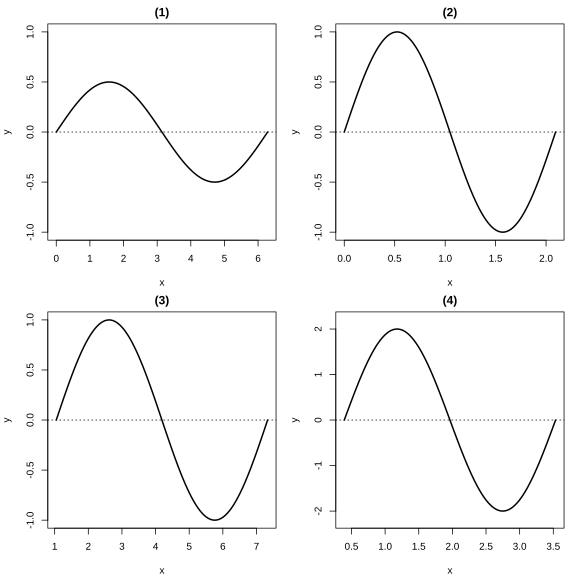
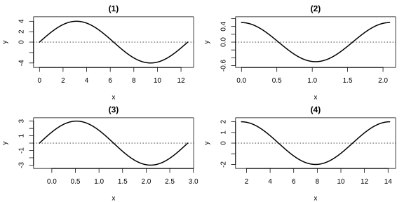
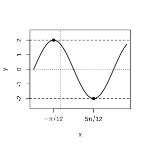

# 作业 23

> **定义 5.6.1** (振幅)  函数 $y=A\sin(\omega x+\varphi)$ ($A>0$, $\omega>0$) 中, $A$ 称为振幅, 即物体离开平衡位置的最大距离.

> **定义 5.6.2** (周期)  函数 $y=A\sin(\omega x+\varphi)$ 的周期 $T=\frac{2\pi}{\omega}$, 即往复运动一次所需的时间.

> **定义 5.6.3** (频率)  函数 $y=A\sin(\omega x+\varphi)$ 的频率 $f=\frac{1}{T}=\frac{\omega}{2\pi}$, 即单位时间内往复运动的次数.

> **定义 5.6.4** (相位与初相)  $\omega x+\varphi$ 称为相位; $x=0$ 时的相位 $\varphi$ 称为初相.

> **性质 5.6.1** (图象变换)  由 $y=\sin x$ 的图象得到 $y=A\sin(\omega x+\varphi)$ 的图象: (1) 向左 (右) 平移 $\lvert\varphi\rvert$ 个单位得 $y=\sin(x+\varphi)$; (2) 横坐标缩 (伸) 到原来的 $\frac{1}{\omega}$ 倍得 $y=\sin(\omega x+\varphi)$; (3) 纵坐标伸 (缩) 到原来的 $A$ 倍得 $y=A\sin(\omega x+\varphi)$.

### 练习一

(练习 5.6 第 1 题) 画出下列函数在长度为一个周期的闭区间上的简图:

(1) $y=\frac{1}{2}\sin x$;

(2) $y=\sin3x$;

(3) $y=\sin\left(x-\frac{\pi}{3}\right)$;

(4) $y=2\sin\left(2x-\frac{\pi}{4}\right)$.

{width=100%}

### 解答 练习一

由**性质 5.6.1** (图象变换).

(1) 将 $y=\sin x$ 图象上所有点的纵坐标缩短到原来的 $\frac{1}{2}$ (横坐标不变), 即得 $y=\frac{1}{2}\sin x$ 的图象. 周期 $2\pi$, 振幅 $\frac{1}{2}$.

(2) 将 $y=\sin x$ 图象上所有点的横坐标缩短到原来的 $\frac{1}{3}$ (纵坐标不变), 即得 $y=\sin3x$ 的图象. 周期 $\frac{2\pi}{3}$, 振幅 $1$.

(3) 将 $y=\sin x$ 图象上所有点向右平移 $\frac{\pi}{3}$ 个单位长度, 即得 $y=\sin\left(x-\frac{\pi}{3}\right)$ 的图象. 周期 $2\pi$, 初相 $-\frac{\pi}{3}$.

(4) 将 $y=\sin x$ 图象向右平移 $\frac{\pi}{8}$, 横坐标缩短到原来的 $\frac{1}{2}$, 纵坐标伸长到原来的 $2$ 倍, 即得 $y=2\sin\left(2x-\frac{\pi}{4}\right)$ 的图象. 周期 $\pi$, 振幅 $2$. $\blacksquare$

### 练习二

(练习 5.6 第 2 题) 已知函数 $y=3\sin\left(x+\frac{\pi}{5}\right)$ 的图象为 $C$.

(1) 为了得到函数 $y=3\sin\left(x-\frac{\pi}{5}\right)$ 的图象, 只要把 $C$ 上所有的点 ( ).

(A) 向右平行移动 $\frac{\pi}{5}$ 个单位长度

(B) 向左平行移动 $\frac{\pi}{5}$ 个单位长度

(C) 向右平行移动 $\frac{2\pi}{5}$ 个单位长度

(D) 向左平行移动 $\frac{2\pi}{5}$ 个单位长度

(2) 为了得到函数 $y=3\sin\left(2x+\frac{\pi}{5}\right)$ 的图象, 只要把 $C$ 上所有的点 ( ).

(A) 横坐标伸长到原来的 $2$ 倍, 纵坐标不变

(B) 横坐标缩短到原来的 $\frac{1}{2}$, 纵坐标不变

(C) 纵坐标伸长到原来的 $2$ 倍, 横坐标不变

(D) 纵坐标缩短到原来的 $\frac{1}{2}$, 横坐标不变

(3) 为了得到函数 $y=4\sin\left(x+\frac{\pi}{5}\right)$ 的图象, 只要把 $C$ 上所有的点 ( ).

(A) 横坐标伸长到原来的 $\frac{4}{3}$ 倍, 纵坐标不变

(B) 横坐标缩短到原来的 $\frac{3}{4}$, 纵坐标不变

(C) 纵坐标伸长到原来的 $\frac{4}{3}$ 倍, 横坐标不变

(D) 纵坐标缩短到原来的 $\frac{3}{4}$, 横坐标不变

### 解答 练习二

由**性质 5.6.1** (图象变换).

(1) 由 $x+\frac{\pi}{5}\to x-\frac{\pi}{5}$, 即 $x\to x-\frac{2\pi}{5}$, 需向右平移 $\frac{2\pi}{5}$ 个单位. 选 (C).

(2) 由 $x\to2x$, 横坐标缩短到原来的 $\frac{1}{2}$. 选 (B).

(3) 由 $3\to4$, 纵坐标伸长到原来的 $\frac{4}{3}$ 倍. 选 (C). $\blacksquare$

### 练习三

(练习 5.6 第 3 题) 函数 $y=\frac{2}{3}\sin\left(\frac{1}{2}x-\frac{\pi}{4}\right)$ 的图象与正弦曲线有什么关系?

### 解答 练习三

由**性质 5.6.1** (图象变换).

由 $y=\sin x$ 的图象向右平移 $\frac{\pi}{4}$, 横坐标伸长到原来的 $2$ 倍, 纵坐标缩短到原来的 $\frac{2}{3}$, 即得 $y=\frac{2}{3}\sin\left(\frac{1}{2}x-\frac{\pi}{4}\right)$ 的图象. $\blacksquare$

### 练习四

(练习 5.6 第 4 题) 函数 $y=\sin\left(x+\frac{\pi}{12}\right)$, $x\in[0,+\infty)$ 的图象与正弦曲线有什么关系?

### 解答 练习四

由**性质 5.6.1** (图象变换).

由 $y=\sin x$ ($x\in\mathbb R$) 的图象向左平移 $\frac{\pi}{12}$ 个单位长度, 再取 $x\geq0$ 的部分, 即得 $y=\sin\left(x+\frac{\pi}{12}\right)$, $x\in[0,+\infty)$ 的图象. $\blacksquare$

### 习题一

(习题 5.6 复习巩固第 1 题) 选择题.

(1) 为了得到函数 $y=\cos\left(x+\frac{1}{3}\right)$ 的图象, 只需把余弦曲线上所有的点 ( ).

(A) 向左平行移动 $\frac{\pi}{3}$ 个单位长度

(B) 向右平行移动 $\frac{\pi}{3}$ 个单位长度

(C) 向左平行移动 $\frac{1}{3}$ 个单位长度

(D) 向右平行移动 $\frac{1}{3}$ 个单位长度

(2) 为了得到函数 $y=\cos\frac{x}{5}$ 的图象, 只需把余弦曲线上所有的点 ( ).

(A) 横坐标伸长到原来的 $5$ 倍, 纵坐标不变

(B) 横坐标缩短到原来的 $\frac{1}{5}$, 纵坐标不变

(C) 纵坐标伸长到原来的 $5$ 倍, 横坐标不变

(D) 纵坐标缩短到原来的 $\frac{1}{5}$, 横坐标不变

(3) 为了得到函数 $y=\frac{1}{4}\cos x$ 的图象, 只需把余弦曲线上所有的点 ( ).

(A) 横坐标伸长到原来的 $4$ 倍, 纵坐标不变

(B) 横坐标缩短到原来的 $\frac{1}{4}$, 纵坐标不变

(C) 纵坐标伸长到原来的 $4$ 倍, 横坐标不变

(D) 纵坐标缩短到原来的 $\frac{1}{4}$, 横坐标不变

### 解答 习题一

由**性质 5.6.1** (图象变换).

(1) 由 $x\to x+\frac{1}{3}$, 向左平移 $\frac{1}{3}$ 个单位. 选 (C).

(2) 由 $x\to\frac{x}{5}$, 横坐标伸长到原来的 $5$ 倍. 选 (A).

(3) 由 $1\to\frac{1}{4}$, 纵坐标缩短到原来的 $\frac{1}{4}$. 选 (D). $\blacksquare$

### 习题二

(习题 5.6 复习巩固第 2 题) 画出下列函数在长度为一个周期的闭区间上的简图:

(1) $y=4\sin\frac{x}{2}$;

(2) $y=\frac{1}{2}\cos3x$;

(3) $y=3\sin\left(2x+\frac{\pi}{6}\right)$;

(4) $y=2\cos\left(\frac{1}{2}x-\frac{\pi}{4}\right)$.

{width=100%}

### 解答 习题二

由**性质 5.6.1** (图象变换).

(1) $y=4\sin\frac{x}{2}$: 由 $y=\sin x$ 横坐标伸长到原来的 $2$ 倍, 纵坐标伸长到原来的 $4$ 倍. 周期 $4\pi$, 振幅 $4$.

(2) $y=\frac{1}{2}\cos3x$: 由 $y=\cos x$ 横坐标缩短到原来的 $\frac{1}{3}$, 纵坐标缩短到原来的 $\frac{1}{2}$. 周期 $\frac{2\pi}{3}$, 振幅 $\frac{1}{2}$.

(3) $y=3\sin\left(2x+\frac{\pi}{6}\right)$: 由 $y=\sin x$ 向左平移 $\frac{\pi}{12}$, 横坐标缩短到原来的 $\frac{1}{2}$, 纵坐标伸长到原来的 $3$ 倍. 周期 $\pi$, 振幅 $3$.

(4) $y=2\cos\left(\frac{1}{2}x-\frac{\pi}{4}\right)$: 由 $y=\cos x$ 向右平移 $\frac{\pi}{2}$, 横坐标伸长到原来的 $2$ 倍, 纵坐标伸长到原来的 $2$ 倍. 周期 $4\pi$, 振幅 $2$. $\blacksquare$

### 习题三

(习题 5.6 复习巩固第 3 题) 说明下列函数的图象可由正弦曲线经过怎样的变换得到 (注意定义域):

(1) $y=8\sin\left(\frac{x}{4}-\frac{\pi}{8}\right)$, $x\in[0,+\infty)$;

(2) $y=\frac{1}{3}\sin\left(3x+\frac{\pi}{7}\right)$, $x\in[0,+\infty)$.

### 解答 习题三

由**性质 5.6.1** (图象变换).

(1) 由 $y=\sin x$ 向右平移 $\frac{\pi}{2}$, 横坐标伸长到原来的 $4$ 倍, 纵坐标伸长到原来的 $8$ 倍, 再取 $x\geq0$ 的部分.

(2) 由 $y=\sin x$ 向左平移 $\frac{\pi}{21}$, 横坐标缩短到原来的 $\frac{1}{3}$, 纵坐标缩短到原来的 $\frac{1}{3}$, 再取 $x\geq0$ 的部分. $\blacksquare$

### 习题四

(习题 5.6 综合运用第 4 题) 函数 $y=A\sin(\omega x+\varphi)$ ($A>0$, $\omega>0$, $0<\varphi<\pi$) 在一个周期内的图象如图所示, 此函数的解析式为 $y=$ $\;\_\_\;$ .

{width=50%}

### 解答 习题四

由**定义 5.6.1** 至**定义 5.6.4**.

由图象知振幅 $A=2$. 由图象过最高点和最低点的位置关系得周期 $T=\pi$, 故 $\omega=2$. 由图象过点 $(0,1)$ 且在上升沿, 得 $2\sin\varphi=1$, $\varphi=\frac{\pi}{6}$. 故 $y=2\sin\left(2x+\frac{\pi}{6}\right)$. $\blacksquare$

### 习题五

(习题 5.6 综合运用第 5 题) 将函数 $y=3\sin\left(2x+\frac{\pi}{4}\right)$ 的图象向左平移 $\frac{\pi}{3}$ 后得到函数 $y=g(x)$ 的图象, 求 $y=g(x)$ 的解析式.

### 解答 习题五

由**性质 5.6.1** (图象变换).

由向左平移 $\frac{\pi}{3}$, 得 $g(x)=3\sin\left[2\left(x+\frac{\pi}{3}\right)+\frac{\pi}{4}\right]=3\sin\left(2x+\frac{2\pi}{3}+\frac{\pi}{4}\right)=3\sin\left(2x+\frac{11\pi}{12}\right)$. $\blacksquare$

### 习题六

(习题 5.6 综合运用第 6 题) 某时钟的秒针端点 $A$ 到中心点 $O$ 的距离为 $5\text{ cm}$, 秒针绕点 $O$ 匀速旋转, 当时间 $t=0$ 时, 点 $A$ 与钟面上标 $12$ 的点 $B$ 重合. 将 $A$, $B$ 两点间的距离 $d$ (单位: $\text{cm}$) 表示成 $t$ (单位: $\text{s}$) 的函数, 则 $d=$ $\;\_\_\;$ , $t\in[0,60]$.

### 解答 习题六

由**定义 5.6.2** (周期) 及余弦定理.

由秒针 $60\text{ s}$ 转一圈, 角速度 $\omega=\frac{2\pi}{60}=\frac{\pi}{30}$. $t=0$ 时 $A$ 与 $B$ 重合, $t$ 秒后 $\angle AOB=\frac{\pi t}{30}$. 由余弦定理, $d^{2}=5^{2}+5^{2}-2\times5\times5\cos\frac{\pi t}{30}=50\left(1-\cos\frac{\pi t}{30}\right)=100\sin^{2}\frac{\pi t}{60}$. 故 $d=10\sin\frac{\pi t}{60}$. $\blacksquare$

### 习题七

(习题 5.6 综合运用第 7 题) 一个半径为 $3\text{ m}$ 的筒车按逆时针方向每分转 $1.5$ 圈, 筒车的轴心 $O$ 距离水面的高度为 $2.2\text{ m}$. 设筒车上的某个盛水筒 $P$ 到水面的距离为 $d$ (单位: $\text{m}$) (在水面下则 $d$ 为负数), 若以盛水筒 $P$ 刚浮出水面时开始计算时间, 则 $d$ 与时间 $t$ (单位: $\text{s}$) 之间的关系为 $d=A\sin(\omega t+\varphi)+K$ ($A>0$, $\omega>0$, $-\frac{\pi}{2}<\varphi<\frac{\pi}{2}$).

(1) 求 $A$, $\omega$, $\varphi$, $K$ 的值 ($\varphi$ 精确到 $0.0001$);

(2) 盛水筒出水后至少经过多长时间就可到达最高点 (精确到 $0.01\text{ s}$)?

### 解答 习题七

由**定义 5.6.1** 至**定义 5.6.4**.

(1) 由筒车半径 $3\text{ m}$, 得 $A=3$. 由轴心距水面 $2.2\text{ m}$, 得 $K=2.2$. 由每分转 $1.5$ 圈, 周期 $T=\frac{60}{1.5}=40\text{ s}$, 故 $\omega=\frac{2\pi}{40}=\frac{\pi}{20}$.

由 $t=0$ 时盛水筒刚浮出水面, 即 $d=0$, 得 $3\sin\varphi+2.2=0$, $\sin\varphi=-\frac{2.2}{3}\approx-0.7333$. 又 $-\frac{\pi}{2}<\varphi<\frac{\pi}{2}$, 故 $\varphi=\arcsin(-0.7333)\approx-0.8230$.

(2) 由最高点时 $\sin(\omega t+\varphi)=1$, 即 $\omega t+\varphi=\frac{\pi}{2}$, 得 $t=\frac{\frac{\pi}{2}-\varphi}{\omega}=\frac{\frac{\pi}{2}+0.8230}{\frac{\pi}{20}}\approx\frac{2.3938}{0.1571}\approx15.24\text{ s}$. $\blacksquare$
