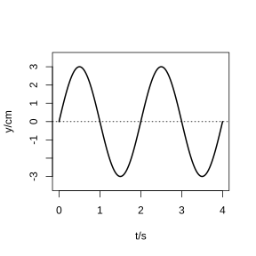
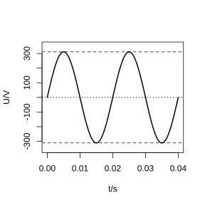
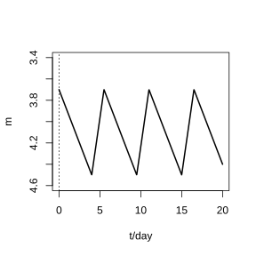
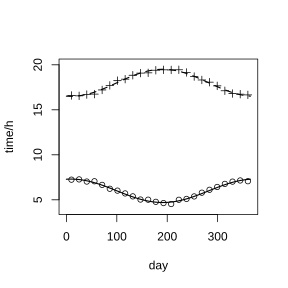

# 作业 24

> **定义 5.7.1** (简谐运动)  物体受到的力 (总是指向平衡位置) 正比于它离开平衡位置的距离的运动称为简谐运动. 在适当的直角坐标系下, 简谐运动可用 $y=A\sin(\omega x+\varphi)$, $x\in[0,+\infty)$ 表示, 其中 $A>0$, $\omega>0$.

> **定义 5.7.2** (振幅, 周期, 频率, 相位)  $A$ 是振幅, 即离开平衡位置的最大距离; 周期 $T=\frac{2\pi}{\omega}$; 频率 $f=\frac{1}{T}=\frac{\omega}{2\pi}$; $\omega x+\varphi$ 称为相位, $x=0$ 时的相位 $\varphi$ 称为初相.

> **性质 5.7.1** (三角函数模型应用步骤)  利用搜集到的数据画出散点图, 观察散点图后进行函数拟合获得具体的函数模型, 最后利用这个函数模型解决相应的实际问题.

### 练习一

(练习 5.7 第 1 题) 某简谐运动的图象如图所示, 试根据图象回答下列问题:

(1) 这个简谐运动的振幅, 周期与频率各是多少?

(2) 写出这个简谐运动的函数解析式.

{width=50%}

### 解答 练习一

由**定义 5.7.1** 及**定义 5.7.2**.

(1) 由图象知最大值为 $3\text{ cm}$, 最小值为 $-3\text{ cm}$, 故振幅 $A=3$. 由图象知周期 $T=3.2-1.2=2\text{ s}$, 频率 $f=\frac{1}{2}=0.5\text{ Hz}$.

(2) 由 $A=3$, $\omega=\frac{2\pi}{T}=\pi$, 且 $t=0$ 时 $y=0$ 且在上升沿, 得 $\varphi=0$. 故 $y=3\sin(\pi t)$, $t\in[0,+\infty)$. $\blacksquare$

### 练习二

(练习 5.7 第 2 题) 一根绝对刚性且长度不变, 质量可忽略不计的线, 一端固定, 另一端悬挂一个沙漏. 沙漏摆动时离开平衡位置的位移 $s$ (单位: $\text{cm}$) 与时间 $t$ (单位: $\text{s}$) 的函数关系是 $s=3\cos\left(\sqrt{\frac{g}{l}}\,t+\frac{\pi}{3}\right)$, $t\in[0,+\infty)$.

(1) 当 $l=25$ 时, 求该沙漏的最大偏角 (精确到 $0.0001\text{ rad}$);

(2) 已知 $g=9.8\text{ m/s}^{2}$, 要使沙漏摆动的周期是 $1\text{ s}$, 线的长度应当是多少 (精确到 $0.1\text{ cm}$)?

### 解答 练习二

由**定义 5.7.1** (简谐运动).

(1) 由 $s_{\max}=3\text{ cm}$, 线长 $l=25\text{ cm}$, 得最大偏角 $\theta$ 满足 $l\sin\theta=s_{\max}$, 即 $\sin\theta=\frac{3}{25}=0.12$. 故 $\theta=\arcsin0.12\approx0.1203\text{ rad}$.

(2) 由周期 $T=\frac{2\pi}{\sqrt{g/l}}=2\pi\sqrt{\frac{l}{g}}=1$, 得 $l=\frac{g}{4\pi^{2}}=\frac{980}{4\pi^{2}}\approx24.8\text{ cm}$. $\blacksquare$

### 练习三

(练习 5.7 第 3 题) 一台发电机产生的电流是正弦式电流, 电压和时间之间的关系如图所示. 由图象说出它的周期, 频率和电压的最大值, 并求出电压 $U$ (单位: $\text{V}$) 关于时间 $t$ (单位: $\text{s}$) 的函数解析式.

{width=50%}

### 解答 练习三

由**定义 5.7.2** (振幅, 周期, 频率, 相位).

由图象知电压最大值 $311\text{ V}$, 周期 $0.02\text{ s}$, 频率 $50\text{ Hz}$. 由 $\omega=\frac{2\pi}{0.02}=100\pi$, 初相 $\varphi=0$. 故 $U=311\sin(100\pi t)$, $t\in[0,+\infty)$. $\blacksquare$

### 习题一

(习题 5.7 综合运用第 1 题) 天上有些恒星的亮度是会变化的, 其中一种称为造父 (型) 变星. 下图是一造父变星的亮度随时间的周期变化图. 此变星的亮度变化的周期为多少天? 最亮时是几等星? 最暗时是几等星?

{width=50%}

### 解答 习题一

由**性质 5.7.1** (三角函数模型应用步骤).

由图象知亮度变化的周期约为 $5.5$ 天. 最亮时约为 $3.5$ 等星, 最暗时约为 $4.5$ 等星. $\blacksquare$

### 习题二

(习题 5.7 综合运用第 2 题) 弹簧挂着的小球做上下运动, 它在 $t\text{ s}$ 时相对于平衡位置的高度 $h$ (单位: $\text{cm}$) 由关系式 $h=2\sin\left(t+\frac{\pi}{4}\right)$ 确定.

(1) 小球在开始振动 (即 $t=0$) 时的位置在哪里?

(2) 小球的最高点和最低点与平衡位置的距离分别是多少?

(3) 经过多少时间小球往复运动一次?

(4) 每秒钟小球能往复振动多少次?

### 解答 习题二

由**定义 5.7.2** (振幅, 周期, 频率, 相位).

(1) 由 $t=0$, $h=2\sin\frac{\pi}{4}=\sqrt{2}\text{ cm}$, 即小球在平衡位置上方 $\sqrt{2}\text{ cm}$ 处.

(2) 由振幅 $A=2$, 最高点和最低点与平衡位置的距离均为 $2\text{ cm}$.

(3) 由 $\omega=1$, 周期 $T=2\pi\text{ s}$, 即经过 $2\pi\text{ s}$ 往复运动一次.

(4) 由频率 $f=\frac{1}{2\pi}\approx0.159$, 每秒钟往复振动 $\frac{1}{2\pi}$ 次. $\blacksquare$

### 习题三

(习题 5.7 拓广探索第 3 题) 北京天安门广场的国旗每天是在日出时随太阳升起, 在日落时降旗. 请根据年鉴或其他参考资料, 统计过去一年不同日期的日出和日落时间.

(1) 在同一直角坐标系中, 以日期为横轴, 画出散点图, 并用曲线去拟合这些数据, 同时找到函数模型;

(2) 某同学准备在五一长假时去看升旗, 他应当在几点前到达天安门广场?

{width=50%}

### 解答 习题三

由**性质 5.7.1** (三角函数模型应用步骤).

(1) 日出时间和日落时间随日期呈周期性变化, 可近似用 $y=A\sin(\omega t+\varphi)+b$ 拟合, 周期为一年 (约 $365$ 天).

(2) 五一 (5月1日) 北京日出时间约为 $5$ 时 $15$ 分左右, 故应在 $5$ 时前到达天安门广场. $\blacksquare$

### 习题四

(习题 5.7 拓广探索第 4 题) 夏天是用电的高峰时期, 每天的用电也出现周期性的变化. 请调查你们地区每天的用电情况, 制定一项 "削峰平谷" 的电价方案.

### 解答 习题四

由**性质 5.7.1** (三角函数模型应用步骤).

由调查用电曲线呈周期性变化, 晚高峰 ($18:00$-$22:00$) 电价上浮, 后半夜 ($0:00$-$6:00$) 电价下浮, 以引导用户在低峰时段用电. $\blacksquare$

### 阅读与思考一

(思考 1) 阅读 "振幅, 周期, 频率, 相位" 一文, 说明声音的数学模型.

### 解答 阅读与思考一

由**定义 5.7.2** (振幅, 周期, 频率, 相位).

纯音的数学模型是 $y=A\sin\omega t$. 响度与振幅 $A$ 有关, 音调与频率 $\frac{\omega}{2\pi}$ 有关. 复合音由基音和谐音组成, 声音的函数为 $y=\sin x+\frac{1}{2}\sin2x+\frac{1}{3}\sin3x+\frac{1}{4}\sin4x+\cdots$. 音色由基音和谐音的综合作用决定. $\blacksquare$
