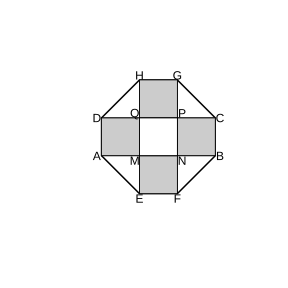

# 作业 27

> **基本事实 2.1.1** (实数大小关系)  如果 $a-b$ 是正数, 那么 $a>b$; 如果 $a-b$ 等于 $0$, 那么 $a=b$; 如果 $a-b$ 是负数, 那么 $a<b$. 反过来也对, 即 $a>b\Leftrightarrow a-b>0$.

> **常用结论 2.1.2** (重要不等式)  $\forall a,b\in\mathbb R$, 有 $a^2+b^2\ge 2ab$, 当且仅当 $a=b$ 时, 等号成立.

> **性质 2.1.3** (对称性)  $a>b\Leftrightarrow b<a$.

> **性质 2.1.4** (传递性)  $a>b$, $b>c\Rightarrow a>c$.

> **性质 2.1.5** (可加性)  $a>b\Rightarrow a+c>b+c$.

> **性质 2.1.6** (可乘性)  $a>b$, $c>0\Rightarrow ac>bc$; $a>b$, $c<0\Rightarrow ac<bc$.

> **性质 2.1.7** (同向可加)  $a>b$, $c>d\Rightarrow a+c>b+d$.

> **性质 2.1.8** (同向同正可乘)  $a>b>0$, $c>d>0\Rightarrow ac>bd$.

> **性质 2.1.9** (乘方)  $a>b>0\Rightarrow a^n>b^n$ ($n\in\mathbb N$, $n\ge2$).

> **定理 2.2.1** (基本不等式)  如果 $a>0$, $b>0$, 那么 $\sqrt{ab}\le\frac{a+b}{2}$, 当且仅当 $a=b$ 时, 等号成立.

> **常用结论 2.2.2** (积定和最小, 和定积最大)  $x,y>0$, 积 $xy=P$ 定时 $x+y\ge2\sqrt P$; 和 $x+y=S$ 定时 $xy\le\frac{1}{4}S^2$.

> **定义 2.3.1** (一元二次不等式)  只含一个未知数, 且未知数最高次数为 $2$ 的不等式, 一般形式为 $ax^2+bx+c>0$ 或 $<0$, $a\neq0$.

> **定义 2.3.2** (二次函数的零点)  使 $ax^2+bx+c=0$ 的实数 $x$.

> **常用结论 2.3.3** (一元二次不等式的解集)  $a>0$ 时, $\Delta>0$: $>0$ 解集 $\left\{x\mid x<x_1$ 或 $x>x_2\right\}$, $<0$ 解集 $\left\{x\mid x_1<x<x_2\right\}$; $\Delta=0$: $>0$ 解集 $\left\{x\mid x\neq-\frac{b}{2a}\right\}$, $<0$ 解集 $\varnothing$; $\Delta<0$: $>0$ 解集 $\mathbb R$, $<0$ 解集 $\varnothing$.

### 习题一

(复习参考题2 复习巩固第 1 题) 某夏令营有 $48$ 人, 出发前要从 $A$, $B$ 两种型号的帐篷中选择一种. $A$ 型号的帐篷比 $B$ 型号的少 $5$ 顶. 若只选 $A$ 型号的, 每顶帐篷住 $4$ 人, 则帐篷不够; 每顶帐篷住 $5$ 人, 则有一顶帐篷没有住满. 若只选 $B$ 型号的, 每顶帐篷住 $3$ 人, 则帐篷不够; 每顶帐篷住 $4$ 人, 则有帐篷多余. 设 $A$ 型号的帐篷有 $x$ 顶, 用不等式将题目中的不等关系表示出来.

### 解答 习题一

由**基本事实 2.1.1** (实数大小关系), $B$ 型号帐篷为 $x+5$ 顶, 逐句把限制写成不等式.

只选 $A$ 型号: 每顶住 $4$ 人不够, 即 $4x<48$; 每顶住 $5$ 人有一顶没住满, 即 $5x>48$ 且其余帐篷都住满, $5\left(x-1\right)<48$.

只选 $B$ 型号: 每顶住 $3$ 人不够, 即 $3\left(x+5\right)<48$; 每顶住 $4$ 人有多余, 即 $4\left(x+5\right)>48$.

故所求不等式组为

$$
\left\{\begin{array}{l}4x<48,\\5x>48,\\5\left(x-1\right)<48,\\3\left(x+5\right)<48,\\4\left(x+5\right)>48.\end{array}\right.
$$

$\blacksquare$

### 习题二

(复习参考题2 复习巩固第 2 题) 用不等号 "$>$" 或 "$<$" 填空.

(1) 若 $a>b$, 且 $\frac{1}{a}>\frac{1}{b}$, 则 $ab\;\_\_\;0$;

(2) 若 $c>a>b>0$, 则 $\frac{a}{c-a}\;\_\_\;\frac{b}{c-b}$;

(3) 若 $a>b>c>0$, 则 $\frac{a}{b}\;\_\_\;\frac{a+c}{b+c}$.

### 解答 习题二

由**基本事实 2.1.1** (实数大小关系), 作差比较.

(1) $\frac{1}{a}-\frac{1}{b}=\frac{b-a}{ab}>0$. 由 $a>b$ 得 $b-a<0$, 故须 $ab<0$ 才能使商为正. 故填 $<$.

(2) 作差: $\frac{a}{c-a}-\frac{b}{c-b}=\frac{a\left(c-b\right)-b\left(c-a\right)}{\left(c-a\right)\left(c-b\right)}=\frac{c\left(a-b\right)}{\left(c-a\right)\left(c-b\right)}$. 由 $c>a>b>0$ 知分子 $c\left(a-b\right)>0$, 分母 $\left(c-a\right)\left(c-b\right)>0$, 故差为正, 填 $>$.

(3) 作差: $\frac{a}{b}-\frac{a+c}{b+c}=\frac{a\left(b+c\right)-b\left(a+c\right)}{b\left(b+c\right)}=\frac{c\left(a-b\right)}{b\left(b+c\right)}>0$, 故填 $>$. $\blacksquare$

### 习题三

(复习参考题2 复习巩固第 3 题)

(1) 在面积为定值 $S$ 的扇形中, 半径是多少时扇形的周长最小?

(2) 在周长为定值 $P$ 的扇形中, 半径是多少时扇形的面积最大?

### 解答 习题三

由**常用结论 2.2.2** (积定和最小, 和定积最大), 设扇形半径为 $R$, 弧长为 $l$. 扇形面积为 $\frac{1}{2}Rl$, 周长为 $2R+l$.

(1) 面积 $S=\frac{1}{2}Rl$ 为定值, 即 $Rl=2S$. 周长 $2R+l\ge2\sqrt{2Rl}=2\sqrt{4S}=4\sqrt S$, 当且仅当 $2R=l$ 时等号成立. 此时 $Rl=2R^2=2S$, 得 $R=\sqrt S$. 故半径为 $\sqrt S$ 时周长最小.

(2) 周长 $P=2R+l$ 为定值. 令 $u=2R$, 则 $u+l=P$, 面积 $\frac{1}{2}Rl=\frac{1}{4}ul\le\frac{1}{4}\cdot\left(\frac{u+l}{2}\right)^2=\frac{P^2}{16}$, 当且仅当 $u=l$ 时等号成立. 此时 $2R=l=\frac{P}{2}$, 得 $R=\frac{P}{4}$. 故半径为 $\frac{P}{4}$ 时面积最大, 最大值为 $\frac{P^2}{16}$. $\blacksquare$

### 习题四

(复习参考题2 复习巩固第 4 题) 求下列不等式的解集.

(1) $14-4x^2\ge x$;

(2) $x^2-14x+45\le0$;

(3) $x^2+6x+10>0$;

(4) $x\left(x+2\right)>x\left(3-x\right)+1$.

### 解答 习题四

由**常用结论 2.3.3** (一元二次不等式的解集), 逐题求解.

(1) 整理得 $4x^2+x-14\le0$. 方程 $4x^2+x-14=0$ 的根为 $x=-2,\frac{7}{4}$, 故解集为 $\left\{x\mid-2\le x\le\frac{7}{4}\right\}$.

(2) $\left(x-5\right)\left(x-9\right)\le0$, 根为 $x=5,9$, 故解集为 $\left\{x\mid5\le x\le9\right\}$.

(3) $\Delta=36-40=-4<0$, 开口向上, 故解集为 $\mathbb R$.

(4) 展开整理得 $2x^2-x-1>0$, 即 $\left(2x+1\right)\left(x-1\right)>0$, 根为 $x=-\frac{1}{2},1$, 故解集为 $\left\{x\mid x<-\frac{1}{2}$ 或 $x>1\right\}$. $\blacksquare$

### 习题五

(复习参考题2 综合运用第 5 题) 若 $a,b>0$, 且 $ab=a+b+3$, 求 $ab$ 的取值范围.

### 解答 习题五

由**定理 2.2.1** (基本不等式), $a+b\ge2\sqrt{ab}$.

由 $ab=a+b+3$, 得 $ab\ge2\sqrt{ab}+3$. 令 $t=\sqrt{ab}>0$, 则

$$
t^2\ge2t+3,
$$

即 $\left(t-3\right)\left(t+1\right)\ge0$. 因 $t>0$, 故 $t\ge3$, 从而 $ab=t^2\ge9$. 当且仅当 $a=b=3$ 时取等号. 故 $ab$ 的取值范围为 $\left\{x\mid x\ge9\right\}$. $\blacksquare$

### 习题六

(复习参考题2 综合运用第 6 题) 当 $k$ 取什么值时, 一元二次不等式 $2kx^2+kx-\frac{3}{8}<0$ 对一切实数 $x$ 都成立?

### 解答 习题六

由**常用结论 2.3.3** (一元二次不等式的解集), $ax^2+bx+c<0$ 对一切实数成立, 须开口向下 ($a<0$) 且无实根 ($\Delta<0$).

首先 $2k<0$, 即 $k<0$.

再要求 $\Delta=k^2-4\cdot2k\cdot\left(-\frac{3}{8}\right)=k^2+3k<0$, 即 $k\left(k+3\right)<0$, 解得 $-3<k<0$.

与 $k<0$ 取交集, 得 $-3<k<0$. 故当 $-3<k<0$ 时, 该不等式对一切实数 $x$ 都成立. $\blacksquare$

### 习题七

(复习参考题2 综合运用第 7 题) 一般认为, 民用住宅的窗户面积必须小于地板面积, 但窗户面积与地板面积的比应不小于 $10\%$, 而且这个比值越大, 采光效果越好.

(1) 若一所公寓窗户面积与地板面积的总和为 $220\ \mathrm m^2$, 则这所公寓的窗户面积至少为多少平方米?

(2) 若同时增加相同的窗户面积和地板面积, 公寓的采光效果是变好了还是变坏了?

### 解答 习题七

设窗户面积为 $w$, 地板面积为 $f$, 则 $w<f$ 且 $\frac{w}{f}\ge0.1$.

(1) 由 $w+f=220$, 即 $f=220-w$. 由 $\frac{w}{f}\ge0.1$, 得 $w\ge0.1\left(220-w\right)$, 即 $1.1w\ge22$, 故 $w\ge20$. 故窗户面积至少为 $20\ \mathrm m^2$.

(2) 设窗户与地板同时增加面积 $m>0$. 由**基本事实 2.1.1** (实数大小关系), 比较新比值与原比值:

$$
\frac{w+m}{f+m}-\frac{w}{f}=\frac{f\left(w+m\right)-w\left(f+m\right)}{f\left(f+m\right)}=\frac{m\left(f-w\right)}{f\left(f+m\right)}.
$$

由 $f>w$ 知分子为正, 故差为正, 即新比值变大. 故同时增加相同面积后, 采光效果变好. $\blacksquare$

### 习题八

(复习参考题2 综合运用第 8 题) 相等关系和不等关系之间具有对应关系: 即只要将一个相等关系的命题中的等号改为不等号就可得到一个相应的不等关系的命题. 请你用类比的方法探索相等关系和不等关系的对应性质, 仿照下表列出尽可能多的有关对应关系的命题; 指出所列的对应不等关系的命题是否正确, 并说明理由.

### 解答 习题八

由**性质 2.1.5** (可加性), **性质 2.1.6** (可乘性) 与**基本事实 2.1.1** (实数大小关系), 类比列出并判断.

(1) 若 $x=y$, 则 $x+z=y+z$; 对应 若 $x>y$, 则 $x+z>y+z$. 正确, 即**性质 2.1.5** (可加性).

(2) 若 $x=y$, 则 $xz=yz$; 对应 若 $x>y$, 则 $xz>yz$. 错误, 当 $z<0$ 时不等号反向.

(3) 若 $x=y$, 则 $x^3=y^3$; 对应 若 $x>y$, 则 $x^3>y^3$. 正确, 因 $x^3-y^3=\left(x-y\right)\left(x^2+xy+y^2\right)>0$.

(4) 若 $x=y$, 则 $x^2=y^2$; 对应 若 $x>y$, 则 $x^2>y^2$. 错误, 如 $1>-2$ 但 $1<4$, 须两数同号才成立.

(5) 若 $x=y$, $z\neq0$, 则 $\frac{x}{z}=\frac{y}{z}$; 对应 若 $x>y$, 则 $\frac{x}{z}>\frac{y}{z}$. 当 $z>0$ 时正确, 当 $z<0$ 时错误.

可见, 与加法类比的命题多正确; 与乘除类比时, 乘除数为负会使不等号反向, 须附加条件. $\blacksquare$

### 习题九

(复习参考题2 拓广探索第 9 题) 如图, 居民小区要建一座八边形的休闲场所, 它的主体造型平面图是由两个相同的矩形 $ABCD$ 和 $EFGH$ 构成的面积为 $200\ \mathrm m^2$ 的十字形地域. 计划在正方形 $MNPQ$ 上建一座花坛, 造价为 $4200$ 元$/ \mathrm m^2$; 在四个相同的矩形 (图中阴影部分) 上铺花岗岩地坪, 造价为 $210$ 元$/ \mathrm m^2$; 再在四个空角 (图中四个三角形) 上铺草坪, 造价为 $80$ 元$/ \mathrm m^2$. 设总造价为 $S$ (单位: 元), $AD$ 长为 $x$ (单位: $\mathrm m$). 当 $x$ 为何值时, $S$ 最小? 并求出这个最小值.

{width=50%}

### 解答 习题九

由**常用结论 2.2.2** (积定和最小, 和定积最大), 设十字形由两个全等矩形叠成, 中央正方形 $MNPQ$ 边长为 $x$, 每个矩形长为 $x+2t$, 其中 $t$ 为伸出部分的一半. 十字面积 $2x\left(x+2t\right)-x^2=x^2+4xt=200$.

花坛面积为 $x^2$; 四个阴影矩形面积共 $4\cdot xt$; 四个空角三角形面积共 $4\cdot\frac{1}{2}t^2=2t^2$. 总造价

$$
S=4200x^2+210\cdot4xt+80\cdot2t^2=4200x^2+840xt+160t^2.
$$

由 $x^2+4xt=200$ 得 $xt=\frac{200-x^2}{4}$. 代入得

$$
S=4200x^2+840\cdot\frac{200-x^2}{4}+160t^2=4000x^2+38000+\frac{400000}{x^2}.
$$

由**定理 2.2.1** (基本不等式), 

$$
4000x^2+\frac{400000}{x^2}\ge2\sqrt{4000x^2\cdot\frac{400000}{x^2}}=80000,
$$

当且仅当 $4000x^2=\frac{400000}{x^2}$, 即 $x^2=10$, $x=\sqrt{10}$ 时, 等号成立. 此时 $S=80000+38000=118000$ 元. 故当 $x=\sqrt{10}\ \mathrm m$ 时总造价最小, 最小值为 $118000$ 元. $\blacksquare$

### 习题十

(复习参考题2 拓广探索第 10 题) 购买同一种物品, 可以用两种不同的策略, 第一种是不考虑物品价格的升降, 每次购买这种物品的数量一定; 第二种是不考虑物品价格的升降, 每次购买这种物品所花的钱数一定. 哪种购物方式比较经济? 你能把所得结论作一些推广吗?

### 解答 习题十

由**定理 2.2.1** (基本不等式), 设两次价格为 $p_1,p_2>0$, 比较两种策略的平均价格.

第一种策略每次买固定数量 $q$: 两次共花 $q\left(p_1+p_2\right)$, 共买 $2q$, 平均价格为 $\frac{p_1+p_2}{2}$ (算术平均数).

第二种策略每次花固定钱数 $m$: 两次共买 $\frac{m}{p_1}+\frac{m}{p_2}$, 共花 $2m$, 平均价格为

$$
\frac{2m}{\frac{m}{p_1}+\frac{m}{p_2}}=\frac{2p_1p_2}{p_1+p_2}
$$

(调和平均数).

由**定理 2.2.1** (基本不等式), $\frac{2p_1p_2}{p_1+p_2}\le\frac{p_1+p_2}{2}$, 当且仅当 $p_1=p_2$ 时取等号. 故第二种策略 (每次花固定钱数) 的平均价格较低, 比较经济.

推广: 价格有升降时, 每次投入固定金额的策略优于每次购买固定数量的策略, 其平均价格恒不高于后者. $\blacksquare$
