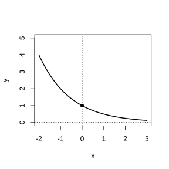
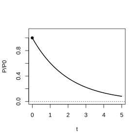

# 作业 29

> **定义 4.1.1** (n 次方根)  一般地, 如果 $x^n=a$ ($n>1$, $n\in\mathbb N^*$), 那么 $x$ 叫做 $a$ 的 $n$ 次方根.

> **定义 4.1.2** (分数指数幂)  规定 $a^{\frac{m}{n}}=\sqrt[n]{a^m}$ ($a>0$, $m,n\in\mathbb N^*$, $n>1$), $a^{-\frac{m}{n}}=\frac{1}{a^{\frac{m}{n}}}$ ($a>0$, $m,n\in\mathbb N^*$, $n>1$).

> **常用结论 4.1.3** (n 次方根的性质)  当 $n$ 为奇数时, $\sqrt[n]{a^n}=a$; 当 $n$ 为偶数时, $\sqrt[n]{a^n}=\left|a\right|$.

> **常用结论 4.1.4** (分数指数幂的运算性质)  $a^r a^s=a^{r+s}$, $(a^r)^s=a^{rs}$, $(ab)^r=a^r b^r$ ($a>0$, $b>0$, $r,s\in\mathbb Q$).

> **定义 4.1.5** (无理数指数幂)  当 $a>0$, $\alpha$ 为无理数时, $a^\alpha$ 是一个确定的实数.

> **常用结论 4.1.6** (实数指数幂的运算性质)  $a^r a^s=a^{r+s}$, $(a^r)^s=a^{rs}$, $(ab)^r=a^r b^r$ ($a>0$, $b>0$, $r,s\in\mathbb R$).

> **定义 4.2.1** (指数函数)  一般地, 函数 $y=a^x$ ($a>0$, 且 $a\neq 1$) 叫做指数函数.

> **常用结论 4.2.2** (指数函数的图象和性质)  定义域为 $\mathbb R$, 值域为 $(0,+\infty)$, 过定点 $(0,1)$; 当 $a>1$ 时为增函数, 当 $0<a<1$ 时为减函数.

> **常用结论 4.2.3** (指数增长与指数衰减模型)  $y=a(1+r)^x$ ($a>0$, $r>0$) 为指数增长模型, $y=a(1-r)^x$ ($a>0$, $0<r<1$) 为指数衰减模型.

> **定义 4.3.1** (对数)  一般地, 如果 $a^x=N$ ($a>0$, 且 $a\neq 1$), 那么数 $x$ 叫做以 $a$ 为底 $N$ 的对数, 记作 $x=\log_a N$.

> **定义 4.3.2** (常用对数与自然对数)  以 $10$ 为底的对数叫做常用对数, 记作 $\lg N$; 以 $\mathrm e$ 为底的对数叫做自然对数, 记作 $\ln N$.

> **常用结论 4.3.3** (对数与指数的关系)  $a^{\log_a N}=N$, $\log_a a^x=x$ ($a>0$, $a\neq 1$, $N>0$).

> **常用结论 4.3.4** (对数运算性质)  $\log_a(MN)=\log_a M+\log_a N$, $\log_a\frac{M}{N}=\log_a M-\log_a N$, $\log_a M^n=n\log_a M$ ($a>0$, $a\neq 1$, $M>0$, $N>0$).

> **常用结论 4.3.5** (对数换底公式)  $\log_a b=\frac{\log_c b}{\log_c a}$ ($a>0$, $a\neq 1$, $c>0$, $c\neq 1$, $b>0$).

> **定义 4.4.1** (对数函数)  一般地, 函数 $y=\log_a x$ ($a>0$, 且 $a\neq 1$) 叫做对数函数, 定义域是 $(0,+\infty)$.

> **定义 4.4.2** (反函数)  指数函数 $y=a^x$ ($a>0$, 且 $a\neq 1$) 与对数函数 $y=\log_a x$ ($a>0$, 且 $a\neq 1$) 互为反函数, 它们的定义域与值域正好互换.

> **常用结论 4.4.3** (对数函数的图象和性质)  定义域为 $(0,+\infty)$, 值域为 $\mathbb R$, 过定点 $(1,0)$; 当 $a>1$ 时为增函数, 当 $0<a<1$ 时为减函数. 底数互为倒数的两个对数函数的图象关于 $x$ 轴对称.

> **常用结论 4.4.4** (不同函数增长的差异)  指数函数 $y=a^x$ ($a>1$) 的增长速度最终会大大超过一次函数 $y=kx$ ($k>0$); 对数函数 $y=\log_a x$ ($a>1$) 的增长速度会越来越慢, 最终会慢于一次函数 $y=kx$ ($k>0$).

> **定义 4.5.1** (函数的零点)  对于一般函数 $y=f(x)$, 我们把使 $f(x)=0$ 的实数 $x$ 叫做函数 $y=f(x)$ 的零点.

> **常用结论 4.5.2** (函数零点存在定理)  如果函数 $y=f(x)$ 在区间 $[a,b]$ 上的图象是一条连续不断的曲线, 且有 $f(a)f(b)<0$, 那么, 函数 $y=f(x)$ 在区间 $(a,b)$ 内至少有一个零点.

> **定义 4.5.3** (二分法)  对于在区间 $[a,b]$ 上图象连续不断且 $f(a)f(b)<0$ 的函数 $y=f(x)$, 通过不断地把它的零点所在区间一分为二, 使所得区间的两个端点逐步逼近零点, 进而得到零点近似值的方法叫做二分法.

### 习题一

(复习参考题4 复习巩固第 1 题) 选择题.

(1) 函数 $y=-2^{-x}$ 与 $y=2^x$ 的图象 ( ).

(A) 关于 $x$ 轴对称 (B) 关于 $y$ 轴对称 (C) 关于原点对称 (D) 关于直线 $y=x$ 对称

(2) 图 (1) 中, ①②③④中不属于函数 $y=2^x$, $y=6^x$, $y=\left(\frac{1}{2}\right)^x$ 的一个是 ( ).

(A) ① (B) ② (C) ③ (D) ④

(3) 图 (2) 中, ①②③④中不属于函数 $y=\log_{\frac{1}{2}} x$, $y=\log_{\frac{1}{3}} x$, $y=\log_2 x$ 的一个是 ( ).

(A) ① (B) ② (C) ③ (D) ④

### 解答 习题一

由**常用结论 4.2.2** (指数函数的图象和性质) 与**常用结论 4.4.3** (对数函数的图象和性质).

(1) 若点 $(x,y)$ 在 $y=-2^{-x}$ 上, 则 $y=-2^{-x}$, 即 $-y=2^{-x}$, 故点 $(-x,-y)$ 在 $y=2^x$ 上. 因此两图象关于原点对称. 选 (C).

(2) $y=2^x$ 和 $y=6^x$ 为递增曲线, $y=\left(\frac{1}{2}\right)^x$ 为递减曲线. 图中 ①②递减, ③④递增. 递增曲线中, $x>1$ 时底数越小图象越靠上, 故 ③ 为 $y=2^x$, ④ 为 $y=6^x$. 递减曲线中, ① 为 $y=\left(\frac{1}{2}\right)^x$, ② 不属于上述三个函数. 选 (B).

(3) $y=\log_2 x$ 为递增曲线, $y=\log_{\frac{1}{2}} x$ 和 $y=\log_{\frac{1}{3}} x$ 为递减曲线. 图中 ①②递减, ③④递增. 递增曲线中, $x>1$ 时底数越小图象越靠上, 故 ③ 为 $y=\log_2 x$, ④ 不属于上述三个函数. 选 (D). $\blacksquare$

### 习题二

(复习参考题4 复习巩固第 2 题) 用 "<" ">" "=" 填空.

(1) $\mathrm e^{0.8}$ ___ $0.8^{\mathrm e}$;

(2) $2^{a+1}$ ___ $3^a$ ($a>2$);

(3) $a^{0.2}$ ___ $a^{0.3}$ ($0<a<1$);

(4) $\lg\mathrm e$ ___ $\ln 0.8$;

(5) $\log_2 3$ ___ $\log_3 2$;

(6) $\log_a 0.2$ ___ $\log_a 0.3$ ($a>1$).

### 解答 习题二

由**常用结论 4.2.2** (指数函数的图象和性质) 与**常用结论 4.4.3** (对数函数的图象和性质).

(1) $\mathrm e^{0.8}\approx 2.23$, $0.8^{\mathrm e}\approx 0.48$, 故 $\mathrm e^{0.8}>0.8^{\mathrm e}$.

(2) 取 $a=3$, $2^{4}=16<27=3^3$, 故 $2^{a+1}<3^a$.

(3) $0<a<1$ 时 $y=a^x$ 递减, $0.2<0.3$, 故 $a^{0.2}>a^{0.3}$.

(4) $\lg\mathrm e\approx 0.434>0$, $\ln 0.8<0$, 故 $\lg\mathrm e>\ln 0.8$.

(5) $\log_2 3>1$, $\log_3 2<1$, 故 $\log_2 3>\log_3 2$.

(6) $a>1$ 时 $y=\log_a x$ 递增, $0.2<0.3$, 故 $\log_a 0.2<\log_a 0.3$. $\blacksquare$

### 习题三

(复习参考题4 复习巩固第 3 题) 借助信息技术, 用二分法求:

(1) 方程 $2x^3-4x^2-3x+1=0$ 的最大的根 (精确度为 $0.01$);

(2) 函数 $f(x)=\lg x$ 和 $g(x)=\frac{1}{x}$ 交点的横坐标 (精确度为 $0.1$).

### 解答 习题三

由**定义 4.5.3** (二分法).

(1) 令 $h(x)=2x^3-4x^2-3x+1$. $h(2)=16-16-6+1=-5<0$, $h(3)=54-36-9+1=10>0$. 在 $(2,3)$ 内二分, 逐步逼近, 最大根约为 $2.60$.

(2) 令 $h(x)=x\lg x-1$. $h(2)=2\lg 2-1\approx -0.398<0$, $h(3)=3\lg 3-1\approx 0.431>0$. 在 $(2,3)$ 内二分, 交点横坐标约为 $2.5$. $\blacksquare$

### 习题四

(复习参考题4 复习巩固第 4 题) 已知函数 $f(x)=\begin{cases}x^2+2x-3, & x\le 0,\\ -2+\ln x, & x>0,\end{cases}$ 求使方程 $f(x)=k$ 的实数解个数分别为 $1$, $2$, $3$ 时 $k$ 的相应取值范围.

### 解答 习题四

由**定义 4.5.1** (函数的零点) 与**常用结论 4.4.3** (对数函数的图象和性质).

$x\le 0$ 时, $y=(x+1)^2-4$, 最小值为 $-4$ (在 $x=-1$), $x=0$ 时 $y=-3$. $x>0$ 时, $y=-2+\ln x$ 为增函数, 对任意 $k$ 有且仅有一解 $x=\mathrm e^{k+2}$.

当 $k<-4$ 时, $x\le 0$ 部分无解, 共 $1$ 解; 当 $k=-4$ 时, $x\le 0$ 部分有 $1$ 解 $x=-1$, 共 $2$ 解; 当 $-4<k\le -3$ 时, $x\le 0$ 部分有 $2$ 解, 共 $3$ 解; 当 $k>-3$ 时, $x\le 0$ 部分有 $1$ 解, 共 $2$ 解.

故 $1$ 解时 $k<-4$; $2$ 解时 $k=-4$ 或 $k>-3$; $3$ 解时 $-4<k\le -3$. $\blacksquare$

### 习题五

(复习参考题4 综合运用第 5 题) 选择题.

(1) 已知集合 $A=\{y\,|\,y=\log_2 x,\,x>1\}$, $B=\{y\,|\,y=\frac{1}{2^x},\,x>1\}$, 则 $A\cap B=$ ( ).

(A) $\{y\,|\,0<y<\frac{1}{2}\}$ (B) $\{y\,|\,0<y<1\}$ (C) $\{y\,|\,\frac{1}{2}<y<1\}$ (D) $\varnothing$

(2) 已知 $f(x)=\left|\lg x\right|$, 若 $a=f\left(\frac{1}{4}\right)$, $b=f\left(\frac{1}{3}\right)$, $c=f(2)$, 则 ( ).

(A) $a<b<c$ (B) $b<c<a$ (C) $c<a<b$ (D) $c<b<a$

(3) 已知函数 $f(x)=2^x+x$, $g(x)=\log_2 x+x$, $h(x)=x^3+x$ 的零点分别为 $a$, $b$, $c$, 则 $a$, $b$, $c$ 的大小顺序为 ( ).

(A) $a>b>c$ (B) $b>c>a$ (C) $c>a>b$ (D) $b>a>c$

### 解答 习题五

由**常用结论 4.2.2** (指数函数的图象和性质) 与**常用结论 4.4.3** (对数函数的图象和性质).

(1) $x>1$ 时 $\log_2 x>0$, 故 $A=\{y\,|\,y>0\}$; $x>1$ 时 $0<\frac{1}{2^x}<\frac{1}{2}$, 故 $B=\{y\,|\,0<y<\frac{1}{2}\}$. $A\cap B=\{y\,|\,0<y<\frac{1}{2}\}$. 选 (A).

(2) $a=\left|\lg\frac{1}{4}\right|=\lg 4$, $b=\left|\lg\frac{1}{3}\right|=\lg 3$, $c=\left|\lg 2\right|=\lg 2$. 因 $\lg 2<\lg 3<\lg 4$, 故 $c<b<a$. 选 (D).

(3) $f(x)=2^x+x=0$ 即 $2^x=-x$, 有解 $a<0$; $g(x)=\log_2 x+x=0$ 即 $\log_2 x=-x$, 有解 $0<b<1$; $h(x)=x^3+x=x(x^2+1)=0$ 有解 $c=0$. 故 $b>c>a$. 选 (B). $\blacksquare$

### 习题六

(复习参考题4 综合运用第 6 题) 设 $f(x)=\frac{\mathrm e^x-\mathrm e^{-x}}{2}$, $g(x)=\frac{\mathrm e^x+\mathrm e^{-x}}{2}$, 求证:

(1) $[g(x)]^2-[f(x)]^2=1$;

(2) $f(2x)=2f(x)g(x)$;

(3) $g(2x)=[g(x)]^2+[f(x)]^2$.

### 解答 习题六

由**常用结论 4.1.6** (实数指数幂的运算性质).

(1) $[g(x)]^2-[f(x)]^2=\frac{(\mathrm e^x+\mathrm e^{-x})^2-(\mathrm e^x-\mathrm e^{-x})^2}{4}=\frac{4\mathrm e^x\mathrm e^{-x}}{4}=1$.

(2) $2f(x)g(x)=2\cdot\frac{\mathrm e^x-\mathrm e^{-x}}{2}\cdot\frac{\mathrm e^x+\mathrm e^{-x}}{2}=\frac{\mathrm e^{2x}-\mathrm e^{-2x}}{2}=f(2x)$.

(3) $[g(x)]^2+[f(x)]^2=\frac{(\mathrm e^x+\mathrm e^{-x})^2+(\mathrm e^x-\mathrm e^{-x})^2}{4}=\frac{2(\mathrm e^{2x}+\mathrm e^{-2x})}{4}=\frac{\mathrm e^{2x}+\mathrm e^{-2x}}{2}=g(2x)$. $\blacksquare$

### 习题七

(复习参考题4 综合运用第 7 题) 指数函数 $y=\left(\frac{b}{a}\right)^x$ 的图象如图所示 (递减曲线), 求二次函数 $y=ax^2+bx$ 图象顶点的横坐标的取值范围.

{width=50%}

### 解答 习题七

由**常用结论 4.2.2** (指数函数的图象和性质).

$y=\left(\frac{b}{a}\right)^x$ 递减, 故 $0<\frac{b}{a}<1$. 二次函数 $y=ax^2+bx$ 顶点的横坐标为 $x=-\frac{b}{2a}$. 由 $0<\frac{b}{a}<1$ 得 $0<\frac{b}{2a}<\frac{1}{2}$, 故 $-\frac{1}{2}<-\frac{b}{2a}<0$. 即顶点横坐标的取值范围为 $\left(-\frac{1}{2},0\right)$. $\blacksquare$

### 习题八

(复习参考题4 综合运用第 8 题) 1986 年切尔诺贝利核电站爆炸, 主要核污染物锶 90 每年的衰减率为 $2.47\%$. 要完全消除这次核事故对自然环境的影响至少需要 $800$ 年, 到那时原有的锶 90 还剩百分之几?

### 解答 习题八

由**常用结论 4.2.3** (指数增长与指数衰减模型).

每年衰减率为 $2.47\%$, 即每年剩余 $97.53\%$. $800$ 年后剩余比例为 $0.9753^{800}=\mathrm e^{800\ln 0.9753}\approx\mathrm e^{800\times(-0.0250)}\approx\mathrm e^{-20}\approx 2\times 10^{-7}\%$. 即到那时原有的锶 90 约剩 $2\times 10^{-7}\%$. $\blacksquare$

### 习题九

(复习参考题4 综合运用第 9 题) 某工厂废气中污染物含量 $P$ (单位: $\mathrm{mg/L}$) 与时间 $t$ (单位: $\mathrm h$) 的关系为 $P=P_0\mathrm e^{-kt}$, 其中 $P_0$, $k$ 为正常数. 前 $5\;\mathrm h$ 消除了 $10\%$ 的污染物.

(1) $10\;\mathrm h$ 后还剩百分之几的污染物?

(2) 污染物减少 $50\%$ 需要花多少时间 (精确到 $1\;\mathrm h$)?

(3) 画出 $P$ 关于 $t$ 变化的函数图象.

{width=50%}

### 解答 习题九

由**常用结论 4.2.3** (指数增长与指数衰减模型) 与**常用结论 4.3.3** (对数与指数的关系).

(1) $P(5)=P_0\mathrm e^{-5k}=0.9P_0$, 即 $\mathrm e^{-5k}=0.9$. $P(10)=P_0\mathrm e^{-10k}=P_0(\mathrm e^{-5k})^2=0.81P_0$. 故 $10\;\mathrm h$ 后还剩 $81\%$ 的污染物.

(2) 令 $P_0\mathrm e^{-kt}=0.5P_0$, 即 $\mathrm e^{-kt}=0.5$, $t=-\frac{\ln 0.5}{k}$. 由 $\mathrm e^{-5k}=0.9$ 得 $k=-\frac{\ln 0.9}{5}\approx 0.021$. 故 $t=\frac{\ln 2}{0.021}\approx 33\;\mathrm h$.

(3) $P=P_0\mathrm e^{-kt}$ 为递减的指数衰减曲线, 从 $P_0$ 逐渐趋近于 $0$. $\blacksquare$

### 习题十

(复习参考题4 综合运用第 10 题) 物体冷却公式为 $\theta=\theta_0+(\theta_1-\theta_0)\mathrm e^{-kt}$. 现有 $62{}^\circ\mathrm C$ 的物体放在 $15{}^\circ\mathrm C$ 的空气中冷却, $1\;\mathrm{min}$ 后物体温度为 $52{}^\circ\mathrm C$.

(1) 求 $k$ 的值 (精确到 $0.01$);

(2) 若要将物体温度降为 $42{}^\circ\mathrm C$, $32{}^\circ\mathrm C$, 求分别需要冷却的时间 (精确到 $0.1\;\mathrm{min}$).

### 解答 习题十

由**常用结论 4.3.3** (对数与指数的关系).

(1) 代入 $\theta=52$, $\theta_0=15$, $\theta_1=62$, $t=1$: $52=15+47\mathrm e^{-k}$, $\mathrm e^{-k}=\frac{37}{47}$, $k=-\ln\frac{37}{47}\approx 0.24$.

(2) 令 $\theta=42$: $42=15+47\mathrm e^{-0.24t}$, $\mathrm e^{-0.24t}=\frac{27}{47}$, $t=\frac{-\ln(27/47)}{0.24}\approx 2.3\;\mathrm{min}$. 令 $\theta=32$: $32=15+47\mathrm e^{-0.24t}$, $\mathrm e^{-0.24t}=\frac{17}{47}$, $t=\frac{-\ln(17/47)}{0.24}\approx 4.5\;\mathrm{min}$. $\blacksquare$

### 习题十一

(复习参考题4 拓广探索第 11 题) 已知函数 $f(x)=\log_a(x+1)$, $g(x)=\log_a(1-x)$ ($a>0$, 且 $a\neq 1$).

(1) 求函数 $f(x)+g(x)$ 的定义域;

(2) 判断函数 $f(x)+g(x)$ 的奇偶性, 并说明理由.

### 解答 习题十一

由**定义 4.4.1** (对数函数).

(1) 要求 $x+1>0$ 且 $1-x>0$, 即 $-1<x<1$. 故定义域为 $(-1,1)$.

(2) $F(x)=f(x)+g(x)=\log_a(x+1)+\log_a(1-x)=\log_a(1-x^2)$. $F(-x)=\log_a(1-(-x)^2)=\log_a(1-x^2)=F(x)$. 故 $F(x)$ 为偶函数. $\blacksquare$

### 习题十二

(复习参考题4 拓广探索第 12 题) 对于函数 $f(x)=a-\frac{2}{2^x+1}$ ($a\in\mathbb R$).

(1) 探索函数 $f(x)$ 的单调性;

(2) 是否存在实数 $a$ 使函数 $f(x)$ 为奇函数?

### 解答 习题十二

由**常用结论 4.2.2** (指数函数的图象和性质).

(1) $2^x$ 为增函数, 故 $\frac{2}{2^x+1}$ 为减函数, $-\frac{2}{2^x+1}$ 为增函数, 因此 $f(x)=a-\frac{2}{2^x+1}$ 为增函数.

(2) 若 $f(x)$ 为奇函数, 则 $f(0)=0$, 即 $a-\frac{2}{2}=0$, $a=1$. 验证: $f(x)=1-\frac{2}{2^x+1}=\frac{2^x-1}{2^x+1}$. $f(-x)=\frac{2^{-x}-1}{2^{-x}+1}=\frac{1-2^x}{1+2^x}=-f(x)$. 故存在 $a=1$ 使 $f(x)$ 为奇函数. $\blacksquare$

### 习题十三

(复习参考题4 拓广探索第 13 题) 函数 $y=f(x)$ 的图象由曲线段 $OA$ 和直线段 $AB$ 构成, 其中 $O(0,0)$, $A(2,3)$, $B(5,0)$.

(1) 写出函数 $y=f(x)$ 的一个解析式;

(2) 提出一个能满足函数 $y=f(x)$ 图象变化规律的实际问题.

### 解答 习题十三

由**常用结论 4.4.4** (不同函数增长的差异).

(1) 曲线段 $OA$ 可设为二次函数 $y=\frac{3}{4}x^2$ ($0\le x\le 2$); 直线段 $AB$ 过 $(2,3)$ 和 $(5,0)$, 斜率为 $-1$, 方程为 $y=-x+5$ ($2<x\le 5$). 故 $f(x)=\begin{cases}\frac{3}{4}x^2, & 0\le x\le 2,\\ -x+5, & 2<x\le 5.\end{cases}$

(2) 实际问题: 如某物体先做加速运动到达最高点, 再做匀速减速运动回到初始位置. $\blacksquare$
