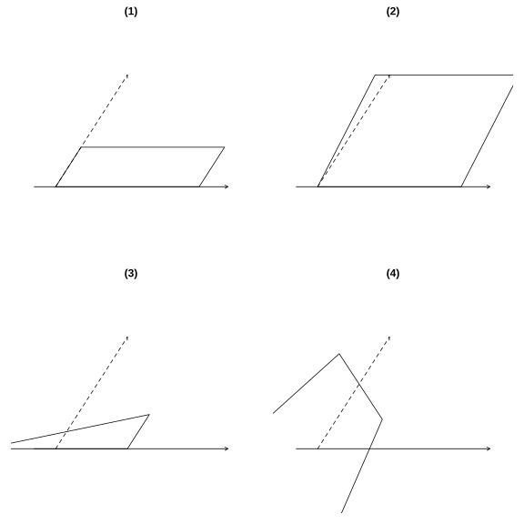
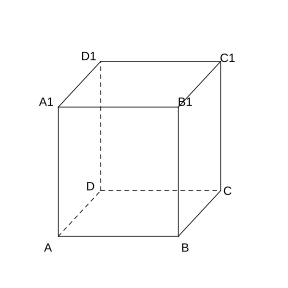
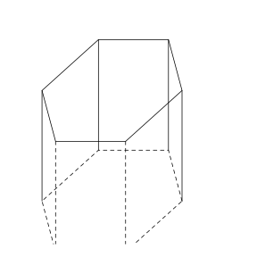
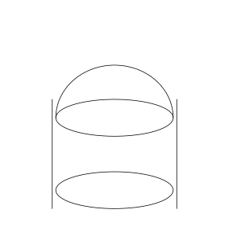
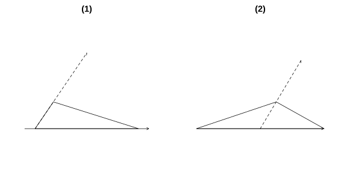
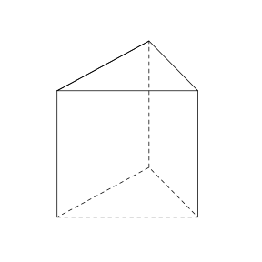
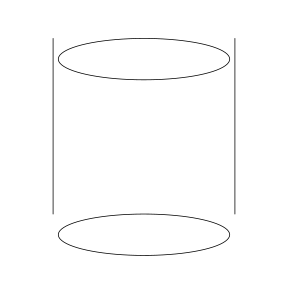
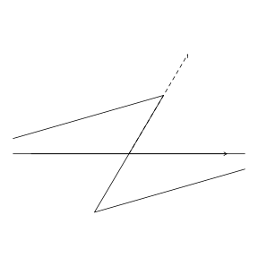
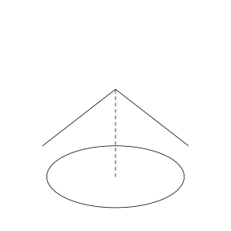
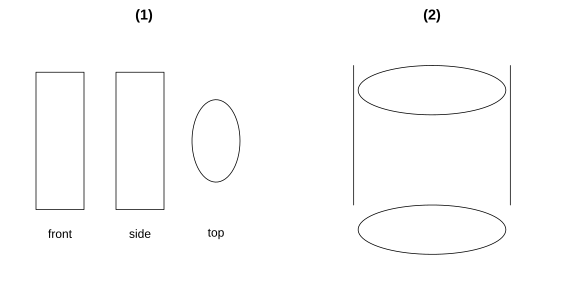

# 作业 39

> **定义 8.2.1** (直观图)  直观图是观察者站在某一点观察一个空间几何体获得的图形. 在立体几何中, 立体图形的直观图通常是在平行投影下得到的平面图形.

> **定义 8.2.2** (斜二测画法)  利用斜二测画法画水平放置的平面图形的直观图, 其步骤是: (1) 在已知图形中取互相垂直的 $x$ 轴和 $y$ 轴, 两轴相交于点 $O$. 画直观图时, 把它们画成对应的 $x'$ 轴与 $y'$ 轴, 两轴相交于点 $O'$, 且使 $\angle x'O'y'=45^{\circ}$ (或 $135^{\circ}$), 它们确定的平面表示水平面. (2) 已知图形中平行于 $x$ 轴或 $y$ 轴的线段, 在直观图中分别画成平行于 $x'$ 轴或 $y'$ 轴的线段. (3) 已知图形中平行于 $x$ 轴的线段, 在直观图中保持原长度不变, 平行于 $y$ 轴的线段, 在直观图中长度为原来的一半.

> **常用结论 8.2.3** (画几何体直观图的 $z$ 轴)  画几何体的直观图时, 与画平面图形的直观图相比, 只是多画一个与 $x$ 轴, $y$ 轴都垂直的 $z$ 轴, 并且使平行于 $z$ 轴的线段的平行性和长度都不变.

### 练习一

(练习 8.2 第 1 题) 用斜二测画法画水平放置的平面图形的直观图时, 下列结论是否正确? 正确的在括号内画 "$\sqrt{ }$", 错误的画 "$\times$".

(1) 相等的线段在直观图中仍然相等.

(2) 平行的线段在直观图中仍然平行.

(3) 一个角的直观图仍是一个角.

(4) 相等的角在直观图中仍然相等.

### 解答 练习一

由**定义 8.2.2** (斜二测画法), 平行于 $x$ 轴的线段长度不变, 平行于 $y$ 轴的线段长度减半, 且 $\angle x'O'y'=45^{\circ}$.

(1) 错误. 原图形中两条长度相等的线段, 若一条平行于 $x$ 轴, 另一条平行于 $y$ 轴, 则在直观图中前者长度不变, 后者长度减半, 不再相等.

(2) 正确. 由斜二测画法步骤 (2), 平行于 $x$ 轴或 $y$ 轴的线段在直观图中仍分别平行于 $x'$ 轴或 $y'$ 轴, 故平行的线段在直观图中仍然平行.

(3) 正确. 一个角的两边在直观图中仍为两条射线, 其公共端点仍为端点, 故仍是一个角.

(4) 错误. 直角在直观图中变为 $45^{\circ}$ 或 $135^{\circ}$, 原来相等的两个角若朝向不同, 在直观图中不再相等. $\blacksquare$

### 练习二

(练习 8.2 第 2 题) 用斜二测画法画出下列水平放置的平面图形的直观图 (尺寸自定).

(1) 矩形; (2) 平行四边形; (3) 正三角形; (4) 正五边形.

{width=100%}

### 解答 练习二

由**定义 8.2.2** (斜二测画法), 按取轴, 画对应轴, 取平行线段三步画图.

(1) 矩形: 取矩形相邻两边为 $x$ 轴和 $y$ 轴, 画 $x'$ 轴与 $y'$ 轴使夹角为 $45^{\circ}$; 在 $x'$ 轴上取与原边等长的线段, 在 $y'$ 轴上取长度减半的线段; 过两端点分别作 $y'$ 轴和 $x'$ 轴的平行线, 相交成一个平行四边形, 即为矩形的直观图.

(2) 平行四边形: 取其一边为 $x$ 轴, 过一个顶点作 $y$ 轴; 同样画夹角 $45^{\circ}$ 的 $x'$, $y'$ 轴, 平行于 $x$ 轴的边长度不变, 平行于 $y$ 轴方向的边长度减半, 连线得直观图.

(3) 正三角形: 取一边所在直线为 $x$ 轴, 取该边上的高所在直线为 $y$ 轴; 画 $x'$, $y'$ 轴夹角 $45^{\circ}$, 在 $x'$ 轴上取底边等长线段, 在 $y'$ 轴上取高长的一半, 连接顶点与底边两端点, 得直观图.

(4) 正五边形: 取一条对称轴为 $y$ 轴, 过中心作垂直的 $x$ 轴; 画 $x'$, $y'$ 轴夹角 $45^{\circ}$, 各顶点按平行于 $x$ 轴方向长度不变, 平行于 $y$ 轴方向长度减半的规则取点, 依次连接, 得直观图. $\blacksquare$

### 练习三

(练习 8.2 第 1 题) 用斜二测画法画一个棱长为 $3\text{ cm}$ 的正方体的直观图.

{width=50%}

### 解答 练习三

由**定义 8.2.2** (斜二测画法) 及**常用结论 8.2.3** (画几何体直观图的 $z$ 轴), 取过一个顶点的三条棱分别为 $x$, $y$, $z$ 轴.

画法: (1) 画轴. 画 $x$ 轴, $y$ 轴, $z$ 轴, 三轴相交于点 $O$, 使 $\angle xOy=45^{\circ}$, $\angle xOz=90^{\circ}$.

(2) 画底面. 在 $x$ 轴正半轴上取 $AB=3\text{ cm}$, 在 $y$ 轴正半轴上取 $AD=1.5\text{ cm}$; 过 $B$ 作 $y$ 轴平行线, 过 $D$ 作 $x$ 轴平行线, 交点为 $C$, 得底面 $ABCD$ 的直观图.

(3) 画侧棱. 在 $z$ 轴正半轴上取 $AA'=3\text{ cm}$, 过 $B$, $C$, $D$ 分别作 $z$ 轴平行线, 在其上截取 $BB'=CC'=DD'=3\text{ cm}$.

(4) 成图. 顺次连接 $A'$, $B'$, $C'$, $D'$, 去掉辅助线, 将被遮挡部分改为虚线, 即得正方体的直观图. $\blacksquare$

### 练习四

(练习 8.2 第 2 题) 用斜二测画法画一个正六棱柱的直观图.

{width=50%}

### 解答 练习四

由**定义 8.2.2** (斜二测画法) 及**常用结论 8.2.3** (画几何体直观图的 $z$ 轴), 先画底面正六边形的直观图, 再画侧棱.

画法: (1) 用斜二测画法画水平放置的正六边形底面的直观图.

(2) 过底面各顶点作 $z$ 轴的平行线, 在各平行线上截取相等的侧棱长, 得上底面各对应顶点.

(3) 顺次连接上底面各顶点, 去掉辅助线, 将被遮挡的侧棱改为虚线, 即得正六棱柱的直观图. $\blacksquare$

### 练习五

(练习 8.2 第 3 题) 一个简单组合体由上下两部分组成, 下部是一个圆柱, 上部是一个半球, 并且半球的球心就是圆柱的上底面圆心. 画出这个组合体的直观图.

{width=50%}

### 解答 练习五

由**定义 8.2.1** (直观图), 先分析组合体结构, 再分别画出各简单几何体的直观图.

画法: (1) 画轴. 画 $x$ 轴, $z$ 轴, 使 $\angle xOz=90^{\circ}$.

(2) 画圆柱的下底面. 以轴上一点为中心, 用椭圆模板画椭圆作为下底面.

(3) 沿轴向上移一段距离得圆柱上底面中心, 同样画椭圆作为上底面, 作两椭圆的两条平行切线, 得圆柱直观图.

(4) 以上底面圆心为球心, 在上底面上方画半个椭圆 (半球的轮廓), 即得圆柱上接半球的组合体直观图. $\blacksquare$

### 习题一

(习题 8.2 复习巩固第 1 题) 用斜二测画法画水平放置的平面图形的直观图时, 下列结论是否正确? 正确的在括号内画 "$\sqrt{ }$", 错误的画 "$\times$".

(1) 三角形的直观图是三角形.

(2) 平行四边形的直观图是平行四边形.

(3) 正方形的直观图是正方形.

(4) 菱形的直观图是菱形.

### 解答 习题一

由**定义 8.2.2** (斜二测画法), 平行关系保持, 但平行于 $y$ 轴的线段长度减半, 夹角变为 $45^{\circ}$.

(1) 正确. 三角形的三条边在直观图中仍为三条线段, 三个顶点仍为三个顶点, 故仍是三角形.

(2) 正确. 平行四边形的两组对边分别平行, 由斜二测画法, 平行关系保持, 故直观图仍是平行四边形.

(3) 错误. 正方形的直角在直观图中变为 $45^{\circ}$ 或 $135^{\circ}$, 且邻边长度不再相等, 故直观图是平行四边形而不是正方形.

(4) 错误. 菱形的邻边若一条平行于 $x$ 轴, 一条平行于 $y$ 轴, 则直观图中邻边长度不再相等, 故不是菱形. $\blacksquare$

### 习题二

(习题 8.2 复习巩固第 2 题) 用斜二测画法画出下列水平放置的等腰直角三角形的直观图:

(1) 直角边横向;

(2) 斜边横向.

{width=100%}

### 解答 习题二

由**定义 8.2.2** (斜二测画法), 平行于 $x$ 轴的线段长度不变, 平行于 $y$ 轴的线段长度减半.

(1) 直角边横向: 取横向直角边为 $x$ 轴, 另一垂直直角边为 $y$ 轴. 画 $x'$, $y'$ 轴夹角 $45^{\circ}$; 在 $x'$ 轴上取横向直角边等长线段, 在 $y'$ 轴上取垂直直角边长的一半, 连接两线段的外端, 得等腰直角三角形的直观图.

(2) 斜边横向: 取斜边所在直线为 $x$ 轴, 取斜边上的高所在直线为 $y$ 轴. 画 $x'$, $y'$ 轴夹角 $45^{\circ}$; 在 $x'$ 轴上取斜边等长线段, 在 $y'$ 轴上取高长的一半, 连接顶点与斜边两端点, 得直观图. $\blacksquare$

### 习题三

(习题 8.2 复习巩固第 3 题) 用斜二测画法画出底面边长为 $2\text{ cm}$, 侧棱长为 $3\text{ cm}$ 的正三棱柱的直观图.

{width=50%}

### 解答 习题三

由**定义 8.2.2** (斜二测画法) 及**常用结论 8.2.3** (画几何体直观图的 $z$ 轴).

画法: (1) 画轴. 画 $x$ 轴, $y$ 轴, $z$ 轴, 使 $\angle xOy=45^{\circ}$, $\angle xOz=90^{\circ}$.

(2) 画下底面. 用斜二测画法画边长为 $2\text{ cm}$ 的正三角形的水平放置直观图: 取一边为 $x$ 轴, 该边上高为 $y$ 轴, $x'$ 轴上边长不变, $y'$ 轴上高长减半.

(3) 画侧棱. 过下底面各顶点作 $z$ 轴平行线, 截取侧棱长 $3\text{ cm}$, 得上底面各对应顶点.

(4) 成图. 顺次连接上底面各顶点, 整理去掉辅助线, 被遮挡部分画虚线, 得正三棱柱直观图. $\blacksquare$

### 习题四

(习题 8.2 复习巩固第 4 题) 画底面半径为 $1\text{ cm}$, 母线长为 $3\text{ cm}$ 的圆柱的直观图.

{width=50%}

### 解答 习题四

由**定义 8.2.2** (斜二测画法) 及**常用结论 8.2.3** (画几何体直观图的 $z$ 轴), 水平放置的圆的直观图画为椭圆.

画法: (1) 画轴. 画 $x$ 轴, $z$ 轴, 使 $\angle xOz=90^{\circ}$.

(2) 画下底面. 以 $O$ 为中点, 在 $x$ 轴上取 $OA=OB=1\text{ cm}$, 用椭圆模板画过 $A$, $B$ 的椭圆, 即为下底面.

(3) 画上底面. 在 $Oz$ 上取 $OO'=3\text{ cm}$, 过 $O'$ 作平行于 $Ox$ 的轴, 同样画出上底面椭圆.

(4) 成图. 作两椭圆的两条平行切线, 整理得圆柱的直观图. $\blacksquare$

### 习题五

(习题 8.2 综合运用第 5 题) 一个菱形的边长为 $4\text{ cm}$, 一内角为 $60^{\circ}$, 将菱形水平放置并且使较长的对角线成横向, 试用斜二测画法画出这个菱形的直观图.

{width=50%}

### 解答 习题五

由**定义 8.2.2** (斜二测画法), 较长对角线横向即平行于 $x$ 轴, 较短对角线平行于 $y$ 轴.

菱形边长为 $4\text{ cm}$, 一内角为 $60^{\circ}$, 则较短对角线长为 $4\text{ cm}$, 较长对角线长为 $4\sqrt{3}\text{ cm}$.

取较长对角线为 $x$ 轴, 较短对角线为 $y$ 轴, 交点为 $O$. 画 $x'$, $y'$ 轴夹角 $45^{\circ}$; 在 $x'$ 轴上取较长对角线等长 $4\sqrt{3}\text{ cm}$, 在 $y'$ 轴上取较短对角线的一半即 $1\text{ cm}$; 依次连接四个顶点, 即得菱形的直观图. $\blacksquare$

### 习题六

(习题 8.2 综合运用第 6 题) 已知一个圆锥由等腰直角三角形旋转形成, 画出这个圆锥的直观图.

{width=50%}

### 解答 习题六

由**定义 8.2.1** (直观图) 及**定义 8.1.12** (圆锥), 圆锥由等腰直角三角形绕直角边旋转而成, 故圆锥的高与底面半径相等.

画法: (1) 画轴. 画 $x$ 轴, $z$ 轴, 使 $\angle xOz=90^{\circ}$.

(2) 画底面. 以 $O$ 为中心, 用椭圆模板画水平放置的底面椭圆, 设底面半径为 $r$.

(3) 定顶点. 在 $z$ 轴上取高 $OS=r$ (因等腰直角三角形旋转, 高等于底面半径), 得顶点 $S$.

(4) 成图. 从 $S$ 向椭圆作两条切线作为母线, 整理得圆锥直观图. $\blacksquare$

### 习题七

(习题 8.2 综合运用第 7 题) 一个几何体的三视图如图所示, 画出这个几何体的直观图.

{width=100%}

### 解答 习题七

由**定义 8.2.1** (直观图), 先由三视图判断几何体的结构, 再画直观图.

由正视图, 侧视图均为矩形而俯视图为圆, 可知该几何体是一个圆柱.

按圆柱直观图的画法: 画 $x$, $z$ 轴, 画上下两个椭圆底面, 作两条平行母线, 即得该圆柱的直观图. $\blacksquare$

### 习题八

(习题 8.2 拓广探索第 8 题) 画出你所在学校的一些建筑物的直观图 (尺寸自定).

### 解答 习题八

由**定义 8.2.2** (斜二测画法) 及**常用结论 8.2.3** (画几何体直观图的 $z$ 轴), 建筑物多为棱柱, 棱台等组合体.

先观察建筑物, 将其抽象为棱柱, 棱台等简单几何体或其组合; 取适当的轴, 用斜二测画法画水平放置的底面, 再沿 $z$ 轴方向画出竖直方向的棱, 长度保持不变; 被遮挡部分画虚线. 尺寸可自定, 只要能表达出建筑物的结构特征即可. $\blacksquare$
