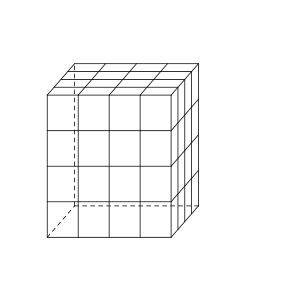
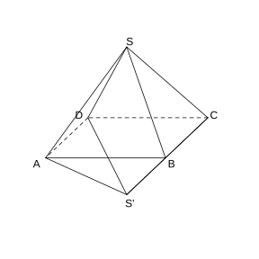
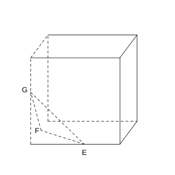
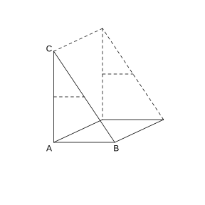
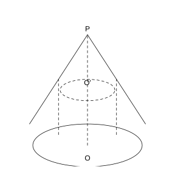
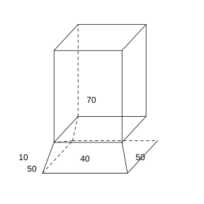
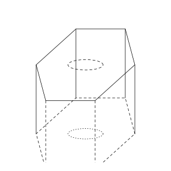
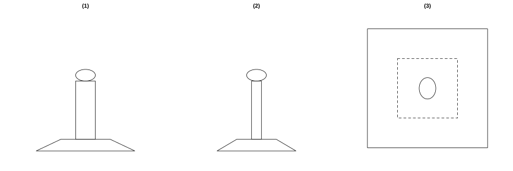

# 作业 40

> **定义 8.3.1** (多面体的表面积)  多面体的表面积是围成它的各个面的面积之和. 棱台的表面积等于它的侧面积 (各个侧面面积之和) 与两个底面面积之和.

> **定义 8.3.2** (柱体体积)  柱体的底面面积为 $S$, 高为 $h$, 则 $V_{\text{柱体}}=Sh$.

> **定义 8.3.3** (锥体体积)  锥体的底面面积为 $S$, 高为 $h$, 则 $V_{\text{锥体}}=\frac{1}{3}Sh$.

> **定义 8.3.4** (台体体积)  台体的上, 下底面面积为 $S'$, $S$, 高为 $h$, 则 $V_{\text{台体}}=\frac{1}{3}h\left(S'+\sqrt{S'S}+S\right)$.

> **定义 8.3.5** (圆柱表面积)  圆柱底面半径为 $r$, 母线长为 $l$, 则 $S_{\text{圆柱}}=2\pi r\left(r+l\right)$.

> **定义 8.3.6** (圆锥表面积)  圆锥底面半径为 $r$, 母线长为 $l$, 则 $S_{\text{圆锥}}=\pi r\left(r+l\right)$.

> **定义 8.3.7** (圆台表面积)  圆台上, 下底面半径为 $r'$, $r$, 母线长为 $l$, 则 $S_{\text{圆台}}=\pi\left(r'^{2}+r^{2}+r'l+rl\right)$.

> **定义 8.3.8** (圆柱体积)  $V_{\text{圆柱}}=\pi r^{2}h$.

> **定义 8.3.9** (圆锥体积)  $V_{\text{圆锥}}=\frac{1}{3}\pi r^{2}h$.

> **定义 8.3.10** (圆台体积)  $V_{\text{圆台}}=\frac{1}{3}\pi h\left(r'^{2}+r'r+r^{2}\right)$.

> **定义 8.3.11** (球的表面积)  球的半径为 $R$, 则 $S_{\text{球}}=4\pi R^{2}$.

> **定义 8.3.12** (球的体积)  球的半径为 $R$, 则 $V_{\text{球}}=\frac{4}{3}\pi R^{3}$.

### 练习一

(练习 8.3 第 1 题) 正六棱台的上, 下底面边长分别是 $2\text{ cm}$ 和 $6\text{ cm}$, 侧棱长是 $5\text{ cm}$, 求它的表面积.

### 解答 练习一

由**定义 8.3.1** (多面体的表面积), 表面积等于两个底面面积与侧面积之和.

正六边形面积公式为 $\frac{3\sqrt{3}}{2}a^{2}$. 上底面边长 $a'=2$, 上底面积 $S'=\frac{3\sqrt{3}}{2}\cdot 2^{2}=6\sqrt{3}$. 下底面边长 $a=6$, 下底面积 $S=\frac{3\sqrt{3}}{2}\cdot 6^{2}=54\sqrt{3}$.

侧面是 $6$ 个全等的等腰梯形, 上底 $2$, 下底 $6$, 腰 (侧棱) $5$. 梯形的高为

$$
h_{\text{梯}}=\sqrt{5^{2}-\left(\frac{6-2}{2}\right)^{2}}=\sqrt{25-4}=\sqrt{21}.
$$

每个梯形面积为 $\frac{2+6}{2}\cdot\sqrt{21}=4\sqrt{21}$, 侧面积为 $6\times 4\sqrt{21}=24\sqrt{21}$.

故表面积为 $6\sqrt{3}+54\sqrt{3}+24\sqrt{21}=60\sqrt{3}+24\sqrt{21}\ \left(\text{cm}^{2}\right)$. $\blacksquare$

### 练习二

(练习 8.3 第 2 题) 如图是一个表面被涂上红色的棱长是 $4\text{ cm}$ 的立方体, 将其适当分割成棱长为 $1\text{ cm}$ 的小立方体.

(1) 共得到多少个棱长是 $1\text{ cm}$ 的小立方体?

(2) 三面是红色的小立方体有多少个? 它们的表面积之和是多少?

(3) 两面是红色的小立方体有多少个? 它们的表面积之和是多少?

(4) 一面是红色的小立方体有多少个? 它们的表面积之和是多少?

(5) 六个面均没有颜色的小立方体有多少个? 它们的表面积之和是多少? 它们占有多少立方厘米的空间?

{width=50%}

### 解答 练习二

由**定义 8.3.2** (柱体体积), 立方体被分成 $4\times 4\times 4$ 个小立方体.

(1) 小立方体总数为 $4^{3}=64$ 个.

(2) 三面红色的小立方体位于大立方体的顶点处, 共 $8$ 个. 每个小立方体表面积为 $6\text{ cm}^{2}$, 表面积之和为 $8\times 6=48\text{ cm}^{2}$.

(3) 两面红色的小立方体位于棱上但不在顶点处. 每条棱上有 $4-2=2$ 个, 共 $12$ 条棱, 故有 $12\times 2=24$ 个. 表面积之和为 $24\times 6=144\text{ cm}^{2}$.

(4) 一面红色的小立方体位于面上但不在棱上. 每个面上有 $\left(4-2\right)^{2}=4$ 个, 共 $6$ 个面, 故有 $6\times 4=24$ 个. 表面积之和为 $24\times 6=144\text{ cm}^{2}$.

(5) 无色的小立方体位于大立方体内部, 有 $\left(4-2\right)^{3}=8$ 个. 表面积之和为 $8\times 6=48\text{ cm}^{2}$. 所占空间为 $8\times 1^{3}=8\text{ cm}^{3}$. $\blacksquare$

### 练习三

(练习 8.3 第 3 题) 某广场设置了一些石凳供大家休息, 这些石凳是由正方体截去八个一样的四面体得到的. 如果被截正方体的棱长是 $50\text{ cm}$, 那么石凳的体积是多少?

### 解答 练习三

由**定义 8.3.2** (柱体体积) 及**定义 8.3.3** (锥体体积), 石凳体积等于正方体体积减去八个被截去的四面体体积.

正方体棱长为 $50\text{ cm}$, 体积为 $50^{3}=125000\text{ cm}^{3}$.

截去八个一样的四面体, 每个四面体的三条棱两两垂直且长均为 $25\text{ cm}$ (即过各顶点三条棱的中点的平面截取). 每个四面体的体积为

$$
V_{4}=\frac{1}{3}\times\frac{1}{2}\times 25\times 25\times 25=\frac{25^{3}}{6}=\frac{15625}{6}\ \left(\text{cm}^{3}\right).
$$

八个四面体共截去 $8\times\frac{15625}{6}=\frac{62500}{3}\text{ cm}^{3}$.

故石凳体积为 $125000-\frac{62500}{3}=\frac{312500}{3}\approx 104167\text{ cm}^{3}$. $\blacksquare$

### 练习四

(练习 8.3 第 4 题) 求证: 直三棱柱的任意两个侧面的面积和大于第三个侧面的面积.

### 解答 练习四

由**定义 8.3.2** (柱体体积) 及直三棱柱侧面为矩形的性质, 三个侧面的面积分别等于底面三角形三边与侧棱长的乘积.

设直三棱柱底面三角形的三边长分别为 $a$, $b$, $c$, 侧棱长为 $l$. 三个侧面面积分别为 $al$, $bl$, $cl$.

由三角形两边之和大于第三边, $a+b>c$. 两边同乘正数 $l$, 得 $al+bl>cl$, 即任意两个侧面面积之和大于第三个侧面面积. 同理可证其余两组. 故直三棱柱任意两个侧面的面积和大于第三个侧面的面积. $\blacksquare$

### 练习五

(练习 8.3 第 1 题) 已知圆锥的表面积为 $a\text{ m}^{2}$, 且它的侧面展开图是一个半圆, 求这个圆锥的底面直径.

### 解答 练习五

由**定义 8.3.6** (圆锥表面积), 设圆锥底面半径为 $r$, 母线长为 $l$.

侧面展开图是半圆, 半圆的半径为母线 $l$, 弧长为 $\pi l$. 该弧长等于底面周长 $2\pi r$, 故 $\pi l=2\pi r$, 即 $l=2r$.

表面积为 $S=\pi r\left(r+l\right)=\pi r\left(r+2r\right)=3\pi r^{2}=a$, 解得 $r=\sqrt{\frac{a}{3\pi}}$.

故底面直径为 $2r=2\sqrt{\frac{a}{3\pi}}\ \left(\text{m}\right)$. $\blacksquare$

### 练习六

(练习 8.3 第 2 题) 当一个球的半径满足什么条件时, 其体积和表面积的数值相等?

### 解答 练习六

由**定义 8.3.11** (球的表面积) 及**定义 8.3.12** (球的体积), 设球的半径为 $R$.

体积为 $V=\frac{4}{3}\pi R^{3}$, 表面积为 $S=4\pi R^{2}$. 令二者数值相等:

$$
\frac{4}{3}\pi R^{3}=4\pi R^{2}.
$$

两边同除以 $4\pi R^{2}$ ($R>0$), 得 $\frac{R}{3}=1$, 即 $R=3$.

故当球的半径为 $3$ 时, 其体积和表面积的数值相等. $\blacksquare$

### 练习七

(练习 8.3 第 3 题) 将一个棱长为 $6\text{ cm}$ 的正方体铁块磨制成一个球体零件, 求可能制作的最大零件的体积.

### 解答 练习七

由**定义 8.3.12** (球的体积), 正方体内所能容纳的最大球是它的内切球, 其直径等于正方体的棱长.

正方体棱长为 $6\text{ cm}$, 内切球直径为 $6\text{ cm}$, 半径 $R=3\text{ cm}$.

最大球的体积为 $V=\frac{4}{3}\pi R^{3}=\frac{4}{3}\pi\times 3^{3}=36\pi\approx 113.1\text{ cm}^{3}$. $\blacksquare$

### 练习八

(练习 8.3 第 4 题) 一个长, 宽, 高分别是 $80\text{ cm}$, $60\text{ cm}$, $55\text{ cm}$ 的长方体水槽中装有 $200000\text{ cm}^{3}$ 的水, 现放入一个直径为 $50\text{ cm}$ 的木球. 如果木球的三分之二在水中, 三分之一在水上, 那么水是否会从水槽中溢出?

### 解答 练习八

由**定义 8.3.12** (球的体积), 比较木球浸入水中部分的体积与水槽剩余容积.

水槽容积为 $80\times 60\times 55=264000\text{ cm}^{3}$. 已有水 $200000\text{ cm}^{3}$, 剩余空间为 $264000-200000=64000\text{ cm}^{3}$.

木球半径 $R=25\text{ cm}$, 球的体积为 $V=\frac{4}{3}\pi R^{3}=\frac{4}{3}\pi\times 25^{3}\approx 65450\text{ cm}^{3}$. 浸入水中的体积为 $\frac{2}{3}V\approx 43633\text{ cm}^{3}$.

因为 $43633<64000$, 浸入水中部分的体积小于水槽剩余空间, 故水不会溢出. $\blacksquare$

### 习题一

(习题 8.3 复习巩固第 1 题) 如图, 八面体的每一个面都是正三角形, 并且 $4$ 个顶点 $A$, $B$, $C$, $D$ 在同一个平面内. 如果四边形 $ABCD$ 是边长为 $30\text{ cm}$ 的正方形, 那么这个八面体的表面积是多少?

{width=50%}

### 解答 习题一

由**定义 8.3.1** (多面体的表面积), 八面体有 $8$ 个面, 每个面都是边长为 $30\text{ cm}$ 的正三角形.

每个正三角形面积为 $\frac{\sqrt{3}}{4}\times 30^{2}=225\sqrt{3}\text{ cm}^{2}$.

表面积为 $8\times 225\sqrt{3}=1800\sqrt{3}\text{ cm}^{2}$. $\blacksquare$

### 习题二

(习题 8.3 复习巩固第 2 题) 如图, 将一个长方体沿相邻三个面的对角线截出一个棱锥, 求棱锥的体积与剩下的几何体体积的比.

{width=50%}

### 解答 习题二

由**定义 8.3.2** (柱体体积) 及**定义 8.3.3** (锥体体积), 设长方体的长, 宽, 高分别为 $a$, $b$, $c$.

长方体体积为 $V=abc$.

截出的棱锥以长方体的一个顶点为顶点, 三条两两垂直的棱长分别为 $a$, $b$, $c$, 其体积为

$$
V_{\text{锥}}=\frac{1}{3}\times\frac{1}{2}ab\cdot c=\frac{1}{6}abc.
$$

剩下的几何体体积为 $V_{\text{剩}}=abc-\frac{1}{6}abc=\frac{5}{6}abc$.

故棱锥体积与剩下体积之比为 $\frac{1}{6}:\frac{5}{6}=1:5$. $\blacksquare$

### 习题三

(习题 8.3 复习巩固第 3 题) 如图, 一个直三棱柱形容器中盛有水, 侧棱 $AA_{1}=8$. 若侧面 $AA_{1}B_{1}B$ 水平放置时, 水面恰好过 $AC$, $BC$, $A_{1}C_{1}$, $B_{1}C_{1}$ 的中点. 那么当底面 $ABC$ 水平放置时, 水面高为多少?

{width=50%}

### 解答 习题三

由**定义 8.3.2** (柱体体积), 水的体积不变.

设直三棱柱底面三角形 $ABC$ 的面积为 $S$, 侧棱长 $AA_{1}=8$. 当侧面 $AA_{1}B_{1}B$ 水平放置时, 水面过 $AC$, $BC$ 的中点, 即在截面三角形 $ABC$ 中, 水面线平行于 $AB$ 且位于 $AC$, $BC$ 中点连线上.

水面上方的小三角形与 $\triangle ABC$ 相似, 相似比为 $\frac{1}{2}$, 面积为 $\frac{1}{4}S$. 故水中部分的截面面积为 $S-\frac{1}{4}S=\frac{3}{4}S$.

水的体积为 $V_{\text{水}}=\frac{3}{4}S\times 8=6S$.

当底面 $ABC$ 水平放置时, 设水面高为 $h$, 则 $V_{\text{水}}=S\cdot h$. 由 $S\cdot h=6S$, 得 $h=6$. $\blacksquare$

### 习题四

(习题 8.3 复习巩固第 4 题) 如图, 圆锥 $PO$ 的底面直径和高均是 $a$, 过 $PO$ 的中点 $O'$ 作平行于底面的截面, 以该截面为底面挖去一个圆柱, 求剩下几何体的表面积和体积.

{width=50%}

### 解答 习题四

由**定义 8.3.6** (圆锥表面积), **定义 8.3.3** (锥体体积) 及**定义 8.3.8** (圆柱体积).

圆锥底面半径为 $\frac{a}{2}$, 高为 $a$, 母线长 $l=\sqrt{a^{2}+\left(\frac{a}{2}\right)^{2}}=\frac{\sqrt{5}}{2}a$.

$O'$ 为 $PO$ 中点, 距底面高为 $\frac{a}{2}$. 由相似, 截面半径 $r'=\frac{1}{2}\times\frac{a}{2}=\frac{a}{4}$. 挖去的圆柱高为 $\frac{a}{2}$, 底面半径为 $\frac{a}{4}$.

表面积: 圆锥侧面积为 $\pi\cdot\frac{a}{2}\cdot\frac{\sqrt{5}}{2}a=\frac{\sqrt{5}}{4}\pi a^{2}$; 圆锥底面挖去半径 $\frac{a}{4}$ 的圆后剩余圆环面积为 $\pi\left(\frac{a}{2}\right)^{2}-\pi\left(\frac{a}{4}\right)^{2}=\frac{3}{16}\pi a^{2}$; 新增圆柱侧面积为 $2\pi\cdot\frac{a}{4}\cdot\frac{a}{2}=\frac{1}{4}\pi a^{2}$; 圆柱顶面 (即截面圆) 面积为 $\pi\left(\frac{a}{4}\right)^{2}=\frac{1}{16}\pi a^{2}$.

故剩下几何体的表面积为

$$
S=\frac{\sqrt{5}}{4}\pi a^{2}+\frac{3}{16}\pi a^{2}+\frac{1}{4}\pi a^{2}+\frac{1}{16}\pi a^{2}=\frac{\left(\sqrt{5}+2\right)\pi a^{2}}{4}.
$$

体积: 圆锥体积为 $\frac{1}{3}\pi\left(\frac{a}{2}\right)^{2}\cdot a=\frac{\pi a^{3}}{12}$, 挖去的圆柱体积为 $\pi\left(\frac{a}{4}\right)^{2}\cdot\frac{a}{2}=\frac{\pi a^{3}}{32}$.

故剩下几何体的体积为 $V=\frac{\pi a^{3}}{12}-\frac{\pi a^{3}}{32}=\frac{5\pi a^{3}}{96}$. $\blacksquare$

### 习题五

(习题 8.3 复习巩固第 5 题) 一个正方体的顶点都在球面上, 它的棱长是 $a\text{ cm}$, 求球的体积.

### 解答 习题五

由**定义 8.3.12** (球的体积), 正方体的外接球直径等于正方体的体对角线.

正方体棱长为 $a$, 体对角线长为 $\sqrt{3}a$, 故外接球半径 $R=\frac{\sqrt{3}}{2}a$.

球的体积为 $V=\frac{4}{3}\pi R^{3}=\frac{4}{3}\pi\left(\frac{\sqrt{3}}{2}a\right)^{3}=\frac{\sqrt{3}}{2}\pi a^{3}\text{ cm}^{3}$. $\blacksquare$

### 习题六

(习题 8.3 综合运用第 6 题) 如图是一个烟筒的直观图 (图中数据的单位为厘米), 它的下部是一个正四棱台形物体, 上部是一个正四棱柱形物体 (底面与四棱台形物体的上底面重合). 为防止雨水的侵蚀, 同时使烟筒更美观, 现要在烟筒外部粘贴瓷砖, 请你计算需要多少平方厘米的瓷砖? (结果精确到 $1\text{ cm}^{2}$, 可用计算工具)

(下部四棱台下底边长 $50$, 上底边长 $40$, 高 $10$; 上部四棱柱底面边长 $40$, 高 $70$.)

{width=50%}

### 解答 习题六

由**定义 8.3.1** (多面体的表面积), 贴瓷砖的面积为烟筒外部所有暴露面的面积之和, 底面贴地不计.

四棱柱部分: 四个侧面面积为 $4\times 40\times 70=11200\text{ cm}^{2}$, 上底面面积为 $40\times 40=1600\text{ cm}^{2}$.

四棱台部分: 上下底边长分别为 $40$ 和 $50$, 高为 $10$. 侧面等腰梯形的高 (斜高) 为

$$
h_{\text{斜}}=\sqrt{10^{2}+\left(\frac{50-40}{2}\right)^{2}}=\sqrt{125}=5\sqrt{5}.
$$

四个侧面面积为 $4\times\frac{40+50}{2}\times 5\sqrt{5}=900\sqrt{5}\text{ cm}^{2}$. 棱台上底面被四棱柱盖住, 下底面贴地, 均不计.

故总面积为 $11200+1600+900\sqrt{5}=12800+900\sqrt{5}\approx 12800+2012=14812\text{ cm}^{2}$. $\blacksquare$

### 习题七

(习题 8.3 综合运用第 7 题) 一堆规格相同的铁制 (铁的密度是 $7.9\times 10^{3}\text{ kg/m}^{3}$) 六角螺母的质量为 $5.8\text{ kg}$. 如图, 每一个螺母的底面是正六边形, 边长为 $12\text{ mm}$, 内孔直径为 $10\text{ mm}$, 高为 $10\text{ mm}$, 这堆螺母大约有多少个? (可用计算工具, $\pi$ 取 $3.14$)

{width=50%}

### 解答 习题七

由**定义 8.3.2** (柱体体积), 一个螺母的体积等于正六棱柱体积减去内孔圆柱体积.

正六边形面积为 $\frac{3\sqrt{3}}{2}\times 12^{2}=216\sqrt{3}\approx 374.1\text{ mm}^{2}$. 正六棱柱体积为 $374.1\times 10=3741\text{ mm}^{3}$.

内孔圆柱半径为 $5\text{ mm}$, 体积为 $\pi\times 5^{2}\times 10=250\pi\approx 785\text{ mm}^{3}$.

一个螺母体积为 $3741-785=2956\text{ mm}^{3}=2.956\text{ cm}^{3}$.

一个螺母质量为 $7.9\text{ g/cm}^{3}\times 2.956\text{ cm}^{3}\approx 23.35\text{ g}$.

螺母个数约为 $\frac{5800}{23.35}\approx 248$ 个. $\blacksquare$

### 习题八

(习题 8.3 综合运用第 8 题) 分别以一个直角三角形的斜边, 两条直角边所在直线为轴, 其余各边旋转一周形成的曲面围成 $3$ 个几何体. 这 $3$ 个几何体的体积之间有什么关系?

### 解答 习题八

由**定义 8.3.9** (圆锥体积), 设直角三角形两条直角边长为 $a$, $b$, 斜边长为 $c=\sqrt{a^{2}+b^{2}}$.

以直角边 $a$ 为轴旋转, 得底面半径 $b$, 高 $a$ 的圆锥, 体积 $V_{1}=\frac{1}{3}\pi b^{2}a$.

以直角边 $b$ 为轴旋转, 得底面半径 $a$, 高 $b$ 的圆锥, 体积 $V_{2}=\frac{1}{3}\pi a^{2}b$.

以斜边 $c$ 为轴旋转, 得两个同底圆锥的组合体, 底面半径为斜边上的高 $h=\frac{ab}{c}$, 总体积

$$
V_{3}=\frac{1}{3}\pi h^{2}\cdot c=\frac{1}{3}\pi\cdot\frac{a^{2}b^{2}}{c^{2}}\cdot c=\frac{1}{3}\pi\cdot\frac{a^{2}b^{2}}{c}.
$$

计算得

$$
\frac{1}{V_{1}^{2}}+\frac{1}{V_{2}^{2}}=\frac{9}{\pi^{2}}\left(\frac{1}{a^{2}b^{4}}+\frac{1}{a^{4}b^{2}}\right)=\frac{9}{\pi^{2}}\cdot\frac{a^{2}+b^{2}}{a^{4}b^{4}}=\frac{9c^{2}}{\pi^{2}a^{4}b^{4}}=\frac{1}{V_{3}^{2}}.
$$

故三个体积之间满足 $\frac{1}{V_{3}^{2}}=\frac{1}{V_{1}^{2}}+\frac{1}{V_{2}^{2}}$. $\blacksquare$

### 习题九

(习题 8.3 拓广探索第 9 题) 如下页图是一个奖杯的三视图, 试根据奖杯的三视图计算它的表面积和体积. (可用计算工具, 尺寸如图, 单位: $\text{cm}$, $\pi$ 取 $3.14$, 结果取整数.)

(奖杯由下至上为: 四棱台, 下底 $20\times 16$, 上底 $10\times 8$, 高 $2$; 四棱柱 $8\times 4$, 高 $20$; 球, 直径 $4$.)

{width=100%}

### 解答 习题九

由**定义 8.3.4** (台体体积), **定义 8.3.2** (柱体体积) 及**定义 8.3.12** (球的体积), 奖杯由四棱台, 四棱柱和球三部分组成.

体积: 四棱台下底面积 $S=20\times 16=320$, 上底面积 $S'=10\times 8=80$, 高 $2$, 体积为

$$
V_{\text{台}}=\frac{1}{3}\times 2\times\left(80+\sqrt{80\times 320}+320\right)=\frac{2}{3}\times 560=\frac{1120}{3}\approx 373.3.
$$

四棱柱体积为 $8\times 4\times 20=640$. 球半径为 $2$, 体积为 $\frac{4}{3}\pi\times 2^{3}=\frac{32\pi}{3}\approx 33.5$.

总体积为 $373.3+640+33.5\approx 1047\text{ cm}^{3}$.

表面积: 四棱台侧面, 前后两面 (底 $20$, $10$) 斜高为 $\sqrt{2^{2}+4^{2}}=2\sqrt{5}$, 面积共 $2\times\frac{20+10}{2}\times 2\sqrt{5}=60\sqrt{5}$; 左右两面 (底 $16$, $8$) 斜高为 $\sqrt{2^{2}+5^{2}}=\sqrt{29}$, 面积共 $2\times\frac{16+8}{2}\times\sqrt{29}=24\sqrt{29}$. 四棱台下底面积 $320$, 上底暴露部分面积 $80-8\times 4=48$.

四棱柱侧面积为 $2\left(8\times 20+4\times 20\right)=480$, 上底面积 $8\times 4=32$.

球的表面积为 $4\pi\times 2^{2}=16\pi$.

总表面积为 $60\sqrt{5}+24\sqrt{29}+320+48+480+32+16\pi\approx 134.2+129.3+880+50.2\approx 1194\text{ cm}^{2}$. $\blacksquare$
