# 作业 43

> **定义 8.6.1** (异面直线所成的角)  已知两条异面直线 $a$, $b$, 经过空间任一点 $O$ 作直线 $a'\parallel a$, $b'\parallel b$, 我们把 $a'$ 与 $b'$ 所成的锐角 (或直角) 叫做异面直线 $a$ 与 $b$ 所成的角 (或夹角).

> **定义 8.6.2** (异面直线垂直)  如果两条异面直线所成的角是直角, 那么我们就说这两条异面直线互相垂直.

> **定义 8.6.3** (直线与平面垂直)  如果直线 $l$ 与平面 $\alpha$ 内的任意一条直线都垂直, 我们就说直线 $l$ 与平面 $\alpha$ 互相垂直.

> **定理 8.6.4** (直线与平面垂直的判定定理)  如果一条直线与一个平面内的两条相交直线垂直, 那么这条直线与这个平面垂直.

> **定理 8.6.5** (直线与平面垂直的性质定理)  垂直于同一个平面的两条直线平行.

> **定义 8.6.6** (直线与平面所成的角)  一条直线 $l$ 与平面 $\alpha$ 相交, 但不垂直, 这条直线叫做平面的斜线, 斜线和平面的交点叫做斜足. 过斜线上斜足以外的一点向平面引垂线, 过垂足和斜足的直线叫做斜线在平面上的射影. 斜线与它在平面上的射影所成的锐角, 叫做这条直线与平面所成的角.

> **定义 8.6.7** (二面角)  从一条直线出发的两个半平面所组成的图形叫做二面角, 这条直线叫做二面角的棱, 这两个半平面叫做二面角的面. 以二面角的棱上任一点为端点, 在两个半平面内分别作垂直于棱的两条射线, 这两条射线所成的角叫做二面角的平面角.

> **定理 8.6.8** (平面与平面垂直的判定定理)  如果一个平面过另一个平面的垂线, 那么这两个平面垂直.

> **定理 8.6.9** (平面与平面垂直的性质定理)  两个平面垂直, 如果一个平面内有一直线垂直于这两个平面的交线, 那么这条直线与另一个平面垂直.

### 练习一

(练习 8.6 第 1 题) 判断下列命题是否正确, 正确的在括号内画 "$\sqrt{ }$", 错误的画 "$\times$".

(1) 如果两条平行直线中的一条与已知直线垂直, 那么另一条也与已知直线垂直.

(2) 垂直于同一条直线的两条直线平行.

### 解答 练习一

由**定义 8.6.2** (异面直线垂直) 判断.

(1) 正确. 两直线平行, 其中一条与已知直线所成角为 $90^{\circ}$, 另一条所成角也为 $90^{\circ}$.

(2) 错误. 垂直于同一条直线的两条直线可能平行, 相交或异面. $\blacksquare$

### 练习二

(练习 8.6 第 2 题) 如图, 在长方体 $ABCD\text{-}A'B'C'D'$ 的各条棱所在直线中,

(1) 与直线 $AB$ 垂直的直线有 $\;\_\_\;$ 条;

(2) 与直线 $AB$ 异面且垂直的直线有 $\;\_\_\;$ 条;

(3) 与直线 $AB$ 和 $A'D'$ 都垂直的直线有 $\;\_\_\;$ 条;

(4) 与直线 $AB$ 和 $A'D'$ 都垂直且相交的直线是直线 $\;\_\_\;$.

{width=50%}

### 解答 练习二

由**定义 8.6.2** (异面直线垂直) 及长方体棱的方向判断.

(1) $AB$ 方向的棱有 $4$ 条, 与 $AB$ 垂直的棱包括 $4$ 条竖棱和 $4$ 条宽方向棱, 共 $8$ 条.

(2) 与 $AB$ 异面且垂直的棱为 $CC'$, $DD'$, $A'D'$, $B'C'$, 共 $4$ 条.

(3) 与 $AB$ 和 $A'D'$ 都垂直的直线是 $4$ 条竖棱 $AA'$, $BB'$, $CC'$, $DD'$, 共 $4$ 条.

(4) 与 $AB$ 和 $A'D'$ 都垂直且相交的直线是 $AA'$. $\blacksquare$

### 练习三

(练习 8.6 第 3 题) 如图, 在长方体 $ABCD\text{-}A'B'C'D'$ 中, $AB=AD=2\sqrt{3}$, $AA'=2$, 求:

(1) 直线 $BC$ 和 $A'C'$ 所成的角的大小;

(2) 直线 $AA'$ 和 $BC$ 所成的角的大小.

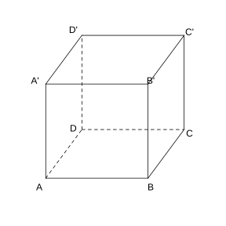{width=50%}

### 解答 练习三

由**定义 8.6.1** (异面直线所成的角).

(1) $BC\parallel B'C'$, 故 $BC$ 与 $A'C'$ 所成的角即 $\angle B'C'A'$. 底面 $A'B'C'D'$ 是边长为 $2\sqrt{3}$ 的正方形, $A'C'$ 为对角线, $\triangle A'B'C'$ 为等腰直角三角形, $\angle B'C'A'=45^{\circ}$.

(2) $AA'$ 垂直于底面 $ABCD$, $BC\subset$ 底面, 故 $AA'\perp BC$, 所成角为 $90^{\circ}$. $\blacksquare$

### 练习四

(练习 8.6 第 4 题) 如图, 在正三棱柱 $ABC\text{-}A'B'C'$ 中, $D$ 为棱 $AC$ 的中点, $AB=BB'=2$, 求证 $BD\perp AC'$.

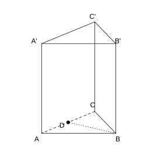{width=50%}

### 解答 练习四

由**定理 8.6.4** (直线与平面垂直的判定定理) 及**定理 8.6.8** (平面与平面垂直的判定定理).

底面 $ABC$ 是正三角形, $D$ 为 $AC$ 中点, 故 $BD\perp AC$.

正三棱柱中, 侧面 $ACC'A'\perp$ 底面 $ABC$, 交线为 $AC$. $BD\subset$ 底面 $ABC$ 且 $BD\perp AC$, 由面面垂直的性质, $BD\perp$ 平面 $ACC'A'$.

又 $AC'\subset$ 平面 $ACC'A'$, 故 $BD\perp AC'$. $\blacksquare$

### 练习五

(练习 8.6 第 1 题) 如果两条直线和一个平面所成的角相等, 那么这两条直线一定平行吗?

### 解答 练习五

由**定义 8.6.6** (直线与平面所成的角) 判断.

不一定. 两条直线与同一平面所成角相等时, 它们可能平行, 也可能相交或异面. 例如过平面外一点作与平面成等角的直线, 它们形成一个圆锥面, 彼此相交于该点. $\blacksquare$

### 练习六

(练习 8.6 第 2 题) 如图, 四棱锥 $S\text{-}ABCD$ 的底面是正方形, $SD\perp$ 平面 $ABCD$, 求证: $AC\perp$ 平面 $SDB$.

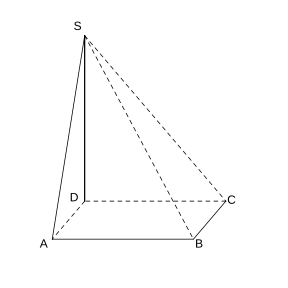{width=50%}

### 解答 练习六

由**定理 8.6.4** (直线与平面垂直的判定定理).

因为 $SD\perp$ 平面 $ABCD$, $AC\subset$ 平面 $ABCD$, 故 $SD\perp AC$.

底面 $ABCD$ 是正方形, 故 $AC\perp BD$.

又 $SD\cap BD=D$, 由**定理 8.6.4** (直线与平面垂直的判定定理), $AC\perp$ 平面 $SDB$. $\blacksquare$

### 练习七

(练习 8.6 第 3 题) 如图, 在直四棱柱 $A'B'C'D'\text{-}ABCD$ 中, 当底面四边形 $ABCD$ 满足什么条件时, $A'C\perp B'D'$?

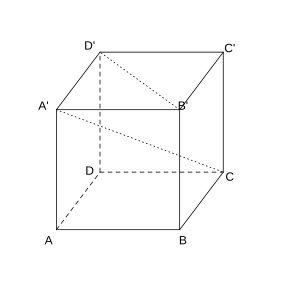{width=50%}

### 解答 练习七

由**定理 8.6.4** (直线与平面垂直的判定定理).

$B'D'\parallel BD$. 直四棱柱中, $A'A\perp$ 底面 $ABCD$, 故 $A'C$ 在底面的射影为 $AC$.

要使 $A'C\perp B'D'$, 由三垂线定理, 只需 $AC\perp BD$.

故当底面四边形 $ABCD$ 的对角线互相垂直 (即 $ABCD$ 为菱形) 时, $A'C\perp B'D'$. $\blacksquare$

### 练习八

(练习 8.6 第 4 题) 过 $\triangle ABC$ 所在平面 $\alpha$ 外一点 $P$, 作 $PO\perp\alpha$, 垂足为 $O$, 连接 $PA$, $PB$, $PC$.

(1) 若 $PA=PB=PC$, 则点 $O$ 是 $\triangle ABC$ 的 $\;\_\_\;$ 心.

(2) 若 $PA=PB=PC$, $\angle ACB=90^{\circ}$, 则点 $O$ 是 $AB$ 边的 $\;\_\_\;$ 点.

### 解答 练习八

由**定义 8.6.3** (直线与平面垂直) 及勾股定理.

因为 $PO\perp\alpha$, 故 $PO\perp OA$, $PO\perp OB$, $PO\perp OC$.

(1) 由 $PA=PB=PC$, $PO$ 公共, $\text{Rt}\triangle POA\cong\text{Rt}\triangle POB\cong\text{Rt}\triangle POC$, 故 $OA=OB=OC$. 点 $O$ 是 $\triangle ABC$ 的外心.

(2) $\angle ACB=90^{\circ}$, $\triangle ABC$ 为直角三角形, 其外心在斜边 $AB$ 的中点. 又 $OA=OB=OC$, 故 $O$ 是 $AB$ 边的中点. $\blacksquare$

### 练习九

(练习 8.6 第 1 题) 已知直线 $a$, $b$ 和平面 $\alpha$, 且 $a\perp b$, $a\perp\alpha$, 则 $b$ 与 $\alpha$ 的位置关系是 $\;\_\_\;$.

### 解答 练习九

由**定理 8.6.5** (直线与平面垂直的性质定理) 判断.

$a\perp\alpha$, 若 $b\subset\alpha$, 则 $a\perp b$ 成立. 若 $b\not\subset\alpha$, 过 $a$ 作平面交 $\alpha$ 于直线 $c$, 则 $a\perp c$. 由 $a\perp b$ 且 $a\perp c$, $b\parallel c$. $c\subset\alpha$, $b\not\subset\alpha$, 故 $b\parallel\alpha$.

故 $b$ 与 $\alpha$ 的位置关系是 $b\parallel\alpha$ 或 $b\subset\alpha$. $\blacksquare$

### 练习十

(练习 8.6 第 2 题) 已知 $A$, $B$ 两点在平面 $\alpha$ 的同侧, 且它们与 $\alpha$ 的距离相等, 求证: 直线 $AB\parallel\alpha$.

### 解答 练习十

由**定理 8.5.3** (直线与平面平行的判定定理).

分别作 $AA'\perp\alpha$, $BB'\perp\alpha$, 垂足为 $A'$, $B'$. 由**定理 8.6.5** (直线与平面垂直的性质定理), $AA'\parallel BB'$.

由题设 $AA'=BB'$, 故四边形 $ABB'A'$ 是平行四边形, $AB\parallel A'B'$.

又 $A'B'\subset\alpha$, $AB\not\subset\alpha$, 由**定理 8.5.3** (直线与平面平行的判定定理), $AB\parallel\alpha$. $\blacksquare$

### 练习十一

(练习 8.6 第 3 题) 如图, $EA$ 和 $DC$ 都垂直于平面 $ABC$, 且 $EA=2DC$, $F$ 是 $EB$ 的中点, 求证: $DF\parallel$ 平面 $ABC$.

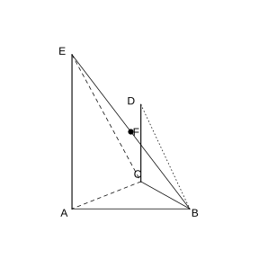{width=50%}

### 解答 练习十一

由**定理 8.5.3** (直线与平面平行的判定定理) 及**定理 8.6.5** (直线与平面垂直的性质定理).

取 $AB$ 的中点 $G$, 连接 $FG$, $CG$.

在 $\triangle EAB$ 中, $F$, $G$ 分别为 $EB$, $AB$ 的中点, 故 $FG\parallel EA$, $FG=\frac{1}{2}EA$.

由题设 $EA=2DC$, 故 $FG=DC$. 又 $EA\perp$ 平面 $ABC$, $DC\perp$ 平面 $ABC$, 由**定理 8.6.5** (直线与平面垂直的性质定理), $EA\parallel DC$. 故 $FG\parallel DC$.

于是 $FG=\ DC$, 四边形 $DFGC$ 是平行四边形, $DF\parallel CG$.

又 $CG\subset$ 平面 $ABC$, $DF\not\subset$ 平面 $ABC$, 故 $DF\parallel$ 平面 $ABC$. $\blacksquare$

### 练习十二

(练习 8.6 第 4 题) 求证: 垂直于同一条直线的两个平面互相平行.

### 解答 练习十二

由**定理 8.6.4** (直线与平面垂直的判定定理).

设直线 $l\perp\alpha$, $l\perp\beta$. 过 $l$ 作两个相交平面, 分别与 $\alpha$, $\beta$ 交于 $a$, $a'$ 和 $b$, $b'$.

因为 $l\perp\alpha$, 故 $l\perp a$, $l\perp b$. 因为 $l\perp\beta$, 故 $l\perp a'$, $l\perp b'$.

在同一平面内, 垂直于同一直线的两条直线平行, 故 $a\parallel a'$, $b\parallel b'$.

$a$, $b$ 是 $\alpha$ 内两条相交直线, $a'$, $b'$ 是 $\beta$ 内两条相交直线. 由**定理 8.5.5** (平面与平面平行的判定定理), $\alpha\parallel\beta$. $\blacksquare$

### 练习十三

(练习 8.6 第 1 题) 如图, 检查工件的相邻两个 (平) 面是否垂直时, 只要用曲尺的一边紧靠在工件的一个面上, 另一边在工件的另一个面上转动, 观察尺边和这个面是否密合就可以了. 这是为什么?

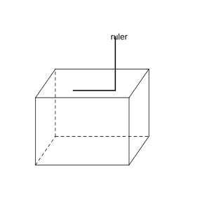{width=50%}

### 解答 练习十三

由**定理 8.6.8** (平面与平面垂直的判定定理).

曲尺两边互相垂直. 若一边紧靠第一面, 另一边在第二面内绕交线转动时始终与第二面密合, 说明第二面内存在一条直线垂直于第一面内的曲尺边, 即第二面内有一条直线垂直于第一面.

由**定理 8.6.8** (平面与平面垂直的判定定理), 第二面过第一面的一条垂线, 故两平面垂直. $\blacksquare$

### 练习十四

(练习 8.6 第 2 题) 已知直线 $a$, $b$ 与平面 $\alpha$, $\beta$, $\gamma$, 能使 $\alpha\perp\beta$ 的充分条件是 ( ).

(A) $a\perp\gamma$, $\beta\perp\gamma$; (B) $\alpha\cap\beta=a$, $b\perp\alpha$, $b\subset\beta$; (C) $a\parallel\beta$, $a\parallel\alpha$; (D) $a\parallel\alpha$, $a\perp\beta$.

### 解答 练习十四

由**定理 8.6.8** (平面与平面垂直的判定定理) 判断.

(A) 错误. 同垂直于 $\gamma$ 的两平面 $\alpha$, $\beta$ 可能平行.

(B) 正确. $b\perp\alpha$, $b\subset\beta$, 即 $\beta$ 过 $\alpha$ 的一条垂线, 由**定理 8.6.8** (平面与平面垂直的判定定理), $\alpha\perp\beta$.

(C) 错误. $a\parallel\alpha$, $a\parallel\beta$ 不能推出 $\alpha\perp\beta$.

(D) 错误. $a\parallel\alpha$, $a\perp\beta$ 不能推出 $\alpha\perp\beta$.

故选 (B). $\blacksquare$

### 练习十五

(练习 8.6 第 3 题) 如图, $AB\perp$ 平面 $BCD$, $BC\perp CD$, 你能发现哪些平面互相垂直? 为什么?

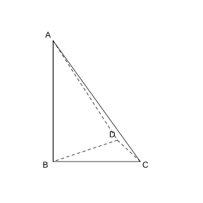{width=50%}

### 解答 练习十五

由**定理 8.6.8** (平面与平面垂直的判定定理).

因为 $AB\perp$ 平面 $BCD$, $AB\subset$ 平面 $ABC$, $AB\subset$ 平面 $ABD$, 故平面 $ABC\perp$ 平面 $BCD$, 平面 $ABD\perp$ 平面 $BCD$.

又 $BC\perp CD$, $AB\perp$ 平面 $BCD$ 故 $AB\perp CD$. $AB\cap BC=B$, 故 $CD\perp$ 平面 $ABC$. 而 $CD\subset$ 平面 $ACD$, 故平面 $ACD\perp$ 平面 $ABC$.

综上, 互相垂直的平面对为: 平面 $ABC\perp$ 平面 $BCD$, 平面 $ABD\perp$ 平面 $BCD$, 平面 $ACD\perp$ 平面 $ABC$. $\blacksquare$

### 练习十六

(练习 8.6 第 4 题) 如图, 在正三棱柱 $ABC\text{-}A'B'C'$ 中, $D$ 为棱 $AC$ 的中点. 求证: 平面 $BDC'\perp$ 平面 $ACC'A'$.

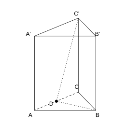{width=50%}

### 解答 练习十六

由**定理 8.6.8** (平面与平面垂直的判定定理).

底面 $ABC$ 是正三角形, $D$ 为 $AC$ 中点, 故 $BD\perp AC$.

正三棱柱中, 平面 $ABC\perp$ 平面 $ACC'A'$, 交线为 $AC$. $BD\subset$ 平面 $ABC$ 且 $BD\perp AC$, 由面面垂直的性质, $BD\perp$ 平面 $ACC'A'$.

又 $BD\subset$ 平面 $BDC'$, 由**定理 8.6.8** (平面与平面垂直的判定定理), 平面 $BDC'\perp$ 平面 $ACC'A'$. $\blacksquare$

### 练习十七

(练习 8.6 第 1 题) 判断下列命题是否正确, 正确的在括号内画 "$\sqrt{ }$", 错误的画 "$\times$".

(1) 如果平面 $\alpha\perp$ 平面 $\beta$, 那么平面 $\alpha$ 内所有直线都垂直于平面 $\beta$.

(2) 如果平面 $\alpha\perp$ 平面 $\beta$, 那么平面 $\alpha$ 内一定存在直线平行于平面 $\beta$.

(3) 如果平面 $\alpha$ 不垂直于平面 $\beta$, 那么平面 $\alpha$ 内一定不存在直线垂直于平面 $\beta$.

### 解答 练习十七

由**定理 8.6.9** (平面与平面垂直的性质定理) 判断.

(1) 错误. $\alpha\perp\beta$ 时, $\alpha$ 内平行于交线的直线平行于 $\beta$, 不垂直.

(2) 正确. $\alpha$ 内平行于两平面交线的直线平行于 $\beta$.

(3) 正确. 若 $\alpha$ 内存在直线垂直于 $\beta$, 则由**定理 8.6.8** (平面与平面垂直的判定定理), $\alpha\perp\beta$, 矛盾. $\blacksquare$

### 练习十八

(练习 8.6 第 2 题) 若平面 $\alpha\perp$ 平面 $\beta$, 且 $\alpha\cap\beta=l$, 则下列命题中正确的个数是 ( ).

(1) 平面 $\alpha$ 内的直线必垂直于平面 $\beta$ 内的任意一条直线.

(2) 平面 $\alpha$ 内的已知直线必垂直于平面 $\beta$ 内的无数条直线.

(3) 平面 $\alpha$ 内的任一条直线必垂直于平面 $\beta$.

(4) 过平面 $\alpha$ 内任意一点作交线 $l$ 的垂线, 则此垂线必垂直于平面 $\beta$.

(A) $3$; (B) $2$; (C) $1$; (D) $0$.

### 解答 练习十八

由**定理 8.6.9** (平面与平面垂直的性质定理) 判断.

(1) 错误. $\alpha$ 内平行于 $l$ 的直线不垂直于 $\beta$ 内所有直线.

(2) 正确. $\alpha$ 内任一直线, 在 $\beta$ 内垂直于 $l$ 的所有直线都与它垂直, 有无数条.

(3) 错误. $\alpha$ 内平行于 $l$ 的直线不垂直于 $\beta$.

(4) 正确. 由**定理 8.6.9** (平面与平面垂直的性质定理), 过 $\alpha$ 内一点作 $l$ 的垂线, 此垂线垂直于 $\beta$.

共 $2$ 个正确, 选 (B). $\blacksquare$

### 练习十九

(练习 8.6 第 3 题) 已知 $\alpha$, $\beta$ 是两个不同的平面, $m$ 为平面 $\alpha$ 内的一条直线, 则 "$\alpha\perp\beta$" 是 "$m\perp\beta$" 的 ( ).

(A) 充分不必要条件; (B) 必要不充分条件; (C) 充要条件; (D) 既不充分也不必要条件.

### 解答 练习十九

由**定理 8.6.8** (平面与平面垂直的判定定理) 判断.

若 $m\perp\beta$ 且 $m\subset\alpha$, 则 $\alpha\perp\beta$, 故必要性成立.

但 $\alpha\perp\beta$ 时, $\alpha$ 内的直线 $m$ 不一定垂直于 $\beta$, 故充分性不成立.

故 "$\alpha\perp\beta$" 是 "$m\perp\beta$" 的必要不充分条件, 选 (B). $\blacksquare$

### 练习二十

(练习 8.6 第 4 题) 已知平面 $\alpha$, $\beta$, 直线 $a$, 且 $\alpha\perp\beta$, $\alpha\cap\beta=AB$, $a\parallel\alpha$, $a\perp AB$, 判断直线 $a$ 与平面 $\beta$ 的位置关系, 并说明理由.

### 解答 练习二十

由**定理 8.5.4** (直线与平面平行的性质定理) 及**定理 8.6.9** (平面与平面垂直的性质定理).

因为 $a\parallel\alpha$, 过 $a$ 作平面与 $\alpha$ 交于直线 $b$, 由线面平行性质, $a\parallel b$.

因为 $a\perp AB$, 故 $b\perp AB$. 又 $\alpha\perp\beta$, $b\subset\alpha$, $b\perp AB$ (交线), 由**定理 8.6.9** (平面与平面垂直的性质定理), $b\perp\beta$.

又 $a\parallel b$, 故 $a\perp\beta$. $\blacksquare$

### 习题一

(习题 8.6 复习巩固第 1 题) 选择题.

(1) 若空间中四条不同的直线 $l_{1}$, $l_{2}$, $l_{3}$, $l_{4}$ 满足 $l_{1}\perp l_{2}$, $l_{2}\perp l_{3}$, $l_{3}\perp l_{4}$, 则下面结论正确的是 ( ).

(A) $l_{1}\perp l_{4}$; (B) $l_{1}\parallel l_{4}$; (C) $l_{1}$, $l_{4}$ 既不垂直也不平行; (D) $l_{1}$, $l_{4}$ 的位置关系不确定.

(2) 设 $l$, $m$, $n$ 均为直线, 其中 $m$, $n$ 在平面 $\alpha$ 内, 则 "$l\perp\alpha$" 是 "$l\perp m$ 且 $l\perp n$" 的 ( ).

(A) 充分不必要条件; (B) 必要不充分条件; (C) 充要条件; (D) 既不充分也不必要条件.

(3) 直线 $l_{1}$, $l_{2}$ 互相平行的一个充分条件是 ( ).

(A) $l_{1}$, $l_{2}$ 都平行于同一个平面; (B) $l_{1}$, $l_{2}$ 与同一个平面所成的角相等; (C) $l_{1}$, $l_{2}$ 都垂直于同一个平面; (D) $l_{1}$ 平行于 $l_{2}$ 所在的平面.

### 解答 习题一

由**定理 8.6.4** (直线与平面垂直的判定定理) 及**定理 8.6.5** (直线与平面垂直的性质定理) 判断.

(1) $l_{1}\perp l_{2}$, $l_{2}\perp l_{3}$ 只能推出 $l_{1}$ 与 $l_{3}$ 平行或异面, $l_{3}\perp l_{4}$ 后 $l_{1}$ 与 $l_{4}$ 的位置关系仍不确定. 故选 (D).

(2) $l\perp\alpha$ 必有 $l\perp m$ 且 $l\perp n$, 但 $l\perp m$ 且 $l\perp n$ 时若 $m\parallel n$ 则不能推出 $l\perp\alpha$. 故为充分不必要条件, 选 (A).

(3) 由**定理 8.6.5** (直线与平面垂直的性质定理), 垂直于同一平面的两直线平行. 故选 (C). $\blacksquare$

### 习题二

(习题 8.6 复习巩固第 2 题) 判断下列命题是否正确, 正确的在括号内画 "$\sqrt{ }$", 错误的画 "$\times$".

(1) 过平面外一点, 有且只有一条直线与这个平面垂直.

(2) 过平面外一点, 有且只有一条直线与这个平面平行.

(3) 过直线外一点, 有且只有一个平面与这条直线垂直.

(4) 过直线外一点, 有且只有一个平面与这条直线平行.

(5) 过直线外一点, 有且只有一条直线与这条直线平行.

### 解答 习题二

由线面平行, 垂直的基本性质判断.

(1) 正确. 过平面外一点与该平面垂直的直线唯一.

(2) 错误. 过平面外一点有无数条直线与该平面平行, 它们都在过该点且平行于该平面的平面内.

(3) 正确. 过直线外一点与该直线垂直的平面唯一.

(4) 错误. 过直线外一点有无数个平面与该直线平行.

(5) 正确. 由平行公理, 过直线外一点有且只有一条直线与已知直线平行. $\blacksquare$

### 习题三

(习题 8.6 复习巩固第 3 题) 判断下列命题是否正确, 正确的说明理由, 错误的举例说明.

(1) 一条直线平行于一个平面, 另一条直线与这个平面垂直, 则这两条直线互相垂直;

(2) 如果平面 $\alpha\parallel$ 平面 $\alpha_{1}$, 平面 $\beta\parallel$ 平面 $\beta_{1}$, 那么平面 $\alpha$ 与平面 $\beta$ 所成的二面角和平面 $\alpha_{1}$ 与平面 $\beta_{1}$ 所成的二面角相等或互补;

(3) 如果平面 $\alpha\perp$ 平面 $\beta$, 平面 $\beta\perp$ 平面 $\gamma$, 那么平面 $\alpha\perp$ 平面 $\gamma$.

### 解答 习题三

由**定理 8.6.4** (直线与平面垂直的判定定理) 判断.

(1) 正确. 直线 $l\parallel$ 平面 $\alpha$, 直线 $m\perp\alpha$. 过 $l$ 作平面交 $\alpha$ 于 $l'$, 则 $l\parallel l'$. $m\perp\alpha$ 故 $m\perp l'$, 从而 $m\perp l$.

(2) 正确. 两平行平面分别与另两平行平面相交, 所得二面角的平面角对应相等或互补.

(3) 错误. 反例: 墙面与地面垂直, 另一面墙也与地面垂直, 但这两面墙平行或相交, 不一定垂直. $\blacksquare$

### 习题四

(习题 8.6 复习巩固第 4 题) 如图, 在直三棱柱 $ABC\text{-}A_{1}B_{1}C_{1}$ 中, $CA=CB$, $P$ 为 $A_{1}B$ 的中点, $Q$ 为棱 $C_{1}C$ 的中点. 求证:

(1) $PQ\parallel AB$;

(2) $PQ\perp C_{1}C$;

(3) $PQ\perp A_{1}B$.

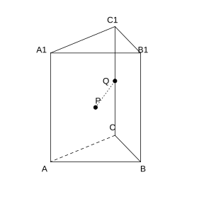{width=50%}

### 解答 习题四

由**定理 8.6.4** (直线与平面垂直的判定定理).

取 $AB$ 的中点 $M$, 连接 $PM$, $CM$.

(1) 在 $\triangle A_{1}AB$ 中, $P$, $M$ 分别为 $A_{1}B$, $AB$ 的中点, 故 $PM\parallel A_{1}A$, $PM=\frac{1}{2}A_{1}A$. 又 $Q$ 为 $C_{1}C$ 中点, $CQ=\frac{1}{2}C_{1}C=\frac{1}{2}A_{1}A$, 且 $CQ\parallel A_{1}A$. 故 $PM=\ CQ$, 四边形 $PMCQ$ 为平行四边形, $PQ\parallel CM$. 又 $CM\subset$ 底面 $ABC$, $AB\subset$ 底面, 故 $PQ\parallel AB$.

(2) $CA=CB$, $M$ 为 $AB$ 中点, 故 $CM\perp AB$. 直三棱柱中 $CC_{1}\perp$ 底面 $ABC$, 故 $CC_{1}\perp CM$. $PQ\parallel CM$, 故 $PQ\perp C_{1}C$.

(3) $CM\perp AB$, $CM\perp BB_{1}$ (直三棱柱), 故 $CM\perp$ 平面 $ABB_{1}A_{1}$. $A_{1}B\subset$ 平面 $ABB_{1}A_{1}$, 故 $CM\perp A_{1}B$. $PQ\parallel CM$, 故 $PQ\perp A_{1}B$. $\blacksquare$

### 习题五

(习题 8.6 复习巩固第 5 题) 如图, 在三棱锥 $P\text{-}ABC$ 中, $CD\perp AB$, 垂足为 $D$, $PO\perp$ 底面 $ABC$, 垂足为 $O$, 且 $O$ 在 $CD$ 上, 求证 $AB\perp PC$.

{width=50%}

### 解答 习题五

由**定理 8.6.4** (直线与平面垂直的判定定理).

因为 $PO\perp$ 底面 $ABC$, $AB\subset$ 底面 $ABC$, 故 $PO\perp AB$.

又已知 $CD\perp AB$, 且 $PO\cap CD=O$, 由**定理 8.6.4** (直线与平面垂直的判定定理), $AB\perp$ 平面 $PCD$.

因为 $PC\subset$ 平面 $PCD$, 故 $AB\perp PC$. $\blacksquare$

### 习题六

(习题 8.6 复习巩固第 6 题) 如图, 在正方体 $ABCD\text{-}A'B'C'D'$ 中, 平面 $ABC'D'$ 与正方体的各个面所在的平面所成的二面角的大小分别是多少?

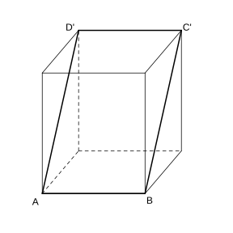{width=50%}

### 解答 习题六

由**定义 8.6.7** (二面角) 计算.

平面 $ABC'D'$ 与正方体六个面的交线分别为 $AB$, $C'D'$, $AD'$, $BC'$.

与底面 $ABCD$, 顶面 $A'B'C'D'$, 正面 $ABB'A'$, 背面 $CDD'C'$ 所成二面角均为 $45^{\circ}$ (因为该平面与这四个面的交线方向上, 平面的倾斜角为 $45^{\circ}$).

与左面 $ADD'A'$, 右面 $BCC'B'$ 所成二面角均为 $90^{\circ}$ (因为平面 $ABC'D'$ 垂直于这两个面).

故平面 $ABC'D'$ 与前后上下四个面成 $45^{\circ}$, 与左右两个面成 $90^{\circ}$. $\blacksquare$

### 习题七

(习题 8.6 复习巩固第 7 题) 如图, 在三棱锥 $V\text{-}ABC$ 中, 已知 $\angle VAB=\angle VAC=\angle ABC=90^{\circ}$, 判断平面 $VAB$ 与平面 $VBC$ 的位置关系, 并说明理由.

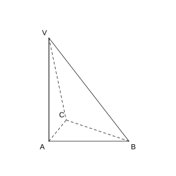{width=50%}

### 解答 习题七

由**定理 8.6.4** (直线与平面垂直的判定定理) 及**定理 8.6.8** (平面与平面垂直的判定定理).

因为 $\angle VAB=\angle VAC=90^{\circ}$, 故 $VA\perp AB$, $VA\perp AC$. $AB\cap AC=A$, 故 $VA\perp$ 平面 $ABC$.

因为 $BC\subset$ 平面 $ABC$, 故 $VA\perp BC$. 又 $\angle ABC=90^{\circ}$, 即 $AB\perp BC$. $VA\cap AB=A$, 故 $BC\perp$ 平面 $VAB$.

又 $BC\subset$ 平面 $VBC$, 由**定理 8.6.8** (平面与平面垂直的判定定理), 平面 $VBC\perp$ 平面 $VAB$. $\blacksquare$

### 习题八

(习题 8.6 复习巩固第 8 题) 求证: 如果共点的三条直线两两垂直, 那么它们中每两条直线确定的平面也两两垂直.

### 解答 习题八

由**定理 8.6.8** (平面与平面垂直的判定定理).

设共点于 $O$ 的三条直线 $l_{1}$, $l_{2}$, $l_{3}$ 两两垂直, 即 $l_{1}\perp l_{2}$, $l_{2}\perp l_{3}$, $l_{3}\perp l_{1}$.

$l_{1}\perp l_{2}$ 且 $l_{1}\perp l_{3}$, $l_{2}\cap l_{3}=O$, 由**定理 8.6.4** (直线与平面垂直的判定定理), $l_{1}\perp$ 平面 $(l_{2},l_{3})$.

平面 $(l_{1},l_{2})$ 过 $l_{1}$, 而 $l_{1}\perp$ 平面 $(l_{2},l_{3})$, 故平面 $(l_{1},l_{2})\perp$ 平面 $(l_{2},l_{3})$.

同理可证平面 $(l_{2},l_{3})\perp$ 平面 $(l_{3},l_{1})$, 平面 $(l_{3},l_{1})\perp$ 平面 $(l_{1},l_{2})$. 故三个平面两两垂直. $\blacksquare$

### 习题九

(习题 8.6 复习巩固第 9 题) 已知平面 $\alpha$, $\beta$, $\gamma$, 且 $\alpha\perp\gamma$, $\beta\parallel\alpha$, 求证 $\beta\perp\gamma$.

### 解答 习题九

由**定理 8.6.8** (平面与平面垂直的判定定理) 及**定理 8.5.6** (平面与平面平行的性质定理).

设 $\alpha\cap\gamma=a$. 在 $\alpha$ 内作直线 $l\perp a$, 由**定理 8.6.9** (平面与平面垂直的性质定理), $l\perp\gamma$.

因为 $\alpha\parallel\beta$, 过 $l$ 作平面与 $\beta$ 交于 $l'$, 由面面平行性质, $l'\parallel l$.

因为 $l\perp\gamma$, 故 $l'\perp\gamma$. 又 $l'\subset\beta$, 由**定理 8.6.8** (平面与平面垂直的判定定理), $\beta\perp\gamma$. $\blacksquare$

### 习题十

(习题 8.6 复习巩固第 10 题) 已知平面 $\alpha$, $\beta$, $\gamma$, 且 $\alpha\perp\gamma$, $\beta\perp\gamma$, $\alpha\cap\beta=l$, 求证 $l\perp\gamma$.

### 解答 习题十

由**定理 8.6.4** (直线与平面垂直的判定定理).

设 $\alpha\cap\gamma=a$, $\beta\cap\gamma=b$. 在 $\gamma$ 内作直线 $m\perp a$, 由面面垂直性质, $m\perp\alpha$, 故 $m\perp l$.

同理, 在 $\gamma$ 内作直线 $n\perp b$, 则 $n\perp\beta$, 故 $n\perp l$.

$m$, $n$ 是 $\gamma$ 内两条相交直线, $l$ 垂直于 $\gamma$ 内两条相交直线. 由**定理 8.6.4** (直线与平面垂直的判定定理), $l\perp\gamma$. $\blacksquare$

### 习题十一

(习题 8.6 综合运用第 11 题) 如下页图, 在正方体 $ABCD\text{-}A_{1}B_{1}C_{1}D_{1}$ 中, 点 $P$, $Q$ 分别为棱 $AD$, $CC_{1}$ 的中点. 求证 $A_{1}P\perp BQ$.

### 解答 习题十一

由**定理 8.6.4** (直线与平面垂直的判定定理).

取 $DD_{1}$ 的中点 $R$, 连接 $A_{1}R$, $PR$. 在正方形 $ADD_{1}A_{1}$ 中, $P$, $R$ 分别为 $AD$, $DD_{1}$ 的中点, 可证 $A_{1}P\perp A_{1}R$ (由三角形全等, 对应角互余).

又 $BQ\parallel A_{1}R$ (由正方体对称性及中位线性质, $BQ$ 与 $A_{1}R$ 方向对应平行).

故 $A_{1}P\perp BQ$. $\blacksquare$

### 习题十二

(习题 8.6 综合运用第 12 题) 如图, $m$, $n$ 是两条相交直线, $l_{1}$, $l_{2}$ 是与 $m$, $n$ 都垂直的两条直线, 且直线 $l$ 与 $l_{1}$, $l_{2}$ 都相交, 求证 $\angle 1=\angle 2$.

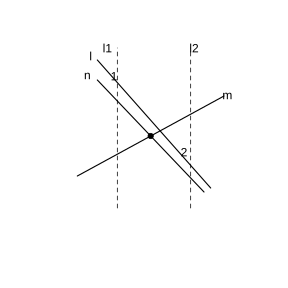{width=50%}

### 解答 习题十二

由**定理 8.6.5** (直线与平面垂直的性质定理).

因为 $l_{1}\perp m$, $l_{1}\perp n$, $m\cap n=O$, 故 $l_{1}\perp$ 平面 $(m,n)$. 同理 $l_{2}\perp$ 平面 $(m,n)$.

由**定理 8.6.5** (直线与平面垂直的性质定理), $l_{1}\parallel l_{2}$.

直线 $l$ 与两平行线 $l_{1}$, $l_{2}$ 相交, $\angle 1$ 与 $\angle 2$ 是两平行线被 $l$ 所截的同位角, 故 $\angle 1=\angle 2$. $\blacksquare$

### 习题十三

(习题 8.6 综合运用第 13 题) 求证: 两条平行直线与同一个平面所成的角相等.

### 解答 习题十三

由**定义 8.6.6** (直线与平面所成的角).

设直线 $a\parallel b$, 它们与平面 $\alpha$ 所成的角分别为 $\theta_{1}$, $\theta_{2}$.

在 $a$, $b$ 上分别取点 $A$, $B$, 作 $AA'\perp\alpha$, $BB'\perp\alpha$, 垂足为 $A'$, $B'$. 连接斜足与垂足.

由 $a\parallel b$, 可得两直角三角形相似, 斜线与射影所成的角对应相等. 故 $\theta_{1}=\theta_{2}$. $\blacksquare$

### 习题十四

(习题 8.6 综合运用第 14 题) 如图, 在棱锥 $V\text{-}ABC$ 中, $VO\perp$ 平面 $ABC$, $O\in CD$, $VA=VB$, $AD=BD$, 你能判定 $CD\perp AB$, 以及 $AC=BC$ 吗?

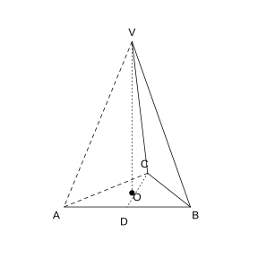{width=50%}

### 解答 习题十四

由**定理 8.6.4** (直线与平面垂直的判定定理).

因为 $VO\perp$ 平面 $ABC$, 故 $VO\perp OA$, $VO\perp OB$. 由 $VA=VB$, $VO$ 公共, 得 $\text{Rt}\triangle VOA\cong\text{Rt}\triangle VOB$, 故 $OA=OB$.

又 $AD=BD$, 即 $D$ 为 $AB$ 中点. 在 $\triangle ABC$ 所在平面内, $O$ 在 $CD$ 上, $OA=OB$, $AD=BD$, 故 $OD\perp AB$. 即 $CD\perp AB$.

$CD\perp AB$, $D$ 为 $AB$ 中点, 故 $CD$ 是 $AB$ 的垂直平分线, $A$, $B$ 关于 $CD$ 对称, 从而 $AC=BC$. $\blacksquare$

### 习题十五

(习题 8.6 综合运用第 15 题) 如图, 在正方形 $SG_{1}G_{2}G_{3}$ 中, $E$, $F$ 分别是 $G_{1}G_{2}$, $G_{2}G_{3}$ 的中点, $D$ 是 $EF$ 的中点. 若沿 $SE$, $SF$ 及 $EF$ 把这个正方形折成一个四面体, 使 $G_{1}$, $G_{2}$, $G_{3}$ 三点重合, 重合后的点记为 $G$, 则在四面体 $S\text{-}EFG$ 中, 哪些棱与面互相垂直?

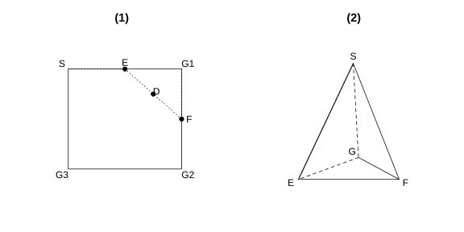{width=100%}

### 解答 习题十五

由**定理 8.6.4** (直线与平面垂直的判定定理).

折叠后, 原正方形中的直角保持: $\angle SGE=\angle SG_{1}E=90^{\circ}$, $\angle SGF=\angle SG_{3}F=90^{\circ}$, $\angle EGF=\angle G_{1}G_{2}G_{3}=90^{\circ}$.

因为 $SG\perp GE$, $SG\perp GF$, $GE\cap GF=G$, 故 $SG\perp$ 平面 $EFG$.

因为 $GE\perp GF$, $GE\perp SG$, $SG\cap GF=G$, 故 $GE\perp$ 平面 $SGF$.

因为 $GF\perp GE$, $GF\perp SG$, $SG\cap GE=G$, 故 $GF\perp$ 平面 $SEG$.

故棱 $SG\perp$ 平面 $EFG$, 棱 $GE\perp$ 平面 $SGF$, 棱 $GF\perp$ 平面 $SEG$. $\blacksquare$

### 习题十六

(习题 8.6 综合运用第 16 题) 求证: 垂直于两个平行平面中的一个平面的直线也垂直于另一个平面.

### 解答 习题十六

由**定理 8.6.4** (直线与平面垂直的判定定理) 及**定理 8.5.6** (平面与平面平行的性质定理).

设 $\alpha\parallel\beta$, 直线 $l\perp\alpha$. 过 $l$ 作两个相交平面, 分别与 $\alpha$, $\beta$ 交于 $a$, $a'$ 和 $b$, $b'$.

因为 $l\perp\alpha$, 故 $l\perp a$, $l\perp b$.

由**定理 8.5.6** (平面与平面平行的性质定理), $a\parallel a'$, $b\parallel b'$. 故 $l\perp a'$, $l\perp b'$.

$a'$, $b'$ 是 $\beta$ 内两条相交直线, 由**定理 8.6.4** (直线与平面垂直的判定定理), $l\perp\beta$. $\blacksquare$

### 习题十七

(习题 8.6 综合运用第 17 题) 求证: 三个两两垂直的平面的交线也两两垂直.

### 解答 习题十七

由**定理 8.6.4** (直线与平面垂直的判定定理).

设平面 $\alpha\perp\beta$, $\beta\perp\gamma$, $\gamma\perp\alpha$, 交线 $l=\alpha\cap\beta$, $m=\beta\cap\gamma$, $n=\gamma\cap\alpha$.

因为 $\alpha\perp\gamma$, $\beta\perp\gamma$, $\alpha\cap\beta=l$, 由**习题 8.6 复习巩固第 10 题**的结论, $l\perp\gamma$.

$m$, $n\subset\gamma$, 故 $l\perp m$, $l\perp n$.

同理, $m\perp\alpha$, 故 $m\perp n$.

故 $l$, $m$, $n$ 两两垂直. $\blacksquare$

### 习题十八

(习题 8.6 综合运用第 18 题) 如图, 在三棱锥 $V\text{-}ABC$ 中, $VA=VB=AB=AC=BC=2$, $VC=1$, 作出二面角 $V\text{-}AB\text{-}C$ 的平面角, 并求出它的余弦值.

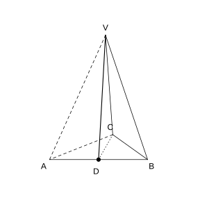{width=50%}

### 解答 习题十八

由**定义 8.6.7** (二面角).

取 $AB$ 的中点 $D$, 连接 $VD$, $CD$.

因为 $VA=VB=2$, $D$ 为 $AB$ 中点, 故 $VD\perp AB$, $VD=\sqrt{VA^{2}-AD^{2}}=\sqrt{4-1}=\sqrt{3}$.

因为 $AC=BC=2$, $D$ 为 $AB$ 中点, 故 $CD\perp AB$, $CD=\sqrt{AC^{2}-AD^{2}}=\sqrt{4-1}=\sqrt{3}$.

$\angle VDC$ 即二面角 $V\text{-}AB\text{-}C$ 的平面角.

在 $\triangle VDC$ 中, $VD=CD=\sqrt{3}$, $VC=1$. 由余弦定理:

$$
\cos\angle VDC=\frac{VD^{2}+CD^{2}-VC^{2}}{2\cdot VD\cdot CD}=\frac{3+3-1}{2\times 3}=\frac{5}{6}.
$$

故二面角 $V\text{-}AB\text{-}C$ 的余弦值为 $\frac{5}{6}$. $\blacksquare$

### 习题十九

(习题 8.6 拓广探索第 19 题) 如图, 在直三棱柱 $ABC\text{-}A_{1}B_{1}C_{1}$ 中, $\angle ABC=90^{\circ}$, $AA_{1}=AB$, 求证 $A_{1}C\perp AB_{1}$.

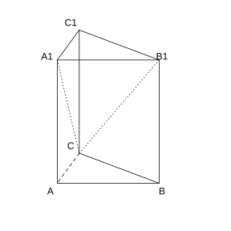{width=50%}

### 解答 习题十九

由**定理 8.6.4** (直线与平面垂直的判定定理).

因为 $\angle ABC=90^{\circ}$, 故 $AB\perp BC$. 直三棱柱中 $BB_{1}\perp$ 底面 $ABC$, 故 $BB_{1}\perp AB$. $BC\cap BB_{1}=B$, 故 $AB\perp$ 平面 $BCC_{1}B_{1}$.

又 $BC_{1}\subset$ 平面 $BCC_{1}B_{1}$, 故 $AB\perp BC_{1}$.

因为 $AA_{1}=AB=BB_{1}$, 侧面 $ABB_{1}A_{1}$ 是正方形, 故 $AB_{1}\perp A_{1}B$.

$AB_{1}\perp A_{1}B$, $AB_{1}\perp BC_{1}$, $A_{1}B\cap BC_{1}=B$, 故 $AB_{1}\perp$ 平面 $A_{1}BC$.

因为 $A_{1}C\subset$ 平面 $A_{1}BC$, 故 $AB_{1}\perp A_{1}C$. $\blacksquare$

### 习题二十

(习题 8.6 拓广探索第 20 题) 如上页图, $AB$ 是 $\odot O$ 的直径, 点 $C$ 是 $\odot O$ 上的动点, 过动点 $C$ 的直线 $VC$ 垂直于 $\odot O$ 所在平面, $D$, $E$ 分别是 $VA$, $VC$ 的中点. 判断直线 $DE$ 与平面 $VBC$ 的位置关系, 并说明理由.

### 解答 习题二十

由**定理 8.6.4** (直线与平面垂直的判定定理).

因为 $D$, $E$ 分别是 $VA$, $VC$ 的中点, 在 $\triangle VAC$ 中, $DE$ 是中位线, 故 $DE\parallel AC$.

因为 $AB$ 是 $\odot O$ 的直径, $C$ 是圆上一点, 故 $\angle ACB=90^{\circ}$, 即 $AC\perp BC$.

又 $VC\perp\odot O$ 所在平面, $AC\subset$ 该平面, 故 $VC\perp AC$.

$BC\cap VC=C$, 故 $AC\perp$ 平面 $VBC$.

因为 $DE\parallel AC$, 故 $DE\perp$ 平面 $VBC$. $\blacksquare$

### 习题二十一

(习题 8.6 拓广探索第 21 题) 如图, 在四棱锥 $P\text{-}ABCD$ 中, 底面 $ABCD$ 为正方形, $PA\perp$ 底面 $ABCD$, $PA=AB$, $E$ 为线段 $PB$ 的中点, $F$ 为线段 $BC$ 上的动点. 平面 $AEF$ 与平面 $PBC$ 是否互相垂直? 如果垂直, 请证明; 如果不垂直, 请说明理由.

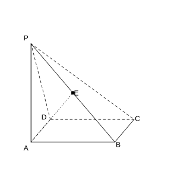{width=50%}

### 解答 习题二十一

由**定理 8.6.8** (平面与平面垂直的判定定理).

因为 $PA=AB$, $E$ 为 $PB$ 中点, 故在等腰直角三角形 $PAB$ 中, $AE\perp PB$.

因为 $PA\perp$ 底面 $ABCD$, $BC\subset$ 底面, 故 $PA\perp BC$. 底面 $ABCD$ 为正方形, 故 $AB\perp BC$. $PA\cap AB=A$, 故 $BC\perp$ 平面 $PAB$.

又 $AE\subset$ 平面 $PAB$, 故 $BC\perp AE$.

$AE\perp PB$, $AE\perp BC$, $PB\cap BC=B$, 故 $AE\perp$ 平面 $PBC$.

又 $AE\subset$ 平面 $AEF$, 由**定理 8.6.8** (平面与平面垂直的判定定理), 平面 $AEF\perp$ 平面 $PBC$.

故无论 $F$ 在 $BC$ 上如何运动, 平面 $AEF$ 与平面 $PBC$ 始终互相垂直. $\blacksquare$
