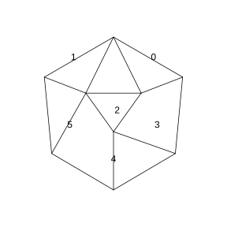

# 作业 44

> **定义 9.1.1** (普查与抽样调查)  对每一个调查对象都进行调查的方法, 称为全面调查, 又称普查; 根据一定目的, 从总体中抽取一部分个体进行调查, 并以此为依据对总体的情况作出估计和推断的调查方法, 称为抽样调查. 对具有毁损性的检测, 只能用抽样调查.

> **定义 9.1.2** (总体, 个体, 样本与样本量)  在一个调查中, 我们把调查对象的全体称为总体, 组成总体的每一个调查对象称为个体. 为了强调调查目的, 也可以把调查对象的某些指标的全体作为总体, 每一个调查对象的相应指标作为个体. 从总体中抽取的那部分个体称为样本, 样本中包含的个体数称为样本容量, 简称样本量. 调查样本获得的变量值称为样本的观测数据, 简称样本数据.

> **定义 9.1.3** (简单随机抽样)  设一个总体含有 $N$ ($N$ 为正整数) 个个体, 从中逐个抽取 $n$ ($1\le n<N$) 个个体作为样本, 如果抽取是放回的, 且每次抽取时总体内的各个个体被抽到的概率都相等, 称为放回简单随机抽样; 如果抽取是不放回的, 且每次抽取时总体内未进入样本的各个个体被抽到的概率都相等, 称为不放回简单随机抽样. 两者统称为简单随机抽样, 通过简单随机抽样获得的样本称为简单随机样本. 除非特殊声明, 本章所称的简单随机抽样指不放回简单随机抽样.

> **定义 9.1.4** (总体均值与样本均值)  总体中有 $N$ 个个体, 它们的变量值分别为 $Y_1,Y_2,\cdots,Y_N$, 则称 $\bar Y=\frac{1}{N}\sum_{i=1}^{N}Y_i$ 为总体均值, 又称总体平均数. 如果从总体中抽取一个容量为 $n$ 的样本, 其变量值分别为 $y_1,y_2,\cdots,y_n$, 则称 $\bar y=\frac{1}{n}\sum_{i=1}^{n}y_i$ 为样本均值, 又称样本平均数. 在简单随机抽样中, 常用样本平均数 $\bar y$ 估计总体平均数 $\bar Y$.

> **定义 9.1.5** (分层随机抽样, 层与比例分配)  按一个或多个变量把总体划分成若干个子总体, 每个个体属于且仅属于一个子总体, 在每个子总体中独立地进行简单随机抽样, 再把所有子总体中抽取的样本合在一起作为总样本, 这样的抽样方法称为分层随机抽样, 每一个子总体称为层. 在分层随机抽样中, 如果每层样本量都与层的大小成比例, 那么称这种样本量的分配方式为比例分配.

> **常用结论 9.1.6** (分层随机抽样的总体平均数估计)  在比例分配的分层随机抽样中, 第 1 层与第 2 层的层大小分别为 $M,N$, 样本量分别为 $m,n$, 层样本平均数分别为 $\bar x,\bar y$, 则可直接用样本平均数 $\bar w=\frac{m}{m+n}\bar x+\frac{n}{m+n}\bar y$ 估计总体平均数 $\bar W$; 在非比例分配时, 须按各层的总体大小加权, 用 $\frac{M}{M+N}\bar x+\frac{N}{M+N}\bar y$ 估计总体平均数.

> **常用结论 9.1.7** (数据变换对平均数的影响)  若 $y_i=ax_i+b$ ($i=1,2,\cdots,n$), $\bar x,\bar y$ 分别为两组数据的平均数, 则 $\bar y=a\bar x+b$.

### 练习一

(练习 9.1 第 1 题) 在以下调查中, 总体, 个体各是什么? 哪些适合用全面调查? 哪些适合用抽样调查?

(1) 调查一个班级学生每周的体育锻炼时间;

(2) 调查一个地区结核病的发病率;

(3) 调查一批炮弹的杀伤半径;

(4) 调查一个水库所有鱼中草鱼所占的比例.

请你再举一些不宜用全面调查的例子, 并说明理由.

### 解答 练习一

由**定义 9.1.2** (总体, 个体, 样本与样本量), 总体是调查对象的全体, 个体是组成总体的每一个调查对象; 由**定义 9.1.1** (普查与抽样调查), 普查对每个对象都调查, 抽样调查只抽取一部分个体.

(1) 总体是该班全体学生每周的体育锻炼时间, 个体是每一名学生每周的体育锻炼时间. 一个班级人数很少, 对每名学生都进行调查花费不大, 故适合用全面调查.

(2) 总体是该地区全部人口的结核病患病情况, 个体是该地区每一个人的结核病患病情况. 一个地区人口很多, 逐一调查工作量大, 故适合用抽样调查.

(3) 总体是这批炮弹的杀伤半径, 个体是每一发炮弹的杀伤半径. 测量炮弹杀伤半径会销毁炮弹, 检测具有毁损性, 故只能用抽样调查.

(4) 总体是该水库所有鱼中草鱼所占的比例, 个体是水库中每一条鱼是否为草鱼. 水库中的鱼无法逐一全部捕获调查, 故适合用抽样调查.

不宜用全面调查的例子: 检测一批灯泡的使用寿命, 测试即烧毁灯泡, 具有毁损性; 调查全国居民的年收入, 总体规模过大, 逐一调查成本过高. 二者都只能用抽样调查. $\blacksquare$

### 练习二

(练习 9.1 第 2 题) 如图, 由均匀材质制成的一个正二十面体 (每个面都是正三角形), 将 20 个面平分成 10 组, 第 1 组标上 0, 第 2 组标上 1, $\cdots$, 第 10 组标上 9.

(1) 投掷正二十面体, 若把朝上一面的数字作为投掷结果, 则出现 $0,1,2,\cdots,9$ 是等可能的吗?

(2) 三个正二十面体分别涂上红, 黄, 蓝三种颜色, 分别代表百位, 十位, 个位, 同时投掷可以产生一个三位数 (百位为 0 的也看作三位数), 它是 $000\sim999$ 范围内的随机数吗?

{width=50%}

### 解答 练习二

由**定义 9.1.3** (简单随机抽样), 随机数要求每个可能结果被取到的概率相等.

(1) 正二十面体由均匀材质制成, 其 20 个面朝上是等可能的, 每个面朝上的概率为 $\frac{1}{20}$. 20 个面平分成 10 组, 每组恰有 2 个面, 故数字 $0,1,\cdots,9$ 中每个数字朝上的概率都是 $\frac{2}{20}=\frac{1}{10}$, 彼此相等, 即出现 $0,1,2,\cdots,9$ 是等可能的.

(2) 三个正二十面体同时投掷, 百位, 十位, 个位各自独立地等可能地取 $0\sim9$ 中的数字, 故每一个三位数 $abc$ ($a,b,c\in\left\{0,1,\cdots,9\right\}$) 出现的概率都是 $\frac{1}{10}\cdot\frac{1}{10}\cdot\frac{1}{10}=\frac{1}{1000}$. 而 $000\sim999$ 恰有 1000 个三位数, 每个被取到的概率相等, 故它是 $000\sim999$ 范围内的随机数. $\blacksquare$

### 练习三

(练习 9.1 第 3 题) 实验室的笼子里共有 100 只小白鼠, 现要从中抽取 10 只作试验用. 下列两种情况是否属于简单随机抽样? 请说明理由.

(1) 每次不经任何挑选地抓一只, 抓满 10 只为止;

(2) 将笼中的 100 只小白鼠按 $1\sim100$ 编号, 任意选出编号范围内的 10 个不重复数字, 把相应编号的小白鼠作为试验用的小白鼠.

### 解答 练习三

由**定义 9.1.3** (简单随机抽样), 不放回简单随机抽样要求每次抽取时总体内未进入样本的各个个体被抽到的概率都相等.

(1) 不属于简单随机抽样. "不经任何挑选地抓一只" 受抓取者的动作, 位置等人为因素影响, 不能保证笼中每只小白鼠在每次被抓时被抽到的概率都相等, 故不符合**定义 9.1.3**.

(2) 属于简单随机抽样. 先将 100 只小白鼠编号 $1\sim100$, 再从中任取 10 个不重复的编号, 每个编号被取到的概率相等, 即每只小白鼠被抽中的概率相等, 且抽取是不放回的, 符合**定义 9.1.3** 中不放回简单随机抽样的要求. $\blacksquare$

### 练习四

(练习 9.1 第 4 题) 如果计算器只能生成 $\left[0,1\right)$ 内的随机数, 你有办法把它转化为 $1\sim100$ 范围内的整数随机数吗? 转化为 $1\sim712$ 范围内的整数随机数呢?

### 解答 练习四

由**定义 9.1.3** (简单随机抽样), 转化后的整数随机数应使 $1\sim100$ (或 $1\sim712$) 中每个整数被取到的概率相等.

设计算器生成的随机数为 $U$, 它在 $\left[0,1\right)$ 上均匀分布.

要转化为 $1\sim100$ 范围内的整数随机数, 只需取

$$
\left\lfloor 100U\right\rfloor+1.
$$

因为 $0\le U<1$, 所以 $0\le 100U<100$, 从而 $\lfloor 100U\rfloor$ 取遍 $0,1,\cdots,99$, 加 1 后恰为 $1,2,\cdots,100$, 且每个整数出现的概率都是 $\frac{1}{100}$.

同理, 要转化为 $1\sim712$ 范围内的整数随机数, 只需取

$$
\left\lfloor 712U\right\rfloor+1.
$$

因为 $0\le 712U<712$, 所以 $\lfloor 712U\rfloor$ 取遍 $0,1,\cdots,711$, 加 1 后恰为 $1,2,\cdots,712$, 且每个整数出现的概率都是 $\frac{1}{712}$. $\blacksquare$

### 练习五

(练习 9.1 第 5 题) 在抽样调查中, 请你说说通过 "随机" 选择样本的优, 缺点.

### 解答 练习五

由**定义 9.1.3** (简单随机抽样), 随机抽样使总体中每个个体被抽到的概率相等, 避免了人为挑选样本时的主观偏好.

优点: 随机抽取排除了人为选择的主观偏差, 使样本对总体具有较好的代表性, 从而可以用样本客观地估计和推断总体.

缺点: 样本的选取是随机的, 由此算出的样本平均数等统计量也具有随机性, 不同样本得到的结果往往不同, 抽样误差不可避免; 当总体很大时, 对所有个体编号等准备工作费事, 抽中的个体往往分散, 实施调查也有困难. $\blacksquare$

### 练习六

(练习 9.1 第 6 题) 为了合理调配电力资源, 某市欲了解全市 50000 户居民的日用电量. 若通过简单随机抽样从中抽取了 300 户进行调查, 得到其日用电量的平均数为 $5.5\,\mathrm{kW\cdot h}$, 则可以推测全市居民用户日用电量的平均数 ($\;\_\_\;$).

(A) 一定为 $5.5\,\mathrm{kW\cdot h}$

(B) 高于 $5.5\,\mathrm{kW\cdot h}$

(C) 低于 $5.5\,\mathrm{kW\cdot h}$

(D) 约为 $5.5\,\mathrm{kW\cdot h}$

### 解答 练习六

由**定义 9.1.4** (总体均值与样本均值), 在简单随机抽样中, 用样本平均数估计总体平均数.

样本平均数 $5.5\,\mathrm{kW\cdot h}$ 是对总体平均数的一个估计值. 由于样本的选取是随机的, 样本平均数具有随机性, 它一般不会恰好等于总体平均数, 只能说总体平均数约为 $5.5\,\mathrm{kW\cdot h}$, 而不能说一定为, 高于或低于该值. 故选 (D). $\blacksquare$

### 练习七

(练习 9.1 第 7 题) 在学生身高的调查中, 小明和小华分别独立进行了简单随机抽样调查. 小明调查的样本平均数为 $166.4$, 样本量为 100; 小华调查的样本平均数为 $164.7$, 样本量为 200. 你更愿意把哪个值作为总体平均数的估计? 是不是你选的值一定比另一个更接近总体平均数? 说说你的理由.

### 解答 练习七

由**定义 9.1.4** (总体均值与样本均值), 样本平均数是总体平均数的估计, 样本量越大, 样本平均数在总体平均数附近波动的幅度越小.

更愿意把小华调查的样本平均数 $164.7$ 作为总体平均数的估计. 因为样本量为 200 比样本量为 100 大, 样本平均数的波动幅度更小, 一般说来更接近总体平均数.

但所选的值不一定比另一个更接近总体平均数. 因为样本的选取是随机的, 样本平均数也具有随机性, 样本量小的样本也可能恰好抽到一个离总体平均数很近的样本, 而样本量大的样本也可能恰好偏离较远. 只能说样本量大的样本平均数 "更可能" 接近总体平均数, 而不是 "一定" 更接近. $\blacksquare$

### 练习八

(练习 9.1 第 8 题) 找一组数据作为总体, 自行设定样本量, 进行多次简单随机抽样. 观察样本量对估计总体平均数的影响, 并试着解释其中的原因.

### 解答 练习八

由**定义 9.1.4** (总体均值与样本均值), 样本平均数用于估计总体平均数, 且样本平均数具有随机性.

取一组数据作为总体, 先算出其总体平均数. 固定一个样本量, 从总体中进行多次简单随机抽样, 分别算出各次样本的平均数, 观察它们在总体平均数附近的波动情况; 再换一个更大的样本量重复上述试验.

可以观察到: 样本量越大, 各次样本平均数越集中在总体平均数附近, 波动幅度越小; 样本量越小, 样本平均数的波动幅度越大.

原因在于: 样本量越大, 样本中不同取值的比例越接近总体中相应取值的比例, 样本平均数越接近总体平均数; 但样本量的增大也会带来人力, 费用, 时间等成本的增加, 故样本量应根据实际问题的需要来选择, 并非越大越好. $\blacksquare$

### 练习九

(练习 9.1 第 9 题) 数据 $x_1,x_2,\cdots,x_m$ 的平均数为 $\bar x$, 数据 $y_1,y_2,\cdots,y_n$ 的平均数为 $\bar y$, 证明:

$$
\frac{\sum_{i=1}^{m}x_i+\sum_{i=1}^{n}y_i}{m+n}=\frac{m}{m+n}\bar x+\frac{n}{m+n}\bar y.
$$

### 解答 练习九

由**定义 9.1.4** (总体均值与样本均值), 平均数等于数据之和除以数据个数.

由 $\bar x=\frac{1}{m}\sum_{i=1}^{m}x_i$, 得 $\sum_{i=1}^{m}x_i=m\bar x$; 由 $\bar y=\frac{1}{n}\sum_{i=1}^{n}y_i$, 得 $\sum_{i=1}^{n}y_i=n\bar y$.

把两组数据合并, 其数据之和为 $\sum_{i=1}^{m}x_i+\sum_{i=1}^{n}y_i$, 数据个数为 $m+n$, 故合并后数据的平均数为

$$
\frac{\sum_{i=1}^{m}x_i+\sum_{i=1}^{n}y_i}{m+n}=\frac{m\bar x+n\bar y}{m+n}=\frac{m}{m+n}\bar x+\frac{n}{m+n}\bar y.
$$

原式得证. $\blacksquare$

### 练习十

(练习 9.1 第 10 题) 有人说: "如果抽样方法设计得好, 用样本进行视力调查与对 24300 名学生进行视力普查的结果差不多. 而且对于想要掌握学生视力状况的教育部门来说, 节省了人力, 物力和财力, 抽样调查更可取." 你认为这种说法有道理吗? 为什么?

### 解答 练习十

由**定义 9.1.1** (普查与抽样调查) 与**定义 9.1.4** (总体均值与样本均值).

这种说法有一定道理, 但不完全. 当抽样方法设计得好, 样本对总体具有较好的代表性时, 样本估计值与普查结果确实相差不大, 而且抽样调查只调查一部分个体, 花费少, 效率高, 节省人力, 物力和财力, 这是抽样调查的优点.

但抽样调查是用样本估计总体, 由于样本的随机性, 估计结果与真实的普查结果之间总存在一定的抽样误差, 它不能像普查那样得到总体的精确值. 因此, 对需要精确掌握每名学生视力状况的场合, 普查仍有其不可替代的作用; 而对只需大致掌握学生视力整体状况的教育部门, 设计良好的抽样调查是更经济合理的选择. $\blacksquare$

### 练习十一

(练习 9.1 第 11 题) 高二年级有男生 490 人, 女生 510 人, 张华按男生, 女生进行分层, 通过分层随机抽样的方法, 得到男生, 女生的平均身高分别为 $170.2\,\mathrm{cm}$ 和 $160.8\,\mathrm{cm}$.

(1) 如果张华在各层中按比例分配样本, 总样本量为 100, 那么在男生, 女生中分别抽取了多少名? 在这种情况下, 请估计高二年级全体学生的平均身高.

(2) 如果张华从男生, 女生中抽取的样本量分别为 30 和 70, 那么在这种情况下, 如何估计高二年级全体学生的平均身高更合理?

### 解答 练习十一

由**定义 9.1.5** (分层随机抽样, 层与比例分配) 与**常用结论 9.1.6** (分层随机抽样的总体平均数估计).

(1) 按比例分配时, 男生应抽取

$$
\frac{490}{490+510}\times100=\frac{490}{1000}\times100=49
$$

名, 女生应抽取

$$
\frac{510}{490+510}\times100=\frac{510}{1000}\times100=51
$$

名.

在比例分配下, 由**常用结论 9.1.6**, 可直接用样本平均数估计总体平均数. 也即按各层人数加权:

$$
\frac{490\times170.2+510\times160.8}{1000}=\frac{83398+82008}{1000}=165.406\approx165.4.
$$

故估计高二年级全体学生的平均身高约为 $165.4\,\mathrm{cm}$.

(2) 当男生, 女生样本量分别为 30 和 70 时, 样本量不是按比例分配的 (男生层大却抽得少). 此时不能直接用 $\frac{30\times170.2+70\times160.8}{100}$ 估计总体平均数, 而应按各层的总体人数加权, 即

$$
\frac{490\times170.2+510\times160.8}{1000}\approx165.4\,\mathrm{cm}.
$$

这样估计才合理. $\blacksquare$

### 练习十二

(练习 9.1 第 12 题) 要调查全市普通高中高一年级学生中患色盲的比例, 小明根据性别对总体进行分层, 用分层随机抽样的方法进行调查. 请你查阅有关资料, 说说这样的分层是否合理. 你觉得在选择分层变量时应注意什么?

### 解答 练习十二

由**定义 9.1.5** (分层随机抽样, 层与比例分配), 分层的目的是把总体分成层间差异明显, 层内差异不大的若干层, 从而避免 "极端" 样本, 提高估计效果.

色盲的发病与性别密切相关, 男性患色盲的比例明显高于女性, 而同一性别内部患色盲的比例差异较小. 因此按性别分层后, 男, 女两层之间色盲比例差异明显, 每层内部差异不大, 这样的分层是合理的, 能有效提高估计全市高一年级学生色盲比例的精度.

选择分层变量时应注意: 分层变量要与所考察的指标 (这里是是否患色盲) 密切相关, 使各层之间差异明显, 而每一层内部的差异尽量小; 同时各层都要有足够多的个体, 以便在层内进行随机抽样. $\blacksquare$

### 练习十三

(练习 9.1 第 13 题) 请从国家统计局网站上查找我国水资源及其使用情况的一些数据, 根据数据谈谈当前保护水资源的重要性.

### 解答 练习十三

由**定义 9.1.2** (总体, 个体, 样本与样本量), 通过查询国家统计局等权威部门公布的二手数据来了解我国水资源状况.

从国家统计局公布的水资源数据可以看到: 我国人均水资源占有量远低于世界平均水平, 属于缺水国家; 同时随着经济发展和人口增加, 生产用水, 生活用水的需求量不断上升, 水资源供需矛盾突出, 水污染进一步加剧了水资源的紧张.

由这些数据可知, 水资源是有限而宝贵的, 当前保护水资源, 节约用水, 防治水污染十分重要. 只有合理利用和保护水资源, 才能保障生产生活用水的可持续供应. $\blacksquare$

### 练习十四

(练习 9.1 第 14 题) 近视是青少年存在的普遍问题, 你能查找相关数据, 并利用数据说说近几年我国在防治青少年近视上取得的成效吗?

### 解答 练习十四

通过查阅国家卫生健康部门公布的青少年近视率监测数据, 可以了解近几年我国儿童青少年总体近视率的变化情况.

由公布的数据可知, 随着近视防控工作的推进, 儿童青少年总体近视率得到一定控制, 防控工作取得了积极成效. 但同时也要看到, 近视率仍然较高, 防控任务依然艰巨, 需要学校, 家庭和社会共同努力, 继续加强户外活动和用眼卫生的宣传引导. $\blacksquare$

### 习题一

(习题 9.1 复习巩固第 1 题) 下列情况中哪些适合用全面调查, 哪些适合用抽样调查? 说明理由.

(1) 了解某城市居民的食品消费结构;

(2) 调查一个县各村的粮食播种面积;

(3) 了解某地区小学生中患沙眼的人数;

(4) 了解一批玉米种子的发芽率;

(5) 调查一条河流的水质;

(6) 某企业想了解其产品在市场的占有率.

### 解答 习题一

由**定义 9.1.1** (普查与抽样调查), 当总体规模小, 调查无毁损且需要精确结果时用全面调查; 当总体规模大或调查具有毁损性时用抽样调查.

(1) 城市居民户数众多, 逐一调查成本高, 适合用抽样调查.

(2) 一个县的村数有限, 各村的粮食播种面积可以逐一统计, 适合用全面调查.

(3) 某地区小学生人数有限, 可通过体检逐一普查患沙眼的人数, 适合用全面调查.

(4) 测试种子发芽率会消耗种子, 具有毁损性, 只能用抽样调查.

(5) 河流绵延很长, 无法对河水做全面普查, 只能抽取若干断面采样, 用抽样调查.

(6) 产品的市场占有率涉及大量消费者, 无法逐一调查, 适合用抽样调查. $\blacksquare$

### 习题二

(习题 9.1 复习巩固第 2 题) 某刊物对其读者进行满意度调查, 调查表随刊物送到读者手中, 对寄回的调查表进行分析. 这是不是一项抽样调查? 样本抽取是不是属于简单随机抽样? 为什么?

### 解答 习题二

由**定义 9.1.2** (总体, 个体, 样本与样本量) 与**定义 9.1.3** (简单随机抽样).

这是一项抽样调查, 因为刊物只对寄回调查表的那部分读者进行分析, 而非对全体读者都进行调查, 寄回调查表的读者构成了从全体读者中抽出的一个样本.

但样本抽取不属于简单随机抽样. 因为读者是否寄回调查表是自愿的, 对刊物满意或不满意的读者更倾向于寄回, 沉默的大多数不会寄回, 这使得每个读者被抽中的概率不相等, 样本带有明显的自我选择偏差, 不符合**定义 9.1.3** 中每个个体被抽到概率相等的要求. $\blacksquare$

### 习题三

(习题 9.1 复习巩固第 3 题) 中央电视台希望在春节联欢晚会播出后一周内获得该节目的收视率. 下面是三名同学为电视台设计的调查方案.

同学 A: 我把这张春节联欢晚会收视率调查表放在互联网上, 只要上网登录该网址的人就可以看到这张表, 他们填写的信息可以很快地反馈到我的电脑中. 这样, 我就可以很快统计出收视率了.

同学 B: 我给我们居民小区的每一个住户发一份是否在除夕晚上看过中央电视台春节联欢晚会的调查表, 只要一两天就可以统计出收视率.

同学 C: 我在一个电话号码本上随机地选出一定数量的手机号码, 然后逐个给他们打电话, 问一下手机用户是否收看了中央电视台春节联欢晚会, 我不出家门就可以统计出中央电视台春节联欢晚会的收视率.

请问: 上述三名同学设计的调查方案获得比较准确的收视率的可能性大吗? 为什么?

### 解答 习题三

由**定义 9.1.3** (简单随机抽样), 样本要准确估计总体, 抽样框必须覆盖总体中的每一个个体.

三名同学的方案获得比较准确收视率的可能性都不大, 原因如下.

(1) 同学 A 的方案只调查上网并登录该网址的人, 不上网的人, 不上该网址的人都被排除在样本之外, 样本不能代表全体电视观众, 存在严重的覆盖偏差.

(2) 同学 B 的方案只调查一个居民小区的住户, 一个小区的住户结构与全国电视观众的结构相差很大, 样本范围过窄, 不能代表总体.

(3) 同学 C 的方案从电话号码本上随机选号, 方式上接近简单随机抽样, 但电话号码本不能覆盖所有观众, 不用手机或号码未登记的人被漏掉, 仍有覆盖偏差.

三者的抽样框都不能覆盖 "全国电视观众" 这一总体, 故获得准确收视率的可能性都不大. $\blacksquare$

### 习题四

(习题 9.1 复习巩固第 4 题) 下列从总体中抽得的样本是否为简单随机样本?

(1) 总体编号为 $1\sim75$, 在 $0\sim99$ 中产生随机整数 $r$. 若 $r=0$ 或 $r>75$, 则舍弃, 重新抽取.

(2) 总体编号为 $1\sim75$, 在 $0\sim99$ 中产生随机整数 $r$, $r$ 除以 75 的余数作为抽中的编号. 若余数为 0, 则抽中 75.

(3) 总体编号为 $6001\sim6876$, 在 $1\sim876$ 范围内产生一个随机整数 $r$, 把 $r+6000$ 作为抽中的编号.

### 解答 习题四

由**定义 9.1.3** (简单随机抽样), 简单随机样本要求总体中每个个体被抽中的概率相等.

(1) 是简单随机样本. 在 $0\sim99$ 产生随机数后, 凡 $r=0$ 或 $r>75$ 都舍弃重抽, 最终留下来的有效编号 $1\sim75$ 中, 每个编号被抽中的概率相等, 故得到的是简单随机样本.

(2) 不是简单随机样本. $r$ 取 $0\sim99$ 共 100 个值. 编号 1 对应 $r=1,76$, 编号 2 对应 $r=2,77$,..., 编号 24 对应 $r=24,99$, 编号 75 对应 $r=0,75$, 即编号 $1\sim24$ 和 75 各对应 2 个随机数, 被抽中的概率为 $\frac{2}{100}$; 而编号 $25\sim74$ 各只对应 1 个随机数, 被抽中的概率为 $\frac{1}{100}$. 各编号被抽中的概率不相等, 故不是简单随机样本.

(3) 是简单随机样本. 在 $1\sim876$ 产生随机整数 $r$, 每个 $r$ 与编号 $6001\sim6876$ 一一对应, 且每个 $r$ 被取到的概率相等, 故每个编号被抽中的概率相等, 得到的是简单随机样本. $\blacksquare$

### 习题五

(习题 9.1 复习巩固第 5 题) 一支田径队有男运动员 56 人, 女运动员 42 人, 按性别进行分层, 用分层随机抽样的方法从全体运动员中抽出一个容量为 28 的样本. 如果样本按比例分配, 那么男, 女运动员应各抽取多少名?

### 解答 习题五

由**定义 9.1.5** (分层随机抽样, 层与比例分配), 比例分配时每层样本量与该层大小成比例.

运动员总人数为 $56+42=98$. 男生应抽取

$$
\frac{56}{98}\times28=16
$$

名, 女生应抽取

$$
\frac{42}{98}\times28=12
$$

名. 且 $16+12=28$, 恰为样本容量. 故男运动员抽取 16 名, 女运动员抽取 12 名. $\blacksquare$

### 习题六

(习题 9.1 综合运用第 6 题) 数据 $x_1,x_2,\cdots,x_n$ 的平均数为 $\bar x$, 数据 $y_1,y_2,\cdots,y_n$ 的平均数为 $\bar y$, $a,b$ 为常数. 如果满足 $y_1=ax_1+b$, $y_2=ax_2+b$, $\cdots$, $y_n=ax_n+b$, 证明 $\bar y=a\bar x+b$.

### 解答 习题六

由**常用结论 9.1.7** (数据变换对平均数的影响).

因为 $y_i=ax_i+b$ ($i=1,2,\cdots,n$), 所以

$$
\bar y=\frac{1}{n}\sum_{i=1}^{n}y_i=\frac{1}{n}\sum_{i=1}^{n}\left(ax_i+b\right)=\frac{a}{n}\sum_{i=1}^{n}x_i+\frac{1}{n}\cdot nb=a\bar x+b.
$$

原式得证. $\blacksquare$

### 习题七

(习题 9.1 综合运用第 7 题) 已知总体划分为 3 层, 通过分层随机抽样, 得到各层的样本平均数分别为 $\bar x,\bar y,\bar z$.

(1) 根据以上信息可以估计总体平均数吗? 如果不能, 还需要什么条件? 写出估计式.

(2) 如果样本量是按比例分配, 第 1, 2, 3 层的个体数分别为 $L,M,N$, 样本量分别为 $l,m,n$, 证明:

$$
\frac{L}{L+M+N}\bar x+\frac{M}{L+M+N}\bar y+\frac{N}{L+M+N}\bar z=\frac{l}{l+m+n}\bar x+\frac{m}{l+m+n}\bar y+\frac{n}{l+m+n}\bar z.
$$

### 解答 习题七

由**定义 9.1.5** (分层随机抽样, 层与比例分配) 与**常用结论 9.1.6** (分层随机抽样的总体平均数估计).

(1) 仅凭各层的样本平均数 $\bar x,\bar y,\bar z$ 不能估计总体平均数, 还需要知道各层在总体中所占的比重 (即各层的个体数或样本量), 才能对各层样本平均数加权. 估计式为

$$
\bar W=\frac{L\bar x+M\bar y+N\bar z}{L+M+N},
$$

其中 $L,M,N$ 分别为第 1, 2, 3 层的个体数.

(2) 在比例分配下, 各层样本量与层大小成比例, 即

$$
\frac{l}{L}=\frac{m}{M}=\frac{n}{N}=\frac{l+m+n}{L+M+N}.
$$

由 $\frac{l}{L}=\frac{l+m+n}{L+M+N}$, 得 $\frac{L}{L+M+N}=\frac{l}{l+m+n}$; 同理 $\frac{M}{L+M+N}=\frac{m}{l+m+n}$, $\frac{N}{L+M+N}=\frac{n}{l+m+n}$.

代入即得

$$
\frac{L}{L+M+N}\bar x+\frac{M}{L+M+N}\bar y+\frac{N}{L+M+N}\bar z=\frac{l}{l+m+n}\bar x+\frac{m}{l+m+n}\bar y+\frac{n}{l+m+n}\bar z.
$$

原式得证. $\blacksquare$

### 习题八

(习题 9.1 综合运用第 8 题) 校学生会希望调查学生对本学期学生活动计划的意见. 你自愿担任调查员, 并打算在学校里抽取 $10\%$ 的同学作为样本.

(1) 怎样安排抽样, 可以提高样本的代表性?

(2) 在调查抽样中你可能遇到哪些问题?

(3) 这些问题可能会影响什么?

(4) 你打算怎样解决这些问题?

### 解答 习题八

由**定义 9.1.5** (分层随机抽样, 层与比例分配) 与**定义 9.1.3** (简单随机抽样).

(1) 为提高样本的代表性, 可按年级或班级对全校学生进行分层, 使各年级, 各班在样本中的比例与它们在全校学生中的比例一致, 再在各层内进行简单随机抽样, 即采用比例分配的分层随机抽样.

(2) 可能遇到的问题: 被抽到的同学不愿意填问卷, 问卷回收率低; 样本分散在各个班级, 组织调查费时; 样本量小, 个别同学的意见对结果影响大.

(3) 这些问题会降低样本的回收率和代表性, 使调查结果偏离全体同学的真实意见.

(4) 解决办法: 采用匿名问卷以消除顾虑; 利用课间或自习时间当面发放和回收问卷; 在各班级按比例分配样本量, 并请班干部协助发放, 以提高回收率. $\blacksquare$

### 习题九

(习题 9.1 综合运用第 9 题) 一般来说, 影响农作物收成的因素有气候, 土质, 田间管理水平等. 如果你是一个农村调查队成员, 要在麦收季节对你所在地区的小麦进行估产调查, 你将如何设计调查方案?

### 解答 习题九

由**定义 9.1.5** (分层随机抽样, 层与比例分配).

影响小麦收成的因素有气候, 土质, 田间管理水平等, 应按这些因素把本地区麦田分成若干层: 例如按土质好, 中, 差或按不同村, 不同地块类型分层.

在每一层中随机抽取若干面积相等的样方, 实收实测样方内小麦的产量, 得到该层单位面积产量的样本平均数. 再按各层麦田的面积加权, 估计本地区小麦的平均亩产量和总产量.

这样按影响收成的因素分层, 使层内条件相近, 层间差异明显, 可以避免抽到 "极端" 样方, 提高估产的准确性. $\blacksquare$

### 习题十

(习题 9.1 拓广探索第 10 题) 如果调查目的是要确定被调查者的收入水平, 请设计一种提问方法.

### 解答 习题十

由**定义 9.1.1** (普查与抽样调查), 收入属于敏感性问题, 直接提问容易使被调查者产生顾虑而不提供真实情况.

可采用不记名的问卷方式, 使被调查者无需署名; 进一步可采用随机化回答技术: 让被调查者先随机从袋中摸球, 摸到白球者如实回答一个无关紧要的问题 (如公历生日日期是否为奇数), 摸到红球者再回答收入问题, 且回答 "是" 的人只往盒中放一颗小石子, 旁人不知道回答的是哪个问题. 这样既消除了被调查者的顾虑, 又能通过两个问题的概率关系估计出收入水平的真实比例. $\blacksquare$

### 习题十一

(习题 9.1 拓广探索第 11 题) 你可能想了解全校同学生活, 学习中的一些情况, 例如, 全校同学比较喜欢哪门课程, 每月的零花钱平均是多少, 喜欢看新闻联播的同学的比例是多少, 每天大约什么时间起床, 每天睡眠的平均时间是多少, 等. 选一些自己关心的问题, 设计一份调查问卷, 利用简单随机抽样方法调查你们学校同学的情况, 并解释你得到的结论.

### 解答 习题十一

由**定义 9.1.3** (简单随机抽样) 与**定义 9.1.4** (总体均值与样本均值).

设计问卷时, 把要了解的问题 (最喜欢哪门课程, 每月零花钱, 是否喜欢看新闻联播, 每天起床时间, 每天睡眠时间等) 用清楚, 不带倾向性的语言写成选择题或填空题.

先给全校学生编号, 用随机数法抽取一个容量合适的简单随机样本, 向样本中的同学发放并回收问卷. 对回收的数据: 用喜欢各门课程的人数的频率估计全校同学喜欢各门课程的比例; 用零花钱的样本平均数估计全校同学每月零花钱的平均数; 用睡眠时间的样本平均数估计全校同学每天睡眠的平均时间.

由于样本是随机抽取的, 样本结果是对总体的估计, 会存在一定的抽样误差; 样本量越大, 估计一般越可靠. $\blacksquare$

### 习题十二

(习题 9.1 拓广探索第 12 题) 查询中央电视台最近五年春节联欢晚会的收视率, 从中你能发现一些什么信息? 查阅一些收视率调查所用的方法, 在分析这些方法的合理性和不足的基础上, 请你自行设计一个调查收视率的方案.

### 解答 习题十二

由**定义 9.1.3** (简单随机抽样) 与**定义 9.1.5** (分层随机抽样, 层与比例分配).

查阅近年春节联欢晚会收视率数据, 可以发现收视率总体保持在较高水平, 但随年份呈缓慢下降趋势, 这与新媒体分流观众, 观众选择增多有关.

收视率调查通常采用电话随机拨号或测量仪等方法. 其合理性在于随机抽取样本, 使样本对观众总体有一定代表性; 不足在于抽样框难以覆盖所有观众 (如不看电视的人, 未登记号码的人), 且样本量有限时估计有误差.

自行设计方案时: 先明确调查总体为该地区所有家庭电视观众; 按城乡, 年龄段分层, 在各层内随机抽取家庭户; 在样本户中装测量仪或随机电话访问, 记录除夕当晚是否收看; 最后用各层的收看比例按层的户数加权, 估计该地区的收视率. $\blacksquare$

### 阅读与思考一

(思考 1) 某地区的公共卫生部门为了调查本地区中学生的吸烟情况, 对随机抽出的 200 名学生进行了调查. 调查中使用了两个问题. 问题 1: 你父亲的公历生日日期是不是奇数? 问题 2: 你是否经常吸烟? 调查者设计了一个随机化装置, 这是一个装有大小, 形状和质量完全一样的 50 个白球和 50 个红球的袋子. 每个被调查者随机从袋中摸取 1 个球 (摸出的球再放回袋中), 摸到白球的学生如实回答第一个问题, 摸到红球的学生如实回答第二个问题, 回答 "是" 的人往一个盒子中放一个小石子, 回答 "否" 的人什么都不要做. 如果在 200 人中, 共有 58 人回答 "是", 你能估计出这个地区吸烟的中学生所占的百分比吗?

### 解答 阅读与思考一

由**定义 9.1.4** (总体均值与样本均值), 用样本中回答 "是" 的频率估计总体中相应的比例.

每个学生从袋中摸出白球或红球的概率都是 $0.5$, 故在 200 人中, 期望大约有 100 人回答第一个问题, 另 100 人回答第二个问题.

在摸出白球的情况下, 回答父亲公历生日日期是奇数的概率为 $\frac{186}{365}\approx0.51$. 因而在回答第一个问题的约 100 人中, 大约有 $100\times0.51=51$ 人回答了 "是".

总共 58 人回答 "是", 故在回答第二个问题的约 100 人中, 回答 "是" 的人数约为 $58-51=7$.

由此估计这个地区中学生吸烟的比例约为 $\frac{7}{100}=0.07$, 即大约有 $7\%$ 的中学生吸烟. $\blacksquare$
