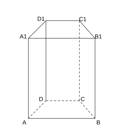
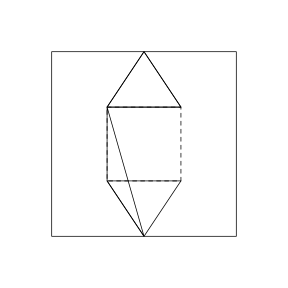
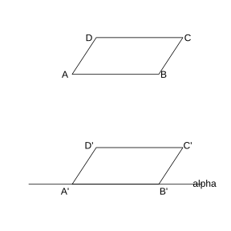
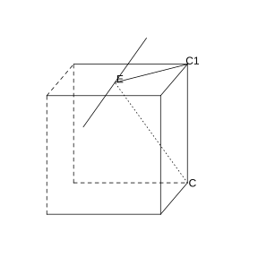
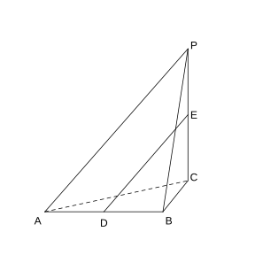
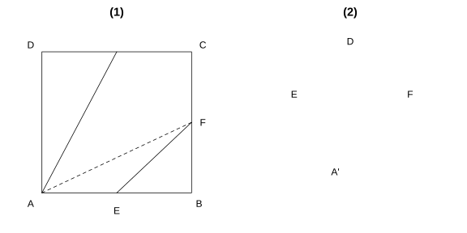
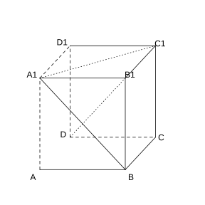
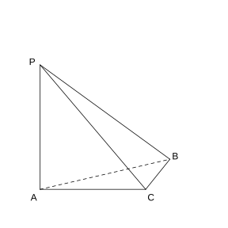
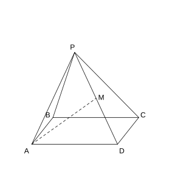

# 作业 53

> **定义 8.1.4** (棱柱)  有两个面互相平行, 其余各面都是四边形, 且相邻两个四边形的公共边互相平行.

> **定义 8.1.8** (棱锥)  有一个面是多边形, 其余各面都是有一个公共顶点的三角形.

> **定义 8.1.10** (棱台)  用平行于棱锥底面的平面截取棱锥, 底面和截面之间的部分.

> **定义 8.3.11** (球的表面积)  $S_{\text{球}}=4\pi R^{2}$.

> **定义 8.3.12** (球的体积)  $V_{\text{球}}=\frac{4}{3}\pi R^{3}$.

> **基本事实 8.4.2** (基本事实 1)  过不在一条直线上的三个点, 有且只有一个平面.

> **基本事实 8.4.3** (基本事实 2)  如果一条直线上的两个点在一个平面内, 那么这条直线在这个平面内.

> **基本事实 8.4.4** (基本事实 3)  如果两个不重合的平面有一个公共点, 那么它们有且只有一条过该点的公共直线.

> **定义 8.4.8** (异面直线)  不同在任何一个平面内的两条直线.

> **定理 8.5.3** (直线与平面平行的判定定理)  平面外一条直线与此平面内的一条直线平行, 则该直线与此平面平行.

> **定理 8.5.4** (直线与平面平行的性质定理)  一条直线与一个平面平行, 如果过该直线的平面与此平面相交, 则该直线与交线平行.

> **定理 8.5.6** (平面与平面平行的性质定理)  两个平行平面同时和第三个平面相交, 所得交线平行.

> **定理 8.6.4** (直线与平面垂直的判定定理)  一条直线与一个平面内的两条相交直线都垂直, 则该直线与此平面垂直.

> **定理 8.6.5** (直线与平面垂直的性质定理)  垂直于同一个平面的两条直线平行.

> **定理 8.6.8** (平面与平面垂直的判定定理)  一个平面过另一个平面的垂线, 则这两个平面垂直.

> **定理 8.6.9** (平面与平面垂直的性质定理)  两个平面垂直, 则一个平面内垂直于交线的直线与另一个平面垂直.

### 习题一

(复习参考题8 复习巩固第 1 题) 从多面体角度去考察棱柱, 棱锥, 棱台, 填写下列表格:

| 多面体 | 顶点数 $V$ | 棱数 $E$ | 面数 $F$ | $V+F-E$ |
|---|---|---|---|---|
| $n$ 棱柱 | $\;\_\_\;$ | $\;\_\_\;$ | $\;\_\_\;$ | $\;\_\_\;$ |
| $n$ 棱锥 | $\;\_\_\;$ | $\;\_\_\;$ | $\;\_\_\;$ | $\;\_\_\;$ |
| $n$ 棱台 | $\;\_\_\;$ | $\;\_\_\;$ | $\;\_\_\;$ | $\;\_\_\;$ |

### 解答 习题一

由**定义 8.1.4** (棱柱), **定义 8.1.8** (棱锥) 及**定义 8.1.10** (棱台) 计数.

$n$ 棱柱: 两个底面各 $n$ 个顶点, 共 $V=2n$; 侧棱 $n$ 条, 上下底各 $n$ 条边, 共 $E=3n$; 两个底面 $+$ $n$ 个侧面, 共 $F=n+2$; $V+F-E=2n+(n+2)-3n=2$.

$n$ 棱锥: 底面 $n$ 个顶点 $+$ 顶点 $1$ 个, 共 $V=n+1$; 侧棱 $n$ 条, 底边 $n$ 条, 共 $E=2n$; 底面 $1$ 个 $+$ $n$ 个侧面, 共 $F=n+1$; $V+F-E=(n+1)+(n+1)-2n=2$.

$n$ 棱台: 上下底各 $n$ 个顶点, 共 $V=2n$; 侧棱 $n$ 条, 上下底各 $n$ 条边, 共 $E=3n$; 两个底面 $+$ $n$ 个侧面, 共 $F=n+2$; $V+F-E=2n+(n+2)-3n=2$.

故表格依次填入: $n$ 棱柱 ($2n$, $3n$, $n+2$, $2$); $n$ 棱锥 ($n+1$, $2n$, $n+1$, $2$); $n$ 棱台 ($2n$, $3n$, $n+2$, $2$). $\blacksquare$

### 习题二

(复习参考题8 复习巩固第 2 题) 在直四棱柱 $ABCD\text{-}A_{1}B_{1}C_{1}D_{1}$ 中, $AB\parallel CD$, $\angle DAB=90^{\circ}$, $AB=2$, $CD=1$, $AD=3$, $AA_{1}=4$.

(1) 画出四棱柱 $ABCD\text{-}A_{1}B_{1}C_{1}D_{1}$ 的直观图;

(2) 将四棱柱 $ABCD\text{-}A_{1}B_{1}C_{1}D_{1}$ 补成一个长方体, 并说出补上的几何体的名称.

{width=50%}

### 解答 习题二

由**定义 8.1.4** (棱柱) 及斜二测画法.

(1) 按斜二测画法: 取 $AB$ 为 $x$ 轴, $AD$ 为 $y$ 轴, $AA_{1}$ 为 $z$ 轴. 在 $x'$ 轴上取 $AB=2$, $DC=1$ (因 $AB\parallel CD$), 在 $y'$ 轴上取 $AD=1.5$ (取一半), 连接成直角梯形 $ABCD$; 沿 $z$ 轴方向取 $AA_{1}=4$, 画出上底面 $A_{1}B_{1}C_{1}D_{1}$, 连接侧棱.

(2) 底面 $ABCD$ 是直角梯形 ($AB=2$, $CD=1$, $AD=3$, $\angle DAB=90^{\circ}$). 补上一个与原直四棱柱等高的直三棱柱 (底面为直角三角形, 两条直角边分别为 $1$ 和 $3$), 即可补成一个长方体 (长 $2$, 宽 $3$, 高 $4$). $\blacksquare$

### 习题三

(复习参考题8 复习巩固第 3 题) 填空题.

(1) 正方体的棱长扩大到原来的 $n$ 倍, 则其表面积扩大到原来的 $\;\_\_\;$ 倍, 体积扩大到原来的 $\;\_\_\;$ 倍;

(2) 球的半径扩大到原来的 $n$ 倍, 则其表面积扩大到原来的 $\;\_\_\;$ 倍, 体积扩大到原来的 $\;\_\_\;$ 倍.

### 解答 习题三

由**定义 8.3.11** (球的表面积) 及**定义 8.3.12** (球的体积).

(1) 正方体表面积 $S=6a^{2}$, 体积 $V=a^{3}$. 棱长扩大 $n$ 倍后, $S'=6(na)^{2}=n^{2}S$, $V'=(na)^{3}=n^{3}V$. 故表面积扩大 $n^{2}$ 倍, 体积扩大 $n^{3}$ 倍.

(2) 球表面积 $S=4\pi R^{2}$, 体积 $V=\frac{4}{3}\pi R^{3}$. 半径扩大 $n$ 倍后, $S'=4\pi(nR)^{2}=n^{2}S$, $V'=\frac{4}{3}\pi(nR)^{3}=n^{3}V$. 故表面积扩大 $n^{2}$ 倍, 体积扩大 $n^{3}$ 倍. $\blacksquare$

### 习题四

(复习参考题8 复习巩固第 4 题) 如图, 一块边长为 $10\text{ cm}$ 的正方形铁片上有四块阴影部分. 将这些阴影部分裁下来, 然后用余下的四个全等的等腰三角形加工成一个正四棱锥形容器, 把容器的容积 $V$ (单位: $\text{cm}^{3}$) 表示为 $x$ (单位: $\text{cm}$) 的函数.

(图: 正方形边长 $10$, 中间正方形边长 $x$, 四个等腰三角形底为 $x$, 高为 $5$.)

{width=50%}

### 解答 习题四

由棱锥体积公式 $V=\frac{1}{3}Sh$.

正四棱锥底面是边长为 $x$ 的正方形, 底面积 $S=x^{2}$.

等腰三角形的高为 $5$, 即侧面等腰三角形的斜高 $l=5$. 棱锥的高 $h$, 底面中心到边的距离 $\frac{x}{2}$, 斜高 $5$ 构成直角三角形:

$$
h=\sqrt{5^{2}-\left(\frac{x}{2}\right)^{2}}=\sqrt{25-\frac{x^{2}}{4}}.
$$

故容积

$$
V=\frac{1}{3}x^{2}\sqrt{25-\frac{x^{2}}{4}}=\frac{x^{2}}{6}\sqrt{100-x^{2}}\quad (0<x<10).
$$

$\blacksquare$

### 习题五

(复习参考题8 复习巩固第 5 题) 三个平面可将空间分成几部分? 请分情况说明.

### 解答 习题五

由平面与平面的位置关系分类讨论.

(1) 三个平面互相平行: 空间分成 $4$ 部分.

(2) 两个平面平行, 第三个平面与它们相交: 空间分成 $6$ 部分.

(3) 三个平面两两相交, 交线互相平行: 空间分成 $7$ 部分.

(4) 三个平面两两相交, 三条交线重合 (即三个平面共线): 空间分成 $6$ 部分.

(5) 三个平面两两相交, 三条交线交于同一点 (两两垂直, 如墙角): 空间分成 $8$ 部分.

故三个平面可将空间分成 $4$, $6$, $7$ 或 $8$ 部分. $\blacksquare$

### 习题六

(复习参考题8 复习巩固第 6 题) 已知 $\alpha$, $\beta$, $\gamma$ 是三个平面, 且 $\alpha\cap\beta=a$, $\alpha\cap\gamma=b$, $\beta\cap\gamma=c$.

(1) 若 $a\cap b=O$, 求证: $a$, $b$, $c$ 三线共点.

(2) 若 $a\parallel b$, 则 $a$ 与 $c$, $b$ 与 $c$ 有什么关系? 为什么?

### 解答 习题六

由**基本事实 8.4.4** (基本事实 3).

(1) 因为 $a\cap b=O$, $a=\alpha\cap\beta$, $b=\alpha\cap\gamma$, 故 $O\in\beta$ 且 $O\in\gamma$. 又 $\beta\cap\gamma=c$, 由**基本事实 8.4.4** (基本事实 3), $O\in c$. 故 $a$, $b$, $c$ 三线共点于 $O$.

(2) 因为 $a\parallel b$, $b\subset\gamma$, $a\not\subset\gamma$, 故 $a\parallel\gamma$. 又 $a\subset\beta$, $\beta\cap\gamma=c$, 由线面平行的性质, $a\parallel c$. 又 $a\parallel b$, 故 $b\parallel c$.

故 $a\parallel c$, $b\parallel c$. $\blacksquare$

### 习题七

(复习参考题8 复习巩固第 7 题) 如图, 四边形 $A'B'C'D'$ 是 $\square ABCD$ 在平面 $\alpha$ 上的投影 ($AA'\parallel BB'\parallel CC'\parallel DD'$), 求证: 四边形 $A'B'C'D'$ 是平行四边形.

{width=50%}

### 解答 习题七

由**定理 8.5.6** (平面与平面平行的性质定理).

因为 $AA'\parallel BB'\parallel CC'\parallel DD'$, 这四条直线互相平行. $AB\parallel CD$ (平行四边形). 由**定理 8.5.6** (平面与平面平行的性质定理), 分别过平行线对 $AA'$, $BB'$ 和 $CC'$, $DD'$ 的两个平面与平面 $\alpha$ 的交线 $A'B'$ 和 $C'D'$ 平行.

同理, 由 $AD\parallel BC$, 可得 $A'D'\parallel B'C'$.

四边形 $A'B'C'D'$ 两组对边分别平行, 故它是平行四边形. $\blacksquare$

### 习题八

(复习参考题8 复习巩固第 8 题) 如图, 一块正方体形木料的上底面有一点 $E$. 若经过点 $E$ 在上底面上画一条直线与 $CE$ 垂直, 则应该怎样画?

{width=50%}

### 解答 习题八

由**定理 8.6.4** (直线与平面垂直的判定定理).

设正方体上底面为 $A_{1}B_{1}C_{1}D_{1}$, $C$ 为下底面顶点. 连接 $C_{1}E$. 在上底面 $A_{1}B_{1}C_{1}D_{1}$ 内, 过点 $E$ 作直线 $l\perp C_{1}E$.

因为 $CC_{1}\perp$ 上底面, 故 $CC_{1}\perp l$. 又 $l\perp C_{1}E$, $CC_{1}\cap C_{1}E=C_{1}$, 故 $l\perp$ 平面 $CC_{1}E$. 而 $CE\subset$ 平面 $CC_{1}E$, 故 $l\perp CE$.

故过 $E$ 作 $C_{1}E$ 的垂线即为所求. $\blacksquare$

### 习题九

(复习参考题8 复习巩固第 9 题) 如图, 在三棱锥 $P\text{-}ABC$ 中, $PC\perp$ 底面 $ABC$, $AB\perp BC$, $D$, $E$ 分别是 $AB$, $PB$ 的中点. 求证:

(1) $DE\parallel$ 平面 $PAC$;

(2) $AB\perp PB$.

{width=50%}

### 解答 习题九

由**定理 8.5.3** (直线与平面平行的判定定理) 及**定理 8.6.4** (直线与平面垂直的判定定理).

(1) 在 $\triangle PAB$ 中, $D$, $E$ 分别是 $AB$, $PB$ 的中点, 故 $DE$ 是中位线, $DE\parallel PA$.

又 $PA\subset$ 平面 $PAC$, $DE\not\subset$ 平面 $PAC$, 由**定理 8.5.3** (直线与平面平行的判定定理), $DE\parallel$ 平面 $PAC$.

(2) 因为 $PC\perp$ 底面 $ABC$, $AB\subset$ 底面 $ABC$, 故 $PC\perp AB$. 又已知 $AB\perp BC$, $PC\cap BC=C$, 由**定理 8.6.4** (直线与平面垂直的判定定理), $AB\perp$ 平面 $PBC$.

而 $PB\subset$ 平面 $PBC$, 故 $AB\perp PB$. $\blacksquare$

### 习题十

(复习参考题8 综合运用第 10 题) 如图, 在边长为 $2$ 的正方形 $ABCD$ 中, 点 $E$ 是 $AB$ 的中点, 点 $F$ 是 $BC$ 的中点, 将 $\triangle AED$, $\triangle BEF$, $\triangle DCF$ 分别沿 $DE$, $EF$, $DF$ 折起, 使 $A$, $B$, $C$ 三点重合于点 $A'$.

(1) 求证 $A'D\perp EF$;

(2) 求三棱锥 $A'\text{-}EFD$ 的体积.

{width=100%}

### 解答 习题十

由**定理 8.6.4** (直线与平面垂直的判定定理) 及棱锥体积公式.

折叠前: $EA\perp AD$, $EB\perp BF$, $FC\perp CD$. 折叠后 $A$, $B$, $C$ 重合为 $A'$, 故 $A'E\perp A'D$, $A'E\perp A'F$, $A'F\perp A'D$.

(1) 因为 $A'E\perp A'D$, $A'F\perp A'D$, $A'E\cap A'F=A'$, 故 $A'D\perp$ 平面 $A'EF$. 而 $EF\subset$ 平面 $A'EF$, 故 $A'D\perp EF$.

(2) 由上述, $A'E$, $A'F$, $A'D$ 两两垂直. $A'E=A'F=1$ ($E$, $F$ 为中点), $A'D=AD=2$.

三棱锥 $A'\text{-}EFD$ 即三棱锥 $D\text{-}A'EF$ (以 $A'$ 为顶点, 底面 $\triangle A'EF$). $\triangle A'EF$ 是直角三角形, 面积 $S=\frac{1}{2}\times 1\times 1=\frac{1}{2}$.

高 $DA'=2$. 故体积

$$
V=\frac{1}{3}\times\frac{1}{2}\times 2=\frac{1}{3}.
$$

$\blacksquare$

### 习题十一

(复习参考题8 综合运用第 11 题) 如下页图, 在四面体 $A\text{-}BCD$ 中, $M$ 是 $AD$ 的中点, $P$ 是 $BM$ 的中点, 点 $Q$ 在线段 $AC$ 上, 且 $AQ=3QC$. 求证: $PQ\parallel$ 平面 $BCD$.

### 解答 习题十一

由**定理 8.5.3** (直线与平面平行的判定定理).

取 $MD$ 的中点 $N$, 连接 $PN$, $QN$.

在 $\triangle BMD$ 中, $P$ 是 $BM$ 中点, $N$ 是 $MD$ 中点, 故 $PN\parallel BD$.

在 $\triangle ADC$ 中, $M$ 是 $AD$ 中点, $N$ 是 $MD$ 中点, 故 $AN=\frac{3}{4}AD$, 即 $AN:ND=3:1$. 又 $AQ:QC=3:1$, 故在 $\triangle ADC$ 中, $QN\parallel DC$.

$PN\parallel BD$, $QN\parallel DC$, $PN\cap QN=N$, $BD\cap DC=D$. 由面面平行判定定理, 平面 $PQN\parallel$ 平面 $BCD$.

而 $PQ\subset$ 平面 $PQN$, 故 $PQ\parallel$ 平面 $BCD$. $\blacksquare$

### 习题十二

(复习参考题8 综合运用第 12 题) 如图, 在正方体 $ABCD\text{-}A_{1}B_{1}C_{1}D_{1}$ 中, 求证:

(1) $B_{1}D\perp$ 平面 $A_{1}BC_{1}$;

(2) $B_{1}D$ 与平面 $A_{1}BC_{1}$ 的交点 $H$ 是 $\triangle A_{1}C_{1}B$ 的重心.

{width=50%}

### 解答 习题十二

由**定理 8.6.4** (直线与平面垂直的判定定理).

(1) 因为 $DD_{1}\perp$ 平面 $A_{1}B_{1}C_{1}D_{1}$, 故 $DD_{1}\perp A_{1}C_{1}$. 又 $A_{1}C_{1}\perp B_{1}D_{1}$ (正方形对角线垂直), $DD_{1}\cap B_{1}D_{1}=D_{1}$, 故 $A_{1}C_{1}\perp$ 平面 $BDD_{1}B_{1}$. 而 $B_{1}D\subset$ 平面 $BDD_{1}B_{1}$, 故 $A_{1}C_{1}\perp B_{1}D$.

同理, $A_{1}B\perp B_{1}C$ (正方形 $ABB_{1}A_{1}$ 对角线垂直, 且 $BC\perp$ 平面 $ABB_{1}A_{1}$), 可证 $B_{1}D\perp A_{1}B$.

$A_{1}C_{1}\cap A_{1}B=A_{1}$, 由**定理 8.6.4** (直线与平面垂直的判定定理), $B_{1}D\perp$ 平面 $A_{1}BC_{1}$.

(2) 设正方体棱长为 $1$, $B_{1}D$ 与平面 $A_{1}BC_{1}$ 交于 $H$. 由对称性, $H$ 到 $A_{1}$, $B$, $C_{1}$ 三点的距离相等. $\triangle A_{1}BC_{1}$ 是正三角形, 其外心, 重心, 垂心重合. 故 $H$ 是 $\triangle A_{1}C_{1}B$ 的重心. $\blacksquare$

### 习题十三

(复习参考题8 综合运用第 13 题) 如图, 在三棱锥 $P\text{-}ABC$ 中, $\angle ACB=90^{\circ}$, $PA\perp$ 底面 $ABC$.

(1) 求证: 平面 $PAC\perp$ 平面 $PBC$;

(2) 若 $AC=BC=PA$, $M$ 是 $PB$ 的中点, 求 $AM$ 与平面 $PBC$ 所成角的正切值.

{width=50%}

### 解答 习题十三

由**定理 8.6.8** (平面与平面垂直的判定定理).

(1) 因为 $PA\perp$ 底面 $ABC$, $BC\subset$ 底面 $ABC$, 故 $PA\perp BC$. 又 $\angle ACB=90^{\circ}$, 即 $AC\perp BC$. $PA\cap AC=A$, 故 $BC\perp$ 平面 $PAC$.

而 $BC\subset$ 平面 $PBC$, 由**定理 8.6.8** (平面与平面垂直的判定定理), 平面 $PAC\perp$ 平面 $PBC$.

(2) 设 $AC=BC=PA=a$. 取 $PC$ 的中点 $N$, 连接 $AN$, $MN$.

因为 $PA=AC=a$, $\triangle PAC$ 是等腰直角三角形, $N$ 为 $PC$ 中点, 故 $AN\perp PC$.

由 (1) 平面 $PAC\perp$ 平面 $PBC$, 交线为 $PC$, $AN\subset$ 平面 $PAC$ 且 $AN\perp PC$, 故 $AN\perp$ 平面 $PBC$.

$MN$ 是 $\triangle PBC$ 的中位线, $MN\parallel BC$ 且 $MN=\frac{1}{2}BC=\frac{a}{2}$.

$AM$ 在平面 $PBC$ 上的射影为 $NM$, $\angle AMN$ 即 $AM$ 与平面 $PBC$ 所成的角.

$AN=\frac{\sqrt{2}}{2}a$, $MN=\frac{a}{2}$. 故

$$
\tan\angle AMN=\frac{AN}{MN}=\frac{\frac{\sqrt{2}}{2}a}{\frac{a}{2}}=\sqrt{2}.
$$

$\blacksquare$

### 习题十四

(复习参考题8 综合运用第 14 题) 如图, 在四棱锥 $P\text{-}ABCD$ 中, 底面 $ABCD$ 为正方形, 侧面 $PAD$ 是正三角形, 侧面 $PAD\perp$ 底面 $ABCD$, $M$ 是 $PD$ 的中点.

(1) 求证: $AM\perp$ 平面 $PCD$;

(2) 求侧面 $PBC$ 与底面 $ABCD$ 所成二面角的余弦值.

{width=50%}

### 解答 习题十四

由**定理 8.6.9** (平面与平面垂直的性质定理) 及**定理 8.6.4** (直线与平面垂直的判定定理).

(1) 因为侧面 $PAD\perp$ 底面 $ABCD$, 交线为 $AD$. 底面 $ABCD$ 为正方形, 故 $CD\perp AD$. 由面面垂直的性质, $CD\perp$ 平面 $PAD$.

而 $AM\subset$ 平面 $PAD$, 故 $CD\perp AM$.

又 $\triangle PAD$ 是正三角形, $M$ 是 $PD$ 中点, 故 $AM\perp PD$.

$CD\cap PD=D$, 由**定理 8.6.4** (直线与平面垂直的判定定理), $AM\perp$ 平面 $PCD$.

(2) 取 $AD$ 的中点 $O$, $BC$ 的中点 $E$, 连接 $PO$, $OE$, $PE$.

$\triangle PAD$ 为正三角形, $O$ 为 $AD$ 中点, 故 $PO\perp AD$. 又平面 $PAD\perp$ 底面 $ABCD$, 故 $PO\perp$ 底面 $ABCD$.

$OE\parallel AB\parallel CD$, $OE\perp BC$. 由三垂线定理, $PE\perp BC$. 故 $\angle PEO$ 即侧面 $PBC$ 与底面 $ABCD$ 所成二面角的平面角.

设正方形边长为 $a$, 则 $PO=\frac{\sqrt{3}}{2}a$, $OE=a$, $PE=\sqrt{PO^{2}+OE^{2}}=\sqrt{\frac{3}{4}a^{2}+a^{2}}=\frac{\sqrt{7}}{2}a$.

故 $\cos\angle PEO=\frac{OE}{PE}=\frac{a}{\frac{\sqrt{7}}{2}a}=\frac{2}{\sqrt{7}}=\frac{2\sqrt{7}}{7}$. $\blacksquare$

### 习题十五

(复习参考题8 拓广探索第 15 题) 从直线 $a$, $b$ 和平面 $\omega$ 这三个空间元素中任取两个, 若已知它们与第三个元素有平行或垂直关系, 则所取的两个元素是否也有平行或垂直关系? 你能得到哪些结论? 写出一些你认为重要的. 如果三个元素分别是直线 $m$, 平面 $\alpha$ 和 $\beta$, 你能得到哪些结论?

### 解答 习题十五

由**定理 8.6.5** (直线与平面垂直的性质定理) 及面面平行, 垂直的性质.

(1) 若 $a\parallel\omega$, $b\parallel\omega$, 则 $a$ 与 $b$ 平行, 相交或异面, 不一定平行.

(2) 若 $a\perp\omega$, $b\perp\omega$, 则 $a\parallel b$ (**定理 8.6.5**).

(3) 若 $a\parallel\omega$, $b\perp\omega$, 则 $a\perp b$.

对直线 $m$ 和平面 $\alpha$, $\beta$:

(4) 若 $m\perp\alpha$, $m\perp\beta$, 则 $\alpha\parallel\beta$.

(5) 若 $m\parallel\alpha$, $m\parallel\beta$, 则 $\alpha$ 与 $\beta$ 平行或相交, 不一定平行.

(6) 若 $m\perp\alpha$, $\alpha\parallel\beta$, 则 $m\perp\beta$.

(7) 若 $m\parallel\alpha$, $\alpha\perp\beta$, 则 $m$ 与 $\beta$ 关系不确定. $\blacksquare$

### 习题十六

(复习参考题8 拓广探索第 16 题) 已知 $m$, $n$ 为异面直线, $m\perp$ 平面 $\alpha$, $n\perp$ 平面 $\beta$. 若直线 $l$ 满足 $l\perp m$, $l\perp n$, $l\not\subset\alpha$, $l\not\subset\beta$, 则 ( ).

(A) $\alpha\parallel\beta$, $l\parallel\alpha$; (B) $\alpha$ 与 $\beta$ 相交, 且交线平行于 $l$; (C) $\alpha\perp\beta$, $l\perp\beta$; (D) $\alpha$ 与 $\beta$ 相交, 且交线垂直于 $l$.

### 解答 习题十六

由**定理 8.6.5** (直线与平面垂直的性质定理).

因为 $m\perp\alpha$, $n\perp\beta$, 且 $m$, $n$ 是异面直线, 故 $\alpha$ 与 $\beta$ 不平行 (若 $\alpha\parallel\beta$, 则由**定理 8.6.5** 类似结论, $m\parallel n$, 与 $m$, $n$ 异面矛盾). 故 $\alpha$ 与 $\beta$ 相交.

$l\perp m$, $l\perp n$. 过 $l$ 作平面, 由 $m\perp\alpha$, $n\perp\beta$, 可推知 $l$ 平行于 $\alpha$ 与 $\beta$ 的交线.

故选 (B). $\blacksquare$
