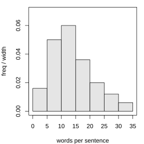
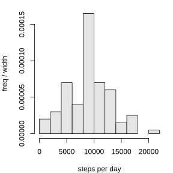

# 作业 54

> **定义 9.1.1** (普查与抽样调查)  对每一个调查对象都进行调查的方法, 称为全面调查, 又称普查; 根据一定目的, 从总体中抽取一部分个体进行调查, 并以此为依据对总体的情况作出估计和推断的调查方法, 称为抽样调查.

> **定义 9.1.2** (总体, 个体, 样本与样本量)  在一个调查中, 调查对象的全体称为总体, 组成总体的每一个调查对象称为个体; 从总体中抽取的那部分个体称为样本, 样本中包含的个体数称为样本容量, 简称样本量.

> **定义 9.1.3** (简单随机抽样)  设一个总体含有 $N$ 个个体, 从中逐个抽取 $n$ 个个体作为样本, 如果抽取是放回的且每次抽取时总体内各个个体被抽到的概率都相等, 称为放回简单随机抽样; 如果抽取是不放回的且每次抽取时总体内未进入样本的各个个体被抽到的概率都相等, 称为不放回简单随机抽样.

> **定义 9.1.4** (总体均值与样本均值)  总体中 $N$ 个个体变量值的平均数称为总体平均数, 样本中 $n$ 个变量值的平均数称为样本平均数; 在简单随机抽样中, 常用样本平均数估计总体平均数.

> **定义 9.1.5** (分层随机抽样, 层与比例分配)  按一个或多个变量把总体划分成若干个子总体, 每个个体属于且仅属于一个子总体, 在每个子总体中独立地进行简单随机抽样, 再把所有子总体中抽取的样本合在一起作为总样本, 这样的抽样方法称为分层随机抽样; 若每层样本量与层的大小成比例, 称为比例分配.

> **常用结论 9.1.6** (分层随机抽样的总体平均数估计)  比例分配的分层随机抽样中, 可直接用样本平均数 $\bar w=\frac{m}{m+n}\bar x+\frac{n}{m+n}\bar y$ 估计总体平均数; 非比例分配时, 按各层总体大小加权估计.

> **常用结论 9.1.7** (数据变换对平均数的影响)  若 $y_i=ax_i+b$, 则 $\bar y=a\bar x+b$.

> **定义 9.2.1** (频率分布表与频率分布直方图)  把数据分成若干组, 列出各组频数与频率制成频率分布表; 频率分布直方图中纵轴表示 $\frac{\text{频率}}{\text{组距}}$, 小长方形面积等于相应各组频率, 所有小长方形面积之和等于 1.

> **定义 9.2.2** (第 $p$ 百分位数)  一组数据的第 $p$ 百分位数是这样一个值, 它使得这组数据中至少有 $p\%$ 的数据小于或等于这个值, 且至少有 $\left(100-p\right)\%$ 的数据大于或等于这个值; 中位数就是第 50 百分位数.

> **定义 9.2.3** (众数, 中位数与平均数)  众数是一组数据中出现次数最多的数据; 中位数是把数据从小到大排列后处于中间位置的数; 平均数是所有数据的算术平均数; 它们从不同角度描述数据的集中趋势, 平均数易受极端值影响.

> **定义 9.2.4** (总体方差, 总体标准差, 样本方差与样本标准差)  方差 (标准差) 是各数据与平均数差的平方的平均数 (的算术平方根), 度量数据的离散程度; 方差 (标准差) 越大, 数据的离散程度越大.

> **常用结论 9.2.5** (分层随机抽样的总方差)  两层合并后的方差为 $s^2=\frac{n_1\left(s_1^2+\left(\bar x_1-\bar w\right)^2\right)+n_2\left(s_2^2+\left(\bar x_2-\bar w\right)^2\right)}{n_1+n_2}$.

> **常用结论 9.2.6** (数据变换对平均数与方差的影响)  若 $y_i=ax_i+b$, 则 $\bar y=a\bar x+b$, $s_y^2=a^2s_x^2$, $s_y=\left|a\right|s_x$.

### 习题一

(复习参考题9 复习巩固第 1 题) 为了了解某地参加计算机水平测试的 5000 名学生的成绩, 从中抽取了 200 名学生进行调查分析. 在这个问题中, 被抽取的 200 名学生是 ($\;\_\_\;$).

(A) 总体  (B) 个体  (C) 样本  (D) 样本量

### 解答 习题一

由**定义 9.1.2** (总体, 个体, 样本与样本量), 调查对象的全体是总体, 组成总体的每一个调查对象是个体, 从总体中抽取的那部分个体是样本.

本题中, 5000 名学生的成绩是总体, 每一名学生的成绩是个体, 被抽取的 200 名学生是从总体中抽出的一部分个体, 即样本; 200 才是样本量. 故选 (C). $\blacksquare$

### 习题二

(复习参考题9 复习巩固第 2 题) 四名同学各掷骰子 5 次, 分别记录每次骰子出现的点数. 根据四名同学的统计结果, 可以判断出一定没有出现点数 6 的是 ($\;\_\_\;$).

(A) 平均数为 3, 中位数为 2

(B) 中位数为 3, 众数为 2

(C) 平均数为 2, 方差为 2.4

(D) 中位数为 3, 方差为 2.8

### 解答 习题二

由**定义 9.2.3** (众数, 中位数与平均数) 与**定义 9.2.4** (总体方差, 总体标准差, 样本方差与样本标准差).

(1) 对 (A): 平均数为 3, 则 5 次点数之和为 15. 例如 $1,2,2,4,6$ 的和为 15, 中位数为 2, 平均数为 3, 其中出现了 6. 故 (A) 不能判断一定没有 6.

(2) 对 (B): 例如 $2,2,3,4,6$ 的中位数为 3, 众数为 2, 其中出现了 6. 故 (B) 不能判断一定没有 6.

(3) 对 (C): 平均数为 2, 则 5 次点数之和为 $5\times2=10$. 方差为 2.4, 则 $\sum\left(x_i-\bar x\right)^2=5\times2.4=12$, 即

$$
\sum x_i^2=\sum\left(x_i-\bar x\right)^2+n\bar x^2=12+5\times4=32.
$$

若出现一次点数 6, 则其余 4 次点数之和为 $10-6=4$, 即其余 4 次都为 1, 此时平方和为 $6^2+4\times1^2=40>32$, 矛盾. 故一定没有出现点数 6.

(4) 对 (D): 例如 $1,2,3,3,6$ 的中位数为 3, 平均数为 3, 方差为 $\frac{\left(1-3\right)^2+\left(2-3\right)^2+0+0+\left(6-3\right)^2}{5}=\frac{14}{5}=2.8$, 其中出现了 6. 故 (D) 不能判断一定没有 6.

综上, 选 (C). $\blacksquare$

### 习题三

(复习参考题9 复习巩固第 3 题) 如果一组数据的中位数比平均数小很多, 下面哪种叙述一定是错误的? 为什么?

(1) 数据中可能有异常值;

(2) 这组数据是近似对称的;

(3) 数据中可能有极端大的值;

(4) 数据中众数可能和中位数相同.

### 解答 习题三

由**定义 9.2.3** (众数, 中位数与平均数), 平均数利用全部数据且易受极端值影响, 中位数只与排列位置有关.

(1) 数据中可能有异常值: 可能. 个别异常大的值会把平均数拉高.

(2) 这组数据是近似对称的: 一定错误. 若数据近似对称, 则平均数与中位数应大致相等, 不会出现中位数比平均数小很多的情况.

(3) 数据中可能有极端大的值: 可能. 极端大的值把平均数拉高, 而中位数不受影响.

(4) 数据中众数可能和中位数相同: 可能. 众数是否与中位数相同, 与平均数和中位数的大小关系没有必然联系.

故一定错误的是 (2). $\blacksquare$

### 习题四

(复习参考题9 复习巩固第 4 题) (1) 在已分组的若干数据中, 每组的频数是指 $\;\_\_\;$, 每组的频率是指 $\;\_\_\;$.

(2) 一个公司共有 $N$ 名员工, 下设一些部门, 要采用样本量比例分配的分层随机抽样方法从全体员工中抽取样本量为 $n$ 的样本. 如果某部门有 $m$ 名员工, 那么从该部门抽取的员工人数是 $\;\_\_\;$.

### 解答 习题四

由**定义 9.2.1** (频率分布表与频率分布直方图) 与**定义 9.1.5** (分层随机抽样, 层与比例分配).

(1) 每组的频数是指落在该组中的数据个数; 每组的频率是指该组频数与数据总数的比值.

(2) 比例分配时, 各部门抽取的人数与该部门员工人数成比例. 该部门占全体员工的比例为 $\frac{m}{N}$, 故从该部门抽取的员工人数为

$$
\frac{m}{N}\cdot n=\frac{mn}{N}.
$$

$\blacksquare$

### 习题五

(复习参考题9 复习巩固第 5 题) 一家著名的全国性连锁服装店进行了一项关于当年秋季服装流行色的民意调查. 调查者通过向顾客发放饮料, 并让顾客通过挑选饮料杯上印着的颜色来对自己喜欢的服装颜色 "投票". 根据这次调查结果, 在某大城市 A, 服装颜色的众数是红色, 而当年全国服装协会发布的调查结果是咖啡色.

(1) 这个结果是否代表 A 城市的人的看法?

(2) 你认为这两种调查的差异是由什么引起的?

### 解答 习题五

由**定义 9.1.3** (简单随机抽样) 与**定义 9.2.3** (众数, 中位数与平均数).

(1) 这个结果不能代表 A 城市所有人的看法. 因为参加投票的只是到该服装店购物的顾客, 他们是一个特殊群体, 在年龄, 性别, 消费偏好上都与 A 城市全体居民有差异.

(2) 两种调查结果的差异是由抽样偏差引起的. 连锁店调查只对到店顾客进行, 抽样框没有覆盖 A 城市全体居民; 而全国服装协会的调查覆盖面更广. 用特殊人群的投票结果去推断全体居民的偏好, 自然会出现偏差. 这说明抽样调查中抽样框能否覆盖总体, 直接影响结果的代表性. $\blacksquare$

### 习题六

(复习参考题9 综合运用第 6 题) 从一本英语书中随机抽取 100 个句子, 数出每个句子中的单词数, 作出这 100 个数据的频率分布表, 由此你可以作出什么估计?

{width=50%}

### 解答 习题六

由**定义 9.2.1** (频率分布表与频率分布直方图) 与**定义 9.1.4** (总体均值与样本均值).

统计这 100 个句子所含单词数的分布, 列出频率分布表, 画频率分布直方图.

由频率分布表可以看出这本书中句子单词数的分布规律: 大多数句子含有多少个单词, 句子单词数集中在哪个范围, 是否有少数特别长或特别短的句子. 进一步, 用这 100 个句子单词数的平均数, 可以估计这本书平均每个句子所含的单词数, 进而估计这本书的语言难度. $\blacksquare$

### 习题七

(复习参考题9 综合运用第 7 题) 在一个文艺比赛中, 12 名专业人士和 12 名观众代表各组成一个评委小组, 给参赛选手打分. 下面是两组评委对同一名选手的打分:

小组 A: $42,45,48,46,52,47,49,55,42,51,47,45$;

小组 B: $55,36,70,66,75,49,46,68,42,62,58,47$.

(1) 选择一个可以度量每一组评委打分相似性的量, 并对每组评委的打分计算度量值;

(2) 你能据此判断小组 A 与小组 B 中哪一个更像是由专业人士组成的吗?

### 解答 习题七

由**定义 9.2.4** (总体方差, 总体标准差, 样本方差与样本标准差).

(1) 用方差 (或标准差) 度量同一组评委打分的相似性: 方差越小, 说明组内打分越集中, 评委之间越一致.

小组 A 的平均数为

$$
\bar x_A=\frac{42+45+\cdots+45}{12}=\frac{569}{12}\approx47.42,
$$

方差约为 $s_A^2\approx13.91$, 标准差约为 $s_A\approx3.73$.

小组 B 的平均数为

$$
\bar x_B=\frac{55+36+\cdots+47}{12}=\frac{674}{12}\approx56.17,
$$

方差约为 $s_B^2\approx138.97$, 标准差约为 $s_B\approx11.79$.

(2) 因为 $s_A\approx3.73<s_B\approx11.79$, 小组 A 的打分明显更集中, 评委之间意见更一致. 专业评委通常有统一的专业标准, 打分比较一致; 而观众代表打分差异较大. 故小组 A 更像是由专业人士组成的. $\blacksquare$

### 习题八

(复习参考题9 综合运用第 8 题) 一名学生通过计步仪器, 记录了自己 100 天每天走的步数, 数据见教材.

(1) 画出这组数据的频率分布直方图, 并分析数据的分布特点;

(2) 计算这组数据的平均数, 中位数和标准差, 并根据这些数值描述这名学生的运动情况.

{width=50%}

### 解答 习题八

由**定义 9.2.1** (频率分布表与频率分布直方图), **定义 9.2.3** (众数, 中位数与平均数) 与**定义 9.2.4** (总体方差, 总体标准差, 样本方差与样本标准差).

(1) 把 100 个步数数据适当分组, 列出频率分布表, 画频率分布直方图. 可以看到: 这名学生每天的步数大致集中在 $6000\sim12000$ 步之间, 分布大致对称, 但右侧拖出一条尾巴, 即有少数天数步数特别大.

(2) 计算得平均数为

$$
\bar x=\frac{\sum_{i=1}^{100}x_i}{100}\approx9370,
$$

中位数约为 $9015$, 标准差约为

$$
s=\sqrt{\frac{1}{100}\sum_{i=1}^{100}\left(x_i-\bar x\right)^2}\approx4223.
$$

这名学生平均每天走约 9370 步, 中位数约 9015 步, 说明他每天步行量中等; 标准差较大, 说明他每天的运动量不稳定, 有的天走得多, 有的天走得少, 运动习惯还不够规律. $\blacksquare$

### 习题九

(复习参考题9 综合运用第 9 题) 一家水果店的店长为了解本店苹果的日销售情况, 记录了过去 30 天苹果的日销售量 (单位: $\mathrm{kg}$), 结果如下:

$83,96,107,91,70,75,94,80,80,100,75,99,117,89,74,94,84,85,101,87,93,85,107,99,55,97,86,84,85,104$.

(1) 请计算该水果店过去 30 天苹果日销售量的中位数, 平均数, 极差和标准差;

(2) 一次进货太多, 水果会变得不新鲜; 进货太少, 又不能满足顾客的需求. 店长希望每天的苹果尽量新鲜, 又能 $80\%$ 地满足顾客的需求 (在 100 天中, 大约有 80 天可以满足顾客的需求). 请问, 每天应该进多少千克苹果?

### 解答 习题九

由**定义 9.2.3** (众数, 中位数与平均数), **定义 9.2.4** (总体方差, 总体标准差, 样本方差与样本标准差) 与**定义 9.2.2** (第 $p$ 百分位数).

(1) 把 30 个数据从小到大排列. 平均数为

$$
\bar x=\frac{83+96+\cdots+104}{30}=\frac{2676}{30}=89.2.
$$

中位数为第 15 个数与第 16 个数的平均数, 即 $88$. 极差为最大值与最小值之差, 即 $117-55=62$. 标准差为

$$
s=\sqrt{\frac{1}{30}\sum_{i=1}^{30}\left(x_i-89.2\right)^2}\approx12.6.
$$

(2) 要 $80\%$ 地满足顾客需求, 即把进货量定在日销售量的第 80 百分位数上: 使约 $80\%$ 的天数销售量不超过进货量.

第 80 百分位数: $i=30\times80\%=24$, 是整数, 故为第 24 个数与第 25 个数的平均数, 约为 $99.5$.

故每天应进约 $100\,\mathrm{kg}$ 苹果, 既能尽量保持苹果新鲜, 又能在约 $80\%$ 的天数里满足顾客需求. $\blacksquare$

### 习题十

(复习参考题9 综合运用第 10 题) 一家保险公司决定对推销员实行目标管理, 即给推销员确定一个具体的销售目标. 下面一组数据是部分推销员的月销售额 (单位: 万元):

$1.958,1.611,1.645,2.045,2.024,2.166,2.245,1.822,1.234,1.935,2.055,1.745,1.878,1.796,1.991,1.812,1.465,1.478,1.678,1.878,1.829,1.851,1.786,1.958,1.921,1.855,1.634,1.554,1.755,1.489,1.894,1.743,1.714,1.802,1.998,1.788,1.732,1.935,1.545,1.958,1.345,2.134,1.400,1.842,2.300,1.752,1.851,1.716,2.456,2.514$.

请根据这组样本数据提出使 $65\%$ 的职工能够完成销售指标的建议.

### 解答 习题十

由**定义 9.2.2** (第 $p$ 百分位数).

要使 $65\%$ 的职工能够完成销售指标, 应把销售目标定在月销售额的第 65 百分位数上: 这样约 $65\%$ 的推销员月销售额不低于该目标, 即能完成指标.

把 50 个月销售额从小到大排列. $i=50\times65\%=32.5$, 不是整数, 向上取整得第 33 个数. 由数据算得第 65 百分位数约为 $1.894$ 万元.

故建议把月销售目标定为约 $1.9$ 万元. 这样约 $65\%$ 的推销员能够完成指标, 既不会因目标过高使多数人完不成而失去信心, 也不会因目标过低而不利于挖掘工作潜力. $\blacksquare$

### 习题十一

(复习参考题9 综合运用第 11 题) 为了解某市家庭用电量的情况, 该市统计局调查了 200 户居民去年一年的月均用电量 (单位: $\mathrm{kW\cdot h}$), 数据从小到大排序. 为了既满足居民的基本用电需求, 又提高能源的利用效率, 市政府计划采用阶梯电价, 使 $75\%$ 的居民缴费在第一档, $20\%$ 的居民缴费在第二档, 其余 $5\%$ 的居民缴费在第三档. 请确定各档的范围.

### 解答 习题十一

由**定义 9.2.2** (第 $p$ 百分位数).

第一档覆盖 $75\%$ 的居民, 故第一档上限为第 75 百分位数; 第二档覆盖接下来的 $20\%$, 即介于第 75 百分位数与第 95 百分位数之间; 第三档为超过第 95 百分位数的部分.

把 200 个数据从小到大排列. 第 75 百分位数: $i=200\times75\%=150$, 是整数, 为第 150 个数与第 151 个数的平均数, 约为 $178\,\mathrm{kW\cdot h}$. 第 95 百分位数: $i=200\times95\%=190$, 是整数, 为第 190 个数与第 191 个数的平均数, 约为 $296.5\,\mathrm{kW\cdot h}$.

故各档范围可定为: 第一档为月均用电量不超过 $178\,\mathrm{kW\cdot h}$; 第二档为 $\left(178,296.5\right]\,\mathrm{kW\cdot h}$; 第三档为月均用电量超过 $296.5\,\mathrm{kW\cdot h}$. $\blacksquare$

### 习题十二

(复习参考题9 拓广探索第 12 题) 要了解全校学生的体重情况, 请你设计一个调查方案, 并实施调查, 完成一份统计调查分析报告.

### 解答 习题十二

由**定义 9.1.2** (总体, 个体, 样本与样本量), **定义 9.1.5** (分层随机抽样, 层与比例分配) 与**定义 9.2.3** (众数, 中位数与平均数).

调查方案设计如下.

(1) 明确问题: 了解全校学生的体重情况. 总体为全校学生的体重, 个体为每名学生的体重.

(2) 抽样: 考虑到不同年级, 性别学生体重差异较大, 按年级和性别分层, 采用比例分配的分层随机抽样, 从各层中随机抽取适当数量的学生, 测量其体重.

(3) 整理与分析: 对抽中学生的体重数据, 画频率分布直方图, 了解体重的分布规律; 计算平均数, 中位数, 标准差等统计量, 分别对男女生及全体学生进行比较.

(4) 撰写报告: 写出调查的目的, 方法, 数据结果, 结论, 并对偏瘦或超重学生的比例提出合理建议.

通过样本估计全校学生体重的整体情况. 由于样本是随机抽取的, 估计结果会有一定抽样误差, 样本量越大, 估计越可靠. $\blacksquare$
