# 作业 56

> **定义 1.1.1** (空间向量)  在空间, 我们把具有大小和方向的量叫做空间向量, 空间向量的大小叫做空间向量的长度或模. 空间向量也用有向线段表示, 有向线段的长度表示空间向量的模. 向量 $\boldsymbol{a}$ 的起点是 $A$, 终点是 $B$, 则向量 $\boldsymbol{a}$ 也可以记作 $\boldsymbol{AB}$, 其模记为 $\lvert \boldsymbol{a} \rvert$ 或 $\lvert \boldsymbol{AB} \rvert$.

> **定义 1.1.2** (零向量, 单位向量, 相反向量)  长度为 $0$ 的向量叫做零向量, 记为 $\boldsymbol{0}$. 当有向线段的起点 $A$ 与终点 $B$ 重合时, $\boldsymbol{AB}=\boldsymbol{0}$. 模为 $1$ 的向量叫做单位向量. 与向量 $\boldsymbol{a}$ 长度相等而方向相反的向量, 叫做 $\boldsymbol{a}$ 的相反向量, 记为 $-\boldsymbol{a}$.

> **定义 1.1.3** (共线向量或平行向量)  如果表示若干空间向量的有向线段所在的直线互相平行或重合, 那么这些向量叫做共线向量或平行向量. 我们规定: 零向量与任意向量平行, 即对于任意向量 $\boldsymbol{a}$, 都有 $\boldsymbol{0} \parallel \boldsymbol{a}$.

> **定义 1.1.4** (相等向量)  方向相同且模相等的向量叫做相等向量. 因此, 在空间, 同向且等长的有向线段表示同一向量或相等向量. 空间向量是自由的, 所以对于空间中的任意两个非零向量, 我们都可以通过平移使它们的起点重合.

> **定义 1.1.5** (空间向量的线性运算)  与平面向量一样, 我们把平面向量的线性运算推广到空间, 定义空间向量的加法, 减法以及数乘运算: (1) $\boldsymbol{a}+\boldsymbol{b}=\boldsymbol{OA}+\boldsymbol{AB}=\boldsymbol{OB}$; (2) $\boldsymbol{a}-\boldsymbol{b}=\boldsymbol{OA}-\boldsymbol{OC}=\boldsymbol{CA}$; (3) 当 $\lambda>0$ 时, $\lambda\boldsymbol{a}=\lambda\boldsymbol{OA}=\boldsymbol{PQ}$; 当 $\lambda<0$ 时, $\lambda\boldsymbol{a}=\lambda\boldsymbol{OA}=\boldsymbol{MN}$; 当 $\lambda=0$ 时, $\lambda\boldsymbol{a}=\boldsymbol{0}$.

> **常用结论 1.1.6** (空间向量线性运算的运算律)  交换律: $\boldsymbol{a}+\boldsymbol{b}=\boldsymbol{b}+\boldsymbol{a}$; 结合律: $\left(\boldsymbol{a}+\boldsymbol{b}\right)+\boldsymbol{c}=\boldsymbol{a}+\left(\boldsymbol{b}+\boldsymbol{c}\right)$, $\mu\left(\lambda\boldsymbol{a}\right)=\left(\mu\lambda\right)\boldsymbol{a}$; 分配律: $\left(\lambda+\mu\right)\boldsymbol{a}=\lambda\boldsymbol{a}+\mu\boldsymbol{a}$, $\lambda\left(\boldsymbol{a}+\boldsymbol{b}\right)=\lambda\boldsymbol{a}+\lambda\boldsymbol{b}$.

> **常用结论 1.1.7** (向量共线的充要条件)  对任意两个空间向量 $\boldsymbol{a}$, $\boldsymbol{b}$ ($\boldsymbol{b} \neq \boldsymbol{0}$), $\boldsymbol{a} \parallel \boldsymbol{b}$ 的充要条件是存在实数 $\lambda$, 使 $\boldsymbol{a}=\lambda\boldsymbol{b}$.

> **定义 1.1.8** (共面向量)  已知向量 $\boldsymbol{a}$, 作 $\boldsymbol{OA}=\boldsymbol{a}$, 如果 $\boldsymbol{OA}$ 平行于平面 $\alpha$, 那么称向量 $\boldsymbol{a}$ 平行于平面 $\alpha$. 平行于同一个平面的向量, 叫做共面向量.

> **常用结论 1.1.9** (向量共面的充要条件)  如果两个向量 $\boldsymbol{a}$, $\boldsymbol{b}$ 不共线, 那么向量 $\boldsymbol{p}$ 与向量 $\boldsymbol{a}$, $\boldsymbol{b}$ 共面的充要条件是存在唯一的有序实数对 $\left(x,y\right)$, 使 $\boldsymbol{p}=x\boldsymbol{a}+y\boldsymbol{b}$.

> **定义 1.1.10** (向量的夹角)  已知两个非零向量 $\boldsymbol{a}$, $\boldsymbol{b}$, 在空间任取一点 $O$, 作 $\boldsymbol{OA}=\boldsymbol{a}$, $\boldsymbol{OB}=\boldsymbol{b}$, 则 $\angle AOB$ 叫做向量 $\boldsymbol{a}$, $\boldsymbol{b}$ 的夹角, 记作 $\left\langle \boldsymbol{a}, \boldsymbol{b} \right\rangle$. 通常规定, $0 \leq \left\langle \boldsymbol{a}, \boldsymbol{b} \right\rangle \leq \pi$. 这样, 两个向量的夹角是唯一确定的, 且 $\left\langle \boldsymbol{a}, \boldsymbol{b} \right\rangle = \left\langle \boldsymbol{b}, \boldsymbol{a} \right\rangle$.

> **定义 1.1.11** (向量垂直)  如果 $\left\langle \boldsymbol{a}, \boldsymbol{b} \right\rangle = \frac{\pi}{2}$, 那么向量 $\boldsymbol{a}$, $\boldsymbol{b}$ 互相垂直, 记作 $\boldsymbol{a} \perp \boldsymbol{b}$.

> **定义 1.1.12** (数量积)  已知两个非零向量 $\boldsymbol{a}$, $\boldsymbol{b}$, 则 $\lvert \boldsymbol{a} \rvert \lvert \boldsymbol{b} \rvert \cos \left\langle \boldsymbol{a}, \boldsymbol{b} \right\rangle$ 叫做 $\boldsymbol{a}$, $\boldsymbol{b}$ 的数量积, 记作 $\boldsymbol{a} \cdot \boldsymbol{b}$. 即 $\boldsymbol{a} \cdot \boldsymbol{b} = \lvert \boldsymbol{a} \rvert \lvert \boldsymbol{b} \rvert \cos \left\langle \boldsymbol{a}, \boldsymbol{b} \right\rangle$. 特别地, 零向量与任意向量的数量积为 $0$.

> **常用结论 1.1.13** (数量积的性质)  当 $\boldsymbol{a} \neq \boldsymbol{0}$, $\boldsymbol{b} \neq \boldsymbol{0}$ 时, $\boldsymbol{a} \perp \boldsymbol{b} \iff \boldsymbol{a} \cdot \boldsymbol{b} = 0$; $\boldsymbol{a} \cdot \boldsymbol{a} = \lvert \boldsymbol{a} \rvert \lvert \boldsymbol{a} \rvert \cos 0 = \lvert \boldsymbol{a} \rvert^2$. $\boldsymbol{a} \cdot \boldsymbol{a}$ 也记作 $\boldsymbol{a}^2$.

> **常用结论 1.1.14** (数量积的运算律)  交换律: $\boldsymbol{a} \cdot \boldsymbol{b} = \boldsymbol{b} \cdot \boldsymbol{a}$; 数乘结合律: $\left(\lambda\boldsymbol{a}\right) \cdot \boldsymbol{b} = \lambda\left(\boldsymbol{a} \cdot \boldsymbol{b}\right)$; 分配律: $\left(\boldsymbol{a}+\boldsymbol{b}\right) \cdot \boldsymbol{c} = \boldsymbol{a} \cdot \boldsymbol{c} + \boldsymbol{b} \cdot \boldsymbol{c}$.

> **定义 1.1.15** (投影向量)  在空间, 向量 $\boldsymbol{a}$ 向向量 $\boldsymbol{b}$ 投影, 可以先将它们平移到同一个平面 $\alpha$ 内, 进而利用平面上向量的投影, 得到与向量 $\boldsymbol{b}$ 共线的向量 $\boldsymbol{c}$, $\boldsymbol{c} = \boldsymbol{a} \cos \left\langle \boldsymbol{a}, \boldsymbol{b} \right\rangle \frac{\boldsymbol{b}}{\lvert \boldsymbol{b} \rvert}$, 向量 $\boldsymbol{c}$ 称为向量 $\boldsymbol{a}$ 在向量 $\boldsymbol{b}$ 上的投影向量. 类似地, 可以将向量 $\boldsymbol{a}$ 向直线 $l$ 投影, 向平面 $\beta$ 投影.

### 练习一

(练习 1.1 第 1 题) 举出一些表示三个不同在一个平面内的向量的实例.

### 解答 练习一

由**定义 1.1.1** (空间向量), 空间向量是具有大小和方向的量, 不同在一个平面内的三个向量即不共面的三个向量.

实例: 在正方体中, 从同一个顶点出发的三条棱上的向量 $\boldsymbol{OA}$, $\boldsymbol{OB}$, $\boldsymbol{OC}$ 不共面; 在三棱锥中, 从顶点出发的三条侧棱上的向量也不共面; 物理中作用于同一质点且不在同一平面内的三个力也不共面. $\blacksquare$

### 练习二

(练习 1.1 第 2 题) 如图, $E$, $F$ 分别是长方体 $ABCD-A'B'C'D'$ 的棱 $AB$, $CD$ 的中点. 化简下列表达式, 并在图中标出化简结果:

(1) $\boldsymbol{AA'}-\boldsymbol{CB}$;

(2) $\boldsymbol{AA'}+\boldsymbol{AB}+\boldsymbol{B'C'}$;

(3) $\boldsymbol{AB}-\boldsymbol{AD}+\boldsymbol{B'D'}$;

(4) $\boldsymbol{AB}+\boldsymbol{CF}$.

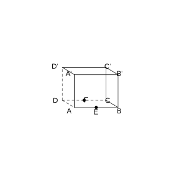{width=50%}

### 解答 练习二

由**定义 1.1.5** (空间向量的线性运算), 利用向量加法的三角形法则和平行六面体法则化简.

(1) $\boldsymbol{AA'}-\boldsymbol{CB}=\boldsymbol{AA'}+\boldsymbol{BC}$. 由**常用结论 1.1.6** (运算律), $\boldsymbol{AA'}+\boldsymbol{BC}=\boldsymbol{AA'}+\boldsymbol{AD}$ (因为 $\boldsymbol{BC}=\boldsymbol{AD}$). 在长方体中, $\boldsymbol{AA'}+\boldsymbol{AD}=\boldsymbol{AD'}$.

(2) $\boldsymbol{AA'}+\boldsymbol{AB}+\boldsymbol{B'C'}$. 由**定义 1.1.4** (相等向量), $\boldsymbol{B'C'}=\boldsymbol{BC}=\boldsymbol{AD}$. 故 $\boldsymbol{AA'}+\boldsymbol{AB}+\boldsymbol{B'C'}=\boldsymbol{AA'}+\boldsymbol{AB}+\boldsymbol{AD}$. 由平行六面体法则, 得 $\boldsymbol{AC'}$.

(3) $\boldsymbol{AB}-\boldsymbol{AD}+\boldsymbol{B'D'}$. 由**定义 1.1.5**, $\boldsymbol{AB}-\boldsymbol{AD}=\boldsymbol{DB}$. 又 $\boldsymbol{B'D'}=\boldsymbol{BD}$ (相等向量). 故 $\boldsymbol{DB}+\boldsymbol{BD}=\boldsymbol{0}$.

(4) $\boldsymbol{AB}+\boldsymbol{CF}$. 因为 $F$ 是 $CD$ 的中点, $\boldsymbol{CF}=\frac{1}{2}\boldsymbol{CD}=\frac{1}{2}\left(-\boldsymbol{AB}\right)=-\frac{1}{2}\boldsymbol{AB}$. 故 $\boldsymbol{AB}+\boldsymbol{CF}=\boldsymbol{AB}-\frac{1}{2}\boldsymbol{AB}=\frac{1}{2}\boldsymbol{AB}$. $\blacksquare$

### 练习三

(练习 1.1 第 3 题) 在图 1.1-6 中, 用 $\boldsymbol{AB}$, $\boldsymbol{AD}$, $\boldsymbol{AA'}$ 表示 $\boldsymbol{AC'}$, $\boldsymbol{BD'}$ 及 $\boldsymbol{DB'}$.

{width=50%}

### 解答 练习三

由**定义 1.1.5** (空间向量的线性运算) 及平行六面体法则.

在平行六面体 $ABCD-A'B'C'D'$ 中:

$$
\boldsymbol{AC'}=\boldsymbol{AB}+\boldsymbol{AD}+\boldsymbol{AA'}.
$$

$$
\boldsymbol{BD'}=\boldsymbol{BA}+\boldsymbol{AA'}+\boldsymbol{A'D'}=-\boldsymbol{AB}+\boldsymbol{AA'}+\boldsymbol{AD}.
$$

$$
\boldsymbol{DB'}=\boldsymbol{DA}+\boldsymbol{AA'}+\boldsymbol{A'B'}=-\boldsymbol{AD}+\boldsymbol{AA'}+\boldsymbol{AB}.
$$

$\blacksquare$

### 练习四

(练习 1.1 第 4 题) 如图, 已知四面体 $ABCD$, $E$, $F$ 分别是 $BC$, $CD$ 的中点. 化简下列表达式, 并在图中标出化简结果:

(1) $\boldsymbol{AB}+\boldsymbol{BC}+\boldsymbol{CD}$;

(2) $\boldsymbol{AB}+\frac{1}{2}\left(\boldsymbol{BD}+\boldsymbol{BC}\right)$;

(3) $\boldsymbol{AF}-\frac{1}{2}\left(\boldsymbol{AB}+\boldsymbol{AC}\right)$.

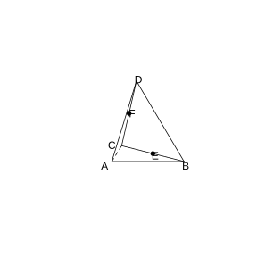{width=50%}

### 解答 练习四

由**定义 1.1.5** (空间向量的线性运算), 利用向量加法的三角形法则化简.

(1) 由**定义 1.1.5**, $\boldsymbol{AB}+\boldsymbol{BC}=\boldsymbol{AC}$, 故 $\boldsymbol{AB}+\boldsymbol{BC}+\boldsymbol{CD}=\boldsymbol{AC}+\boldsymbol{CD}=\boldsymbol{AD}$.

(2) 因为 $E$ 是 $BC$ 的中点, 由**定义 1.1.5**, $\frac{1}{2}\left(\boldsymbol{BD}+\boldsymbol{BC}\right)=\boldsymbol{BE}+\boldsymbol{EC}=\boldsymbol{BE}+\boldsymbol{ED}$ (因为 $E$ 是 $BC$ 中点, $\boldsymbol{BE}=\frac{1}{2}\boldsymbol{BC}$; $F$ 是 $CD$ 中点, $\boldsymbol{EF}=\frac{1}{2}\boldsymbol{BD}$). 实际上 $\frac{1}{2}\left(\boldsymbol{BD}+\boldsymbol{BC}\right)=\boldsymbol{BF}$ (因为在 $\triangle BCD$ 中, $F$ 是 $CD$ 中点, $\boldsymbol{BF}=\frac{1}{2}\left(\boldsymbol{BC}+\boldsymbol{BD}\right)$). 故 $\boldsymbol{AB}+\frac{1}{2}\left(\boldsymbol{BD}+\boldsymbol{BC}\right)=\boldsymbol{AB}+\boldsymbol{BF}=\boldsymbol{AF}$.

(3) 因为 $E$ 是 $BC$ 的中点, $\frac{1}{2}\left(\boldsymbol{AB}+\boldsymbol{AC}\right)=\boldsymbol{AE}$. 故 $\boldsymbol{AF}-\frac{1}{2}\left(\boldsymbol{AB}+\boldsymbol{AC}\right)=\boldsymbol{AF}-\boldsymbol{AE}=\boldsymbol{EF}$. $\blacksquare$

### 练习五

(练习 1.1 第 5 题) 如图, 已知正方体 $ABCD-A'B'C'D'$, $E$, $F$ 分别是上底面 $A'C'$ 和侧面 $CD'$ 的中心. 求下列各式中 $x$, $y$ 的值:

(1) $\boldsymbol{AC'}=x\left(\boldsymbol{AB}+\boldsymbol{BC}+\boldsymbol{CC'}\right)$;

(2) $\boldsymbol{AE}=\boldsymbol{AA'}+x\boldsymbol{AB}+y\boldsymbol{AD}$;

(3) $\boldsymbol{AF}=\boldsymbol{AD}+x\boldsymbol{AB}+y\boldsymbol{AA'}$.

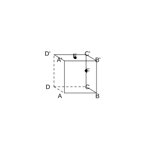{width=50%}

### 解答 练习五

由**定义 1.1.5** (空间向量的线性运算), 用基底 $\left\{\boldsymbol{AB}, \boldsymbol{AD}, \boldsymbol{AA'}\right\}$ 表示各向量.

(1) 由**定义 1.1.5**, $\boldsymbol{AC'}=\boldsymbol{AB}+\boldsymbol{BC}+\boldsymbol{CC'}=\boldsymbol{AB}+\boldsymbol{AD}+\boldsymbol{AA'}$. 故对比得 $x=1$.

(2) $E$ 是上底面 $A'C'$ 的中心, 即正方形 $A'B'C'D'$ 的中心. 故 $\boldsymbol{AE}=\boldsymbol{AA'}+\boldsymbol{A'E}$, 其中 $\boldsymbol{A'E}=\frac{1}{2}\left(\boldsymbol{A'B'}+\boldsymbol{A'D'}\right)=\frac{1}{2}\left(\boldsymbol{AB}+\boldsymbol{AD}\right)$. 因此 $\boldsymbol{AE}=\boldsymbol{AA'}+\frac{1}{2}\boldsymbol{AB}+\frac{1}{2}\boldsymbol{AD}$, 对比得 $x=\frac{1}{2}$, $y=\frac{1}{2}$.

(3) $F$ 是侧面 $CD'$ 的中心, 即正方形 $CDD'C'$ 的中心. 故 $\boldsymbol{AF}=\boldsymbol{AD}+\boldsymbol{DF}$, 其中 $\boldsymbol{DF}=\frac{1}{2}\left(\boldsymbol{DC}+\boldsymbol{DD'}\right)=\frac{1}{2}\left(\boldsymbol{AB}+\boldsymbol{AA'}\right)$. 因此 $\boldsymbol{AF}=\boldsymbol{AD}+\frac{1}{2}\boldsymbol{AB}+\frac{1}{2}\boldsymbol{AA'}$, 对比得 $x=\frac{1}{2}$, $y=\frac{1}{2}$. $\blacksquare$

### 练习六

(练习 1.1 第 1 题) 如图, 在正三棱柱 $ABC-A_1B_1C_1$ 中, 若 $AB=\sqrt{2}BB_1$, 则 $AB_1$ 与 $BC_1$ 所成角的大小为( ).

(A) $60^\circ$ (B) $90^\circ$ (C) $105^\circ$ (D) $75^\circ$

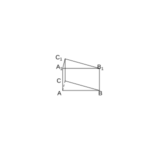{width=50%}

### 解答 练习六

由**定义 1.1.12** (数量积), 两向量所成角的余弦值等于它们数量积除以模长乘积.

设 $BB_1=1$, 则 $AB=\sqrt{2}$. 以 $\left\{\boldsymbol{BA}, \boldsymbol{BC}, \boldsymbol{BB_1}\right\}$ 为基底, 设 $\boldsymbol{BA}=\boldsymbol{a}$, $\boldsymbol{BC}=\boldsymbol{b}$, $\boldsymbol{BB_1}=\boldsymbol{c}$. 则 $\lvert \boldsymbol{a} \rvert=\sqrt{2}$, $\lvert \boldsymbol{b} \rvert=\sqrt{2}$, $\lvert \boldsymbol{c} \rvert=1$, $\left\langle \boldsymbol{a}, \boldsymbol{b} \right\rangle=60^\circ$, $\boldsymbol{a} \perp \boldsymbol{c}$, $\boldsymbol{b} \perp \boldsymbol{c}$.

$\boldsymbol{AB_1}=\boldsymbol{AB}+\boldsymbol{BB_1}=-\boldsymbol{a}+\boldsymbol{c}$.

$\boldsymbol{BC_1}=\boldsymbol{BC}+\boldsymbol{CC_1}=\boldsymbol{b}+\boldsymbol{c}$.

由**常用结论 1.1.14** (数量积的运算律):

$$
\boldsymbol{AB_1} \cdot \boldsymbol{BC_1}=\left(-\boldsymbol{a}+\boldsymbol{c}\right) \cdot \left(\boldsymbol{b}+\boldsymbol{c}\right)=-\boldsymbol{a} \cdot \boldsymbol{b}-\boldsymbol{a} \cdot \boldsymbol{c}+\boldsymbol{c} \cdot \boldsymbol{b}+\boldsymbol{c} \cdot \boldsymbol{c}.
$$

因为 $\boldsymbol{a} \cdot \boldsymbol{c}=0$, $\boldsymbol{b} \cdot \boldsymbol{c}=0$, $\boldsymbol{c} \cdot \boldsymbol{c}=1$, $\boldsymbol{a} \cdot \boldsymbol{b}=\lvert \boldsymbol{a} \rvert \lvert \boldsymbol{b} \rvert \cos 60^\circ=\sqrt{2} \cdot \sqrt{2} \cdot \frac{1}{2}=1$.

故 $\boldsymbol{AB_1} \cdot \boldsymbol{BC_1}=-1+0+0+1=0$.

由**常用结论 1.1.13** (数量积的性质), $\boldsymbol{AB_1} \perp \boldsymbol{BC_1}$, 即 $AB_1$ 与 $BC_1$ 所成角为 $90^\circ$. 故选 (B). $\blacksquare$

### 练习七

(练习 1.1 第 2 题) 如图, 正方体 $ABCD-A'B'C'D'$ 的棱长为 $1$, 设 $\boldsymbol{AB}=\boldsymbol{a}$, $\boldsymbol{AD}=\boldsymbol{b}$, $\boldsymbol{AA'}=\boldsymbol{c}$, 求:

(1) $\boldsymbol{a} \cdot \left(\boldsymbol{b}+\boldsymbol{c}\right)$;

(2) $\boldsymbol{a} \cdot \left(\boldsymbol{a}+\boldsymbol{b}+\boldsymbol{c}\right)$;

(3) $\left(\boldsymbol{a}+\boldsymbol{b}\right) \cdot \left(\boldsymbol{b}+\boldsymbol{c}\right)$.

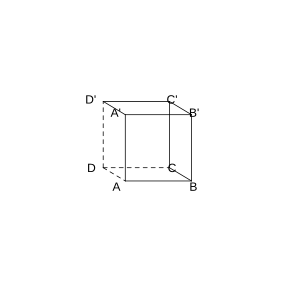{width=50%}

### 解答 练习七

由**定义 1.1.12** (数量积) 及**常用结论 1.1.14** (数量积的运算律).

在正方体中, $\boldsymbol{a}$, $\boldsymbol{b}$, $\boldsymbol{c}$ 两两垂直且模均为 $1$, 故 $\boldsymbol{a} \cdot \boldsymbol{b}=\boldsymbol{b} \cdot \boldsymbol{c}=\boldsymbol{c} \cdot \boldsymbol{a}=0$, $\boldsymbol{a} \cdot \boldsymbol{a}=\boldsymbol{b} \cdot \boldsymbol{b}=\boldsymbol{c} \cdot \boldsymbol{c}=1$.

(1) 由分配律, $\boldsymbol{a} \cdot \left(\boldsymbol{b}+\boldsymbol{c}\right)=\boldsymbol{a} \cdot \boldsymbol{b}+\boldsymbol{a} \cdot \boldsymbol{c}=0+0=0$.

(2) $\boldsymbol{a} \cdot \left(\boldsymbol{a}+\boldsymbol{b}+\boldsymbol{c}\right)=\boldsymbol{a} \cdot \boldsymbol{a}+\boldsymbol{a} \cdot \boldsymbol{b}+\boldsymbol{a} \cdot \boldsymbol{c}=1+0+0=1$.

(3) $\left(\boldsymbol{a}+\boldsymbol{b}\right) \cdot \left(\boldsymbol{b}+\boldsymbol{c}\right)=\boldsymbol{a} \cdot \boldsymbol{b}+\boldsymbol{a} \cdot \boldsymbol{c}+\boldsymbol{b} \cdot \boldsymbol{b}+\boldsymbol{b} \cdot \boldsymbol{c}=0+0+1+0=1$. $\blacksquare$

### 练习八

(练习 1.1 第 3 题) 如图, 在平行六面体 $ABCD-A'B'C'D'$ 中, $AB=4$, $AD=3$, $AA'=5$, $\angle BAD=90^\circ$, $\angle BAA'=\angle DAA'=60^\circ$. 求:

(1) $\boldsymbol{AA'} \cdot \boldsymbol{AB}$;

(2) $AB'$ 的长;

(3) $AC'$ 的长.

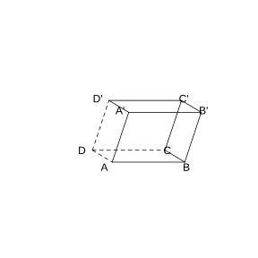{width=50%}

### 解答 练习八

由**定义 1.1.12** (数量积) 及**常用结论 1.1.13** (数量积的性质).

设 $\boldsymbol{AB}=\boldsymbol{a}$, $\boldsymbol{AD}=\boldsymbol{b}$, $\boldsymbol{AA'}=\boldsymbol{c}$, 则 $\lvert \boldsymbol{a} \rvert=4$, $\lvert \boldsymbol{b} \rvert=3$, $\lvert \boldsymbol{c} \rvert=5$, $\left\langle \boldsymbol{a}, \boldsymbol{b} \right\rangle=90^\circ$, $\left\langle \boldsymbol{a}, \boldsymbol{c} \right\rangle=60^\circ$, $\left\langle \boldsymbol{b}, \boldsymbol{c} \right\rangle=60^\circ$.

(1) 由**定义 1.1.12**, $\boldsymbol{AA'} \cdot \boldsymbol{AB}=\boldsymbol{c} \cdot \boldsymbol{a}=\lvert \boldsymbol{c} \rvert \lvert \boldsymbol{a} \rvert \cos 60^\circ=5 \times 4 \times \frac{1}{2}=10$.

(2) $\boldsymbol{AB'}=\boldsymbol{AB}+\boldsymbol{BB'}=\boldsymbol{a}+\boldsymbol{c}$. 由**常用结论 1.1.13**, $\lvert \boldsymbol{AB'} \rvert^2=\left(\boldsymbol{a}+\boldsymbol{c}\right)^2=\boldsymbol{a}^2+2\boldsymbol{a} \cdot \boldsymbol{c}+\boldsymbol{c}^2=16+2 \times 10+25=61$. 故 $AB'=\sqrt{61}$.

(3) $\boldsymbol{AC'}=\boldsymbol{a}+\boldsymbol{b}+\boldsymbol{c}$. $\lvert \boldsymbol{AC'} \rvert^2=\left(\boldsymbol{a}+\boldsymbol{b}+\boldsymbol{c}\right)^2=\boldsymbol{a}^2+\boldsymbol{b}^2+\boldsymbol{c}^2+2\boldsymbol{a} \cdot \boldsymbol{b}+2\boldsymbol{a} \cdot \boldsymbol{c}+2\boldsymbol{b} \cdot \boldsymbol{c}$. 其中 $\boldsymbol{a} \cdot \boldsymbol{b}=0$, $\boldsymbol{a} \cdot \boldsymbol{c}=10$, $\boldsymbol{b} \cdot \boldsymbol{c}=\lvert \boldsymbol{b} \rvert \lvert \boldsymbol{c} \rvert \cos 60^\circ=3 \times 5 \times \frac{1}{2}=7.5$. 故 $\lvert \boldsymbol{AC'} \rvert^2=16+9+25+0+20+15=85$. 故 $AC'=\sqrt{85}$. $\blacksquare$

### 练习九

(练习 1.1 第 4 题) 如图, 线段 $AB$, $BD$ 在平面 $\alpha$ 内, $BD \perp AB$, $AC \perp \alpha$, 且 $AB=a$, $BD=b$, $AC=c$. 求 $C$, $D$ 两点间的距离.

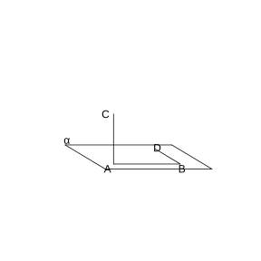{width=50%}

### 解答 练习九

由**定义 1.1.12** (数量积) 及**常用结论 1.1.13** (数量积的性质).

$\boldsymbol{CD}=\boldsymbol{CA}+\boldsymbol{AB}+\boldsymbol{BD}=-\boldsymbol{AC}+\boldsymbol{AB}+\boldsymbol{BD}$.

设 $\boldsymbol{AC}=\boldsymbol{c}$, $\boldsymbol{AB}=\boldsymbol{a}$, $\boldsymbol{BD}=\boldsymbol{b}$, 则 $\boldsymbol{a} \perp \boldsymbol{b}$ (因为 $BD \perp AB$), $\boldsymbol{c} \perp \boldsymbol{a}$ (因为 $AC \perp \alpha$ 且 $AB \subset \alpha$), $\boldsymbol{c} \perp \boldsymbol{b}$ (因为 $AC \perp \alpha$ 且 $BD \subset \alpha$). 故 $\boldsymbol{a} \cdot \boldsymbol{b}=\boldsymbol{a} \cdot \boldsymbol{c}=\boldsymbol{b} \cdot \boldsymbol{c}=0$.

$$
\lvert \boldsymbol{CD} \rvert^2=\left(-\boldsymbol{c}+\boldsymbol{a}+\boldsymbol{b}\right)^2=\boldsymbol{c}^2+\boldsymbol{a}^2+\boldsymbol{b}^2-2\boldsymbol{c} \cdot \boldsymbol{a}+2\boldsymbol{a} \cdot \boldsymbol{b}-2\boldsymbol{c} \cdot \boldsymbol{b}=c^2+a^2+b^2.
$$

故 $CD=\sqrt{a^2+b^2+c^2}$. $\blacksquare$

### 习题一

(习题 1.1 复习巩固第 1 题) 如图, 在长方体 $ABCD-A'B'C'D'$ 中, $E$, $F$ 分别为棱 $AA'$, $AB$ 的中点.

(1) 写出与向量 $\boldsymbol{BC}$ 相等的向量;

(2) 写出与向量 $\boldsymbol{BC}$ 相反的向量;

(3) 写出与向量 $\boldsymbol{EF}$ 平行的向量.

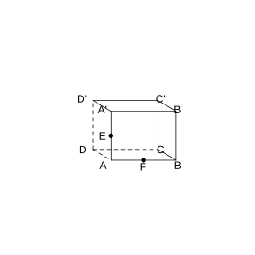{width=50%}

### 解答 习题一

由**定义 1.1.4** (相等向量), **定义 1.1.2** (相反向量) 及**定义 1.1.3** (共线向量或平行向量).

(1) 由**定义 1.1.4**, 方向相同且模相等的向量相等. 在长方体中, $\boldsymbol{BC}=\boldsymbol{AD}=\boldsymbol{A'D'}=\boldsymbol{B'C'}$.

(2) 由**定义 1.1.2**, 与 $\boldsymbol{BC}$ 相反的向量即方向相反且模相等的向量: $\boldsymbol{CB}$, $\boldsymbol{DA}$, $\boldsymbol{D'A'}$, $\boldsymbol{C'B'}$.

(3) $E$, $F$ 分别为 $AA'$, $AB$ 的中点, 故 $\boldsymbol{EF}=\frac{1}{2}\boldsymbol{A'B}=\frac{1}{2}\left(\boldsymbol{AB}-\boldsymbol{AA'}\right)$. 由**定义 1.1.3**, 与 $\boldsymbol{EF}$ 平行的向量为所有与 $\boldsymbol{EF}$ 共线的向量, 如 $\boldsymbol{A'B}$, $\boldsymbol{D'C}$ 等. $\blacksquare$

### 习题二

(习题 1.1 复习巩固第 2 题) 如图, 已知平行六面体 $ABCD-A'B'C'D'$, 化简下列表达式, 并在图中标出化简结果:

(1) $\boldsymbol{AB}+\boldsymbol{BC}$;

(2) $\boldsymbol{AB}+\boldsymbol{AD}+\boldsymbol{CC'}$;

(3) $\boldsymbol{AB}+\boldsymbol{AD}+\frac{1}{2}\boldsymbol{CC'}$;

(4) $\frac{1}{3}\left(\boldsymbol{AB}+\boldsymbol{AD}+\boldsymbol{AA'}\right)$.

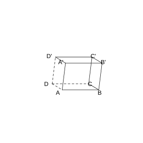{width=50%}

### 解答 习题二

由**定义 1.1.5** (空间向量的线性运算) 及**常用结论 1.1.6** (运算律).

(1) $\boldsymbol{AB}+\boldsymbol{BC}=\boldsymbol{AC}$.

(2) $\boldsymbol{AB}+\boldsymbol{AD}+\boldsymbol{CC'}=\boldsymbol{AC}+\boldsymbol{CC'}=\boldsymbol{AC'}$.

(3) $\boldsymbol{AB}+\boldsymbol{AD}+\frac{1}{2}\boldsymbol{CC'}=\boldsymbol{AC}+\frac{1}{2}\boldsymbol{AA'}$. 设 $M$ 是 $CC'$ 的中点, 则该向量等于 $\boldsymbol{AM}$.

(4) $\frac{1}{3}\left(\boldsymbol{AB}+\boldsymbol{AD}+\boldsymbol{AA'}\right)=\frac{1}{3}\boldsymbol{AC'}$. 设 $P$ 是对角线 $AC'$ 上靠近 $A$ 的三等分点, 则该向量等于 $\boldsymbol{AP}$. $\blacksquare$

### 习题三

(习题 1.1 复习巩固第 3 题) 证明: 如果向量 $\boldsymbol{a}$, $\boldsymbol{b}$ 共线, 那么向量 $2\boldsymbol{a}+\boldsymbol{b}$ 与 $\boldsymbol{a}$ 共线.

### 解答 习题三

由**常用结论 1.1.7** (向量共线的充要条件), $\boldsymbol{a} \parallel \boldsymbol{b}$ 当且仅当存在实数 $\lambda$ 使 $\boldsymbol{b}=\lambda\boldsymbol{a}$.

因为 $\boldsymbol{a}$, $\boldsymbol{b}$ 共线, 由**常用结论 1.1.7**, 存在实数 $\lambda$, 使 $\boldsymbol{b}=\lambda\boldsymbol{a}$.

于是 $2\boldsymbol{a}+\boldsymbol{b}=2\boldsymbol{a}+\lambda\boldsymbol{a}=\left(2+\lambda\right)\boldsymbol{a}$.

由**常用结论 1.1.7**, $2\boldsymbol{a}+\boldsymbol{b}$ 与 $\boldsymbol{a}$ 共线. $\blacksquare$

### 习题四

(习题 1.1 复习巩固第 4 题) 如图, 已知四面体 $ABCD$ 的所有棱长都等于 $a$, $E$, $F$, $G$ 分别是棱 $AB$, $AD$, $DC$ 的中点. 求:

(1) $\boldsymbol{AB} \cdot \boldsymbol{AC}$;

(2) $\boldsymbol{AD} \cdot \boldsymbol{DB}$;

(3) $\boldsymbol{GF} \cdot \boldsymbol{AC}$;

(4) $\boldsymbol{EF} \cdot \boldsymbol{BC}$;

(5) $\boldsymbol{FG} \cdot \boldsymbol{BA}$;

(6) $\boldsymbol{GE} \cdot \boldsymbol{GF}$.

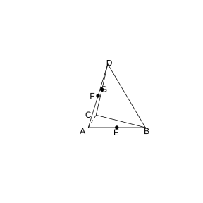{width=50%}

### 解答 习题四

由**定义 1.1.12** (数量积), 正四面体中任意两条棱的夹角均为 $60^\circ$.

(1) $\left\langle \boldsymbol{AB}, \boldsymbol{AC} \right\rangle=60^\circ$, 故 $\boldsymbol{AB} \cdot \boldsymbol{AC}=\lvert \boldsymbol{AB} \rvert \lvert \boldsymbol{AC} \rvert \cos 60^\circ=a \cdot a \cdot \frac{1}{2}=\frac{a^2}{2}$.

(2) $\left\langle \boldsymbol{AD}, \boldsymbol{DB} \right\rangle$: $\boldsymbol{AD}$ 与 $\boldsymbol{DB}$ 的夹角. 在正三角形 $ABD$ 中, $\angle ADB=60^\circ$, 但 $\boldsymbol{AD}$ 与 $\boldsymbol{DB}$ 的夹角为 $180^\circ-60^\circ=120^\circ$. 故 $\boldsymbol{AD} \cdot \boldsymbol{DB}=a \cdot a \cdot \cos 120^\circ=-\frac{a^2}{2}$.

(3) $G$, $F$ 分别是 $DC$, $AD$ 的中点, 故 $\boldsymbol{GF}=\frac{1}{2}\boldsymbol{CA}=-\frac{1}{2}\boldsymbol{AC}$. 故 $\boldsymbol{GF} \cdot \boldsymbol{AC}=-\frac{1}{2}\boldsymbol{AC} \cdot \boldsymbol{AC}=-\frac{1}{2}a^2$.

(4) $E$, $F$ 分别是 $AB$, $AD$ 的中点, 故 $\boldsymbol{EF}=\frac{1}{2}\boldsymbol{BD}$. 故 $\boldsymbol{EF} \cdot \boldsymbol{BC}=\frac{1}{2}\boldsymbol{BD} \cdot \boldsymbol{BC}$. $\left\langle \boldsymbol{BD}, \boldsymbol{BC} \right\rangle=60^\circ$, 故 $\boldsymbol{EF} \cdot \boldsymbol{BC}=\frac{1}{2} \cdot a \cdot a \cdot \frac{1}{2}=\frac{a^2}{4}$.

(5) $\boldsymbol{FG}=\frac{1}{2}\boldsymbol{AC}=\frac{1}{2}\boldsymbol{AC}$. 故 $\boldsymbol{FG} \cdot \boldsymbol{BA}=\frac{1}{2}\boldsymbol{AC} \cdot \boldsymbol{BA}=\frac{1}{2}\boldsymbol{AC} \cdot \left(-\boldsymbol{AB}\right)=-\frac{1}{2} \cdot \frac{a^2}{2}=-\frac{a^2}{4}$.

(6) $\boldsymbol{GE}=\boldsymbol{GC}+\boldsymbol{CE}$ 或用中点性质. $\boldsymbol{GE}=\boldsymbol{AE}-\boldsymbol{AG}$. 其中 $\boldsymbol{AE}=\frac{1}{2}\boldsymbol{AB}$, $\boldsymbol{AG}=\frac{1}{2}\left(\boldsymbol{AD}+\boldsymbol{AC}\right)$ (因为 $G$ 是 $DC$ 中点, $\boldsymbol{AG}=\boldsymbol{AD}+\boldsymbol{DG}=\boldsymbol{AD}+\frac{1}{2}\boldsymbol{DC}=\boldsymbol{AD}+\frac{1}{2}\left(\boldsymbol{AC}-\boldsymbol{AD}\right)=\frac{1}{2}\boldsymbol{AD}+\frac{1}{2}\boldsymbol{AC}$).

故 $\boldsymbol{GE}=\frac{1}{2}\boldsymbol{AB}-\frac{1}{2}\boldsymbol{AD}-\frac{1}{2}\boldsymbol{AC}$.

$\boldsymbol{GF}=-\frac{1}{2}\boldsymbol{AC}$.

$\boldsymbol{GE} \cdot \boldsymbol{GF}=\left(\frac{1}{2}\boldsymbol{AB}-\frac{1}{2}\boldsymbol{AD}-\frac{1}{2}\boldsymbol{AC}\right) \cdot \left(-\frac{1}{2}\boldsymbol{AC}\right)$

$=-\frac{1}{4}\boldsymbol{AB} \cdot \boldsymbol{AC}+\frac{1}{4}\boldsymbol{AD} \cdot \boldsymbol{AC}+\frac{1}{4}\boldsymbol{AC} \cdot \boldsymbol{AC}$

$=-\frac{1}{4} \cdot \frac{a^2}{2}+\frac{1}{4} \cdot \frac{a^2}{2}+\frac{1}{4}a^2=\frac{a^2}{4}$. $\blacksquare$

### 习题五

(习题 1.1 综合运用第 5 题) 如图, 在平行六面体 $ABCD-A_1B_1C_1D_1$ 中, $AC$ 与 $BD$ 的交点为 $M$. 设 $\boldsymbol{A_1B_1}=\boldsymbol{a}$, $\boldsymbol{A_1D_1}=\boldsymbol{b}$, $\boldsymbol{A_1A}=\boldsymbol{c}$, 则下列向量中与 $\boldsymbol{B_1M}$ 相等的向量是( ).

(A) $-\frac{1}{2}\boldsymbol{a}+\frac{1}{2}\boldsymbol{b}+\boldsymbol{c}$ (B) $\frac{1}{2}\boldsymbol{a}+\frac{1}{2}\boldsymbol{b}+\boldsymbol{c}$ (C) $\frac{1}{2}\boldsymbol{a}-\frac{1}{2}\boldsymbol{b}+\boldsymbol{c}$ (D) $-\frac{1}{2}\boldsymbol{a}-\frac{1}{2}\boldsymbol{b}+\boldsymbol{c}$

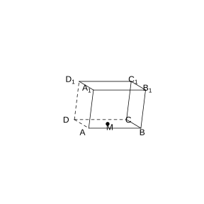{width=50%}

### 解答 习题五

由**定义 1.1.5** (空间向量的线性运算).

$\boldsymbol{B_1M}=\boldsymbol{B_1B}+\boldsymbol{BM}=\boldsymbol{c}+\frac{1}{2}\boldsymbol{BD}$.

$\boldsymbol{BD}=\boldsymbol{BA}+\boldsymbol{AD}=-\boldsymbol{A_1B_1}+\boldsymbol{A_1D_1}=-\boldsymbol{a}+\boldsymbol{b}$.

故 $\boldsymbol{B_1M}=\boldsymbol{c}+\frac{1}{2}\left(-\boldsymbol{a}+\boldsymbol{b}\right)=-\frac{1}{2}\boldsymbol{a}+\frac{1}{2}\boldsymbol{b}+\boldsymbol{c}$.

故选 (A). $\blacksquare$

### 习题六

(习题 1.1 综合运用第 6 题) 如图, 已知 $E$, $F$, $G$, $H$ 分别为四面体 $ABCD$ 的棱 $AB$, $BC$, $CD$, $DA$ 的中点, 求证: $E$, $F$, $G$, $H$ 四点共面.

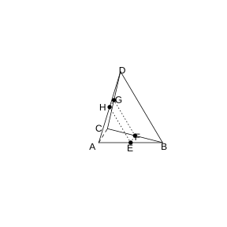{width=50%}

### 解答 习题六

由**常用结论 1.1.9** (向量共面的充要条件), 要证 $E$, $F$, $G$, $H$ 四点共面, 只需证明 $\boldsymbol{EH}$, $\boldsymbol{EF}$, $\boldsymbol{EG}$ 共面.

因为 $E$, $F$, $G$, $H$ 分别是 $AB$, $BC$, $CD$, $DA$ 的中点, 由**定义 1.1.5**:

$\boldsymbol{EF}=\frac{1}{2}\boldsymbol{AC}$, $\boldsymbol{EH}=\frac{1}{2}\boldsymbol{BD}$.

$\boldsymbol{EG}=\boldsymbol{EF}+\boldsymbol{FG}=\frac{1}{2}\boldsymbol{AC}+\frac{1}{2}\boldsymbol{BD}$.

故 $\boldsymbol{EG}=\boldsymbol{EF}+\boldsymbol{EH}$.

由**常用结论 1.1.9**, $\boldsymbol{EG}$ 与 $\boldsymbol{EF}$, $\boldsymbol{EH}$ 共面, 即 $\boldsymbol{EH}$, $\boldsymbol{EF}$, $\boldsymbol{EG}$ 共面, 又它们过同一点 $E$, 故 $E$, $F$, $G$, $H$ 四点共面. $\blacksquare$

### 习题七

(习题 1.1 综合运用第 7 题) 如图, 正方体 $ABCD-A'B'C'D'$ 的棱长为 $a$.

(1) 求 $A'B$ 和 $B'C$ 的夹角;

(2) 求证: $A'B \perp AC'$.

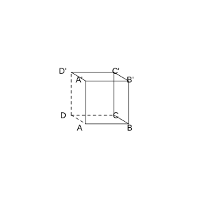{width=50%}

### 解答 习题七

由**定义 1.1.12** (数量积) 及**常用结论 1.1.13** (数量积的性质).

设 $\boldsymbol{AB}=\boldsymbol{a}$, $\boldsymbol{AD}=\boldsymbol{b}$, $\boldsymbol{AA'}=\boldsymbol{c}$, 则 $\lvert \boldsymbol{a} \rvert=\lvert \boldsymbol{b} \rvert=\lvert \boldsymbol{c} \rvert=a$, 且 $\boldsymbol{a}$, $\boldsymbol{b}$, $\boldsymbol{c}$ 两两垂直.

(1) $\boldsymbol{A'B}=\boldsymbol{AB}-\boldsymbol{AA'}=\boldsymbol{a}-\boldsymbol{c}$.

$\boldsymbol{B'C}=\boldsymbol{B'B}+\boldsymbol{BC}=-\boldsymbol{c}+\boldsymbol{b}=\boldsymbol{b}-\boldsymbol{c}$.

$\boldsymbol{A'B} \cdot \boldsymbol{B'C}=\left(\boldsymbol{a}-\boldsymbol{c}\right) \cdot \left(\boldsymbol{b}-\boldsymbol{c}\right)=\boldsymbol{a} \cdot \boldsymbol{b}-\boldsymbol{a} \cdot \boldsymbol{c}-\boldsymbol{c} \cdot \boldsymbol{b}+\boldsymbol{c}^2=0-0-0+a^2=a^2$.

$\lvert \boldsymbol{A'B} \rvert=\sqrt{\left(\boldsymbol{a}-\boldsymbol{c}\right)^2}=\sqrt{a^2+a^2}=\sqrt{2}a$.

$\lvert \boldsymbol{B'C} \rvert=\sqrt{\left(\boldsymbol{b}-\boldsymbol{c}\right)^2}=\sqrt{2}a$.

$\cos \left\langle \boldsymbol{A'B}, \boldsymbol{B'C} \right\rangle=\frac{a^2}{\sqrt{2}a \cdot \sqrt{2}a}=\frac{1}{2}$.

故夹角为 $60^\circ$.

(2) $\boldsymbol{AC'}=\boldsymbol{a}+\boldsymbol{b}+\boldsymbol{c}$.

$\boldsymbol{A'B} \cdot \boldsymbol{AC'}=\left(\boldsymbol{a}-\boldsymbol{c}\right) \cdot \left(\boldsymbol{a}+\boldsymbol{b}+\boldsymbol{c}\right)=\boldsymbol{a}^2+\boldsymbol{a} \cdot \boldsymbol{b}+\boldsymbol{a} \cdot \boldsymbol{c}-\boldsymbol{c} \cdot \boldsymbol{a}-\boldsymbol{c} \cdot \boldsymbol{b}-\boldsymbol{c}^2=a^2+0+0-0-0-a^2=0$.

由**常用结论 1.1.13**, $\boldsymbol{A'B} \perp \boldsymbol{AC'}$, 即 $A'B \perp AC'$. $\blacksquare$

### 习题八

(习题 1.1 拓广探索第 8 题) 用向量方法证明: 在平面内的一条直线, 如果与这个平面的一条斜线在这个平面上的射影垂直, 那么它也与这条斜线垂直 (三垂线定理).

### 解答 习题八

由**常用结论 1.1.13** (数量积的性质), 要证两直线垂直, 只需证它们的方向向量数量积为零.

设平面 $\alpha$ 内的直线 $l$ 的方向向量为 $\boldsymbol{a}$, 斜线为 $AB$ ($A \in \alpha$, $B \notin \alpha$), $B$ 在 $\alpha$ 上的射影为 $B'$, 则射影为 $AB'$. 设 $\boldsymbol{AB'}=\boldsymbol{b}$, $\boldsymbol{B'B}=\boldsymbol{c}$, 其中 $\boldsymbol{c} \perp \alpha$, 故 $\boldsymbol{c} \perp \boldsymbol{a}$.

已知 $l \perp AB'$, 即 $\boldsymbol{a} \perp \boldsymbol{b}$, 故 $\boldsymbol{a} \cdot \boldsymbol{b}=0$.

$\boldsymbol{AB}=\boldsymbol{AB'}+\boldsymbol{B'B}=\boldsymbol{b}+\boldsymbol{c}$.

$\boldsymbol{a} \cdot \boldsymbol{AB}=\boldsymbol{a} \cdot \left(\boldsymbol{b}+\boldsymbol{c}\right)=\boldsymbol{a} \cdot \boldsymbol{b}+\boldsymbol{a} \cdot \boldsymbol{c}=0+0=0$.

由**常用结论 1.1.13**, $\boldsymbol{a} \perp \boldsymbol{AB}$, 即 $l \perp AB$. $\blacksquare$

### 习题九

(习题 1.1 拓广探索第 9 题) 如图, 在四面体 $OABC$ 中, $OA \perp BC$, $OB \perp AC$. 求证: $OC \perp AB$.

{width=50%}

### 解答 习题九

由**常用结论 1.1.13** (数量积的性质).

设 $\boldsymbol{OA}=\boldsymbol{a}$, $\boldsymbol{OB}=\boldsymbol{b}$, $\boldsymbol{OC}=\boldsymbol{c}$.

由 $OA \perp BC$, 即 $\boldsymbol{a} \perp \boldsymbol{BC}$. $\boldsymbol{BC}=\boldsymbol{c}-\boldsymbol{b}$. 故 $\boldsymbol{a} \cdot \left(\boldsymbol{c}-\boldsymbol{b}\right)=0$, 即 $\boldsymbol{a} \cdot \boldsymbol{c}-\boldsymbol{a} \cdot \boldsymbol{b}=0$. (1)

由 $OB \perp AC$, 即 $\boldsymbol{b} \perp \boldsymbol{AC}$. $\boldsymbol{AC}=\boldsymbol{c}-\boldsymbol{a}$. 故 $\boldsymbol{b} \cdot \left(\boldsymbol{c}-\boldsymbol{a}\right)=0$, 即 $\boldsymbol{b} \cdot \boldsymbol{c}-\boldsymbol{b} \cdot \boldsymbol{a}=0$. (2)

由 (1) 得 $\boldsymbol{a} \cdot \boldsymbol{c}=\boldsymbol{a} \cdot \boldsymbol{b}$. 由 (2) 得 $\boldsymbol{b} \cdot \boldsymbol{c}=\boldsymbol{a} \cdot \boldsymbol{b}$.

故 $\boldsymbol{a} \cdot \boldsymbol{c}=\boldsymbol{b} \cdot \boldsymbol{c}$, 即 $\boldsymbol{c} \cdot \left(\boldsymbol{a}-\boldsymbol{b}\right)=0$.

$\boldsymbol{AB}=\boldsymbol{OB}-\boldsymbol{OA}=\boldsymbol{b}-\boldsymbol{a}=-\left(\boldsymbol{a}-\boldsymbol{b}\right)$.

故 $\boldsymbol{c} \cdot \boldsymbol{AB}=\boldsymbol{c} \cdot \left(\boldsymbol{b}-\boldsymbol{a}\right)=-\boldsymbol{c} \cdot \left(\boldsymbol{a}-\boldsymbol{b}\right)=0$.

由**常用结论 1.1.13**, $\boldsymbol{OC} \perp \boldsymbol{AB}$, 即 $OC \perp AB$. $\blacksquare$

### 习题十

(习题 1.1 拓广探索第 10 题) 如图, 在四面体 $OABC$ 中, $OA=OB$, $CA=CB$, $E$, $F$, $G$, $H$ 分别是 $OA$, $OB$, $BC$, $CA$ 的中点. 求证: 四边形 $EFGH$ 是矩形.

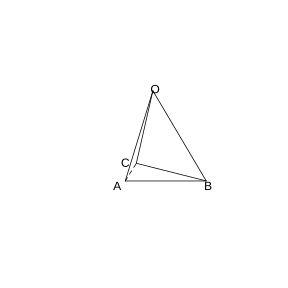{width=50%}

### 解答 习题十

由**常用结论 1.1.9** (向量共面的充要条件) 及**常用结论 1.1.13** (数量积的性质).

$E$, $F$, $G$, $H$ 分别是 $OA$, $OB$, $BC$, $CA$ 的中点.

$\boldsymbol{EF}=\frac{1}{2}\boldsymbol{AB}$, $\boldsymbol{HG}=\frac{1}{2}\boldsymbol{AB}$, 故 $\boldsymbol{EF}=\boldsymbol{HG}$, 即 $EF \parallel HG$ 且 $EF=HG$.

$\boldsymbol{FG}=\frac{1}{2}\boldsymbol{OC}$, $\boldsymbol{EH}=\frac{1}{2}\boldsymbol{OC}$, 故 $\boldsymbol{FG}=\boldsymbol{EH}$, 即 $FG \parallel EH$ 且 $FG=EH$.

故四边形 $EFGH$ 是平行四边形.

再证一个内角为直角. $\boldsymbol{EF} \cdot \boldsymbol{FG}=\frac{1}{2}\boldsymbol{AB} \cdot \frac{1}{2}\boldsymbol{OC}=\frac{1}{4}\boldsymbol{AB} \cdot \boldsymbol{OC}$.

设 $\boldsymbol{OA}=\boldsymbol{a}$, $\boldsymbol{OB}=\boldsymbol{b}$, $\boldsymbol{OC}=\boldsymbol{c}$. 由 $OA=OB$, $\lvert \boldsymbol{a} \rvert=\lvert \boldsymbol{b} \rvert$. 由 $CA=CB$, $\lvert \boldsymbol{c}-\boldsymbol{a} \rvert=\lvert \boldsymbol{c}-\boldsymbol{b} \rvert$, 平方得 $\boldsymbol{c}^2-2\boldsymbol{c} \cdot \boldsymbol{a}+\boldsymbol{a}^2=\boldsymbol{c}^2-2\boldsymbol{c} \cdot \boldsymbol{b}+\boldsymbol{b}^2$. 由 $\boldsymbol{a}^2=\boldsymbol{b}^2$, 得 $\boldsymbol{c} \cdot \boldsymbol{a}=\boldsymbol{c} \cdot \boldsymbol{b}$.

$\boldsymbol{AB}=\boldsymbol{b}-\boldsymbol{a}$. $\boldsymbol{AB} \cdot \boldsymbol{c}=\left(\boldsymbol{b}-\boldsymbol{a}\right) \cdot \boldsymbol{c}=\boldsymbol{b} \cdot \boldsymbol{c}-\boldsymbol{a} \cdot \boldsymbol{c}=0$.

故 $\boldsymbol{EF} \cdot \boldsymbol{FG}=0$, 即 $EF \perp FG$.

平行四边形 $EFGH$ 有一个内角为直角, 故为矩形. $\blacksquare$
