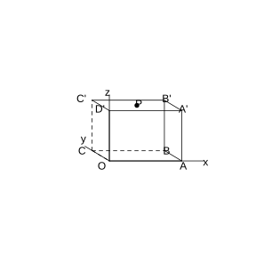
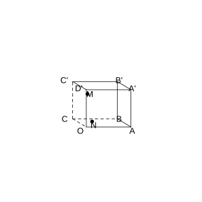
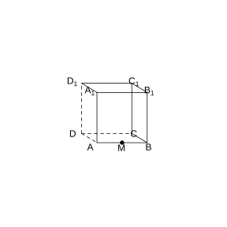
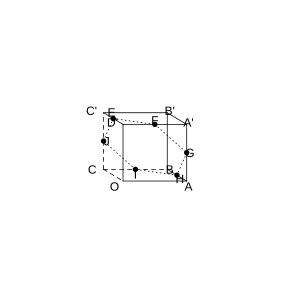
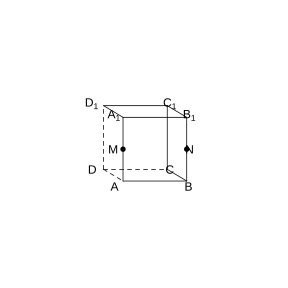

# 作业 58

> **定理 1.2.1** (空间向量基本定理)  如果三个向量 $\boldsymbol{a}$, $\boldsymbol{b}$, $\boldsymbol{c}$ 不共面, 那么对任意一个空间向量 $\boldsymbol{p}$, 存在唯一的有序实数组 $(x,y,z)$, 使得 $\boldsymbol{p}=x\boldsymbol{a}+y\boldsymbol{b}+z\boldsymbol{c}$.

> **定义 1.2.3** (单位正交基底)  如果空间的一个基底中的三个基向量两两垂直, 且长度都为 $1$, 那么这个基底叫做单位正交基底, 常用 $\{\boldsymbol{i}, \boldsymbol{j}, \boldsymbol{k}\}$ 表示.

> **定义 1.3.1** (空间直角坐标系)  在空间选定一点 $O$ 和一个单位正交基底 $\{\boldsymbol{i}, \boldsymbol{j}, \boldsymbol{k}\}$. 以点 $O$ 为原点, 分别以 $\boldsymbol{i}$, $\boldsymbol{j}$, $\boldsymbol{k}$ 的方向为正方向, 以它们的长为单位长度建立三条数轴: $x$ 轴, $y$ 轴, $z$ 轴, 它们都叫做坐标轴. 这时我们就建立了一个空间直角坐标系 $Oxyz$, $O$ 叫做原点, $\boldsymbol{i}$, $\boldsymbol{j}$, $\boldsymbol{k}$ 都叫做坐标向量, 通过每两条坐标轴的平面叫做坐标平面.

> **定义 1.3.2** (点的坐标)  在单位正交基底 $\{\boldsymbol{i}, \boldsymbol{j}, \boldsymbol{k}\}$ 下与向量 $\boldsymbol{OA}$ 对应的有序实数组 $(x,y,z)$, 叫做点 $A$ 在空间直角坐标系中的坐标, 记作 $A(x,y,z)$, 其中 $x$ 叫做点 $A$ 的横坐标, $y$ 叫做点 $A$ 的纵坐标, $z$ 叫做点 $A$ 的竖坐标.

> **定义 1.3.3** (向量的坐标)  有序实数组 $(x,y,z)$ 叫做 $\boldsymbol{a}$ 在空间直角坐标系 $Oxyz$ 中的坐标, 即 $\boldsymbol{a}=x\boldsymbol{i}+y\boldsymbol{j}+z\boldsymbol{k}$, 上式可简记作 $\boldsymbol{a}=(x,y,z)$.

> **常用结论 1.3.4** (空间向量运算的坐标表示)  设 $\boldsymbol{a}=(a_1,a_2,a_3)$, $\boldsymbol{b}=(b_1,b_2,b_3)$, 则 $\boldsymbol{a}+\boldsymbol{b}=(a_1+b_1,a_2+b_2,a_3+b_3)$, $\boldsymbol{a}-\boldsymbol{b}=(a_1-b_1,a_2-b_2,a_3-b_3)$, $\lambda\boldsymbol{a}=(\lambda a_1,\lambda a_2,\lambda a_3)$, $\lambda \in \mathbb R$, $\boldsymbol{a} \cdot \boldsymbol{b}=a_1b_1+a_2b_2+a_3b_3$. 一个空间向量的坐标等于表示此向量的有向线段的终点坐标减去起点坐标.

> **常用结论 1.3.5** (平行, 垂直, 模长, 夹角的坐标表示)  当 $\boldsymbol{b} \neq \boldsymbol{0}$ 时, $\boldsymbol{a} \parallel \boldsymbol{b} \iff \boldsymbol{a}=\lambda\boldsymbol{b} \iff a_1=\lambda b_1$, $a_2=\lambda b_2$, $a_3=\lambda b_3$ ($\lambda \in \mathbb R$); 当 $\boldsymbol{a} \neq \boldsymbol{0}$, $\boldsymbol{b} \neq \boldsymbol{0}$ 时, $\boldsymbol{a} \perp \boldsymbol{b} \iff \boldsymbol{a} \cdot \boldsymbol{b}=0 \iff a_1b_1+a_2b_2+a_3b_3=0$; $\lvert \boldsymbol{a} \rvert=\sqrt{a_1^2+a_2^2+a_3^2}$; $\cos \langle \boldsymbol{a}, \boldsymbol{b} \rangle=\frac{a_1b_1+a_2b_2+a_3b_3}{\sqrt{a_1^2+a_2^2+a_3^2}\sqrt{b_1^2+b_2^2+b_3^2}}$.

> **常用结论 1.3.6** (空间两点间的距离公式)  设 $P_1(x_1,y_1,z_1)$, $P_2(x_2,y_2,z_2)$ 是空间中任意两点, 则 $P_1P_2=\sqrt{(x_2-x_1)^2+(y_2-y_1)^2+(z_2-z_1)^2}$.

### 练习一

(练习 1.3 第 1 题) 在空间直角坐标系中标出下列各点:

$A(0,2,4)$, $B(1,0,5)$, $C(0,2,0)$, $D(1,3,4)$.

### 解答 练习一

由**定义 1.3.2** (点的坐标), 在空间直角坐标系 $Oxyz$ 中, 横坐标对应 $x$ 轴, 纵坐标对应 $y$ 轴, 竖坐标对应 $z$ 轴.

$A(0,2,4)$: 在 $yOz$ 平面内, 沿 $y$ 轴方向走 $2$, 再沿 $z$ 轴方向走 $4$.

$B(1,0,5)$: 在 $xOz$ 平面内, 沿 $x$ 轴方向走 $1$, 再沿 $z$ 轴方向走 $5$.

$C(0,2,0)$: 在 $y$ 轴上, 坐标为 $(0,2,0)$.

$D(1,3,4)$: 从原点沿 $x$ 轴走 $1$, 沿 $y$ 轴走 $3$, 沿 $z$ 轴走 $4$. $\blacksquare$

### 练习二

(练习 1.3 第 2 题) 在空间直角坐标系 $Oxyz$ 中,

(1) 哪个坐标平面与 $x$ 轴垂直? 哪个坐标平面与 $y$ 轴垂直? 哪个坐标平面与 $z$ 轴垂直?

(2) 写出点 $P(2,3,4)$ 在三个坐标平面内的射影的坐标.

(3) 写出点 $P(1,3,5)$ 关于原点成中心对称的点的坐标.

### 解答 练习二

由**定义 1.3.1** (空间直角坐标系) 及**定义 1.3.2** (点的坐标).

(1) 由**定义 1.3.1**, $yOz$ 平面与 $x$ 轴垂直, $xOz$ 平面与 $y$ 轴垂直, $xOy$ 平面与 $z$ 轴垂直.

(2) 点 $P(2,3,4)$ 在 $xOy$ 平面内的射影为 $(2,3,0)$; 在 $yOz$ 平面内的射影为 $(0,3,4)$; 在 $xOz$ 平面内的射影为 $(2,0,4)$.

(3) 点 $P(1,3,5)$ 关于原点成中心对称的点, 三个坐标均取相反数, 得 $(-1,-3,-5)$. $\blacksquare$

### 练习三

(练习 1.3 第 3 题) 在长方体 $OABC-D'A'B'C'$ 中, $OA=3$, $OC=4$, $OD'=3$, $A'C'$ 与 $B'D'$ 相交于点 $P$, 建立如图所示的空间直角坐标系 $Oxyz$.

(1) 写出点 $C$, $B'$, $P$ 的坐标;

(2) 写出向量 $\boldsymbol{BB'}$, $\boldsymbol{A'C'}$ 的坐标.

{width=50%}

### 解答 练习三

由**定义 1.3.2** (点的坐标) 及**定义 1.3.3** (向量的坐标).

(1) 由题意, $O$ 为原点, $OA$ 沿 $x$ 轴, $OC$ 沿 $y$ 轴, $OD'$ 沿 $z$ 轴.

点 $C$ 在 $y$ 轴上, $OC=4$, 故 $C(0,4,0)$.

点 $B'$ 的坐标为 $(OA, OC, OD')=(3,4,3)$.

$P$ 是 $A'C'$ 与 $B'D'$ 的交点, 即上底面的中心, 故 $P\left(\frac{3}{2}, 2, 3\right)$.

(2) $\boldsymbol{BB'}=\boldsymbol{OB'}-\boldsymbol{OB}=(3,4,3)-(3,0,0)=(0,4,3)$.

$\boldsymbol{A'C'}=\boldsymbol{OC'}-\boldsymbol{OA'}=(0,4,3)-(3,0,3)=(-3,4,0)$. $\blacksquare$

### 练习四

(练习 1.3 第 4 题) 已知点 $B$ 是点 $A(3,4,5)$ 在坐标平面 $Oxy$ 内的射影, 求 $\lvert \boldsymbol{OB} \rvert$.

### 解答 练习四

由**定义 1.3.2** (点的坐标) 及**常用结论 1.3.5** (模长的坐标表示).

点 $A(3,4,5)$ 在坐标平面 $Oxy$ 内的射影为 $B(3,4,0)$.

$\boldsymbol{OB}=(3,4,0)$.

由**常用结论 1.3.5**, $\lvert \boldsymbol{OB} \rvert=\sqrt{3^2+4^2+0^2}=\sqrt{9+16}=5$. $\blacksquare$

### 练习五

(练习 1.3 第 1 题) 已知 $\boldsymbol{a}=(-3,2,5)$, $\boldsymbol{b}=(1,5,-1)$, 求:

(1) $\boldsymbol{a}+\boldsymbol{b}$;

(2) $6\boldsymbol{a}$;

(3) $3\boldsymbol{a}-\boldsymbol{b}$;

(4) $\boldsymbol{a} \cdot \boldsymbol{b}$.

### 解答 练习五

由**常用结论 1.3.4** (空间向量运算的坐标表示).

(1) $\boldsymbol{a}+\boldsymbol{b}=(-3+1, 2+5, 5+(-1))=(-2,7,4)$.

(2) $6\boldsymbol{a}=(6 \times (-3), 6 \times 2, 6 \times 5)=(-18,12,30)$.

(3) $3\boldsymbol{a}-\boldsymbol{b}=3(-3,2,5)-(1,5,-1)=(-9,6,15)-(1,5,-1)=(-10,1,16)$.

(4) $\boldsymbol{a} \cdot \boldsymbol{b}=(-3) \times 1+2 \times 5+5 \times (-1)=-3+10-5=2$. $\blacksquare$

### 练习六

(练习 1.3 第 2 题) 已知 $\boldsymbol{a}=(2,-1,3)$, $\boldsymbol{b}=(-4,2,x)$, 且 $\boldsymbol{a} \perp \boldsymbol{b}$. 求 $x$ 的值.

### 解答 练习六

由**常用结论 1.3.5** (垂直的坐标表示), $\boldsymbol{a} \perp \boldsymbol{b} \iff \boldsymbol{a} \cdot \boldsymbol{b}=0$.

$\boldsymbol{a} \cdot \boldsymbol{b}=2 \times (-4)+(-1) \times 2+3 \times x=-8-2+3x=3x-10$.

由 $\boldsymbol{a} \perp \boldsymbol{b}$, 得 $3x-10=0$, 即 $x=\frac{10}{3}$. $\blacksquare$

### 练习七

(练习 1.3 第 3 题) 在 $z$ 轴上求一点 $M$, 使点 $M$ 到点 $A(1,0,2)$ 与点 $B(1,-3,1)$ 的距离相等.

### 解答 练习七

由**常用结论 1.3.6** (空间两点间的距离公式).

设 $M(0,0,z)$, 因为 $M$ 在 $z$ 轴上.

$MA=\sqrt{(1-0)^2+(0-0)^2+(2-z)^2}=\sqrt{1+(2-z)^2}$.

$MB=\sqrt{(1-0)^2+(-3-0)^2+(1-z)^2}=\sqrt{1+9+(1-z)^2}=\sqrt{10+(1-z)^2}$.

由 $MA=MB$, 得 $1+(2-z)^2=10+(1-z)^2$.

展开: $1+4-4z+z^2=10+1-2z+z^2$, 即 $5-4z=11-2z$, 解得 $z=-3$.

故 $M(0,0,-3)$. $\blacksquare$

### 练习八

(练习 1.3 第 4 题) 如图, 正方体 $OABC-D'A'B'C'$ 的棱长为 $a$, 点 $N$, $M$ 分别在 $AC$, $BC'$ 上, $AN=2CN$, $BM=2MC'$, 求 $MN$ 的长.

{width=50%}

### 解答 练习八

由**常用结论 1.3.4** (空间向量运算的坐标表示) 及**常用结论 1.3.6** (空间两点间的距离公式).

以 $O$ 为原点, $OA$ 沿 $x$ 轴, $OC$ 沿 $y$ 轴, $OD'$ 沿 $z$ 轴, 则 $O(0,0,0)$, $A(a,0,0)$, $C(0,a,0)$, $B(a,a,0)$, $C'(0,a,a)$.

$AN=2CN$, 故 $N$ 在 $AC$ 上且 $AN:NC=2:1$, 由定比分点, $N=\frac{1 \cdot A+2 \cdot C}{3}=\left(\frac{a}{3}, \frac{2a}{3}, 0\right)$.

$BM=2MC'$, 故 $M$ 在 $BC'$ 上且 $BM:MC'=2:1$, $M=\frac{1 \cdot B+2 \cdot C'}{3}=\left(\frac{a}{3}, a, \frac{2a}{3}\right)$.

$\boldsymbol{MN}=M-N=(0, \frac{a}{3}, \frac{2a}{3})$.

$MN=\sqrt{0^2+\left(\frac{a}{3}\right)^2+\left(\frac{2a}{3}\right)^2}=\sqrt{\frac{a^2}{9}+\frac{4a^2}{9}}=\frac{\sqrt{5}a}{3}$. $\blacksquare$

### 练习九

(练习 1.3 第 5 题) 如图, 在正方体 $ABCD-A_1B_1C_1D_1$ 中, $M$ 是 $AB$ 的中点, 求 $DB_1$ 与 $CM$ 所成角的余弦值.

{width=50%}

### 解答 练习九

由**常用结论 1.3.5** (夹角的坐标表示).

设正方体棱长为 $1$, 以 $D$ 为原点, $DA$ 为 $x$ 轴, $DC$ 为 $y$ 轴, $DD_1$ 为 $z$ 轴.

$D(0,0,0)$, $B_1(1,1,1)$, $C(0,1,0)$, $M\left(1, \frac{1}{2}, 0\right)$.

$\boldsymbol{DB_1}=(1,1,1)$.

$\boldsymbol{CM}=M-C=\left(1, -\frac{1}{2}, 0\right)$.

$\boldsymbol{DB_1} \cdot \boldsymbol{CM}=1 \times 1+1 \times \left(-\frac{1}{2}\right)+1 \times 0=\frac{1}{2}$.

$\lvert \boldsymbol{DB_1} \rvert=\sqrt{3}$.

$\lvert \boldsymbol{CM} \rvert=\sqrt{1+\frac{1}{4}}=\frac{\sqrt{5}}{2}$.

$\cos \theta=\frac{\frac{1}{2}}{\sqrt{3} \cdot \frac{\sqrt{5}}{2}}=\frac{1}{\sqrt{15}}=\frac{\sqrt{15}}{15}$. $\blacksquare$

### 习题一

(习题 1.3 复习巩固第 1 题) 在空间直角坐标系 $Oxyz$ 中, 三个非零向量 $\boldsymbol{a}$, $\boldsymbol{b}$, $\boldsymbol{c}$ 分别平行于 $x$ 轴, $y$ 轴, $z$ 轴, 它们的坐标各有什么特点?

### 解答 习题一

由**定义 1.3.3** (向量的坐标).

平行于 $x$ 轴的向量 $\boldsymbol{a}$, 其 $y$ 坐标和 $z$ 坐标均为 $0$, 即 $\boldsymbol{a}=(a_1,0,0)$, $a_1 \neq 0$.

平行于 $y$ 轴的向量 $\boldsymbol{b}$, 其 $x$ 坐标和 $z$ 坐标均为 $0$, 即 $\boldsymbol{b}=(0,b_2,0)$, $b_2 \neq 0$.

平行于 $z$ 轴的向量 $\boldsymbol{c}$, 其 $x$ 坐标和 $y$ 坐标均为 $0$, 即 $\boldsymbol{c}=(0,0,c_3)$, $c_3 \neq 0$. $\blacksquare$

### 习题二

(习题 1.3 复习巩固第 2 题) $M(x,y,z)$ 是空间直角坐标系 $Oxyz$ 中的一点, 写出满足下列条件的点的坐标:

(1) 与点 $M$ 关于 $x$ 轴对称的点;

(2) 与点 $M$ 关于 $y$ 轴对称的点;

(3) 与点 $M$ 关于 $z$ 轴对称的点;

(4) 与点 $M$ 关于原点对称的点.

### 解答 习题二

由**定义 1.3.2** (点的坐标).

(1) 关于 $x$ 轴对称, $x$ 坐标不变, $y$, $z$ 坐标取相反数: $(x,-y,-z)$.

(2) 关于 $y$ 轴对称, $y$ 坐标不变, $x$, $z$ 坐标取相反数: $(-x,y,-z)$.

(3) 关于 $z$ 轴对称, $z$ 坐标不变, $x$, $y$ 坐标取相反数: $(-x,-y,z)$.

(4) 关于原点对称, 三个坐标均取相反数: $(-x,-y,-z)$. $\blacksquare$

### 习题三

(习题 1.3 复习巩固第 3 题) 如图, 正方体 $OABC-D'A'B'C'$ 的棱长为 $a$, $E$, $F$, $G$, $H$, $I$, $J$ 分别是棱 $C'D'$, $D'A'$, $A'A$, $AB$, $BC$, $CC'$ 的中点, 写出正六边形 $EFGHIJ$ 各顶点的坐标.

{width=50%}

### 解答 习题三

由**定义 1.3.2** (点的坐标).

以 $O$ 为原点, $OA$ 为 $x$ 轴, $OC$ 为 $y$ 轴, $OD'$ 为 $z$ 轴, 则 $O(0,0,0)$, $A(a,0,0)$, $B(a,a,0)$, $C(0,a,0)$, $D'(0,0,a)$, $A'(a,0,a)$, $B'(a,a,a)$, $C'(0,a,a)$.

$E$ 是 $C'D'$ 中点: $E\left(0, \frac{a}{2}, a\right)$.

$F$ 是 $D'A'$ 中点: $F\left(\frac{a}{2}, 0, a\right)$.

$G$ 是 $A'A$ 中点: $G\left(a, 0, \frac{a}{2}\right)$.

$H$ 是 $AB$ 中点: $H\left(a, \frac{a}{2}, 0\right)$.

$I$ 是 $BC$ 中点: $I\left(\frac{a}{2}, a, 0\right)$.

$J$ 是 $CC'$ 中点: $J\left(0, a, \frac{a}{2}\right)$. $\blacksquare$

### 习题四

(习题 1.3 复习巩固第 4 题) 先在空间直角坐标系中标出 $A$, $B$ 两点, 再求它们之间的距离:

(1) $A(2,3,5)$, $B(3,1,4)$;

(2) $A(6,0,1)$, $B(3,5,7)$.

### 解答 习题四

由**常用结论 1.3.6** (空间两点间的距离公式).

(1) $AB=\sqrt{(3-2)^2+(1-3)^2+(4-5)^2}=\sqrt{1+4+1}=\sqrt{6}$.

(2) $AB=\sqrt{(3-6)^2+(5-0)^2+(7-1)^2}=\sqrt{9+25+36}=\sqrt{70}$. $\blacksquare$

### 习题五

(习题 1.3 综合运用第 5 题) 已知 $\boldsymbol{a}=(2,-3,1)$, $\boldsymbol{b}=(2,0,3)$, $\boldsymbol{c}=(0,0,2)$. 求:

(1) $\boldsymbol{a} \cdot (\boldsymbol{b}+\boldsymbol{c})$;

(2) $\boldsymbol{a}+6\boldsymbol{b}-8\boldsymbol{c}$.

### 解答 习题五

由**常用结论 1.3.4** (空间向量运算的坐标表示).

(1) $\boldsymbol{b}+\boldsymbol{c}=(2,0,5)$. $\boldsymbol{a} \cdot (\boldsymbol{b}+\boldsymbol{c})=2 \times 2+(-3) \times 0+1 \times 5=4+0+5=9$.

(2) $6\boldsymbol{b}=(12,0,18)$, $8\boldsymbol{c}=(0,0,16)$. $\boldsymbol{a}+6\boldsymbol{b}-8\boldsymbol{c}=(2+12-0, -3+0-0, 1+18-16)=(14,-3,3)$. $\blacksquare$

### 习题六

(习题 1.3 综合运用第 6 题) 求证: 以 $A(4,1,9)$, $B(10,-1,6)$, $C(2,4,3)$ 为顶点的三角形是等腰直角三角形.

### 解答 习题六

由**常用结论 1.3.6** (空间两点间的距离公式).

$AB=\sqrt{(10-4)^2+(-1-1)^2+(6-9)^2}=\sqrt{36+4+9}=\sqrt{49}=7$.

$AC=\sqrt{(2-4)^2+(4-1)^2+(3-9)^2}=\sqrt{4+9+36}=\sqrt{49}=7$.

$BC=\sqrt{(2-10)^2+(4-(-1))^2+(3-6)^2}=\sqrt{64+25+9}=\sqrt{98}=7\sqrt{2}$.

故 $AB=AC=7$, 且 $AB^2+AC^2=49+49=98=BC^2$.

由勾股定理的逆定理, $\angle BAC=90^\circ$, 且 $AB=AC$, 故 $\triangle ABC$ 是等腰直角三角形. $\blacksquare$

### 习题七

(习题 1.3 拓广探索第 7 题) 已知 $A(3,5,-7)$, $B(-2,4,3)$, 求 $\boldsymbol{AB}$, $\boldsymbol{BA}$, 线段 $AB$ 的中点坐标及线段 $AB$ 的长.

### 解答 习题七

由**常用结论 1.3.4** (空间向量运算的坐标表示) 及**常用结论 1.3.6** (空间两点间的距离公式).

$\boldsymbol{AB}=B-A=(-2-3, 4-5, 3-(-7))=(-5,-1,10)$.

$\boldsymbol{BA}=A-B=(5,1,-10)$.

线段 $AB$ 的中点坐标为 $\left(\frac{3+(-2)}{2}, \frac{5+4}{2}, \frac{-7+3}{2}\right)=\left(\frac{1}{2}, \frac{9}{2}, -2\right)$.

$AB=\sqrt{(-5)^2+(-1)^2+10^2}=\sqrt{25+1+100}=\sqrt{126}=3\sqrt{14}$. $\blacksquare$

### 习题八

(习题 1.3 拓广探索第 8 题) 如图, 在正方体 $ABCD-A_1B_1C_1D_1$ 中, $M$, $N$ 分别为棱 $A_1A$ 和 $B_1B$ 的中点, 求 $CM$ 和 $D_1N$ 所成角的余弦值.

{width=50%}

### 解答 习题八

由**常用结论 1.3.5** (夹角的坐标表示).

设正方体棱长为 $1$, 以 $D$ 为原点, $DA$ 为 $x$ 轴, $DC$ 为 $y$ 轴, $DD_1$ 为 $z$ 轴.

$D(0,0,0)$, $C(0,1,0)$, $M\left(1,0,\frac{1}{2}\right)$, $D_1(0,0,1)$, $N\left(1,1,\frac{1}{2}\right)$.

$\boldsymbol{CM}=M-C=\left(1,-1,\frac{1}{2}\right)$.

$\boldsymbol{D_1N}=N-D_1=\left(1,1,-\frac{1}{2}\right)$.

$\boldsymbol{CM} \cdot \boldsymbol{D_1N}=1 \times 1+(-1) \times 1+\frac{1}{2} \times \left(-\frac{1}{2}\right)=1-1-\frac{1}{4}=-\frac{1}{4}$.

$\lvert \boldsymbol{CM} \rvert=\sqrt{1+1+\frac{1}{4}}=\frac{3}{2}$.

$\lvert \boldsymbol{D_1N} \rvert=\sqrt{1+1+\frac{1}{4}}=\frac{3}{2}$.

$\cos \theta=\frac{-\frac{1}{4}}{\frac{3}{2} \cdot \frac{3}{2}}=-\frac{1}{9}$.

两直线所成角取锐角或直角, 故余弦值为 $\frac{1}{9}$. $\blacksquare$

### 习题九

(习题 1.3 拓广探索第 9 题) $\{\boldsymbol{a}, \boldsymbol{b}, \boldsymbol{c}\}$ 是空间的一个单位正交基底, 向量 $\boldsymbol{p}=\boldsymbol{a}+2\boldsymbol{b}+3\boldsymbol{c}$, $\{\boldsymbol{a}+\boldsymbol{b}, \boldsymbol{a}-\boldsymbol{b}, \boldsymbol{c}\}$ 是空间的另一个基底, 用基底 $\{\boldsymbol{a}+\boldsymbol{b}, \boldsymbol{a}-\boldsymbol{b}, \boldsymbol{c}\}$ 表示向量 $\boldsymbol{p}$.

### 解答 习题九

由**定理 1.2.1** (空间向量基本定理).

设 $\boldsymbol{p}=x(\boldsymbol{a}+\boldsymbol{b})+y(\boldsymbol{a}-\boldsymbol{b})+z\boldsymbol{c}=(x+y)\boldsymbol{a}+(x-y)\boldsymbol{b}+z\boldsymbol{c}$.

又 $\boldsymbol{p}=\boldsymbol{a}+2\boldsymbol{b}+3\boldsymbol{c}$, 比较系数:

$x+y=1$, $x-y=2$, $z=3$.

解得 $x=\frac{3}{2}$, $y=-\frac{1}{2}$, $z=3$.

故 $\boldsymbol{p}=\frac{3}{2}(\boldsymbol{a}+\boldsymbol{b})-\frac{1}{2}(\boldsymbol{a}-\boldsymbol{b})+3\boldsymbol{c}$. $\blacksquare$

### 阅读与思考一

(思考 1) 一般地, $n$ 元有序实数组 $(a_1,a_2,\cdots,a_n)$ 称为 $n$ 维向量. 类似二维向量, 对于 $n$ 维向量, 也可定义两个向量的加法运算, 减法运算, 数乘运算, 两个向量的数量积, 向量的长度 (模), 两点间的 "距离" 等. 设 $\boldsymbol{a}=(a_1,a_2,\cdots,a_n)$, $\boldsymbol{b}=(b_1,b_2,\cdots,b_n)$, 则 $\boldsymbol{a} \pm \boldsymbol{b}=(a_1 \pm b_1,a_2 \pm b_2,\cdots,a_n \pm b_n)$; $\lambda\boldsymbol{a}=(\lambda a_1,\lambda a_2,\cdots,\lambda a_n)$, $\lambda \in \mathbb R$; $\boldsymbol{a} \cdot \boldsymbol{b}=a_1b_1+a_2b_2+\cdots+a_nb_n$; $\lvert \boldsymbol{a} \rvert=\sqrt{a_1^2+a_2^2+\cdots+a_n^2}$. $n$ 维向量空间中两点 $A(a_1,a_2,\cdots,a_n)$, $B(b_1,b_2,\cdots,b_n)$ 间的 "距离" $d_{AB}=\sqrt{(b_1-a_1)^2+(b_2-a_2)^2+\cdots+(b_n-a_n)^2}$.

### 解答 阅读与思考一

由**常用结论 1.3.4** (空间向量运算的坐标表示) 及**常用结论 1.3.5** (模长与夹角的坐标表示), 这些结论可直接推广到 $n$ 维向量情形.

$n$ 维向量的加法, 减法, 数乘, 数量积, 模长和距离公式都是三维向量相应公式的直接推广, 其运算律与三维情形完全一致. 例如, 数量积满足交换律, 分配律和数乘结合律; 向量模长满足 $\lvert \boldsymbol{a} \rvert \geq 0$, 且 $\lvert \boldsymbol{a} \rvert=0 \iff \boldsymbol{a}=\boldsymbol{0}$; 两点间距离满足非负性和对称性.

在实际应用中, $n$ 维向量可用于表示多指标数据 (如学生成绩, 产品质量指标等), 通过向量运算和距离概念进行分类, 比较和分析. $\blacksquare$
