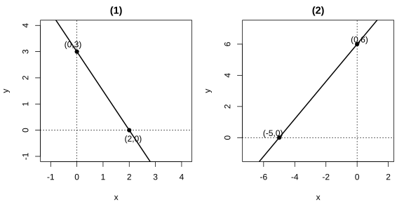
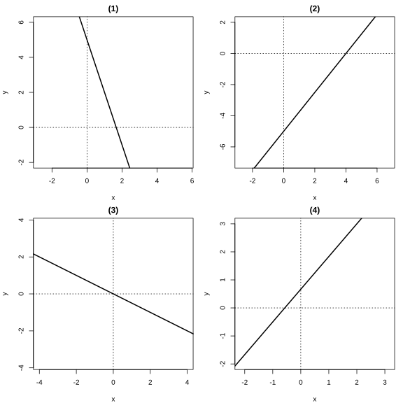
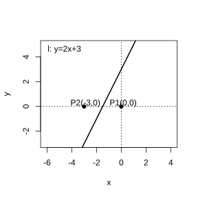
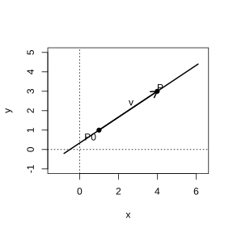

# 作业 61

> **定义 2.1.2** (斜率)  我们把一条直线的倾斜角 $\alpha$ 的正切值叫做这条直线的斜率. 斜率常用小写字母 $k$ 表示, 即 $k=\tan\alpha$.

> **常用结论 2.1.3** (斜率公式)  如果直线经过两点 $P_1\left(x_1,y_1\right)$, $P_2\left(x_2,y_2\right)$ ($x_1\ne x_2$), 那么斜率 $k=\frac{y_2-y_1}{x_2-x_1}$.

> **常用结论 2.1.5** (两条直线平行)  对于斜率分别为 $k_1,k_2$ 的两条直线 $l_1,l_2$, 有 $l_1\parallel l_2\Leftrightarrow k_1=k_2$.

> **常用结论 2.1.6** (两条直线垂直)  $l_1\perp l_2\Leftrightarrow k_1k_2=-1$.

> **定义 2.2.1** (点斜式方程)  直线 $l$ 经过点 $P_0\left(x_0,y_0\right)$ 且斜率为 $k$, 则方程 $y-y_0=k\left(x-x_0\right)$ 称为过点 $P_0\left(x_0,y_0\right)$ 且斜率为 $k$ 的直线的点斜式方程, 简称点斜式. 当直线的倾斜角为 $0^\circ$ 时, 直线方程为 $y=y_0$; 当直线的倾斜角为 $90^\circ$ 时, 直线没有斜率, 其方程为 $x=x_0$.

> **定义 2.2.2** (斜截式方程)  直线 $l$ 与 $y$ 轴的交点 $\left(0,b\right)$ 的纵坐标 $b$ 叫做直线 $l$ 在 $y$ 轴上的截距. 方程 $y=kx+b$ 由直线的斜率 $k$ 与它在 $y$ 轴上的截距 $b$ 确定, 叫做直线的斜截式方程, 简称斜截式.

> **常用结论 2.2.3** (斜截式下平行与垂直)  对于直线 $l_1:y=k_1x+b_1$, $l_2:y=k_2x+b_2$, 有 $l_1\parallel l_2\Leftrightarrow k_1=k_2$ 且 $b_1\ne b_2$; $l_1\perp l_2\Leftrightarrow k_1k_2=-1$.

> **定义 2.2.4** (两点式方程)  经过两点 $P_1\left(x_1,y_1\right)$, $P_2\left(x_2,y_2\right)$ (其中 $x_1\ne x_2$, $y_1\ne y_2$) 的直线方程为 $\frac{y-y_1}{y_2-y_1}=\frac{x-x_1}{x_2-x_1}$, 叫做直线的两点式方程, 简称两点式.

> **定义 2.2.5** (截距式方程)  直线 $l$ 与 $x$ 轴的交点 $\left(a,0\right)$ 的横坐标 $a$ 叫做直线 $l$ 在 $x$ 轴上的截距. 方程 $\frac{x}{a}+\frac{y}{b}=1$ 由直线 $l$ 在两条坐标轴上的截距 $a$ 与 $b$ 确定, 叫做直线的截距式方程, 简称截距式.

> **定义 2.2.6** (一般式方程)  关于 $x,y$ 的二元一次方程 $Ax+By+C=0$ (其中 $A,B$ 不同时为 $0$) 叫做直线的一般式方程, 简称一般式. 当 $B\ne0$ 时, 方程可化为 $y=-\frac{A}{B}x-\frac{C}{B}$, 表示斜率为 $-\frac{A}{B}$ 且过点 $\left(0,-\frac{C}{B}\right)$ 的直线; 当 $B=0$ 时, 方程可化为 $x=-\frac{C}{A}$, 表示过点 $\left(-\frac{C}{A},0\right)$ 且垂直于 $x$ 轴的直线.

### 练习一

(练习 2.2 第 1 题) 写出下列直线的点斜式方程:

(1) 经过点 $A\left(3,-1\right)$, 斜率是 $\sqrt 2$;

(2) 经过点 $B\left(-\sqrt 2,2\right)$, 倾斜角是 $30^\circ$;

(3) 经过点 $C\left(0,3\right)$, 倾斜角是 $0^\circ$;

(4) 经过点 $D\left(-4,-2\right)$, 倾斜角是 $\frac{2\pi}{3}$.

### 解答 练习一

由**定义 2.2.1** (点斜式方程), 点斜式方程为 $y-y_0=k\left(x-x_0\right)$, 其中 $k=\tan\alpha$.

(1) 代入点 $A\left(3,-1\right)$ 与斜率 $k=\sqrt 2$, 得 $y-\left(-1\right)=\sqrt 2\left(x-3\right)$, 即 $y+1=\sqrt 2\left(x-3\right)$.

(2) 由**定义 2.1.2** (斜率), $k=\tan 30^\circ=\frac{\sqrt 3}{3}$. 代入点 $B\left(-\sqrt 2,2\right)$, 得 $y-2=\frac{\sqrt 3}{3}\left(x+\sqrt 2\right)$.

(3) 由倾斜角为 $0^\circ$, 得 $k=\tan 0^\circ=0$. 代入点 $C\left(0,3\right)$, 得 $y-3=0\cdot\left(x-0\right)$, 即 $y-3=0$.

(4) 由**定义 2.1.2**, $k=\tan\frac{2\pi}{3}=-\sqrt 3$. 代入点 $D\left(-4,-2\right)$, 得 $y-\left(-2\right)=-\sqrt 3\left(x+4\right)$, 即 $y+2=-\sqrt 3\left(x+4\right)$. $\blacksquare$

### 练习二

(练习 2.2 第 2 题) 填空题.

(1) 已知直线的点斜式方程是 $y-2=x-1$, 那么此直线的斜率是 $\;\_\_\;$, 倾斜角是 $\;\_\_\;$;

(2) 已知直线的点斜式方程是 $y+2=\sqrt 3\left(x+1\right)$, 那么此直线的斜率是 $\;\_\_\;$, 倾斜角是 $\;\_\_\;$.

### 解答 练习二

由**定义 2.2.1** (点斜式方程), 点斜式 $y-y_0=k\left(x-x_0\right)$ 中 $k$ 即为斜率; 由**定义 2.1.2** (斜率), $k=\tan\alpha$.

(1) 方程 $y-2=x-1$ 即 $y-2=1\cdot\left(x-1\right)$, 对照点斜式, 得斜率 $k=1$. 由 $\tan\alpha=1$ 及 $0^\circ\le\alpha<180^\circ$, 得倾斜角 $\alpha=45^\circ$.

(2) 方程 $y+2=\sqrt 3\left(x+1\right)$ 即 $y-\left(-2\right)=\sqrt 3\left[x-\left(-1\right)\right]$, 对照点斜式, 得斜率 $k=\sqrt 3$. 由 $\tan\alpha=\sqrt 3$ 及 $0^\circ\le\alpha<180^\circ$, 得倾斜角 $\alpha=60^\circ$. $\blacksquare$

### 练习三

(练习 2.2 第 3 题) 写出下列直线的斜截式方程:

(1) 斜率是 $\frac{\sqrt 3}{2}$, 在 $y$ 轴上的截距是 $-2$;

(2) 斜率是 $-2$, 在 $y$ 轴上的截距是 $4$.

### 解答 练习三

由**定义 2.2.2** (斜截式方程), 斜截式为 $y=kx+b$, 其中 $k$ 为斜率, $b$ 为在 $y$ 轴上的截距.

(1) 代入 $k=\frac{\sqrt 3}{2}$, $b=-2$, 得 $y=\frac{\sqrt 3}{2}x-2$.

(2) 代入 $k=-2$, $b=4$, 得 $y=-2x+4$. $\blacksquare$

### 练习四

(练习 2.2 第 4 题) 判断下列各对直线是否平行或垂直:

(1) $l_1:y=\frac{1}{2}x+3$, $l_2:y=\frac{1}{2}x-2$;

(2) $l_1:y=\frac{5}{3}x$, $l_2:y=-\frac{3}{5}x$.

### 解答 练习四

由**常用结论 2.2.3** (斜截式下平行与垂直).

(1) $l_1$ 的斜率 $k_1=\frac{1}{2}$, $l_2$ 的斜率 $k_2=\frac{1}{2}$, $k_1=k_2$. 又 $l_1$ 的截距 $b_1=3$, $l_2$ 的截距 $b_2=-2$, $b_1\ne b_2$, 故 $l_1\parallel l_2$.

(2) $l_1$ 的斜率 $k_1=\frac{5}{3}$, $l_2$ 的斜率 $k_2=-\frac{3}{5}$. 两斜率之积为 $\frac{5}{3}\times\left(-\frac{3}{5}\right)=-1$, 故 $l_1\perp l_2$. $\blacksquare$

### 练习五

(练习 2.2 第 5 题) 求经过下列两点的直线的两点式方程:

(1) $P_1\left(2,1\right)$, $P_2\left(0,-3\right)$;

(2) $A\left(0,5\right)$, $B\left(5,0\right)$.

### 解答 练习五

由**定义 2.2.4** (两点式方程), 两点式为 $\frac{y-y_1}{y_2-y_1}=\frac{x-x_1}{x_2-x_1}$.

(1) 代入 $P_1\left(2,1\right)$, $P_2\left(0,-3\right)$, 得

$$
\frac{y-1}{-3-1}=\frac{x-2}{0-2},
$$

即 $\frac{y-1}{-4}=\frac{x-2}{-2}$.

(2) 代入 $A\left(0,5\right)$, $B\left(5,0\right)$, 得

$$
\frac{y-5}{0-5}=\frac{x-0}{5-0},
$$

即 $\frac{y-5}{-5}=\frac{x}{5}$. $\blacksquare$

### 练习六

(练习 2.2 第 6 题) 根据下列条件求直线的截距式方程, 并画出图形:

(1) 在 $x$ 轴, $y$ 轴上的截距分别是 $2,3$;

(2) 在 $x$ 轴, $y$ 轴上的截距分别是 $-5,6$.

{width=100%}

### 解答 练习六

由**定义 2.2.5** (截距式方程), 截距式为 $\frac{x}{a}+\frac{y}{b}=1$, 其中 $a$ 为 $x$ 轴上的截距, $b$ 为 $y$ 轴上的截距.

(1) 代入 $a=2$, $b=3$, 得 $\frac{x}{2}+\frac{y}{3}=1$.

(2) 代入 $a=-5$, $b=6$, 得 $\frac{x}{-5}+\frac{y}{6}=1$. $\blacksquare$

### 练习七

(练习 2.2 第 7 题) 根据下列条件, 求直线的方程:

(1) 过点 $\left(0,5\right)$, 且在两坐标轴上的截距之和为 $2$;

(2) 过点 $\left(5,0\right)$, 且在两坐标轴上的截距之差为 $2$.

### 解答 练习七

由**定义 2.2.5** (截距式方程), 设直线在 $x$ 轴, $y$ 轴上的截距分别为 $a,b$, 则截距式为 $\frac{x}{a}+\frac{y}{b}=1$.

(1) 直线过点 $\left(0,5\right)$, 即在 $y$ 轴上的截距 $b=5$. 又截距之和为 $a+b=2$, 故 $a=2-5=-3$. 代入截距式, 得 $\frac{x}{-3}+\frac{y}{5}=1$.

(2) 直线过点 $\left(5,0\right)$, 即在 $x$ 轴上的截距 $a=5$. 又截距之差为 $\lvert a-b \rvert=2$, 即 $\lvert 5-b \rvert=2$, 故 $b=3$ 或 $b=7$.

当 $b=3$ 时, 方程为 $\frac{x}{5}+\frac{y}{3}=1$; 当 $b=7$ 时, 方程为 $\frac{x}{5}+\frac{y}{7}=1$. $\blacksquare$

### 练习八

(练习 2.2 第 8 题) 根据下列条件, 写出直线的方程, 并把它化为一般式:

(1) 经过点 $A\left(8,-2\right)$, 斜率是 $-\frac{1}{2}$;

(2) 经过点 $B\left(4,2\right)$, 平行于 $x$ 轴;

(3) 经过点 $P_1\left(3,-2\right)$, $P_2\left(5,-4\right)$;

(4) 在 $x$ 轴, $y$ 轴上的截距分别是 $\frac{3}{2},-3$.

### 解答 练习八

由**定义 2.2.6** (一般式方程), 一般式为 $Ax+By+C=0$.

(1) 由**定义 2.2.1** (点斜式方程), 代入点 $A\left(8,-2\right)$ 与斜率 $k=-\frac{1}{2}$, 得 $y+2=-\frac{1}{2}\left(x-8\right)$. 整理, 得 $x+2y-4=0$.

(2) 直线平行于 $x$ 轴, 即倾斜角为 $0^\circ$, 斜率为 $0$. 经过点 $B\left(4,2\right)$, 由**定义 2.2.1**, 得 $y=2$, 即 $y-2=0$.

(3) 由**常用结论 2.1.3** (斜率公式), $k=\frac{-4-\left(-2\right)}{5-3}=\frac{-2}{2}=-1$. 由**定义 2.2.1**, 代入点 $P_1\left(3,-2\right)$, 得 $y+2=-1\left(x-3\right)$, 即 $x+y-1=0$.

(4) 由**定义 2.2.5** (截距式方程), 代入 $a=\frac{3}{2}$, $b=-3$, 得 $\frac{x}{\frac{3}{2}}+\frac{y}{-3}=1$, 即 $\frac{2x}{3}-\frac{y}{3}=1$. 整理, 得 $2x-y-3=0$. $\blacksquare$

### 练习九

(练习 2.2 第 9 题) 求下列直线的斜率以及在 $y$ 轴上的截距, 并画出图形:

(1) $3x+y-5=0$;

(2) $\frac{x}{4}-\frac{y}{5}=1$;

(3) $x+2y=0$;

(4) $7x-6y+4=0$.

{width=100%}

### 解答 练习九

由**定义 2.2.6** (一般式方程), 当 $B\ne0$ 时, 将一般式化为斜截式 $y=-\frac{A}{B}x-\frac{C}{B}$, 斜率为 $-\frac{A}{B}$, 在 $y$ 轴上的截距为 $-\frac{C}{B}$.

(1) $3x+y-5=0$ 即 $y=-3x+5$, 斜率 $k=-3$, 在 $y$ 轴上的截距为 $5$.

(2) $\frac{x}{4}-\frac{y}{5}=1$ 即 $y=\frac{5}{4}x-5$, 斜率 $k=\frac{5}{4}$, 在 $y$ 轴上的截距为 $-5$.

(3) $x+2y=0$ 即 $y=-\frac{1}{2}x$, 斜率 $k=-\frac{1}{2}$, 在 $y$ 轴上的截距为 $0$.

(4) $7x-6y+4=0$ 即 $y=\frac{7}{6}x+\frac{2}{3}$, 斜率 $k=\frac{7}{6}$, 在 $y$ 轴上的截距为 $\frac{2}{3}$. $\blacksquare$

### 练习十

(练习 2.2 第 10 题) 已知直线 $l$ 的方程是 $Ax+By+C=0$.

(1) 当 $B\ne0$ 时, 直线 $l$ 的斜率是多少? 当 $B=0$ 时呢?

(2) 系数 $A,B,C$ 取什么值时, 方程 $Ax+By+C=0$ 表示经过原点的直线?

### 解答 练习十

由**定义 2.2.6** (一般式方程).

(1) 当 $B\ne0$ 时, 方程 $Ax+By+C=0$ 可化为 $y=-\frac{A}{B}x-\frac{C}{B}$, 故直线 $l$ 的斜率为 $-\frac{A}{B}$. 当 $B=0$ 时, $A\ne0$, 方程可化为 $x=-\frac{C}{A}$, 直线垂直于 $x$ 轴, 斜率不存在.

(2) 直线经过原点 $\left(0,0\right)$, 即 $x=0$, $y=0$ 满足方程, 代入得 $A\cdot0+B\cdot0+C=0$, 即 $C=0$. 又 $A,B$ 不同时为 $0$, 故当 $C=0$ 且 $A,B$ 不同时为 $0$ 时, 方程 $Ax+By+C=0$ 表示经过原点的直线. $\blacksquare$

### 习题一

(习题 2.2 复习巩固第 1 题) 写出满足下列条件的直线的方程:

(1) 经过点 $A\left(8,-2\right)$, 斜率是 $\frac{\sqrt 3}{3}$;

(2) 经过点 $B\left(-2,0\right)$, 且与 $x$ 轴垂直;

(3) 斜率是 $-4$, 在 $y$ 轴上的截距是 $7$;

(4) 经过 $A\left(-1,8\right)$, $B\left(4,-2\right)$ 两点;

(5) 在 $y$ 轴上的截距是 $2$, 且与 $x$ 轴平行;

(6) 在 $x$ 轴, $y$ 轴上的截距分别是 $4,-3$.

### 解答 习题一

(1) 由**定义 2.2.1** (点斜式方程), 代入点 $A\left(8,-2\right)$ 与斜率 $k=\frac{\sqrt 3}{3}$, 得 $y+2=\frac{\sqrt 3}{3}\left(x-8\right)$.

(2) 直线与 $x$ 轴垂直, 即倾斜角为 $90^\circ$, 斜率不存在. 由**定义 2.2.1**, 直线方程为 $x=-2$.

(3) 由**定义 2.2.2** (斜截式方程), 代入 $k=-4$, $b=7$, 得 $y=-4x+7$.

(4) 由**常用结论 2.1.3** (斜率公式), $k=\frac{-2-8}{4-\left(-1\right)}=\frac{-10}{5}=-2$. 由**定义 2.2.1**, 代入点 $A\left(-1,8\right)$, 得 $y-8=-2\left(x+1\right)$.

(5) 直线与 $x$ 轴平行, 即斜率为 $0$. 在 $y$ 轴上的截距为 $2$, 由**定义 2.2.2** (斜截式方程), 得 $y=2$.

(6) 由**定义 2.2.5** (截距式方程), 代入 $a=4$, $b=-3$, 得 $\frac{x}{4}+\frac{y}{-3}=1$. $\blacksquare$

### 习题二

(习题 2.2 复习巩固第 2 题) 判断 $A\left(1,3\right)$, $B\left(5,7\right)$, $C\left(10,12\right)$ 三点是否共线, 并说明理由.

### 解答 习题二

由**常用结论 2.1.3** (斜率公式), 分别求 $AB$ 与 $AC$ 的斜率.

$$
k_{AB}=\frac{7-3}{5-1}=\frac{4}{4}=1,
$$

$$
k_{AC}=\frac{12-3}{10-1}=\frac{9}{9}=1.
$$

由**常用结论 2.1.5** (两条直线平行), $k_{AB}=k_{AC}=1$, 且两直线都经过点 $A$, 故直线 $AB$ 与直线 $AC$ 重合, 即 $A,B,C$ 三点共线. $\blacksquare$

### 习题三

(习题 2.2 复习巩固第 3 题) 已知两点 $A\left(7,-4\right)$, $B\left(-5,6\right)$, 求线段 $AB$ 的垂直平分线的方程.

### 解答 习题三

由**常用结论 2.1.3** (斜率公式), 先求 $AB$ 的斜率与中点.

$$
k_{AB}=\frac{6-\left(-4\right)}{-5-7}=\frac{10}{-12}=-\frac{5}{6}.
$$

由中点坐标公式, $AB$ 的中点为 $\left(\frac{7+\left(-5\right)}{2},\frac{-4+6}{2}\right)=\left(1,1\right)$.

垂直平分线与 $AB$ 垂直, 由**常用结论 2.1.6** (两条直线垂直), 其斜率为 $k=\frac{6}{5}$.

由**定义 2.2.1** (点斜式方程), 代入点 $\left(1,1\right)$ 与斜率 $k=\frac{6}{5}$, 得 $y-1=\frac{6}{5}\left(x-1\right)$. 整理, 得 $6x-5y-1=0$. $\blacksquare$

### 习题四

(习题 2.2 复习巩固第 4 题) 已知 $\triangle ABC$ 的三个顶点 $A\left(8,5\right)$, $B\left(4,-2\right)$, $C\left(-6,3\right)$, 求经过两边 $AB$ 和 $AC$ 的中点的直线的方程.

### 解答 习题四

由中点坐标公式, $AB$ 的中点为

$$
M\left(\frac{8+4}{2},\frac{5+\left(-2\right)}{2}\right)=M\left(6,\frac{3}{2}\right),
$$

$AC$ 的中点为

$$
N\left(\frac{8+\left(-6\right)}{2},\frac{5+3}{2}\right)=N\left(1,4\right).
$$

由**常用结论 2.1.3** (斜率公式), 直线 $MN$ 的斜率为

$$
k_{MN}=\frac{4-\frac{3}{2}}{1-6}=\frac{\frac{5}{2}}{-5}=-\frac{1}{2}.
$$

由**定义 2.2.1** (点斜式方程), 代入点 $N\left(1,4\right)$ 与斜率 $k=-\frac{1}{2}$, 得 $y-4=-\frac{1}{2}\left(x-1\right)$. 整理, 得 $x+2y-9=0$. $\blacksquare$

### 习题五

(习题 2.2 复习巩固第 5 题) 一根弹簧, 挂 $4\,\mathrm{N}$ 的物体时, 长 $20\,\mathrm{cm}$. 在弹性限度内, 所挂物体的重量每增加 $1\,\mathrm{N}$, 弹簧就伸长 $1.5\,\mathrm{cm}$. 试写出弹簧的长度 $l$ (单位: $\mathrm{cm}$) 与所挂物体重量 $G$ (单位: $\mathrm{N}$) 之间关系的方程.

### 解答 习题五

由**定义 2.2.2** (斜截式方程), 设 $l=kG+b$.

当 $G=4$ 时 $l=20$, 即 $20=4k+b$. 所挂物体重量每增加 $1\,\mathrm{N}$ 弹簧伸长 $1.5\,\mathrm{cm}$, 即斜率 $k=1.5=\frac{3}{2}$.

代入 $k=\frac{3}{2}$, 得 $20=\frac{3}{2}\times4+b=6+b$, 故 $b=14$.

故弹簧长度与物体重量之间关系的方程为 $l=\frac{3}{2}G+14$. $\blacksquare$

### 习题六

(习题 2.2 复习巩固第 6 题) 菱形的两条对角线分别位于 $x$ 轴和 $y$ 轴上, 其长度分别为 $8$ 和 $6$, 求菱形各边所在直线的方程.

### 解答 习题六

由**定义 2.2.5** (截距式方程), 菱形的四个顶点分别为 $\left(4,0\right)$, $\left(-4,0\right)$, $\left(0,3\right)$, $\left(0,-3\right)$.

四条边分别连接相邻顶点:

(1) 连接 $\left(4,0\right)$ 与 $\left(0,3\right)$ 的边, 由**定义 2.2.5**, 截距为 $4$ 和 $3$, 方程为 $\frac{x}{4}+\frac{y}{3}=1$.

(2) 连接 $\left(-4,0\right)$ 与 $\left(0,3\right)$ 的边, 截距为 $-4$ 和 $3$, 方程为 $\frac{x}{-4}+\frac{y}{3}=1$.

(3) 连接 $\left(-4,0\right)$ 与 $\left(0,-3\right)$ 的边, 截距为 $-4$ 和 $-3$, 方程为 $\frac{x}{-4}+\frac{y}{-3}=1$.

(4) 连接 $\left(4,0\right)$ 与 $\left(0,-3\right)$ 的边, 截距为 $4$ 和 $-3$, 方程为 $\frac{x}{4}+\frac{y}{-3}=1$. $\blacksquare$

### 习题七

(习题 2.2 复习巩固第 7 题) 求经过点 $P\left(2,3\right)$, 并且在两坐标轴上的截距相等的直线的方程.

### 解答 习题七

由**定义 2.2.5** (截距式方程), 设直线在 $x$ 轴, $y$ 轴上的截距分别为 $a,b$, 且 $a=b$.

(a) 当 $a=b\ne0$ 时, 截距式为 $\frac{x}{a}+\frac{y}{a}=1$, 即 $x+y=a$. 直线过点 $P\left(2,3\right)$, 代入得 $2+3=a$, 故 $a=5$. 方程为 $x+y=5$, 即 $x+y-5=0$.

(b) 当 $a=b=0$ 时, 直线过原点, 截距式不适用. 由**定义 2.2.1** (点斜式方程), 设直线过原点 $\left(0,0\right)$ 和 $P\left(2,3\right)$, 由**常用结论 2.1.3** (斜率公式), $k=\frac{3-0}{2-0}=\frac{3}{2}$. 方程为 $y=\frac{3}{2}x$, 即 $3x-2y=0$.

故所求直线的方程为 $x+y-5=0$ 或 $3x-2y=0$. $\blacksquare$

### 习题八

(习题 2.2 复习巩固第 8 题) 求满足下列条件的直线的方程:

(1) 经过点 $A\left(3,2\right)$, 且与直线 $4x+y-2=0$ 平行;

(2) 经过点 $C\left(2,-3\right)$, 且平行于过 $M\left(1,2\right)$ 和 $N\left(-1,-5\right)$ 两点的直线;

(3) 经过点 $B\left(3,0\right)$, 且与直线 $2x+y-5=0$ 垂直.

### 解答 习题八

(1) 直线 $4x+y-2=0$ 即 $y=-4x+2$, 斜率为 $-4$. 由**常用结论 2.1.5** (两条直线平行), 所求直线斜率也为 $-4$. 由**定义 2.2.1** (点斜式方程), 代入点 $A\left(3,2\right)$, 得 $y-2=-4\left(x-3\right)$, 即 $4x+y-14=0$.

(2) 由**常用结论 2.1.3** (斜率公式), $k_{MN}=\frac{-5-2}{-1-1}=\frac{-7}{-2}=\frac{7}{2}$. 由**常用结论 2.1.5**, 所求直线斜率也为 $\frac{7}{2}$. 由**定义 2.2.1**, 代入点 $C\left(2,-3\right)$, 得 $y+3=\frac{7}{2}\left(x-2\right)$, 即 $7x-2y-20=0$.

(3) 直线 $2x+y-5=0$ 即 $y=-2x+5$, 斜率为 $-2$. 由**常用结论 2.1.6** (两条直线垂直), 所求直线斜率为 $\frac{1}{2}$. 由**定义 2.2.1**, 代入点 $B\left(3,0\right)$, 得 $y=\frac{1}{2}\left(x-3\right)$, 即 $x-2y-3=0$. $\blacksquare$

### 习题九

(习题 2.2 综合运用第 9 题) $\triangle ABC$ 的三个顶点是 $A\left(4,0\right)$, $B\left(6,7\right)$, $C\left(0,3\right)$, 求:

(1) 边 $BC$ 上的中线所在直线的方程;

(2) 边 $BC$ 上的高所在直线的方程;

(3) 边 $BC$ 的垂直平分线的方程.

### 解答 习题九

由**常用结论 2.1.3** (斜率公式), 先求 $BC$ 的斜率与中点.

$$
k_{BC}=\frac{3-7}{0-6}=\frac{-4}{-6}=\frac{2}{3}.
$$

$BC$ 的中点为 $D\left(\frac{6+0}{2},\frac{7+3}{2}\right)=D\left(3,5\right)$.

(1) 边 $BC$ 上的中线即直线 $AD$. 由**常用结论 2.1.3**, $k_{AD}=\frac{5-0}{3-4}=\frac{5}{-1}=-5$. 由**定义 2.2.1** (点斜式方程), 代入点 $A\left(4,0\right)$, 得 $y=-5\left(x-4\right)$, 即 $5x+y-20=0$.

(2) 边 $BC$ 上的高过点 $A$ 且与 $BC$ 垂直. 由**常用结论 2.1.6** (两条直线垂直), 高所在直线的斜率为 $-\frac{3}{2}$. 由**定义 2.2.1**, 代入点 $A\left(4,0\right)$, 得 $y=-\frac{3}{2}\left(x-4\right)$, 即 $3x+2y-12=0$.

(3) 边 $BC$ 的垂直平分线过中点 $D\left(3,5\right)$ 且与 $BC$ 垂直. 由**常用结论 2.1.6**, 其斜率为 $-\frac{3}{2}$. 由**定义 2.2.1**, 代入点 $D\left(3,5\right)$, 得 $y-5=-\frac{3}{2}\left(x-3\right)$, 即 $3x+2y-19=0$. $\blacksquare$

### 习题十

(习题 2.2 综合运用第 10 题) 求直线 $Ax+By+C=0$ ($A,B$ 不同时为 $0$) 的系数 $A,B,C$ 分别满足什么关系时, 这条直线有以下性质:

(1) 与两条坐标轴都相交;

(2) 只与 $x$ 轴相交;

(3) 只与 $y$ 轴相交;

(4) 是 $x$ 轴所在的直线;

(5) 是 $y$ 轴所在的直线.

### 解答 习题十

由**定义 2.2.6** (一般式方程), 当 $B\ne0$ 时直线斜率为 $-\frac{A}{B}$; 当 $B=0$ 时直线垂直于 $x$ 轴.

(1) 与两条坐标轴都相交, 即直线既不平行于 $x$ 轴也不平行于 $y$ 轴, 即斜率存在且不为 $0$. 故 $A\ne0$ 且 $B\ne0$.

(2) 只与 $x$ 轴相交, 即直线平行于 $y$ 轴, 即 $B=0$ 且 $A\ne0$.

(3) 只与 $y$ 轴相交, 即直线平行于 $x$ 轴, 即 $A=0$ 且 $B\ne0$.

(4) 是 $x$ 轴所在的直线, 即 $y=0$, 故 $A=0$, $B\ne0$, $C=0$.

(5) 是 $y$ 轴所在的直线, 即 $x=0$, 故 $B=0$, $A\ne0$, $C=0$. $\blacksquare$

### 习题十一

(习题 2.2 综合运用第 11 题) 设点 $P_0\left(x_0,y_0\right)$ 在直线 $Ax+By+C=0$ 上, 求证: 这条直线的方程还可以写成 $A\left(x-x_0\right)+B\left(y-y_0\right)=0$.

### 解答 习题十一

由**定义 2.2.6** (一般式方程), 直线方程为 $Ax+By+C=0$.

因为点 $P_0\left(x_0,y_0\right)$ 在直线上, 所以 $Ax_0+By_0+C=0$, 即 $C=-Ax_0-By_0$.

将 $C=-Ax_0-By_0$ 代入原方程, 得 $Ax+By-Ax_0-By_0=0$, 即 $A\left(x-x_0\right)+B\left(y-y_0\right)=0$. 故原命题得证. $\blacksquare$

### 习题十二

(习题 2.2 拓广探索第 12 题) 若直线 $l$ 沿 $x$ 轴向左平移 $3$ 个单位长度, 再沿 $y$ 轴向上平移 $1$ 个单位长度后, 回到原来的位置. 试求直线 $l$ 的斜率.

### 解答 习题十二

由**定义 2.2.2** (斜截式方程), 设直线 $l$ 的方程为 $y=kx+b$.

直线沿 $x$ 轴向左平移 $3$ 个单位, 即将 $x$ 替换为 $x+3$, 得 $y=k\left(x+3\right)+b$. 再沿 $y$ 轴向上平移 $1$ 个单位, 即将 $y$ 替换为 $y-1$, 得 $y-1=k\left(x+3\right)+b$, 即 $y=kx+3k+b+1$.

平移后与原直线重合, 故 $3k+b+1=b$, 即 $3k+1=0$, 故 $k=-\frac{1}{3}$. $\blacksquare$

### 习题十三

(习题 2.2 拓广探索第 13 题) 一条光线从点 $P\left(6,4\right)$ 射出, 与 $x$ 轴相交于点 $Q\left(2,0\right)$, 经 $x$ 轴反射, 求入射光线和反射光线所在直线的方程.

### 解答 习题十三

入射光线经过点 $P\left(6,4\right)$ 和 $Q\left(2,0\right)$. 由**常用结论 2.1.3** (斜率公式),

$$
k_{PQ}=\frac{0-4}{2-6}=\frac{-4}{-4}=1.
$$

由**定义 2.2.1** (点斜式方程), 代入点 $Q\left(2,0\right)$, 得入射光线方程为 $y=x-2$, 即 $x-y-2=0$.

由光的反射定律, 反射光线与入射光线关于 $x$ 轴对称. 点 $P\left(6,4\right)$ 关于 $x$ 轴的对称点为 $P'\left(6,-4\right)$. 反射光线经过点 $P'\left(6,-4\right)$ 和 $Q\left(2,0\right)$. 由**常用结论 2.1.3**,

$$
k_{P'Q}=\frac{0-\left(-4\right)}{2-6}=\frac{4}{-4}=-1.
$$

由**定义 2.2.1**, 代入点 $Q\left(2,0\right)$, 得反射光线方程为 $y=-\left(x-2\right)$, 即 $x+y-2=0$. $\blacksquare$

### 习题十四

(习题 2.2 拓广探索第 14 题) 已知直线 $l_1,l_2$ 的方程分别是 $l_1:A_1x+B_1y+C_1=0$ ($A_1,B_1$ 不同时为 $0$), $l_2:A_2x+B_2y+C_2=0$ ($A_2,B_2$ 不同时为 $0$), 且 $A_1A_2+B_1B_2=0$, 求证: $l_1\perp l_2$.

### 解答 习题十四

由**定义 2.2.6** (一般式方程), 当 $B_1\ne0$ 时, $l_1$ 的斜率为 $k_1=-\frac{A_1}{B_1}$; 当 $B_2\ne0$ 时, $l_2$ 的斜率为 $k_2=-\frac{A_2}{B_2}$.

(a) 当 $B_1\ne0$ 且 $B_2\ne0$ 时, 两斜率之积为

$$
k_1k_2=\left(-\frac{A_1}{B_1}\right)\left(-\frac{A_2}{B_2}\right)=\frac{A_1A_2}{B_1B_2}.
$$

由 $A_1A_2+B_1B_2=0$, 得 $A_1A_2=-B_1B_2$, 故 $k_1k_2=\frac{-B_1B_2}{B_1B_2}=-1$. 由**常用结论 2.1.6** (两条直线垂直), 故 $l_1\perp l_2$.

(b) 当 $B_1=0$ 时, $A_1\ne0$, 由 $A_1A_2+B_1B_2=0$ 得 $A_1A_2=0$, 故 $A_2=0$. 又 $A_2,B_2$ 不同时为 $0$, 故 $B_2\ne0$. 此时 $l_1$ 的方程为 $A_1x+C_1=0$, 即 $x=-\frac{C_1}{A_1}$, 垂直于 $x$ 轴; $l_2$ 的方程为 $B_2y+C_2=0$, 即 $y=-\frac{C_2}{B_2}$, 平行于 $x$ 轴. 故 $l_1\perp l_2$.

(c) 当 $B_2=0$ 时, 同理可得 $A_1=0$, $l_1$ 平行于 $x$ 轴而 $l_2$ 垂直于 $x$ 轴, 故 $l_1\perp l_2$.

综上, $l_1\perp l_2$. $\blacksquare$

### 习题十五

(习题 2.2 拓广探索第 15 题) 画出直线 $l:2x-y+3=0$, 并在直线 $l$ 外取若干点, 将这些点的坐标代入 $2x-y+3$, 求它的值; 观察有什么规律, 并把这个规律表示出来.

{width=50%}

### 解答 习题十五

由**定义 2.2.6** (一般式方程), 直线 $l$ 的方程为 $2x-y+3=0$.

在直线 $l$ 上的点, 其坐标代入 $2x-y+3$ 的值为 $0$. 在直线 $l$ 外的点, 代入 $2x-y+3$ 的值不为 $0$.

取点 $P_1\left(0,0\right)$, 代入得 $2\cdot0-0+3=3>0$; 取点 $P_2\left(-3,0\right)$, 代入得 $2\cdot\left(-3\right)-0+3=-3<0$.

观察规律: 在直线 $l$ 同侧的点, 代入 $2x-y+3$ 的值同号; 在直线 $l$ 两侧的点, 代入的值异号. 即二元一次式 $2x-y+3$ 的值的正负刻画了点在直线的哪一侧. $\blacksquare$

### 探究与发现一

(探究与发现 方向向量与直线的参数方程) 如图 1, 设直线 $l$ 经过点 $P_0\left(x_0,y_0\right)$, $\boldsymbol{v}=\left(m,n\right)$ 是它的一个方向向量, $P\left(x,y\right)$ 是直线 $l$ 上的任意一点, 则 $\boldsymbol{P_0P}$ 与 $\boldsymbol{v}$ 共线. 根据向量共线的充要条件, 存在唯一的实数 $t$, 使 $\boldsymbol{P_0P}=t\boldsymbol{v}$, 即 $\left(x-x_0,y-y_0\right)=t\left(m,n\right)$, 所以

$$
\begin{cases}x=x_0+mt,\\y=y_0+nt.\end{cases}
$$

从运动学角度看, $\boldsymbol{P_0P}=t\boldsymbol{v}$ ($t>0$) 可以看成质点 $P$ 从点 $P_0$ 出发, 以速度 $\boldsymbol{v}=\left(m,n\right)$ 做匀速直线运动, 经过时间 $t$ 后的位移. 你能刻画射线 $P_0N$ 吗? 由以上讨论, 你能说说方程 ① 的运动学意义吗?

{width=50%}

### 解答 探究与发现一

由**常用结论 2.1.4** (方向向量与斜率), 直线的方向向量为 $\boldsymbol{v}=\left(m,n\right)$ 时, 直线的斜率为 $k=\frac{n}{m}$.

射线 $P_0N$ 是从点 $P_0$ 出发沿方向 $-\boldsymbol{v}$ 延伸的, 即在参数方程中令 $t\le0$ 即得射线 $P_0N$.

方程 $\begin{cases}x=x_0+mt\\y=y_0+nt\end{cases}$ 的运动学意义为: 质点 $P$ 从点 $P_0\left(x_0,y_0\right)$ 出发, 以速度向量 $\boldsymbol{v}=\left(m,n\right)$ 做匀速直线运动, 经过时间 $t$ 后到达点 $\left(x,y\right)$. 当 $t>0$ 时, 质点沿 $\boldsymbol{v}$ 方向运动; 当 $t<0$ 时, 质点沿 $-\boldsymbol{v}$ 方向运动; $t$ 的绝对值表示运动的时间. $\blacksquare$

### 探究与发现二

(探究与发现 方向向量与直线的参数方程) 想一想, 直线的参数方程 $\begin{cases}x=x_0+mt\\y=y_0+nt\end{cases}$ 中, $\left(m,n\right)$ 的几何意义是什么?

### 解答 探究与发现二

由**常用结论 2.1.4** (方向向量与斜率), 直线 $l$ 的方向向量的坐标为 $\left(x,y\right)$ 时, 斜率 $k=\frac{y}{x}$.

在参数方程 $\begin{cases}x=x_0+mt\\y=y_0+nt\end{cases}$ 中, $\left(m,n\right)$ 是直线 $l$ 的一个方向向量. 当 $t=1$ 时, 点 $\left(x_0+m,y_0+n\right)$ 在直线 $l$ 上, 即从点 $P_0\left(x_0,y_0\right)$ 出发沿 $\left(m,n\right)$ 方向走一个参数单位到达该点. $\left(m,n\right)$ 的方向即为直线 $l$ 的方向, $\left(m,n\right)$ 的长度即为参数 $t=1$ 时质点沿直线移动的距离. $\blacksquare$
