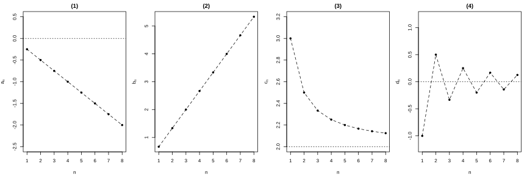
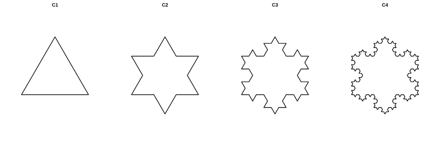
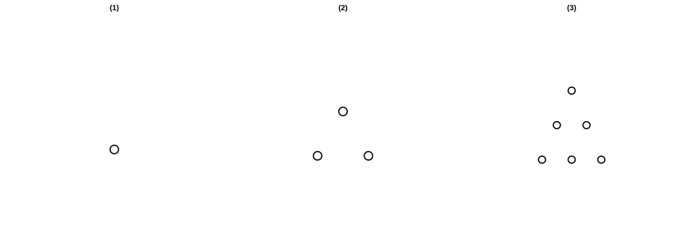

# 作业 78

> **定义 4.1.1** (数列)  按照确定的顺序排列的一列数称为数列, 数列中的每一个数叫做这个数列的项.
> **定义 4.1.5** (通项公式)  如果数列 $\left\{a_n\right\}$ 的第 $n$ 项 $a_n$ 与它的序号 $n$ 之间的对应关系可以用一个式子来表示, 那么这个式子叫做这个数列的通项公式.
> **定义 4.1.6** (递推公式)  如果一个数列的相邻两项或多项之间的关系可以用一个式子来表示, 那么这个式子叫做这个数列的递推公式.
> **常用结论 4.1.8** ($a_n$ 与 $S_n$ 的关系)  当 $n=1$ 时, $a_1=S_1$; 当 $n\ge 2$ 时, $a_n=S_n-S_{n-1}$.
> **定义 4.2.1** (等差数列)  如果一个数列从第 $2$ 项起, 每一项与它的前一项的差都等于同一个常数, 那么这个数列就叫做等差数列, 这个常数叫做等差数列的公差, 通常用字母 $d$ 表示.
> **定义 4.2.2** (等差中项)  由三个数 $a,A,b$ 组成的等差数列, $A$ 叫做 $a$ 与 $b$ 的等差中项. 根据等差数列的定义, $2A=a+b$.
> **定理 4.2.3** (等差数列通项公式)  首项为 $a_1$, 公差为 $d$ 的等差数列 $\left\{a_n\right\}$ 的通项公式为 $a_n=a_1+\left(n-1\right)d$.
> **定理 4.2.5** (等差数列性质)  在等差数列 $\left\{a_n\right\}$ 中, 若 $p+q=s+t$ ($p,q,s,t\in\mathbb N^*$), 则 $a_p+a_q=a_s+a_t$.
> **定理 4.2.6** (前 $n$ 项和公式一)  等差数列 $\left\{a_n\right\}$ 的前 $n$ 项和 $S_n=\frac{n\left(a_1+a_n\right)}{2}$.
> **定理 4.2.7** (前 $n$ 项和公式二)  等差数列 $\left\{a_n\right\}$ 的前 $n$ 项和 $S_n=na_1+\frac{n\left(n-1\right)}{2}d$.
> **定义 4.3.1** (等比数列)  如果一个数列从第 $2$ 项起, 每一项与它的前一项的比都等于同一个常数, 那么这个数列叫做等比数列, 这个常数叫做等比数列的公比, 通常用字母 $q$ 表示 ($q\ne 0$).
> **定义 4.3.2** (等比中项)  如果在 $a$ 与 $b$ 中间插入一个数 $G$, 使 $a,G,b$ 成等比数列, 那么 $G$ 叫做 $a$ 与 $b$ 的等比中项. 此时 $G^2=ab$.
> **定理 4.3.3** (等比数列通项公式)  首项为 $a_1$, 公比为 $q$ 的等比数列 $\left\{a_n\right\}$ 的通项公式为 $a_n=a_1 q^{n-1}$.
> **定理 4.3.5** (前 $n$ 项和公式)  当 $q\ne 1$ 时, $S_n=\frac{a_1\left(1-q^n\right)}{1-q}=\frac{a_1-a_n q}{1-q}$; 当 $q=1$ 时, $S_n=na_1$.
> **定义 4.4.1** (数学归纳法)  证明一个与正整数 $n$ 有关的命题, 可按下列步骤进行: (1)(归纳奠基) 证明当 $n=n_0$ ($n_0\in\mathbb N^*$) 时命题成立; (2)(归纳递推) 以"当 $n=k$ ($k\in\mathbb N^*$, $k\ge n_0$) 时命题成立"为条件, 推出"当 $n=k+1$ 时命题也成立". 只要完成这两个步骤, 就可以断定命题对从 $n_0$ 开始的所有正整数 $n$ 都成立.

### 习题一

(复习参考题4 复习巩固第 1 题) 根据下列数列的通项公式, 分别作出它们的图象

(1) $a_n=-\frac{n}{4}$;

(2) $b_n=\frac{2n}{3}$;

(3) $c_n=\frac{2n+1}{n}$;

(4) $d_n=\frac{\left(-1\right)^n}{n}$.

{width=100%}

### 解答 习题一

由**定义 4.1.5** (通项公式), 各数列的前若干项为:

(1) $a_n=-\frac{n}{4}$: $-\frac{1}{4},-\frac{1}{2},-\frac{3}{4},-1,\cdots$, 图象为在直线 $y=-\frac{x}{4}$ 上的散点, 递减.

(2) $b_n=\frac{2n}{3}$: $\frac{2}{3},\frac{4}{3},2,\frac{8}{3},\cdots$, 图象为在直线 $y=\frac{2x}{3}$ 上的散点, 递增.

(3) $c_n=\frac{2n+1}{n}=2+\frac{1}{n}$: $3,\frac{5}{2},\frac{7}{3},\frac{9}{4},\cdots$, 图象从 $3$ 递减趋近于 $2$.

(4) $d_n=\frac{\left(-1\right)^n}{n}$: $-1,\frac{1}{2},-\frac{1}{3},\frac{1}{4},\cdots$, 图象正负交替, 绝对值递减趋近于 $0$.

$\blacksquare$

(复习参考题4 复习巩固第 2 题) 根据下列数列的前 $4$ 项, 写出数列的一个通项公式

(1) $\frac{1}{2},\frac{3}{4},\frac{5}{8},\frac{7}{16},\cdots$;

(2) $1+\frac{1}{2^2},1-\frac{3}{4^2},1+\frac{5}{6^2},1-\frac{7}{8^2},\cdots$;

(3) $0,\sqrt{2},0,\sqrt{2},\cdots$.

### 解答 习题一

(1) 由**定义 4.1.5** (通项公式), 分子为 $1,3,5,7$, 分母为 $2,4,8,16$, 故

$$
a_n=\frac{2n-1}{2^n}.
$$

$\blacksquare$

(2) 由**定义 4.1.5** (通项公式), 符号正负交替, 分子为 $1,3,5,7$, 分母为 $2^2,4^2,6^2,8^2$, 故

$$
a_n=1+\left(-1\right)^{n+1}\frac{2n-1}{\left(2n\right)^2}.
$$

$\blacksquare$

(3) 由**定义 4.1.5** (通项公式), $0,\sqrt{2},0,\sqrt{2}$ 交替, 故

$$
a_n=\frac{\sqrt{2}}{2}\left[1-\left(-1\right)^n\right].
$$

$\blacksquare$

(复习参考题4 复习巩固第 3 题) 选择题

(1) 预测人口的变化趋势有多种方法, "直接推算法"使用的公式是 $P_n=P_0\left(1+k\right)^n$ ($k>-1$), 其中 $P_n$ 为预测期人口数, $P_0$ 为初期人口数, $k$ 为预测期内人口年增长率, $n$ 为预测期间隔年数. 如果在某一时期 $k\in\left(-1,0\right)$, 那么在这期间人口数 ( ).

(A) 呈上升趋势

(B) 呈下降趋势

(C) 摆动变化

(D) 不变

(2) 莱因德纸草书是世界上最古老的数学著作之一. 书中有一道这样的题目: 把 $100$ 个面包分给 $5$ 个人, 使每人所得面包个数成等差数列, 且使较大的三份之和的 $\frac{1}{7}$ 是较小的两份之和, 则最小的一份为 ( ).

(A) $\frac{5}{3}$

(B) $\frac{10}{3}$

(C) $\frac{5}{6}$

(D) $\frac{11}{6}$

(3) 如图是瑞典数学家科赫在 $1904$ 年构造的能够描述雪花形状的图案. 设原正三角形的边长为 $1$, 把图中各图形的周长依次记为 $C_1,C_2,C_3,C_4$, 则 $C_4=$ ( ).

(A) $\frac{128}{9}$

(B) $\frac{64}{9}$

(C) $\frac{64}{27}$

(D) $\frac{128}{27}$

{width=100%}

### 解答 习题一

(1) 由**定理 4.3.3** (等比数列通项公式), $P_n=P_0\left(1+k\right)^n$, 当 $k\in\left(-1,0\right)$ 时, $0<1+k<1$, 故 $P_n$ 递减, 选 (B).

$\blacksquare$

(2) 由**定理 4.2.3** (等差数列通项公式), 设五人所得为 $a-2d,a-d,a,a+d,a+2d$.

$$
5a=100,\ a=20.
$$

较大三份之和 $=\left(a\right)+\left(a+d\right)+\left(a+2d\right)=3a+3d$, 较小两份之和 $=\left(a-2d\right)+\left(a-d\right)=2a-3d$.

$$
\frac{1}{7}\left(3a+3d\right)=2a-3d,\ 3a+3d=14a-21d,\ 24d=11a=220,\ d=\frac{55}{6}.
$$

最小一份 $a-2d=20-\frac{110}{6}=\frac{10}{6}=\frac{5}{3}$, 选 (A).

$\blacksquare$

(3) 由**定义 4.3.1** (等比数列), 每次操作后边数乘以 $\frac{4}{3}$, 周长也乘以 $\frac{4}{3}$.

$C_1=3$, $C_4=3\times\left(\frac{4}{3}\right)^3=\frac{64}{9}$, 选 (B).

$\blacksquare$

(复习参考题4 复习巩固第 4 题) 填空题

(1) 已知 $a=5+2\sqrt{6}$, $c=5-2\sqrt{6}$. 若 $a,b,c$ 三个数成等差数列, 则 $b=$ $\;\_\_\;$; 若 $a,b,c$ 三个数成等比数列, 则 $b=$ $\;\_\_\;$.

(2) 我国古代数学名著算法统宗中有如下问题: "远望巍巍塔七层, 红光点点倍加增, 共灯三百八十一, 请问尖头几盏灯." 意思是: 一座 $7$ 层塔共挂了 $381$ 盏灯, 且相邻两层中的下一层灯数是上一层灯数的 $2$ 倍, 则塔的顶层共有 $\;\_\_\;$ 盏灯.

### 解答 习题一

(1) 由**定义 4.2.2** (等差中项), $b=\frac{a+c}{2}=\frac{10}{2}=5$.

由**定义 4.3.2** (等比中项), $b^2=ac=\left(5+2\sqrt{6}\right)\left(5-2\sqrt{6}\right)=25-24=1$, $b=\pm 1$.

$\blacksquare$

(2) 由**定义 4.3.1** (等比数列), 各层灯数构成首项 $a_1$ (顶层), 公比 $2$, $7$ 项的等比数列.

由**定理 4.3.5** (前 $n$ 项和公式),

$$
S_7=\frac{a_1\left(1-2^7\right)}{1-2}=127a_1=381,\ a_1=3.
$$

顶层共有 $3$ 盏灯.

$\blacksquare$

(复习参考题4 复习巩固第 5 题) 某教育网站本月的用户为 $2000$ 人. 网站改造后, 预计平均每月的用户都比上一个月增加 $30\%$, 那么从本月起, 大约经过几个月可使用户达到 $1$ 万人 (精确到 $1$)?

### 解答 习题一

由**定义 4.3.1** (等比数列), 用户数构成首项 $2000$, 公比 $1.3$ 的等比数列.

$$
2000\times 1.3^n\ge 10000,\ 1.3^n\ge 5,\ n\ge\log_{1.3}5\approx 6.8.
$$

约经过 $7$ 个月.

$\blacksquare$

(复习参考题4 复习巩固第 6 题) 某中学的募捐小组暑假期间走上街头进行了一次募捐活动, 共收到捐款 $1200$ 元. 他们第 $1$ 天只得到 $10$ 元, 之后采取了积极措施, 从第 $2$ 天起, 每天收到的捐款都比前一天多 $10$ 元. 这次募捐活动一共进行了多少天?

### 解答 习题一

由**定义 4.2.1** (等差数列), 每天捐款构成首项 $10$, 公差 $10$ 的等差数列.

由**定理 4.2.7** (前 $n$ 项和公式二),

$$
S_n=10n+\frac{n\left(n-1\right)}{2}\times 10=5n^2+5n=1200.
$$

$$
n^2+n-240=0,\ n=15.
$$

共进行了 $15$ 天.

$\blacksquare$

(复习参考题4 复习巩固第 7 题) 某同学利用暑假中的一段时间 (不超过 $20$ 天) 到一家商场勤工俭学. 该商场向他提供了三种付酬方案: 第一种, 每天支付 $85$ 元; 第二种, 第 $1$ 天支付 $65$ 元, 从第 $2$ 天起, 每天比前一天都多支付 $2$ 元; 第三种, 第 $1$ 天支付 $40$ 元, 从第 $2$ 天起, 每天支付的金额都是前一天的 $1.1$ 倍. 你认为他选择哪种方案领取报酬更划算?

### 解答 习题一

设工作 $n$ 天 ($n\le 20$).

第一种: $85n$ 元.

第二种: 由**定理 4.2.7** (前 $n$ 项和公式二), $65n+\frac{n\left(n-1\right)}{2}\times 2=n^2+64n$ 元.

第三种: 由**定理 4.3.5** (前 $n$ 项和公式), $\frac{40\left(1.1^n-1\right)}{1.1-1}=400\left(1.1^n-1\right)$ 元.

比较: 第二种 $-$ 第一种 $=n^2+64n-85n=n\left(n-21\right)<0$ ($n<21$), 第一种始终优于第二种.

第三种与第一种比较: $400\left(1.1^n-1\right)$ 与 $85n$.

$n=10$: 第三种 $=400\left(2.594-1\right)=637.6$, 第一种 $=850$, 第一种优.

$n=15$: 第三种 $=400\left(4.177-1\right)=1270.8$, 第一种 $=1275$, 接近.

$n=16$: 第三种 $=400\left(4.595-1\right)=1438$, 第一种 $=1360$, 第三种优.

故 $n\le 15$ 选第一种, $n\ge 16$ 选第三种.

$\blacksquare$

### 习题二

(复习参考题4 综合运用第 8 题) 非零实数 $a,b,c$ 不全相等

(1) 若 $a,b,c$ 成等差数列, $\frac{1}{a},\frac{1}{b},\frac{1}{c}$ 能构成等差数列吗? 你能用函数图象解释一下吗?

(2) 若 $a,b,c$ 成等比数列, $\frac{1}{a},\frac{1}{b},\frac{1}{c}$ 能构成等比数列吗? 为什么?

### 解答 习题二

(1) 由**定义 4.2.1** (等差数列), $2b=a+c$.

若 $\frac{1}{a},\frac{1}{b},\frac{1}{c}$ 成等差数列, 则 $\frac{2}{b}=\frac{1}{a}+\frac{1}{c}=\frac{a+c}{ac}=\frac{2b}{ac}$.

$b^2=ac$. 又 $2b=a+c$, 故 $\left(\frac{a+c}{2}\right)^2=ac$, $\left(a-c\right)^2=0$, $a=c$, 从而 $a=b=c$, 与不全相等矛盾.

故 $\frac{1}{a},\frac{1}{b},\frac{1}{c}$ 不能构成等差数列.

$\blacksquare$

(2) 由**定义 4.3.1** (等比数列), $b^2=ac$.

$$
\frac{1}{b^2}=\frac{1}{ac}=\frac{1}{a}\cdot\frac{1}{c}.
$$

由**定义 4.3.2** (等比中项), $\frac{1}{b}$ 是 $\frac{1}{a}$ 与 $\frac{1}{c}$ 的等比中项, 故 $\frac{1}{a},\frac{1}{b},\frac{1}{c}$ 成等比数列.

$\blacksquare$

(复习参考题4 综合运用第 9 题) 小明的父母为了准备小明将来考入大学的学费, 于 $2017$ 年元旦在某银行存入 $10000$ 元, 并在后续每一年的元旦都在该银行存入 $1200$ 元, 直到 $2022$ 年存入最后一笔钱为止. 如果银行的存款年利率为 $2.75\%$, 且以复利计息, 那么小明的父母在 $2023$ 年元旦将存款连本带利全部取出时, 能取到多少钱?

### 解答 习题二

由**定义 4.3.1** (等比数列), 每笔存款到 $2023$ 年的本利和构成等比数列.

$2017$ 年存入的 $10000$ 元到 $2023$ 年: $10000\times 1.0275^6$.

$2018$ 年至 $2022$ 年每年存入 $1200$ 元, 到 $2023$ 年分别为 $1200\times 1.0275^5,1200\times 1.0275^4,\cdots,1200\times 1.0275^0$.

由**定理 4.3.5** (前 $n$ 项和公式), 后续存款的本利和为

$$
1200\times\frac{1.0275^6-1}{1.0275-1}=1200\times\frac{1.0275^6-1}{0.0275}.
$$

总金额 $=10000\times 1.0275^6+1200\times\frac{1.0275^6-1}{0.0275}$.

$1.0275^6\approx 1.1769$, 总金额 $\approx 11769+1200\times\frac{0.1769}{0.0275}\approx 11769+7721=19490$ 元.

$\blacksquare$

(复习参考题4 综合运用第 10 题) 任取一个正整数, 若是奇数, 就将该数乘 $3$ 再加上 $1$; 若是偶数, 就将该数除以 $2$. 反复进行上述两种运算, 经过有限次步骤后, 必进入循环圈 $1\to 4\to 2\to 1$. 这就是数学史上著名的"冰雹猜想". 现给出冰雹猜想的递推关系如下: 已知数列 $\left\{a_n\right\}$ 满足 $a_1=m$ ($m$ 为正整数), $a_{n+1}=\begin{cases}\frac{a_n}{2}, & a_n\text{ 为偶数},\\ 3a_n+1, & a_n\text{ 为奇数}.\end{cases}$

(1) 当 $m=17$ 时, 试确定使得 $a_n=1$ 需要多少步雹程;

(2) 若 $a_8=1$, 求 $m$ 所有可能的取值集合 $M$.

### 解答 习题二

(1) 由**定义 4.1.6** (递推公式), 逐项计算.

$17\to 52\to 26\to 13\to 40\to 20\to 10\to 5\to 16\to 8\to 4\to 2\to 1$.

共 $12$ 步.

$\blacksquare$

(2) 逆向推导: $a_8=1$.

$a_7=2$ (因 $1\times 2=2$, 奇数 $1$ 不满足 $3a_7+1=1$).

$a_6=4$ (或 $a_6=0$ 舍去).

$a_5=8$ (或 $a_5=1$ 但 $1$ 不满足奇数运算).

$a_4=16$ (或 $a_4=\frac{1-1}{3}=0$ 舍去).

$a_3=32$ (或 $a_3=\frac{16-1}{3}=5$).

$a_2$: 从 $32$ 逆推: $64$ 或 $\frac{31}{3}$ (舍去); 从 $5$ 逆推: $10$ 或 $\frac{4}{3}$ (舍去). 故 $a_2=64$ 或 $10$.

$a_1$: 从 $64$ 逆推: $128$ 或 $21$; 从 $10$ 逆推: $20$ 或 $3$.

故 $M=\left\{3,20,21,128\right\}$.

$\blacksquare$

(复习参考题4 综合运用第 11 题) 已知等差数列 $\left\{a_n\right\}$ 的前 $n$ 项和为 $S_n$, 且 $S_4=4S_2$, $a_{2n}=2a_n+1$ ($n\in\mathbb N^*$)

(1) 求数列 $\left\{a_n\right\}$ 的通项公式;

(2) 若 $b_n=3^{n-1}$, 令 $c_n=a_n b_n$, 求数列 $\left\{c_n\right\}$ 的前 $n$ 项和 $T_n$.

### 解答 习题二

(1) 由**定理 4.2.7** (前 $n$ 项和公式二), $S_4=4a_1+6d$, $S_2=2a_1+d$.

$4a_1+6d=4\left(2a_1+d\right)$, $2a_1=d$.

由 $a_{2n}=2a_n+1$, $a_1+\left(2n-1\right)d=2\left[a_1+\left(n-1\right)d\right]+1$.

$a_1+\left(2n-1\right)d=2a_1+2\left(n-1\right)d+1$, $d-a_1=1$.

代入 $d=2a_1$, $a_1=1$, $d=2$.

$$
a_n=1+2\left(n-1\right)=2n-1.
$$

$\blacksquare$

(2) $c_n=\left(2n-1\right)3^{n-1}$.

$$
T_n=1+3\times 3+5\times 3^2+\cdots+\left(2n-1\right)3^{n-1}.
$$

$$
3T_n=1\times 3+3\times 3^2+\cdots+\left(2n-3\right)3^{n-1}+\left(2n-1\right)3^n.
$$

两式相减,

$$
-2T_n=1+2\left(3+3^2+\cdots+3^{n-1}\right)-\left(2n-1\right)3^n=1+2\cdot\frac{3\left(3^{n-1}-1\right)}{3-1}-\left(2n-1\right)3^n.
$$

$$
=1+3^n-3-\left(2n-1\right)3^n=-2-\left(2n-2\right)3^n.
$$

$$
T_n=\left(n-1\right)3^n+1.
$$

$\blacksquare$

(复习参考题4 综合运用第 12 题) 已知等比数列 $\left\{a_n\right\}$ 的前 $n$ 项和为 $S_n$, 且 $a_{n+1}=2S_n+2$ ($n\in\mathbb N^*$)

(1) 求数列 $\left\{a_n\right\}$ 的通项公式.

(2) 在 $a_n$ 与 $a_{n+1}$ 之间插入 $n$ 个数, 使这 $n+2$ 个数组成一个公差为 $d_n$ 的等差数列, 在数列 $\left\{d_n\right\}$ 中是否存在 $3$ 项 $d_m,d_k,d_p$ (其中 $m,k,p$ 成等差数列) 成等比数列? 若存在, 求出这样的 $3$ 项; 若不存在, 请说明理由.

### 解答 习题二

(1) 由 $a_{n+1}=2S_n+2$, 当 $n\ge 2$ 时, $a_n=2S_{n-1}+2$.

两式相减, $a_{n+1}-a_n=2a_n$, $a_{n+1}=3a_n$.

当 $n=1$ 时, $a_2=2a_1+2$, 又 $a_2=3a_1$, 故 $a_1=2$.

由**定理 4.3.3** (等比数列通项公式), $a_n=2\times 3^{n-1}$.

$\blacksquare$

(2) 在 $a_n$ 与 $a_{n+1}$ 之间插入 $n$ 个数, 共 $n+2$ 项, 公差

$$
d_n=\frac{a_{n+1}-a_n}{n+1}=\frac{2\times 3^n-2\times 3^{n-1}}{n+1}=\frac{4\times 3^{n-1}}{n+1}.
$$

假设存在 $d_m,d_k,d_p$ 成等比数列, $m,k,p$ 成等差数列, 即 $2k=m+p$.

$$
d_k^2=d_m d_p.
$$

$$
\left(\frac{4\times 3^{k-1}}{k+1}\right)^2=\frac{4\times 3^{m-1}}{m+1}\cdot\frac{4\times 3^{p-1}}{p+1}.
$$

$$
\frac{3^{2k-2}}{\left(k+1\right)^2}=\frac{3^{m+p-2}}{\left(m+1\right)\left(p+1\right)}.
$$

由 $2k=m+p$, $3^{2k-2}=3^{m+p-2}$, 故 $\left(k+1\right)^2=\left(m+1\right)\left(p+1\right)$.

由 $k=\frac{m+p}{2}$, $\left(\frac{m+p}{2}+1\right)^2=\left(m+1\right)\left(p+1\right)$.

$$
\frac{\left(m+p+2\right)^2}{4}=mp+m+p+1,\ \left(m+p\right)^2+4\left(m+p\right)+4=4mp+4\left(m+p\right)+4.
$$

$$
\left(m-p\right)^2=0,\ m=p.
$$

故 $m=k=p$, 即三项相同, 不存在不同的 $3$ 项成等比数列.

$\blacksquare$

(复习参考题4 综合运用第 13 题) 类比等差数列和等比数列的定义, 通项公式, 常用性质等, 发现它们具有如下的对偶关系: 只要将等差数列的一个关系式中的运算 "$+$" 改为 "$\times$", "$-$" 改为 "$\div$", 正整数倍改为正整数指数幂, 相应地就可得到等比数列中一个形式相同的关系式, 反之也成立

(1) 根据上述说法, 请你参照下表给出的信息推断出相关的对偶关系式;

(2) 在等差数列 $\left\{a_n\right\}$ 中, 若 $a_{2018}=0$, 则有 $a_1+a_2+\cdots+a_n=a_1+a_2+\cdots+a_{4035-n}$ ($n\in\mathbb N^*$, $n<4035$). 相应地, 在等比数列 $\left\{b_n\right\}$ 中, 若 $b_{2019}=1$, 请你类比推测出对偶的等式, 并加以证明.

### 解答 习题二

(1) 由对偶关系, 等差数列 $a_{n+1}-a_n=d$ 对应等比数列 $\frac{b_{n+1}}{b_n}=q$.

等差数列通项 $a_n=a_1+\left(n-1\right)d$ 对应等比数列 $b_n=b_1 q^{n-1}$.

等差数列常用性质: $a_1+a_n=a_2+a_{n-1}$ 对应 $b_1 b_n=b_2 b_{n-1}$; $a_{n-k}+a_{n+k}=2a_n$ 对应 $b_{n-k}b_{n+k}=b_n^2$; 若 $m+n=k+l$ 则 $a_m+a_n=a_k+a_l$ 对应 $b_m b_n=b_k b_l$.

$\blacksquare$

(2) 对偶推测: 在等比数列 $\left\{b_n\right\}$ 中, 若 $b_{2019}=1$, 则

$$
b_1 b_2\cdots b_n=b_1 b_2\cdots b_{4037-n}\ \left(n<4037\right).
$$

证明: 由**定义 4.3.2** (等比中项), $b_i b_{4037-i}=b_{2019}^2=1$.

左边 $=b_1 b_2\cdots b_n$, 右边 $=b_1 b_2\cdots b_n\cdot b_{n+1}\cdots b_{4037-n}$.

只需证 $b_{n+1}\cdots b_{4037-n}=1$.

由 $b_i b_{4037-i}=1$, 共 $\left(4037-n\right)-\left(n+1\right)+1=4036-2n$ 项, 可配对为 $2018-n$ 对, 每对乘积为 $1$.

故乘积为 $1$, 等式成立.

$\blacksquare$

### 习题三

(复习参考题4 拓广探索第 14 题) 在 $2015$ 年苏州世乒赛期间, 某景点用乒乓球堆成若干堆"正三棱锥"形的装饰品, 其中第 $1$ 堆只有 $1$ 层, 就一个球; 第 $2,3,4,\cdots$ 堆最底层 (第一层) 分别按图中所示方式固定摆放, 从第二层开始, 每层的小球自然垒放在下一层之上, 第 $n$ 堆第 $n$ 层就放一个乒乓球. 记第 $n$ 堆的乒乓球总数为 $f\left(n\right)$

(1) 求出 $f\left(3\right)$;

(2) 试归纳出 $f\left(n+1\right)$ 与 $f\left(n\right)$ 的关系式, 并根据你得到的关系式探求 $f\left(n\right)$ 的表达式.

参考公式: $1^2+2^2+\cdots+n^2=\frac{1}{6}n\left(n+1\right)\left(2n+1\right)$.

{width=100%}

### 解答 习题三

(1) 第 $3$ 堆有 $3$ 层, 各层球数分别为 $1,3,6$.

$$
f\left(3\right)=1+3+6=10.
$$

$\blacksquare$

(2) 第 $n+1$ 堆比第 $n$ 堆多一层 (最底层), 该层球数为第 $n+1$ 个三角形数, 即 $\frac{\left(n+1\right)\left(n+2\right)}{2}$.

$$
f\left(n+1\right)=f\left(n\right)+\frac{\left(n+1\right)\left(n+2\right)}{2}.
$$

$$
f\left(n\right)=f\left(1\right)+\sum_{k=1}^{n-1}\frac{\left(k+1\right)\left(k+2\right)}{2}=1+\frac{1}{2}\sum_{k=1}^{n-1}\left(k+1\right)\left(k+2\right).
$$

$$
=1+\frac{1}{2}\sum_{k=1}^{n-1}\left(k^2+3k+2\right)=1+\frac{1}{2}\left[\frac{\left(n-1\right)n\left(2n-1\right)}{6}+\frac{3\left(n-1\right)n}{2}+2\left(n-1\right)\right].
$$

$$
=\frac{n\left(n+1\right)\left(n+2\right)}{6}.
$$

$\blacksquare$

(复习参考题4 拓广探索第 15 题) 有理数都能表示成 $\frac{m}{n}$ ($m,n\in\mathbb Z$, 且 $n\ne 0$, $m$ 与 $n$ 互质) 的形式. 任何有理数 $\frac{m}{n}$ 都可以化为有限小数或无限循环小数. 反之, 任一有限小数也可以化为 $\frac{m}{n}$ 的形式, 从而是有理数; 那么无限循环小数是不是有理数? 思考下列问题

(1) $1.2\dot{3}$ 是有理数吗? 请说明理由.

(2) $1.2\dot{4}$ 是有理数吗? 请说明理由.

### 解答 习题三

(1) 设 $x=1.2\dot{3}=1.2333\cdots$.

$10x=12.333\cdots$, $100x=123.333\cdots$.

$90x=111$, $x=\frac{111}{90}=\frac{37}{30}$.

故 $1.2\dot{3}$ 是有理数.

$\blacksquare$

(2) 设 $x=1.2\dot{4}=1.2444\cdots$.

$10x=12.444\cdots$, $100x=124.444\cdots$.

$90x=112$, $x=\frac{112}{90}=\frac{56}{45}$.

故 $1.2\dot{4}$ 是有理数.

$\blacksquare$

(复习参考题4 拓广探索第 16 题) 平面上有 $n$ ($n\in\mathbb N$, $n\ge 3$) 个点, 其中任何三点都不在同一条直线上. 过这些点中任意两点作直线, 这样的直线共有多少条? 证明你的结论

### 解答 习题三

猜想直线共有 $\frac{n\left(n-1\right)}{2}$ 条.

(1) 当 $n=3$ 时, $3$ 个点确定 $3$ 条直线, $\frac{3\times 2}{2}=3$, 成立.

(2) 假设当 $n=k$ 时, $k$ 个点确定 $\frac{k\left(k-1\right)}{2}$ 条直线.

当增加第 $k+1$ 个点时, 该点与前 $k$ 个点各确定一条新直线, 增加 $k$ 条.

$$
\frac{k\left(k-1\right)}{2}+k=\frac{k\left(k+1\right)}{2}.
$$

即当 $n=k+1$ 时成立. 由**定义 4.4.1** (数学归纳法), $n$ 个点确定 $\frac{n\left(n-1\right)}{2}$ 条直线.

$\blacksquare$

(复习参考题4 拓广探索第 17 题) 数学归纳法还有其他变化形式, 例如, 将数学归纳法中的第 (1) 步保持不变, 第 (2) 步改为"以'当 $n_0\le n\le k$ ($k\in\mathbb N^*$, $k\ge n_0$) 时命题成立'为条件, 推出'当 $n=k+1$ 时命题也成立'", 也可以断定命题对从 $n_0$ 开始的所有正整数 $n$ 都成立. 这种证明方法称为第二数学归纳法. 试用第二数学归纳法证明如下命题: 若数列 $\left\{F_n\right\}$ 满足 $F_1=1$, $F_2=1$, $F_n=F_{n-1}+F_{n-2}$ ($n\ge 3$, $n\in\mathbb N^*$), 则其通项公式为 $F_n=\frac{1}{\sqrt{5}}\left[\left(\frac{1+\sqrt{5}}{2}\right)^n-\left(\frac{1-\sqrt{5}}{2}\right)^n\right]$

### 解答 习题三

设 $\alpha=\frac{1+\sqrt{5}}{2}$, $\beta=\frac{1-\sqrt{5}}{2}$, 则 $\alpha+\beta=1$, $\alpha\beta=-1$.

(1) 当 $n=1$ 时, $\frac{1}{\sqrt{5}}\left(\alpha-\beta\right)=\frac{1}{\sqrt{5}}\cdot\sqrt{5}=1=F_1$, 成立.

当 $n=2$ 时, $\frac{1}{\sqrt{5}}\left(\alpha^2-\beta^2\right)=\frac{1}{\sqrt{5}}\left(\alpha-\beta\right)\left(\alpha+\beta\right)=\frac{1}{\sqrt{5}}\cdot\sqrt{5}\cdot 1=1=F_2$, 成立.

(2) 假设当 $n\le k$ ($k\ge 2$) 时, $F_n=\frac{1}{\sqrt{5}}\left(\alpha^n-\beta^n\right)$.

当 $n=k+1$ 时,

$$
F_{k+1}=F_k+F_{k-1}=\frac{1}{\sqrt{5}}\left(\alpha^k-\beta^k\right)+\frac{1}{\sqrt{5}}\left(\alpha^{k-1}-\beta^{k-1}\right).
$$

$$
=\frac{1}{\sqrt{5}}\left[\alpha^{k-1}\left(\alpha+1\right)-\beta^{k-1}\left(\beta+1\right)\right].
$$

由 $\alpha^2=\alpha+1$, $\beta^2=\beta+1$, 故

$$
F_{k+1}=\frac{1}{\sqrt{5}}\left(\alpha^{k+1}-\beta^{k+1}\right).
$$

成立. 由**定义 4.4.1** (数学归纳法) 的第二形式, 通项公式对一切 $n\in\mathbb N^*$ 成立.

$\blacksquare$
