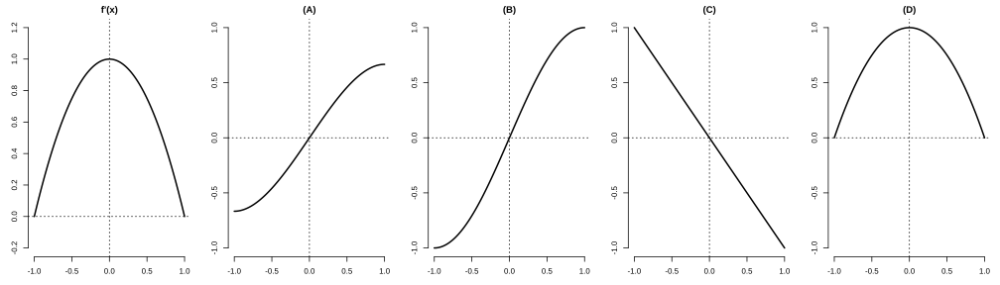
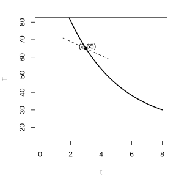
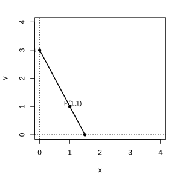
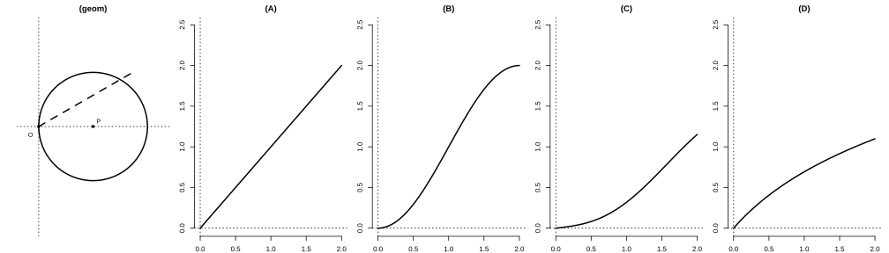
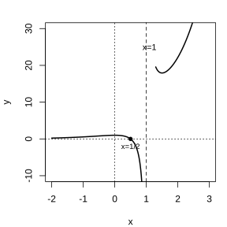

# 作业 79

> **定义 5.1.1** (平均变化率)  $\frac{\Delta y}{\Delta x}=\frac{f\left(x_{0}+\Delta x\right)-f\left(x_{0}\right)}{\Delta x}$.

> **定义 5.1.2** (导数)  $f'\left(x_{0}\right)=\lim_{\Delta x\to0}\frac{f\left(x_{0}+\Delta x\right)-f\left(x_{0}\right)}{\Delta x}$.

> **定义 5.1.3** (导数的几何意义)  $f'\left(x_{0}\right)$ 是曲线 $y=f\left(x\right)$ 在点 $\left(x_{0},f\left(x_{0}\right)\right)$ 处切线的斜率.

> **定义 5.1.4** (导函数)  $f'\left(x\right)=y'=\lim_{\Delta x\to0}\frac{f\left(x+\Delta x\right)-f\left(x\right)}{\Delta x}$.

> **定义 5.2.1** (基本初等函数的导数公式)  $\left(c\right)'=0$; $\left(x^{\alpha}\right)'=\alpha x^{\alpha-1}$; $\left(\sin x\right)'=\cos x$; $\left(\cos x\right)'=-\sin x$; $\left(a^{x}\right)'=a^{x}\ln a$; $\left(\mathrm e^{x}\right)'=\mathrm e^{x}$; $\left(\log_{a}x\right)'=\frac{1}{x\ln a}$; $\left(\ln x\right)'=\frac{1}{x}$.

> **定义 5.2.2** (导数的四则运算法则)  $\left[f\left(x\right)\pm g\left(x\right)\right]'=f'\left(x\right)\pm g'\left(x\right)$; $\left[f\left(x\right)g\left(x\right)\right]'=f'\left(x\right)g\left(x\right)+f\left(x\right)g'\left(x\right)$; $\left[\frac{f\left(x\right)}{g\left(x\right)}\right]'=\frac{f'\left(x\right)g\left(x\right)-f\left(x\right)g'\left(x\right)}{\left[g\left(x\right)\right]^{2}}$.

> **定义 5.2.3** (复合函数的求导法则)  $y'_{x}=y'_{u}\cdot u'_{x}$.

> **定义 5.3.1** (函数的单调性与导数的正负)  在某个区间 $\left(a,b\right)$ 内, $f'\left(x\right)>0$ 则 $f\left(x\right)$ 单调递增; $f'\left(x\right)<0$ 则 $f\left(x\right)$ 单调递减.

> **定义 5.3.2** (函数的极值)  在 $x_{0}$ 附近左侧 $f'\left(x\right)>0$, 右侧 $f'\left(x\right)<0$ 时 $f\left(x_{0}\right)$ 为极大值; 左侧 $f'\left(x\right)<0$, 右侧 $f'\left(x\right)>0$ 时 $f\left(x_{0}\right)$ 为极小值.

> **定义 5.3.3** (求函数极值的方法)  解方程 $f'\left(x\right)=0$, 按两侧导数正负判断极大或极小.

> **定义 5.3.4** (闭区间上的最大 (小) 值)  闭区间上连续函数必有最大值和最小值, 比较各极值与端点函数值即得.

### 习题一

(复习参考题 5 复习巩固第 1 题) 已知点 $P$ 和点 $Q$ 是曲线 $y=x^{2}-2x-3$ 上的两点, 且点 $P$ 的横坐标是 $1$, 点 $Q$ 的横坐标是 $4$. 求: 

(1) 割线 $PQ$ 的斜率; 

(2) 点 $P$ 处的切线方程.

### 解答 习题一

由**定义 5.1.1** 与**定义 5.1.3**.

(1) $P\left(1,f\left(1\right)\right)=\left(1,-4\right)$, $Q\left(4,f\left(4\right)\right)=\left(4,5\right)$. 割线 $PQ$ 的斜率为

$$
k=\frac{f\left(4\right)-f\left(1\right)}{4-1}=\frac{5-\left(-4\right)}{3}=3.
$$

(2) $y'=2x-2$, 故点 $P$ 处切线斜率为 $y'\big|_{x=1}=0$. 切线过 $\left(1,-4\right)$, 切线方程为 $y=-4$. $\blacksquare$

### 习题二

(复习参考题 5 复习巩固第 2 题) 求下列函数的导数: 

(1) $y=2^{x}\tan x$;

(2) $y=2^{x}\ln x$;

(3) $y=\left(x-2\right)^{3}\left(3x+1\right)^{2}$;

(4) $y=\frac{x^{2}}{\left(2x+1\right)^{3}}$;

(5) $y=\mathrm e^{-2x+1}\cos\left(-x^{2}+x\right)$;

(6) $y=\frac{\sin2x}{\sqrt{x}}$.

### 解答 习题二

由**定义 5.2.1**, **定义 5.2.2** 与**定义 5.2.3**.

(1) $y'=2^{x}\ln2\cdot\tan x+2^{x}\cdot\frac{1}{\cos^{2}x}$.

(2) $y'=2^{x}\ln2\cdot\ln x+\frac{2^{x}}{x}$.

(3) 由积的法则, 

$$
y'=3\left(x-2\right)^{2}\left(3x+1\right)^{2}+\left(x-2\right)^{3}\cdot2\left(3x+1\right)\cdot3=3\left(x-2\right)^{2}\left(3x+1\right)\left(5x-3\right).
$$

(4) 由商的法则, 

$$
y'=\frac{2x\left(2x+1\right)^{3}-x^{2}\cdot3\left(2x+1\right)^{2}\cdot2}{\left(2x+1\right)^{6}}=\frac{2x\left(2x+1\right)-6x^{2}}{\left(2x+1\right)^{4}}=\frac{2x-2x^{2}}{\left(2x+1\right)^{4}}.
$$

(5) 由积的法则与复合函数法则, 

$$
y'=-2\mathrm e^{-2x+1}\cos\left(-x^{2}+1\right)+\mathrm e^{-2x+1}\left[-\sin\left(-x^{2}+x\right)\right]\cdot\left(-2x+1\right).
$$

(6) 由商的法则, 

$$
y'=\frac{2\cos2x\cdot\sqrt{x}-\sin2x\cdot\frac{1}{2\sqrt{x}}}{x}=\frac{4x\cos2x-\sin2x}{2x\sqrt{x}}.
$$

$\blacksquare$

### 习题三

(复习参考题 5 复习巩固第 3 题) 已知函数 $y=f\left(x\right)$ 的图象是下列四个图象之一, 且其导函数 $y=f'\left(x\right)$ 的图象如图所示, 则该函数的图象是 ( ).

{width=100%}

### 解答 习题三

由**定义 5.3.1**, 由导函数 $f'\left(x\right)$ 的正负判断 $f\left(x\right)$ 的增减.

由导函数图象, 在 $\left(-1,0\right)$ 内 $f'\left(x\right)>0$ 且逐渐增大, 故 $f\left(x\right)$ 递增且越来越陡; 在 $\left(0,1\right)$ 内 $f'\left(x\right)>0$ 但逐渐减小, 故 $f\left(x\right)$ 递增但越来越平缓.

故 $f\left(x\right)$ 在 $\left(-1,1\right)$ 内始终递增, 斜率先增后减. 符合这一特征的是选项 (B). $\blacksquare$

### 习题四

(复习参考题 5 复习巩固第 4 题) 求下列曲线在给定点处的切线方程: 

(1) $y=x-\frac{1}{x}$, $\left(1,0\right)$;

(2) $y=\frac{\mathrm e^{2x-1}}{x^{2}}$, $\left(\frac{1}{2},4\right)$.

### 解答 习题四

由**定义 5.1.3** 与**定义 5.2.2**.

(1) $y'=1+\frac{1}{x^{2}}$, 切线斜率 $k=y'\big|_{x=1}=2$. 切线过 $\left(1,0\right)$, 方程为 $y=2\left(x-1\right)$, 即 $y=2x-2$.

(2) $y'=\frac{2\mathrm e^{2x-1}\cdot x^{2}-\mathrm e^{2x-1}\cdot2x}{x^{4}}=\frac{2\mathrm e^{2x-1}\left(x-1\right)}{x^{3}}$. 在 $x=\frac{1}{2}$ 处, 

$$
k=\frac{2\mathrm e^{0}\left(\frac{1}{2}-1\right)}{\left(\frac{1}{2}\right)^{3}}=\frac{2\cdot\left(-\frac{1}{2}\right)}{\frac{1}{8}}=-8.
$$

切线过 $\left(\frac{1}{2},4\right)$, 方程为 $y-4=-8\left(x-\frac{1}{2}\right)$, 即 $y=-8x+8$. $\blacksquare$

### 习题五

(复习参考题 5 复习巩固第 5 题) 一个距地心距离为 $r$, 质量为 $m$ 的人造卫星, 与地球之间的万有引力 $F$ 由公式 $F=\frac{GMm}{r^{2}}$ 给出, 其中 $M$ 为地球质量, $G$ 为引力常量. 求 $F$ 对于 $r$ 的瞬时变化率.

### 解答 习题五

由**定义 5.2.1**, $F=GMm\cdot r^{-2}$, 故

$$
F'\left(r\right)=GMm\cdot\left(-2\right)r^{-3}=-\frac{2GMm}{r^{3}}.
$$

故 $F$ 对于 $r$ 的瞬时变化率为 $-\frac{2GMm}{r^{3}}$. $\blacksquare$

### 习题六

(复习参考题 5 复习巩固第 6 题) 一杯 $80\ {^\circ}\mathrm C$ 的热红茶置于 $20\ {^\circ}\mathrm C$ 的房间里, 它的温度会逐渐下降, 温度 $T$ (单位: ${^\circ}\mathrm C$) 与时间 $t$ (单位: $\mathrm{min}$) 之间的关系由函数 $T=f\left(t\right)$ 给出.

(1) 判断 $f'\left(t\right)$ 的正负, 并说明理由.

(2) $f'\left(3\right)=-4$ 的实际意义是什么? 如果 $f\left(3\right)=65\ {^\circ}\mathrm C$, 你能画出函数 $T=f\left(t\right)$ 在 $t=3$ 时图象的大致形状吗? 

{width=50%}

### 解答 习题六

(1) 由**定义 5.1.2** (导数), $f'\left(t\right)$ 是温度关于时间的瞬时变化率. 热红茶温度逐渐下降, 故温度随时间增加而减小, $f'\left(t\right)<0$.

(2) $f'\left(3\right)=-4$ 表示在第 $3\ \mathrm{min}$ 附近, 红茶温度大约以每分钟 $4\ {^\circ}\mathrm C$ 的速率下降.

由 $f\left(3\right)=65$ 且 $f'\left(3\right)=-4<0$, 图象在点 $\left(3,65\right)$ 处下降, 切线斜率为 $-4$. 又冷却速度随温差减小而变慢, 故图象下降且越来越平缓. $\blacksquare$

### 习题七

(复习参考题 5 复习巩固第 7 题) 求函数 $f\left(x\right)=\sqrt\left[3\right]{x^{2}}$ 的单调区间.

### 解答 习题七

由**定义 5.2.1**, $f\left(x\right)=x^{\frac{2}{3}}$, 故 $f'\left(x\right)=\frac{2}{3}x^{-\frac{1}{3}}=\frac{2}{3\sqrt\left[3\right]{x}}$.

当 $x>0$ 时 $f'\left(x\right)>0$; 当 $x<0$ 时 $f'\left(x\right)<0$.

由**定义 5.3.1**, $f\left(x\right)$ 在 $\left(-\infty,0\right)$ 内单调递减, 在 $\left(0,+\infty\right)$ 内单调递增. $\blacksquare$

### 习题八

(复习参考题 5 综合运用第 8 题) 已知函数 $f\left(x\right)=x^{2}+px+q$, 试确定 $p,q$ 的值, 使得当 $x=1$ 时, $f\left(x\right)$ 有最小值 $4$.

### 解答 习题八

由**定义 5.3.2**, $f'\left(x\right)=2x+p$. 在 $x=1$ 处取极值, 须 $f'\left(1\right)=0$, 即 $2+p=0$, 故 $p=-2$.

又 $f\left(1\right)=4$, 即 $1+p+q=4$, 代入 $p=-2$, 得 $1-2+q=4$, 故 $q=5$.

此时 $f\left(x\right)=x^{2}-2x+5=\left(x-1\right)^{2}+4$, 在 $x=1$ 处取最小值 $4$.

故 $p=-2$, $q=5$. $\blacksquare$

### 习题九

(复习参考题 5 综合运用第 9 题) 已知函数 $f\left(x\right)=x\left(x-c\right)^{2}$ 在 $x=2$ 处有极大值, 求 $c$ 的值.

### 解答 习题九

由**定义 5.2.2**, $f'\left(x\right)=\left(x-c\right)^{2}+x\cdot2\left(x-c\right)=\left(x-c\right)\left(3x-c\right)$.

在 $x=2$ 处取极值, 须 $f'\left(2\right)=0$, 即 $\left(2-c\right)\left(6-c\right)=0$, 故 $c=2$ 或 $c=6$.

当 $c=2$ 时, $f'\left(x\right)=\left(x-2\right)\left(3x-2\right)$, 在 $x=2$ 处左负右正, 为极小值, 不合题意.

当 $c=6$ 时, $f'\left(x\right)=\left(x-6\right)\left(3x-6\right)=3\left(x-6\right)\left(x-2\right)$, 在 $x=2$ 处左正右负, 为极大值, 符合题意.

故 $c=6$. $\blacksquare$

### 习题十

(复习参考题 5 综合运用第 10 题) 如图, 过点 $P\left(1,1\right)$ 作直线 $AB$, 分别与 $x$ 轴的正半轴, $y$ 轴的正半轴交于点 $A,B$. 当直线 $AB$ 在什么位置时, $\triangle AOB$ 的面积最小? 最小面积是多少? 

{width=50%}

### 解答 习题十

设直线 $AB$ 的斜率为 $k$, 则直线方程为 $y-1=k\left(x-1\right)$. 令 $y=0$, 得 $A\left(1-\frac{1}{k},0\right)$; 令 $x=0$, 得 $B\left(0,1-k\right)$. 由 $A,B$ 在正半轴, $k<0$.

$\triangle AOB$ 的面积为

$$
S=\frac{1}{2}\left(1-\frac{1}{k}\right)\left(1-k\right)=\frac{1}{2}\left(2-k-\frac{1}{k}\right).
$$

求导, $S'=\frac{1}{2}\left(-1+\frac{1}{k^{2}}\right)$. 令 $S'=0$, 得 $k^{2}=1$, 由 $k<0$ 得 $k=-1$.

当 $k<-1$ 时 $S'<0$, 当 $-1<k<0$ 时 $S'>0$, 故 $k=-1$ 为最小值点.

此时 $A\left(2,0\right)$, $B\left(0,2\right)$, 最小面积为 $S=\frac{1}{2}\times2\times2=2$.

故当直线 $AB$ 为 $x+y=2$ 时, $\triangle AOB$ 面积最小, 最小面积为 $2$. $\blacksquare$

### 习题十一

(复习参考题 5 综合运用第 11 题) 如图, 直线 $l$ 和圆 $P$, 当 $l$ 从 $l_{0}$ 开始在平面上按逆时针方向绕点 $O$ 匀速转动 (转动角度不超过 $90^\circ$) 时, 它扫过的圆内阴影部分的面积 $S$ 是时间 $t$ 的函数. 这个函数的图象大致是 ( ).

{width=100%}

### 解答 习题十一

由**定义 5.1.3**, $S'\left(t\right)$ 表示面积的变化快慢.

直线匀速转动时, 扫过的阴影面积开始时增长较慢, 中间较快, 最后又变慢. 故 $S'\left(t\right)$ 先增后减, $S\left(t\right)$ 的图象先下凸 (越来越陡), 后上凸 (越来越平缓).

符合这一特征的是选项 (C). $\blacksquare$

### 习题十二

(复习参考题 5 综合运用第 12 题) 当室内的有毒细菌开始增加时, 就要使用杀菌剂. 刚开始使用的时候, 细菌数量还会继续增加, 随着时间的增加, 它增加的幅度逐渐变小, 到一定时间, 细菌数量开始减少. 已知使用杀菌剂 $t\ \mathrm{h}$ 后的细菌数量为 $b\left(t\right)=10^{5}+10^{4}t-10^{3}t^{2}$.

(1) 求细菌数量在 $t=5$ 与 $t=10$ 时的瞬时变化率.

(2) 细菌数量在哪段时间增加, 在哪段时间减少? 为什么? 

### 解答 习题十二

由**定义 5.3.1**.

(1) $b'\left(t\right)=10^{4}-2\times10^{3}t=10^{4}-2000t$.

$b'\left(5\right)=10000-10000=0$.

$b'\left(10\right)=10000-20000=-10000$.

(2) 令 $b'\left(t\right)=0$, 得 $t=5$. 当 $0<t<5$ 时 $b'\left(t\right)>0$, 细菌数量增加; 当 $t>5$ 时 $b'\left(t\right)<0$, 细菌数量减少. $\blacksquare$

### 习题十三

(复习参考题 5 综合运用第 13 题) 已知曲线 $y=x+\ln x$ 在点 $\left(1,1\right)$ 处的切线与曲线 $y=ax^{2}+\left(2a+3\right)x+1$ 只有一个公共点, 求 $a$ 的值.

### 解答 习题十三

对 $y=x+\ln x$, $y'=1+\frac{1}{x}$, 在 $x=1$ 处切线斜率为 $2$. 切线方程为 $y-1=2\left(x-1\right)$, 即 $y=2x-1$.

令 $2x-1=ax^{2}+\left(2a+3\right)x+1$, 整理得

$$
ax^{2}+\left(2a+1\right)x+2=0.
$$

两曲线只有一个公共点, 即此方程有唯一解. 当 $a\neq0$ 时, 判别式 $\Delta=\left(2a+1\right)^{2}-8a=4a^{2}-4a+1=\left(2a-1\right)^{2}=0$, 得 $a=\frac{1}{2}$.

当 $a=0$ 时, 方程为 $x+2=0$, 有唯一解 $x=-2$, 也符合.

故 $a=0$ 或 $a=\frac{1}{2}$. $\blacksquare$

### 习题十四

(复习参考题 5 综合运用第 14 题) 用总长 $14.8\ \mathrm{m}$ 的钢条制作一个长方体容器的框架, 如果所制容器底面一边的长比另一边的长多 $0.5\ \mathrm{m}$, 那么高为多少时容器的容积最大? 最大容积是多少? 

### 解答 习题十四

设底面短边长为 $x\ \mathrm{m}$, 则长边长为 $x+0.5\ \mathrm{m}$, 高为 $h$. 长方体框架共 $12$ 条棱 (4 长, 4 宽, 4 高), 故

$$
4\left[x+\left(x+0.5\right)+h\right]=14.8,
$$

解得 $h=3.7-2x-0.5=3.2-2x$.

容积为

$$
V\left(x\right)=x\left(x+0.5\right)\left(3.2-2x\right).
$$

求导并令 $V'\left(x\right)=0$, 展开得 $V\left(x\right)=-2x^{3}+2.2x^{2}+1.6x$, 故 $V'\left(x\right)=-6x^{2}+4.4x+1.6=0$, 即 $3x^{2}-2.2x-0.8=0$.

解得 $x=1$ (舍去负根). 此时 $h=3.2-2=1.2\ \mathrm{m}$.

最大容积为 $V=1\times1.5\times1.2=1.8\ \mathrm{m^{3}}$.

故高为 $1.2\ \mathrm{m}$ 时容积最大, 最大容积为 $1.8\ \mathrm{m^{3}}$. $\blacksquare$

### 习题十五

(复习参考题 5 综合运用第 15 题) 用半径为 $R$ 的圆形铁皮剪出一个圆心角为 $\alpha$ 的扇形, 制成一个圆锥形容器. 扇形的圆心角 $\alpha$ 为多大时, 容器的容积最大? 

### 解答 习题十五

扇形弧长为 $R\alpha$, 即圆锥底面周长, 故圆锥底面半径 $r=\frac{R\alpha}{2\pi}$. 圆锥母线长为 $R$, 故高为

$$
h=\sqrt{R^{2}-r^{2}}=\sqrt{R^{2}-\frac{R^{2}\alpha^{2}}{4\pi^{2}}}=\frac{R}{2\pi}\sqrt{4\pi^{2}-\alpha^{2}}.
$$

圆锥容积为

$$
V=\frac{1}{3}\pi r^{2}h=\frac{1}{3}\pi\cdot\frac{R^{2}\alpha^{2}}{4\pi^{2}}\cdot\frac{R}{2\pi}\sqrt{4\pi^{2}-\alpha^{2}}=\frac{R^{3}}{24\pi^{2}}\alpha^{2}\sqrt{4\pi^{2}-\alpha^{2}}.
$$

只需最大化 $\alpha^{2}\sqrt{4\pi^{2}-\alpha^{2}}$. 设 $u=\alpha^{2}$, 则目标为 $u\sqrt{4\pi^{2}-u}$, 求导令其为 $0$, 得 $2\left(4\pi^{2}-u\right)-u=0$, 即 $u=\frac{8\pi^{2}}{3}$.

故 $\alpha^{2}=\frac{8\pi^{2}}{3}$, 即 $\alpha=\frac{2\sqrt{6}\pi}{3}$.

当圆心角 $\alpha=\frac{2\sqrt{6}\pi}{3}$ 时, 圆锥形容器容积最大. $\blacksquare$

### 习题十六

(复习参考题 5 拓广探索第 16 题) 已知 $A,B$ 两地的距离是 $130\ \mathrm{km}$. 根据交通法规, 两地之间的公路车速应限制在 $50\sim100\ \mathrm{km/h}$. 假设油价是 $7$ 元/$\mathrm L$, 以 $x\ \mathrm{km/h}$ 的速度行驶时, 汽车的耗油率为 $\left(3+\frac{x^{2}}{360}\right)\ \mathrm{L/h}$, 司机每小时的工资是 $35$ 元. 那么最经济的车速是多少 (精确到 $1\ \mathrm{km/h}$)? 如果不考虑其他费用, 这次行车的总费用是多少 (精确到 $1$ 元)? 

### 解答 习题十六

行车时间为 $\frac{130}{x}\ \mathrm{h}$. 总费用为油费与工资之和: 

$$
C\left(x\right)=\frac{130}{x}\left[7\left(3+\frac{x^{2}}{360}\right)+35\right]=\frac{130}{x}\left(56+\frac{7x^{2}}{360}\right)=130\left(\frac{56}{x}+\frac{7x}{360}\right).
$$

求导, $C'\left(x\right)=130\left(-\frac{56}{x^{2}}+\frac{7}{360}\right)$. 令 $C'\left(x\right)=0$, 得 $\frac{56}{x^{2}}=\frac{7}{360}$, 即 $x^{2}=2880$, 故 $x\approx53.7\ \mathrm{km/h}$.

此值在 $50\sim100$ 范围内, 为最小值点. 精确到 $1\ \mathrm{km/h}$, 最经济车速约为 $54\ \mathrm{km/h}$.

总费用为

$$
C\left(54\right)=130\left(\frac{56}{54}+\frac{7\times54}{360}\right)\approx130\times\left(1.037+1.05\right)\approx271\ \mathrm{元}.
$$

故最经济车速约为 $54\ \mathrm{km/h}$, 总费用约为 $271$ 元. $\blacksquare$

### 习题十七

(复习参考题 5 拓广探索第 17 题) 作函数 $y=\frac{\mathrm e^{x}\left(2x-1\right)}{x-1}$ 的大致图象.

{width=50%}

### 解答 习题十七

由**定义 5.3.1** 与**定义 5.3.2**.

定义域为 $x\neq1$. 令 $y=0$, 得 $x=\frac{1}{2}$, 即图象过 $\left(\frac{1}{2},0\right)$.

求导, 

$$
y'=\frac{\left[\mathrm e^{x}\left(2x-1\right)+2\mathrm e^{x}\right]\left(x-1\right)-\mathrm e^{x}\left(2x-1\right)}{\left(x-1\right)^{2}}=\frac{\mathrm e^{x}\left(2x^{2}-x-2\right)}{\left(x-1\right)^{2}}.
$$

令 $y'=0$, 得 $2x^{2}-x-2=0$, 解得 $x=\frac{1\pm\sqrt{17}}{4}$.

当 $x\to1$ 时, $y\to\infty$; 当 $x\to-\infty$ 时, $y\to0$; 当 $x\to+\infty$ 时, $y\to+\infty$.

故图象有两条渐近线 $x=1$ 与 $y=0$, 在 $x=\frac{1\pm\sqrt{17}}{4}$ 处取极值. $\blacksquare$

### 习题十八

(复习参考题 5 拓广探索第 18 题) 已知函数 $f\left(x\right)=\mathrm e^{x}-\ln\left(x+m\right)$. 当 $m\le2$ 时, 求证 $f\left(x\right)>0$.

### 解答 习题十八

由**定义 5.3.1**, $f'\left(x\right)=\mathrm e^{x}-\frac{1}{x+m}$. 令 $f'\left(x\right)=0$, 即 $\mathrm e^{x}=\frac{1}{x+m}$.

当 $m\le2$ 时, $\ln\left(x+m\right)$ 的定义域内 $x+m>0$. 设 $f\left(x\right)$ 的最小值点为 $x_{0}$, 满足 $\mathrm e^{x_{0}}=\frac{1}{x_{0}+m}$, 即 $x_{0}+m=\mathrm e^{-x_{0}}$.

最小值为

$$
f\left(x_{0}\right)=\mathrm e^{x_{0}}-\ln\left(x_{0}+m\right)=\mathrm e^{x_{0}}-\ln\left(\mathrm e^{-x_{0}}\right)=\mathrm e^{x_{0}}+x_{0}.
$$

由 $x_{0}+m=\mathrm e^{-x_{0}}$ 及 $m\le2$, 得 $x_{0}\ge\mathrm e^{-x_{0}}-2$. 又 $\mathrm e^{x_{0}}+x_{0}>0$ 对任意 $x_{0}$ 成立 (因 $\mathrm e^{x_{0}}>0$ 且当 $x_{0}\ge-2$ 时 $\mathrm e^{x_{0}}+x_{0}>0$).

故 $f\left(x\right)$ 的最小值大于 $0$, 即 $f\left(x\right)>0$. $\blacksquare$

### 习题十九

(复习参考题 5 拓广探索第 19 题) 已知函数 $f\left(x\right)=a\mathrm e^{2x}+\left(a-2\right)\mathrm e^{x}-x$.

(1) 讨论 $f\left(x\right)$ 的单调性; 

(2) 若 $f\left(x\right)$ 有两个零点, 求 $a$ 的取值范围.

### 解答 习题十九

由**定义 5.2.3**, $f'\left(x\right)=2a\mathrm e^{2x}+\left(a-2\right)\mathrm e^{x}-1$. 令 $t=\mathrm e^{x}>0$, 则

$$
f'\left(x\right)=\left(at-1\right)\left(2t+1\right).
$$

(1) 因 $2t+1>0$, $f'\left(x\right)$ 的符号由 $at-1$ 决定.

当 $a\le0$ 时, $at-1<0$, $f'\left(x\right)<0$, $f\left(x\right)$ 在 $\mathbb R$ 上单调递减.

当 $a>0$ 时, 令 $at-1=0$, 得 $t=\frac{1}{a}$, 即 $x=-\ln a$. 当 $x<-\ln a$ 时 $f'\left(x\right)<0$, 当 $x>-\ln a$ 时 $f'\left(x\right)>0$. 故 $f\left(x\right)$ 在 $\left(-\infty,-\ln a\right)$ 内递减, 在 $\left(-\ln a,+\infty\right)$ 内递增.

(2) 当 $a\le0$ 时, $f\left(x\right)$ 单调递减, 至多一个零点.

当 $a>0$ 时, $f\left(x\right)$ 在 $x=-\ln a$ 处取最小值 $f\left(-\ln a\right)$. 代入, $t=\frac{1}{a}$, 

$$
f\left(-\ln a\right)=a\cdot\frac{1}{a^{2}}+\left(a-2\right)\cdot\frac{1}{a}+\ln a=\frac{1}{a}+1-\frac{2}{a}+\ln a=1-\frac{1}{a}+\ln a.
$$

要使 $f\left(x\right)$ 有两个零点, 须最小值小于 $0$, 即 $1-\frac{1}{a}+\ln a<0$. 设 $g\left(a\right)=1-\frac{1}{a}+\ln a$, 则 $g'\left(a\right)=\frac{1}{a^{2}}+\frac{1}{a}>0$, $g\left(a\right)$ 单调递增, 且 $g\left(1\right)=0$. 故当 $0<a<1$ 时 $g\left(a\right)<0$.

又当 $x\to-\infty$ 时 $f\left(x\right)\to+\infty$, 当 $x\to+\infty$ 时 $f\left(x\right)\to+\infty$.

故 $a$ 的取值范围为 $\left(0,1\right)$. $\blacksquare$
