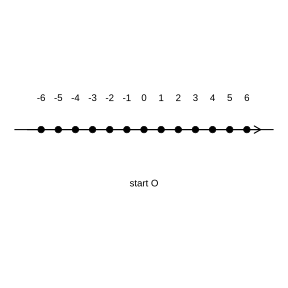
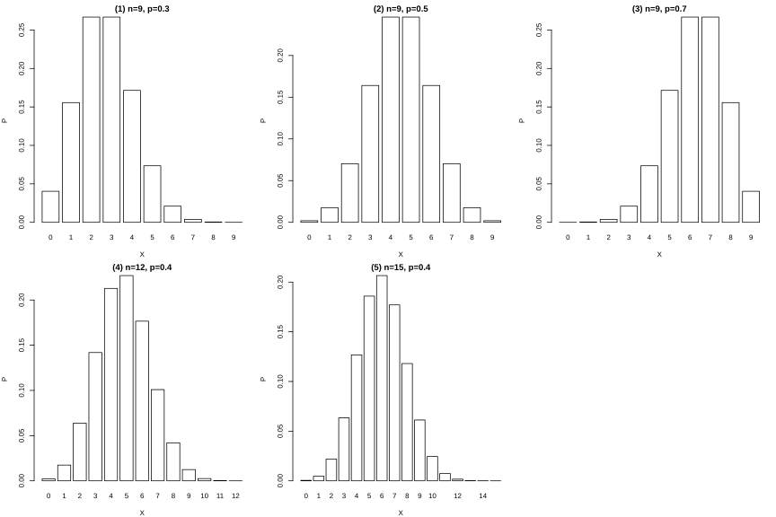

# 作业 86

> **定义 7.4.1** (伯努利试验与 $n$ 重伯努利试验)  只包含两个可能结果的试验叫做伯努利试验. 将一个伯努利试验独立地重复进行 $n$ 次所组成的随机试验称为 $n$ 重伯努利试验.

> **定义 7.4.2** (二项分布)  在 $n$ 重伯努利试验中, 设每次试验中事件 $A$ 发生的概率为 $p$, 用 $X$ 表示事件 $A$ 发生的次数, 则 $\mathbb P(X=k)=\binom{n}{k} p^k (1-p)^{n-k}$, $k=0,1,\cdots,n$. 称 $X$ 服从二项分布, 记作 $X\sim B(n,p)$.

> **结论 7.4.3** (二项分布的均值与方差)  若 $X\sim B(n,p)$, 则 $\mathbb E(X)=np$, $D(X)=np(1-p)$.

> **定义 7.4.4** (超几何分布)  设有 $N$ 件产品, 其中含有 $M$ 件次品. 从中不放回地随机抽取 $n$ 件, 用 $X$ 表示抽取出的 $n$ 件产品中次品的件数, 则 $\mathbb P(X=k)=\frac{\binom{M}{k} \binom{N-M}{n-k}}{\binom{N}{n}}$, $k=0,1,\cdots,\min(n,M)$. 称 $X$ 服从超几何分布.

> **结论 7.4.5** (超几何分布的均值)  若 $X$ 服从超几何分布, 记 $p=\frac{M}{N}$, 则 $\mathbb E(X)=np$.

### 练习一

(练习 7.4 第 1 题) 任意抛掷一枚质地均匀的硬币 4 次, 设正面向上的次数为 $X$.

(1) 求 $X$ 的分布列;

(2) 求 $\mathbb E(X)=\;\_\_\;$, $D(X)=\;\_\_\;$.

### 解答 练习一

由**定义 7.4.2** (二项分布) 与**结论 7.4.3** (二项分布的均值与方差).

抛掷硬币 4 次, 每次正面向上的概率为 $0.5$, 各次独立, 故 $X\sim B(4,0.5)$.

(1) 由**定义 7.4.2** (二项分布), $\mathbb P(X=k)=\binom{4}{k} (0.5)^4$, 故分布列为

| $X$ | 0 | 1 | 2 | 3 | 4 |
|---|---|---|---|---|---|
| $P$ | $\frac{1}{16}$ | $\frac{1}{4}$ | $\frac{3}{8}$ | $\frac{1}{4}$ | $\frac{1}{16}$ |

(2) 由**结论 7.4.3** (二项分布的均值与方差), $\mathbb E(X)=np=4\times 0.5=2$, $D(X)=np(1-p)=4\times 0.5\times 0.5=1$. 故填空处依次为 $2$, $1$. $\blacksquare$

### 练习二

(练习 7.4 第 2 题) 接种某种疫苗后, 一只鸡感染某种疾病的概率为 $0.2$. 若接种该疫苗的 5 只鸡都没有感染这种疾病, 求:

(1) 它们都没有感染的概率;

(2) 其中恰有 1 只感染的概率.

### 解答 练习二

由**定义 7.4.2** (二项分布).

设 $X$ 为 5 只鸡中没有感染疾病的只数, 则每只鸡不感染的概率为 $0.8$, 各只相互独立, 故 $X\sim B(5,0.8)$.

(1)

$$
\mathbb P(X=5)=0.8^5\approx 0.3277.
$$

(2) 恰有 1 只感染即恰有 4 只不感染,

$$
\mathbb P(X=4)=\binom{5}{4} (0.8)^4\times 0.2=5\times 0.8^4\times 0.2\approx 0.4096.
$$

$\blacksquare$

### 练习三

(练习 7.4 第 3 题) 判断下列每一随机变量是否服从二项分布? 如果服从, 请写出参数 $n$, $p$ 的值.

(1) 某射手每次射击击中目标的概率为 $0.8$, 连续射击 12 次, 击中目标的次数 $X$;

(2) 现有 100 件产品, 其中有 10 件次品, 其余为正品. 现从中逐件不放回地抽取 6 件, 抽取出的次品件数 $Y$.

### 解答 练习三

由**定义 7.4.2** (二项分布) 与**定义 7.4.4** (超几何分布).

(1) 每次射击独立, 每次只有击中与未击中两种结果, 击中概率恒为 $0.8$, 故 $X$ 服从二项分布, $X\sim B(12,0.8)$, 参数 $n=12$, $p=0.8$.

(2) 抽取是不放回的, 各次抽取并不相互独立, 次品件数 $Y$ 服从**定义 7.4.4** (超几何分布), 而不服从二项分布. $\blacksquare$

### 练习四

(练习 7.4 第 4 题) 举出两个服从二项分布的随机变量的例子.

### 解答 练习四

由**定义 7.4.2** (二项分布), 二项分布描述 $n$ 次独立重复试验中事件发生的次数.

(1) 某射手每次射击命中目标的概率为 $0.7$, 他连续射击 10 次, 命中目标的次数 $X$ 服从二项分布 $X\sim B(10,0.7)$.

(2) 某工厂生产的产品次品率为 $0.05$, 从中有放回地抽查 20 件, 其中次品的件数 $Y$ 服从二项分布 $Y\sim B(20,0.05)$. $\blacksquare$

### 练习五

(练习 7.4 第 1 题) 一箱 24 罐的饮料中 4 罐有奖券, 每张奖券奖励饮料一罐, 从中任意抽取 2 罐, 求这 2 罐中有奖券的概率.

### 解答 练习五

由**定义 7.4.4** (超几何分布).

设 $X$ 为抽出的 2 罐中有奖券的罐数, 总体 $N=24$, 其中有奖券的 $M=4$, 抽取 $n=2$. 所求为 $\mathbb P(X\ge 1)$.

$$
\mathbb P(X=0)=\frac{\binom{20}{2}}{\binom{24}{2}}=\frac{190}{276}=\frac{95}{138}.
$$

由对立事件,

$$
\mathbb P(X\ge 1)=1-\mathbb P(X=0)=1-\frac{95}{138}=\frac{43}{138}.
$$

$\blacksquare$

### 练习六

(练习 7.4 第 2 题) 从某大学心理健康教育中心的 12 名志愿者中选 4 名参加心理援助工作. 已知这 12 名志愿者中有 4 名来自甲班, 求甲班恰有 2 名被选中的概率.

### 解答 练习六

由**定义 7.4.4** (超几何分布).

设 $X$ 为甲班被选中的志愿者人数, 总体 $N=12$, 其中甲班 $M=4$, 抽取 $n=4$. 所求为 $\mathbb P(X=2)$.

$$
\mathbb P(X=2)=\frac{\binom{4}{2} \binom{8}{2}}{\binom{12}{4}}=\frac{6\times 28}{495}=\frac{168}{495}=\frac{56}{165}.
$$

$\blacksquare$

### 练习七

(练习 7.4 第 3 题) 举出两个服从超几何分布的随机变量的例子.

### 解答 练习七

由**定义 7.4.4** (超几何分布), 超几何分布描述不放回抽取中具有某种特征的件数.

(1) 一批产品共 $N$ 件, 其中 $M$ 件次品, 不放回地抽取 $n$ 件, 其中次品的件数 $X$ 服从超几何分布.

(2) 某班有男生 $N_1$ 人, 女生 $N_2$ 人, 从中任选 $k$ 名学生, 其中女生的人数 $Y$ 服从超几何分布. $\blacksquare$

### 习题一

(习题 7.4 复习巩固第 1 题) 抛掷一枚骰子, 当出现 5 点或 6 点时, 就说这次试验成功, 求在 30 次试验中成功次数 $X$ 的均值和方差.

### 解答 习题一

由**定义 7.4.2** (二项分布) 与**结论 7.4.3** (二项分布的均值与方差).

抛掷一枚骰子, 出现 5 点或 6 点即成功, 成功概率 $p=\frac{2}{6}=\frac{1}{3}$. 独立重复 30 次, 成功次数 $X\sim B\bigl(30,\frac{1}{3}\bigr)$.

由**结论 7.4.3** (二项分布的均值与方差),

$$
\mathbb E(X)=np=30\times\frac{1}{3}=10.
$$

$$
D(X)=np(1-p)=30\times\frac{1}{3}\times\frac{2}{3}=\frac{20}{3}.
$$

$\blacksquare$

### 习题二

(习题 7.4 复习巩固第 2 题) 某射手每次射击命中目标的概率为 0.9, 连续射击 4 次, 求其中恰有 1 次未命中目标的概率.

### 解答 习题二

由**定义 7.4.2** (二项分布).

设 $X$ 为 4 次射击中命中目标的次数, 则 $X\sim B(4,0.9)$. 恰有 1 次未命中即恰命中 3 次, 所求为 $\mathbb P(X=3)$.

$$
\mathbb P(X=3)=\binom{4}{3} (0.9)^3\times 0.1=4\times 0.729\times 0.1=0.2916.
$$

$\blacksquare$

### 习题三

(习题 7.4 复习巩固第 3 题) 一个质点在整数点上随机移动, 每次等概率地向左或向右移动 1 个单位长度, 各次移动相互独立. 求质点移动 6 次后:

(1) 回到原点的概率;

(2) 位于坐标 4 处的概率.

{width=50%}

### 解答 习题三

由**定义 7.4.2** (二项分布).

设 $X$ 为 6 次移动中向右移动的次数, 每次向右的概率为 $0.5$, 故 $X\sim B(6,0.5)$. 质点最终位置为 $X-(6-X)=2X-6$.

(1) 回到原点即 $2X-6=0$, $X=3$.

$$
\mathbb P(X=3)=\binom{6}{3} (0.5)^6=\frac{20}{64}=\frac{5}{16}.
$$

(2) 位于坐标 4 处即 $2X-6=4$, $X=5$.

$$
\mathbb P(X=5)=\binom{6}{5} (0.5)^6=\frac{6}{64}=\frac{3}{32}.
$$

$\blacksquare$

### 习题四

(习题 7.4 复习巩固第 4 题) 从一副不含大小王的 52 张扑克牌中任意抽取 5 张, 求至少抽到 2 张 $A$ 牌的概率.

### 解答 习题四

由**定义 7.4.4** (超几何分布).

设 $X$ 为抽到的 $A$ 牌张数, 总体 $N=52$, 其中 $A$ 牌 $M=4$, 抽取 $n=5$. 所求为 $\mathbb P(X\ge 2)=1-\mathbb P(X=0)-\mathbb P(X=1)$.

$$
\mathbb P(X=0)=\frac{\binom{48}{5}}{\binom{52}{5}}=\frac{1712304}{2598960}\approx 0.6588.
$$

$$
\mathbb P(X=1)=\frac{\binom{4}{1} \binom{48}{4}}{\binom{52}{5}}=\frac{4\times 194580}{2598960}\approx 0.2995.
$$

$$
\mathbb P(X\ge 2)=1-0.6588-0.2995\approx 0.0417.
$$

$\blacksquare$

### 习题五

(习题 7.4 综合运用第 5 题) 某射手每次射击命中目标的概率为 0.8, 连续射击 10 次.

(1) 求恰有 8 次命中目标的概率;

(2) 求至少有 8 次命中目标的概率.

### 解答 习题五

由**定义 7.4.2** (二项分布).

设 $X$ 为 10 次射击中命中目标的次数, 则 $X\sim B(10,0.8)$.

(1)

$$
\mathbb P(X=8)=\binom{10}{8} (0.8)^8 (0.2)^2=45\times 0.8^8\times 0.2^2\approx 0.3020.
$$

(2)

$$
\mathbb P(X=9)=\binom{10}{9} (0.8)^9 (0.2)=10\times 0.8^9\times 0.2\approx 0.2684.
$$

$$
\mathbb P(X=10)=0.8^{10}\approx 0.1074.
$$

$$
\mathbb P(X\ge 8)=0.3020+0.2684+0.1074=0.6778.
$$

$\blacksquare$

### 习题六

(习题 7.4 综合运用第 6 题) 袋中有 10 个红球和 20 个白球, 从中不放回地随机摸出 5 个球, 求其中至少有 3 个红球就中奖的概率.

### 解答 习题六

由**定义 7.4.4** (超几何分布).

设 $X$ 为摸出的 5 个球中红球的个数, 总体 $N=30$, 其中红球 $M=10$, 抽取 $n=5$. 所求为 $\mathbb P(X\ge 3)=\mathbb P(X=3)+\mathbb P(X=4)+\mathbb P(X=5)$.

$$
\mathbb P(X=3)=\frac{\binom{10}{3} \binom{20}{2}}{\binom{30}{5}}=\frac{120\times 190}{142506}\approx 0.1599.
$$

$$
\mathbb P(X=4)=\frac{\binom{10}{4} \binom{20}{1}}{\binom{30}{5}}=\frac{210\times 20}{142506}\approx 0.0295.
$$

$$
\mathbb P(X=5)=\frac{\binom{10}{5}}{\binom{30}{5}}=\frac{252}{142506}\approx 0.0018.
$$

$$
\mathbb P(X\ge 3)\approx 0.1599+0.0295+0.0018=0.1912.
$$

$\blacksquare$

### 习题七

(习题 7.4 综合运用第 7 题) 一个车间有 3 台车床, 它们各自独立工作. 设在一段时间内发生故障的车床数为 $X$, 在下列两种情形下分别求 $X$ 的分布列.

(1) 假设这 3 台车床型号相同, 它们发生故障的概率都是 $20\%$;

(2) 这 3 台车床中有 $A$ 型号 2 台, $B$ 型号 1 台, $A$ 型车床发生故障的概率为 $10\%$, $B$ 型车床发生故障的概率为 $20\%$.

### 解答 习题七

由**定义 7.4.2** (二项分布) 与概率的乘法公式.

(1) 3 台车床型号相同且各自独立, 每台故障概率均为 $0.2$, 故 $X\sim B(3,0.2)$.

$$
\mathbb P(X=0)=0.8^3=0.512.
$$

$$
\mathbb P(X=1)=\binom{3}{1}\times 0.2\times 0.8^2=3\times 0.2\times 0.64=0.384.
$$

$$
\mathbb P(X=2)=\binom{3}{2}\times 0.2^2\times 0.8=3\times 0.04\times 0.8=0.096.
$$

$$
\mathbb P(X=3)=0.2^3=0.008.
$$

(2) 2 台 $A$ 型车床故障概率为 $0.1$, 1 台 $B$ 型车床故障概率为 $0.2$, 且相互独立.

$$
\mathbb P(X=0)=0.9^2\times 0.8=0.648.
$$

$$
\mathbb P(X=1)=\binom{2}{1}\times 0.1\times 0.9\times 0.8+0.9^2\times 0.2=0.144+0.162=0.306.
$$

$$
\mathbb P(X=2)=0.1^2\times 0.8+\binom{2}{1}\times 0.1\times 0.9\times 0.2=0.008+0.036=0.044.
$$

$$
\mathbb P(X=3)=0.1^2\times 0.2=0.002.
$$

故两种情形下 $X$ 的分布列分别为

| $X$ | 0 | 1 | 2 | 3 |
|---|---|---|---|---|
| $P$ | 0.512 | 0.384 | 0.096 | 0.008 |

| $X$ | 0 | 1 | 2 | 3 |
|---|---|---|---|---|
| $P$ | 0.648 | 0.306 | 0.044 | 0.002 |

$\blacksquare$

### 习题八

(习题 7.4 拓广探索第 8 题) 一家制药公司声称其生产的某种新药对一种疾病的有效率为 $90\%$. 医院对 10 名患者进行临床试验, 结果其中不超过 6 人治愈. 你是否怀疑该药品的有效率? 请说明理由.

### 解答 习题八

由**定义 7.4.2** (二项分布).

若该药品有效率确为 $0.9$, 设 $X$ 为 10 名患者中治愈的人数, 则 $X\sim B(10,0.9)$. 计算 $\mathbb P(X\le 6)=1-\mathbb P(X\ge 7)$.

$$
\mathbb P(X=7)=\binom{10}{7} (0.9)^7 (0.1)^3\approx 0.0574.
$$

$$
\mathbb P(X=8)=\binom{10}{8} (0.9)^8 (0.1)^2\approx 0.1937.
$$

$$
\mathbb P(X=9)=\binom{10}{9} (0.9)^9 (0.1)\approx 0.3874.
$$

$$
\mathbb P(X=10)=0.9^{10}\approx 0.3487.
$$

$$
\mathbb P(X\ge 7)\approx 0.0574+0.1937+0.3874+0.3487=0.9872.
$$

$$
\mathbb P(X\le 6)=1-0.9872=0.0128.
$$

即在有效率为 $90\%$ 的假设下, 10 名患者中治愈不超过 6 人的概率仅约 $1.28\%$, 是小概率事件, 故有理由怀疑该药品的有效率达不到 $90\%$. $\blacksquare$

### 探究与发现一

(思考 1) 二项分布的性质. 观察参数 $n$, $p$ 取不同值时二项分布 $X\sim B(n,p)$ 的分布列图形, 类比函数性质的研究, 你能发现二项分布的哪些性质?

{width=100%}

### 解答 探究与发现一

由**定义 7.4.2** (二项分布).

观察分布列图形, 可发现:

(1) 分布列各概率之和为 $1$, 图形下方面积 (概率和) 恒为 $1$.

(2) 概率 $\mathbb P(X=k)$ 先随 $k$ 增大而增大, 在 $k$ 接近 $np$ 处取得最大值, 随后随 $k$ 增大而减小, 图形呈单峰形.

(3) 当 $p=0.5$ 时, 分布列关于 $k=np$ 对称; 当 $p\neq 0.5$ 时, 分布列不对称, 峰值位置偏向一侧.

(4) $n$ 越大, 概率越集中在均值 $np$ 附近, 图形越陡峻. $\blacksquare$

### 探究与发现二

(思考 2) 对你发现的二项分布的其他性质, 你能给出证明吗?

### 解答 探究与发现二

由**定义 7.4.2** (二项分布).

考察相邻两项之比:

$$
\frac{\mathbb P(X=k+1)}{\mathbb P(X=k)}=\frac{\binom{n}{k+1} p^{k+1}(1-p)^{n-k-1}}{\binom{n}{k} p^k(1-p)^{n-k}}=\frac{n-k}{k+1}\cdot\frac{p}{1-p}.
$$

当该比值大于 $1$, 即 $k<(n+1)p-1$ 时, $\mathbb P(X=k+1)>\mathbb P(X=k)$, 分布列上升; 当该比值小于 $1$, 即 $k>(n+1)p-1$ 时, $\mathbb P(X=k+1)<\mathbb P(X=k)$, 分布列下降. 故 $\mathbb P(X=k)$ 在 $k$ 最接近 $(n+1)p$ 的整数处取得最大值, 即单峰性质得证.

当 $p=0.5$ 时, $\mathbb P(X=k)=\mathbb P(X=n-k)$, 分布列关于 $k=\frac{n}{2}$ 对称, 对称性质得证. $\blacksquare$
