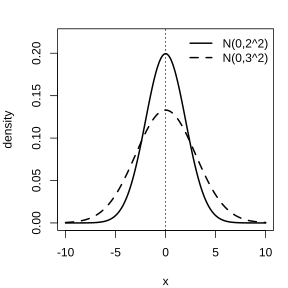

# 作业 87

> **定义 7.5.1** (连续型随机变量)  对于随机变量 $X$, 如果它可以取某一区间内的任意值, 称 $X$ 为连续型随机变量.

> **定义 7.5.2** (正态分布)  正态密度函数为 $f\left(x\right)=\frac{1}{\sigma\sqrt{2\pi}}e^{-\frac{\left(x-\mu\right)^2}{2\sigma^2}}$, $x\in\mathbb R$, 其中 $\mu\in\mathbb R$, $\sigma>0$. 称随机变量 $X$ 服从正态分布, 记作 $X\sim N\left(\mu,\sigma^2\right)$. 当 $\mu=0$, $\sigma=1$ 时称为标准正态分布.

> **结论 7.5.3** (正态曲线的性质)  正态曲线关于直线 $x=\mu$ 对称, 在 $x=\mu$ 处达到峰值 $\frac{1}{\sigma\sqrt{2\pi}}$; 且 $\mathbb E\left(X\right)=\mu$, $D\left(X\right)=\sigma^2$.

> **结论 7.5.4** ($3\sigma$ 原则)  若 $X\sim N\left(\mu,\sigma^2\right)$, 则 $\mathbb P\left(\mu-\sigma\le X\le\mu+\sigma\right)\approx 0.6827$, $\mathbb P\left(\mu-2\sigma\le X\le\mu+2\sigma\right)\approx 0.9545$, $\mathbb P\left(\mu-3\sigma\le X\le\mu+3\sigma\right)\approx 0.9973$.

### 练习一

(练习 7.5 第 1 题) 已知 $X\sim N\left(0,1\right)$, 则正态密度函数为 $\;\_\_\;$, $\mathbb P\left(X\le 0\right)=\;\_\_\;$, $\mathbb P\left(\lvert X\rvert\le 1\right)=\;\_\_\;$, $\mathbb P\left(X\le 1\right)=\;\_\_\;$, $\mathbb P\left(X>1\right)=\;\_\_\;$.

### 解答 练习一

由**定义 7.5.2** (正态分布) 与**结论 7.5.4** ($3\sigma$ 原则).

$X\sim N\left(0,1\right)$ 时, 正态密度函数为

$$
f\left(x\right)=\frac{1}{\sqrt{2\pi}}e^{-\frac{x^2}{2}}.
$$

由**结论 7.5.3** (正态曲线的性质), 曲线关于 $x=0$ 对称, 故 $\mathbb P\left(X\le 0\right)=0.5$.

由**结论 7.5.4** ($3\sigma$ 原则), $\mathbb P\left(\lvert X\rvert\le 1\right)\approx 0.6827$. 又 $\mathbb P\left(X\le 1\right)=0.5+\frac{0.6827}{2}\approx 0.8413$, 故 $\mathbb P\left(X>1\right)=1-0.8413=0.1587$.

填空处依次为 $f\left(x\right)=\frac{1}{\sqrt{2\pi}}e^{-\frac{x^2}{2}}$, $0.5$, $0.6827$, $0.8413$, $0.1587$. $\blacksquare$

### 练习二

(练习 7.5 第 2 题) 已知 $X\sim N\left(0,2^2\right)$, $Y\sim N\left(0,3^2\right)$.

(1) 画出它们的密度曲线草图;

(2) 比较 $\mathbb P\left(X\le -2\right)$ 与 $\mathbb P\left(X\le 2\right)$ 的大小关系;

(3) 比较 $\mathbb P\left(\lvert X\rvert\le 1\right)$ 与 $\mathbb P\left(\lvert Y\rvert\le 1\right)$ 的大小.

{width=50%}

### 解答 练习二

由**结论 7.5.3** (正态曲线的性质) 与**结论 7.5.4** ($3\sigma$ 原则).

(1) 两条密度曲线都关于 $x=0$ 对称, 呈钟形. $X$ 的标准差为 2, $Y$ 的标准差为 3, 故 $X$ 的曲线更陡峻, 更集中在 0 附近, $Y$ 的曲线更扁平, 更分散.

(2) 由**结论 7.5.3** (正态曲线的性质), 曲线关于 $x=0$ 对称, 故 $\mathbb P\left(X\le -2\right)=\mathbb P\left(X\ge 2\right)=1-\mathbb P\left(X\le 2\right)$. 二者不相等, 且 $\mathbb P\left(X\le -2\right)<\mathbb P\left(X\le 2\right)$.

(3) $X$ 的标准差较小, 取值更集中在均值 0 附近, 故落在区间 $\left[-1,1\right]$ 内的概率更大, 即 $\mathbb P\left(\lvert X\rvert\le 1\right)>\mathbb P\left(\lvert Y\rvert\le 1\right)$. $\blacksquare$

### 练习三

(练习 7.5 第 3 题) 举出两个服从正态分布的随机变量的例子.

### 解答 练习三

由**定义 7.5.2** (正态分布), 正态分布描述大量连续型测量数据的分布规律.

(1) 某地区同一年龄段成年男子的身高 $X$, 通常服从正态分布.

(2) 某种零件的尺寸测量误差 $Y$, 通常服从正态分布. $\blacksquare$

### 习题一

(习题 7.5 复习巩固第 1 题) 已知某地区男生的身高 $X\sim N\left(72,8^2\right)$, 女生的身高 $Y\sim N\left(74,6^2\right)$ (单位: $\mathrm{cm}$). 试比较男生和女生身高的分布情况.

### 解答 习题一

由**结论 7.5.3** (正态曲线的性质), 正态分布的均值决定分布的中心位置, 方差决定离散程度.

女生身高的均值为 74, 男生身高的均值为 72, 即女生平均身高略高于男生. 男生身高的方差为 $8^2=64$, 女生身高的方差为 $6^2=36$, 即男生身高的离散程度更大. 综合来看, 女生平均身高更高且身高更整齐, 男生平均身高略低但个体差异更大. $\blacksquare$

### 习题二

(习题 7.5 复习巩固第 2 题) 已知某地区成年男子的身高 $X\sim N\left(170,5^2\right)$ (单位: $\mathrm{cm}$). 求:

(1) $\mathbb P\left(165<X\le 175\right)$;

(2) $\mathbb P\left(X\le 165\right)$;

(3) $\mathbb P\left(X>175\right)$.

### 解答 习题二

由**结论 7.5.4** ($3\sigma$ 原则).

这里 $\mu=170$, $\sigma=5$, 故 $165=\mu-\sigma$, $175=\mu+\sigma$.

(1)

$$
\mathbb P\left(165<X\le 175\right)=\mathbb P\left(\mu-\sigma<X\le\mu+\sigma\right)\approx 0.6827.
$$

(2) 由对称性, $\mathbb P\left(X\le 165\right)=\mathbb P\left(X\le\mu-\sigma\right)=\frac{1-0.6827}{2}\approx 0.1587$.

(3)

$$
\mathbb P\left(X>175\right)=\mathbb P\left(X>\mu+\sigma\right)=\frac{1-0.6827}{2}\approx 0.1587.
$$

$\blacksquare$

### 习题三

(习题 7.5 复习巩固第 3 题) 已知 $X\sim N\left(\mu,\sigma^2\right)$, 求 $X$ 位于区间 $\left[\mu,\mu+\sigma\right]$ 内的概率.

### 解答 习题三

由**结论 7.5.3** (正态曲线的性质) 与**结论 7.5.4** ($3\sigma$ 原则).

由**结论 7.5.4** ($3\sigma$ 原则), $\mathbb P\left(\mu-\sigma\le X\le\mu+\sigma\right)\approx 0.6827$. 由**结论 7.5.3** (正态曲线的性质), 曲线关于 $x=\mu$ 对称, 区间 $\left[\mu-\sigma,\mu\right]$ 与 $\left[\mu,\mu+\sigma\right]$ 上的概率相等. 故

$$
\mathbb P\left(\mu\le X\le\mu+\sigma\right)=\frac{0.6827}{2}\approx 0.3414.
$$

$\blacksquare$

### 习题四

(习题 7.5 综合运用第 4 题) 某食品厂包装食盐, 每袋食盐的误差 $X$ (单位: $\mathrm{g}$) 服从正态分布. 现抽取若干袋食盐, 算得误差的样本均值为 0, 样本方差为 4. 如果规定误差的绝对值不超过 $4\,\mathrm{g}$ 为合格, 试估计这批食盐的合格率.

### 解答 习题四

由**结论 7.5.4** ($3\sigma$ 原则).

误差 $X$ 服从正态分布, 样本均值为 0, 样本方差为 4, 即 $\mu=0$, $\sigma=\sqrt{4}=2$. 合格即 $\lvert X\rvert\le 4=2\sigma$.

由**结论 7.5.4** ($3\sigma$ 原则),

$$
\mathbb P\left(\lvert X\rvert\le 2\sigma\right)=\mathbb P\left(-2\sigma\le X\le 2\sigma\right)\approx 0.9545.
$$

故这批食盐的合格率约为 $95.45\%$. $\blacksquare$

### 信息技术应用一

(思考 1) 概率分布图及概率计算. 请你再选择一些正态分布 $N\left(\mu,\sigma^2\right)$, 分别计算 $\mathbb P\left(\mu-\sigma\le X\le\mu+\sigma\right)$, $\mathbb P\left(\mu-2\sigma\le X\le\mu+2\sigma\right)$, $\mathbb P\left(\mu-3\sigma\le X\le\mu+3\sigma\right)$ 的值, 并总结这些值的规律.

### 解答 信息技术应用一

由**结论 7.5.4** ($3\sigma$ 原则).

无论 $\mu$, $\sigma$ 取何值, 正态分布 $N\left(\mu,\sigma^2\right)$ 落在区间 $\left[\mu-\sigma,\mu+\sigma\right]$, $\left[\mu-2\sigma,\mu+2\sigma\right]$, $\left[\mu-3\sigma,\mu+3\sigma\right]$ 内的概率分别约为

$$
\mathbb P\left(\mu-\sigma\le X\le\mu+\sigma\right)\approx 0.6827.
$$

$$
\mathbb P\left(\mu-2\sigma\le X\le\mu+2\sigma\right)\approx 0.9545.
$$

$$
\mathbb P\left(\mu-3\sigma\le X\le\mu+3\sigma\right)\approx 0.9973.
$$

规律: 这三个概率只与区间宽度相对于标准差的倍数有关, 与 $\mu$, $\sigma$ 的具体取值无关. 正态变量几乎全部的取值落在 $\left[\mu-3\sigma,\mu+3\sigma\right]$ 内, 落在其外的概率仅约 $0.27\%$, 这就是 $3\sigma$ 原则. $\blacksquare$
