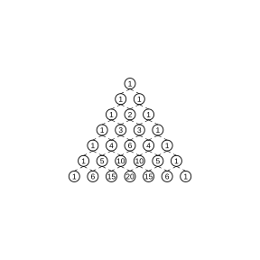
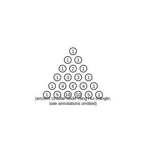

# 作业 91

> **定理 6.3.1** (二项式定理)  对任意正整数 $n$, 有 $\left(a+b\right)^n=\binom{n}{0}a^n+\binom{n}{1}a^{n-1}b+\cdots+\binom{n}{k}a^{n-k}b^k+\cdots+\binom{n}{n}b^n$. 其中 $\binom{n}{k}$ ($k=0,1,2,\cdots,n$) 叫做二项式系数, $\binom{n}{k}a^{n-k}b^k$ 叫做二项展开式的通项.

> **常用结论 6.2.1** (组合数的对称性)  从 $n$ 个不同元素中取出 $m$ 个元素的组合数, 等于从这 $n$ 个不同元素中取出 $n-m$ 个元素的组合数, 即 $\binom{n}{m}=\binom{n}{n-m}$.

> **常用结论 6.2.2** (组合数的递推关系)  $\binom{n+1}{m}=\binom{n}{m}+\binom{n}{m-1}$.

> **常用结论 6.3.2** (各二项式系数的和)  $\left(a+b\right)^n$ 的展开式的各二项式系数的和等于 $2^n$, 即 $\binom{n}{0}+\binom{n}{1}+\cdots+\binom{n}{n}=2^n$; 奇数项的二项式系数的和等于偶数项的二项式系数的和, 都等于 $2^{n-1}$.

> **常用结论 6.3.3** (组合数求和公式)  对任意正整数 $r$, 有 $\sum_{k=1}^n \binom{k+r-1}{r}=\binom{n+r}{r+1}$.

### 探究一

(探究任务 1) 观察杨辉三角的结构, 即杨辉三角中数字排列的规律, 例如每一行, 相邻两行, 斜行等, 画一画, 连一连, 算一算, 写出你发现的结论.

{width=50%}

### 解答 探究一

由**定理 6.3.1** (二项式定理), 杨辉三角的第 $n$ 行就是 $\left(a+b\right)^n$ 的展开式的二项式系数. 逐行, 逐列, 逐斜行观察, 发现如下结论.

(1) 每行的构成. 第 $0$ 行为 $1$; 第 $1$ 行为 $1,1$; 第 $2$ 行为 $1,2,1$; ...; 第 $n$ 行从左到右依次为

$$
\binom{n}{0},\ \binom{n}{1},\ \binom{n}{2},\ \cdots,\ \binom{n}{n}.
$$

即第 $n$ 行的第 $r$ 个数 (从左起第 $r+1$ 个) 为 $\binom{n}{r}$.

(2) 相邻两行的关系. 三角形两个腰上的数都是 $1$, 其余每个数都等于它肩上的两个数相加, 即

$$
\binom{n}{r}=\binom{n-1}{r-1}+\binom{n-1}{r}.
$$

例如 $2=1+1$, $3=1+2$, $4=1+3$, $6=3+3$, 等等.

(3) 斜行的规律. 从左侧腰上某数出发, 沿右上方向的斜行依次为 $\binom{0}{0}$; $\binom{1}{0},\binom{2}{0},\binom{3}{0},\cdots$; $\binom{1}{1},\binom{2}{1},\binom{3}{1},\cdots$; $\binom{2}{2},\binom{3}{2},\binom{4}{2},\cdots$. 这些斜行分别是常数列, 自然数列, 三角形数列 $\frac{n\left(n+1\right)}{2}$, 四面体数列等, 揭示了组合数与垛积数列的联系. $\blacksquare$

### 探究二

(探究任务 2) 利用已学知识, 尝试对所得结论进行证明. 例如, 对于相邻两行的关系式 $\binom{n}{r}=\binom{n-1}{r-1}+\binom{n-1}{r}$, 按教材给出的方式进行证明.

### 解答 探究二

由**常用结论 6.2.2** (组合数的递推关系), 该式正是杨辉三角最基本的性质, 也是二项式系数和组合数的性质.

(1) 代数证明. 由组合数公式 $\binom{n}{r}=\frac{n!}{r!\left(n-r\right)!}$, 有

$$
\binom{n-1}{r-1}+\binom{n-1}{r}=\frac{\left(n-1\right)!}{\left(r-1\right)!\left(n-r\right)!}+\frac{\left(n-1\right)!}{r!\left(n-1-r\right)!}.
$$

通分, 公分母为 $r!\left(n-r\right)!$, 得

$$
\binom{n-1}{r-1}+\binom{n-1}{r}=\frac{\left(n-1\right)!\,r+\left(n-1\right)!\,\left(n-r\right)}{r!\left(n-r\right)!}=\frac{\left(n-1\right)!\,\left[r+\left(n-r\right)\right]}{r!\left(n-r\right)!}.
$$

由于 $r+\left(n-r\right)=n$, 故

$$
\binom{n-1}{r-1}+\binom{n-1}{r}=\frac{n!}{r!\left(n-r\right)!}=\binom{n}{r}.
$$

即

$$
\binom{n}{r}=\binom{n-1}{r-1}+\binom{n-1}{r}.
$$

(2) 组合意义证明. 等式右边的 $\binom{n}{r}$ 可解释为: 从 $n$ 个不同元素中选出 $r$ 个的选法总数. 把这 $n$ 个元素中的某一个固定出来, 设为元素甲. 按是否选甲把所有选法分成两类: 选甲的, 还需从其余 $n-1$ 个元素中再选 $r-1$ 个, 共 $\binom{n-1}{r-1}$ 种; 不选甲的, 需从其余 $n-1$ 个元素中选 $r$ 个, 共 $\binom{n-1}{r}$ 种. 两类合计即 $\binom{n}{r}=\binom{n-1}{r-1}+\binom{n-1}{r}$. 这就从计数方案的角度证明了该式.

上式是杨辉三角最基本的性质: 正因为杨辉三角中的数与开方, 解方程以及组合数学, 概率论中的有关问题都有密切关系, 历代数学家才从不同角度研究它的性质. $\blacksquare$

### 探究三

(探究任务 3) 帕斯卡曾在论算术三角形一书中给出 19 条性质. 请你再发现并证明杨辉三角的其他性质, 例如每行数字的对称性, 每行数字之和, 奇偶项之和, 斜行求和等.

### 解答 探究三

由**定理 6.3.1** (二项式定理) 及**常用结论 6.2.1** (组合数的对称性), 可证明以下若干性质.

(1) 对称性. 杨辉三角中与首末两端等距离的两个数相等, 即 $\binom{n}{r}=\binom{n}{n-r}$. 由**常用结论 6.2.1** (组合数的对称性), 这是组合数本身的性质, 它把函数 $f\left(r\right)=\binom{n}{r}$ 的图象关于直线 $r=\frac{n}{2}$ 对称.

(2) 每行数字之和. 第 $n$ 行所有数字之和为

$$
\binom{n}{0}+\binom{n}{1}+\cdots+\binom{n}{n}.
$$

在**定理 6.3.1** (二项式定理) 中令 $a=b=1$, 即得 $\left(1+1\right)^n=\binom{n}{0}+\binom{n}{1}+\cdots+\binom{n}{n}$, 故第 $n$ 行数字之和为 $2^n$. 由**常用结论 6.3.2** (各二项式系数的和), 这正是各二项式系数的和.

(3) 奇数项与偶数项之和. 在**定理 6.3.1** (二项式定理) 中令 $a=1$, $b=-1$, 得

$$
\left(1-1\right)^n=\binom{n}{0}-\binom{n}{1}+\binom{n}{2}-\cdots+\left(-1\right)^n\binom{n}{n}=0.
$$

即 $\left(\binom{n}{0}+\binom{n}{2}+\cdots\right)-\left(\binom{n}{1}+\binom{n}{3}+\cdots\right)=0$, 故奇数项的二项式系数之和等于偶数项的二项式系数之和. 结合 (2) 中各行之和为 $2^n$, 由**常用结论 6.3.2** (各二项式系数的和), 二者都等于 $2^{n-1}$.

(4) 斜行求和. 沿某一斜方向取数, 其和构成斐波那契数列. 例如

$$
\binom{n}{0}+\binom{n-1}{1}+\binom{n-2}{2}+\cdots=\binom{n+1}{\lfloor n/2\rfloor}\text{ 所在斜行的累加}.
$$

更一般地, 由**常用结论 6.3.3** (组合数求和公式), 第 $r$ 条斜行前 $n$ 个数之和为 $\sum_{k=1}^n \binom{k+r-1}{r}=\binom{n+r}{r+1}$, 这正是垛积问题的求和公式. $\blacksquare$

### 问题一

(问题 1) 开方古算题 (出自杨辉详解九章算法): 积一百三十三万六千三百三十六尺, 问为三乘方几何. 在我国清中叶以前, 称平方为自乘, 立方为再自乘, 四次方为三乘方. 因此这个问题相当于解方程 $x^4=1336336$. 试求 $x$.

{width=50%}

### 解答 问题一

由**定理 6.3.1** (二项式定理), 我国古代用杨辉三角各行的系数进行开方. 本题即求 $x^4=1336336$ 的正根.

(1) 估算位数与范围. 由于 $30^4=810000$, $40^4=2560000$, 而 $810000<1336336<2560000$, 故 $x$ 在 30 与 40 之间, 即 $x$ 的十位数字为 3, 设 $x=30+b$, 其中 $b$ 为个位数字.

(2) 利用完全四次方展开. 由**定理 6.3.1** (二项式定理),

$$
\left(30+b\right)^4=30^4+4\cdot 30^3b+6\cdot 30^2b^2+4\cdot 30b^3+b^4.
$$

其中 $30^4=810000$. 先试 $b=4$:

$$
\left(30+4\right)^4=34^4.
$$

计算 $34^2=1156$, 于是

$$
34^4=1156^2=1336336.
$$

恰好等于题设的积. 故 $x=34$, 即三乘方之积为 1336336 尺时, 底边长为 34 尺.

杨辉三角 (图 2) 中 "左袤乃积数, 右袤乃隅算, 中藏者皆廉" 分别说明了图中数字代表的意义, "以廉乘商方, 命实而除之" 则说明了如何应用各行系数进行开方, 这正是上述逐位试商, 用二项式系数作廉的算法. $\blacksquare$

### 问题二

(问题 2) 数列古算题 (出自杨辉详解九章算法): 三角垛, 下广, 一面十二个, 上尖, 问计几何. 一般化后即: 底层是每边堆 $n$ 个圆球的三角形, 向上逐层每边减少 1 个, 顶层是 1 个, 求圆球总数. 试求 $n=12$ 时的总数.

### 解答 问题二

由**常用结论 6.3.3** (组合数求和公式), 三角垛各层的球数构成三角形数列.

(1) 各层的球数. 底层每边有 12 个球, 该层球数为每边 12 的三角形数, 即

$$
1+2+\cdots+12=\frac{12\times 13}{2}=78.
$$

向上逐层每边减少 1 个, 故从上到下各层每边的球数依次为 $1,2,3,\cdots,12$, 各层球数依次为

$$
1,\ 3,\ 6,\ 10,\ \cdots,\ \frac{k\left(k+1\right)}{2},\ \cdots,\ 78.
$$

其中每边为 $k$ 的一层球数为 $\frac{k\left(k+1\right)}{2}=\binom{k+1}{2}$.

(2) 求总数. 设总数为 $S$, 则

$$
S=\sum_{k=1}^{12}\frac{k\left(k+1\right)}{2}.
$$

由**常用结论 6.3.3** (组合数求和公式), 取 $r=2$, 得

$$
S=\sum_{k=1}^{12}\binom{k+1}{2}=\binom{14}{3}.
$$

计算得

$$
\binom{14}{3}=\frac{14\times 13\times 12}{6}=364.
$$

故三角垛下广一面 12 个时, 圆球总数为 364 个.

一般地, 下广一面为 $n$ 个时, 三角垛总数为

$$
S=\binom{n+2}{3}=\frac{n\left(n+1\right)\left(n+2\right)}{6},
$$

这就是垛积问题中著名的三角垛求和公式. $\blacksquare$

### 活动要求

以独立探究和小组合作相结合的方式开展探究活动. 建议按如下步骤完成:

(1) 小组集体讨论探究方案, 确定研究思路;

(2) 小组成员各自开展独立探究, 并以专题作业的形式撰写研究报告;

(3) 小组内进行交流讨论, 完善研究成果, 并形成一份小组研究报告;

(4) 全班进行成果交流, 评价.

### 报告参考形式

研究报告的题目为杨辉三角的性质与应用, 内容包括以下各项:

(1) 课题组成员及分工;

(2) 发现的数学结论及发现过程概述;

(3) 证明思路及其形成过程描述;

(4) 结论的证明或否定;

(5) 杨辉三角的应用举例;

(6) 收获与体会.
