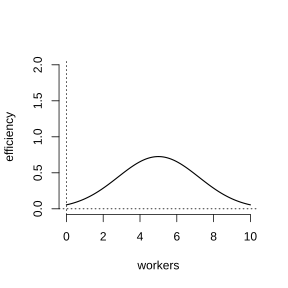
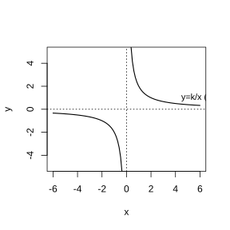
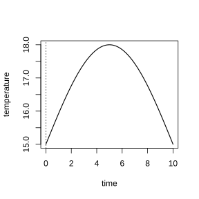
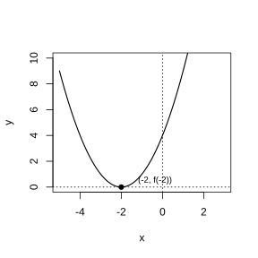
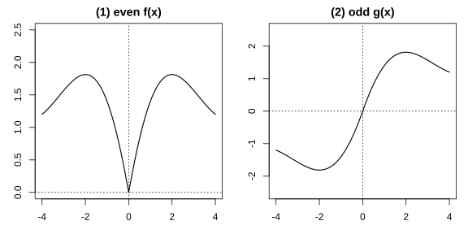
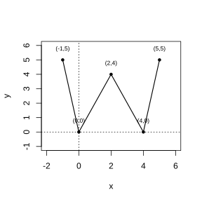
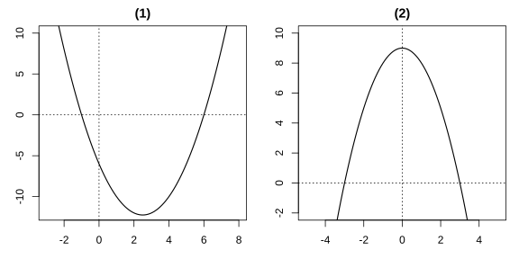
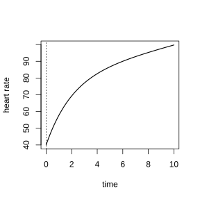
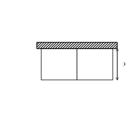
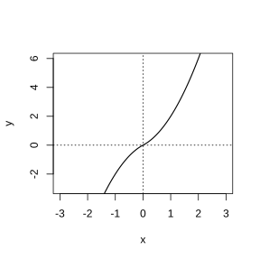

# Assignment 10

> **Definition 3.1.1** (Function)  In general, let $A,B$ be nonempty sets of real numbers. If for any number $x$ in the set $A$, according to a certain determined correspondence $f$, there is a unique determined number $y$ in the set $B$ corresponding to it, then $f:A\to B$ is called a function from the set $A$ to the set $B$, denoted by $y=f\left(x\right)$, $x\in A$.

> **Definition 3.1.2** (Domain and Range)  $x$ is called the independent variable, and the range $A$ of values of $x$ is called the domain of the function; the value $y$ corresponding to the value of $x$ is called the function value, and the set of function values $\left\{f\left(x\right)\mid x\in A\right\}$ is called the range of the function.

> **Definition 3.2.1** (Monotone Increasing and Increasing Function)  Let the domain of the function $f\left(x\right)$ be $D$, and let $I\subseteq D$ be an interval: if for $\forall x_1,x_2\in I$, whenever $x_1<x_2$, we always have $f\left(x_1\right)<f\left(x_2\right)$, then the function $f\left(x\right)$ is said to be monotonically increasing on the interval $I$. In particular, when the function $f\left(x\right)$ is monotonically increasing on its domain, it is called an increasing function.

> **Definition 3.2.2** (Monotone Decreasing and Decreasing Function)  If for $\forall x_1,x_2\in I$, whenever $x_1<x_2$, we always have $f\left(x_1\right)>f\left(x_2\right)$, then the function $f\left(x\right)$ is said to be monotonically decreasing on the interval $I$. In particular, when the function $f\left(x\right)$ is monotonically decreasing on its domain, it is called a decreasing function. If the function $y=f\left(x\right)$ is monotonically increasing or monotonically decreasing on the interval $I$, then the function $y=f\left(x\right)$ is said to have (strict) monotonicity on this interval, and the interval $I$ is called a monotonic interval of $y=f\left(x\right)$.

> **Definition 3.2.3** (Maximum Value)  Let the domain of the function $y=f\left(x\right)$ be $D$. If there exists a real number $M$ satisfying: (1) for $\forall x\in D$, we always have $f\left(x\right)\le M$; (2) $\exists x_0\in D$ such that $f\left(x_0\right)=M$. Then $M$ is called the maximum value of the function $y=f\left(x\right)$.

> **Definition 3.2.4** (Minimum Value)  Let the domain of the function $y=f\left(x\right)$ be $D$. If there exists a real number $m$ satisfying: (1) for $\forall x\in D$, we always have $f\left(x\right)\ge m$; (2) $\exists x_0\in D$ such that $f\left(x_0\right)=m$. Then $m$ is called the minimum value of the function $y=f\left(x\right)$.

> **Definition 3.2.5** (Even Function)  Let the domain of the function $f\left(x\right)$ be $D$. If for $\forall x\in D$ we always have $-x\in D$ and $f\left(-x\right)=f\left(x\right)$, then the function $f\left(x\right)$ is called an even function.

> **Definition 3.2.6** (Odd Function)  Let the domain of the function $f\left(x\right)$ be $D$. If for $\forall x\in D$ we always have $-x\in D$ and $f\left(-x\right)=-f\left(x\right)$, then the function $f\left(x\right)$ is called an odd function.

### Exercise 1

(Exercise 3.2, Problem 1) Based on the following figure, describe the relation between the production efficiency of an assembly line and the number of workers on the line.

{width=50%}

### Solution to Exercise 1

By **Definition 3.2.1** (Monotone Increasing and Increasing Function) and **Definition 3.2.2** (Monotone Decreasing and Decreasing Function), judge the trend of change from the slope of the graph.

The production efficiency first rises as the number of workers increases, reaches a peak, and then declines. That is, when the number of workers is small, the production efficiency increases monotonically as the number of workers increases; when the number of workers exceeds a certain value, the production efficiency decreases monotonically as the number of workers increases. $\blacksquare$

### Exercise 2

(Exercise 3.2, Problem 2) According to the definition, prove that the function $f\left(x\right)=3x+2$ is an increasing function.

### Solution to Exercise 2

By **Definition 3.2.1** (Monotone Increasing and Increasing Function), take any $x_1<x_2$ and prove $f\left(x_1\right)<f\left(x_2\right)$.

For $\forall x_1,x_2\in\mathbb R$ with $x_1<x_2$, we have

$$
f\left(x_1\right)-f\left(x_2\right)=\left(3x_1+2\right)-\left(3x_2+2\right)=3\left(x_1-x_2\right).
$$

From $x_1<x_2$, we get $x_1-x_2<0$, and since $3>0$, we have $3\left(x_1-x_2\right)<0$, i.e. $f\left(x_1\right)-f\left(x_2\right)<0$, equivalently $f\left(x_1\right)<f\left(x_2\right)$. Thus $f\left(x\right)=3x+2$ is an increasing function. $\blacksquare$

### Exercise 3

(Exercise 3.2, Problem 3) Prove that the function $f\left(x\right)=-\frac{2}{x}$ is monotonically increasing on the interval $\left(-\infty,0\right)$.

### Solution to Exercise 3

By **Definition 3.2.1** (Monotone Increasing and Increasing Function), take any $x_1<x_2<0$ and prove $f\left(x_1\right)<f\left(x_2\right)$.

For $\forall x_1,x_2\in\left(-\infty,0\right)$ with $x_1<x_2$, we have

$$
f\left(x_1\right)-f\left(x_2\right)=-\frac{2}{x_1}-\left(-\frac{2}{x_2}\right)=\frac{2}{x_2}-\frac{2}{x_1}=\frac{2\left(x_1-x_2\right)}{x_1x_2}.
$$

From $x_1<x_2<0$, we get $x_1-x_2<0$ and $x_1x_2>0$, and since $2>0$, we have $\frac{2\left(x_1-x_2\right)}{x_1x_2}<0$, i.e. $f\left(x_1\right)-f\left(x_2\right)<0$, equivalently $f\left(x_1\right)<f\left(x_2\right)$. Thus $f\left(x\right)=-\frac{2}{x}$ is monotonically increasing on $\left(-\infty,0\right)$. $\blacksquare$

### Exercise 4

(Exercise 3.2, Problem 4) Draw the graph of the inverse proportional function $y=\frac{k}{x}$.

(1) What is the domain $D$ of this function?

(2) What is its monotonicity on the domain $D$? Prove your conclusion.

{width=50%}

### Solution to Exercise 4

By **Definition 3.1.2** (Domain and Range) and **Definition 3.2.1** (Monotone Increasing and Increasing Function).

(1) The fraction $\frac{k}{x}$ requires $x\ne0$, so the domain is $D=\left(-\infty,0\right)\cup\left(0,+\infty\right)$.

(2) When $k>0$, the graph lies in the first and third quadrants: it is monotonically decreasing on $\left(-\infty,0\right)$ and also monotonically decreasing on $\left(0,+\infty\right)$. Proof: take any $x_1,x_2\in\left(0,+\infty\right)$ with $x_1<x_2$, then $f\left(x_1\right)-f\left(x_2\right)=\frac{k}{x_1}-\frac{k}{x_2}=\frac{k\left(x_2-x_1\right)}{x_1x_2}>0$, i.e. $f\left(x_1\right)>f\left(x_2\right)$, so it is monotonically decreasing. Similarly it is monotonically decreasing on $\left(-\infty,0\right)$. When $k<0$, the graph lies in the second and fourth quadrants, and it is monotonically increasing on both intervals. $\blacksquare$

### Exercise 5

(Exercise 3.2, Problem 5) Throughout the morning ($8{:}00\sim12{:}00$) the weather became warmer and warmer, and at noon ($12{:}00\sim13{:}00$) a storm suddenly made the weather much cooler. After the storm, the weather warmed up again, and it did not start to cool down again until sunset ($18{:}00$). Draw a possible graph (schematic) of the temperature as a function of time during $8{:}00\sim20{:}00$ on this day, and state the monotonic intervals of the drawn function.

{width=50%}

### Solution to Exercise 5

By **Definition 3.2.1** (Monotone Increasing and Increasing Function) and **Definition 3.2.2** (Monotone Decreasing and Decreasing Function), divide the trends of change according to the problem.

From $8{:}00\sim12{:}00$ the temperature rises, monotonically increasing; from $12{:}00\sim13{:}00$ the temperature drops sharply, monotonically decreasing; from $13{:}00\sim18{:}00$ the temperature recovers, monotonically increasing; from $18{:}00\sim20{:}00$ the temperature cools down, monotonically decreasing. Thus the monotonically increasing intervals are $\left[8,12\right]$ and $\left[13,18\right]$, and the monotonically decreasing intervals are $\left[12,13\right]$ and $\left[18,20\right]$. $\blacksquare$

### Exercise 6

(Exercise 3.2, Problem 6) Let the domain of the function $f\left(x\right)$ be $\left[-6,11\right]$. If $f\left(x\right)$ is monotonically decreasing on the interval $\left[-6,-2\right]$ and monotonically increasing on the interval $\left[-2,11\right]$, draw a rough graph of $f\left(x\right)$. From the graph one can find that $f\left(-2\right)$ is a $\;\_\_\;$ of the function $f\left(x\right)$.

{width=50%}

### Solution to Exercise 6

By **Definition 3.2.4** (Minimum Value), the function decreases on the left and increases on the right at $x=-2$, so $f\left(-2\right)$ is the minimum value of the function.

The graph is V-shaped or parabolic opening upward, attaining the lowest point at $x=-2$. Thus $f\left(-2\right)$ is a $\;\_\_\;$ (minimum value) of the function $f\left(x\right)$. $\blacksquare$

### Exercise 7

(Exercise 3.2, Problem 7) Given the function $f\left(x\right)=\frac{1}{x}$, find the maximum and minimum values of the function on the interval $\left[2,6\right]$.

### Solution to Exercise 7

By **Definition 3.2.2** (Monotone Decreasing and Decreasing Function) and **Definition 3.2.3** (Maximum Value), first determine the monotonicity and then evaluate at the endpoints.

By Exercise 4, $f\left(x\right)=\frac{1}{x}$ is monotonically decreasing on $\left(0,+\infty\right)$, so it is also monotonically decreasing on $\left[2,6\right]$. Therefore it attains the maximum value $f\left(2\right)=\frac{1}{2}$ at $x=2$, and the minimum value $f\left(6\right)=\frac{1}{6}$ at $x=6$. $\blacksquare$

### Exercise 8

(Exercise 3.2, Problem 8) Given that $f\left(x\right)$ is an even function and $g\left(x\right)$ is an odd function, please complete the following figure.

{width=100%}

### Solution to Exercise 8

By **Definition 3.2.5** (Even Function) and **Definition 3.2.6** (Odd Function), use symmetry to complete the graph.

The graph of the even function $f\left(x\right)$ is symmetric about the $y$-axis; given the right part, the left part is obtained by taking the mirror image of the right part about the $y$-axis.

The graph of the odd function $g\left(x\right)$ is symmetric about the origin; given the right part, the left part is obtained by taking the centrally symmetric figure of the right part about the origin. $\blacksquare$

### Exercise 9

(Exercise 3.2, Problem 9) Determine the parity of the following functions:

(1) $f\left(x\right)=2x^4+3x^2$;

(2) $f\left(x\right)=x^3-2x$.

### Solution to Exercise 9

By **Definition 3.2.5** (Even Function) and **Definition 3.2.6** (Odd Function), compute $f\left(-x\right)$ and compare it with $f\left(x\right)$.

(1) The domain is $\mathbb R$. $f\left(-x\right)=2\left(-x\right)^4+3\left(-x\right)^2=2x^4+3x^2=f\left(x\right)$, so $f\left(x\right)$ is an even function.

(2) The domain is $\mathbb R$. $f\left(-x\right)=\left(-x\right)^3-2\left(-x\right)=-x^3+2x=-\left(x^3-2x\right)=-f\left(x\right)$, so $f\left(x\right)$ is an odd function. $\blacksquare$

### Exercise 10

(Exercise 3.2, Problem 10) (1) Starting from the definition of an even function, prove that the necessary and sufficient condition for a function $y=f\left(x\right)$ to be an even function is that its graph is symmetric about the $y$-axis;

(2) starting from the definition of an odd function, prove that the necessary and sufficient condition for a function $y=f\left(x\right)$ to be an odd function is that its graph is symmetric about the origin.

### Solution to Exercise 10

By **Definition 3.2.5** (Even Function) and **Definition 3.2.6** (Odd Function), prove the necessary and sufficient condition starting from the definitions.

(1) Necessity: If $f\left(x\right)$ is an even function, then for $\forall x\in D$, $f\left(-x\right)=f\left(x\right)$. The point $\left(x,f\left(x\right)\right)$ on the graph has its mirror image about the $y$-axis at $\left(-x,f\left(x\right)\right)=\left(-x,f\left(-x\right)\right)$, which is also on the graph, so the graph is symmetric about the $y$-axis.

Sufficiency: If the graph is symmetric about the $y$-axis, then the mirror image $\left(-x,f\left(x\right)\right)$ of the point $\left(x,f\left(x\right)\right)$ is also on the graph, i.e. $f\left(-x\right)=f\left(x\right)$, so $f\left(x\right)$ is an even function.

(2) Necessity: If $f\left(x\right)$ is an odd function, then for $\forall x\in D$, $f\left(-x\right)=-f\left(x\right)$. The point $\left(x,f\left(x\right)\right)$ on the graph has its mirror image about the origin at $\left(-x,-f\left(x\right)\right)=\left(-x,f\left(-x\right)\right)$, which is also on the graph, so the graph is symmetric about the origin.

Sufficiency: If the graph is symmetric about the origin, then the mirror image $\left(-x,-f\left(x\right)\right)$ of the point $\left(x,f\left(x\right)\right)$ is also on the graph, i.e. $f\left(-x\right)=-f\left(x\right)$, so $f\left(x\right)$ is an odd function. $\blacksquare$

### Problem 1

(Exercise 3.2, Review and Consolidation, Problem 1) Based on the following figure, state the monotonic intervals of the function and the monotonicity on each monotonic interval.

{width=50%}

### Solution to Problem 1

By **Definition 3.2.1** (Monotone Increasing and Increasing Function) and **Definition 3.2.2** (Monotone Decreasing and Decreasing Function), judge from the rising and falling of the graph.

From left to right, the graph first falls, then rises, then falls, then rises. Thus the monotonically decreasing intervals are $\left[-1,0\right]$ and $\left[2,3\right]$, and the monotonically increasing intervals are $\left[0,2\right]$ and $\left[3,5\right]$. $\blacksquare$

### Problem 2

(Exercise 3.2, Review and Consolidation, Problem 2) Draw the graphs of the following functions, and based on the graphs state the monotonic intervals of the function $y=f\left(x\right)$ and the monotonicity on each monotonic interval.

(1) $y=x^2-5x-6$;

(2) $y=9-x^2$.

{width=100%}

### Solution to Problem 2

By **Definition 3.2.1** (Monotone Increasing and Increasing Function) and **Definition 3.2.2** (Monotone Decreasing and Decreasing Function).

(1) $y=x^2-5x-6=\left(x-\frac{5}{2}\right)^2-\frac{49}{4}$, with vertex $\left(\frac{5}{2},-\frac{49}{4}\right)$ opening upward. The monotonically decreasing interval is $\left(-\infty,\frac{5}{2}\right]$, and the monotonically increasing interval is $\left[\frac{5}{2},+\infty\right)$.

(2) $y=9-x^2$, with vertex $\left(0,9\right)$ opening downward. The monotonically increasing interval is $\left(-\infty,0\right]$, and the monotonically decreasing interval is $\left[0,+\infty\right)$. $\blacksquare$

### Problem 3

(Exercise 3.2, Review and Consolidation, Problem 3) Prove that:

(1) the function $f\left(x\right)=-2x+1$ is a decreasing function;

(2) the function $f\left(x\right)=x^2+1$ is monotonically increasing on $\left(0,+\infty\right)$;

(3) the function $f\left(x\right)=1-\frac{1}{x}$ is monotonically increasing on $\left(-\infty,0\right)$.

### Solution to Problem 3

By **Definition 3.2.1** (Monotone Increasing and Increasing Function) and **Definition 3.2.2** (Monotone Decreasing and Decreasing Function).

(1) For $\forall x_1,x_2\in\mathbb R$ with $x_1<x_2$, we have $f\left(x_1\right)-f\left(x_2\right)=\left(-2x_1+1\right)-\left(-2x_2+1\right)=-2\left(x_1-x_2\right)$. From $x_1<x_2$ we get $x_1-x_2<0$, so $-2\left(x_1-x_2\right)>0$, i.e. $f\left(x_1\right)>f\left(x_2\right)$, so $f\left(x\right)=-2x+1$ is a decreasing function.

(2) For $\forall x_1,x_2\in\left(0,+\infty\right)$ with $x_1<x_2$, we have $f\left(x_1\right)-f\left(x_2\right)=\left(x_1^2+1\right)-\left(x_2^2+1\right)=x_1^2-x_2^2=\left(x_1-x_2\right)\left(x_1+x_2\right)$. From $x_1<x_2$ we get $x_1-x_2<0$, and from $x_1,x_2>0$ we get $x_1+x_2>0$, so $f\left(x_1\right)-f\left(x_2\right)<0$, i.e. $f\left(x_1\right)<f\left(x_2\right)$, so it is monotonically increasing.

(3) For $\forall x_1,x_2\in\left(-\infty,0\right)$ with $x_1<x_2$, we have $f\left(x_1\right)-f\left(x_2\right)=\left(1-\frac{1}{x_1}\right)-\left(1-\frac{1}{x_2}\right)=\frac{1}{x_2}-\frac{1}{x_1}=\frac{x_1-x_2}{x_1x_2}$. From $x_1<x_2<0$ we get $x_1-x_2<0$ and $x_1x_2>0$, so $f\left(x_1\right)-f\left(x_2\right)<0$, i.e. $f\left(x_1\right)<f\left(x_2\right)$, so it is monotonically increasing. $\blacksquare$

### Problem 4

(Exercise 3.2, Review and Consolidation, Problem 4) The monthly profit $y$ (unit: yuan) of a car rental company and the monthly rent $x$ (unit: yuan) per car satisfy $y=-\frac{x^2}{50}+162x-21000$. Then, at what monthly rent per car is the monthly profit of the rental company maximized? What is the maximum monthly profit?

### Solution to Problem 4

By **Definition 3.2.3** (Maximum Value), a quadratic function attains its maximum at the vertex.

$$
y=-\frac{x^2}{50}+162x-21000=-\frac{1}{50}\left(x-4050\right)^2+307050.
$$

When $x=4050$, $y$ attains its maximum value $307050$. Thus when the monthly rent per car is $4050$ yuan, the monthly profit is maximized, with maximum monthly profit $307050$ yuan. $\blacksquare$

### Problem 5

(Exercise 3.2, Review and Consolidation, Problem 5) Determine the parity of the following functions:

(1) $f\left(x\right)=x^2+1$;

(2) $f\left(x\right)=\frac{x}{x^2+1}$.

### Solution to Problem 5

By **Definition 3.2.5** (Even Function) and **Definition 3.2.6** (Odd Function).

(1) The domain is $\mathbb R$. $f\left(-x\right)=\left(-x\right)^2+1=x^2+1=f\left(x\right)$, so it is an even function.

(2) The domain is $\mathbb R$. $f\left(-x\right)=\frac{-x}{\left(-x\right)^2+1}=\frac{-x}{x^2+1}=-f\left(x\right)$, so it is an odd function. $\blacksquare$

### Problem 6

(Exercise 3.2, Comprehensive Application, Problem 6) After a patient with tachycardia takes a certain drug, the heart rate immediately drops significantly, and then as the drug effect wears off, the heart rate slowly rises again. Draw a possible graph (schematic) of the heart rate as a function of time from the moment the drug is taken.

{width=50%}

### Solution to Problem 6

By **Definition 3.2.1** (Monotone Increasing and Increasing Function) and **Definition 3.2.2** (Monotone Decreasing and Decreasing Function), divide according to the problem.

From the moment the drug is taken, the heart rate first drops rapidly (monotonically decreasing), reaches the lowest point and then slowly recovers (monotonically increasing), finally approaching the normal heart rate level. The graph starts from some positive value on the vertical axis, drops rapidly to a valley, and then slowly rises and tends toward a horizontal asymptote. $\blacksquare$

### Problem 7

(Exercise 3.2, Comprehensive Application, Problem 7) Given the functions $f\left(x\right)=x^2-2x$ and $g\left(x\right)=x^2-2x$ ($x\in\left[2,4\right]$),

(1) find the monotonic intervals of $f\left(x\right)$ and $g\left(x\right)$;

(2) find the minimum values of $f\left(x\right)$ and $g\left(x\right)$.

### Solution to Problem 7

By **Definition 3.2.1** (Monotone Increasing and Increasing Function) and **Definition 3.2.4** (Minimum Value).

$f\left(x\right)=x^2-2x=\left(x-1\right)^2-1$, with vertex $\left(1,-1\right)$.

(1) The monotonically decreasing interval of $f\left(x\right)$ is $\left(-\infty,1\right]$, and the monotonically increasing interval is $\left[1,+\infty\right)$. The domain of $g\left(x\right)$ is $\left[2,4\right]$, which lies to the right of the vertex, so $g\left(x\right)$ is monotonically increasing on $\left[2,4\right]$.

(2) $f\left(x\right)$ attains the minimum value $-1$ at $x=1$. $g\left(x\right)$ attains the minimum value $g\left(2\right)=4-4=0$ at $x=2$. $\blacksquare$

### Problem 8

(Exercise 3.2, Comprehensive Application, Problem 8) (1) According to the definition of monotonicity, prove that the function $y=x+\frac{9}{x}$ is monotonically increasing on the interval $\left[3,+\infty\right)$.

(2) Discuss the monotonicity of the function $y=x+\frac{9}{x}$ on the interval $\left(0,+\infty\right)$.

(3) Discuss the monotonicity of the function $y=x+\frac{k}{x}$ ($k>0$) on the interval $\left(0,+\infty\right)$.

### Solution to Problem 8

By **Definition 3.2.1** (Monotone Increasing and Increasing Function) and **Definition 3.2.2** (Monotone Decreasing and Decreasing Function).

(1) For $\forall x_1,x_2\in\left[3,+\infty\right)$ with $x_1<x_2$, we have

$$
y_1-y_2=\left(x_1+\frac{9}{x_1}\right)-\left(x_2+\frac{9}{x_2}\right)=\left(x_1-x_2\right)+9\left(\frac{1}{x_1}-\frac{1}{x_2}\right)=\left(x_1-x_2\right)\left(1-\frac{9}{x_1x_2}\right).
$$

From $x_1,x_2\ge3$ we get $x_1x_2\ge9$, so $1-\frac{9}{x_1x_2}\ge0$; from $x_1<x_2$ we get $x_1-x_2<0$. When $x_1,x_2>3$, $x_1x_2>9$, so $1-\frac{9}{x_1x_2}>0$, and hence $y_1-y_2<0$, i.e. $y_1<y_2$, so it is monotonically increasing.

(2) By the same reasoning as (1), when $x_1,x_2\in\left(0,3\right)$ with $x_1<x_2$, $x_1x_2<9$, so $1-\frac{9}{x_1x_2}<0$, and hence $y_1-y_2>0$, i.e. $y_1>y_2$, so it is monotonically decreasing. Thus $y=x+\frac{9}{x}$ is monotonically decreasing on $\left(0,3\right]$ and monotonically increasing on $\left[3,+\infty\right)$.

(3) For $y=x+\frac{k}{x}$ ($k>0$), by the same reasoning we get $y_1-y_2=\left(x_1-x_2\right)\left(1-\frac{k}{x_1x_2}\right)$. It is decreasing when $x_1x_2<k$ and increasing when $x_1x_2>k$. The dividing point is $x=\sqrt k$, so it is monotonically decreasing on $\left(0,\sqrt k\right]$ and monotonically increasing on $\left[\sqrt k,+\infty\right)$. $\blacksquare$

### Problem 9

(Exercise 3.2, Comprehensive Application, Problem 9) Let the domain of the function $y=f\left(x\right)$ be $D$, let $I\subseteq D$ be an interval, and write $\Delta x=x_1-x_2$, $\Delta y=f\left(x_1\right)-f\left(x_2\right)$. Prove that:

(1) the necessary and sufficient condition for the function $y=f\left(x\right)$ to be monotonically increasing on the interval $I$ is: for $\forall x_1,x_2\in I$ with $x_1\ne x_2$, we always have $\frac{\Delta y}{\Delta x}>0$;

(2) the necessary and sufficient condition for the function $y=f\left(x\right)$ to be monotonically decreasing on the interval $I$ is: for $\forall x_1,x_2\in I$ with $x_1\ne x_2$, we always have $\frac{\Delta y}{\Delta x}<0$.

### Solution to Problem 9

By **Definition 3.2.1** (Monotone Increasing and Increasing Function) and **Definition 3.2.2** (Monotone Decreasing and Decreasing Function).

(1) Necessity: If $f$ is monotonically increasing on $I$, then for $\forall x_1,x_2\in I$ with $x_1\ne x_2$, without loss of generality let $x_1>x_2$, then $\Delta x=x_1-x_2>0$, and $f\left(x_1\right)>f\left(x_2\right)$, i.e. $\Delta y>0$, so $\frac{\Delta y}{\Delta x}>0$.

Sufficiency: If $\frac{\Delta y}{\Delta x}>0$, then $\Delta y$ and $\Delta x$ have the same sign. When $x_1>x_2$, $\Delta x>0$, so $\Delta y>0$, i.e. $f\left(x_1\right)>f\left(x_2\right)$, so it is monotonically increasing.

(2) Necessity: If $f$ is monotonically decreasing on $I$, then when $x_1>x_2$, $\Delta x>0$, and $f\left(x_1\right)<f\left(x_2\right)$, i.e. $\Delta y<0$, so $\frac{\Delta y}{\Delta x}<0$.

Sufficiency: If $\frac{\Delta y}{\Delta x}<0$, then $\Delta y$ and $\Delta x$ have opposite signs. When $x_1>x_2$, $\Delta x>0$, so $\Delta y<0$, i.e. $f\left(x_1\right)<f\left(x_2\right)$, so it is monotonically decreasing. $\blacksquare$

### Problem 10

(Exercise 3.2, Comprehensive Application, Problem 10) As shown in the figure, a zoo wants to build two adjacent rectangular panda enclosures of equal area against a wall. If the total length of materials available for building the walls is $30\ \text{m}$, then for what width $x$ (unit: $\text{m}$) is the area of each panda enclosure maximized? What is the maximum area of each panda enclosure?

{width=50%}

### Solution to Problem 10

By **Definition 3.2.3** (Maximum Value), set up the area as a function of $x$ and then find its maximum.

The two enclosures together require $3$ width segments (each of length $x$) and $2$ length segments (each denoted $y$), and the total wall length is $3x+2y=30$, so $y=15-\frac{3x}{2}$. The area of each enclosure is $S=x\cdot\frac{y}{2}=x\left(\frac{15}{2}-\frac{3x}{4}\right)=-\frac{3}{4}x^2+\frac{15}{2}x$.

When $x=-\frac{15/2}{2\cdot\left(-3/4\right)}=5$, $S$ attains its maximum $S_{\max}=-\frac{3}{4}\cdot25+\frac{15}{2}\cdot5=-\frac{75}{4}+\frac{75}{2}=\frac{75}{4}=18.75\ \text{m}^2$. Thus when the width is $5\ \text{m}$, the area of each enclosure is maximized, with maximum area $18.75\ \text{m}^2$. $\blacksquare$

### Problem 11

(Exercise 3.2, Comprehensive Application, Problem 11) Given that the function $f\left(x\right)$ is an odd function with domain $\mathbb R$, and when $x\ge0$, $f\left(x\right)=x\left(1+x\right)$. Draw the graph of the function $f\left(x\right)$ and find its analytic expression.

{width=50%}

### Solution to Problem 11

By **Definition 3.2.6** (Odd Function), use $f\left(x\right)=-f\left(-x\right)$ to find the analytic expression when $x<0$.

When $x<0$, $-x>0$, so $f\left(-x\right)=\left(-x\right)\left(1-x\right)=-x\left(1-x\right)$. By the property of odd functions, $f\left(x\right)=-f\left(-x\right)=x\left(1-x\right)$. Thus

$$
f\left(x\right)=\begin{cases}x\left(1+x\right), & x\ge0,\\x\left(1-x\right), & x<0.\end{cases}
$$

The graph is the right half of a parabola opening upward when $x\ge0$, and its centrally symmetric figure about the origin when $x<0$. $\blacksquare$

### Problem 12

(Exercise 3.2, Extension and Exploration, Problem 12) Given that the function $f\left(x\right)$ is an even function and is monotonically decreasing on $\left(0,+\infty\right)$, determine whether $f\left(x\right)$ is monotonically increasing or monotonically decreasing on $\left(-\infty,0\right)$, and prove your judgment.

### Solution to Problem 12

By **Definition 3.2.5** (Even Function) and **Definition 3.2.1** (Monotone Increasing and Increasing Function), use the property of even functions to transform.

$f\left(x\right)$ is monotonically increasing on $\left(-\infty,0\right)$. Proof: take any $x_1,x_2\in\left(-\infty,0\right)$ with $x_1<x_2<0$, then $-x_1>-x_2>0$. Since $f\left(x\right)$ is monotonically decreasing on $\left(0,+\infty\right)$, we get $f\left(-x_1\right)<f\left(-x_2\right)$. Also since $f\left(x\right)$ is an even function, $f\left(-x_1\right)=f\left(x_1\right)$ and $f\left(-x_2\right)=f\left(x_2\right)$, so $f\left(x_1\right)<f\left(x_2\right)$. Therefore $f\left(x\right)$ is monotonically increasing on $\left(-\infty,0\right)$. $\blacksquare$

### Problem 13

(Exercise 3.2, Extension and Exploration, Problem 13) We know that the necessary and sufficient condition for the graph of the function $y=f\left(x\right)$ to be centrally symmetric about the origin is that the function $y=f\left(x\right)$ is an odd function. A student has found that this can be generalized: the necessary and sufficient condition for the graph of the function $y=f\left(x\right)$ to be centrally symmetric about the point $P\left(a,b\right)$ is that the function $y=f\left(x+a\right)-b$ is an odd function.

(1) Find the center of symmetry of the graph of the function $f\left(x\right)=x^3-3x^2$;

(2) By analogy with the above generalized conclusion, write a generalized conclusion for "the necessary and sufficient condition for the graph of the function $y=f\left(x\right)$ to be axis-symmetric about the $y$-axis is that the function $y=f\left(x\right)$ is an even function".

### Solution to Problem 13

By **Definition 3.2.6** (Odd Function) and **Definition 3.2.5** (Even Function), use the generalized conclusion.

(1) Let the center of symmetry be $\left(a,b\right)$, then $g\left(x\right)=f\left(x+a\right)-b$ is an odd function, i.e. $g\left(-x\right)=-g\left(x\right)$.

$$
g\left(x\right)=\left(x+a\right)^3-3\left(x+a\right)^2-b=x^3+3ax^2+3a^2x+a^3-3x^2-6ax-3a^2-b.
$$

For an odd function, $g\left(x\right)$ must contain no even-powered terms and no constant term. The coefficient of the $x^2$ term is $3a-3=0$, giving $a=1$. The constant term is $a^3-3a^2-b=1-3-b=0$, giving $b=-2$. Thus the center of symmetry is $\left(1,-2\right)$.

(2) By analogy we get: the necessary and sufficient condition for the graph of the function $y=f\left(x\right)$ to be axis-symmetric about the line $x=a$ is that the function $y=f\left(x+a\right)$ is an even function. $\blacksquare$

### Information Technology Application 1

(Information Technology Application: Drawing Function Graphs with a Computer) If you have the conditions, please draw the graph of the function $y=ax^2+bx+c$ ($a\ne0$), and investigate the influence of the coefficients $a,b,c$ on the graph of the function.

### Solution to Information Technology Application 1

By **Definition 3.1.6** (Ways of Representing a Function), observe from the graphs the influence of the coefficients on the shape and position of the parabola.

(1) The coefficient $a$ determines the opening direction and width: when $a>0$ it opens upward, and when $a<0$ it opens downward; the larger $\left|a\right|$ is, the narrower the opening, and the smaller $\left|a\right|$ is, the wider the opening.

(2) The coefficient $c$ determines the position of the intersection of the graph with the $y$-axis: when $x=0$, $y=c$, so the graph intersects the $y$-axis at the point $\left(0,c\right)$.

(3) The coefficients $b$ and $a$ together determine the position of the axis of symmetry: the axis of symmetry is $x=-\frac{b}{2a}$, and changes in $b$ shift the parabola in the horizontal direction. $\blacksquare$
