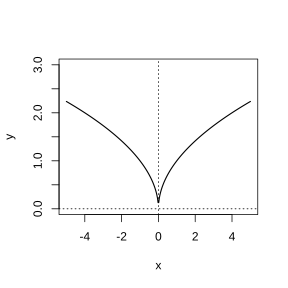
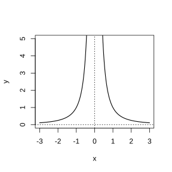
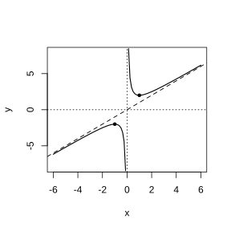

# Assignment 11

> **Definition 3.2.1** (Monotone Increasing and Increasing Function)  Let the domain of the function $f\left(x\right)$ be $D$, and let $I\subseteq D$ be an interval: if for $\forall x_1,x_2\in I$, whenever $x_1<x_2$, we always have $f\left(x_1\right)<f\left(x_2\right)$, then the function $f\left(x\right)$ is said to be monotonically increasing on the interval $I$. In particular, when the function $f\left(x\right)$ is monotonically increasing on its domain, it is called an increasing function.

> **Definition 3.2.2** (Monotone Decreasing and Decreasing Function)  If for $\forall x_1,x_2\in I$, whenever $x_1<x_2$, we always have $f\left(x_1\right)>f\left(x_2\right)$, then the function $f\left(x\right)$ is said to be monotonically decreasing on the interval $I$. In particular, when the function $f\left(x\right)$ is monotonically decreasing on its domain, it is called a decreasing function.

> **Definition 3.2.5** (Even Function)  Let the domain of the function $f\left(x\right)$ be $D$. If for $\forall x\in D$ we always have $-x\in D$ and $f\left(-x\right)=f\left(x\right)$, then the function $f\left(x\right)$ is called an even function.

> **Definition 3.2.6** (Odd Function)  Let the domain of the function $f\left(x\right)$ be $D$. If for $\forall x\in D$ we always have $-x\in D$ and $f\left(-x\right)=-f\left(x\right)$, then the function $f\left(x\right)$ is called an odd function.

> **Definition 3.3.1** (Power Function)  In general, the function $y=x^\alpha$ is called a power function, where $x$ is the independent variable and $\alpha$ is a constant.

> **Standard Conclusion 3.3.2** (Properties of Power Functions)  (1) The graphs of the functions $y=x$, $y=x^2$, $y=x^3$, $y=x^{\frac{1}{2}}$, and $y=x^{-1}$ all pass through the point $\left(1,1\right)$; (2) the functions $y=x$, $y=x^3$, and $y=x^{-1}$ are odd functions, and the function $y=x^2$ is an even function; (3) on the interval $\left(0,+\infty\right)$, the functions $y=x$, $y=x^2$, $y=x^3$, and $y=x^{\frac{1}{2}}$ are monotonically increasing, and the function $y=x^{-1}$ is monotonically decreasing.

### Exercise 1

(Exercise 3.3, Problem 1) Given that the graph of the power function $y=f\left(x\right)$ passes through the point $\left(2,\sqrt2\right)$, find the analytic expression of this function.

### Solution to Exercise 1

By **Definition 3.3.1** (Power Function), let $f\left(x\right)=x^\alpha$, and substitute the known point to find $\alpha$.

Since the graph passes through the point $\left(2,\sqrt2\right)$, we have $2^\alpha=\sqrt2=2^{\frac{1}{2}}$, so $\alpha=\frac{1}{2}$. Therefore the analytic expression of the function is $f\left(x\right)=x^{\frac{1}{2}}=\sqrt x$. $\blacksquare$

### Exercise 2

(Exercise 3.3, Problem 2) Using the properties of power functions, compare the sizes of the two values in each of the following:

(1) $\left(-1.5\right)^3$, $\left(-1.4\right)^3$;

(2) $\frac{1}{-1.5}$, $\frac{1}{-1.4}$.

### Solution to Exercise 2

By **Standard Conclusion 3.3.2** (Properties of Power Functions), use the monotonicity of power functions to compare.

(1) The function $y=x^3$ is monotonically increasing on $\mathbb R$. From $-1.5<-1.4$, we get $\left(-1.5\right)^3<\left(-1.4\right)^3$.

(2) $\frac{1}{-1.5}=-\frac{1}{1.5}$, $\frac{1}{-1.4}=-\frac{1}{1.4}$. The function $y=x^{-1}=\frac{1}{x}$ is monotonically decreasing on $\left(0,+\infty\right)$. From $1.5>1.4>0$, we get $\frac{1}{1.5}<\frac{1}{1.4}$, so $-\frac{1}{1.5}>-\frac{1}{1.4}$, i.e. $\frac{1}{-1.5}>\frac{1}{-1.4}$. $\blacksquare$

### Exercise 3

(Exercise 3.3, Problem 3) According to the definitions of monotonicity and parity, discuss the monotonicity of the function $f\left(x\right)=x^3$ and determine its parity.

### Solution to Exercise 3

By **Definition 3.2.1** (Monotone Increasing and Increasing Function) and **Definition 3.2.6** (Odd Function).

Monotonicity: for $\forall x_1,x_2\in\mathbb R$ with $x_1<x_2$, we have $f\left(x_1\right)-f\left(x_2\right)=x_1^3-x_2^3=\left(x_1-x_2\right)\left(x_1^2+x_1x_2+x_2^2\right)$. From $x_1<x_2$ we get $x_1-x_2<0$. When $x_1,x_2$ have the same sign, $x_1^2+x_1x_2+x_2^2>0$; when $x_1x_2\le0$, $x_1^2+x_2^2>0$ and $x_1x_2\le0$, but $x_1^2+x_1x_2+x_2^2=\left(x_1+\frac{x_2}{2}\right)^2+\frac{3x_2^2}{4}>0$. Thus $f\left(x_1\right)-f\left(x_2\right)<0$, i.e. $f\left(x_1\right)<f\left(x_2\right)$, so $f\left(x\right)=x^3$ is monotonically increasing on $\mathbb R$.

Parity: $f\left(-x\right)=\left(-x\right)^3=-x^3=-f\left(x\right)$, so $f\left(x\right)=x^3$ is an odd function. $\blacksquare$

### Problem 1

(Exercise 3.3, Review and Consolidation, Problem 1) Draw the graph of the function $y=\sqrt{\left|x\right|}$, determine the parity of the function, and discuss its monotonicity.

{width=50%}

### Solution to Problem 1

By **Definition 3.2.5** (Even Function) and **Definition 3.2.1** (Monotone Increasing and Increasing Function).

$$
y=\sqrt{\left|x\right|}=\begin{cases}\sqrt x, & x\ge0,\\\sqrt{-x}, & x<0.\end{cases}
$$

Parity: $f\left(-x\right)=\sqrt{\left|-x\right|}=\sqrt{\left|x\right|}=f\left(x\right)$, so it is an even function.

Monotonicity: when $x\ge0$, $y=\sqrt x$ is monotonically increasing; when $x<0$, $y=\sqrt{-x}$ is monotonically decreasing. Thus the monotonically increasing interval is $\left[0,+\infty\right)$, and the monotonically decreasing interval is $\left(-\infty,0\right]$. The graph is symmetric about the $y$-axis: on the right it is the curve $y=\sqrt x$, and on the left it is its mirror image about the $y$-axis. $\blacksquare$

### Problem 2

(Exercise 3.3, Comprehensive Application, Problem 2) Under a fixed pressure difference (the pressure difference is a constant), when gas flows through a circular pipe, its flow rate $v$ (unit: $\text{cm}^3/\text{s}$) is proportional to the fourth power of the pipe radius $r$ (unit: $\text{cm}$).

(1) Write the analytic expression of the gas flow rate $v$ as a function of the pipe radius $r$;

(2) if the gas flows through a pipe of radius $3\ \text{cm}$ with a flow rate of $400\ \text{cm}^3/\text{s}$, find the expression for the flow rate $v$ when this gas flows through a pipe of radius $r$;

(3) given that the pipe radius through which the gas in (2) flows is $5\ \text{cm}$, calculate the flow rate of the gas (accurate to $1\ \text{cm}^3/\text{s}$).

### Solution to Problem 2

By **Definition 3.3.1** (Power Function), the flow rate is proportional to the fourth power of the radius.

(1) Let the proportionality coefficient be $k$, then $v=kr^4$ ($k>0$).

(2) From $v=400$ when $r=3$, we get $400=k\cdot3^4=81k$, so $k=\frac{400}{81}$. Therefore $v=\frac{400}{81}r^4$.

(3) When $r=5$, $v=\frac{400}{81}\cdot5^4=\frac{400\times625}{81}=\frac{250000}{81}\approx3086\ \text{cm}^3/\text{s}$. $\blacksquare$

### Problem 3

(Exercise 3.3, Comprehensive Application, Problem 3) Try to plot points to draw the graph of the function $f\left(x\right)=x^{-2}$, find its domain and range; discuss its monotonicity and parity, and prove.

{width=50%}

### Solution to Problem 3

By **Definition 3.2.5** (Even Function), **Definition 3.2.1** (Monotone Increasing and Increasing Function), and **Definition 3.2.2** (Monotone Decreasing and Decreasing Function).

Domain: $x^{-2}=\frac{1}{x^2}$ requires $x\ne0$, so the domain is $\left(-\infty,0\right)\cup\left(0,+\infty\right)$.

Range: $\frac{1}{x^2}>0$, so the range is $\left(0,+\infty\right)$.

Parity: $f\left(-x\right)=\frac{1}{\left(-x\right)^2}=\frac{1}{x^2}=f\left(x\right)$, so it is an even function.

Monotonicity: take any $x_1,x_2\in\left(0,+\infty\right)$ with $x_1<x_2$, then $f\left(x_1\right)-f\left(x_2\right)=\frac{1}{x_1^2}-\frac{1}{x_2^2}=\frac{x_2^2-x_1^2}{x_1^2x_2^2}=\frac{\left(x_2-x_1\right)\left(x_2+x_1\right)}{x_1^2x_2^2}>0$, i.e. $f\left(x_1\right)>f\left(x_2\right)$, so it is monotonically decreasing on $\left(0,+\infty\right)$. By the property of even functions, it is monotonically increasing on $\left(-\infty,0\right)$.

Graph: in the first quadrant it is a decreasing hyperbola-like curve, and in the second quadrant it is its mirror image about the $y$-axis, with the two coordinate axes as asymptotes. $\blacksquare$

### Inquiry and Discovery 1

(Inquiry and Discovery: Investigating the Graph and Properties of the Function $y=x+\frac{1}{x}$) From what aspects do you think this function can be studied?

### Solution to Inquiry and Discovery 1

By **Definition 3.2.1** (Monotone Increasing and Increasing Function) and **Definition 3.2.5** (Even Function), the general approach to studying a function.

It can be studied from the following aspects: domain, range, parity, monotonicity, extrema, graph features, asymptotes, etc. $\blacksquare$

### Inquiry and Discovery 2

(Inquiry and Discovery: Investigating the Graph and Properties of the Function $y=x+\frac{1}{x}$) What path do you think should be followed to study this function?

### Solution to Inquiry and Discovery 2

By **Definition 3.1.2** (Domain and Range) and **Definition 3.2.1** (Monotone Increasing and Increasing Function).

The study path: first find the domain, then determine the parity, then use the definition to discuss the monotonicity and find the extrema, and finally draw the graph and observe the trend of change. $\blacksquare$

### Inquiry and Discovery 3

(Inquiry and Discovery: Investigating the Graph and Properties of the Function $y=x+\frac{1}{x}$) Follow the path you have constructed to study the questions you have thought of.

### Solution to Inquiry and Discovery 3

By **Definition 3.2.5** (Even Function) and **Definition 3.2.1** (Monotone Increasing and Increasing Function).

Domain: $x\ne0$, i.e. $\left(-\infty,0\right)\cup\left(0,+\infty\right)$.

Parity: $f\left(-x\right)=-x+\frac{1}{-x}=-\left(x+\frac{1}{x}\right)=-f\left(x\right)$, so it is an odd function, and the graph is symmetric about the origin.

Monotonicity: on $\left(0,+\infty\right)$, by the conclusion of Problem 8 (Section 3.2), $y=x+\frac{1}{x}$ is monotonically decreasing on $\left(0,1\right]$ and monotonically increasing on $\left[1,+\infty\right)$. By the property of odd functions, it is monotonically increasing on $\left(-\infty,-1\right]$ and monotonically decreasing on $\left[-1,0\right)$.

Extrema: it attains the local minimum $f\left(1\right)=2$ at $x=1$, and the local maximum $f\left(-1\right)=-2$ at $x=-1$. $\blacksquare$

### Inquiry and Discovery 4

(Inquiry and Discovery: Investigating the Graph and Properties of the Function $y=x+\frac{1}{x}$) Prove that: when $x>0$, $x+\frac{1}{x}\ge2$, with equality if and only if $x=\frac{1}{x}$, i.e. $x=1$; when $x<0$, $x+\frac{1}{x}\le-2$, with equality if and only if $x=\frac{1}{x}$, i.e. $x=-1$.

### Solution to Inquiry and Discovery 4

By **Definition 3.2.3** (Maximum Value) and **Definition 3.2.4** (Minimum Value), use the nonnegativity of a square to prove.

When $x>0$, $\left(\sqrt x-\frac{1}{\sqrt x}\right)^2\ge0$, and expanding gives $x-2+\frac{1}{x}\ge0$, i.e. $x+\frac{1}{x}\ge2$. Equality holds if and only if $\sqrt x=\frac{1}{\sqrt x}$, i.e. $x=1$.

When $x<0$, let $t=-x>0$, then $x+\frac{1}{x}=-\left(t+\frac{1}{t}\right)\le-2$, and equality holds if and only if $t=1$, i.e. $x=-1$. $\blacksquare$

### Inquiry and Discovery 5

(Inquiry and Discovery: Investigating the Graph and Properties of the Function $y=x+\frac{1}{x}$) Is the function graph you drew similar to Figure 1?

{width=50%}

### Solution to Inquiry and Discovery 5

By **Definition 3.1.6** (Ways of Representing a Function), the graphical method.

Based on the domain, parity, monotonicity, and extrema discussed above, the drawn graph should be similar to Figure 1 in the textbook: in the first quadrant it decreases from $+\infty$ to $\left(1,2\right)$ and then increases to $+\infty$, and in the third quadrant it is the part symmetric about the origin. $\blacksquare$

### Inquiry and Discovery 6

(Inquiry and Discovery: Investigating the Graph and Properties of the Function $y=x+\frac{1}{x}$) What is the trend of change of the graph of the function $y=x+\frac{1}{x}$? Can you use the trends of the graphs of the functions $y=x$ and $y=\frac{1}{x}$ to explain the trend of the graph of the function $y=x+\frac{1}{x}$?

### Solution to Inquiry and Discovery 6

By **Definition 3.2.1** (Monotone Increasing and Increasing Function) and **Definition 3.2.2** (Monotone Decreasing and Decreasing Function).

When $x\to+\infty$, $y=\frac{1}{x}\to0$, so $y=x+\frac{1}{x}\approx x$, and the graph approaches the line $y=x$. When $x\to0^+$, $y=\frac{1}{x}\to+\infty$, so $y\to+\infty$. For $x>0$, $y=x$ is increasing and $y=\frac{1}{x}$ is decreasing; the superposition of the two makes the function attain the local minimum $2$ at $x=1$. For $x<0$, by symmetry the reasoning is analogous. $\blacksquare$

### Inquiry and Discovery 7

(Inquiry and Discovery: Investigating the Graph and Properties of the Function $y=x+\frac{1}{x}$) Through the inquiry into the graph and properties of the function $y=x+\frac{1}{x}$, what insights have you gained?

### Solution to Inquiry and Discovery 7

By **Definition 3.2.1** (Monotone Increasing and Increasing Function) and **Definition 3.2.5** (Even Function).

Through the inquiry into $y=x+\frac{1}{x}$, one gains the following insights: (1) one can use the properties of already-learned functions (power functions) to study new functions; (2) parity can simplify the study, since one only needs to study half an interval and then reflect it; (3) the properties of a sum of functions are not a simple superposition of the properties of each function and require comprehensive analysis; (4) using the basic inequality $\left(\sqrt x-\frac{1}{\sqrt x}\right)^2\ge0$ makes it convenient to find the extrema. $\blacksquare$
