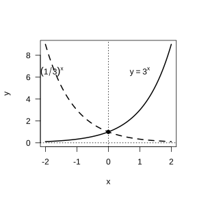
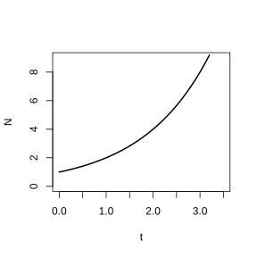
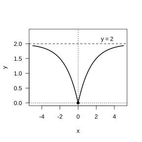

# Assignment 14

> **Definition 4.2.1** (Exponential Function)  In general, the function $y=a^x$ ($a>0$, and $a\neq 1$) is called an exponential function, where the exponent $x$ is the independent variable and the domain is $\mathbb R$.

> **Standard Conclusion 4.2.2** (Graphs and Properties of Exponential Functions)  (1) The domain is $\mathbb R$; (2) the range is $(0,+\infty)$; (3) the graph passes through the fixed point $(0,1)$, i.e. when $x=0$, $y=1$; (4) when $a>1$, $y=a^x$ is an increasing function; when $0<a<1$, $y=a^x$ is a decreasing function. The graphs of two exponential functions whose bases are reciprocals of each other are symmetric about the $y$-axis.

> **Standard Conclusion 4.2.3** (Exponential Growth and Decay Model)  Let the initial quantity be $N$, the growth rate each time be $p$, and after $x$ growth steps the quantity grows to $y$, then $y=N(1+p)^x$ ($x\in\mathbb N$). A function of the form $y=ka^x$ ($k\in\mathbb R$, and $k\neq 0$; $a>0$, and $a\neq 1$) is a very useful function model for describing the laws of exponential growth or exponential decay.

### Exercise 1

(Exercise 4.2, Problem 1) Among the following graphs, which could possibly represent an exponential function? ( ).

(A) a straight line from upper left to lower right; (B) a parabola opening upward; (C) a curve located above the $x$-axis, passing through $(0,1)$, and monotonically increasing; (D) a curve passing through the origin and lying in the first and third quadrants.

### Solution to Exercise 1

By **Definition 4.2.1** (Exponential Function) and **Standard Conclusion 4.2.2** (Graphs and Properties of Exponential Functions), the exponential function $y=a^x$ ($a>0$, and $a\neq 1$) has domain $\mathbb R$, range $(0,+\infty)$, its graph always lies above the $x$-axis, passes through the fixed point $(0,1)$, and is monotonic.

(A) is a straight line, a linear function; (B) is a parabola, a quadratic function; (D) passes through the origin and lies in the first and third quadrants, with a range containing negative numbers, which does not match the range $(0,+\infty)$. Only the graph in (C) lies above the $x$-axis, passes through $(0,1)$, and is monotonically increasing, consistent with the features of $y=a^x$ ($a>1$). Therefore choose (C). $\blacksquare$

### Exercise 2

(Exercise 4.2, Problem 2) Given the function $y=f(x)$, $x\in\mathbb R$, and $f(0)=3$, $\frac{f(0.5)}{f(0)}=2$, $\frac{f(1)}{f(0.5)}=2$, $\cdots$, $\frac{f(0.5n)}{f(0.5(n-1))}=2$, $n\in\mathbb N^*$, find an analytic expression for the function $y=f(x)$.

### Solution to Exercise 2

By **Standard Conclusion 4.2.3** (Exponential Growth and Decay Model), the function value doubles after every fixed interval, which is an exponential growth pattern.

From the given conditions, $f(0)=3$, and each time the independent variable increases by $0.5$, the function value is multiplied by $2$. Thus for $n\in\mathbb N^*$,

$$
f(0.5n)=f(0)\cdot 2^n=3\cdot 2^n.
$$

Let $x=0.5n$, then $n=2x$, and substituting gives $f(x)=3\cdot 2^{2x}=3\cdot 4^x$. Therefore $f(x)=3\cdot 4^x$ ($x\in\mathbb R$) is one analytic expression satisfying the requirements. $\blacksquare$

### Exercise 3

(Exercise 4.2, Problem 3) During a certain period, the cyanobacteria in a certain lake grow exponentially at a daily growth rate of $6.25\%$. After $30$ days, by how many times will the cyanobacteria in the lake have increased compared with the original? (A calculating tool may be used.)

### Solution to Exercise 3

By **Standard Conclusion 4.2.3** (Exponential Growth and Decay Model), the daily growth rate is $6.25\%$, i.e. the quantity each day is $1+6.25\%=1.0625$ times that of the previous day.

Let the initial quantity be $N$, and after $30$ days the quantity is $y$, then $y=N\cdot 1.0625^{30}$. Using a calculating tool, $1.0625^{30}\approx 6.13$, so after $30$ days the cyanobacteria have approximately increased to $6.13$ times the original. $\blacksquare$

### Reading and Thinking 1

(Reading and Thinking: Decay of Radioactive Substances) In general, if the half-life of a certain substance is $h$, then after time $t$ the remaining mass of the substance is $Q(t)=Q_0\left(\frac{1}{2}\right)^{\frac{t}{h}}$, where $Q_0$ is the initial mass of the substance. Can you explain why?

### Solution to Reading and Thinking 1

By **Standard Conclusion 4.2.3** (Exponential Growth and Decay Model), a half-life of $h$ means that every time interval $h$ passes, the remaining mass is halved.

After $1$ half-life, i.e. when $t=h$, the remaining mass is $\frac{1}{2}Q_0$; after $2$ half-lives, i.e. when $t=2h$, the remaining mass is $\frac{1}{2}\cdot\frac{1}{2}Q_0=\left(\frac{1}{2}\right)^2 Q_0$; after $n$ half-lives, i.e. when $t=nh$, the remaining mass is $\left(\frac{1}{2}\right)^n Q_0$. Generalizing to arbitrary time $t$, the number of half-lives elapsed is $\frac{t}{h}$, so $Q(t)=Q_0\left(\frac{1}{2}\right)^{\frac{t}{h}}$. $\blacksquare$

### Reading and Thinking 2

(Reading and Thinking: Decay of Radioactive Substances) If a certain function grows exponentially, then the time taken for the function value to grow to twice the original is called the "doubling period". Can you, by searching online, give an example of a doubling exponential function model?

### Solution to Reading and Thinking 2

By **Standard Conclusion 4.2.3** (Exponential Growth and Decay Model), the doubling period is the time required for the function value to double.

Example: a certain kind of bacterium divides once every $20\;\mathrm{min}$ under ideal conditions ($1$ divides into $2$), so the doubling period of its quantity is $20\;\mathrm{min}$. Let the initial quantity be $N_0$, and after $t$ minutes the quantity is $N(t)$, then $N(t)=N_0\cdot 2^{\frac{t}{20}}$. When $t=20$, $N(20)=2N_0$; when $t=40$, $N(40)=4N_0$, i.e. the quantity doubles every $20\;\mathrm{min}$. $\blacksquare$

### Exercise 4

(Exercise 4.2, Problem 4) In the same rectangular coordinate system, draw the graphs of the functions $y=3^x$ and $y=\left(\frac{1}{3}\right)^x$, and explain their relationship.

{width=50%}

### Solution to Exercise 4

By **Standard Conclusion 4.2.2** (Graphs and Properties of Exponential Functions), the graphs of two exponential functions whose bases are reciprocals of each other are symmetric about the $y$-axis.

Since $\left(\frac{1}{3}\right)^x=3^{-x}$, if the point $(x,y)$ lies on the graph of $y=3^x$, then $y=3^x$, and the point $(-x,y)$ satisfies $y=3^{-(-x)}=\left(\frac{1}{3}\right)^{-(-x)}$, i.e. the point $(-x,y)$ lies on the graph of $y=\left(\frac{1}{3}\right)^x$. Conversely also holds. Therefore the two graphs are symmetric about the $y$-axis. $y=3^x$ is an increasing curve passing through $(0,1)$; $y=\left(\frac{1}{3}\right)^x$ is a decreasing curve passing through $(0,1)$, and the two are mirror images of each other about the $y$-axis. $\blacksquare$

### Exercise 5

(Exercise 4.2, Problem 5) Compare the sizes of the two values in each of the following.

(1) $6^{\sqrt{2}}$, $7^{\sqrt{2}}$;

(2) $0.3^{-3.5}$, $0.3^{-2.3}$;

(3) $1.2^{0.5}$, $0.5^{1.2}$.

### Solution to Exercise 5

By **Standard Conclusion 4.2.2** (Graphs and Properties of Exponential Functions), use the monotonicity of exponential functions to compare sizes.

(1) $\sqrt{2}>0$; for the power $x^{\sqrt{2}}$, the power value increases as the base increases, so $6^{\sqrt{2}}<7^{\sqrt{2}}$.

(2) The base $0.3\in(0,1)$, and the function $y=0.3^x$ is decreasing. Since $-3.5<-2.3$, in a decreasing function the smaller the independent variable, the larger the function value, so $0.3^{-3.5}>0.3^{-2.3}$.

(3) $1.2^{0.5}>1.2^0=1$, while $0.5^{1.2}<0.5^0=1$, so $1.2^{0.5}>0.5^{1.2}$. $\blacksquare$

### Exercise 6

(Exercise 4.2, Problem 6) Cancer cells in the body increase very slowly in the early stage, but increase sharply in the late stage. Draw a schematic diagram reflecting how the number of cancer cells in the body changes over time.

{width=50%}

### Solution to Exercise 6

By **Standard Conclusion 4.2.3** (Exponential Growth and Decay Model), the number of cancer cells grows exponentially with time.

Schematic diagram: the horizontal axis is time and the vertical axis is the number of cancer cells. The curve starts near the origin, with a very small slope in the early stage and a gentle rise; as time passes, the slope gradually increases, and in the later stage it rises sharply, showing a convex-down exponential growth shape, consistent with the graph of $y=a^x$ ($a>1$) when $x\ge 0$. $\blacksquare$

### Problem 1

(Exercise 4.2, Review and Consolidation, Problem 1) Find the domains of the following functions.

(1) $y=2^{3-x}$;

(2) $y=3^{2x+1}$;

(3) $y=\left(\frac{1}{2}\right)^{5x}$;

(4) $y=0.7^{\frac{1}{x}}$.

### Solution to Problem 1

By **Definition 4.2.1** (Exponential Function), the expression in the exponent position must be meaningful.

(1) $3-x$ is meaningful for any $x\in\mathbb R$, so the domain is $\mathbb R$.

(2) $2x+1$ is meaningful for any $x\in\mathbb R$, so the domain is $\mathbb R$.

(3) $5x$ is meaningful for any $x\in\mathbb R$, so the domain is $\mathbb R$.

(4) $\frac{1}{x}$ requires $x\neq 0$, so the domain is $(-\infty,0)\cup(0,+\infty)$. $\blacksquare$

### Problem 2

(Exercise 4.2, Review and Consolidation, Problem 2) The original annual output of a certain product is $a$ pieces. In the coming $m$ years, it is planned that the output will increase on average by $p\%$ each year over the previous year. Write the function analytic expression for the annual output $y$ (unit: pieces) with respect to the number of years elapsed $x$.

### Solution to Problem 2

By **Standard Conclusion 4.2.3** (Exponential Growth and Decay Model), each year increases by $p\%$ over the previous year, i.e. the output each year is $\left(1+\frac{p}{100}\right)$ times that of the previous year.

After $x$ years, the annual output is $y=a\left(1+\frac{p}{100}\right)^x$, where $x\in\{0,1,2,\cdots,m\}$. $\blacksquare$

### Problem 3

(Exercise 4.2, Review and Consolidation, Problem 3) Compare the sizes of $m$ and $n$ satisfying the following conditions.

(1) $2^m<2^n$;

(2) $0.2^m<0.2^n$;

(3) $a^m<a^n$ ($0<a<1$);

(4) $a^m>a^n$ ($a>1$).

### Solution to Problem 3

By **Standard Conclusion 4.2.2** (Graphs and Properties of Exponential Functions), when $a>1$, $y=a^x$ is increasing, and when $0<a<1$, $y=a^x$ is decreasing.

(1) The base $2>1$, and $y=2^x$ is increasing; from $2^m<2^n$ we get $m<n$.

(2) The base $0.2\in(0,1)$, and $y=0.2^x$ is decreasing; from $0.2^m<0.2^n$ we get $m>n$.

(3) $0<a<1$, and $y=a^x$ is decreasing; from $a^m<a^n$ we get $m>n$.

(4) $a>1$, and $y=a^x$ is increasing; from $a^m>a^n$ we get $m>n$. $\blacksquare$

### Problem 4

(Exercise 4.2, Review and Consolidation, Problem 4) Let the function $f(x)=Q_0(1+r)^x$, and $f(10)=20.23$, $f(11)=23.26$.

(1) Find the growth rate $r$ of the function $f(x)$;

(2) find the value of $f(12)$.

### Solution to Problem 4

By **Standard Conclusion 4.2.3** (Exponential Growth and Decay Model), $f(x)=Q_0(1+r)^x$.

(1) From $f(11)=Q_0(1+r)^{11}$ and $f(10)=Q_0(1+r)^{10}$, dividing the two equations gives $\frac{f(11)}{f(10)}=1+r=\frac{23.26}{20.23}\approx 1.15$, so $r\approx 0.15$, i.e. the growth rate is approximately $15\%$.

(2) $f(12)=f(11)(1+r)\approx 23.26\times 1.15\approx 26.75$. $\blacksquare$

### Problem 5

(Exercise 4.2, Comprehensive Application, Problem 5) Find a possible analytic expression for each of the following functions.

(1) The data for the function $f(x)$ are as follows: when $x=0,1,2$, $f(x)=3.50,4.20,5.04$;

(2) the graph of the function $g(x)$ passes through the points $(-1,8)$ and $(1,2)$ and is monotonically decreasing.

### Solution to Problem 5

By **Standard Conclusion 4.2.3** (Exponential Growth and Decay Model), assume the function is of exponential type $y=ka^x$.

(1) From the data: $\frac{f(1)}{f(0)}=\frac{4.20}{3.50}=1.2$, $\frac{f(2)}{f(1)}=\frac{5.04}{4.20}=1.2$, the common ratio is $1.2$, and the first term is $f(0)=3.50$. Thus $f(x)=3.50\times 1.2^x$.

(2) Let $g(x)=ka^x$ ($0<a<1$). From $g(1)=ka=2$ and $g(-1)=ka^{-1}=8$, dividing the two equations gives $a^2=\frac{2}{8}=\frac{1}{4}$, so $a=\frac{1}{2}$, and substituting into $ka=2$ gives $k=4$. Thus $g(x)=4\cdot\left(\frac{1}{2}\right)^x=2^{2-x}$. $\blacksquare$

### Problem 6

(Exercise 4.2, Comprehensive Application, Problem 6) Compare the sizes of the two values in each of the following.

(1) $3^{0.8}$, $3^{0.7}$;

(2) $0.75^{-0.1}$, $0.75^{0.1}$;

(3) $1.01^{2.7}$, $1.01^{3.5}$;

(4) $0.99^{3.3}$, $0.99^{4.5}$.

### Solution to Problem 6

By **Standard Conclusion 4.2.2** (Graphs and Properties of Exponential Functions), compare using monotonicity.

(1) The base $3>1$, $y=3^x$ is increasing, $0.8>0.7$, so $3^{0.8}>3^{0.7}$.

(2) The base $0.75\in(0,1)$, $y=0.75^x$ is decreasing, $-0.1<0.1$, so $0.75^{-0.1}>0.75^{0.1}$.

(3) The base $1.01>1$, $y=1.01^x$ is increasing, $2.7<3.5$, so $1.01^{2.7}<1.01^{3.5}$.

(4) The base $0.99\in(0,1)$, $y=0.99^x$ is decreasing, $3.3<4.5$, so $0.99^{3.3}>0.99^{4.5}$. $\blacksquare$

### Problem 7

(Exercise 4.2, Comprehensive Application, Problem 7) When the content of carbon $14$ in dead biological tissue is less than one-thousandth of that before death, a general radioactive detector can no longer detect carbon $14$. If the carbon $14$ in dead biological tissue has gone through nine "half-lives", can a general radioactive detector still detect carbon $14$?

### Solution to Problem 7

By **Standard Conclusion 4.2.3** (Exponential Growth and Decay Model), each time a half-life passes, the remaining mass is halved.

After nine half-lives, the remaining carbon $14$ is $\left(\frac{1}{2}\right)^9=\frac{1}{512}\approx 0.001953=0.1953\%$ of the original. One-thousandth is $0.1\%$. Since $0.1953\%>0.1\%$, i.e. the remaining content exceeds one-thousandth, a general radioactive detector can still detect carbon $14$. $\blacksquare$

### Problem 8

(Exercise 4.2, Comprehensive Application, Problem 8) A kind of savings that calculates interest by compound interest, with principal $a$ (unit: yuan), interest rate per period $r$, sum of principal and interest $y$ (unit: yuan), and number of deposit periods $x$.

(1) Write the function analytic expression for the sum of principal and interest $y$ with respect to the number of deposit periods $x$;

(2) if the principal deposited is $1000$ yuan and the interest rate per period is $2.25\%$, calculate the sum of principal and interest after $5$ periods.

### Solution to Problem 8

By **Standard Conclusion 4.2.3** (Exponential Growth and Decay Model), compound interest means that the interest each period is incorporated into the principal and earns interest again in the next period.

(1) After depositing for $1$ period, the sum of principal and interest is $a(1+r)$; after $2$ periods, it is $a(1+r)^2$; and so on; after $x$ periods, it is $y=a(1+r)^x$, where $x\in\mathbb N$.

(2) Substituting $a=1000$, $r=2.25\%=0.0225$, $x=5$, gives $y=1000\times 1.0225^5\approx 1000\times 1.1177\approx 1117.7$ yuan. $\blacksquare$

### Problem 9

(Exercise 4.2, Extension and Exploration, Problem 9) It is known that the graph of the function $y=a\left(\frac{1}{2}\right)^{\left|x\right|}+b$ passes through the origin and approaches the line $y=2$ indefinitely but does not intersect it.

(1) Find the analytic expression of this function and draw its graph;

(2) determine the parity and monotonicity of this function.

{width=50%}

### Solution to Problem 9

By **Definition 4.2.1** (Exponential Function) and **Standard Conclusion 4.2.2** (Graphs and Properties of Exponential Functions).

(1) The graph passes through the origin, i.e. when $x=0$, $y=0$, so $a\left(\frac{1}{2}\right)^0+b=a+b=0$, giving $b=-a$. When $\left|x\right|\to+\infty$, $\left(\frac{1}{2}\right)^{\left|x\right|}\to 0$, so $y\to b$. Moreover, the graph approaches $y=2$ indefinitely but does not intersect it, so $b=2$, and thus $a=-2$. The analytic expression is $y=2-2\left(\frac{1}{2}\right)^{\left|x\right|}$. The graph: passes through the origin, is symmetric about the $y$-axis, attains the minimum value $0$ at $x=0$, rises gradually on both sides, and approaches the line $y=2$ indefinitely.

(2) Let $f(x)=2-2\left(\frac{1}{2}\right)^{\left|x\right|}$. From $\left|-x\right|=\left|x\right|$, we get $f(-x)=2-2\left(\frac{1}{2}\right)^{\left|-x\right|}=2-2\left(\frac{1}{2}\right)^{\left|x\right|}=f(x)$, so $f(x)$ is an even function. When $x\ge 0$, $\left(\frac{1}{2}\right)^x$ is decreasing and $-2\left(\frac{1}{2}\right)^x$ is increasing, so $f(x)$ is increasing on $[0,+\infty)$; by the symmetry of an even function, $f(x)$ is decreasing on $(-\infty,0]$. $\blacksquare$

### Problem 10

(Exercise 4.2, Extension and Exploration, Problem 10) Given $f(x)=a^x$, $g(x)=\left(\frac{1}{a}\right)^x$ ($a>0$, and $a\neq 1$).

(1) Discuss the monotonicity of the functions $f(x)$ and $g(x)$;

(2) if $f(x)<g(x)$, what is the range of values of $x$?

### Solution to Problem 10

By **Standard Conclusion 4.2.2** (Graphs and Properties of Exponential Functions).

(1) When $a>1$, $f(x)=a^x$ is an increasing function, and the base of $g(x)=\left(\frac{1}{a}\right)^x$ is $\frac{1}{a}\in(0,1)$, so $g(x)$ is a decreasing function; when $0<a<1$, $f(x)=a^x$ is a decreasing function, and the base of $g(x)=\left(\frac{1}{a}\right)^x$ is $\frac{1}{a}>1$, so $g(x)$ is an increasing function.

(2) $f(x)<g(x)$ means $a^x<\left(\frac{1}{a}\right)^x=a^{-x}$, i.e. $a^{2x}<1=a^0$. When $a>1$, $y=a^x$ is increasing; from $a^{2x}<a^0$ we get $2x<0$, i.e. $x<0$. When $0<a<1$, $y=a^x$ is decreasing; from $a^{2x}<a^0$ we get $2x>0$, i.e. $x>0$. $\blacksquare$

### Information Technology Application 1

(Thinking 1) Continue to observe the graphs of the family of exponential functions; when the independent variable $x$ takes the same value, what is the size relationship among the corresponding function values $y$? What pattern do you discover from this?

### Solution to Information Technology Application 1

By **Standard Conclusion 4.2.2** (Graphs and Properties of Exponential Functions), compare exponential functions with different bases in the same coordinate system.

When $x>0$, the larger the base of the exponential function $y=a^x$, the larger the function value, i.e. the graph is higher; when $x<0$, the larger the base, the smaller the function value, i.e. the graph is lower; all graphs pass through $(0,1)$. Pattern: to the right of the $y$-axis, the base increases as the graphs go from bottom to top; to the left of the $y$-axis, the base decreases as the graphs go from bottom to top. $\blacksquare$

### Information Technology Application 2

(Thinking 2) Similarly, you can use information technology to draw the graph of the power function $y=x^\alpha$, and by changing the size of $\alpha$, understand the pattern of change of power functions.

### Solution to Information Technology Application 2

By the graphs and properties of power functions, changing the exponent $\alpha$ allows observation of how power functions change in the first quadrant.

When $\alpha>0$, the graph passes through the origin $(0,0)$ and $(1,1)$, and is increasing in the first quadrant; the larger $\alpha$ is, the steeper the graph is when $x>1$. When $\alpha<0$, the graph does not pass through the origin, is decreasing in the first quadrant, and has the coordinate axes as asymptotes. All power function graphs pass through the point $(1,1)$. $\blacksquare$
