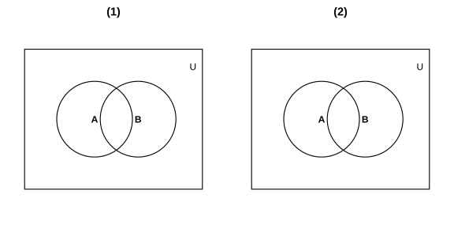

# Assignment 3

> **Definition 1.1.5** (Belonging and Not Belonging)  If $a$ is an element of the set $A$, we say $a$ belongs to the set $A$, denoted $a\in A$; if $a$ is not an element of the set $A$, we say $a$ does not belong to the set $A$, denoted $a\notin A$.

> **Common Number Sets**  The set of all non-negative integers is called the non-negative integer set, or the natural number set, denoted $\mathbb N$; the set of all positive integers is called the positive integer set, denoted $\mathbb N^*$ or $\mathbb N_+$; the set of all integers is called the integer set, denoted $\mathbb Z$; the set of all rational numbers is called the rational number set, denoted $\mathbb Q$; the set of all real numbers is called the real number set, denoted $\mathbb R$.

> **Definition 1.3.1** (Union)  Generally, the set formed by all elements belonging to the set $A$ or belonging to the set $B$ is called the union of the set $A$ and $B$, denoted $A\cup B$, i.e. $A\cup B=\left\{x\mid x\in A$, or $x\in B\right\}$. When finding the union of two sets, their common elements may appear only once in the union.

> **Definition 1.3.2** (Intersection)  Generally, the set formed by all elements belonging to the set $A$ and belonging to the set $B$ is called the intersection of the set $A$ and $B$, denoted $A\cap B$, i.e. $A\cap B=\left\{x\mid x\in A$, and $x\in B\right\}$.

> **Definition 1.3.3** (Universal Set)  Generally, if a set contains all elements involved in the problem under study, then we call this set the universal set, usually denoted $U$. Usually a given set is also taken as the universal set.

> **Definition 1.3.4** (Complement)  For a set $A$, the set formed by all elements in the universal set $U$ that do not belong to the set $A$ is called the complement of the set $A$ relative to the universal set $U$, or the complement of the set $A$ for short, denoted $\boldsymbol{U\setminus A}$, i.e. $\boldsymbol{U\setminus A}=\left\{x\mid x\in U$, and $x\notin A\right\}$.

> **Common Conclusion** (Number of Elements in a Finite Set)  We call a set $A$ containing finitely many elements a finite set, and use $\operatorname{card}\left(A\right)$ to denote the number of elements in the finite set $A$. Generally, for any two finite sets $A,B$, we have $\operatorname{card}\left(A\cup B\right)=\operatorname{card}\left(A\right)+\operatorname{card}\left(B\right)-\operatorname{card}\left(A\cap B\right)$.

### Exercise 1

(Exercise 1.3, Problem 1) Let $A=\left\{3,5,6,8\right\}$, $B=\left\{4,5,7,8\right\}$, find $A\cap B$, $A\cup B$.

### Solution to Exercise 1

By **Definition 1.3.2** (Intersection), the intersection consists of elements that belong to both $A$ and $B$; by **Definition 1.3.1** (Union), the union consists of elements that belong to $A$ or $B$, and common elements appear only once.

The common elements of $A$ and $B$ are $5,8$, so $A\cap B=\left\{5,8\right\}$.

Combining the elements of $A$ and $B$ and removing the duplicates $5,8$, we get $A\cup B=\left\{3,4,5,6,7,8\right\}$. $\blacksquare$

### Exercise 2

(Exercise 1.3, Problem 2) Let $A=\left\{x\mid x^2-4x-5=0\right\}$, $B=\left\{x\mid x^2=1\right\}$, find $A\cup B$, $A\cap B$.

### Solution to Exercise 2

First simplify the sets $A,B$ separately. By **Definition 1.1.5** (Belonging and Not Belonging), the elements of the sets are precisely the real roots of the equations.

The equation $x^2-4x-5=0$ is equivalent to $\left(x-5\right)\left(x+1\right)=0$, whose roots are $x=5$ or $x=-1$, so $A=\left\{-1,5\right\}$.

The equation $x^2=1$ is equivalent to $\left(x-1\right)\left(x+1\right)=0$, whose roots are $x=1$ or $x=-1$, so $B=\left\{-1,1\right\}$.

By **Definition 1.3.1** (Union), combining the elements of $A,B$ and removing the duplicate $-1$, we get $A\cup B=\left\{-1,1,5\right\}$.

By **Definition 1.3.2** (Intersection), the only common element of $A,B$ is $-1$, so $A\cap B=\left\{-1\right\}$. $\blacksquare$

### Exercise 3

(Exercise 1.3, Problem 3) Let $A=\left\{x\mid x\text{ 是等腰三角形}\right\}$, $B=\left\{x\mid x\text{ 是直角三角形}\right\}$, find $A\cap B$, $A\cup B$.

### Solution to Exercise 3

By **Definition 1.3.2** (Intersection), $A\cap B$ consists of elements that belong to both $A$ and $B$, i.e. triangles that are both isosceles and right triangles, so $A\cap B=\left\{x\mid x\text{ 是等腰直角三角形}\right\}$.

By **Definition 1.3.1** (Union), $A\cup B$ consists of elements that belong to $A$ or $B$, i.e. all isosceles or right triangles, so $A\cup B=\left\{x\mid x\text{ 是等腰三角形或直角三角形}\right\}$. $\blacksquare$

### Exercise 4

(Exercise 1.3, Problem 4) Let $A=\left\{x\mid x\text{ 是幸福农场的汽车}\right\}$, $B=\left\{x\mid x\text{ 是幸福农场的货车}\right\}$, find $A\cup B$.

### Solution to Exercise 4

By **Definition 1.3.1** (Union), $A\cup B$ consists of elements that belong to $A$ or $B$, i.e. all cars or trucks of Happy Farm. A truck is also a kind of car; the two have a common part, but common elements appear only once in the union.

Therefore $A\cup B=\left\{x\mid x\text{ 是幸福农场的汽车或货车}\right\}$. $\blacksquare$

### Exercise 5

(Exercise 1.3, Problem 5) Given $U=\left\{1,2,3,4,5,6,7\right\}$, $A=\left\{2,4,5\right\}$, $B=\left\{1,3,5,7\right\}$, find $A\cap\left(\boldsymbol{U\setminus B}\right)$, $\left(\boldsymbol{U\setminus A}\right)\cap\left(\boldsymbol{U\setminus B}\right)$.

### Solution to Exercise 5

By **Definition 1.3.4** (Complement), the complement consists of elements in the universal set $U$ that do not belong to the set.

The universal set is $U=\left\{1,2,3,4,5,6,7\right\}$. Removing the elements of $B=\left\{1,3,5,7\right\}$ from $U$, we get $\boldsymbol{U\setminus B}=\left\{2,4,6\right\}$. Removing the elements of $A=\left\{2,4,5\right\}$ from $U$, we get $\boldsymbol{U\setminus A}=\left\{1,3,6,7\right\}$.

By **Definition 1.3.2** (Intersection), the common elements of $A$ and $\boldsymbol{U\setminus B}$ are $2,4$, so $A\cap\left(\boldsymbol{U\setminus B}\right)=\left\{2,4\right\}$.

The only common element of $\boldsymbol{U\setminus A}=\left\{1,3,6,7\right\}$ and $\boldsymbol{U\setminus B}=\left\{2,4,6\right\}$ is $6$, so $\left(\boldsymbol{U\setminus A}\right)\cap\left(\boldsymbol{U\setminus B}\right)=\left\{6\right\}$. $\blacksquare$

### Exercise 6

(Exercise 1.3, Problem 6) Let $S=\left\{x\mid x\text{ 是平行四边形或梯形}\right\}$, $A=\left\{x\mid x\text{ 是平行四边形}\right\}$, $B=\left\{x\mid x\text{ 是菱形}\right\}$, $C=\left\{x\mid x\text{ 是矩形}\right\}$, find $B\cap C$, $\boldsymbol{A\setminus B}$, $\boldsymbol{S\setminus A}$.

### Solution to Exercise 6

By **Definition 1.3.2** (Intersection), $B\cap C$ consists of quadrilaterals that are both rhombi and rectangles. A rhombus has equal adjacent sides, and a rectangle has right interior angles; a quadrilateral with both properties is a square, so $B\cap C=\left\{x\mid x\text{ 是正方形}\right\}$.

By **Definition 1.3.4** (Complement), $\boldsymbol{A\setminus B}$ is the part remaining after removing rhombi from the universal set $A$, i.e. parallelograms, so $\boldsymbol{A\setminus B}=\left\{x\mid x\text{ 是平行四边形且不是菱形}\right\}$.

Similarly, $\boldsymbol{S\setminus A}$ is the part remaining after removing parallelograms from the universal set $S$, i.e. parallelograms or trapezoids, so $\boldsymbol{S\setminus A}=\left\{x\mid x\text{ 是梯形}\right\}$. $\blacksquare$

### Exercise 7

(Exercise 1.3, Problem 7) In the figure, $U$ is the universal set, and $A,B$ are two subsets of $U$. Shade the following:

(1) $\left(\boldsymbol{U\setminus A}\right)\cap\left(\boldsymbol{U\setminus B}\right)$;

(2) $\left(\boldsymbol{U\setminus A}\right)\cup\left(\boldsymbol{U\setminus B}\right)$.

{width=100%}

### Solution to Exercise 7

By **Definition 1.3.4** (Complement), $\boldsymbol{U\setminus A}$ is the part of the universal set $U$ outside circle $A$, and $\boldsymbol{U\setminus B}$ is the part of the universal set $U$ outside circle $B$.

(1) By **Definition 1.3.2** (Intersection), $\left(\boldsymbol{U\setminus A}\right)\cap\left(\boldsymbol{U\setminus B}\right)$ is the part that is both outside circle $A$ and outside circle $B$, i.e. the entire region within the universal set $U$ excluding the areas covered by circles $A$ and $B$; shade it.

(2) By **Definition 1.3.1** (Union), $\left(\boldsymbol{U\setminus A}\right)\cup\left(\boldsymbol{U\setminus B}\right)$ is the part that is outside circle $A$ or outside circle $B$, i.e. the entire region within the universal set $U$ excluding the common part $A\cap B$ of circles $A$ and $B$; shade it. $\blacksquare$

### Problem 1

(Problem 1.3, Review and Consolidation, Problem 1) The sets are $A=\left\{x\mid 2\le x<4\right\}$, $B=\left\{x\mid 3x-7\ge 8-2x\right\}$. Find $A\cup B$, $A\cap B$.

### Solution to Problem 1

First simplify the set $B$. From $3x-7\ge 8-2x$, transposing gives $5x\ge 15$, i.e. $x\ge 3$, so $B=\left\{x\mid x\ge 3\right\}$.

By **Definition 1.3.1** (Union), $A\cup B$ consists of real numbers satisfying $2\le x<4$ or $x\ge 3$, i.e. $x\ge 2$, so $A\cup B=\left\{x\mid x\ge 2\right\}$.

By **Definition 1.3.2** (Intersection), $A\cap B$ consists of real numbers simultaneously satisfying $2\le x<4$ and $x\ge 3$, i.e. $3\le x<4$, so $A\cap B=\left\{x\mid 3\le x<4\right\}$. $\blacksquare$

### Problem 2

(Problem 1.3, Review and Consolidation, Problem 2) Let $A=\left\{x\mid x\text{ 是小于 }9\text{ 的正整数}\right\}$, $B=\left\{1,2,3\right\}$, $C=\left\{3,4,5,6\right\}$. Find $A\cap B$, $A\cap C$, $A\cap\left(B\cup C\right)$, $A\cup\left(B\cap C\right)$.

### Solution to Problem 2

By the **Common Number Sets** and **Definition 1.1.5** (Belonging and Not Belonging), the positive integers less than $9$ are $1,2,3,4,5,6,7,8$, so $A=\left\{1,2,3,4,5,6,7,8\right\}$.

By **Definition 1.3.2** (Intersection), $A\cap B$ is the common elements of $A$ and $B$, i.e. $A\cap B=\left\{1,2,3\right\}$.

Similarly, $A\cap C$ is the common elements of $A$ and $C$, i.e. $A\cap C=\left\{3,4,5,6\right\}$.

By **Definition 1.3.1** (Union), $B\cup C=\left\{1,2,3\right\}\cup\left\{3,4,5,6\right\}=\left\{1,2,3,4,5,6\right\}$, where the common element $3$ appears only once. Then by **Definition 1.3.2** (Intersection), $A\cap\left(B\cup C\right)=\left\{1,2,3,4,5,6\right\}$.

By **Definition 1.3.2** (Intersection), $B\cap C$ is the common elements of $B$ and $C$, i.e. $B\cap C=\left\{3\right\}$. Then by **Definition 1.3.1** (Union), $A\cup\left(B\cap C\right)=A\cup\left\{3\right\}=A=\left\{1,2,3,4,5,6,7,8\right\}$. $\blacksquare$

### Problem 3

(Problem 1.3, Review and Consolidation, Problem 3) The school holds a sports meet. Let $A=\left\{x\mid x\text{ 是参加 }100\text{ m 跑的同学}\right\}$, $B=\left\{x\mid x\text{ 是参加 }200\text{ m 跑的同学}\right\}$, $C=\left\{x\mid x\text{ 是参加 }400\text{ m 跑的同学}\right\}$. The school stipulates that each student participating in the above events may participate in at most two events. Please use set operations to express this rule and explain the meaning of the following set operations:

(1) $A\cup B$;

(2) $A\cap C$.

### Solution to Problem 3

The school stipulates that each student may participate in at most two events, i.e. no student belongs to all three sets $A,B,C$. By **Definition 1.3.2** (Intersection), students belonging simultaneously to $A,B,C$ form $A\cap B\cap C$, so this rule can be expressed as $A\cap B\cap C=\varnothing$.

(1) By **Definition 1.3.1** (Union), $A\cup B$ consists of students who belong to $A$ or $B$, i.e. all students participating in the $100\text{ m}$ run or the $200\text{ m}$ run.

(2) By **Definition 1.3.2** (Intersection), $A\cap C$ consists of students who belong to both $A$ and $C$, i.e. all students participating in both the $100\text{ m}$ run and the $400\text{ m}$ run. $\blacksquare$

### Problem 4

(Problem 1.3, Comprehensive Application, Problem 4) Given the sets $A=\left\{x\mid 3\le x<7\right\}$, $B=\left\{x\mid 2<x<10\right\}$, find $\boldsymbol{\left(A\cup B\right)^c}$, $\boldsymbol{\left(A\cap B\right)^c}$, $\left(\boldsymbol{A^c}\right)\cap B$, $A\cup\left(\boldsymbol{B^c}\right)$.

### Solution to Problem 4

By **Definition 1.3.1** (Union), $A\cup B=\left\{x\mid 2<x<10\right\}$. By **Definition 1.3.2** (Intersection), $A\cap B=\left\{x\mid 3\le x<7\right\}$.

By **Definition 1.3.4** (Complement), take complements in the universal set $\mathbb R$. First find the complement of $A\cup B$: the real numbers outside $2<x<10$ are $x\le 2$ or $x\ge 10$, so $\boldsymbol{\left(A\cup B\right)^c}=\left\{x\mid x\le 2\text{ 或 }x\ge 10\right\}$.

Then find the complement of $A\cap B$: the real numbers outside $3\le x<7$ are $x<3$ or $x\ge 7$, so $\boldsymbol{\left(A\cap B\right)^c}=\left\{x\mid x<3\text{ 或 }x\ge 7\right\}$.

The complement of $A$ in $\mathbb R$ is $\boldsymbol{A^c}=\left\{x\mid x<3\text{ 或 }x\ge 7\right\}$. Then by **Definition 1.3.2** (Intersection), $\left(\boldsymbol{A^c}\right)\cap B$ consists of real numbers simultaneously satisfying $x<3$ or $x\ge 7$ and $2<x<10$, i.e. $2<x<3$ or $7\le x<10$, so $\left(\boldsymbol{A^c}\right)\cap B=\left\{x\mid 2<x<3\text{ 或 }7\le x<10\right\}$.

The complement of $B$ in $\mathbb R$ is $\boldsymbol{B^c}=\left\{x\mid x\le 2\text{ 或 }x\ge 10\right\}$. Then by **Definition 1.3.1** (Union), $A\cup\left(\boldsymbol{B^c}\right)$ consists of real numbers satisfying $3\le x<7$ or $x\le 2$ or $x\ge 10$, so $A\cup\left(\boldsymbol{B^c}\right)=\left\{x\mid x\le 2\text{ 或 }3\le x<7\text{ 或 }x\ge 10\right\}$. $\blacksquare$

### Problem 5

(Problem 1.3, Comprehensive Application, Problem 5) Let $a\in\mathbb R$, the sets are $A=\left\{x\mid\left(x-3\right)\left(x-a\right)=0\right\}$, $B=\left\{x\mid\left(x-4\right)\left(x-1\right)=0\right\}$. Find $A\cup B$, $A\cap B$.

### Solution to Problem 5

By **Definition 1.1.5** (Belonging and Not Belonging), the elements of the sets are precisely the real roots of the corresponding equations. The roots of the equation $\left(x-4\right)\left(x-1\right)=0$ are $x=4$ or $x=1$, so $B=\left\{1,4\right\}$.

The roots of the equation $\left(x-3\right)\left(x-a\right)=0$ are $x=3$ and $x=a$. Since the value of $a$ is undetermined, the elements of $A$ may overlap with those of $B$, so a case-by-case discussion is needed.

(a) When $a\notin\left\{1,3,4\right\}$, $A=\left\{3,a\right\}$, with no common elements with $B=\left\{1,4\right\}$. By **Definition 1.3.2** (Intersection), $A\cap B=\varnothing$. By **Definition 1.3.1** (Union), $A\cup B=\left\{1,3,4,a\right\}$.

(b) When $a=1$, $A=\left\{1,3\right\}$. By **Definition 1.3.2** (Intersection), the common element is $1$, so $A\cap B=\left\{1\right\}$. By **Definition 1.3.1** (Union), $A\cup B=\left\{1,3,4\right\}$.

(c) When $a=3$, $A=\left\{3\right\}$. Since $3\notin B$, by **Definition 1.3.2** (Intersection), $A\cap B=\varnothing$. By **Definition 1.3.1** (Union), $A\cup B=\left\{1,3,4\right\}$.

(d) When $a=4$, $A=\left\{3,4\right\}$. By **Definition 1.3.2** (Intersection), the common element is $4$, so $A\cap B=\left\{4\right\}$. By **Definition 1.3.1** (Union), $A\cup B=\left\{1,3,4\right\}$. $\blacksquare$

### Problem 6

(Problem 1.3, Extension and Exploration, Problem 6) Given the universal set $U=A\cup B=\left\{x\in\mathbb N\mid 0\le x\le 10\right\}$, $A\cap\left(\boldsymbol{U\setminus B}\right)=\left\{1,3,5,7\right\}$, find the set $B$.

### Solution to Problem 6

By the **Common Number Sets**, $\mathbb N$ is the non-negative integer set, so $U=A\cup B=\left\{0,1,2,3,4,5,6,7,8,9,10\right\}$.

By **Definition 1.3.4** (Complement), $\boldsymbol{U\setminus B}$ is the elements in $U$ that do not belong to $B$. Also by **Definition 1.3.1** (Union), $U=A\cup B$, i.e. every element in $U$ belongs to at least one of $A,B$. Thus the elements in $U$ that do not belong to $B$ must belong to $A$, i.e.

$$
\boldsymbol{U\setminus B}=A\cap\left(\boldsymbol{U\setminus B}\right).
$$

Given $A\cap\left(\boldsymbol{U\setminus B}\right)=\left\{1,3,5,7\right\}$, we have $\boldsymbol{U\setminus B}=\left\{1,3,5,7\right\}$.

Then by **Definition 1.3.4** (Complement), removing the elements of $\left\{1,3,5,7\right\}$ from the universal set $U$, we get $B=\left\{0,2,4,6,8,9,10\right\}$. $\blacksquare$

### Reading and Thinking 1

(Reading and Thinking: The Number of Elements in a Set) For finite sets $A,B,C$, can you discover the relationship among $\operatorname{card}\left(A\cup B\cup C\right)$, $\operatorname{card}\left(A\right)$, $\operatorname{card}\left(B\right)$, $\operatorname{card}\left(C\right)$, $\operatorname{card}\left(A\cap B\right)$, $\operatorname{card}\left(B\cap C\right)$, $\operatorname{card}\left(A\cap C\right)$, $\operatorname{card}\left(A\cap B\cap C\right)$? Through a concrete example, calculate.

### Solution to Reading and Thinking 1

By the **Common Conclusion** (Number of Elements in a Finite Set), for two finite sets $A,B$ we have $\operatorname{card}\left(A\cup B\right)=\operatorname{card}\left(A\right)+\operatorname{card}\left(B\right)-\operatorname{card}\left(A\cap B\right)$. Treating $A\cup B$ and $C$ as two sets and applying the conclusion once more, we get

$$
\operatorname{card}\left(A\cup B\cup C\right)=\operatorname{card}\left(A\cup B\right)+\operatorname{card}\left(C\right)-\operatorname{card}\left(\left(A\cup B\right)\cap C\right).
$$

Expanding and simplifying, we get

$$
\operatorname{card}\left(A\cup B\cup C\right)=\operatorname{card}\left(A\right)+\operatorname{card}\left(B\right)+\operatorname{card}\left(C\right)-\operatorname{card}\left(A\cap B\right)-\operatorname{card}\left(B\cap C\right)-\operatorname{card}\left(A\cap C\right)+\operatorname{card}\left(A\cap B\cap C\right).
$$

Below we verify with a concrete example. Take $A=\left\{1,2,3\right\}$, $B=\left\{2,3,4\right\}$, $C=\left\{3,4,5\right\}$; then $\operatorname{card}\left(A\right)=\operatorname{card}\left(B\right)=\operatorname{card}\left(C\right)=3$, $\operatorname{card}\left(A\cap B\right)=\operatorname{card}\left(\left\{2,3\right\}\right)=2$, $\operatorname{card}\left(B\cap C\right)=\operatorname{card}\left(\left\{3,4\right\}\right)=2$, $\operatorname{card}\left(A\cap C\right)=\operatorname{card}\left(\left\{3\right\}\right)=1$, $\operatorname{card}\left(A\cap B\cap C\right)=\operatorname{card}\left(\left\{3\right\}\right)=1$.

Substituting into the right-hand side of the formula, we get $3+3+3-2-2-1+1=5$. Meanwhile $A\cup B\cup C=\left\{1,2,3,4,5\right\}$, whose number of elements is $5$, consistent with the result computed by the formula. $\blacksquare$

### Reading and Thinking 2

(Reading and Thinking: The Number of Elements in a Set) The number of elements in a finite set can be counted one by one. But for sets with infinitely many elements, such as $A=\left\{1,2,3,4,\cdots,n,\cdots\right\}$, $B=\left\{2,4,6,8,\cdots,2n,\cdots\right\}$, we cannot count the number of elements in the set, but we can compare the number of elements in these two sets. Can you design a method to compare the number of elements in these two sets?

### Solution to Reading and Thinking 2

To compare the number of elements in two finite sets, one can pair the elements of the two sets one by one and see whether they can all be paired without remainder. For infinite sets, one can similarly use the method of establishing a one-to-one correspondence to compare.

Take any element $n$ in $A$ and let it correspond to the element $2n$ in $B$, i.e. establish the correspondence $n\leftrightarrow 2n$.

By **Definition 1.1.5** (Belonging and Not Belonging), every element $n$ in $A=\left\{1,2,3,4,\cdots,n,\cdots\right\}$ has a uniquely determined element $2n$ in $B$ corresponding to it; conversely, every element in $B=\left\{2,4,6,8,\cdots,2n,\cdots\right\}$ is some even number $2n$, and also has a uniquely determined element $n$ in $A$ corresponding to it.

Thus, the elements of $A$ and $B$ can be paired one by one without remainder, so the two infinite sets have the same number of elements. This method compares the number of elements by establishing a one-to-one correspondence between the two sets. $\blacksquare$
