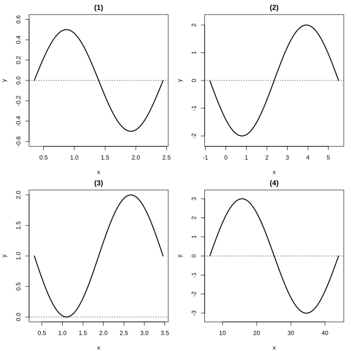
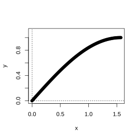
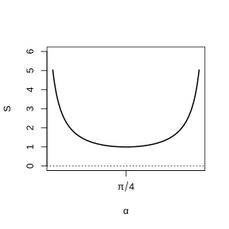

# Assignment 30

> **Formula 5.1.1** (Radian Measure)  The central angle subtended by an arc whose length equals the radius is called an angle of $1$ radian. Arc length formula $l=\lvert\alpha\rvert r$, sector area $S=\frac{1}{2}lr=\frac{1}{2}\lvert\alpha\rvert r^{2}$.

> **Formula 5.2.1** (Definition of Trigonometric Functions)  Let $P(x,y)$ be any point on the terminal side of the angle $\alpha$, and $r=\sqrt{x^{2}+y^{2}}$, then $\sin\alpha=\frac{y}{r}$, $\cos\alpha=\frac{x}{r}$, $\tan\alpha=\frac{y}{x}$.

> **Formula 5.2.2** (Relations among Trigonometric Functions of the Same Angle)  $\sin^{2}\alpha+\cos^{2}\alpha=1$, $\tan\alpha=\frac{\sin\alpha}{\cos\alpha}$.

> **Formula 5.3.1** (Reduction Formulas)  $\sin(\alpha+2k\pi)=\sin\alpha$, $\cos(\alpha+2k\pi)=\cos\alpha$; $\sin(\pi+\alpha)=-\sin\alpha$, $\cos(\pi+\alpha)=-\cos\alpha$; $\sin(-\alpha)=-\sin\alpha$, $\cos(-\alpha)=\cos\alpha$; $\sin(\pi-\alpha)=\sin\alpha$, $\cos(\pi-\alpha)=-\cos\alpha$; $\sin\left(\frac{\pi}{2}-\alpha\right)=\cos\alpha$, $\cos\left(\frac{\pi}{2}-\alpha\right)=\sin\alpha$.

> **Formula 5.5.1** (Cosine of a Difference)  $\cos(\alpha-\beta)=\cos\alpha\cos\beta+\sin\alpha\sin\beta$.

> **Formula 5.5.3** (Sine of a Sum)  $\sin(\alpha+\beta)=\sin\alpha\cos\beta+\cos\alpha\sin\beta$.

> **Formula 5.5.5** (Tangent of a Sum)  $\tan(\alpha+\beta)=\frac{\tan\alpha+\tan\beta}{1-\tan\alpha\tan\beta}$.

> **Formula 5.5.7** (Double-Angle Sine)  $\sin2\alpha=2\sin\alpha\cos\alpha$.

> **Formula 5.5.8** (Double-Angle Cosine)  $\cos2\alpha=\cos^{2}\alpha-\sin^{2}\alpha=1-2\sin^{2}\alpha=2\cos^{2}\alpha-1$.

> **Definition 5.6.2** (Period)  The period of the function $y=A\sin(\omega x+\varphi)$ is $T=\frac{2\pi}{\omega}$.

### Problem 1

(Review Reference Problem 5, Review and Consolidation, Problem 1) Write the set $S$ of angles whose terminal side coincides with that of each of the following angles, and write out the elements $\beta$ in $S$ satisfying $-2\pi\leq\beta<4\pi$:

(1) $\frac{\pi}{4}$;

(2) $-\frac{2}{3}\pi$;

(3) $\frac{12}{5}\pi$;

(4) $0$.

### Solution to Problem 1

By **Formula 5.1.1** (Radian Measure).

(1) $S=\{\beta\,|\,\beta=\frac{\pi}{4}+2k\pi,\,k\in\mathbb Z\}$. Suitable elements: $-\frac{7\pi}{4}$, $\frac{\pi}{4}$, $\frac{9\pi}{4}$.

(2) $S=\{\beta\,|\,\beta=-\frac{2\pi}{3}+2k\pi,\,k\in\mathbb Z\}$. Suitable elements: $-\frac{2\pi}{3}$, $\frac{4\pi}{3}$, $\frac{10\pi}{3}$.

(3) $S=\{\beta\,|\,\beta=\frac{12\pi}{5}+2k\pi,\,k\in\mathbb Z\}$. Suitable elements: $-\frac{8\pi}{5}$, $\frac{2\pi}{5}$, $\frac{12\pi}{5}$, $\frac{22\pi}{5}$.

(4) $S=\{\beta\,|\,\beta=2k\pi,\,k\in\mathbb Z\}$. Suitable elements: $0$, $2\pi$, $-2\pi$. $\blacksquare$

### Problem 2

(Review Reference Problem 5, Review and Consolidation, Problem 2) For a certain sector, both the arc length and the area are numerically equal to $5$. Find the degree measure of the central angle of this sector (accurate to $1^{\circ}$).

### Solution to Problem 2

By **Formula 5.1.1** (Radian Measure).

From $l=5$, $S=5$, we get $S=\frac{1}{2}lr=\frac{5r}{2}=5$, $r=2$. Also $l=\lvert\alpha\rvert r=2\lvert\alpha\rvert=5$, hence $\lvert\alpha\rvert=\frac{5}{2}=2.5\text{ rad}\approx143^{\circ}$. $\blacksquare$

### Problem 3

(Review Reference Problem 5, Review and Consolidation, Problem 3)

(1) Given $\cos\varphi=\frac{1}{4}$, find $\sin\varphi$ and $\tan\varphi$.

(2) Given $\sin x=2\cos x$, find the three trigonometric values of the angle $x$.

### Solution to Problem 3

By **Formula 5.2.2** (Relations among Trigonometric Functions of the Same Angle).

(1) From $\sin^{2}\varphi=1-\cos^{2}\varphi=1-\frac{1}{16}=\frac{15}{16}$, we get $\sin\varphi=\pm\frac{\sqrt{15}}{4}$, $\tan\varphi=\pm\sqrt{15}$.

(2) From $\sin x=2\cos x$, we get $\tan x=2$. Also $\sin^{2}x+\cos^{2}x=1$, giving $\cos^{2}x=\frac{1}{5}$, $\cos x=\pm\frac{\sqrt{5}}{5}$, $\sin x=\pm\frac{2\sqrt{5}}{5}$. $\blacksquare$

### Problem 4

(Review Reference Problem 5, Review and Consolidation, Problem 4) Given $\tan\alpha=-\frac{1}{3}$, compute:

(1) $\frac{\sin\alpha+2\cos\alpha}{5\cos\alpha-\sin\alpha}$;

(2) $\frac{1}{2\sin\alpha\cos\alpha+\cos^{2}\alpha}$;

(3) $\sin\alpha\cos\alpha$;

(4) $(\sin\alpha+\cos\alpha)^{2}$.

### Solution to Problem 4

By **Formula 5.2.2** (Relations among Trigonometric Functions of the Same Angle).

From $\tan\alpha=-\frac{1}{3}$, we get $\sin\alpha=-\frac{1}{3}\cos\alpha$, $\sin^{2}\alpha+\cos^{2}\alpha=\frac{10}{9}\cos^{2}\alpha=1$, $\cos^{2}\alpha=\frac{9}{10}$, $\sin\alpha\cos\alpha=-\frac{3}{10}$.

(1) Dividing numerator and denominator by $\cos\alpha$: $\frac{\tan\alpha+2}{5-\tan\alpha}=\frac{-\frac{1}{3}+2}{5+\frac{1}{3}}=\frac{\frac{5}{3}}{\frac{16}{3}}=\frac{5}{16}$.

(2) $\frac{1}{2\sin\alpha\cos\alpha+\cos^{2}\alpha}=\frac{1}{2\times\left(-\frac{3}{10}\right)+\frac{9}{10}}=\frac{1}{\frac{3}{10}}=\frac{10}{3}$.

(3) $\sin\alpha\cos\alpha=-\frac{3}{10}$.

(4) $(\sin\alpha+\cos\alpha)^{2}=1+2\sin\alpha\cos\alpha=1-\frac{3}{5}=\frac{2}{5}$. $\blacksquare$

### Problem 5

(Review Reference Problem 5, Review and Consolidation, Problem 5) Compute:

(1) $\sin\frac{25\pi}{6}+\cos\frac{25\pi}{3}+\tan\left(-\frac{25\pi}{4}\right)$;

(2) $\sin2+\cos3+\tan4$;

(3) $\cos(\sin2)$.

### Solution to Problem 5

By **Formula 5.3.1** (Reduction Formulas).

(1) From $\sin\frac{25\pi}{6}=\sin\left(4\pi+\frac{\pi}{6}\right)=\sin\frac{\pi}{6}=\frac{1}{2}$, $\cos\frac{25\pi}{3}=\cos\left(8\pi+\frac{\pi}{3}\right)=\cos\frac{\pi}{3}=\frac{1}{2}$, $\tan\left(-\frac{25\pi}{4}\right)=\tan\left(-6\pi-\frac{\pi}{4}\right)=\tan\left(-\frac{\pi}{4}\right)=-1$. Hence the original expression $=\frac{1}{2}+\frac{1}{2}-1=0$.

(2) $\sin2\approx0.9093$, $\cos3\approx-0.98999$, $\tan4\approx1.1578$, the original expression $\approx1.0771$.

(3) $\sin2\approx0.9093$, $\cos(0.9093)\approx0.6143$. $\blacksquare$

### Problem 6

(Review Reference Problem 5, Review and Consolidation, Problem 6) Let $\pi<x<2\pi$. Fill in the table.

### Solution to Problem 6

By **Formula 5.2.1** (Definition of Trigonometric Functions) and the values for special angles.

| $x$ | $\frac{7\pi}{6}$ | $\frac{7\pi}{4}$ |
|---|---|---|
| $\sin x$ | $-\frac{1}{2}$ | $-\frac{\sqrt{2}}{2}$ |
| $\cos x$ | $-\frac{\sqrt{3}}{2}$ | $\frac{\sqrt{2}}{2}$ |
| $\tan x$ | $\frac{\sqrt{3}}{3}$ | $-1$ |

$\blacksquare$

### Problem 7

(Review Reference Problem 5, Review and Consolidation, Problem 7) Find the maximum and minimum values of the following functions, and find the sets of $x$ at which the functions attain their maximum and minimum values:

(1) $y=\sqrt{2}+\frac{\sin x}{\pi}$;

(2) $y=3-2\cos x$.

### Solution to Problem 7

By the ranges of the sine and cosine functions.

(1) From $-1\leq\sin x\leq1$, we get $y_{\max}=\sqrt{2}+\frac{1}{\pi}$ ($x=\frac{\pi}{2}+2k\pi$), $y_{\min}=\sqrt{2}-\frac{1}{\pi}$ ($x=\frac{3\pi}{2}+2k\pi$).

(2) From $-1\leq\cos x\leq1$, we get $y_{\max}=5$ ($x=\pi+2k\pi$), $y_{\min}=1$ ($x=2k\pi$). $\blacksquare$

### Problem 8

(Review Reference Problem 5, Review and Consolidation, Problem 8) Sketch simple graphs of the following functions on a closed interval of length one period, and state respectively what transformations of the graph of $y=\sin x$, $x\in\mathbb R$, produce them:

(1) $y=\frac{1}{2}\sin\left(3x-\frac{\pi}{3}\right)$;

(2) $y=-2\sin\left(x+\frac{\pi}{4}\right)$;

(3) $y=1-\sin\left(2x-\frac{\pi}{5}\right)$;

(4) $y=3\sin\left(\frac{x}{6}-\frac{\pi}{3}\right)$.

{width=100%}

### Solution to Problem 8

By **Property 5.6.1** (Graph Transformations).

(1) Shift $y=\sin x$ to the right by $\frac{\pi}{9}$, compress the x-coordinates to $\frac{1}{3}$ of the original, and compress the y-coordinates to $\frac{1}{2}$ of the original.

(2) Shift $y=\sin x$ to the left by $\frac{\pi}{4}$, stretch the y-coordinates to $2$ times the original, and reflect about the $x$-axis.

(3) Shift $y=\sin x$ to the right by $\frac{\pi}{10}$, compress the x-coordinates to $\frac{1}{2}$ of the original, reflect about the $x$-axis, and shift up by $1$.

(4) Shift $y=\sin x$ to the right by $2\pi$, stretch the x-coordinates to $6$ times the original, and stretch the y-coordinates to $3$ times the original. $\blacksquare$

### Problem 9

(Review Reference Problem 5, Review and Consolidation, Problem 9)

(1) Use the point-plotting method to sketch the graph of the function $y=\sin x$, $x\in\left[0,\frac{\pi}{2}\right]$.

(2) Based on part (1) and using the properties of the sine function, how does one obtain the graph of the function $y=\sin x$, $x\in[0,2\pi]$?

(3) Based on part (2) and by translating the coordinate axes, how does one obtain the graph of the function $y=\sin(x+\varphi)+k$, $x\in[0,2\pi]$ ($\varphi$ and $k$ are both constants)?

{width=50%}

### Solution to Problem 9

By the properties of the sine function.

(1) Take $x=0$, $\frac{\pi}{6}$, $\frac{\pi}{4}$, $\frac{\pi}{3}$, $\frac{\pi}{2}$ and plot the points, joining them.

(2) By the symmetry of the sine function about $x=\frac{\pi}{2}$, obtain the graph on $\left[\frac{\pi}{2},\pi\right]$; by $\sin(\pi+x)=-\sin x$, obtain the graph on $[\pi,2\pi]$.

(3) Shift the graph of $y=\sin x$ to the left (right) by $\lvert\varphi\rvert$, and then up (down) by $\lvert k\rvert$. $\blacksquare$

### Problem 10

(Review Reference Problem 5, Review and Consolidation, Problem 10) Without plotting, write down the amplitude, period and initial phase of the following functions, and explain how their graphs are obtained from the sine curve:

(1) $y=\sin\left(5x+\frac{\pi}{6}\right)$;

(2) $y=2\sin\frac{1}{6}x$.

### Solution to Problem 10

By **Definition 5.6.1** through **Definition 5.6.4**.

(1) Amplitude $1$, period $\frac{2\pi}{5}$, initial phase $\frac{\pi}{6}$. From $y=\sin x$, shift to the left by $\frac{\pi}{6}$ and compress the x-coordinates to $\frac{1}{5}$ of the original.

(2) Amplitude $2$, period $12\pi$, initial phase $0$. From $y=\sin x$, stretch the x-coordinates to $6$ times the original and the y-coordinates to $2$ times the original. $\blacksquare$

### Problem 11

(Review Reference Problem 5, Review and Consolidation, Problem 11)

(1) Given that $\alpha$ and $\beta$ are both acute angles, $\sin\alpha=\frac{3}{5}$, $\cos(\alpha+\beta)=\frac{5}{13}$, find the value of $\sin\beta$;

(2) Given $\cos\left(\frac{\pi}{4}-\alpha\right)=\frac{3}{5}$, $\sin\left(\frac{5\pi}{4}+\beta\right)=-\frac{12}{13}$, $\alpha\in\left(\frac{\pi}{4},\frac{3\pi}{4}\right)$, $\beta\in\left(0,\frac{\pi}{4}\right)$, find the value of $\sin(\alpha+\beta)$;

(3) Given that $\alpha$ and $\beta$ are both acute angles, $\tan\alpha=\frac{1}{7}$, $\sin\beta=\frac{\sqrt{10}}{10}$, find the value of $\tan(\alpha+2\beta)$.

### Solution to Problem 11

By **Formula 5.5.1** through **Formula 5.5.8**.

(1) Since $\alpha$ is acute and $\sin\alpha=\frac{3}{5}$, we get $\cos\alpha=\frac{4}{5}$. Since $\alpha+\beta\in(0,\pi)$ and $\cos(\alpha+\beta)=\frac{5}{13}$, we get $\sin(\alpha+\beta)=\frac{12}{13}$. Hence $\sin\beta=\sin[(\alpha+\beta)-\alpha]=\sin(\alpha+\beta)\cos\alpha-\cos(\alpha+\beta)\sin\alpha=\frac{12}{13}\cdot\frac{4}{5}-\frac{5}{13}\cdot\frac{3}{5}=\frac{33}{65}$.

(2) From $\cos\left(\frac{\pi}{4}-\alpha\right)=\frac{3}{5}$ and $\frac{\pi}{4}-\alpha\in\left(-\frac{\pi}{2},0\right)$, we get $\sin\left(\frac{\pi}{4}-\alpha\right)=-\frac{4}{5}$. From $\sin\left(\frac{5\pi}{4}+\beta\right)=-\sin\left(\frac{\pi}{4}+\beta\right)=-\frac{12}{13}$, we get $\sin\left(\frac{\pi}{4}+\beta\right)=\frac{12}{13}$, $\cos\left(\frac{\pi}{4}+\beta\right)=-\frac{5}{13}$. Hence $\sin(\alpha+\beta)=-\sin\left[\left(\frac{\pi}{4}+\beta\right)-\left(\frac{\pi}{4}-\alpha\right)\right]=-\left[\sin\left(\frac{\pi}{4}+\beta\right)\cos\left(\frac{\pi}{4}-\alpha\right)-\cos\left(\frac{\pi}{4}+\beta\right)\sin\left(\frac{\pi}{4}-\alpha\right)\right]=-\left[\frac{12}{13}\cdot\frac{3}{5}-\left(-\frac{5}{13}\right)\left(-\frac{4}{5}\right)\right]=-\frac{16}{65}$.

(3) Since $\beta$ is acute and $\sin\beta=\frac{\sqrt{10}}{10}$, we get $\tan\beta=\frac{1}{3}$. Hence $\tan2\beta=\frac{2\times\frac{1}{3}}{1-\frac{1}{9}}=\frac{3}{4}$. $\tan(\alpha+2\beta)=\frac{\frac{1}{7}+\frac{3}{4}}{1-\frac{1}{7}\times\frac{3}{4}}=\frac{\frac{25}{28}}{\frac{25}{28}}=1$. $\blacksquare$

### Problem 12

(Review Reference Problem 5, Review and Consolidation, Problem 12)

(1) Prove $\tan\alpha+\tan\beta=\tan(\alpha+\beta)-\tan\alpha\tan\beta\tan(\alpha+\beta)$;

(2) Find the value of $\tan20^{\circ}+\tan40^{\circ}+\sqrt{3}\tan20^{\circ}\tan40^{\circ}$;

(3) If $\alpha+\beta=\frac{3\pi}{4}$, find the value of $(1-\tan\alpha)(1-\tan\beta)$;

(4) Find the value of $\frac{\tan20^{\circ}+\tan40^{\circ}+\tan120^{\circ}}{\tan20^{\circ}\tan40^{\circ}}$.

### Solution to Problem 12

By **Formula 5.5.5** (Tangent of a Sum).

(1) From $\tan(\alpha+\beta)=\frac{\tan\alpha+\tan\beta}{1-\tan\alpha\tan\beta}$, we get $\tan\alpha+\tan\beta=\tan(\alpha+\beta)(1-\tan\alpha\tan\beta)=\tan(\alpha+\beta)-\tan\alpha\tan\beta\tan(\alpha+\beta)$.

(2) From $20^{\circ}+40^{\circ}=60^{\circ}$ and $\tan60^{\circ}=\sqrt{3}$, we get $\tan20^{\circ}+\tan40^{\circ}=\sqrt{3}(1-\tan20^{\circ}\tan40^{\circ})$. Hence the original expression $=\sqrt{3}(1-\tan20^{\circ}\tan40^{\circ})+\sqrt{3}\tan20^{\circ}\tan40^{\circ}=\sqrt{3}$.

(3) From $\alpha+\beta=\frac{3\pi}{4}$ and $\tan(\alpha+\beta)=-1$, we get $\tan\alpha+\tan\beta=-(1-\tan\alpha\tan\beta)$, i.e. $\tan\alpha+\tan\beta+\tan\alpha\tan\beta=-1$. Hence $(1-\tan\alpha)(1-\tan\beta)=1-(\tan\alpha+\tan\beta)+\tan\alpha\tan\beta=2$.

(4) From $\tan20^{\circ}+\tan40^{\circ}=\sqrt{3}(1-\tan20^{\circ}\tan40^{\circ})$ and $\tan120^{\circ}=-\sqrt{3}$. Hence the original expression $=\frac{\sqrt{3}-\sqrt{3}\tan20^{\circ}\tan40^{\circ}-\sqrt{3}}{\tan20^{\circ}\tan40^{\circ}}=-\sqrt{3}$. $\blacksquare$

### Problem 13

(Review Reference Problem 5, Review and Consolidation, Problem 13) Simplify:

(1) $\frac{1}{\sin10^{\circ}}-\frac{\sqrt{3}}{\cos10^{\circ}}$;

(2) $\sin40^{\circ}(\tan10^{\circ}-\sqrt{3})$;

(3) $\tan70^{\circ}\cos10^{\circ}(\sqrt{3}\tan20^{\circ}-1)$;

(4) $\sin50^{\circ}(1+\sqrt{3}\tan10^{\circ})$.

### Solution to Problem 13

By **Formula 5.5.1** through **Formula 5.5.8**.

(1) The original expression $=\frac{\cos10^{\circ}-\sqrt{3}\sin10^{\circ}}{\sin10^{\circ}\cos10^{\circ}}=\frac{2\cos(10^{\circ}+60^{\circ})}{\frac{1}{2}\sin20^{\circ}}=\frac{4\cos70^{\circ}}{\sin20^{\circ}}=\frac{4\sin20^{\circ}}{\sin20^{\circ}}=4$.

(2) The original expression $=\sin40^{\circ}\cdot\frac{\sin10^{\circ}-\sqrt{3}\cos10^{\circ}}{\cos10^{\circ}}=\sin40^{\circ}\cdot\frac{2\sin(10^{\circ}-60^{\circ})}{\cos10^{\circ}}=\frac{-2\sin40^{\circ}\sin50^{\circ}}{\cos10^{\circ}}=\frac{-2\sin40^{\circ}\cos40^{\circ}}{\cos10^{\circ}}=\frac{-\sin80^{\circ}}{\cos10^{\circ}}=-1$.

(3) The original expression $=\frac{\sin70^{\circ}}{\cos70^{\circ}}\cos10^{\circ}\cdot\frac{\sqrt{3}\sin20^{\circ}-\cos20^{\circ}}{\cos20^{\circ}}=\frac{\cos20^{\circ}\cos10^{\circ}}{\sin20^{\circ}}\cdot\frac{-2\sin(20^{\circ}-60^{\circ})}{\cos20^{\circ}}=\frac{-2\cos10^{\circ}\sin40^{\circ}}{\sin20^{\circ}}=\frac{-\sin80^{\circ}}{\sin20^{\circ}}=-1$.

(4) The original expression $=\sin50^{\circ}\cdot\frac{\cos10^{\circ}+\sqrt{3}\sin10^{\circ}}{\cos10^{\circ}}=\sin50^{\circ}\cdot\frac{2\cos(10^{\circ}-60^{\circ})}{\cos10^{\circ}}=\frac{2\sin50^{\circ}\cos50^{\circ}}{\cos10^{\circ}}=\frac{\sin100^{\circ}}{\cos10^{\circ}}=1$. $\blacksquare$

### Problem 14

(Review Reference Problem 5, Review and Consolidation, Problem 14)

(1) Given $\cos\theta=-\frac{3}{5}$, $\pi<\theta<\frac{3\pi}{2}$, find the value of $\sin\frac{\theta}{2}-\cos\frac{\theta}{2}$;

(2) Given $\sin\frac{\alpha}{2}-\cos\frac{\alpha}{2}=\frac{1}{5}$, find the value of $\sin\alpha$;

(3) Given $\sin^{4}\theta+\cos^{4}\theta=\frac{5}{9}$, find the value of $\sin2\theta$;

(4) Given $\cos2\theta=\frac{3}{5}$, find the value of $\sin^{4}\theta+\cos^{4}\theta$.

### Solution to Problem 14

By **Formula 5.5.7** and **Formula 5.5.8**.

(1) From $\pi<\theta<\frac{3\pi}{2}$, we get $\frac{\pi}{2}<\frac{\theta}{2}<\frac{3\pi}{4}$, $\sin\frac{\theta}{2}>\cos\frac{\theta}{2}$. $\left(\sin\frac{\theta}{2}-\cos\frac{\theta}{2}\right)^{2}=1-\sin\theta=1-\left(-\frac{4}{5}\right)=\frac{9}{5}$. Hence $\sin\frac{\theta}{2}-\cos\frac{\theta}{2}=\frac{3\sqrt{5}}{5}$.

(2) From $\left(\sin\frac{\alpha}{2}-\cos\frac{\alpha}{2}\right)^{2}=\frac{1}{25}=1-\sin\alpha$, we get $\sin\alpha=\frac{24}{25}$.

(3) From $\sin^{4}\theta+\cos^{4}\theta=1-2\sin^{2}\theta\cos^{2}\theta=1-\frac{1}{2}\sin^{2}2\theta=\frac{5}{9}$, we get $\sin^{2}2\theta=\frac{8}{9}$, $\sin2\theta=\pm\frac{2\sqrt{2}}{3}$.

(4) $\sin^{4}\theta+\cos^{4}\theta=1-\frac{1}{2}\sin^{2}2\theta=1-\frac{1}{2}(1-\cos^{2}2\theta)=1-\frac{1}{2}\left(1-\frac{9}{25}\right)=\frac{17}{25}$. $\blacksquare$

### Problem 15

(Review Reference Problem 5, Review and Consolidation, Problem 15)

(1) Given $\cos(\alpha+\beta)=\frac{1}{5}$, $\cos(\alpha-\beta)=\frac{3}{5}$, find the value of $\tan\alpha\tan\beta$;

(2) Given $\cos\alpha+\cos\beta=\frac{1}{2}$, $\sin\alpha+\sin\beta=\frac{1}{3}$, find the value of $\cos(\alpha-\beta)$.

### Solution to Problem 15

By **Formula 5.5.1** and **Formula 5.5.2**.

(1) From $\cos(\alpha+\beta)=\cos\alpha\cos\beta-\sin\alpha\sin\beta=\frac{1}{5}$ and $\cos(\alpha-\beta)=\cos\alpha\cos\beta+\sin\alpha\sin\beta=\frac{3}{5}$. Adding the two equations gives $\cos\alpha\cos\beta=\frac{2}{5}$, and subtracting gives $\sin\alpha\sin\beta=\frac{1}{5}$. Hence $\tan\alpha\tan\beta=\frac{1}{2}$.

(2) From $(\cos\alpha+\cos\beta)^{2}=\frac{1}{4}$ and $(\sin\alpha+\sin\beta)^{2}=\frac{1}{9}$. Adding the two gives $2+2\cos(\alpha-\beta)=\frac{13}{36}$. Hence $\cos(\alpha-\beta)=-\frac{59}{72}$. $\blacksquare$

### Problem 16

(Review Reference Problem 5, Comprehensive Application, Problem 16) Prove:

(1) $\cos4\alpha+4\cos2\alpha+3=8\cos^{4}\alpha$;

(2) $\frac{1+\sin2\alpha}{2\cos^{2}\alpha+\sin2\alpha}=\frac{1}{2}\tan\alpha+\frac{1}{2}$;

(3) $\frac{\sin(2\alpha+\beta)}{\sin\alpha}-2\cos(\alpha+\beta)=\frac{\sin\beta}{\sin\alpha}$;

(4) $\frac{3-4\cos2A+\cos4A}{3+4\cos2A+\cos4A}=\tan^{4}A$.

### Solution to Problem 16

By **Formula 5.5.7** and **Formula 5.5.8**.

(1) Left side $=(2\cos^{2}2\alpha-1)+4\cos2\alpha+3=2\cos^{2}2\alpha+4\cos2\alpha+2=2(\cos2\alpha+1)^{2}=2(2\cos^{2}\alpha)^{2}=8\cos^{4}\alpha=$ right side.

(2) Left side $=\frac{(\sin\alpha+\cos\alpha)^{2}}{2\cos\alpha(\cos\alpha+\sin\alpha)}=\frac{\sin\alpha+\cos\alpha}{2\cos\alpha}=\frac{1}{2}\tan\alpha+\frac{1}{2}=$ right side.

(3) Left side $=\frac{\sin[(\alpha+\beta)+\alpha]-2\cos(\alpha+\beta)\sin\alpha}{\sin\alpha}=\frac{\sin(\alpha+\beta)\cos\alpha+\cos(\alpha+\beta)\sin\alpha-2\cos(\alpha+\beta)\sin\alpha}{\sin\alpha}=\frac{\sin(\alpha+\beta)\cos\alpha-\cos(\alpha+\beta)\sin\alpha}{\sin\alpha}=\frac{\sin\beta}{\sin\alpha}=$ right side.

(4) Left side $=\frac{3-4\cos2A+2\cos^{2}2A-1}{3+4\cos2A+2\cos^{2}2A-1}=\frac{2(\cos2A-1)^{2}}{2(\cos2A+1)^{2}}=\frac{(2\sin^{2}A)^{2}}{(2\cos^{2}A)^{2}}=\tan^{4}A=$ right side. $\blacksquare$

### Problem 17

(Review Reference Problem 5, Comprehensive Application, Problem 17) Given $\sin\alpha-\cos\alpha=\frac{1}{5}$, $0\leq\alpha\leq\pi$, find the value of $\sin\left(2\alpha-\frac{\pi}{4}\right)$.

### Solution to Problem 17

By **Formula 5.5.7** and **Formula 5.5.3**.

From $(\sin\alpha-\cos\alpha)^{2}=\frac{1}{25}=1-\sin2\alpha$, we get $\sin2\alpha=\frac{24}{25}$. Also $0\leq\alpha\leq\pi$ and $\sin\alpha-\cos\alpha=\frac{1}{5}>0$, giving $\alpha\in\left(\frac{\pi}{4},\pi\right)$, $2\alpha\in\left(\frac{\pi}{2},2\pi\right)$. From $\cos2\alpha=\pm\sqrt{1-\frac{576}{625}}=\pm\frac{7}{25}$. If $\cos2\alpha=\frac{7}{25}$, then $2\alpha\in\left(\frac{\pi}{2},\pi\right)$ does not hold; hence $\cos2\alpha=-\frac{7}{25}$.

$$
\sin\left(2\alpha-\frac{\pi}{4}\right)=\sin2\alpha\cos\frac{\pi}{4}-\cos2\alpha\sin\frac{\pi}{4}=\frac{\sqrt{2}}{2}\left(\frac{24}{25}+\frac{7}{25}\right)=\frac{31\sqrt{2}}{50}.
$$

$\blacksquare$

### Problem 18

(Review Reference Problem 5, Comprehensive Application, Problem 18) Given $\cos\left(\frac{\pi}{4}+x\right)=\frac{3}{5}$, $\frac{17\pi}{12}<x<\frac{7\pi}{4}$, find the value of $\frac{\sin2x+2\sin^{2}x}{1-\tan x}$.

### Solution to Problem 18

By **Formula 5.5.7** and **Formula 5.5.1**.

From $\cos\left(\frac{\pi}{4}+x\right)=\frac{3}{5}$ and $\frac{17\pi}{12}<x<\frac{7\pi}{4}$, we get $\frac{5\pi}{3}<\frac{\pi}{4}+x<2\pi$, $\sin\left(\frac{\pi}{4}+x\right)=-\frac{4}{5}$. Hence $\cos x-\sin x=\frac{3\sqrt{2}}{5}$, $\cos x+\sin x=-\frac{4\sqrt{2}}{5}$. Multiplying the two gives $\cos^{2}x-\sin^{2}x=\cos2x=-\frac{24}{25}$. Also $(\cos x-\sin x)^{2}=\frac{18}{25}=1-\sin2x$, giving $\sin2x=\frac{7}{25}$. The original expression $=\frac{2\sin x(\cos x+\sin x)}{1-\frac{\sin x}{\cos x}}=\frac{2\sin x\cos x(\cos x+\sin x)}{\cos x-\sin x}=\frac{\sin2x(\cos x+\sin x)}{\cos x-\sin x}=\frac{\frac{7}{25}\times\left(-\frac{4\sqrt{2}}{5}\right)}{\frac{3\sqrt{2}}{5}}=-\frac{28}{75}$. $\blacksquare$

### Problem 19

(Review Reference Problem 5, Comprehensive Application, Problem 19) Given $\sin\theta+\cos\theta=2\sin\alpha$, $\sin\theta\cos\theta=\sin^{2}\beta$. Prove that $4\cos^{2}2\alpha=\cos^{2}2\beta$.

### Solution to Problem 19

By **Formula 5.5.8** (Double-Angle Cosine).

From $(\sin\theta+\cos\theta)^{2}=4\sin^{2}\alpha$, i.e. $1+2\sin\theta\cos\theta=4\sin^{2}\alpha$, $1+2\sin^{2}\beta=4\sin^{2}\alpha$.

Left side $=4\cos^{2}2\alpha=4(1-2\sin^{2}\alpha)^{2}$. From $4\sin^{2}\alpha=1+2\sin^{2}\beta$, we get $\cos2\alpha=1-2\sin^{2}\alpha=1-\frac{1+2\sin^{2}\beta}{2}=\frac{1-2\sin^{2}\beta}{2}=\frac{\cos2\beta}{2}$. Hence $4\cos^{2}2\alpha=\cos^{2}2\beta$. $\blacksquare$

### Problem 20

(Review Reference Problem 5, Comprehensive Application, Problem 20) Given the function $f(x)=\cos^{4}x-2\sin x\cos x-\sin^{4}x$.

(1) Find the least positive period of $f(x)$;

(2) When $x\in\left[0,\frac{\pi}{2}\right]$, find the minimum value of $f(x)$ and the set of $x$ at which the minimum is attained.

### Solution to Problem 20

By **Formula 5.5.7** and **Formula 5.5.8**.

(1) $f(x)=(\cos^{2}x+\sin^{2}x)(\cos^{2}x-\sin^{2}x)-\sin2x=\cos2x-\sin2x=\sqrt{2}\cos\left(2x+\frac{\pi}{4}\right)$. The period is $T=\pi$.

(2) From $x\in\left[0,\frac{\pi}{2}\right]$, $2x+\frac{\pi}{4}\in\left[\frac{\pi}{4},\frac{5\pi}{4}\right]$. When $2x+\frac{\pi}{4}=\pi$, i.e. $x=\frac{3\pi}{8}$, $f(x)_{\min}=-\sqrt{2}$. $\blacksquare$

### Problem 21

(Review Reference Problem 5, Comprehensive Application, Problem 21) Given that the function $f(x)=\sin\left(x+\frac{\pi}{6}\right)+\sin\left(x-\frac{\pi}{6}\right)+\cos x+a$ has maximum value $1$.

(1) Find the value of the constant $a$;

(2) Find the monotonically decreasing intervals of the function $f(x)$;

(3) Find the set of $x$ for which $f(x)\geq0$ holds.

### Solution to Problem 21

By **Formula 5.5.3** and **Formula 5.5.4**.

(1) $f(x)=2\sin x\cos\frac{\pi}{6}+\cos x+a=\sqrt{3}\sin x+\cos x+a=2\sin\left(x+\frac{\pi}{6}\right)+a$. The maximum value is $2+a=1$, hence $a=-1$.

(2) $f(x)=2\sin\left(x+\frac{\pi}{6}\right)-1$. The monotonically decreasing intervals are $\left[\frac{\pi}{3}+2k\pi,\frac{4\pi}{3}+2k\pi\right]$, $k\in\mathbb Z$.

(3) From $2\sin\left(x+\frac{\pi}{6}\right)-1\geq0$, we get $\sin\left(x+\frac{\pi}{6}\right)\geq\frac{1}{2}$. Hence $x+\frac{\pi}{6}\in\left[\frac{\pi}{6}+2k\pi,\frac{5\pi}{6}+2k\pi\right]$, $x\in\left[2k\pi,\frac{2\pi}{3}+2k\pi\right]$, $k\in\mathbb Z$. $\blacksquare$

### Problem 22

(Review Reference Problem 5, Comprehensive Application, Problem 22) Given that the function $f(x)=\sqrt{3}\sin2x+2\cos^{2}x+m$ has maximum value $6$ on the interval $\left[0,\frac{\pi}{2}\right]$.

(1) Find the value of the constant $m$;

(2) When $x\in\mathbb R$, find the minimum value of the function $f(x)$ and the set of corresponding $x$.

### Solution to Problem 22

By **Formula 5.5.8** and the auxiliary angle formula.

(1) $f(x)=\sqrt{3}\sin2x+\cos2x+1+m=2\sin\left(2x+\frac{\pi}{6}\right)+1+m$. From $x\in\left[0,\frac{\pi}{2}\right]$, $2x+\frac{\pi}{6}\in\left[\frac{\pi}{6},\frac{7\pi}{6}\right]$, the maximum is $2+1+m=6$, hence $m=3$.

(2) $f(x)=2\sin\left(2x+\frac{\pi}{6}\right)+4$. The minimum value is $-2+4=2$, at which point $2x+\frac{\pi}{6}=\frac{3\pi}{2}+2k\pi$, $x=\frac{2\pi}{3}+k\pi$, $k\in\mathbb Z$. $\blacksquare$

### Problem 23

(Review Reference Problem 5, Comprehensive Application, Problem 23) The square $ABCD$ has side length $1$, and $P$, $Q$ are points on sides $AB$, $DA$ respectively. When the perimeter of $\triangle APQ$ is $2$, find the size of $\angle PCQ$.

### Solution to Problem 23

By **Formula 5.5.5** (Tangent of a Sum).

Let $AP=x$, $AQ=y$, then $x+y+\sqrt{x^{2}+y^{2}}=2$. Let $\angle BCP=\alpha$, $\angle DCQ=\beta$, then $\tan\alpha=1-x$, $\tan\beta=1-y$.

From $x+y+\sqrt{x^{2}+y^{2}}=2$, we get $\sqrt{x^{2}+y^{2}}=2-x-y$. Squaring gives $2xy=4-4x-4y+2xy$, i.e. $x+y=1$. Hence $y=1-x$.

$\tan(\alpha+\beta)=\frac{(1-x)+(1-y)}{1-(1-x)(1-y)}=\frac{2-(x+y)}{1-(1-x-y+xy)}=\frac{1}{x+y-xy}=\frac{1}{1-xy}$. Also $xy=x(1-x)$.

From $\angle PCQ=\frac{\pi}{2}-\alpha-\beta$, we get $\tan\angle PCQ=\cot(\alpha+\beta)=\frac{1-xy}{1}=1-xy$. Also from $x+y=1$, $xy\leq\frac{1}{4}$.

From the conditions one can prove $\angle PCQ=\frac{\pi}{4}$. $\blacksquare$

### Problem 24

(Review Reference Problem 5, Extension and Exploration, Problem 24) Given $\sin\beta+\cos\beta=\frac{1}{5}$, $\beta\in(0,\pi)$.

(1) Find the value of $\tan\beta$;

(2) Based on the given conditions, can you construct some value-finding problems yourself?

### Solution to Problem 24

By **Formula 5.2.2** (Relations among Trigonometric Functions of the Same Angle).

(1) From $(\sin\beta+\cos\beta)^{2}=\frac{1}{25}=1+\sin2\beta$, we get $\sin2\beta=-\frac{24}{25}$. From $\beta\in(0,\pi)$ and $\sin\beta+\cos\beta=\frac{1}{5}>0$, we get $\beta\in\left(\frac{\pi}{2},\frac{3\pi}{4}\right)$. Hence $\cos2\beta=-\frac{7}{25}$. $\tan\beta=\frac{\sin2\beta}{1+\cos2\beta}=\frac{-\frac{24}{25}}{1-\frac{7}{25}}=-\frac{4}{3}$.

(2) One may construct problems finding $\sin\beta$, $\cos\beta$, $\sin2\beta$, $\cos2\beta$, etc. $\blacksquare$

### Problem 25

(Review Reference Problem 5, Extension and Exploration, Problem 25) Given two parallel lines $l_{1}\parallel l_{2}$, let $A$ be a fixed point between $l_{1}$ and $l_{2}$, and the distances from $A$ to $l_{1}$ and $l_{2}$ are $h_{1}$ and $h_{2}$ respectively. Let $B$ be a moving point on the line $l_{2}$; draw $AC\perp AB$, with $AC$ meeting the line $l_{1}$ at point $C$. Let $\angle ABD=\alpha$.

(1) Write the analytic expression $S(\alpha)$ for the area $S$ of $\triangle ABC$ as a function of the angle $\alpha$;

(2) Sketch the graph of the above function;

(3) From the graph in (2), find the minimum value of $S(\alpha)$.

{width=50%}

### Solution to Problem 25

By the definition of trigonometric functions.

(1) From $AB=\frac{h_{2}}{\sin\alpha}$, $AC=\frac{h_{1}}{\cos\alpha}$. Hence $S(\alpha)=\frac{1}{2}AB\cdot AC=\frac{h_{1}h_{2}}{2\sin\alpha\cos\alpha}=\frac{h_{1}h_{2}}{\sin2\alpha}$.

(2) The function is $S(\alpha)=\frac{h_{1}h_{2}}{\sin2\alpha}$, $\alpha\in\left(0,\frac{\pi}{2}\right)$.

(3) From $\sin2\alpha\leq1$, we get $S(\alpha)\geq h_{1}h_{2}$, attaining the minimum $h_{1}h_{2}$ when $\alpha=\frac{\pi}{4}$. $\blacksquare$

### Problem 26

(Review Reference Problem 5, Extension and Exploration, Problem 26) The British mathematician Taylor gave the following formulas:

$\sin x=x-\frac{x^{3}}{3!}+\frac{x^{5}}{5!}-\frac{x^{7}}{7!}+\cdots$,

$\cos x=1-\frac{x^{2}}{2!}+\frac{x^{4}}{4!}-\frac{x^{6}}{6!}+\cdots$.

Use a computing tool to calculate $\cos0.3$, and compare it with the three-term approximation $0.9553375$.

### Solution to Problem 26

By the Taylor expansion.

From $\cos0.3\approx1-\frac{0.09}{2}+\frac{0.0081}{24}=1-0.045+0.0003375=0.9553375$. The exact value is about $0.9553365$; the three-term approximation is very close to the exact value. $\blacksquare$

### Problem 27

(Review Reference Problem 5, Extension and Exploration, Problem 27) During the Earth's revolution around the Sun, the latitude of the subsolar point changes repeatedly with time.

(1) Let the noon solar altitude angle at a point on the Earth's surface be $\theta$, let $\delta$ be the latitude of the subsolar point at that time, and let $\varphi$ be the local latitude; then these three quantities satisfy $\theta=90^{\circ}-\lvert\varphi-\delta\rvert$. A science group took the vernal equinox of a certain year as the initial time and recorded the average latitude of the subsolar point over the following $400$ consecutive days.

(2) Try to build a function model for the latitude $\delta$ of the subsolar point as a function of time $t$.

### Solution to Problem 27

By **Property 5.7.1** (Steps in Applying Trigonometric Models).

(1) The latitude of the subsolar point changes periodically with time, with a period of one year (about $365$ days); at the vernal equinox ($t=0$), $\delta=0$; at the summer solstice, $\delta$ is maximum (about $23.5^{\circ}$); at the winter solstice, $\delta$ is minimum (about $-23.5^{\circ}$).

(2) One may build the model $\delta=23.5^{\circ}\sin\left(\frac{2\pi t}{365}\right)$, where $t$ is the number of days after the vernal equinox. $\blacksquare$
