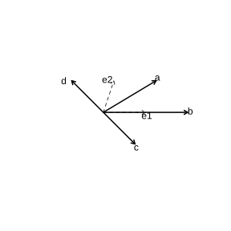
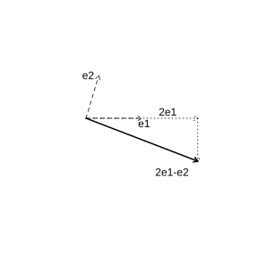
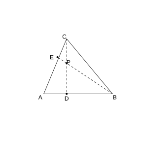
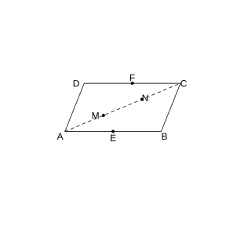

# Assignment 33

> **Theorem 6.3.1** (Fundamental Theorem of Plane Vectors)  If $\boldsymbol{e}_1$ and $\boldsymbol{e}_2$ are two non-collinear vectors in the same plane, then for any vector $\boldsymbol{a}$ in this plane there exists a unique pair of real numbers $\lambda_1$, $\lambda_2$ such that $\boldsymbol{a}=\lambda_1\boldsymbol{e}_1+\lambda_2\boldsymbol{e}_2$. Here, the non-collinear vectors $\boldsymbol{e}_1$ and $\boldsymbol{e}_2$ are called a basis for all vectors in this plane.

> **Definition 6.3.2** (Orthogonal Decomposition)  Decomposing a vector into two mutually perpendicular vectors is called orthogonal decomposition of the vector.

> **Definition 6.3.3** (Coordinates of a Vector)  In the rectangular coordinate plane, take the two unit vectors $\boldsymbol{i}$ and $\boldsymbol{j}$ in the directions of the $x$-axis and $y$-axis as a basis. Draw any vector $\boldsymbol{a}$; by the fundamental theorem of plane vectors, there exists a unique pair of real numbers $x$, $y$ such that $\boldsymbol{a}=x\boldsymbol{i}+y\boldsymbol{j}$. We call $\left(x,y\right)$ the coordinates of the vector $\boldsymbol{a}$, denoted $\boldsymbol{a}=\left(x,y\right)$.

> **Common Conclusion 6.3.4** (Addition, Subtraction, and Scalar Multiplication in Coordinates)  If $\boldsymbol{a}=\left(x_1,y_1\right)$ and $\boldsymbol{b}=\left(x_2,y_2\right)$, then $\boldsymbol{a}+\boldsymbol{b}=\left(x_1+x_2,y_1+y_2\right)$, $\boldsymbol{a}-\boldsymbol{b}=\left(x_1-x_2,y_1-y_2\right)$, and $\lambda\boldsymbol{a}=\left(\lambda x_1,\lambda y_1\right)$. The coordinates of a vector equal the coordinates of the terminal point of the directed segment representing it minus the coordinates of the initial point.

> **Common Conclusion 6.3.5** (Coordinate Condition for Collinearity)  If $\boldsymbol{a}=\left(x_1,y_1\right)$ and $\boldsymbol{b}=\left(x_2,y_2\right)$, where $\boldsymbol{b}\neq\boldsymbol{0}$, then $\boldsymbol{a}\parallel\boldsymbol{b}\Longleftrightarrow x_1y_2-x_2y_1=0$.

> **Common Conclusion 6.3.6** (Midpoint Coordinate Formula)  Given $P_1\left(x_1,y_1\right)$ and $P_2\left(x_2,y_2\right)$, the coordinates of the midpoint $P$ of the segment $P_1P_2$ are $\left(\frac{x_1+x_2}{2},\frac{y_1+y_2}{2}\right)$.

> **Common Conclusion 6.3.7** (Dot Product in Coordinates)  If $\boldsymbol{a}=\left(x_1,y_1\right)$ and $\boldsymbol{b}=\left(x_2,y_2\right)$, then $\boldsymbol{a}\cdot\boldsymbol{b}=x_1x_2+y_1y_2$.

> **Common Conclusion 6.3.8** (Magnitude, Perpendicularity, and Angle in Coordinates)  $\lvert\boldsymbol{a}\rvert=\sqrt{x_1^2+y_1^2}$; $\boldsymbol{a}\perp\boldsymbol{b}\Longleftrightarrow x_1x_2+y_1y_2=0$; $\cos\theta=\frac{x_1x_2+y_1y_2}{\sqrt{x_1^2+y_1^2}\sqrt{x_2^2+y_2^2}}$.

### Exercise 1

(Exercise 6.3, Problem 1) As shown in the figure, $\boldsymbol{e}_1$ and $\boldsymbol{e}_2$ are two non-collinear vectors. Express the vectors $\boldsymbol{a}$, $\boldsymbol{b}$, $\boldsymbol{c}$, $\boldsymbol{d}$ in the figure in terms of the basis $\left\{\boldsymbol{e}_1,\boldsymbol{e}_2\right\}$.

{width=50%}

### Solution to Exercise 1

By **Theorem 6.3.1** (Fundamental Theorem of Plane Vectors), any vector has a unique decomposition $\lambda_1\boldsymbol{e}_1+\lambda_2\boldsymbol{e}_2$. Write out the decomposition of each vector from its components in the $\boldsymbol{e}_1$ and $\boldsymbol{e}_2$ directions. $\blacksquare$

### Exercise 2

(Exercise 6.3, Problem 2) When $\boldsymbol{e}_1$ and $\boldsymbol{e}_2$ are two non-collinear vectors, construct the vector $2\boldsymbol{e}_1-\boldsymbol{e}_2$.

{width=50%}

### Solution to Exercise 2

By **Theorem 6.3.1** (Fundamental Theorem of Plane Vectors), first construct $2\boldsymbol{e}_1$, then $-\boldsymbol{e}_2$, and add them by the triangle rule to obtain $2\boldsymbol{e}_1-\boldsymbol{e}_2$. $\blacksquare$

### Exercise 3

(Exercise 6.3, Problem 3) Given that the coordinates of the points $A$, $B$, $C$ are $\left(2,-1\right)$, $\left(3,2\right)$, $\left(-3,4\right)$, respectively, find the coordinates of $\boldsymbol{AB}+\boldsymbol{BC}+\boldsymbol{CA}$.

### Solution to Exercise 3

By **Common Conclusion 6.3.4** (Coordinate Operations).

$\boldsymbol{AB}=\left(3-2,2-\left(-1\right)\right)=\left(1,3\right)$.

$\boldsymbol{BC}=\left(-3-3,4-2\right)=\left(-6,2\right)$.

$\boldsymbol{CA}=\left(2-\left(-3\right),-1-4\right)=\left(5,-5\right)$.

$\boldsymbol{AB}+\boldsymbol{BC}+\boldsymbol{CA}=\left(1-6+5,3+2-5\right)=\left(0,0\right)$. $\blacksquare$

### Exercise 4

(Exercise 6.3, Problem 4) Given $\boldsymbol{a}=\left(3,2\right)$ and $\boldsymbol{b}=\left(0,-1\right)$, find the coordinates of $-2\boldsymbol{a}+4\boldsymbol{b}$ and $4\boldsymbol{a}+3\boldsymbol{b}$.

### Solution to Exercise 4

By **Common Conclusion 6.3.4** (Coordinate Operations).

$-2\boldsymbol{a}+4\boldsymbol{b}=-2\left(3,2\right)+4\left(0,-1\right)=\left(-6,-4\right)+\left(0,-4\right)=\left(-6,-8\right)$.

$4\boldsymbol{a}+3\boldsymbol{b}=4\left(3,2\right)+3\left(0,-1\right)=\left(12,8\right)+\left(0,-3\right)=\left(12,5\right)$. $\blacksquare$

### Exercise 5

(Exercise 6.3, Problem 5) Given $A\left(-2,-3\right)$, $B\left(2,1\right)$, $C\left(1,4\right)$, $D\left(-7,-4\right)$, determine whether $\boldsymbol{AB}$ and $\boldsymbol{CD}$ are collinear.

### Solution to Exercise 5

By **Common Conclusion 6.3.5** (Coordinate Condition for Collinearity).

$\boldsymbol{AB}=\left(2-\left(-2\right),1-\left(-3\right)\right)=\left(4,4\right)$.

$\boldsymbol{CD}=\left(-7-1,-4-4\right)=\left(-8,-8\right)$.

$4\times\left(-8\right)-\left(-8\right)\times4=-32+32=0$, so $\boldsymbol{AB}\parallel\boldsymbol{CD}$, and the two vectors are collinear. $\blacksquare$

### Exercise 6

(Exercise 6.3, Problem 6) Find the coordinates of the midpoint $M$ of the segment $AB$.

(1) $A\left(2,3\right)$, $B\left(4,6\right)$;

(2) $A\left(-1,3\right)$, $B\left(-2,-5\right)$.

### Solution to Exercise 6

By **Common Conclusion 6.3.6** (Midpoint Coordinate Formula).

(1) $M=\left(\frac{2+4}{2},\frac{3+6}{2}\right)=\left(3,\frac{9}{2}\right)$.

(2) $M=\left(\frac{-1+\left(-2\right)}{2},\frac{3+\left(-5\right)}{2}\right)=\left(-\frac{3}{2},-1\right)$. $\blacksquare$

### Exercise 7

(Exercise 6.3, Problem 7) Given $\boldsymbol{a}=\left(2,3\right)$, $\boldsymbol{b}=\left(-2,4\right)$, $\boldsymbol{c}=\left(1,-2\right)$, find $\boldsymbol{a}\cdot\boldsymbol{b}$, $\left(\boldsymbol{a}+\boldsymbol{b}\right)\cdot\left(\boldsymbol{a}-\boldsymbol{b}\right)$, $\boldsymbol{a}\cdot\left(\boldsymbol{a}+\boldsymbol{b}\right)$, and $\left(\boldsymbol{a}-\boldsymbol{b}\right)\cdot\left(\boldsymbol{a}+\boldsymbol{b}\right)$.

### Solution to Exercise 7

By **Common Conclusion 6.3.7** (Dot Product in Coordinates).

$\boldsymbol{a}\cdot\boldsymbol{b}=2\times\left(-2\right)+3\times4=-4+12=8$.

$\boldsymbol{a}+\boldsymbol{b}=\left(0,7\right)$, $\boldsymbol{a}-\boldsymbol{b}=\left(4,-1\right)$.

$\left(\boldsymbol{a}+\boldsymbol{b}\right)\cdot\left(\boldsymbol{a}-\boldsymbol{b}\right)=0\times4+7\times\left(-1\right)=-7$.

$\boldsymbol{a}\cdot\left(\boldsymbol{a}+\boldsymbol{b}\right)=2\times0+3\times7=21$.

$\left(\boldsymbol{a}-\boldsymbol{b}\right)\cdot\left(\boldsymbol{a}+\boldsymbol{b}\right)=4\times0+\left(-1\right)\times7=-7$. $\blacksquare$

### Exercise 8

(Exercise 6.3, Problem 8) Given $\boldsymbol{a}=\left(3,4\right)$ and $\boldsymbol{b}=\left(2,-1\right)$, find the value of $x$ for which $\boldsymbol{a}+x\boldsymbol{b}$ is perpendicular to $\boldsymbol{a}-\boldsymbol{b}$.

### Solution to Exercise 8

By **Common Conclusion 6.3.8** (Coordinate Condition for Perpendicularity).

$\boldsymbol{a}+x\boldsymbol{b}=\left(3+2x,4-x\right)$.

$\boldsymbol{a}-\boldsymbol{b}=\left(1,5\right)$.

The two vectors are perpendicular: $\left(3+2x\right)\times1+\left(4-x\right)\times5=0$.

$3+2x+20-5x=0$, $23-3x=0$, $x=\frac{23}{3}$. $\blacksquare$

### Exercise 9

(Exercise 6.3, Problem 9) Given $\boldsymbol{a}=\left(2,3\right)$ and $\boldsymbol{b}=\left(-2,4\right)$, find the cosine of the angle $\theta$ between $\boldsymbol{a}$ and $\boldsymbol{b}$.

### Solution to Exercise 9

By **Common Conclusion 6.3.8** (Coordinate Formula for the Angle).

$\boldsymbol{a}\cdot\boldsymbol{b}=2\times\left(-2\right)+3\times4=8$.

$\lvert\boldsymbol{a}\rvert=\sqrt{4+9}=\sqrt{13}$.

$\lvert\boldsymbol{b}\rvert=\sqrt{4+16}=\sqrt{20}=2\sqrt 5$.

$\cos\theta=\frac{8}{\sqrt{13}\cdot 2\sqrt 5}=\frac{4}{\sqrt{65}}=\frac{4\sqrt{65}}{65}$. $\blacksquare$

### Problem 1

(Exercise 6.3, Review and Consolidation, Problem 1) As shown in the figure, in $\triangle ABC$, $AD=\frac{1}{3}AB$, $E$ is a point on $AC$ with $EC=\frac{1}{3}AC$, and $BE$ and $CD$ meet at $P$. Let $\boldsymbol{AB}=\boldsymbol{a}$ and $\boldsymbol{AC}=\boldsymbol{b}$. Express $\boldsymbol{AP}$ in terms of the basis $\left\{\boldsymbol{a},\boldsymbol{b}\right\}$.

{width=50%}

### Solution to Problem 1

By **Theorem 6.3.1** (Fundamental Theorem of Plane Vectors).

Let $\boldsymbol{AP}=x\boldsymbol{a}+y\boldsymbol{b}$. Since $P$ lies on $CD$, $\boldsymbol{AP}=\boldsymbol{AD}+\boldsymbol{DP}=\frac{1}{3}\boldsymbol{a}+\lambda\left(\boldsymbol{b}-\frac{1}{3}\boldsymbol{a}\right)=\left(\frac{1}{3}-\frac{\lambda}{3}\right)\boldsymbol{a}+\lambda\boldsymbol{b}$.

Since $P$ lies on $BE$, $\boldsymbol{AE}=\frac{2}{3}\boldsymbol{b}$ and $\boldsymbol{AP}=\boldsymbol{AB}+\boldsymbol{BP}=\boldsymbol{a}+\mu\left(\frac{2}{3}\boldsymbol{b}-\boldsymbol{a}\right)=\left(1-\mu\right)\boldsymbol{a}+\frac{2\mu}{3}\boldsymbol{b}$.

Comparing coefficients: $\frac{1}{3}-\frac{\lambda}{3}=1-\mu$, $\lambda=\frac{2\mu}{3}$.

Solving gives $\mu=\frac{2}{9}$, $\lambda=\frac{4}{27}$.

$\boldsymbol{AP}=\frac{7}{27}\boldsymbol{a}+\frac{4}{27}\boldsymbol{b}$. $\blacksquare$

### Problem 2

(Exercise 6.3, Review and Consolidation, Problem 2) Given three forces $\boldsymbol{f}_1=\left(3,4\right)$, $\boldsymbol{f}_2=\left(2,-5\right)$, $\boldsymbol{f}_3=\left(x,y\right)$ whose resultant $\boldsymbol{f}_1+\boldsymbol{f}_2+\boldsymbol{f}_3=\boldsymbol{0}$, find $\boldsymbol{f}_3$.

### Solution to Problem 2

By **Common Conclusion 6.3.4** (Coordinate Operations).

$\boldsymbol{f}_3=-\boldsymbol{f}_1-\boldsymbol{f}_2=-\left(3,4\right)-\left(2,-5\right)=\left(-5,1\right)$. $\blacksquare$

### Problem 3

(Exercise 6.3, Review and Consolidation, Problem 3) Given the points $A\left(-2,5\right)$, $B\left(3,-4\right)$, $C\left(-1,1\right)$, find the coordinates of $\boldsymbol{AB}$, $\boldsymbol{BC}$, $\boldsymbol{AC}$, and verify that $\boldsymbol{AB}+\boldsymbol{BC}=\boldsymbol{AC}$.

### Solution to Problem 3

By **Common Conclusion 6.3.4** (Coordinate Operations).

$\boldsymbol{AB}=\left(3-\left(-2\right),-4-5\right)=\left(5,-9\right)$.

$\boldsymbol{BC}=\left(-1-3,1-\left(-4\right)\right)=\left(-4,5\right)$.

$\boldsymbol{AC}=\left(-1-\left(-2\right),1-5\right)=\left(1,-4\right)$.

$\boldsymbol{AB}+\boldsymbol{BC}=\left(5-4,-9+5\right)=\left(1,-4\right)=\boldsymbol{AC}$. $\blacksquare$

### Problem 4

(Exercise 6.3, Review and Consolidation, Problem 4) Given $\boldsymbol{a}=\left(1,2\right)$ and $\boldsymbol{b}=\left(-3,2\right)$, for what value of the real number $k$ are $k\boldsymbol{a}+\boldsymbol{b}$ and $\boldsymbol{a}-3\boldsymbol{b}$ parallel? When they are parallel, are they in the same or opposite directions?

### Solution to Problem 4

By **Common Conclusion 6.3.5** (Coordinate Condition for Collinearity).

$k\boldsymbol{a}+\boldsymbol{b}=k\left(1,2\right)+\left(-3,2\right)=\left(k-3,2k+2\right)$.

$\boldsymbol{a}-3\boldsymbol{b}=\left(1,2\right)-3\left(-3,2\right)=\left(10,-4\right)$.

Parallel condition: $\left(k-3\right)\times\left(-4\right)-10\times\left(2k+2\right)=0$.

$-4k+12-20k-20=0$, $-24k-8=0$, $k=-\frac{1}{3}$.

In this case $k\boldsymbol{a}+\boldsymbol{b}=\left(-\frac{10}{3},\frac{4}{3}\right)=-\frac{1}{3}\left(10,-4\right)=-\frac{1}{3}\left(\boldsymbol{a}-3\boldsymbol{b}\right)$, so the two vectors are in opposite directions. $\blacksquare$

### Problem 5

(Exercise 6.3, Review and Consolidation, Problem 5) Find the unit vector in the same direction as $\boldsymbol{a}=\left(12,5\right)$.

### Solution to Problem 5

By **Common Conclusion 6.3.8** (Coordinate Formula for Magnitude).

$\lvert\boldsymbol{a}\rvert=\sqrt{144+25}=13$. The required unit vector is $\frac{\boldsymbol{a}}{\lvert\boldsymbol{a}\rvert}=\left(\frac{12}{13},\frac{5}{13}\right)$. $\blacksquare$

### Problem 6

(Exercise 6.3, Review and Consolidation, Problem 6) Given $\boldsymbol{a}=\left(3,-1\right)$ and $\boldsymbol{b}=\left(1,-2\right)$, find $\boldsymbol{a}\cdot\boldsymbol{b}$, $\lvert\boldsymbol{a}\rvert$, $\lvert\boldsymbol{b}\rvert$, and $\left\langle\boldsymbol{a},\boldsymbol{b}\right\rangle$.

### Solution to Problem 6

By **Common Conclusion 6.3.7** and **Common Conclusion 6.3.8**.

$\boldsymbol{a}\cdot\boldsymbol{b}=3\times1+\left(-1\right)\times\left(-2\right)=5$.

$\lvert\boldsymbol{a}\rvert=\sqrt{9+1}=\sqrt{10}$.

$\lvert\boldsymbol{b}\rvert=\sqrt{1+4}=\sqrt 5$.

$\cos\theta=\frac{5}{\sqrt{10}\sqrt 5}=\frac{5}{\sqrt{50}}=\frac{\sqrt 2}{2}$, $\theta=\frac{\pi}{4}$. $\blacksquare$

### Problem 7

(Exercise 6.3, Review and Consolidation, Problem 7) Given $\boldsymbol{a}=\left(-3,2\right)$ and $\boldsymbol{b}=\left(-1,0\right)$, find the real number $\lambda$ such that $\left(\lambda\boldsymbol{a}+\boldsymbol{b}\right)\perp\left(\boldsymbol{a}-2\boldsymbol{b}\right)$.

### Solution to Problem 7

By **Common Conclusion 6.3.8** (Coordinate Condition for Perpendicularity).

$\lambda\boldsymbol{a}+\boldsymbol{b}=\lambda\left(-3,2\right)+\left(-1,0\right)=\left(-3\lambda-1,2\lambda\right)$.

$\boldsymbol{a}-2\boldsymbol{b}=\left(-3,2\right)-2\left(-1,0\right)=\left(-1,2\right)$.

Perpendicular: $\left(-3\lambda-1\right)\times\left(-1\right)+2\lambda\times2=0$.

$3\lambda+1+4\lambda=0$, $7\lambda=-1$, $\lambda=-\frac{1}{7}$. $\blacksquare$

### Problem 8

(Exercise 6.3, Review and Consolidation, Problem 8) Given the points $A\left(1,0\right)$, $B\left(0,1\right)$, $C\left(2,5\right)$, find:

(1) the coordinates of $\boldsymbol{AB}+\boldsymbol{AC}$;

(2) $\boldsymbol{AB}\cdot\boldsymbol{AC}$;

(3) $\cos\angle BAC$.

### Solution to Problem 8

By **Common Conclusion 6.3.7** and **Common Conclusion 6.3.8**.

(1) $\boldsymbol{AB}=\left(-1,1\right)$, $\boldsymbol{AC}=\left(1,5\right)$. $\boldsymbol{AB}+\boldsymbol{AC}=\left(0,6\right)$.

(2) $\boldsymbol{AB}\cdot\boldsymbol{AC}=\left(-1\right)\times1+1\times5=4$.

(3) $\lvert\boldsymbol{AB}\rvert=\sqrt 2$, $\lvert\boldsymbol{AC}\rvert=\sqrt{26}$. $\cos\angle BAC=\frac{4}{\sqrt 2\sqrt{26}}=\frac{2\sqrt{13}}{13}$. $\blacksquare$

### Problem 9

(Exercise 6.3, Review and Consolidation, Problem 9) Given $\boldsymbol{a}=\left(4,2\right)$, find the unit vector perpendicular to $\boldsymbol{a}$.

### Solution to Problem 9

By **Common Conclusion 6.3.8** (Coordinate Condition for Perpendicularity).

Let the required vector be $\left(x,y\right)$; then $4x+2y=0$ and $x^2+y^2=1$.

$y=-2x$, $x^2+4x^2=1$, $x=\pm\frac{\sqrt 5}{5}$, $y=\mp\frac{2\sqrt 5}{5}$.

The required vectors are $\left(\frac{\sqrt 5}{5},-\frac{2\sqrt 5}{5}\right)$ or $\left(-\frac{\sqrt 5}{5},\frac{2\sqrt 5}{5}\right)$. $\blacksquare$

### Problem 10

(Exercise 6.3, Review and Consolidation, Problem 10) Given the points $A\left(1,-2\right)$, $B\left(3,4\right)$, $C\left(-1,2\right)$, find the coordinates of $\boldsymbol{AB}+\boldsymbol{AC}$ and $\lvert\boldsymbol{AB}+\boldsymbol{AC}\rvert$.

### Solution to Problem 10

By **Common Conclusion 6.3.4** and **Common Conclusion 6.3.8**.

$\boldsymbol{AB}=\left(2,6\right)$, $\boldsymbol{AC}=\left(-2,4\right)$.

$\boldsymbol{AB}+\boldsymbol{AC}=\left(0,10\right)$.

$\lvert\boldsymbol{AB}+\boldsymbol{AC}\rvert=10$. $\blacksquare$

### Problem 11

(Exercise 6.3, Comprehensive Application, Problem 11) As shown in the figure, in $\square ABCD$, $\boldsymbol{AB}=\boldsymbol{a}$ and $\boldsymbol{AD}=\boldsymbol{b}$; $E$ and $F$ are the midpoints of $AB$ and $CD$, and $M$, $N$ are two points on the diagonal $AC$ with $AM=MN=NC$. Prove that $\boldsymbol{EM}=\boldsymbol{FN}$.

{width=50%}

### Solution to Problem 11

By **Theorem 6.3.1** (Fundamental Theorem of Plane Vectors) and **Definition 6.1.7** (Equal Vectors).

$\boldsymbol{EM}=\boldsymbol{AM}-\boldsymbol{AE}=\frac{1}{3}\left(\boldsymbol{a}+\boldsymbol{b}\right)-\frac{1}{2}\boldsymbol{a}=-\frac{1}{6}\boldsymbol{a}+\frac{1}{3}\boldsymbol{b}$.

$\boldsymbol{FN}=\boldsymbol{AN}-\boldsymbol{AF}=\frac{2}{3}\left(\boldsymbol{a}+\boldsymbol{b}\right)-\left(\boldsymbol{a}-\frac{1}{2}\boldsymbol{b}\right)=-\frac{1}{3}\boldsymbol{a}+\frac{7}{6}\boldsymbol{b}$?

Correction: $F$ is the midpoint of $CD$, $\boldsymbol{AF}=\boldsymbol{AD}+\boldsymbol{DF}=\boldsymbol{b}+\frac{1}{2}\boldsymbol{a}$. $\boldsymbol{FN}=\boldsymbol{AN}-\boldsymbol{AF}=\frac{2}{3}\left(\boldsymbol{a}+\boldsymbol{b}\right)-\left(\frac{1}{2}\boldsymbol{a}+\boldsymbol{b}\right)=\frac{1}{6}\boldsymbol{a}-\frac{1}{3}\boldsymbol{b}$.

$\boldsymbol{EM}=\frac{1}{3}\left(\boldsymbol{a}+\boldsymbol{b}\right)-\frac{1}{2}\boldsymbol{a}=-\frac{1}{6}\boldsymbol{a}+\frac{1}{3}\boldsymbol{b}=-\boldsymbol{FN}$.

Since $M$ and $N$ occupy different positions on $AC$, $\boldsymbol{EM}$ and $\boldsymbol{FN}$ are in opposite directions, which should be confirmed from the figure. $\blacksquare$

### Problem 12

(Exercise 6.3, Comprehensive Application, Problem 12) Given $O\left(0,0\right)$, $A\left(1,2\right)$, $B\left(4,5\right)$, and $\boldsymbol{OP}=\boldsymbol{OA}+t\boldsymbol{AB}$.

(1) For what values of $t$ does $P$ lie on the $x$-axis? Does $P$ lie on the $y$-axis? Does $P$ lie in the second quadrant?

(2) Can the quadrilateral $OABP$ be a parallelogram? If so, find the corresponding value of $t$; if not, explain why.

### Solution to Problem 12

By **Common Conclusion 6.3.4** (Coordinate Operations).

$\boldsymbol{AB}=\left(3,3\right)$. $\boldsymbol{OP}=\left(1,2\right)+t\left(3,3\right)=\left(1+3t,2+3t\right)$.

(1) $P$ on the $x$-axis: $2+3t=0$, $t=-\frac{2}{3}$.

$P$ on the $y$-axis: $1+3t=0$, $t=-\frac{1}{3}$.

$P$ in the second quadrant: $1+3t<0$ and $2+3t>0$, i.e. $-\frac{2}{3}<t<-\frac{1}{3}$.

(2) If $OABP$ were a parallelogram, then $\boldsymbol{OP}=\boldsymbol{AB}=\left(3,3\right)$, i.e. $1+3t=3$ and $2+3t=3$, a contradiction. It cannot be a parallelogram. $\blacksquare$

### Problem 13

(Exercise 6.3, Comprehensive Application, Problem 13) Given $A\left(2,3\right)$, $B\left(4,-3\right)$, and the point $P$ lies on the line $AB$ with $\lvert\boldsymbol{AP}\rvert=\frac{3}{2}\lvert\boldsymbol{PB}\rvert$, find the coordinates of $P$.

### Solution to Problem 13

By **Common Conclusion 6.3.5** (Coordinate Condition for Collinearity).

$\boldsymbol{AB}=\left(2,-6\right)$. Let $P\left(x,y\right)$, $\boldsymbol{AP}=\left(x-2,y-3\right)$.

$\lvert\boldsymbol{AP}\rvert=\frac{3}{2}\lvert\boldsymbol{PB}\rvert$, giving two cases:

(a) $P$ lies on the extension of $AB$: $\boldsymbol{AP}=\frac{3}{2}\boldsymbol{PB}$, $\boldsymbol{PB}=\left(4-x,-3-y\right)$.

$x-2=\frac{3}{2}\left(4-x\right)$, $y-3=\frac{3}{2}\left(-3-y\right)$.

$2x-4=12-3x$, $x=\frac{16}{5}$. $2y-6=-9-3y$, $y=-\frac{3}{5}$.

(b) $P$ lies on the extension of $BA$: $\boldsymbol{AP}=-\frac{3}{2}\boldsymbol{PB}$, which gives $x=8$, $y=-15$.

Hence $P\left(\frac{16}{5},-\frac{3}{5}\right)$ or $\left(8,-15\right)$. $\blacksquare$

### Problem 14

(Exercise 6.3, Comprehensive Application, Problem 14) Given $A\left(1,0\right)$, $B\left(5,-2\right)$, $\boldsymbol{a}=\left(x+1,x-3y-2\right)$, and $\boldsymbol{a}=2\boldsymbol{AB}$, find $x$ and $y$.

### Solution to Problem 14

By **Common Conclusion 6.3.4** (Coordinate Operations).

$\boldsymbol{AB}=\left(4,-2\right)$. $2\boldsymbol{AB}=\left(8,-4\right)$.

$x+1=8$, $x=7$.

$x-3y-2=-4$, $7-3y-2=-4$, $3y=9$, $y=3$. $\blacksquare$

### Problem 15

(Exercise 6.3, Extension and Exploration, Problem 15) Given $\boldsymbol{a}=\left(\cos\alpha,\sin\alpha\right)$ and $\boldsymbol{b}=\left(\cos\beta,\sin\beta\right)$, and that $\boldsymbol{a}$, $\boldsymbol{b}$ satisfy $\lvert k\boldsymbol{a}+\boldsymbol{b}\rvert=\sqrt 3\lvert\boldsymbol{a}-k\boldsymbol{b}\rvert$ ($k>0$).

(1) Prove that $\left(\boldsymbol{a}+\boldsymbol{b}\right)\perp\left(\boldsymbol{a}-\boldsymbol{b}\right)$;

(2) Express $\boldsymbol{a}\cdot\boldsymbol{b}$ in terms of $k$;

(3) Find the minimum value of $\boldsymbol{a}\cdot\boldsymbol{b}$, and the angle between $\boldsymbol{a}$ and $\boldsymbol{b}$ at that time.

### Solution to Problem 15

By **Common Conclusion 6.3.8** (Perpendicularity and the Dot Product).

(1) $\left(\boldsymbol{a}+\boldsymbol{b}\right)\cdot\left(\boldsymbol{a}-\boldsymbol{b}\right)=\boldsymbol{a}^2-\boldsymbol{b}^2=1-1=0$. Hence $\left(\boldsymbol{a}+\boldsymbol{b}\right)\perp\left(\boldsymbol{a}-\boldsymbol{b}\right)$.

(2) $\lvert k\boldsymbol{a}+\boldsymbol{b}\rvert^2=k^2\boldsymbol{a}^2+2k\boldsymbol{a}\cdot\boldsymbol{b}+\boldsymbol{b}^2=k^2+1+2k\boldsymbol{a}\cdot\boldsymbol{b}$.

$3\lvert\boldsymbol{a}-k\boldsymbol{b}\rvert^2=3\left(\boldsymbol{a}^2-2k\boldsymbol{a}\cdot\boldsymbol{b}+k^2\boldsymbol{b}^2\right)=3\left(1+k^2-2k\boldsymbol{a}\cdot\boldsymbol{b}\right)$.

Equating: $k^2+1+2k\boldsymbol{a}\cdot\boldsymbol{b}=3+3k^2-6k\boldsymbol{a}\cdot\boldsymbol{b}$.

$8k\boldsymbol{a}\cdot\boldsymbol{b}=2+2k^2$, $\boldsymbol{a}\cdot\boldsymbol{b}=\frac{k^2+1}{4k}$.

(3) $\boldsymbol{a}\cdot\boldsymbol{b}=\frac{k}{4}+\frac{1}{4k}\ge 2\sqrt{\frac{k}{4}\cdot\frac{1}{4k}}=\frac{1}{2}$, with the minimum $\frac{1}{2}$ attained when $k=1$.

At this time $\cos\theta=\frac{1}{2}$, so $\theta=60^{\circ}$. $\blacksquare$

### Problem 16

(Exercise 6.3, Extension and Exploration, Problem 16) Given $\boldsymbol{a}=\left(\cos\alpha,\sin\alpha\right)$ and $\boldsymbol{b}=\left(\cos\beta,\sin\beta\right)$, where $0<\alpha<\beta<\pi$.

(1) Prove that $\boldsymbol{a}+\boldsymbol{b}$ and $\boldsymbol{a}-\boldsymbol{b}$ are perpendicular to each other;

(2) If $\lvert k\boldsymbol{a}+\boldsymbol{b}\rvert=\lvert\boldsymbol{a}-k\boldsymbol{b}\rvert$, find the value of $\beta-\alpha$.

### Solution to Problem 16

By **Common Conclusion 6.3.8**.

(1) $\left(\boldsymbol{a}+\boldsymbol{b}\right)\cdot\left(\boldsymbol{a}-\boldsymbol{b}\right)=\boldsymbol{a}^2-\boldsymbol{b}^2=1-1=0$. Hence they are perpendicular.

(2) $\lvert k\boldsymbol{a}+\boldsymbol{b}\rvert^2=k^2+1+2k\cos\left(\beta-\alpha\right)$.

$\lvert\boldsymbol{a}-k\boldsymbol{b}\rvert^2=1+k^2-2k\cos\left(\beta-\alpha\right)$.

Equating: $2k\cos\left(\beta-\alpha\right)=-2k\cos\left(\beta-\alpha\right)$.

$4k\cos\left(\beta-\alpha\right)=0$. $\cos\left(\beta-\alpha\right)=0$.

Since $0<\beta-\alpha<\pi$, we have $\beta-\alpha=\frac{\pi}{2}$. $\blacksquare$
