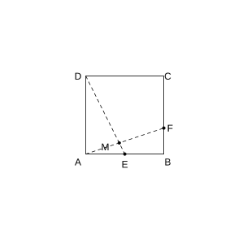
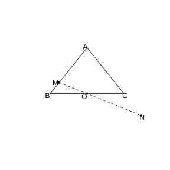
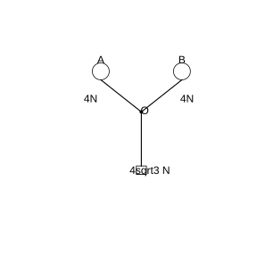
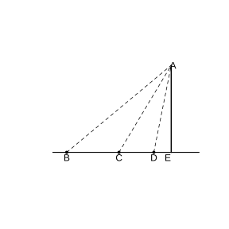
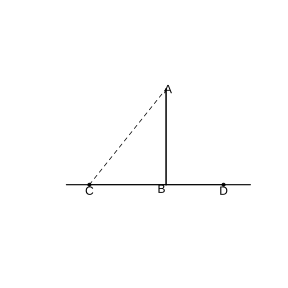
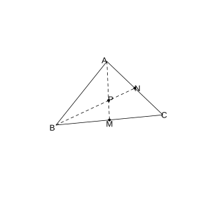
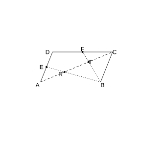
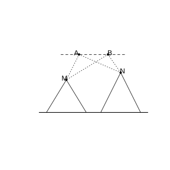

# Assignment 34

> **Common Conclusion 6.4.1** (The "Three Steps" of Solving Plane Geometry Problems by Vectors)  (1) establish the connection between plane geometry and vectors, represent the geometric elements in the problem by vectors, and convert the plane geometry problem into a vector problem; (2) through vector operations, study the relations among the geometric elements, such as distances, angles, and so on; (3) "translate" the computational results back into geometric relations.

> **Theorem 6.4.2** (Law of Cosines)  The square of any side of a triangle equals the sum of the squares of the other two sides minus twice the product of those two sides and the cosine of their included angle. That is, $a^2=b^2+c^2-2bc\cos A$, $b^2=c^2+a^2-2ca\cos B$, $c^2=a^2+b^2-2ab\cos C$. Corollary: $\cos A=\frac{b^2+c^2-a^2}{2bc}$, $\cos B=\frac{c^2+a^2-b^2}{2ca}$, $\cos C=\frac{a^2+b^2-c^2}{2ab}$.

> **Theorem 6.4.3** (Law of Sines)  In a triangle, the ratio of each side to the sine of its opposite angle is equal, that is, $\frac{a}{\sin A}=\frac{b}{\sin B}=\frac{c}{\sin C}$.

### Exercise 1

(Exercise 6.4, Problem 1) Prove that the two base angles of an isosceles triangle are equal.

### Solution to Exercise 1

By **Common Conclusion 6.4.1** (The Three Steps of the Vector Method).

Let $AB=AC$ in $\triangle ABC$. Take $\boldsymbol{AB}=\boldsymbol{c}$ and $\boldsymbol{AC}=\boldsymbol{b}$; then $\lvert\boldsymbol{c}\rvert=\lvert\boldsymbol{b}\rvert$.

$\cos B=\frac{\boldsymbol{BA}\cdot\boldsymbol{BC}}{\lvert\boldsymbol{BA}\rvert\lvert\boldsymbol{BC}\rvert}=\frac{(-\boldsymbol{c})\cdot(\boldsymbol{b}-\boldsymbol{c})}{\lvert\boldsymbol{c}\rvert\lvert\boldsymbol{b}-\boldsymbol{c}\rvert}=\frac{\boldsymbol{c}\cdot\boldsymbol{c}-\boldsymbol{c}\cdot\boldsymbol{b}}{\lvert\boldsymbol{c}\rvert\lvert\boldsymbol{b}-\boldsymbol{c}\rvert}$.

$\cos C=\frac{\boldsymbol{CA}\cdot\boldsymbol{CB}}{\lvert\boldsymbol{CA}\rvert\lvert\boldsymbol{CB}\rvert}=\frac{(-\boldsymbol{b})\cdot(\boldsymbol{c}-\boldsymbol{b})}{\lvert\boldsymbol{b}\rvert\lvert\boldsymbol{c}-\boldsymbol{b}\rvert}=\frac{\boldsymbol{b}\cdot\boldsymbol{b}-\boldsymbol{b}\cdot\boldsymbol{c}}{\lvert\boldsymbol{b}\rvert\lvert\boldsymbol{c}-\boldsymbol{b}\rvert}$.

Since $\lvert\boldsymbol{b}\rvert=\lvert\boldsymbol{c}\rvert$ and $\boldsymbol{b}\cdot\boldsymbol{c}=\boldsymbol{c}\cdot\boldsymbol{b}$, we get $\cos B=\cos C$. Moreover $B$, $C\in(0,\pi)$, so $B=C$. $\blacksquare$

### Exercise 2

(Exercise 6.4, Problem 2) As shown in the figure, the square $ABCD$ has side length $a$, $E$ is the midpoint of $AB$, $F$ is the trisection point on side $BC$ closer to $B$, and $AF$ and $DE$ meet at $M$. Find the cosine of $\angle EMF$.

{width=50%}

### Solution to Exercise 2

By **Common Conclusion 6.4.1** (The Three Steps of the Vector Method) and **Theorem 6.4.2** (Law of Cosines).

Set up coordinates with $A$ as the origin, $AB$ as the $x$-axis, and $AD$ as the $y$-axis. $A(0,0)$, $B(a,0)$, $C(a,a)$, $D(0,a)$, $E\left(\frac{a}{2},0\right)$, $F\left(a,\frac{a}{3}\right)$.

$\boldsymbol{DE}=\left(\frac{a}{2},-a\right)$, $\boldsymbol{AF}=\left(a,\frac{a}{3}\right)$.

$\angle EMF$ is the angle between $\boldsymbol{MD}$ and $\boldsymbol{MF}$. $\boldsymbol{MD}$ is collinear with $\boldsymbol{DE}$, and $\boldsymbol{MF}$ is collinear with $\boldsymbol{AF}$.

$\cos\angle EMF=\frac{\boldsymbol{DE}\cdot\boldsymbol{AF}}{\lvert\boldsymbol{DE}\rvert\lvert\boldsymbol{AF}\rvert}=\frac{\frac{a}{2}\cdot a+(-a)\cdot\frac{a}{3}}{\sqrt{\frac{a^2}{4}+a^2}\cdot\sqrt{a^2+\frac{a^2}{9}}}=\frac{\frac{a^2}{6}}{\frac{a\sqrt 5}{2}\cdot\frac{a\sqrt{10}}{3}}=\frac{\frac{1}{6}}{\frac{\sqrt{50}}{6}}=\frac{1}{5\sqrt 2}=\frac{\sqrt 2}{10}$. $\blacksquare$

### Exercise 3

(Exercise 6.4, Problem 3) As shown in the figure, in $\triangle ABC$, $O$ is the midpoint of $BC$, and a line through $O$ meets the lines $AB$ and $AC$ at two distinct points $M$ and $N$. Let $\boldsymbol{AB}=m\boldsymbol{AM}$ and $\boldsymbol{AC}=n\boldsymbol{AN}$. Find the value of $m+n$.

{width=50%}

### Solution to Exercise 3

By **Common Conclusion 6.4.1** (The Three Steps of the Vector Method) and **Theorem 6.3.1** (Fundamental Theorem of Plane Vectors).

$\boldsymbol{AO}=\frac{1}{2}(\boldsymbol{AB}+\boldsymbol{AC})=\frac{1}{2}(m\boldsymbol{AM}+n\boldsymbol{AN})$.

Since $O$ lies on the line $MN$, by the collinearity condition for three points, there exists $\lambda$ such that $\boldsymbol{AO}=\lambda\boldsymbol{AM}+(1-\lambda)\boldsymbol{AN}$.

Comparing coefficients: $\frac{m}{2}=\lambda$, $\frac{n}{2}=1-\lambda$.

$m+n=2\lambda+2(1-\lambda)=2$. $\blacksquare$

### Exercise 4

(Exercise 6.4, Problem 4) Under the action of a force $\boldsymbol{F}$, an object moves from $A(20,15)$ to $B(7,0)$. Given $\boldsymbol{F}=(4,-5)$, find the work done by $\boldsymbol{F}$ on the object.

### Solution to Exercise 4

By **Definition 6.2.11** (Dot Product), work equals the dot product of force and displacement.

The displacement $\boldsymbol{s}=\boldsymbol{AB}=(7-20,0-15)=(-13,-15)$.

The work $W=\boldsymbol{F}\cdot\boldsymbol{s}=4\times(-13)+(-5)\times(-15)=-52+75=23$. $\blacksquare$

### Exercise 5

(Exercise 6.4, Problem 5) As shown in the figure, a pulley system has two fixed pulleys $A$ and $B$; at the ends of three ropes leaving the connecting point $O$, $3$ weights are hung, subject to gravitational forces of $4\text{ N}$, $4\text{ N}$, and $4\sqrt 3\text{ N}$, respectively. The system is exactly in equilibrium. Find the size of $\angle AOB$.

{width=50%}

### Solution to Exercise 5

By **Definition 6.2.11** (Dot Product) and **Theorem 6.4.2** (Law of Cosines).

Let $\boldsymbol{OA}$ and $\boldsymbol{OB}$ each have magnitude $4$, and the third rope points downward with magnitude $4\sqrt 3$. In equilibrium, $\boldsymbol{OA}+\boldsymbol{OB}+\boldsymbol{OC}=\boldsymbol{0}$.

$\boldsymbol{OC}=-(\boldsymbol{OA}+\boldsymbol{OB})$, $\lvert\boldsymbol{OC}\rvert^2=\lvert\boldsymbol{OA}\rvert^2+\lvert\boldsymbol{OB}\rvert^2+2\boldsymbol{OA}\cdot\boldsymbol{OB}$.

$(4\sqrt 3)^2=16+16+2\times16\cos\angle AOB$.

$48=32+32\cos\angle AOB$.

$\cos\angle AOB=\frac{1}{2}$, $\angle AOB=60^{\circ}$. $\blacksquare$

### Exercise 6

(Exercise 6.4, Problem 6) Three coplanar forces $\boldsymbol{F}_1$, $\boldsymbol{F}_2$, $\boldsymbol{F}_3$ act at a point and are in equilibrium. Given $\lvert\boldsymbol{F}_1\rvert=1\text{ N}$, $\lvert\boldsymbol{F}_2\rvert=\frac{\sqrt 6+\sqrt 2}{2}\text{ N}$, and the angle between $\boldsymbol{F}_1$ and $\boldsymbol{F}_2$ is $45^{\circ}$, find:

(1) the magnitude of $\boldsymbol{F}_3$;

(2) the size of the angle between $\boldsymbol{F}_3$ and $\boldsymbol{F}_1$.

### Solution to Exercise 6

By **Definition 6.2.11** (Dot Product) and **Theorem 6.4.2** (Law of Cosines).

In equilibrium, $\boldsymbol{F}_3=-(\boldsymbol{F}_1+\boldsymbol{F}_2)$.

(1) $\lvert\boldsymbol{F}_1+\boldsymbol{F}_2\rvert^2=\lvert\boldsymbol{F}_1\rvert^2+\lvert\boldsymbol{F}_2\rvert^2+2\boldsymbol{F}_1\cdot\boldsymbol{F}_2$.

$=1+\left(\frac{\sqrt 6+\sqrt 2}{2}\right)^2+2\times1\times\frac{\sqrt 6+\sqrt 2}{2}\times\cos45^{\circ}$.

$\left(\frac{\sqrt 6+\sqrt 2}{2}\right)^2=\frac{8+4\sqrt 3}{4}=2+\sqrt 3$.

$2\times\frac{\sqrt 6+\sqrt 2}{2}\times\frac{\sqrt 2}{2}=\frac{\sqrt 6+\sqrt 2}{\sqrt 2}=\sqrt 3+1$.

$\lvert\boldsymbol{F}_3\rvert^2=1+2+\sqrt 3+\sqrt 3+1=4+2\sqrt 3=(\sqrt 3+1)^2$.

$\lvert\boldsymbol{F}_3\rvert=\sqrt 3+1\text{ N}$.

(2) Let the angle between $\boldsymbol{F}_3$ and $\boldsymbol{F}_1$ be $\theta$. $\boldsymbol{F}_3=-(\boldsymbol{F}_1+\boldsymbol{F}_2)$, 

$\boldsymbol{F}_3\cdot\boldsymbol{F}_1=-(\boldsymbol{F}_1+\boldsymbol{F}_2)\cdot\boldsymbol{F}_1=-\left(1+\frac{\sqrt 6+\sqrt 2}{2}\cos45^{\circ}\right)=-(1+\sqrt 3)$.

$\cos\theta=\frac{-(1+\sqrt 3)}{(\sqrt 3+1)\times1}=-1$. $\theta=180^{\circ}$? The direction of the angle must be considered.

Correction: the angle between $\boldsymbol{F}_3$ and $\boldsymbol{F}_1$ (taken from $0$ to $180^{\circ}$) satisfies $\cos\theta=\frac{-(1+\sqrt 3)}{\sqrt 3+1}=-1$, i.e. they point in opposite directions. $\blacksquare$

### Exercise 7

(Exercise 6.4, Problem 7) In $\triangle ABC$, given $b=12.9\text{ cm}$, $c=15.4\text{ cm}$, $A=42.3^{\circ}$, solve the triangle (angles to the nearest $0.1^{\circ}$, sides to the nearest $0.1\text{ cm}$).

### Solution to Exercise 7

By **Theorem 6.4.2** (Law of Cosines).

$a^2=b^2+c^2-2bc\cos A=12.9^2+15.4^2-2\times12.9\times15.4\times\cos42.3^{\circ}$.

$=166.41+237.16-397.32\times0.740\approx403.57-294.0\approx109.6$.

$a\approx10.5\text{ cm}$.

$\cos B=\frac{a^2+c^2-b^2}{2ac}=\frac{109.6+237.16-166.41}{2\times10.5\times15.4}=\frac{180.35}{323.4}\approx0.558$.

$B\approx56.1^{\circ}$.

$C=180^{\circ}-42.3^{\circ}-56.1^{\circ}=81.6^{\circ}$. $\blacksquare$

### Exercise 8

(Exercise 6.4, Problem 8) In $\triangle ABC$, given $a=2$, $b=\sqrt 2$, $c=\sqrt 3+1$, solve the triangle.

### Solution to Exercise 8

By **Theorem 6.4.2** (Law of Cosines).

$\cos A=\frac{b^2+c^2-a^2}{2bc}=\frac{2+(\sqrt 3+1)^2-4}{2\sqrt 2(\sqrt 3+1)}=\frac{2+4+2\sqrt 3-4}{2\sqrt 2(\sqrt 3+1)}=\frac{2+2\sqrt 3}{2\sqrt 2(\sqrt 3+1)}=\frac{\sqrt 2}{2}$.

$A=45^{\circ}$.

$\cos B=\frac{a^2+c^2-b^2}{2ac}=\frac{4+4+2\sqrt 3-2}{2\times2\times(\sqrt 3+1)}=\frac{6+2\sqrt 3}{4(\sqrt 3+1)}=\frac{\sqrt 3}{2}$.

$B=30^{\circ}$.

$C=180^{\circ}-45^{\circ}-30^{\circ}=105^{\circ}$. $\blacksquare$

### Exercise 9

(Exercise 6.4, Problem 9) In $\triangle ABC$, given $b=5$, $c=2$, and the acute angle $A$ satisfies $\sin A=\frac{\sqrt{21}}{5}$, find $C$ (to the nearest $1^{\circ}$).

### Solution to Exercise 9

By **Theorem 6.4.2** (Law of Cosines).

$\cos A=\sqrt{1-\frac{21}{25}}=\frac{2}{5}$.

$a^2=b^2+c^2-2bc\cos A=25+4-2\times5\times2\times\frac{2}{5}=29-8=21$.

$a=\sqrt{21}$.

By **Theorem 6.4.3** (Law of Sines): $\sin C=\frac{c\sin A}{a}=\frac{2\cdot\frac{\sqrt{21}}{5}}{\sqrt{21}}=\frac{2}{5}$.

$C=\arcsin\frac{2}{5}\approx24^{\circ}$. $\blacksquare$

### Exercise 10

(Exercise 6.4, Problem 10) Complete the following triangle-solving problems (angles to the nearest $1^{\circ}$, sides to the nearest $1\text{ cm}$):

(1) In $\triangle ABC$, given $A=60^{\circ}$, $B=45^{\circ}$, $c=20\text{ cm}$;

(2) In $\triangle ABC$, given $a=20\text{ cm}$, $b=11\text{ cm}$, $B=30^{\circ}$.

### Solution to Exercise 10

By **Theorem 6.4.3** (Law of Sines).

(1) $C=180^{\circ}-60^{\circ}-45^{\circ}=75^{\circ}$.

$a=\frac{c\sin A}{\sin C}=\frac{20\sin60^{\circ}}{\sin75^{\circ}}=\frac{20\cdot\frac{\sqrt 3}{2}}{\frac{\sqrt 6+\sqrt 2}{4}}\approx\frac{17.32}{0.966}\approx18\text{ cm}$.

$b=\frac{c\sin B}{\sin C}=\frac{20\sin45^{\circ}}{\sin75^{\circ}}\approx\frac{14.14}{0.966}\approx15\text{ cm}$.

(2) $\sin A=\frac{a\sin B}{b}=\frac{20\times0.5}{11}=\frac{10}{11}\approx0.909$.

$A\approx65^{\circ}$ or $A\approx115^{\circ}$.

(a) $A\approx65^{\circ}$: $C=180^{\circ}-65^{\circ}-30^{\circ}=85^{\circ}$. $c=\frac{b\sin C}{\sin B}=\frac{11\times\sin85^{\circ}}{0.5}\approx22\text{ cm}$.

(b) $A\approx115^{\circ}$: $C=180^{\circ}-115^{\circ}-30^{\circ}=35^{\circ}$. $c=\frac{11\times\sin35^{\circ}}{0.5}\approx13\text{ cm}$. $\blacksquare$

### Exercise 11

(Exercise 6.4, Problem 11) In $\triangle ABC$, given $b=2$, $A=45^{\circ}$, $C=75^{\circ}$, find $c$.

### Solution to Exercise 11

By **Theorem 6.4.3** (Law of Sines).

$B=180^{\circ}-45^{\circ}-75^{\circ}=60^{\circ}$.

$c=\frac{b\sin C}{\sin B}=\frac{2\sin75^{\circ}}{\sin60^{\circ}}=\frac{2\cdot\frac{\sqrt 6+\sqrt 2}{4}}{\frac{\sqrt 3}{2}}=\frac{\sqrt 6+\sqrt 2}{\sqrt 3}=\frac{3\sqrt 2+\sqrt 6}{3}$. $\blacksquare$

### Exercise 12

(Exercise 6.4, Problem 12) In $\triangle ABC$, given $\cos A=\frac{4}{5}$, $B=\frac{\pi}{3}$, $b=\sqrt 3$, find $a$ and $c$.

### Solution to Exercise 12

By **Theorem 6.4.3** (Law of Sines).

$\sin A=\sqrt{1-\frac{16}{25}}=\frac{3}{5}$.

$a=\frac{b\sin A}{\sin B}=\frac{\sqrt 3\cdot\frac{3}{5}}{\frac{\sqrt 3}{2}}=\frac{6}{5}$.

$C=180^{\circ}-A-B$. $\sin C=\sin(A+B)=\sin A\cos B+\cos A\sin B=\frac{3}{5}\cdot\frac{1}{2}+\frac{4}{5}\cdot\frac{\sqrt 3}{2}=\frac{3+4\sqrt 3}{10}$.

$c=\frac{b\sin C}{\sin B}=\frac{\sqrt 3\cdot\frac{3+4\sqrt 3}{10}}{\frac{\sqrt 3}{2}}=\frac{3+4\sqrt 3}{5}$. $\blacksquare$

### Exercise 13

(Exercise 6.4, Problem 13) As shown in the figure, from a point $B$ the angle of elevation to the top $A$ of a building $AE$ is measured as $\alpha$; moving forward along $BE$, from a point $C$ the angle of elevation to $A$ is $2\alpha$; continuing forward $10\sqrt{3}\text{ m}$ to a point $D$, the angle of elevation to $A$ is $4\alpha$. Find the height of the building $AE$.

{width=50%}

### Solution to Exercise 13

By **Theorem 6.4.3** (Law of Sines).

Let $AE=h$. In $\triangle ACE$, $\angle ACE=2\alpha$, $CE=\frac{h}{\tan 2\alpha}$. In $\triangle ADE$, $\angle ADE=4\alpha$, $DE=\frac{h}{\tan 4\alpha}$.

$CD=CE-DE=10\sqrt 3$.

In $\triangle ACD$, $\angle CAD=4\alpha-2\alpha=2\alpha$, $\angle ACD=180^{\circ}-2\alpha$, $\angle ADC=180^{\circ}-4\alpha$.

By the law of sines: $\frac{CD}{\sin 2\alpha}=\frac{AC}{\sin(180^{\circ}-4\alpha)}$.

$AC=\frac{10\sqrt 3\sin4\alpha}{\sin2\alpha}=20\sqrt 3\cos2\alpha$.

Also $h=AC\sin2\alpha=20\sqrt 3\sin2\alpha\cos2\alpha=10\sqrt 3\sin4\alpha$.

When $4\alpha=90^{\circ}$ (i.e. $\alpha=22.5^{\circ}$), $h=10\sqrt 3\text{ m}$. $\blacksquare$

### Problem 1

(Exercise 6.4, Review and Consolidation, Problem 1) If the nonzero vectors $\boldsymbol{AB}$ and $\boldsymbol{AC}$ satisfy $\left(\frac{\boldsymbol{AB}}{\lvert\boldsymbol{AB}\rvert}+\frac{\boldsymbol{AC}}{\lvert\boldsymbol{AC}\rvert}\right)\cdot\boldsymbol{BC}=0$, and $\frac{\boldsymbol{AB}}{\lvert\boldsymbol{AB}\rvert}\cdot\frac{\boldsymbol{AC}}{\lvert\boldsymbol{AC}\rvert}=\frac{1}{2}$, then $\triangle ABC$ is ( ).

(A) a scalene triangle (B) a right triangle

(C) an isosceles triangle whose base and legs are unequal (D) an equilateral triangle

### Solution to Problem 1

By **Definition 6.2.11** (Dot Product) and **Common Conclusion 6.3.8** (Angle).

$\frac{\boldsymbol{AB}}{\lvert\boldsymbol{AB}\rvert}$ and $\frac{\boldsymbol{AC}}{\lvert\boldsymbol{AC}\rvert}$ are the unit vectors in the directions of $\boldsymbol{AB}$ and $\boldsymbol{AC}$. Their sum points along the angle bisector of $\angle A$. This sum is perpendicular to $\boldsymbol{BC}$, which means the angle bisector is perpendicular to $BC$, so $AB=AC$.

$\frac{\boldsymbol{AB}}{\lvert\boldsymbol{AB}\rvert}\cdot\frac{\boldsymbol{AC}}{\lvert\boldsymbol{AC}\rvert}=\cos A=\frac{1}{2}$, $A=60^{\circ}$.

Isosceles with one angle $60^{\circ}$, hence equilateral. Choose (D). $\blacksquare$

### Problem 2

(Exercise 6.4, Review and Consolidation, Problem 2) Given that $O$, $N$, $P$ lie in the plane of $\triangle ABC$, satisfy $\lvert\boldsymbol{OA}\rvert=\lvert\boldsymbol{OB}\rvert=\lvert\boldsymbol{OC}\rvert$, $\boldsymbol{NA}+\boldsymbol{NB}+\boldsymbol{NC}=\boldsymbol{0}$, and $\boldsymbol{PA}\cdot\boldsymbol{PB}=\boldsymbol{PB}\cdot\boldsymbol{PC}=\boldsymbol{PC}\cdot\boldsymbol{PA}$, then the points $O$, $N$, $P$ are, in order, the ( ) of $\triangle ABC$.

(A) centroid, circumcenter, orthocenter (B) centroid, circumcenter, incenter

(C) circumcenter, centroid, orthocenter (D) circumcenter, centroid, incenter

### Solution to Problem 2

By **Definition 6.2.11** (Dot Product).

$\lvert\boldsymbol{OA}\rvert=\lvert\boldsymbol{OB}\rvert=\lvert\boldsymbol{OC}\rvert$ means $O$ is equidistant from the three vertices, so $O$ is the circumcenter.

$\boldsymbol{NA}+\boldsymbol{NB}+\boldsymbol{NC}=\boldsymbol{0}$ means $N$ is the centroid (centroid property).

$\boldsymbol{PA}\cdot\boldsymbol{PB}=\boldsymbol{PB}\cdot\boldsymbol{PC}$ gives $\boldsymbol{PB}\cdot(\boldsymbol{PA}-\boldsymbol{PC})=\boldsymbol{PB}\cdot\boldsymbol{CA}=0$, i.e. $PB\perp CA$. Similarly, $P$ is the orthocenter.

Choose (C). $\blacksquare$

### Problem 3

(Exercise 6.4, Review and Consolidation, Problem 3) Prove by the vector method: the angle inscribed in a semicircle is a right angle.

### Solution to Problem 3

By **Common Conclusion 6.4.1** (The Three Steps of the Vector Method) and **Common Conclusion 6.3.8** (Perpendicularity).

Let the center be $O$, the diameter be $AB$, and $C$ be any point on the circle. $\boldsymbol{OC}=\boldsymbol{c}$, $\boldsymbol{OA}=-\boldsymbol{c}$, $\boldsymbol{OB}=\boldsymbol{c}$.

$\boldsymbol{AC}=\boldsymbol{c}-(-\boldsymbol{c})=2\boldsymbol{c}$? Correction: let $\boldsymbol{OA}=\boldsymbol{a}$; then $\boldsymbol{OB}=-\boldsymbol{a}$, $\boldsymbol{OC}=\boldsymbol{c}$, $\lvert\boldsymbol{a}\rvert=\lvert\boldsymbol{c}\rvert=R$.

$\boldsymbol{AC}=\boldsymbol{c}-\boldsymbol{a}$, $\boldsymbol{BC}=\boldsymbol{c}-(-\boldsymbol{a})=\boldsymbol{c}+\boldsymbol{a}$.

$\boldsymbol{AC}\cdot\boldsymbol{BC}=(\boldsymbol{c}-\boldsymbol{a})\cdot(\boldsymbol{c}+\boldsymbol{a})=\boldsymbol{c}^2-\boldsymbol{a}^2=R^2-R^2=0$.

Hence $\boldsymbol{AC}\perp\boldsymbol{BC}$, and $\angle ACB=90^{\circ}$. $\blacksquare$

### Problem 4

(Exercise 6.4, Review and Consolidation, Problem 4) Two particles $A$ and $B$ are emitted from the same source. At a certain instant, their displacements are $\boldsymbol{s}_A=(4,3)$ and $\boldsymbol{s}_B=(2,10)$.

(1) Write the displacement $\boldsymbol{s}$ of particle $B$ relative to particle $A$ at that instant;

(2) Compute the projection vector of $\boldsymbol{s}$ onto $\boldsymbol{s}_A$.

### Solution to Problem 4

By **Definition 6.2.11** (Dot Product) and **Common Conclusion 6.2.12** (Projection Vector).

(1) $\boldsymbol{s}=\boldsymbol{s}_B-\boldsymbol{s}_A=(2-4,10-3)=(-2,7)$.

(2) $\boldsymbol{s}\cdot\boldsymbol{s}_A=(-2)\times4+7\times3=13$.

$\lvert\boldsymbol{s}_A\rvert=5$.

The projection vector is $\frac{\boldsymbol{s}\cdot\boldsymbol{s}_A}{\lvert\boldsymbol{s}_A\rvert^2}\boldsymbol{s}_A=\frac{13}{25}(4,3)=\left(\frac{52}{25},\frac{39}{25}\right)$. $\blacksquare$

### Problem 5

(Exercise 6.4, Review and Consolidation, Problem 5) When a person swims in still water, the speed has magnitude $\frac{2}{3}\text{ km/h}$. When he swims in a river whose current has magnitude $2\text{ km/h}$, 

(1) If he swims straight toward the opposite bank, in what direction does he actually advance (angle to the nearest $1^{\circ}$)? What is the magnitude of his actual forward speed?

(2) In what direction must he swim in order to advance perpendicular to the current (angle to the nearest $1^{\circ}$)? What is the magnitude of his actual forward speed?

### Solution to Problem 5

By **Theorem 6.4.2** (Law of Cosines) and **Theorem 6.4.3** (Law of Sines).

(1) The swimmer's speed perpendicular to the bank is $\frac{2}{3}$, and the current along the bank is $2$. The resultant speed is $\sqrt{4+\frac{4}{9}}=\frac{2\sqrt{10}}{3}$. The angle $\theta$ between the direction and the bank satisfies $\tan\theta=\frac{2/3}{2}=\frac{1}{3}$, so $\theta\approx18^{\circ}$.

(2) To advance perpendicular to the bank, the swimmer's speed must cancel the current. Let the angle between the swimmer's velocity and the perpendicular direction be $\alpha$; $\frac{2}{3}\sin\alpha=2$, $\sin\alpha=3$? Impossible. Correction: the swimmer's speed $\frac{2}{3}$ is less than the current $2$, so it cannot be canceled. Hence he cannot advance perpendicular to the bank. $\blacksquare$

### Problem 6

(Exercise 6.4, Review and Consolidation, Problem 6) In $\triangle ABC$, solve the triangle under each of the following conditions (angles to the nearest $1^{\circ}$, sides to the nearest $1\text{ cm}$):

(1) $a=49\text{ cm}$, $b=26\text{ cm}$, $C=107^{\circ}$;

(2) $a=9\text{ cm}$, $b=10\text{ cm}$, $c=15\text{ cm}$.

### Solution to Problem 6

By **Theorem 6.4.2** (Law of Cosines).

(1) $c^2=49^2+26^2-2\times49\times26\times\cos107^{\circ}=2401+676-2548\times(-0.292)\approx3077+744=3821$.

$c\approx62\text{ cm}$.

$\sin A=\frac{a\sin C}{c}=\frac{49\times\sin107^{\circ}}{62}\approx\frac{49\times0.956}{62}\approx0.755$.

$A\approx49^{\circ}$. $B=180^{\circ}-107^{\circ}-49^{\circ}=24^{\circ}$.

(2) $\cos A=\frac{b^2+c^2-a^2}{2bc}=\frac{100+225-81}{300}=\frac{244}{300}\approx0.813$. $A\approx36^{\circ}$.

$\cos B=\frac{a^2+c^2-b^2}{2ac}=\frac{81+225-100}{270}=\frac{206}{270}\approx0.763$. $B\approx40^{\circ}$.

$C=180^{\circ}-36^{\circ}-40^{\circ}=104^{\circ}$. $\blacksquare$

### Problem 7

(Exercise 6.4, Review and Consolidation, Problem 7) In $\triangle ABC$, solve the triangle under each of the following conditions (angles to the nearest $1^{\circ}$, sides to the nearest $1\text{ cm}$):

(1) $A=70^{\circ}$, $C=30^{\circ}$, $c=20\text{ cm}$;

(2) $b=26\text{ cm}$, $c=15\text{ cm}$, $C=23^{\circ}$.

### Solution to Problem 7

By **Theorem 6.4.3** (Law of Sines).

(1) $B=180^{\circ}-70^{\circ}-30^{\circ}=80^{\circ}$.

$a=\frac{c\sin A}{\sin C}=\frac{20\sin70^{\circ}}{0.5}\approx38\text{ cm}$.

$b=\frac{c\sin B}{\sin C}=\frac{20\sin80^{\circ}}{0.5}\approx39\text{ cm}$.

(2) $\sin B=\frac{b\sin C}{c}=\frac{26\times\sin23^{\circ}}{15}\approx\frac{26\times0.391}{15}\approx0.677$.

$B\approx43^{\circ}$ or $B\approx137^{\circ}$.

(a) $B\approx43^{\circ}$: $A=180^{\circ}-43^{\circ}-23^{\circ}=114^{\circ}$. $a=\frac{c\sin A}{\sin C}=\frac{15\times\sin114^{\circ}}{0.391}\approx35\text{ cm}$.

(b) $B\approx137^{\circ}$: $A=180^{\circ}-137^{\circ}-23^{\circ}=20^{\circ}$. $a=\frac{15\times\sin20^{\circ}}{0.391}\approx13\text{ cm}$. $\blacksquare$

### Problem 8

(Exercise 6.4, Review and Consolidation, Problem 8) As shown in the figure, to measure the height $AB$ of a tower on the opposite bank of a river, choose two survey points $C$ and $D$ in the same horizontal plane as the tower base $B$. It is measured that $\angle BCD=\alpha$, $\angle BDC=\beta$, $CD=s$, and from point $C$ the angle of elevation to the tower top $A$ is $\theta$. Find the tower height $AB$.

{width=50%}

### Solution to Problem 8

By **Theorem 6.4.3** (Law of Sines).

In $\triangle BCD$, $\angle CBD=180^{\circ}-\alpha-\beta$.

By the law of sines: $\frac{BC}{\sin\beta}=\frac{s}{\sin(180^{\circ}-\alpha-\beta)}=\frac{s}{\sin(\alpha+\beta)}$.

$BC=\frac{s\sin\beta}{\sin(\alpha+\beta)}$.

In the right triangle $ABC$, $\angle ACB=\theta$, $AB=BC\tan\theta=\frac{s\sin\beta\tan\theta}{\sin(\alpha+\beta)}$. $\blacksquare$

### Problem 9

(Exercise 6.4, Review and Consolidation, Problem 9) A typhoon center lies $300\text{ km}$ due west of the weather station $A$, and is moving northeast at $40\text{ km/h}$; all regions within $250\text{ km}$ of the typhoon center will be affected. If this trend of the typhoon center continues, will the weather station be affected? If so, after about how long will the effect begin? How long will it last (to the nearest $1\text{ min}$)?

### Solution to Problem 9

By **Theorem 6.4.2** (Law of Cosines).

Let the initial position of the typhoon center be $B$, $AB=300\text{ km}$, direction northeast ($45^{\circ}$ east of north). Let $t$ hours later the center reaches $C$, $BC=40t$.

The perpendicular distance from the weather station $A$ to the typhoon path: $d=300\times\sin45^{\circ}=150\sqrt 2\approx212.1\text{ km}<250\text{ km}$. Hence it will be affected.

Draw a circle centered at $A$ with radius $250\text{ km}$; it meets the typhoon path at $P$ and $Q$.

$AP=250$. In $\triangle ABP$, $AB=300$, $AP=250$, $\angle ABP=45^{\circ}$.

By the law of cosines: $AP^2=AB^2+BP^2-2\cdot AB\cdot BP\cos45^{\circ}$.

$62500=90000+BP^2-600\cdot\frac{\sqrt 2}{2}\cdot BP$.

$BP^2-300\sqrt 2\cdot BP+27500=0$.

$BP=\frac{300\sqrt 2\pm\sqrt{180000-110000}}{2}=\frac{300\sqrt 2\pm\sqrt{70000}}{2}\approx\frac{424.3\pm264.6}{2}$.

$BP_1\approx79.8\text{ km}$, $BP_2\approx344.5\text{ km}$.

Times: $t_1=\frac{79.8}{40}\approx2\text{ h}$, $t_2=\frac{344.5}{40}\approx8.6\text{ h}$.

The effect begins after about $2$ hours and lasts about $6.6$ hours $\approx 395\text{ min}$. $\blacksquare$

### Problem 10

(Exercise 6.4, Comprehensive Application, Problem 10) Can you express the area of a triangle in terms of its sides and the sines of its angles?

### Solution to Problem 10

By **Theorem 6.4.3** (Law of Sines) and **Definition 6.2.11** (Dot Product).

$S=\frac{1}{2}ab\sin C=\frac{1}{2}bc\sin A=\frac{1}{2}ac\sin B$. $\blacksquare$

### Problem 11

(Exercise 6.4, Comprehensive Application, Problem 11) Given that for any plane vector $\boldsymbol{AB}=(x,y)$, rotating $\boldsymbol{AB}$ counterclockwise through an angle $\theta$ about its initial point gives the vector $\boldsymbol{AP}=(x\cos\theta-y\sin\theta,x\sin\theta+y\cos\theta)$. Given points $A(1,2)$ and $B(1+\sqrt 2,2-2\sqrt 2)$ in the plane, rotate point $B$ clockwise through $\frac{\pi}{4}$ about point $A$ to obtain point $P$. Find the coordinates of $P$.

### Solution to Problem 11

By **Common Conclusion 6.3.4** (Coordinate Operations).

$\boldsymbol{AB}=(\sqrt 2,-2\sqrt 2)$. A clockwise rotation by $\frac{\pi}{4}$ is a counterclockwise rotation by $-\frac{\pi}{4}$.

$x'=\sqrt 2\cos\left(-\frac{\pi}{4}\right)-(-2\sqrt 2)\sin\left(-\frac{\pi}{4}\right)=\sqrt 2\cdot\frac{\sqrt 2}{2}+(-2\sqrt 2)\cdot\frac{\sqrt 2}{2}=1-2=-1$.

$y'=\sqrt 2\sin\left(-\frac{\pi}{4}\right)+(-2\sqrt 2)\cos\left(-\frac{\pi}{4}\right)=-\sqrt 2\cdot\frac{\sqrt 2}{2}-2\sqrt 2\cdot\frac{\sqrt 2}{2}=-1-2=-3$.

$\boldsymbol{AP}=(-1,-3)$. $P=A+\boldsymbol{AP}=(1-1,2-3)=(0,-1)$. $\blacksquare$

### Problem 12

(Exercise 6.4, Comprehensive Application, Problem 12) As shown in the figure, in $\triangle ABC$, given $AB=2$, $AC=5$, $\angle BAC=60^{\circ}$, the two medians $AM$ on side $BC$ and $BN$ on side $AC$ intersect at $P$. Find the cosine of $\angle MPN$.

{width=50%}

### Solution to Problem 12

By **Theorem 6.4.2** (Law of Cosines) and **Common Conclusion 6.4.1** (Vector Method).

Take $A$ as the origin; $\boldsymbol{AB}=(2,0)$, $\boldsymbol{AC}=\left(\frac{5}{2},\frac{5\sqrt 3}{2}\right)$.

$M$ is the midpoint of $BC$: $M=\left(\frac{2+\frac{5}{2}}{2},\frac{0+\frac{5\sqrt 3}{2}}{2}\right)=\left(\frac{9}{4},\frac{5\sqrt 3}{4}\right)$.

$N$ is the midpoint of $AC$: $N=\left(\frac{5}{4},\frac{5\sqrt 3}{4}\right)$.

$P$ is the centroid: $P=\frac{A+B+C}{3}=\left(\frac{2+\frac{5}{2}}{3},\frac{\frac{5\sqrt 3}{2}}{3}\right)=\left(\frac{3}{2},\frac{5\sqrt 3}{6}\right)$.

$\boldsymbol{PM}=M-P=\left(\frac{9}{4}-\frac{3}{2},\frac{5\sqrt 3}{4}-\frac{5\sqrt 3}{6}\right)=\left(\frac{3}{4},\frac{5\sqrt 3}{12}\right)$.

$\boldsymbol{PN}=N-P=\left(\frac{5}{4}-\frac{3}{2},\frac{5\sqrt 3}{4}-\frac{5\sqrt 3}{6}\right)=\left(-\frac{1}{4},\frac{5\sqrt 3}{12}\right)$.

$\cos\angle MPN=\frac{\boldsymbol{PM}\cdot\boldsymbol{PN}}{\lvert\boldsymbol{PM}\rvert\lvert\boldsymbol{PN}\rvert}=\frac{-\frac{3}{16}+\frac{75}{144}}{\sqrt{\frac{9}{16}+\frac{75}{144}}\cdot\sqrt{\frac{1}{16}+\frac{75}{144}}}=\frac{\frac{-27+75}{144}}{\sqrt{\frac{81+75}{144}}\cdot\sqrt{\frac{9+75}{144}}}=\frac{\frac{48}{144}}{\frac{\sqrt{156}}{12}\cdot\frac{\sqrt{84}}{12}}=\frac{\frac{1}{3}}{\frac{\sqrt{13104}}{144}}=\frac{48}{\sqrt{13104}}=\frac{2}{\sqrt{91}}$. $\blacksquare$

### Problem 13

(Exercise 6.4, Comprehensive Application, Problem 13) The two banks of a river are parallel, and the river width is $d=500\text{ m}$. A boat sets out from a point $A$ on one bank to reach the opposite bank. Given that the boat's speed in still water $\boldsymbol{v}_1$ has magnitude $\lvert\boldsymbol{v}_1\rvert=10\text{ km/h}$, and the current speed $\boldsymbol{v}_2$ has magnitude $\lvert\boldsymbol{v}_2\rvert=2\text{ km/h}$. Analyze the three cases for which the boat's travel time is shortest.

### Solution to Problem 13

By **Theorem 6.4.2** (Law of Cosines).

Boat speed $10\text{ km/h}$, current speed $2\text{ km/h}$, river width $0.5\text{ km}$.

(1) Upstream with obtuse angle: the perpendicular component of the resultant is small, and the time is long.

(2) Downstream with acute angle: the perpendicular component of the resultant is moderate.

(3) Perpendicular to the opposite bank: the perpendicular component of the resultant $=\sqrt{100-4}=\sqrt{96}$.

The time is $t=\frac{d}{v_\perp}$. $v_\perp$ is maximal when heading perpendicular to the opposite bank, giving the shortest time. $\blacksquare$

### Problem 14

(Exercise 6.4, Comprehensive Application, Problem 14) An east-west river has parallel banks and width $250\text{ m}$, with the current flowing east at $\frac{2\sqrt 3}{3}\text{ km/h}$. A small cargo boat is to set out from dock $A$ on the south bank and sail to dock $C$, which lies due west of the point $B$ on the opposite bank (where $AB$ is perpendicular to the river's direction) and is $\frac{250\sqrt 3}{3}\text{ m}$ from $B$, to unload. If the magnitude of the resultant of the current velocity and the boat's sailing velocity is $6\text{ km/h}$, find the direction of the resultant when the boat's course is shortest, and find the magnitude of the boat's sailing speed at that time.

### Solution to Problem 14

By **Theorem 6.4.2** (Law of Cosines) and **Theorem 6.4.3** (Law of Sines).

$AB=0.25\text{ km}$, $BC=\frac{0.25\sqrt 3}{3}\text{ km}$. $AC=\sqrt{0.25^2+\left(\frac{0.25\sqrt 3}{3}\right)^2}=\sqrt{0.0625+0.0208}=\frac{0.5}{\sqrt 3}\text{ km}$.

$\angle BAC$ satisfies $\tan\angle BAC=\frac{BC}{AB}=\frac{\sqrt 3}{3}$, so $\angle BAC=30^{\circ}$.

The resultant velocity is directed along $AC$, i.e. $30^{\circ}$ north of west.

The resultant speed is $6\text{ km/h}$. The current flows east at $\frac{2\sqrt 3}{3}\text{ km/h}$.

The boat speed $=\sqrt{6^2+\left(\frac{2\sqrt 3}{3}\right)^2-2\times6\times\frac{2\sqrt 3}{3}\cos60^{\circ}}=\sqrt{36+\frac{4}{3}-4\sqrt 3}\approx\sqrt{36.1-6.93}\approx\sqrt{29.2}\approx5.4\text{ km/h}$. $\blacksquare$

### Problem 15

(Exercise 6.4, Comprehensive Application, Problem 15) The three sides of $\triangle ABC$ are $a$, $b$, $c$, and the medians to sides $BC$, $CA$, $AB$ are denoted $m_a$, $m_b$, $m_c$. Using the law of cosines, prove:

$m_a=\frac{1}{2}\sqrt{2(b^2+c^2)-a^2}$, $m_b=\frac{1}{2}\sqrt{2(a^2+c^2)-b^2}$, $m_c=\frac{1}{2}\sqrt{2(a^2+b^2)-c^2}$.

### Solution to Problem 15

By **Theorem 6.4.2** (Law of Cosines).

Let $M$ be the midpoint of $BC$, $BM=\frac{a}{2}$. In $\triangle ABM$, $m_a^2=c^2+\left(\frac{a}{2}\right)^2-2c\cdot\frac{a}{2}\cos B$.

By the law of cosines, $\cos B=\frac{a^2+c^2-b^2}{2ac}$:

$m_a^2=c^2+\frac{a^2}{4}-ac\cdot\frac{a^2+c^2-b^2}{2ac}=c^2+\frac{a^2}{4}-\frac{a^2+c^2-b^2}{2}=\frac{2c^2+a^2-2a^2-2c^2+2b^2}{4}=\frac{2b^2+2c^2-a^2}{4}$.

$m_a=\frac{1}{2}\sqrt{2(b^2+c^2)-a^2}$. The other two formulas follow similarly. $\blacksquare$

### Problem 16

(Exercise 6.4, Comprehensive Application, Problem 16) In $\triangle ABC$, prove that $c(a\cos B-b\cos A)=a^2-b^2$.

### Solution to Problem 16

By **Theorem 6.4.2** (Law of Cosines).

The left-hand side $=c\left(a\cdot\frac{a^2+c^2-b^2}{2ac}-b\cdot\frac{b^2+c^2-a^2}{2bc}\right)=c\cdot\frac{a^2+c^2-b^2-b^2-c^2+a^2}{2c}=\frac{2a^2-2b^2}{2}=a^2-b^2=$ the right-hand side. $\blacksquare$

### Problem 17

(Exercise 6.4, Comprehensive Application, Problem 17) Prove: if the circumradius of a triangle is $R$, then $a=2R\sin A$, $b=2R\sin B$, $c=2R\sin C$.

### Solution to Problem 17

By **Theorem 6.4.3** (Law of Sines).

Let the circumcenter be $O$. Draw the diameter $BD$ through $O$; then $\angle BAD=90^{\circ}$ (the angle subtended by a diameter is a right angle). $\angle BDA=\angle BCA=C$ (angles subtending the same arc are equal).

In the right triangle $ABD$, $AB=BD\sin\angle BDA=2R\sin C$, i.e. $c=2R\sin C$.

Similarly, $a=2R\sin A$, $b=2R\sin B$. $\blacksquare$

### Problem 18

(Exercise 6.4, Comprehensive Application, Problem 18) Using the result of Problem 10, prove the triangle area formula $S=\frac{1}{2}\cdot\frac{a^2\sin B\sin C}{\sin A}$.

### Solution to Problem 18

By **Theorem 6.4.3** (Law of Sines) and the result of Problem 10, $S=\frac{1}{2}ab\sin C$.

By the law of sines, $b=\frac{a\sin B}{\sin A}$.

$S=\frac{1}{2}a\cdot\frac{a\sin B}{\sin A}\cdot\sin C=\frac{1}{2}\cdot\frac{a^2\sin B\sin C}{\sin A}$. $\blacksquare$

### Problem 19

(Exercise 6.4, Extension and Exploration, Problem 19) As shown in the figure, in $\square ABCD$, $E$ and $F$ are the midpoints of sides $AD$ and $DC$, and $BE$, $BF$ meet $AC$ at $R$ and $T$, respectively. What relation do you find among $AR$, $RT$, $TC$? Prove your conclusion by a vector method.

{width=50%}

### Solution to Problem 19

By **Common Conclusion 6.4.1** (The Three Steps of the Vector Method) and **Theorem 6.3.1** (Fundamental Theorem of Plane Vectors).

Let $\boldsymbol{AB}=\boldsymbol{a}$, $\boldsymbol{AD}=\boldsymbol{b}$. $\boldsymbol{AC}=\boldsymbol{a}+\boldsymbol{b}$.

$R$ lies on $BE$: $\boldsymbol{AR}=\lambda\boldsymbol{AB}+\mu\boldsymbol{AE}=\lambda\boldsymbol{a}+\frac{\mu}{2}\boldsymbol{b}$. Also $R$ lies on $AC$: $\boldsymbol{AR}=t(\boldsymbol{a}+\boldsymbol{b})$.

Comparing: $t=\lambda$, $t=\frac{\mu}{2}$. $E$ lies on $AD$, $\boldsymbol{AE}=\frac{1}{2}\boldsymbol{b}$. Since $B$, $R$, $E$ are collinear: $\lambda+\frac{\mu}{2}=1$, i.e. $t+t=1$, $t=\frac{1}{3}$. Hence $AR=\frac{1}{3}AC$.

Similarly, $T$ lies on $BF$, $F$ is the midpoint of $DC$, $\boldsymbol{AF}=\boldsymbol{b}+\frac{1}{2}\boldsymbol{a}$. From the collinearity of $A$, $T$, $C$ and of $B$, $T$, $F$, we get $AT=\frac{2}{3}AC$.

Hence $AR=RT=TC=\frac{1}{3}AC$. $\blacksquare$

### Problem 20

(Exercise 6.4, Extension and Exploration, Problem 20) Given that $a$, $b$, $c$ are the sides opposite angles $A$, $B$, $C$ of $\triangle ABC$, let $p=\frac{1}{2}(a+b+c)$. Prove:

(1) the area of the triangle is $S=\sqrt{p(p-a)(p-b)(p-c)}$;

(2) if $r$ is the inradius of the triangle, then $r=\sqrt{\frac{(p-a)(p-b)(p-c)}{p}}$;

(3) if the altitudes to sides $BC$, $AC$, $AB$ are denoted $h_a$, $h_b$, $h_c$, then $h_a=\frac{2}{a}\sqrt{p(p-a)(p-b)(p-c)}$, $h_b=\frac{2}{b}\sqrt{p(p-a)(p-b)(p-c)}$, $h_c=\frac{2}{c}\sqrt{p(p-a)(p-b)(p-c)}$.

### Solution to Problem 20

By **Theorem 6.4.2** (Law of Cosines) and the area formula.

(1) $S=\frac{1}{2}ab\sin C$. $\sin C=\sqrt{1-\cos^2 C}$. $\cos C=\frac{a^2+b^2-c^2}{2ab}$.

$S^2=\frac{a^2b^2}{4}(1-\cos^2 C)=\frac{a^2b^2}{4}\left(1-\frac{(a^2+b^2-c^2)^2}{4a^2b^2}\right)=\frac{4a^2b^2-(a^2+b^2-c^2)^2}{16}$.

$=\frac{(2ab-a^2-b^2+c^2)(2ab+a^2+b^2-c^2)}{16}=\frac{(c^2-(a-b)^2)((a+b)^2-c^2)}{16}$.

$=\frac{(c-a+b)(c+a-b)(a+b-c)(a+b+c)}{16}$.

$=p(p-a)(p-b)(p-c)$. $S=\sqrt{p(p-a)(p-b)(p-c)}$.

(2) $S=rp$. $r=\frac{S}{p}=\frac{\sqrt{p(p-a)(p-b)(p-c)}}{p}=\sqrt{\frac{(p-a)(p-b)(p-c)}{p}}$.

(3) $S=\frac{1}{2}ah_a$. $h_a=\frac{2S}{a}=\frac{2}{a}\sqrt{p(p-a)(p-b)(p-c)}$. Similarly for $h_b$, $h_c$. $\blacksquare$

### Problem 21

(Exercise 6.4, Extension and Exploration, Problem 21) As shown in the figure, to measure the distance between two mountain tops $M$ and $N$, an aircraft makes horizontal measurements at two points $A$ and $B$, with $A$, $B$, $M$, $N$ in the same vertical plane. Design a measurement scheme.

{width=50%}

### Solution to Problem 21

By **Theorem 6.4.2** and **Theorem 6.4.3**.

(1) Measure the distance $d$ of $AB$; from point $A$, measure the elevation angle $\alpha_1$ to $M$ and $\beta_1$ to $N$; from point $B$, measure the elevation angle $\alpha_2$ to $M$ and $\beta_2$ to $N$.

(2) In $\triangle ABM$, use the law of sines to find $AM$ and $BM$; in $\triangle ABN$ find $AN$ and $BN$; in $\triangle AMN$ or $\triangle BMN$, use the law of cosines to find $MN$. $\blacksquare$

### Problem 22

(Exercise 6.4, Extension and Exploration, Problem 22) Given that $a$, $b$, $c$ are the sides opposite the interior angles $A$, $B$, $C$ of $\triangle ABC$, and $a\cos C+\sqrt 3a\sin C-b-c=0$.

(1) Find $A$;

(2) If $a=2$ and the area of $\triangle ABC$ is $\sqrt 3$, find $b$ and $c$.

### Solution to Problem 22

By **Theorem 6.4.3** (Law of Sines).

(1) By the law of sines: $\sin A\cos C+\sqrt 3\sin A\sin C-\sin B-\sin C=0$.

$B=\pi-A-C$. $\sin B=\sin(A+C)=\sin A\cos C+\cos A\sin C$.

$\sin A\cos C+\sqrt 3\sin A\sin C-\sin A\cos C-\cos A\sin C-\sin C=0$.

$(\sqrt 3\sin A-\cos A-1)\sin C=0$.

$\sqrt 3\sin A-\cos A=1$. $2\sin(A-30^{\circ})=1$. $\sin(A-30^{\circ})=\frac{1}{2}$.

$A-30^{\circ}=30^{\circ}$, $A=60^{\circ}$.

(2) $S=\frac{1}{2}bc\sin A=\sqrt 3$. $\frac{1}{2}bc\cdot\frac{\sqrt 3}{2}=\sqrt 3$. $bc=4$.

$a^2=b^2+c^2-2bc\cos A$. $4=b^2+c^2-2\cdot4\cdot\frac{1}{2}=b^2+c^2-4$.

$b^2+c^2=8$. $(b+c)^2=b^2+c^2+2bc=16$. $b+c=4$.

$bc=4$, $b+c=4$. $b=c=2$. $\blacksquare$

### Problem 23

(Exercise 6.4, Extension and Exploration, Problem 23) According to actual needs, use the knowledge from this section to complete a practical measurement project and write an internship report.

### Solution to Problem 23

Using **Theorem 6.4.2** and **Theorem 6.4.3**, design a measurement scheme: choose two points that cannot be reached directly (e.g. on opposite banks of a river), measure the baseline length and the various angles, and compute the distance by the laws of sines and cosines. The internship report includes the measurement problem, the measuring instruments, the measured data, the calculation process, and the conclusion. $\blacksquare$
