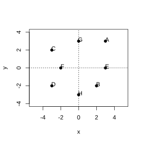
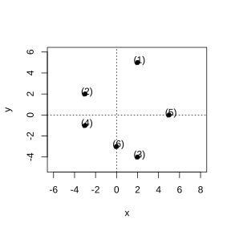
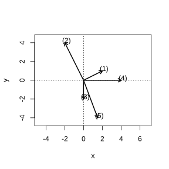

# Assignment 35

> **Definition 7.1.1** (Imaginary Unit)   We introduce a new number $\mathrm{i}$ such that $\mathrm{i}^2=-1$; $\mathrm{i}$ is called the imaginary unit.

> **Definition 7.1.2** (Complex Numbers)   A number of the form $a+b\mathrm{i}\ (a,b\in\mathbb R)$ is called a complex number.

> **Definition 7.1.3** (Set of Complex Numbers)   The set of all complex numbers, $\mathbb C=\{a+b\mathrm{i}\mid a,b\in\mathbb R\}$, is called the set of complex numbers.

> **Definition 7.1.4** (Real and Imaginary Parts)   For a complex number $z=a+b\mathrm{i}\ (a,b\in\mathbb R)$, $a$ is called the real part of $z$, and $b$ is called the imaginary part of $z$.

> **Definition 7.1.5** (Equality of Complex Numbers)   $a+b\mathrm{i}$ and $c+d\mathrm{i}$ are equal if and only if $a=c$ and $b=d$.

> **Definition 7.1.6** (Real Numbers, Imaginary Numbers, and Pure Imaginary Numbers)   For a complex number $a+b\mathrm{i}\ (a,b\in\mathbb R)$, it is a real number if and only if $b=0$; it is called an imaginary number when $b\neq 0$; it is called a pure imaginary number when $a=0$ and $b\neq 0$.

> **Definition 7.1.7** (The Complex Plane)   The plane on which a rectangular coordinate system is set up to represent complex numbers is called the complex plane; the $x$-axis is called the real axis, and the $y$-axis is called the imaginary axis. Every point on the real axis represents a real number; except for the origin, every point on the imaginary axis represents a pure imaginary number.

> **Definition 7.1.8** (Geometric Meaning of a Complex Number)   The complex number $z=a+b\mathrm{i}$ is in one-to-one correspondence with the point $Z(a,b)$ in the complex plane; the complex number $z=a+b\mathrm{i}$ is in one-to-one correspondence with the plane vector $\boldsymbol{OZ}$.

> **Definition 7.1.9** (Modulus of a Complex Number)   The modulus of the vector $\boldsymbol{OZ}$ is called the modulus of the complex number $z=a+b\mathrm{i}$, denoted $\lvert z\rvert$ or $\lvert a+b\mathrm{i}\rvert$, that is,

$$
\lvert z\rvert=\lvert a+b\mathrm{i}\rvert=\sqrt{a^2+b^2}.
$$

> **Definition 7.1.10** (Conjugate Complex Numbers)   When two complex numbers have equal real parts and imaginary parts that are opposites of each other, the two are called conjugates of each other. The conjugate of the complex number $z$ is denoted $\overline{z}$; that is, if $z=a+b\mathrm{i}$, then $\overline{z}=a-b\mathrm{i}$.

### Exercise 1

(Exercise 7.1, Problem 1) State the real and imaginary parts of the following complex numbers:

$-2+\frac{1}{3}\mathrm{i}$, $\sqrt{2}+\mathrm{i}$, $\frac{\sqrt{2}}{2}$, $-\sqrt{3}\mathrm{i}$, $\mathrm{i}$, $0$.

### Solution to Exercise 1

By **Definition 7.1.4** (Real and Imaginary Parts), in $z=a+b\mathrm{i}$, $a$ is the real part and $b$ is the imaginary part.

(1) The complex number $-2+\frac{1}{3}\mathrm{i}$ has real part $-2$ and imaginary part $\frac{1}{3}$.

(2) The complex number $\sqrt{2}+\mathrm{i}$ has real part $\sqrt{2}$ and imaginary part $1$.

(3) The complex number $\frac{\sqrt{2}}{2}=\frac{\sqrt{2}}{2}+0\mathrm{i}$ has real part $\frac{\sqrt{2}}{2}$ and imaginary part $0$.

(4) The complex number $-\sqrt{3}\mathrm{i}=0+(-\sqrt{3})\mathrm{i}$ has real part $0$ and imaginary part $-\sqrt{3}$.

(5) The complex number $\mathrm{i}=0+1\mathrm{i}$ has real part $0$ and imaginary part $1$.

(6) The complex number $0=0+0\mathrm{i}$ has real part $0$ and imaginary part $0$. $\blacksquare$

### Exercise 2

(Exercise 7.1, Problem 2) Among the following numbers, indicate which are real numbers, which are imaginary numbers, and which are pure imaginary numbers. Why?

$2+\sqrt{7}$, $0.618$, $\frac{2}{7}\mathrm{i}$, $0$, $\mathrm{i}$, $5\mathrm{i}+8$, $3-9\sqrt{2}\mathrm{i}$, $\mathrm{i}(1-\sqrt{3})$, $\sqrt{2}-\sqrt{2}\mathrm{i}$.

### Solution to Exercise 2

By **Definition 7.1.6** (Real Numbers, Imaginary Numbers, and Pure Imaginary Numbers), $a+b\mathrm{i}$ is real when $b=0$, imaginary when $b\neq 0$, and pure imaginary when $a=0$ and $b\neq 0$.

(1) $2+\sqrt{7}=(2+\sqrt{7})+0\mathrm{i}$, imaginary part $0$, so it is real.

(2) $0.618=0.618+0\mathrm{i}$, imaginary part $0$, so it is real.

(3) $\frac{2}{7}\mathrm{i}=0+\frac{2}{7}\mathrm{i}$, real part $0$, imaginary part $\frac{2}{7}\neq 0$, so it is a pure imaginary number.

(4) $0=0+0\mathrm{i}$, imaginary part $0$, so it is real.

(5) $\mathrm{i}=0+1\mathrm{i}$, real part $0$, imaginary part $1\neq 0$, so it is a pure imaginary number.

(6) $5\mathrm{i}+8=8+5\mathrm{i}$, real part $8\neq 0$, imaginary part $5\neq 0$, so it is an imaginary number.

(7) $3-9\sqrt{2}\mathrm{i}=3+(-9\sqrt{2})\mathrm{i}$, real part $3\neq 0$, imaginary part $-9\sqrt{2}\neq 0$, so it is an imaginary number.

(8) $\mathrm{i}(1-\sqrt{3})=0+(1-\sqrt{3})\mathrm{i}$, real part $0$, imaginary part $1-\sqrt{3}\neq 0$, so it is a pure imaginary number.

(9) $\sqrt{2}-\sqrt{2}\mathrm{i}=\sqrt{2}+(-\sqrt{2})\mathrm{i}$, real part $\sqrt{2}\neq 0$, imaginary part $-\sqrt{2}\neq 0$, so it is an imaginary number.

In summary, the real numbers are $2+\sqrt{7}$, $0.618$, $0$; the imaginary numbers are $5\mathrm{i}+8$, $3-9\sqrt{2}\mathrm{i}$, $\sqrt{2}-\sqrt{2}\mathrm{i}$; the pure imaginary numbers are $\frac{2}{7}\mathrm{i}$, $\mathrm{i}$, $\mathrm{i}(1-\sqrt{3})$. $\blacksquare$

### Exercise 3

(Exercise 7.1, Problem 3) Find the real numbers $x,y$ satisfying the following conditions:

(1) $(x+y)+(y-1)\mathrm{i}=(2x+3y)+(2y+1)\mathrm{i}$;

(2) $(x+y-3)+(x-2)\mathrm{i}=0$.

### Solution to Exercise 3

By **Definition 7.1.5** (Equality of Complex Numbers), two complex numbers are equal if and only if their real parts are equal and their imaginary parts are equal.

(1) The real parts on the two sides of the equation are $x+y$ and $2x+3y$, and the imaginary parts are $y-1$ and $2y+1$. By equality of complex numbers, we get the system of equations

$$
\begin{cases}x+y=2x+3y,\\y-1=2y+1.\end{cases}
$$

From the first equation, $x+2y=0$; from the second, $y=-2$. Substituting into the first gives $x-4=0$, i.e. $x=4$. Hence $x=4$, $y=-2$.

(2) The right-hand side $0=0+0\mathrm{i}$; by equality of complex numbers, we get the system of equations

$$
\begin{cases}x+y-3=0,\\x-2=0.\end{cases}
$$

From the second equation, $x=2$. Substituting into the first gives $2+y-3=0$, i.e. $y=1$. Hence $x=2$, $y=1$. $\blacksquare$

### Exercise 4

(Exercise 7.1, Problem 1) State the complex numbers represented by the points in the complex plane shown in the figure (each small square has side length $1$).

{width=50%}

### Solution to Exercise 4

By **Definition 7.1.8** (Geometric Meaning of a Complex Number), the point $Z(a,b)$ in the complex plane represents the complex number $a+b\mathrm{i}$.

Reading the figure, the coordinates of the points are: $A(3,3)$, $B(2,-2)$, $C(-3,2)$, $D(-3,-2)$, $E(3,0)$, $F(-2,0)$, $G(0,3)$, $H(0,-3)$.

Hence the complex numbers represented by the points are: $A:3+3\mathrm{i}$, $B:2-2\mathrm{i}$, $C:-3+2\mathrm{i}$, $D:-3-2\mathrm{i}$, $E:3$, $F:-2$, $G:3\mathrm{i}$, $H:-3\mathrm{i}$. $\blacksquare$

### Exercise 5

(Exercise 7.1, Problem 2) In the complex plane, plot the points representing the following complex numbers:

(1) $2+5\mathrm{i}$;

(2) $-3+2\mathrm{i}$;

(3) $2-4\mathrm{i}$;

(4) $-3-\mathrm{i}$;

(5) $5$;

(6) $-3\mathrm{i}$.

{width=50%}

### Solution to Exercise 5

By **Definition 7.1.8** (Geometric Meaning of a Complex Number), the complex number $a+b\mathrm{i}$ corresponds to the point $(a,b)$ in the complex plane.

(1) $2+5\mathrm{i}$ corresponds to the point $(2,5)$.

(2) $-3+2\mathrm{i}$ corresponds to the point $(-3,2)$.

(3) $2-4\mathrm{i}$ corresponds to the point $(2,-4)$.

(4) $-3-\mathrm{i}$ corresponds to the point $(-3,-1)$.

(5) $5=5+0\mathrm{i}$ corresponds to the point $(5,0)$, on the real axis.

(6) $-3\mathrm{i}=0+(-3)\mathrm{i}$ corresponds to the point $(0,-3)$, on the imaginary axis.

Just plot the above points in the complex plane. $\blacksquare$

### Exercise 6

(Exercise 7.1, Problem 3) Given the complex numbers $2+\mathrm{i}$, $-2+4\mathrm{i}$, $-2\mathrm{i}$, $4$, $\frac{3}{2}-4\mathrm{i}$,

(1) Draw in the complex plane the vectors corresponding to these complex numbers;

(2) Find the modulus of each of these complex numbers.

{width=50%}

### Solution to Exercise 6

By **Definition 7.1.8** (Geometric Meaning of a Complex Number), $a+b\mathrm{i}$ corresponds to the vector $\boldsymbol{OZ}=(a,b)$; by **Definition 7.1.9** (Modulus of a Complex Number), $\lvert a+b\mathrm{i}\rvert=\sqrt{a^2+b^2}$.

(1) The corresponding vectors are: $(2,1)$, $(-2,4)$, $(0,-2)$, $(4,0)$, $\left(\frac{3}{2},-4\right)$; just draw these vectors in the complex plane starting from the origin $O$.

(2) Find the modulus one by one:

(a) $\lvert2+\mathrm{i}\rvert=\sqrt{2^2+1^2}=\sqrt{5}$;

(b) $\lvert-2+4\mathrm{i}\rvert=\sqrt{(-2)^2+4^2}=\sqrt{20}=2\sqrt{5}$;

(c) $\lvert-2\mathrm{i}\rvert=\sqrt{0^2+(-2)^2}=2$;

(d) $\lvert4\rvert=\sqrt{4^2+0^2}=4$;

(e) $\left\lvert\frac{3}{2}-4\mathrm{i}\right\rvert=\sqrt{\left(\frac{3}{2}\right)^2+(-4)^2}=\sqrt{\frac{9}{4}+16}=\sqrt{\frac{73}{4}}=\frac{\sqrt{73}}{2}$. $\blacksquare$

### Problem 1

(Exercise 7.1, Review and Consolidation, Problem 1) Does a complex number satisfying the following conditions necessarily exist? If it exists, give an example; if not, explain why.

(1) an imaginary number with real part $-\sqrt{2}$;

(2) an imaginary number with imaginary part $-\sqrt{2}$;

(3) a pure imaginary number with imaginary part $-\sqrt{2}$.

### Solution to Problem 1

By **Definition 7.1.6** (Real Numbers, Imaginary Numbers, and Pure Imaginary Numbers), an imaginary number requires $b\neq 0$, and a pure imaginary number requires $a=0$ and $b\neq 0$.

(1) Take $a=-\sqrt{2}$, $b=1\neq 0$; then the complex number $-\sqrt{2}+\mathrm{i}$ has real part $-\sqrt{2}$ and $b\neq 0$, so it is imaginary. Hence it exists.

(2) Take $a=1$, $b=-\sqrt{2}\neq 0$; then the complex number $1-\sqrt{2}\mathrm{i}$ has imaginary part $-\sqrt{2}$ and $b\neq 0$, so it is imaginary. Hence it exists.

(3) To be pure imaginary, require $a=0$ and $b=-\sqrt{2}\neq 0$; then the complex number $0-\sqrt{2}\mathrm{i}=-\sqrt{2}\mathrm{i}$ has imaginary part $-\sqrt{2}$ and $a=0$, so it is a pure imaginary number. Hence it exists. $\blacksquare$

### Problem 2

(Exercise 7.1, Review and Consolidation, Problem 2) For what value of the real number $m$ is the complex number $(m^2-5m+6)+(m^2-3m)\mathrm{i}$ each of the following?

(1) a real number;

(2) an imaginary number;

(3) a pure imaginary number.

### Solution to Problem 2

By **Definition 7.1.6** (Real Numbers, Imaginary Numbers, and Pure Imaginary Numbers), $a+b\mathrm{i}$ is real when $b=0$, imaginary when $b\neq 0$, and pure imaginary when $a=0$ and $b\neq 0$.

Write $a=m^2-5m+6$, $b=m^2-3m=m(m-3)$.

(1) To be real, require $b=0$, i.e. $m(m-3)=0$, giving $m=0$ or $m=3$.

(2) To be imaginary, require $b\neq 0$, i.e. $m\neq 0$ and $m\neq 3$.

(3) To be pure imaginary, require $a=0$ and $b\neq 0$. From $a=0$, i.e. $(m-2)(m-3)=0$, we get $m=2$ or $m=3$. We also require $b\neq 0$, i.e. $m\neq 0$ and $m\neq 3$; hence $m=3$ is discarded and $m=2$. $\blacksquare$

### Problem 3

(Exercise 7.1, Review and Consolidation, Problem 3) Find the real numbers $x$ and $y$ satisfying the following equations:

(1) $(3x+2y)+(5x-y)\mathrm{i}=17-2\mathrm{i}$;

(2) $(x+y-3)+(x-4)\mathrm{i}=0$.

### Solution to Problem 3

By **Definition 7.1.5** (Equality of Complex Numbers), the real parts and imaginary parts on the two sides are equal respectively.

(1) The right-hand side $17-2\mathrm{i}$ has real part $17$ and imaginary part $-2$. This gives the system

$$
\begin{cases}3x+2y=17,\\5x-y=-2.\end{cases}
$$

From the second equation, $y=5x+2$. Substituting into the first gives $3x+2(5x+2)=17$, i.e. $13x+4=17$, so $x=1$. Substituting back gives $y=7$. Hence $x=1$, $y=7$.

(2) The right-hand side $0=0+0\mathrm{i}$. This gives the system

$$
\begin{cases}x+y-3=0,\\x-4=0.\end{cases}
$$

From the second equation, $x=4$. Substituting into the first gives $4+y-3=0$, i.e. $y=-1$. Hence $x=4$, $y=-1$. $\blacksquare$

### Problem 4

(Exercise 7.1, Review and Consolidation, Problem 4) If $P$ is the point in the complex plane representing the complex number $a+b\mathrm{i}\ (a,b\in\mathbb R)$, state the location of $P$ under each of the following conditions.

(1) $a>0$, $b>0$;

(2) $a<0$, $b>0$;

(3) $a=0$, $b\le 0$;

(4) $b<0$.

### Solution to Problem 4

By **Definition 7.1.7** (The Complex Plane) and **Definition 7.1.8** (Geometric Meaning of a Complex Number), $a+b\mathrm{i}$ corresponds to the point $P(a,b)$ in the complex plane, with $a$ the horizontal coordinate and $b$ the vertical coordinate.

(1) $a>0$, $b>0$, so $P$ lies in the first quadrant.

(2) $a<0$, $b>0$, so $P$ lies in the second quadrant.

(3) $a=0$, so $P$ lies on the $y$-axis (the imaginary axis); and $b\le 0$, so $P$ lies on the lower half of the imaginary axis (including the origin).

(4) $b<0$, so the vertical coordinate of $P$ is negative, and $P$ lies in the half-plane below the real axis. $\blacksquare$

### Problem 5

(Exercise 7.1, Review and Consolidation, Problem 5) Find the moduli of $z_1=3+4\mathrm{i}$ and $z_2=\frac{1}{2}-\sqrt{2}\mathrm{i}$, and compare their sizes.

### Solution to Problem 5

By **Definition 7.1.9** (Modulus of a Complex Number), $\lvert a+b\mathrm{i}\rvert=\sqrt{a^2+b^2}$.

$$
\lvert z_1\rvert=\lvert3+4\mathrm{i}\rvert=\sqrt{3^2+4^2}=\sqrt{25}=5.
$$

$$
\lvert z_2\rvert=\left\lvert\frac{1}{2}-\sqrt{2}\mathrm{i}\right\rvert=\sqrt{\left(\frac{1}{2}\right)^2+(-\sqrt{2})^2}=\sqrt{\frac{1}{4}+2}=\sqrt{\frac{9}{4}}=\frac{3}{2}.
$$

Since $5>\frac{3}{2}$, we have $\lvert z_1\rvert>\lvert z_2\rvert$. $\blacksquare$

### Problem 6

(Exercise 7.1, Comprehensive Application, Problem 6) For what value of the real number $m$ does the point in the complex plane representing the complex number $z=(m^2-8m+15)+(m^2-5m-14)\mathrm{i}$ satisfy each of the following?

(1) lies in the fourth quadrant;

(2) lies in the first or third quadrant;

(3) lies on the line $y=x$.

### Solution to Problem 6

By **Definition 7.1.8** (Geometric Meaning of a Complex Number), $z=a+b\mathrm{i}$ corresponds to the point $P(a,b)$. Write $a=m^2-8m+15=(m-3)(m-5)$, $b=m^2-5m-14=(m-7)(m+2)$.

(1) To lie in the fourth quadrant, require $a>0$ and $b<0$. From $a>0$, we get $m<3$ or $m>5$; from $b<0$, we get $-2<m<7$. Taking the intersection gives $-2<m<3$ or $5<m<7$.

(2) To lie in the first or third quadrant, require $a$ and $b$ to have the same sign, i.e. $ab>0$.

(a) When $a>0$ and $b>0$: $m<3$ or $m>5$, and $m<-2$ or $m>7$, giving $m<-2$ or $m>7$.

(b) When $a<0$ and $b<0$: $3<m<5$, and $-2<m<7$, giving $3<m<5$.

In summary, $m<-2$ or $3<m<5$ or $m>7$.

(3) To lie on the line $y=x$, require $P(a,b)$ to satisfy $b=a$, i.e. $m^2-5m-14=m^2-8m+15$. Simplifying gives $3m=29$, i.e. $m=\frac{29}{3}$. $\blacksquare$

### Problem 7

(Exercise 7.1, Comprehensive Application, Problem 7) In the complex plane, $O$ is the origin, and the complex number corresponding to the vector $\boldsymbol{OA}$ is $2+\mathrm{i}$.

(1) If the reflection of point $A$ across the real axis is point $B$, find the complex number corresponding to the vector $\boldsymbol{OB}$;

(2) If the reflection of point $B$ in (1) across the imaginary axis is point $C$, find the complex number corresponding to point $C$.

### Solution to Problem 7

By **Definition 7.1.8** (Geometric Meaning of a Complex Number), the vector $\boldsymbol{OA}$ corresponds to $2+\mathrm{i}$, so the coordinates of $A$ are $(2,1)$.

(1) The reflection of $A(2,1)$ across the real axis (the $x$-axis) is $B$ with coordinates $(2,-1)$. By **Definition 7.1.8**, the complex number corresponding to $\boldsymbol{OB}$ is $2+(-1)\mathrm{i}=2-\mathrm{i}$.

(2) The reflection of $B(2,-1)$ across the imaginary axis (the $y$-axis) is $C$ with coordinates $(-2,-1)$. By **Definition 7.1.8**, the complex number corresponding to $C$ is $-2+(-1)\mathrm{i}=-2-\mathrm{i}$. $\blacksquare$

### Problem 8

(Exercise 7.1, Comprehensive Application, Problem 8) Let $z\in\mathbb C$, and let $Z$ be the point in the complex plane corresponding to $z$. What figure is the set of points $Z$ satisfying the following conditions?

(1) $\lvert z\rvert=3$;

(2) $2\le \lvert z\rvert<5$.

### Solution to Problem 8

By **Definition 7.1.9** (Modulus of a Complex Number), $\lvert z\rvert$ is the length of the vector $\boldsymbol{OZ}$, that is, the distance from the point $Z$ to the origin $O$.

(1) $\lvert z\rvert=3$ means the distance from $Z$ to the origin $O$ is always $3$. By plane geometry, the set of points $Z$ is a circle centered at the origin $O$ with radius $3$.

(2) $\lvert z\rvert<5$ means the distance from $Z$ to the origin is less than $5$, i.e. the interior of the circle centered at $O$ with radius $5$; $\lvert z\rvert\ge 2$ means the distance from $Z$ to the origin is at least $2$, i.e. the exterior of the circle centered at $O$ with radius $2$ (including the circle). Their intersection is: the annulus between the two circles centered at $O$ with radii $2$ and $5$, where the inner circle ( $\lvert z\rvert=2$ ) is included and the outer circle ( $\lvert z\rvert=5$ ) is excluded. $\blacksquare$

### Problem 9

(Exercise 7.1, Comprehensive Application, Problem 9) If the complex number $z$ has a positive real part and imaginary part $3$, then in the complex plane, on what figure should the point corresponding to $z$ lie?

### Solution to Problem 9

By **Definition 7.1.8** (Geometric Meaning of a Complex Number), $z=a+b\mathrm{i}$ corresponds to the point $Z(a,b)$. Given the imaginary part $b=3$ and real part $a>0$, the vertical coordinate of $Z$ is always $3$ and the horizontal coordinate is positive.

Therefore, the set of points $Z$ is the part of the line $y=3$ lying in the first quadrant, i.e. the ray $y=3\ (x>0)$, not including the endpoint $(0,3)$. $\blacksquare$

### Problem 10

(Exercise 7.1, Extension and Exploration, Problem 10) Given that the imaginary part of the complex number $z$ is $\sqrt{3}$, and the modulus of the vector corresponding to $z$ in the complex plane is $2$, find this complex number $z$.

### Solution to Problem 10

Let $z=a+\sqrt{3}\mathrm{i}\ (a\in\mathbb R)$. By **Definition 7.1.9** (Modulus of a Complex Number), $\lvert z\rvert=\sqrt{a^2+(\sqrt{3})^2}=\sqrt{a^2+3}$. Given $\lvert z\rvert=2$, we get

$$
\sqrt{a^2+3}=2.
$$

Squaring both sides gives $a^2+3=4$, i.e. $a^2=1$, so $a=\pm 1$. Hence $z=1+\sqrt{3}\mathrm{i}$ or $z=-1+\sqrt{3}\mathrm{i}$. $\blacksquare$

### Problem 11

(Exercise 7.1, Extension and Exploration, Problem 11) Indicate in the complex plane the points $Z_1,Z_2,Z_3,Z_4$ corresponding to $z_1=1+2\mathrm{i}$, $z_2=\sqrt{2}+\sqrt{3}\mathrm{i}$, $z_3=\sqrt{3}-\sqrt{2}\mathrm{i}$, $z_4=-2+\mathrm{i}$. Determine whether these $4$ points lie on the same circle, and prove your conclusion.

### Solution to Problem 11

By **Definition 7.1.8** (Geometric Meaning of a Complex Number), the four points have coordinates $Z_1(1,2)$, $Z_2(\sqrt{2},\sqrt{3})$, $Z_3(\sqrt{3},-\sqrt{2})$, $Z_4(-2,1)$.

By **Definition 7.1.9** (Modulus of a Complex Number), compute the distance from each point to the origin:

$$
\lvert z_1\rvert=\sqrt{1^2+2^2}=\sqrt{5},
$$

$$
\lvert z_2\rvert=\sqrt{(\sqrt{2})^2+(\sqrt{3})^2}=\sqrt{2+3}=\sqrt{5},
$$

$$
\lvert z_3\rvert=\sqrt{(\sqrt{3})^2+(-\sqrt{2})^2}=\sqrt{3+2}=\sqrt{5},
$$

$$
\lvert z_4\rvert=\sqrt{(-2)^2+1^2}=\sqrt{5}.
$$

The distance from each of the four points to the origin $O$ equals $\sqrt{5}$, i.e. all four points lie on the circle centered at the origin $O$ with radius $\sqrt{5}$. Hence these $4$ points lie on the same circle. $\blacksquare$
