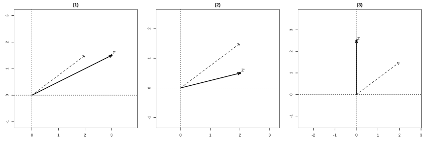

# Assignment 36

> **Definition 7.1.5** (Equality of Complex Numbers)   $a+b\mathrm{i}$ and $c+d\mathrm{i}$ are equal if and only if $a=c$ and $b=d$.

> **Definition 7.1.9** (Modulus of a Complex Number)   The modulus of the vector $\boldsymbol{OZ}$ is called the modulus of the complex number $z=a+b\mathrm{i}$, denoted $\lvert z\rvert$, that is, $\lvert z\rvert=\sqrt{a^2+b^2}$.

> **Definition 7.2.1** (Rule of Complex Addition)   Let $z_1=a+b\mathrm{i}$, $z_2=c+d\mathrm{i}\ (a,b,c,d\in\mathbb R)$; then

$$
(a+b\mathrm{i})+(c+d\mathrm{i})=(a+c)+(b+d)\mathrm{i}.
$$

> **Definition 7.2.2** (Rule of Complex Subtraction)   Complex subtraction is the inverse operation of addition, that is,

$$
(a+b\mathrm{i})-(c+d\mathrm{i})=(a-c)+(b-d)\mathrm{i}.
$$

> **Common Conclusion 7.2.3** (Operation Laws of Addition)   For any $z_1,z_2,z_3\in\mathbb C$, we have $z_1+z_2=z_2+z_1$, $(z_1+z_2)+z_3=z_1+(z_2+z_3)$.

> **Common Conclusion 7.2.4** (Geometric Meaning of Complex Addition and Subtraction)   Complex addition can be carried out according to vector addition; complex subtraction can be carried out according to vector subtraction. The distance between two points $Z_1(x_1,y_1)$, $Z_2(x_2,y_2)$ in the complex plane is $\lvert Z_1Z_2\rvert=\lvert z_2-z_1\rvert=\sqrt{(x_2-x_1)^2+(y_2-y_1)^2}$.

> **Definition 7.2.5** (Rule of Complex Multiplication)   Let $z_1=a+b\mathrm{i}$, $z_2=c+d\mathrm{i}\ (a,b,c,d\in\mathbb R)$; then

$$
(a+b\mathrm{i})(c+d\mathrm{i})=(ac-bd)+(ad+bc)\mathrm{i}.
$$

> **Common Conclusion 7.2.6** (Operation Laws of Multiplication)   For any $z_1,z_2,z_3\in\mathbb C$, we have $z_1z_2=z_2z_1$, $(z_1z_2)z_3=z_1(z_2z_3)$, $z_1(z_2+z_3)=z_1z_2+z_1z_3$.

> **Definition 7.2.7** (Rule of Complex Division)   Complex division is the inverse operation of multiplication, that is,

$$
\frac{a+b\mathrm{i}}{c+d\mathrm{i}}=\frac{ac+bd}{c^2+d^2}+\frac{bc-ad}{c^2+d^2}\mathrm{i}\quad (c+d\mathrm{i}\neq 0).
$$

> **Definition 7.2.8** (Root Formula for Real-Coefficient Quadratic Equations over the Complex Numbers)   When $\Delta=b^2-4ac<0$, the roots of the equation $ax^2+bx+c=0\ (a\neq 0)$ are

$$
x=\frac{-b\pm\sqrt{-(b^2-4ac)}\,\mathrm{i}}{2a}.
$$

### Exercise 1

(Exercise 7.2, Problem 1) Compute:

(1) $(2+4\mathrm{i})+(3-4\mathrm{i})$;

(2) $5-(3+2\mathrm{i})$;

(3) $(-3-4\mathrm{i})+(2+\mathrm{i})-(1-5\mathrm{i})$;

(4) $(2-\mathrm{i})-(2+3\mathrm{i})+4\mathrm{i}$.

### Solution to Exercise 1

By **Definition 7.2.1** (Rule of Complex Addition) and **Definition 7.2.2** (Rule of Complex Subtraction), add and subtract real parts with real parts, and imaginary parts with imaginary parts.

(1) $(2+4\mathrm{i})+(3-4\mathrm{i})=(2+3)+(4-4)\mathrm{i}=5$.

(2) $5-(3+2\mathrm{i})=(5-3)+(0-2)\mathrm{i}=2-2\mathrm{i}$.

(3) $(-3-4\mathrm{i})+(2+\mathrm{i})-(1-5\mathrm{i})=(-3+2-1)+(-4+1+5)\mathrm{i}=-2+2\mathrm{i}$.

(4) $(2-\mathrm{i})-(2+3\mathrm{i})+4\mathrm{i}=(2-2)+(-1-3+4)\mathrm{i}=0$. $\blacksquare$

### Exercise 2

(Exercise 7.2, Problem 2) As shown in the figure, the vector $\boldsymbol{OZ}$ corresponds to the complex number $z$. Draw the vectors corresponding to the results of the following operations:

(1) $z+1$;

(2) $z-\mathrm{i}$;

(3) $z+(-2+\mathrm{i})$.

{width=100%}

### Solution to Exercise 2

By **Common Conclusion 7.2.4** (Geometric Meaning of Complex Addition and Subtraction), complex addition corresponds to vector addition. Let $Z(a,b)$; then $z=a+b\mathrm{i}$.

(1) $z+1=(a+1)+b\mathrm{i}$, corresponding to the point $(a+1,b)$, i.e. translating the vector $\boldsymbol{OZ}$ rightward by $1$ unit.

(2) $z-\mathrm{i}=a+(b-1)\mathrm{i}$, corresponding to the point $(a,b-1)$, i.e. translating the vector $\boldsymbol{OZ}$ downward by $1$ unit.

(3) $z+(-2+\mathrm{i})=(a-2)+(b+1)\mathrm{i}$, corresponding to the point $(a-2,b+1)$, i.e. translating the vector $\boldsymbol{OZ}$ leftward by $2$ units and upward by $1$ unit.

Just draw the above vectors in the complex plane. $\blacksquare$

### Exercise 3

(Exercise 7.2, Problem 3) Prove that complex addition satisfies the commutative and associative laws.

### Solution to Exercise 3

Let $z_1=a+b\mathrm{i}$, $z_2=c+d\mathrm{i}$, $z_3=e+f\mathrm{i}\ (a,b,c,d,e,f\in\mathbb R)$.

By **Definition 7.2.1** (Rule of Complex Addition),

$$
z_1+z_2=(a+c)+(b+d)\mathrm{i},
$$

$$
z_2+z_1=(c+a)+(d+b)\mathrm{i}.
$$

By the commutative law of real addition, $a+c=c+a$, $b+d=d+b$, so $z_1+z_2=z_2+z_1$, and the commutative law holds.

Similarly, by **Definition 7.2.1**,

$$
(z_1+z_2)+z_3=[(a+c)+e]+[(b+d)+f]\mathrm{i},
$$

$$
z_1+(z_2+z_3)=[a+(c+e)]+[b+(d+f)]\mathrm{i}.
$$

By the associative law of real addition, $(a+c)+e=a+(c+e)$, $(b+d)+f=b+(d+f)$, so $(z_1+z_2)+z_3=z_1+(z_2+z_3)$, and the associative law holds. $\blacksquare$

### Exercise 4

(Exercise 7.2, Problem 4) Find the distance between the two points in the complex plane corresponding to the following pairs of complex numbers:

(1) $z_1=2+\mathrm{i}$, $z_2=3-\mathrm{i}$;

(2) $z_3=8+5\mathrm{i}$, $z_4=4+2\mathrm{i}$.

### Solution to Exercise 4

By **Common Conclusion 7.2.4** (Geometric Meaning of Complex Addition and Subtraction), the distance between the two points is $\lvert z_2-z_1\rvert$.

(1) $z_2-z_1=(3-\mathrm{i})-(2+\mathrm{i})=1-2\mathrm{i}$. By **Definition 7.1.9** (Modulus of a Complex Number),

$$
\lvert z_2-z_1\rvert=\lvert1-2\mathrm{i}\rvert=\sqrt{1^2+(-2)^2}=\sqrt{5}.
$$

(2) $z_4-z_3=(4+2\mathrm{i})-(8+5\mathrm{i})=-4-3\mathrm{i}$. By **Definition 7.1.9**,

$$
\lvert z_4-z_3\rvert=\lvert-4-3\mathrm{i}\rvert=\sqrt{(-4)^2+(-3)^2}=5.
$$

Hence the distances between the two points are $\sqrt{5}$ and $5$. $\blacksquare$

### Exercise 5

(Exercise 7.2, Problem 1) Compute:

(1) $(7-6\mathrm{i})(-3\mathrm{i})$;

(2) $(3+4\mathrm{i})(-2-3\mathrm{i})$;

(3) $(1+2\mathrm{i})(3-4\mathrm{i})(-2-\mathrm{i})$.

### Solution to Exercise 5

By **Definition 7.2.5** (Rule of Complex Multiplication), multiply like a polynomial, replace $\mathrm{i}^2$ by $-1$, and then combine the real and imaginary parts.

(1) $(7-6\mathrm{i})(-3\mathrm{i})=-21\mathrm{i}+18\mathrm{i}^2=-18-21\mathrm{i}$.

(2) $(3+4\mathrm{i})(-2-3\mathrm{i})=-6-9\mathrm{i}-8\mathrm{i}-12\mathrm{i}^2=-6-17\mathrm{i}+12=6-17\mathrm{i}$.

(3) First compute $(1+2\mathrm{i})(3-4\mathrm{i})=3-4\mathrm{i}+6\mathrm{i}-8\mathrm{i}^2=11+2\mathrm{i}$. Then compute $(11+2\mathrm{i})(-2-\mathrm{i})=-22-11\mathrm{i}-4\mathrm{i}-2\mathrm{i}^2=-20-15\mathrm{i}$. $\blacksquare$

### Exercise 6

(Exercise 7.2, Problem 2) Compute:

(1) $(\sqrt{3}+\sqrt{2}\mathrm{i})(-\sqrt{3}+\sqrt{2}\mathrm{i})$;

(2) $(1-\mathrm{i})^2$;

(3) $\mathrm{i}(2-\mathrm{i})(1-2\mathrm{i})$.

### Solution to Exercise 6

By **Definition 7.2.5** (Rule of Complex Multiplication).

(1) $(\sqrt{3}+\sqrt{2}\mathrm{i})(-\sqrt{3}+\sqrt{2}\mathrm{i})=-3+\sqrt{6}\mathrm{i}-\sqrt{6}\mathrm{i}+2\mathrm{i}^2=-3-2=-5$.

(2) $(1-\mathrm{i})^2=1-2\mathrm{i}+\mathrm{i}^2=1-2\mathrm{i}-1=-2\mathrm{i}$.

(3) First compute $(2-\mathrm{i})(1-2\mathrm{i})=2-4\mathrm{i}-\mathrm{i}+2\mathrm{i}^2=-5\mathrm{i}$. Then compute $\mathrm{i}\cdot(-5\mathrm{i})=-5\mathrm{i}^2=5$. $\blacksquare$

### Exercise 7

(Exercise 7.2, Problem 3) Compute:

(1) $\frac{1+\mathrm{i}}{1-\mathrm{i}}$;

(2) $\frac{1}{\mathrm{i}}$;

(3) $\frac{7+\mathrm{i}}{3+4\mathrm{i}}$;

(4) $\frac{(-1+\mathrm{i})(2+\mathrm{i})}{-\mathrm{i}}$.

### Solution to Exercise 7

By **Definition 7.2.7** (Rule of Complex Division), multiply numerator and denominator by the conjugate of the denominator to make the denominator real.

(1) $\frac{1+\mathrm{i}}{1-\mathrm{i}}=\frac{(1+\mathrm{i})^2}{(1-\mathrm{i})(1+\mathrm{i})}=\frac{1+2\mathrm{i}+\mathrm{i}^2}{1-\mathrm{i}^2}=\frac{2\mathrm{i}}{2}=\mathrm{i}$.

(2) $\frac{1}{\mathrm{i}}=\frac{1\cdot(-\mathrm{i})}{\mathrm{i}\cdot(-\mathrm{i})}=\frac{-\mathrm{i}}{1}=-\mathrm{i}$.

(3) $\frac{7+\mathrm{i}}{3+4\mathrm{i}}=\frac{(7+\mathrm{i})(3-4\mathrm{i})}{(3+4\mathrm{i})(3-4\mathrm{i})}=\frac{21-28\mathrm{i}+3\mathrm{i}-4\mathrm{i}^2}{9+16}=\frac{25-25\mathrm{i}}{25}=1-\mathrm{i}$.

(4) First compute the numerator $(-1+\mathrm{i})(2+\mathrm{i})=-2-\mathrm{i}+2\mathrm{i}+\mathrm{i}^2=-3+\mathrm{i}$. Then compute $\frac{-3+\mathrm{i}}{-\mathrm{i}}=\frac{(-3+\mathrm{i})\cdot\mathrm{i}}{(-\mathrm{i})\cdot\mathrm{i}}=\frac{-3\mathrm{i}+\mathrm{i}^2}{1}=\frac{-1-3\mathrm{i}}{1}=-1-3\mathrm{i}$. $\blacksquare$

### Exercise 8

(Exercise 7.2, Problem 4) Solve the following equations over the complex numbers:

(1) $9x^2+16=0$;

(2) $x^2+x+1=0$.

### Solution to Exercise 8

By **Definition 7.2.8** (Root Formula for Real-Coefficient Quadratic Equations over the Complex Numbers).

(1) From $9x^2+16=0$, we get $x^2=-\frac{16}{9}$. Since $\left(\frac{4}{3}\mathrm{i}\right)^2=\left(-\frac{4}{3}\mathrm{i}\right)^2=-\frac{16}{9}$, we have $x=\pm\frac{4}{3}\mathrm{i}$.

(2) In the equation $x^2+x+1=0$, $a=1$, $b=1$, $c=1$, $\Delta=1-4=-3<0$. By **Definition 7.2.8**,

$$
x=\frac{-1\pm\sqrt{3}\,\mathrm{i}}{2}.
$$

i.e. $x=-\frac{1}{2}+\frac{\sqrt{3}}{2}\mathrm{i}$ or $x=-\frac{1}{2}-\frac{\sqrt{3}}{2}\mathrm{i}$. $\blacksquare$

### Problem 1

(Exercise 7.2, Review and Consolidation, Problem 1) Compute:

(1) $(6-5\mathrm{i})+(3+2\mathrm{i})$;

(2) $5\mathrm{i}-(2+2\mathrm{i})$;

(3) $\left(\frac{2}{3}+\mathrm{i}\right)+\left(1-\frac{2}{3}\mathrm{i}\right)-\left(\frac{1}{2}+\frac{3}{4}\mathrm{i}\right)$;

(4) $(0.5+1.3\mathrm{i})-(1.2+0.7\mathrm{i})+(1-0.4\mathrm{i})$.

### Solution to Problem 1

By **Definition 7.2.1** (Rule of Complex Addition) and **Definition 7.2.2** (Rule of Complex Subtraction).

(1) $(6-5\mathrm{i})+(3+2\mathrm{i})=9-3\mathrm{i}$.

(2) $5\mathrm{i}-(2+2\mathrm{i})=-2+3\mathrm{i}$.

(3) Real part: $\frac{2}{3}+1-\frac{1}{2}=\frac{4}{6}+\frac{6}{6}-\frac{3}{6}=\frac{7}{6}$; imaginary part: $1-\frac{2}{3}-\frac{3}{4}=\frac{12}{12}-\frac{8}{12}-\frac{9}{12}=-\frac{5}{12}$. The result is $\frac{7}{6}-\frac{5}{12}\mathrm{i}$.

(4) Real part: $0.5-1.2+1=0.3$; imaginary part: $1.3-0.7-0.4=0.2$. The result is $0.3+0.2\mathrm{i}$. $\blacksquare$

### Problem 2

(Exercise 7.2, Review and Consolidation, Problem 2) In the complex plane, the complex numbers $6+5\mathrm{i}$ and $-3+4\mathrm{i}$ correspond to the vectors $\boldsymbol{OA}$ and $\boldsymbol{OB}$ respectively, where $O$ is the origin. Find the complex numbers corresponding to the vectors $\boldsymbol{AB}$ and $\boldsymbol{BA}$.

### Solution to Problem 2

By **Common Conclusion 7.2.4** (Geometric Meaning of Complex Addition and Subtraction), $\boldsymbol{AB}=\boldsymbol{OB}-\boldsymbol{OA}$, $\boldsymbol{BA}=\boldsymbol{OA}-\boldsymbol{OB}$.

Point $A$ corresponds to $6+5\mathrm{i}$, and point $B$ corresponds to $-3+4\mathrm{i}$.

$$
\boldsymbol{AB}\text{ 对应复数}=(-3+4\mathrm{i})-(6+5\mathrm{i})=-9-\mathrm{i}.
$$

$$
\boldsymbol{BA}\text{ 对应复数}=(6+5\mathrm{i})-(-3+4\mathrm{i})=9+\mathrm{i}.
$$

$\blacksquare$

### Problem 3

(Exercise 7.2, Review and Consolidation, Problem 3) Compute:

(1) $(-8-7\mathrm{i})(-3\mathrm{i})$;

(2) $(4-3\mathrm{i})(-5-4\mathrm{i})$;

(3) $\left(-\frac{1}{2}+\frac{\sqrt{3}}{2}\mathrm{i}\right)(1+\mathrm{i})$;

(4) $\left(\frac{\sqrt{3}}{2}\mathrm{i}-\frac{1}{2}\right)\left(-\frac{1}{2}+\frac{\sqrt{3}}{2}\mathrm{i}\right)$;

(5) $(1+\mathrm{i})(1-\mathrm{i})+(-1+\mathrm{i})$.

### Solution to Problem 3

By **Definition 7.2.5** (Rule of Complex Multiplication).

(1) $(-8-7\mathrm{i})(-3\mathrm{i})=24\mathrm{i}+21\mathrm{i}^2=-21+24\mathrm{i}$.

(2) $(4-3\mathrm{i})(-5-4\mathrm{i})=-20-16\mathrm{i}+15\mathrm{i}+12\mathrm{i}^2=-32-\mathrm{i}$.

(3) $\left(-\frac{1}{2}+\frac{\sqrt{3}}{2}\mathrm{i}\right)(1+\mathrm{i})=-\frac{1}{2}-\frac{1}{2}\mathrm{i}+\frac{\sqrt{3}}{2}\mathrm{i}+\frac{\sqrt{3}}{2}\mathrm{i}^2=\frac{-1-\sqrt{3}}{2}+\frac{\sqrt{3}-1}{2}\mathrm{i}$.

(4) First write this as $\left(-\frac{1}{2}+\frac{\sqrt{3}}{2}\mathrm{i}\right)\left(-\frac{1}{2}+\frac{\sqrt{3}}{2}\mathrm{i}\right)$, i.e. $\left(-\frac{1}{2}+\frac{\sqrt{3}}{2}\mathrm{i}\right)^2=\frac{1}{4}-\frac{\sqrt{3}}{2}\mathrm{i}+\frac{3}{4}\mathrm{i}^2=\frac{1}{4}-\frac{3}{4}-\frac{\sqrt{3}}{2}\mathrm{i}=-\frac{1}{2}-\frac{\sqrt{3}}{2}\mathrm{i}$.

(5) $(1+\mathrm{i})(1-\mathrm{i})=1-\mathrm{i}^2=2$; adding $(-1+\mathrm{i})$ gives $2+(-1+\mathrm{i})=1+\mathrm{i}$. $\blacksquare$

### Problem 4

(Exercise 7.2, Review and Consolidation, Problem 4) Compute:

(1) $\frac{2\mathrm{i}}{2-\mathrm{i}}$;

(2) $\frac{2+\mathrm{i}}{7+4\mathrm{i}}$;

(3) $\frac{1}{(2-\mathrm{i})^2}$;

(4) $\frac{5(4+\mathrm{i})^2}{\mathrm{i}(2+\mathrm{i})}$.

### Solution to Problem 4

By **Definition 7.2.7** (Rule of Complex Division).

(1) $\frac{2\mathrm{i}}{2-\mathrm{i}}=\frac{2\mathrm{i}(2+\mathrm{i})}{(2-\mathrm{i})(2+\mathrm{i})}=\frac{4\mathrm{i}+2\mathrm{i}^2}{4+1}=\frac{-2+4\mathrm{i}}{5}=-\frac{2}{5}+\frac{4}{5}\mathrm{i}$.

(2) $\frac{2+\mathrm{i}}{7+4\mathrm{i}}=\frac{(2+\mathrm{i})(7-4\mathrm{i})}{(7+4\mathrm{i})(7-4\mathrm{i})}=\frac{14-8\mathrm{i}+7\mathrm{i}-4\mathrm{i}^2}{49+16}=\frac{18-\mathrm{i}}{65}=\frac{18}{65}-\frac{1}{65}\mathrm{i}$.

(3) First compute $(2-\mathrm{i})^2=4-4\mathrm{i}+\mathrm{i}^2=3-4\mathrm{i}$. Then compute $\frac{1}{3-4\mathrm{i}}=\frac{3+4\mathrm{i}}{(3-4\mathrm{i})(3+4\mathrm{i})}=\frac{3+4\mathrm{i}}{25}=\frac{3}{25}+\frac{4}{25}\mathrm{i}$.

(4) First compute $(4+\mathrm{i})^2=16+8\mathrm{i}+\mathrm{i}^2=15+8\mathrm{i}$, so the numerator is $5(15+8\mathrm{i})=75+40\mathrm{i}$. Then compute $\mathrm{i}(2+\mathrm{i})=2\mathrm{i}+\mathrm{i}^2=-1+2\mathrm{i}$. Finally, $\frac{75+40\mathrm{i}}{-1+2\mathrm{i}}=\frac{(75+40\mathrm{i})(-1-2\mathrm{i})}{(-1+2\mathrm{i})(-1-2\mathrm{i})}=\frac{-75-150\mathrm{i}-40\mathrm{i}-80\mathrm{i}^2}{1+4}=\frac{5-190\mathrm{i}}{5}=1-38\mathrm{i}$. $\blacksquare$

### Problem 5

(Exercise 7.2, Comprehensive Application, Problem 5) Quadrilateral $ABCD$ is a parallelogram in the complex plane, and the points $A$, $B$, $C$ correspond to the complex numbers $1+3\mathrm{i}$, $-\mathrm{i}$, $2+\mathrm{i}$ respectively. Find the complex number corresponding to point $D$.

### Solution to Problem 5

By **Common Conclusion 7.2.4** (Geometric Meaning of Complex Addition and Subtraction), in the parallelogram $ABCD$, the diagonals bisect each other, i.e. the midpoint of $AC$ coincides with the midpoint of $BD$.

Point $A$ corresponds to $z_A=1+3\mathrm{i}$, and point $C$ corresponds to $z_C=2+\mathrm{i}$. The complex number corresponding to the midpoint of diagonal $AC$ is $\frac{z_A+z_C}{2}=\frac{(1+3\mathrm{i})+(2+\mathrm{i})}{2}=\frac{3+4\mathrm{i}}{2}=\frac{3}{2}+2\mathrm{i}$.

Let $z_D$ be the complex number corresponding to point $D$, and point $B$ corresponds to $z_B=-\mathrm{i}$. Since the midpoint of $BD$ coincides with the midpoint of $AC$, we have $\frac{z_B+z_D}{2}=\frac{3}{2}+2\mathrm{i}$, so $z_D=3+4\mathrm{i}-z_B=3+4\mathrm{i}-(-\mathrm{i})=3+5\mathrm{i}$. $\blacksquare$

### Problem 6

(Exercise 7.2, Comprehensive Application, Problem 6) Solve the following equations over the complex numbers:

(1) $x^2+4x+5=0$;

(2) $2x^2-3x+4=0$.

### Solution to Problem 6

By **Definition 7.2.8** (Root Formula for Real-Coefficient Quadratic Equations over the Complex Numbers).

(1) $a=1$, $b=4$, $c=5$, $\Delta=16-20=-4<0$. Hence

$$
x=\frac{-4\pm\sqrt{4}\,\mathrm{i}}{2}=\frac{-4\pm 2\mathrm{i}}{2}=-2\pm\mathrm{i}.
$$

(2) $a=2$, $b=-3$, $c=4$, $\Delta=9-32=-23<0$. Hence

$$
x=\frac{3\pm\sqrt{23}\,\mathrm{i}}{4}.
$$

i.e. $x=\frac{3}{4}+\frac{\sqrt{23}}{4}\mathrm{i}$ or $x=\frac{3}{4}-\frac{\sqrt{23}}{4}\mathrm{i}$. $\blacksquare$

### Problem 7

(Exercise 7.2, Comprehensive Application, Problem 7) Given that $2\mathrm{i}-3$ is a root of the equation $2x^2+px+q=0$ in $x$, find the real numbers $p,q$.

### Solution to Problem 7

By **Definition 7.2.8** and the property of conjugate imaginary numbers, the imaginary roots of a real-coefficient quadratic equation occur in conjugate pairs. Given that $x_1=-3+2\mathrm{i}$ is a root, the other root is its conjugate $x_2=-3-2\mathrm{i}$.

By Vieta's formulas, $x_1+x_2=-\frac{p}{2}$, $x_1x_2=\frac{q}{2}$.

$$
x_1+x_2=(-3+2\mathrm{i})+(-3-2\mathrm{i})=-6=-\frac{p}{2},
$$

Hence $p=12$.

$$
x_1x_2=(-3+2\mathrm{i})(-3-2\mathrm{i})=9-4\mathrm{i}^2=9+4=13=\frac{q}{2},
$$

Hence $q=26$. $\blacksquare$

### Problem 8

(Exercise 7.2, Extension and Exploration, Problem 8) Using the formula $a^2+b^2=(a+b\mathrm{i})(a-b\mathrm{i})$, factor each of the following into a product of linear factors:

(1) $x^2+4$;

(2) $a^4-b^4$.

### Solution to Problem 8

By **Definition 7.2.5** (Rule of Complex Multiplication) and $a^2+b^2=(a+b\mathrm{i})(a-b\mathrm{i})$.

(1) $x^2+4=x^2+2^2=(x+2\mathrm{i})(x-2\mathrm{i})$.

(2) $a^4-b^4=(a^2+b^2)(a^2-b^2)=(a^2+b^2)(a+b)(a-b)$. Using again $a^2+b^2=(a+b\mathrm{i})(a-b\mathrm{i})$, we get

$$
a^4-b^4=(a+\mathrm{i}b)(a-\mathrm{i}b)(a+b)(a-b).
$$

$\blacksquare$

### Problem 9

(Exercise 7.2, Extension and Exploration, Problem 9) If $z=x+y\mathrm{i}\ (x,y\in\mathbb R)$, what figure is the set of points $Z$ in the complex plane satisfying $\lvert z-(2+\mathrm{i})\rvert=3$?

### Solution to Problem 9

By **Definition 7.1.9** (Modulus of a Complex Number) and **Common Conclusion 7.2.4** (Geometric Meaning of Complex Subtraction), $\lvert z-(2+\mathrm{i})\rvert$ is the distance between the point $Z(x,y)$ and the point $(2,1)$.

$\lvert z-(2+\mathrm{i})\rvert=3$ means the distance from $Z$ to the fixed point $(2,1)$ is always $3$. Hence the set of points $Z$ is a circle centered at $(2,1)$ with radius $3$. $\blacksquare$

### Problem 10

(Exercise 7.2, Extension and Exploration, Problem 10) Use information technology to experiment: try factoring real-coefficient polynomials over the complex numbers, and observe and record the patterns you find.

### Solution to Problem 10

Factoring real-coefficient polynomials over the complex numbers, one observes the following pattern.

By **Definition 7.2.8** and **Definition 7.2.5**, every real-coefficient polynomial can be factored over the complex numbers into a product of linear factors, with the imaginary roots occurring in conjugate pairs. That is, if $a+b\mathrm{i}\ (b\neq 0)$ is a root of a real-coefficient polynomial, then $a-b\mathrm{i}$ is also a root, and the corresponding linear factors are $(x-a-b\mathrm{i})(x-a+b\mathrm{i})=(x-a)^2+b^2$.

For example, $x^2+1=(x+\mathrm{i})(x-\mathrm{i})$, $x^4-1=(x-1)(x+1)(x-\mathrm{i})(x+\mathrm{i})$. This shows that over the complex numbers, every real-coefficient polynomial can be completely factored into linear factors, with imaginary roots occurring in pairs. $\blacksquare$

### Reading and Thinking 1

(Think About 1) From the Fundamental Theorem of Algebra it follows that: any complex-coefficient polynomial $f(x)$ of degree $n\ (n\in\mathbb N^*)$ can be factored over the complex numbers into a product of $n$ linear factors. Consequently, a degree-$n$ polynomial equation has $n$ complex roots (multiple roots counted with multiplicity). Can you give a proof?

### Solution to Reading and Thinking 1

By the Fundamental Theorem of Algebra, $f(x)=0$ has at least one complex root, say $x_1$. By polynomial division, $f(x)$ factors as $(x-x_1)f_1(x)$, where $f_1(x)$ is a polynomial of degree $n-1$.

Applying the Fundamental Theorem of Algebra again to $f_1(x)$, the equation $f_1(x)=0$ has at least one complex root $x_2$, so $f(x)=(x-x_1)(x-x_2)f_2(x)$, where $f_2(x)$ is a polynomial of degree $n-2$.

Continuing in this way, after $n$ steps, $f(x)$ is factored into a product of $n$ linear factors:

$$
f(x)=a_n(x-x_1)(x-x_2)\cdots(x-x_n).
$$

Therefore the equation $f(x)=0$ has $n$ complex roots $x_1,x_2,\cdots,x_n$ (multiple roots counted with multiplicity). $\blacksquare$

### Reading and Thinking 2

(Think About 2) If the roots in $\mathbb C$ of the real-coefficient quartic equation $a_4x^4+a_3x^3+a_2x^2+a_1x+a_0=0\ (a_4\neq 0)$ are $x_1,x_2,x_3,x_4$, then what is the relation between them and the coefficients of the equation?

### Solution to Reading and Thinking 2

By **Definition 7.2.5** (Rule of Complex Multiplication) and factoring, the equation can be written as

$$
a_4(x-x_1)(x-x_2)(x-x_3)(x-x_4)=0.
$$

Expanding and comparing coefficients gives

$$
x_1+x_2+x_3+x_4=-\frac{a_3}{a_4},
$$

$$
x_1x_2+x_1x_3+x_1x_4+x_2x_3+x_2x_4+x_3x_4=\frac{a_2}{a_4},
$$

$$
x_1x_2x_3+x_1x_2x_4+x_1x_3x_4+x_2x_3x_4=-\frac{a_1}{a_4},
$$

$$
x_1x_2x_3x_4=\frac{a_0}{a_4}.
$$

$\blacksquare$

### Reading and Thinking 3

(Think About 3) For the above equation, if the coefficients are complex numbers, do these relations between roots and coefficients still hold?

### Solution to Reading and Thinking 3

The above relations between roots and coefficients still hold.

By **Definition 7.2.5** (Rule of Complex Multiplication), addition and multiplication in the complex numbers satisfy the commutative, associative, and distributive laws; hence the expansion and coefficient comparison of the polynomial is exactly the same as in the real-coefficient case. Whether the coefficients are real or complex, as long as the equation can be factored over the complex numbers as $a_n(x-x_1)\cdots(x-x_n)=0$, comparing the coefficients on both sides of the expansion gives the same relations between roots and coefficients. $\blacksquare$
