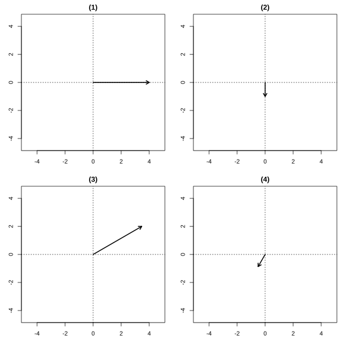
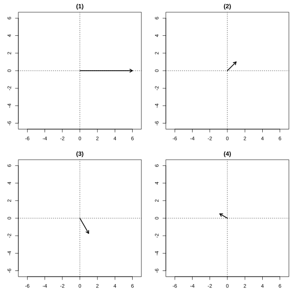
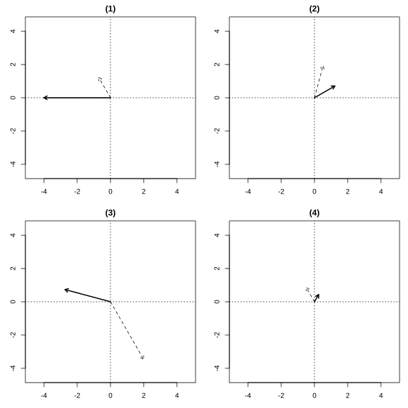

# Assignment 37

> **Definition 7.1.9** (Modulus of a Complex Number)   The modulus of the complex number $z=a+b\mathrm{i}$ is $\lvert z\rvert=\sqrt{a^2+b^2}$.

> **Definition 7.3.1** (Trigonometric Form of a Complex Number)   Any complex number $z=a+b\mathrm{i}$ can be written in the form $r\left(\cos\theta+\mathrm{i}\sin\theta\right)$, where $r$ is the modulus of $z$, and $\theta$ is the angle whose initial side is the nonnegative half of the $x$-axis and whose terminal side is the ray on which the vector $\boldsymbol{OZ}$ lies. The expression $r\left(\cos\theta+\mathrm{i}\sin\theta\right)$ is called the trigonometric form of the complex number $z=a+b\mathrm{i}$, or trigonometric form for short; $a+b\mathrm{i}$ is called the algebraic form.

> **Definition 7.3.2** (Argument)   The angle $\theta$ whose initial side is the nonnegative half of the $x$-axis and whose terminal side is the ray on which the vector $\boldsymbol{OZ}$ lies is called the argument of the complex number $z=a+b\mathrm{i}$. The argument of any nonzero complex number has infinitely many values, which differ by integer multiples of $2\pi$.

> **Definition 7.3.3** (Principal Value of the Argument)   The value of the argument $\theta$ in the range $0\le\theta<2\pi$ is stipulated to be the principal value of the argument, usually denoted $\arg z$, that is, $0\le\arg z<2\pi$.

> **Definition 7.3.4** (Condition for Equality of Nonzero Complex Numbers in Trigonometric Form)   Two nonzero complex numbers are equal if and only if their moduli and their principal arguments are respectively equal.

> **Definition 7.3.5** (Trigonometric Form of Complex Multiplication)  

$$
r_1\left(\cos\theta_1+\mathrm{i}\sin\theta_1\right)\cdot r_2\left(\cos\theta_2+\mathrm{i}\sin\theta_2\right)=r_1r_2\left[\cos\left(\theta_1+\theta_2\right)+\mathrm{i}\sin\left(\theta_1+\theta_2\right)\right].
$$

That is, the modulus of the product equals the product of the moduli, and the argument of the product equals the sum of the arguments.

> **Definition 7.3.6** (Trigonometric Form of Complex Division)  

$$
\frac{r_1\left(\cos\theta_1+\mathrm{i}\sin\theta_1\right)}{r_2\left(\cos\theta_2+\mathrm{i}\sin\theta_2\right)}=\frac{r_1}{r_2}\left[\cos\left(\theta_1-\theta_2\right)+\mathrm{i}\sin\left(\theta_1-\theta_2\right)\right]\quad \left(r_2\neq 0\right).
$$

That is, the modulus of the quotient equals the modulus of the dividend divided by the modulus of the divisor, and the argument of the quotient equals the argument of the dividend minus the argument of the divisor.

> **Common Conclusion 7.3.7** (Geometric Meaning of Complex Multiplication and Division)   When two complex numbers are multiplied, rotate the vector $\boldsymbol{OZ_1}$ about the point $O$ through the angle $\theta_2$, and then scale its modulus by a factor of $r_2$ to obtain the vector corresponding to the product. When two complex numbers are divided, rotate the vector through the angle $-\theta_2$, and then scale its modulus by a factor of $\frac{1}{r_2}$.

> **Theorem 7.3.8** (De Moivre's Theorem)  

$$
\left[r\left(\cos\theta+\mathrm{i}\sin\theta\right)\right]^n=r^n\left(\cos n\theta+\mathrm{i}\sin n\theta\right)\quad \left(n\in\mathbb N^*\right).
$$

### Exercise 1

(Exercise 7.3, Problem 1) Draw the vectors corresponding to the following complex numbers, and write these complex numbers in trigonometric form:

(1) $4$;

(2) $-\mathrm{i}$;

(3) $2\sqrt{3}+2\mathrm{i}$;

(4) $-\frac{1}{2}-\frac{\sqrt{3}}{2}\mathrm{i}$.

{width=100%}

### Solution to Exercise 1

By **Definition 7.3.1** (Trigonometric Form of a Complex Number), $r=\sqrt{a^2+b^2}$, $\cos\theta=\frac{a}{r}$, $\sin\theta=\frac{b}{r}$, and $\theta$ is then determined by the quadrant in which the point lies.

(1) $4=4+0\mathrm{i}$, $r=4$, $\cos\theta=1$, $\sin\theta=0$, the point lies on the positive real axis, so $\arg 4=0$. The trigonometric form is $4\left(\cos 0+\mathrm{i}\sin 0\right)$.

(2) $-\mathrm{i}=0+\left(-1\right)\mathrm{i}$, $r=1$, the point lies on the negative imaginary axis, so $\arg\left(-\mathrm{i}\right)=\frac{3\pi}{2}$. The trigonometric form is $\cos\frac{3\pi}{2}+\mathrm{i}\sin\frac{3\pi}{2}$.

(3) $r=\sqrt{\left(2\sqrt{3}\right)^2+2^2}=\sqrt{12+4}=4$, $\cos\theta=\frac{2\sqrt{3}}{4}=\frac{\sqrt{3}}{2}$, $\sin\theta=\frac{2}{4}=\frac{1}{2}$, the point lies in the first quadrant, so $\arg=\frac{\pi}{6}$. The trigonometric form is $4\left(\cos\frac{\pi}{6}+\mathrm{i}\sin\frac{\pi}{6}\right)$.

(4) $r=\sqrt{\left(-\frac{1}{2}\right)^2+\left(-\frac{\sqrt{3}}{2}\right)^2}=1$, $\cos\theta=-\frac{1}{2}$, $\sin\theta=-\frac{\sqrt{3}}{2}$, the point lies in the third quadrant, so $\arg=\frac{4\pi}{3}$. The trigonometric form is $\cos\frac{4\pi}{3}+\mathrm{i}\sin\frac{4\pi}{3}$. $\blacksquare$

### Exercise 2

(Exercise 7.3, Problem 2) Are the following complex numbers in trigonometric form? If not, write them in trigonometric form.

(1) $\frac{1}{2}\left(\cos\frac{\pi}{4}-\mathrm{i}\sin\frac{\pi}{4}\right)$;

(2) $-\frac{1}{2}\left(\cos\frac{\pi}{3}+\mathrm{i}\sin\frac{\pi}{3}\right)$;

(3) $\frac{1}{2}\left(\sin\frac{5\pi}{12}+\mathrm{i}\cos\frac{5\pi}{12}\right)$;

(4) $\cos\frac{7\pi}{5}+\mathrm{i}\sin\frac{7\pi}{5}$;

(5) $2\left(\cos\frac{\pi}{3}+\mathrm{i}\sin\frac{\pi}{6}\right)$.

### Solution to Exercise 2

By **Definition 7.3.1** (Trigonometric Form of a Complex Number), trigonometric form must satisfy: the modulus $r\ge 0$, and the expression in parentheses is $\cos\theta+\mathrm{i}\sin\theta$.

(1) Not in trigonometric form, because the expression in parentheses is $\cos\theta-\mathrm{i}\sin\theta$. Since $\cos\theta-\mathrm{i}\sin\theta=\cos\left(-\theta\right)+\mathrm{i}\sin\left(-\theta\right)$, we get

$$
\frac{1}{2}\left(\cos\frac{\pi}{4}-\mathrm{i}\sin\frac{\pi}{4}\right)=\frac{1}{2}\left[\cos\left(-\frac{\pi}{4}\right)+\mathrm{i}\sin\left(-\frac{\pi}{4}\right)\right].
$$

(2) Not in trigonometric form, because the modulus is $-\frac{1}{2}<0$. Rewrite as $\frac{1}{2}\left[-\left(\cos\frac{\pi}{3}+\mathrm{i}\sin\frac{\pi}{3}\right)\right]=\frac{1}{2}\left[\cos\left(\frac{\pi}{3}+\pi\right)+\mathrm{i}\sin\left(\frac{\pi}{3}+\pi\right)\right]=\frac{1}{2}\left(\cos\frac{4\pi}{3}+\mathrm{i}\sin\frac{4\pi}{3}\right)$.

(3) Not in trigonometric form, because the expression in parentheses is $\sin\theta+\mathrm{i}\cos\theta$. Since $\sin\theta=\cos\left(\frac{\pi}{2}-\theta\right)$, $\cos\theta=\sin\left(\frac{\pi}{2}-\theta\right)$, we get $\sin\frac{5\pi}{12}+\mathrm{i}\cos\frac{5\pi}{12}=\cos\frac{\pi}{12}+\mathrm{i}\sin\frac{\pi}{12}$. Hence the original expression $=\frac{1}{2}\left(\cos\frac{\pi}{12}+\mathrm{i}\sin\frac{\pi}{12}\right)$.

(4) It is in trigonometric form, with modulus $1$ and argument $\frac{7\pi}{5}$.

(5) Not in trigonometric form, because the angles of $\cos$ and $\sin$ in parentheses differ. The arguments must be unified. $2\left(\cos\frac{\pi}{3}+\mathrm{i}\sin\frac{\pi}{6}\right)=2\left(\frac{1}{2}+\mathrm{i}\cdot\frac{1}{2}\right)=1+\mathrm{i}$. Its modulus $r=\sqrt{2}$, $\arg=\frac{\pi}{4}$, so the trigonometric form is $\sqrt{2}\left(\cos\frac{\pi}{4}+\mathrm{i}\sin\frac{\pi}{4}\right)$. $\blacksquare$

### Exercise 3

(Exercise 7.3, Problem 3) Write the following complex numbers in algebraic form:

(1) $6\left(\cos\frac{3\pi}{2}+\mathrm{i}\sin\frac{3\pi}{2}\right)$;

(2) $2\left(\cos\frac{5\pi}{3}+\mathrm{i}\sin\frac{5\pi}{3}\right)$.

### Solution to Exercise 3

By **Definition 7.3.1** (Trigonometric Form of a Complex Number), $r\left(\cos\theta+\mathrm{i}\sin\theta\right)=r\cos\theta+\left(r\sin\theta\right)\mathrm{i}$.

(1) $6\left(\cos\frac{3\pi}{2}+\mathrm{i}\sin\frac{3\pi}{2}\right)=6\cdot 0+6\cdot\left(-1\right)\mathrm{i}=-6\mathrm{i}$.

(2) $2\left(\cos\frac{5\pi}{3}+\mathrm{i}\sin\frac{5\pi}{3}\right)=2\cdot\frac{1}{2}+2\cdot\left(-\frac{\sqrt{3}}{2}\right)\mathrm{i}=1-\sqrt{3}\mathrm{i}$. $\blacksquare$

### Exercise 4

(Exercise 7.3, Problem 1) Compute:

(1) $8\left(\cos\frac{\pi}{6}+\mathrm{i}\sin\frac{\pi}{6}\right)\times 2\left(\cos\frac{\pi}{4}+\mathrm{i}\sin\frac{\pi}{4}\right)$;

(2) $2\left(\cos\frac{4\pi}{3}+\mathrm{i}\sin\frac{4\pi}{3}\right)\times 4\left(\cos\frac{5\pi}{6}+\mathrm{i}\sin\frac{5\pi}{6}\right)$;

(3) $\sqrt{2}\left(\cos 240^{\circ}+\mathrm{i}\sin 240^{\circ}\right)\times\frac{\sqrt{3}}{2}\left(\cos 60^{\circ}+\mathrm{i}\sin 60^{\circ}\right)$;

(4) $3\left(\cos 18^{\circ}+\mathrm{i}\sin 18^{\circ}\right)\times 2\left(\cos 54^{\circ}+\mathrm{i}\sin 54^{\circ}\right)\times 5\left(\cos 108^{\circ}+\mathrm{i}\sin 108^{\circ}\right)$.

### Solution to Exercise 4

By **Definition 7.3.5** (Trigonometric Form of Complex Multiplication), multiply the moduli and add the arguments.

(1) Modulus: $8\times 2=16$; argument: $\frac{\pi}{6}+\frac{\pi}{4}=\frac{5\pi}{12}$. The result is $16\left(\cos\frac{5\pi}{12}+\mathrm{i}\sin\frac{5\pi}{12}\right)$.

(2) Modulus: $2\times 4=8$; argument: $\frac{4\pi}{3}+\frac{5\pi}{6}=\frac{8\pi}{6}+\frac{5\pi}{6}=\frac{13\pi}{6}=\frac{\pi}{6}$ (subtracting $2\pi$). The result is $8\left(\cos\frac{\pi}{6}+\mathrm{i}\sin\frac{\pi}{6}\right)$.

(3) Modulus: $\sqrt{2}\times\frac{\sqrt{3}}{2}=\frac{\sqrt{6}}{2}$; argument: $240^{\circ}+60^{\circ}=300^{\circ}$. The result is $\frac{\sqrt{6}}{2}\left(\cos 300^{\circ}+\mathrm{i}\sin 300^{\circ}\right)$.

(4) Modulus: $3\times 2\times 5=30$; argument: $18^{\circ}+54^{\circ}+108^{\circ}=180^{\circ}$. The result is $30\left(\cos 180^{\circ}+\mathrm{i}\sin 180^{\circ}\right)=-30$. $\blacksquare$

### Exercise 5

(Exercise 7.3, Problem 2) Compute:

(1) $12\left(\cos\frac{7\pi}{4}+\mathrm{i}\sin\frac{7\pi}{4}\right)\div\left[6\left(\cos\frac{2\pi}{3}+\mathrm{i}\sin\frac{2\pi}{3}\right)\right]$;

(2) $\sqrt{3}\left(\cos 150^{\circ}+\mathrm{i}\sin 150^{\circ}\right)\div\left[\sqrt{2}\left(\cos 225^{\circ}+\mathrm{i}\sin 225^{\circ}\right)\right]$;

(3) $2\div\left(\cos\frac{\pi}{4}+\mathrm{i}\sin\frac{\pi}{4}\right)$;

(4) $-\mathrm{i}\div\left[2\left(\cos 120^{\circ}+\mathrm{i}\sin 120^{\circ}\right)\right]$.

### Solution to Exercise 5

By **Definition 7.3.6** (Trigonometric Form of Complex Division), divide the moduli and subtract the arguments.

(1) Modulus: $12\div 6=2$; argument: $\frac{7\pi}{4}-\frac{2\pi}{3}=\frac{21\pi}{12}-\frac{8\pi}{12}=\frac{13\pi}{12}$. The result is $2\left(\cos\frac{13\pi}{12}+\mathrm{i}\sin\frac{13\pi}{12}\right)$.

(2) Modulus: $\sqrt{3}\div\sqrt{2}=\frac{\sqrt{6}}{2}$; argument: $150^{\circ}-225^{\circ}=-75^{\circ}$. The result is $\frac{\sqrt{6}}{2}\left[\cos\left(-75^{\circ}\right)+\mathrm{i}\sin\left(-75^{\circ}\right)\right]$.

(3) Write $2$ as $2\left(\cos 0+\mathrm{i}\sin 0\right)$. Modulus: $2\div 1=2$; argument: $0-\frac{\pi}{4}=-\frac{\pi}{4}$. The result is $2\left[\cos\left(-\frac{\pi}{4}\right)+\mathrm{i}\sin\left(-\frac{\pi}{4}\right)\right]$.

(4) Write $-\mathrm{i}$ as $\cos\frac{3\pi}{2}+\mathrm{i}\sin\frac{3\pi}{2}$. Modulus: $1\div 2=\frac{1}{2}$; argument: $\frac{3\pi}{2}-\frac{2\pi}{3}=\frac{9\pi}{6}-\frac{4\pi}{6}=\frac{5\pi}{6}$. The result is $\frac{1}{2}\left(\cos\frac{5\pi}{6}+\mathrm{i}\sin\frac{5\pi}{6}\right)$. $\blacksquare$

### Exercise 6

(Exercise 7.3, Problem 3) In the complex plane, rotate the vector corresponding to the complex number $3-\sqrt{3}\mathrm{i}$ clockwise about the origin $O$ by $60^{\circ}$. Find the complex number corresponding to the resulting vector (in algebraic form).

### Solution to Exercise 6

By **Common Conclusion 7.3.7** (Geometric Meaning of Complex Multiplication and Division), a clockwise rotation by $60^{\circ}$ is equivalent to subtracting $60^{\circ}$ from the argument, i.e. multiplying by $\cos\left(-60^{\circ}\right)+\mathrm{i}\sin\left(-60^{\circ}\right)$.

First convert $3-\sqrt{3}\mathrm{i}$ to trigonometric form. $r=\sqrt{3^2+\left(-\sqrt{3}\right)^2}=\sqrt{12}=2\sqrt{3}$, $\cos\theta=\frac{3}{2\sqrt{3}}=\frac{\sqrt{3}}{2}$, $\sin\theta=\frac{-\sqrt{3}}{2\sqrt{3}}=-\frac{1}{2}$, the point lies in the fourth quadrant, so $\arg=\frac{11\pi}{6}=330^{\circ}$.

By **Definition 7.3.5**, multiplying by $\cos\left(-60^{\circ}\right)+\mathrm{i}\sin\left(-60^{\circ}\right)$, we get $2\sqrt{3}\left(\cos 330^{\circ}+\mathrm{i}\sin 330^{\circ}\right)\cdot\left[\cos\left(-60^{\circ}\right)+\mathrm{i}\sin\left(-60^{\circ}\right)\right]=2\sqrt{3}\left[\cos 270^{\circ}+\mathrm{i}\sin 270^{\circ}\right]$.

Converting to algebraic form: $2\sqrt{3}\left(0-\mathrm{i}\right)=-2\sqrt{3}\mathrm{i}$. $\blacksquare$

### Problem 1

(Exercise 7.3, Review and Consolidation, Problem 1) Draw the vectors corresponding to the following complex numbers, and write these complex numbers in trigonometric form:

(1) $6$;

(2) $1+\mathrm{i}$;

(3) $1-\sqrt{3}\mathrm{i}$;

(4) $-\frac{\sqrt{3}}{2}+\frac{1}{2}\mathrm{i}$.

{width=100%}

### Solution to Problem 1

By **Definition 7.3.1** (Trigonometric Form of a Complex Number).

(1) $6=6+0\mathrm{i}$, $r=6$, $\arg=0$. The trigonometric form is $6\left(\cos 0+\mathrm{i}\sin 0\right)$.

(2) $r=\sqrt{1^2+1^2}=\sqrt{2}$, $\cos\theta=\frac{\sqrt{2}}{2}$, $\sin\theta=\frac{\sqrt{2}}{2}$, first quadrant, $\arg=\frac{\pi}{4}$. The trigonometric form is $\sqrt{2}\left(\cos\frac{\pi}{4}+\mathrm{i}\sin\frac{\pi}{4}\right)$.

(3) $r=\sqrt{1+3}=2$, $\cos\theta=\frac{1}{2}$, $\sin\theta=-\frac{\sqrt{3}}{2}$, fourth quadrant, $\arg=\frac{5\pi}{3}$. The trigonometric form is $2\left(\cos\frac{5\pi}{3}+\mathrm{i}\sin\frac{5\pi}{3}\right)$.

(4) $r=\sqrt{\frac{3}{4}+\frac{1}{4}}=1$, $\cos\theta=-\frac{\sqrt{3}}{2}$, $\sin\theta=\frac{1}{2}$, second quadrant, $\arg=\frac{5\pi}{6}$. The trigonometric form is $\cos\frac{5\pi}{6}+\mathrm{i}\sin\frac{5\pi}{6}$. $\blacksquare$

### Problem 2

(Exercise 7.3, Review and Consolidation, Problem 2) Write the following complex numbers in algebraic form:

(1) $3\sqrt{2}\left(\cos\frac{\pi}{4}+\mathrm{i}\sin\frac{\pi}{4}\right)$;

(2) $8\left(\cos\frac{11\pi}{6}+\mathrm{i}\sin\frac{11\pi}{6}\right)$;

(3) $9\left(\cos\pi+\mathrm{i}\sin\pi\right)$;

(4) $6\left(\cos\frac{4\pi}{3}+\mathrm{i}\sin\frac{4\pi}{3}\right)$.

### Solution to Problem 2

By **Definition 7.3.1** (Trigonometric Form of a Complex Number), $r\left(\cos\theta+\mathrm{i}\sin\theta\right)=r\cos\theta+\left(r\sin\theta\right)\mathrm{i}$.

(1) $3\sqrt{2}\left(\frac{\sqrt{2}}{2}+\mathrm{i}\cdot\frac{\sqrt{2}}{2}\right)=3+3\mathrm{i}$.

(2) $8\left(\frac{\sqrt{3}}{2}+\mathrm{i}\cdot\left(-\frac{1}{2}\right)\right)=4\sqrt{3}-4\mathrm{i}$.

(3) $9\left(-1+\mathrm{i}\cdot 0\right)=-9$.

(4) $6\left(-\frac{1}{2}+\mathrm{i}\cdot\left(-\frac{\sqrt{3}}{2}\right)\right)=-3-3\sqrt{3}\mathrm{i}$. $\blacksquare$

### Problem 3

(Exercise 7.3, Review and Consolidation, Problem 3) Compute:

(1) $3\left(\cos\frac{\pi}{3}+\mathrm{i}\sin\frac{\pi}{3}\right)\times 3\left(\cos\frac{\pi}{6}+\mathrm{i}\sin\frac{\pi}{6}\right)$;

(2) $\sqrt{10}\left(\cos\frac{\pi}{2}+\mathrm{i}\sin\frac{\pi}{2}\right)\times\sqrt{2}\left(\cos\frac{\pi}{4}+\mathrm{i}\sin\frac{\pi}{4}\right)$;

(3) $10\left(\cos\frac{2\pi}{3}+\mathrm{i}\sin\frac{2\pi}{3}\right)\div\left[5\left(\cos\frac{\pi}{3}+\mathrm{i}\sin\frac{\pi}{3}\right)\right]$;

(4) $12\left(\cos\frac{3\pi}{2}+\mathrm{i}\sin\frac{3\pi}{2}\right)\div\left[6\left(\cos\frac{\pi}{6}+\mathrm{i}\sin\frac{\pi}{6}\right)\right]$.

### Solution to Problem 3

By **Definition 7.3.5** (Trigonometric Form of Multiplication) and **Definition 7.3.6** (Trigonometric Form of Division).

(1) Modulus: $3\times 3=9$; argument: $\frac{\pi}{3}+\frac{\pi}{6}=\frac{\pi}{2}$. The result is $9\left(\cos\frac{\pi}{2}+\mathrm{i}\sin\frac{\pi}{2}\right)=9\mathrm{i}$.

(2) Modulus: $\sqrt{10}\times\sqrt{2}=\sqrt{20}=2\sqrt{5}$; argument: $\frac{\pi}{2}+\frac{\pi}{4}=\frac{3\pi}{4}$. The result is $2\sqrt{5}\left(\cos\frac{3\pi}{4}+\mathrm{i}\sin\frac{3\pi}{4}\right)$.

(3) Modulus: $10\div 5=2$; argument: $\frac{2\pi}{3}-\frac{\pi}{3}=\frac{\pi}{3}$. The result is $2\left(\cos\frac{\pi}{3}+\mathrm{i}\sin\frac{\pi}{3}\right)$.

(4) Modulus: $12\div 6=2$; argument: $\frac{3\pi}{2}-\frac{\pi}{6}=\frac{9\pi}{6}-\frac{\pi}{6}=\frac{8\pi}{6}=\frac{4\pi}{3}$. The result is $2\left(\cos\frac{4\pi}{3}+\mathrm{i}\sin\frac{4\pi}{3}\right)$. $\blacksquare$

### Problem 4

(Exercise 7.3, Review and Consolidation, Problem 4) Compute each of the following and give a geometric interpretation:

(1) $\sqrt{2}\left(\cos\frac{2\pi}{3}+\mathrm{i}\sin\frac{2\pi}{3}\right)\times 2\sqrt{2}\left(\cos\frac{\pi}{3}+\mathrm{i}\sin\frac{\pi}{3}\right)$;

(2) $2\left(\cos 75^{\circ}+\mathrm{i}\sin 75^{\circ}\right)\times\left(\frac{1}{2}-\frac{1}{2}\mathrm{i}\right)$;

(3) $4\left(\cos 300^{\circ}+\mathrm{i}\sin 300^{\circ}\right)\div\left[\sqrt{2}\left(\cos\frac{3\pi}{4}+\mathrm{i}\sin\frac{3\pi}{4}\right)\right]$;

(4) $\left(-\frac{1}{2}+\frac{\sqrt{3}}{2}\mathrm{i}\right)\div\left[2\left(\cos\frac{\pi}{3}+\mathrm{i}\sin\frac{\pi}{3}\right)\right]$.

{width=100%}

### Solution to Problem 4

By **Definition 7.3.5** and **Definition 7.3.6**.

(1) Modulus: $\sqrt{2}\times 2\sqrt{2}=4$; argument: $\frac{2\pi}{3}+\frac{\pi}{3}=\pi$. The result is $4\left(\cos\pi+\mathrm{i}\sin\pi\right)=-4$. Geometric interpretation: rotate the vector of modulus $\sqrt{2}$ and argument $120^{\circ}$ by $60^{\circ}$ and stretch it to $2\sqrt{2}$ times its original length, obtaining a vector of modulus $4$ and argument $180^{\circ}$.

(2) First convert $\frac{1}{2}-\frac{1}{2}\mathrm{i}$ to trigonometric form: $r=\frac{\sqrt{2}}{2}$, $\arg=\frac{7\pi}{4}=315^{\circ}$. Modulus: $2\times\frac{\sqrt{2}}{2}=\sqrt{2}$; argument: $75^{\circ}+315^{\circ}=390^{\circ}=30^{\circ}$. The result is $\sqrt{2}\left(\cos 30^{\circ}+\mathrm{i}\sin 30^{\circ}\right)=\frac{\sqrt{6}}{2}+\frac{\sqrt{2}}{2}\mathrm{i}$.

(3) Modulus: $4\div\sqrt{2}=2\sqrt{2}$; argument: $300^{\circ}-135^{\circ}=165^{\circ}$. The result is $2\sqrt{2}\left(\cos 165^{\circ}+\mathrm{i}\sin 165^{\circ}\right)$.

(4) First convert $-\frac{1}{2}+\frac{\sqrt{3}}{2}\mathrm{i}$ to trigonometric form: $r=1$, $\arg=\frac{2\pi}{3}$. Modulus: $1\div 2=\frac{1}{2}$; argument: $\frac{2\pi}{3}-\frac{\pi}{3}=\frac{\pi}{3}$. The result is $\frac{1}{2}\left(\cos\frac{\pi}{3}+\mathrm{i}\sin\frac{\pi}{3}\right)=\frac{1}{4}+\frac{\sqrt{3}}{4}\mathrm{i}$. $\blacksquare$

### Problem 5

(Exercise 7.3, Comprehensive Application, Problem 5) (1) Prove that $\frac{1}{\cos\theta+\mathrm{i}\sin\theta}=\cos\theta-\mathrm{i}\sin\theta$;

(2) Write down the modulus and argument of the reciprocal $\frac{1}{z}$ for each of the following complex numbers $z$:

$z=4\left(\cos\frac{\pi}{12}+\mathrm{i}\sin\frac{\pi}{12}\right)$, $z=\cos\frac{\pi}{6}-\mathrm{i}\sin\frac{\pi}{6}$, $z=\frac{\sqrt{2}}{2}\left(1-\mathrm{i}\right)$.

### Solution to Problem 5

By **Definition 7.3.6** (Trigonometric Form of Complex Division).

(1) By **Definition 7.3.6**, $\frac{1}{\cos\theta+\mathrm{i}\sin\theta}=\frac{\cos 0+\mathrm{i}\sin 0}{\cos\theta+\mathrm{i}\sin\theta}=\cos\left(0-\theta\right)+\mathrm{i}\sin\left(0-\theta\right)=\cos\left(-\theta\right)+\mathrm{i}\sin\left(-\theta\right)=\cos\theta-\mathrm{i}\sin\theta$. QED.

(2) By **Definition 7.3.6**, the modulus of $\frac{1}{z}$ is $\frac{1}{\lvert z\rvert}$, and its argument is $-\arg z$.

(a) $z=4\left(\cos\frac{\pi}{12}+\mathrm{i}\sin\frac{\pi}{12}\right)$: $\lvert z\rvert=4$, $\arg z=\frac{\pi}{12}$, so $\lvert\frac{1}{z}\rvert=\frac{1}{4}$, $\arg\frac{1}{z}=-\frac{\pi}{12}$.

(b) $z=\cos\frac{\pi}{6}-\mathrm{i}\sin\frac{\pi}{6}=\cos\left(-\frac{\pi}{6}\right)+\mathrm{i}\sin\left(-\frac{\pi}{6}\right)$: $\lvert z\rvert=1$, $\arg z=-\frac{\pi}{6}$, so $\lvert\frac{1}{z}\rvert=1$, $\arg\frac{1}{z}=\frac{\pi}{6}$.

(c) $z=\frac{\sqrt{2}}{2}\left(1-\mathrm{i}\right)$: $\lvert z\rvert=\frac{\sqrt{2}}{2}\cdot\sqrt{2}=1$, $\arg z=\frac{7\pi}{4}$, so $\lvert\frac{1}{z}\rvert=1$, $\arg\frac{1}{z}=-\frac{7\pi}{4}=\frac{\pi}{4}$. $\blacksquare$

### Problem 6

(Exercise 7.3, Comprehensive Application, Problem 6) Prove that:

(1) $\left(\cos 75^{\circ}+\mathrm{i}\sin 75^{\circ}\right)\left(\cos 15^{\circ}+\mathrm{i}\sin 15^{\circ}\right)=\mathrm{i}$;

(2) $\left(\cos 3\theta-\mathrm{i}\sin 3\theta\right)\left(\cos 2\theta-\mathrm{i}\sin 2\theta\right)=\cos 5\theta-\mathrm{i}\sin 5\theta$.

### Solution to Problem 6

By **Definition 7.3.5** (Trigonometric Form of Complex Multiplication) and $\cos\left(-\alpha\right)+\mathrm{i}\sin\left(-\alpha\right)=\cos\alpha-\mathrm{i}\sin\alpha$.

(1) By **Definition 7.3.5**, modulus: $1\times 1=1$; argument: $75^{\circ}+15^{\circ}=90^{\circ}$. The result is $\cos 90^{\circ}+\mathrm{i}\sin 90^{\circ}=\mathrm{i}$. QED.

(2) Write $\cos 3\theta-\mathrm{i}\sin 3\theta$ as $\cos\left(-3\theta\right)+\mathrm{i}\sin\left(-3\theta\right)$, and $\cos 2\theta-\mathrm{i}\sin 2\theta$ as $\cos\left(-2\theta\right)+\mathrm{i}\sin\left(-2\theta\right)$. By **Definition 7.3.5**, modulus: $1\times 1=1$; argument: $-3\theta+\left(-2\theta\right)=-5\theta$. The result is $\cos\left(-5\theta\right)+\mathrm{i}\sin\left(-5\theta\right)=\cos 5\theta-\mathrm{i}\sin 5\theta$. QED. $\blacksquare$

### Problem 7

(Exercise 7.3, Comprehensive Application, Problem 7) Simplify:

(1) $\frac{\left(\cos 7\theta+\mathrm{i}\sin 7\theta\right)\left(\cos 2\theta+\mathrm{i}\sin 2\theta\right)}{\left(\cos 5\theta+\mathrm{i}\sin 5\theta\right)\left(\cos 3\theta+\mathrm{i}\sin 3\theta\right)}$;

(2) $\frac{\cos\varphi-\mathrm{i}\sin\varphi}{\cos\varphi+\mathrm{i}\sin\varphi}$.

### Solution to Problem 7

By the trigonometric forms of **Definition 7.3.5** (multiplication) and **Definition 7.3.6** (division).

(1) Numerator: modulus $1$, argument $7\theta+2\theta=9\theta$. Denominator: modulus $1$, argument $5\theta+3\theta=8\theta$. After division, modulus $1$, argument $9\theta-8\theta=\theta$. The result is $\cos\theta+\mathrm{i}\sin\theta$.

(2) Numerator $\cos\varphi-\mathrm{i}\sin\varphi=\cos\left(-\varphi\right)+\mathrm{i}\sin\left(-\varphi\right)$. After division, modulus $1$, argument $-\varphi-\varphi=-2\varphi$. The result is $\cos\left(-2\varphi\right)+\mathrm{i}\sin\left(-2\varphi\right)=\cos 2\varphi-\mathrm{i}\sin 2\varphi$. $\blacksquare$

### Problem 8

(Exercise 7.3, Comprehensive Application, Problem 8) Let $\boldsymbol{OZ}$ be the vector corresponding to $z=\sqrt{3}-\mathrm{i}$. Rotate $\boldsymbol{OZ}$ about $O$ counterclockwise by $45^{\circ}$ and clockwise by $60^{\circ}$ respectively. Find the complex numbers corresponding to the resulting vectors (in algebraic form).

### Solution to Problem 8

By **Common Conclusion 7.3.7** (Geometric Meaning of Multiplication and Division), a counterclockwise rotation by $45^{\circ}$ means multiplying by $\cos 45^{\circ}+\mathrm{i}\sin 45^{\circ}$, and a clockwise rotation by $60^{\circ}$ means multiplying by $\cos\left(-60^{\circ}\right)+\mathrm{i}\sin\left(-60^{\circ}\right)$.

First convert $z=\sqrt{3}-\mathrm{i}$ to trigonometric form: $r=\sqrt{3+1}=2$, $\arg=-\frac{\pi}{6}=330^{\circ}$.

(1) Counterclockwise rotation by $45^{\circ}$:

By **Definition 7.3.5**, $2\left[\cos\left(-30^{\circ}\right)+\mathrm{i}\sin\left(-30^{\circ}\right)\right]\cdot\left(\cos 45^{\circ}+\mathrm{i}\sin 45^{\circ}\right)=2\left[\cos 15^{\circ}+\mathrm{i}\sin 15^{\circ}\right]$.

Converting to algebraic form: $2\left(\cos 15^{\circ}+\mathrm{i}\sin 15^{\circ}\right)=2\cdot\frac{\sqrt{6}+\sqrt{2}}{4}+2\cdot\frac{\sqrt{6}-\sqrt{2}}{4}\mathrm{i}=\frac{\sqrt{6}+\sqrt{2}}{2}+\frac{\sqrt{6}-\sqrt{2}}{2}\mathrm{i}$.

(2) Clockwise rotation by $60^{\circ}$:

By **Definition 7.3.5**, $2\left[\cos\left(-30^{\circ}\right)+\mathrm{i}\sin\left(-30^{\circ}\right)\right]\cdot\left[\cos\left(-60^{\circ}\right)+\mathrm{i}\sin\left(-60^{\circ}\right)\right]=2\left[\cos\left(-90^{\circ}\right)+\mathrm{i}\sin\left(-90^{\circ}\right)\right]=2\left(-\mathrm{i}\right)=-2\mathrm{i}$.

$\blacksquare$

### Problem 9

(Exercise 7.3, Extension and Exploration, Problem 9) As shown in the figure on the next page, $\triangle ABC$ in the complex plane is an equilateral triangle, and two of its vertices $A$ and $B$ have coordinates $\left(1,0\right)$ and $\left(2,1\right)$ respectively. Find the coordinates of point $C$.

### Solution to Problem 9

By **Common Conclusion 7.3.7** (Geometric Meaning of Complex Multiplication), rotating the vector $\boldsymbol{AB}$ about point $A$ by $60^{\circ}$ gives the vector $\boldsymbol{AC}$.

Point $A$ corresponds to $z_A=1$, and point $B$ corresponds to $z_B=2+\mathrm{i}$. The complex number corresponding to the vector $\boldsymbol{AB}$ is $z_B-z_A=1+\mathrm{i}$.

Rotating $\boldsymbol{AB}$ counterclockwise about $A$ by $60^{\circ}$, we get

$$
\left(1+\mathrm{i}\right)\left(\cos 60^{\circ}+\mathrm{i}\sin 60^{\circ}\right)=\left(1+\mathrm{i}\right)\left(\frac{1}{2}+\frac{\sqrt{3}}{2}\mathrm{i}\right)=\frac{1-\sqrt{3}}{2}+\frac{1+\sqrt{3}}{2}\mathrm{i}.
$$

Hence the complex number corresponding to point $C$ is

$$
z_C=z_A+\boldsymbol{AC}=1+\frac{1-\sqrt{3}}{2}+\frac{1+\sqrt{3}}{2}\mathrm{i}=\frac{3-\sqrt{3}}{2}+\frac{1+\sqrt{3}}{2}\mathrm{i}.
$$

The coordinates of point $C$ are $\left(\frac{3-\sqrt{3}}{2},\frac{1+\sqrt{3}}{2}\right)$.

If the rotation is clockwise by $60^{\circ}$, then

$$
\left(1+\mathrm{i}\right)\left[\cos\left(-60^{\circ}\right)+\mathrm{i}\sin\left(-60^{\circ}\right)\right]=\left(1+\mathrm{i}\right)\left(\frac{1}{2}-\frac{\sqrt{3}}{2}\mathrm{i}\right)=\frac{1+\sqrt{3}}{2}+\frac{1-\sqrt{3}}{2}\mathrm{i}.
$$

In this case the complex number corresponding to point $C$ is $1+\frac{1+\sqrt{3}}{2}+\frac{1-\sqrt{3}}{2}\mathrm{i}=\frac{3+\sqrt{3}}{2}+\frac{1-\sqrt{3}}{2}\mathrm{i}$, with coordinates $\left(\frac{3+\sqrt{3}}{2},\frac{1-\sqrt{3}}{2}\right)$. $\blacksquare$

### Problem 10

(Exercise 7.3, Extension and Exploration, Problem 10) As shown in the figure on the next page, three congruent squares are placed side by side in the plane. Use complex numbers to prove that $\angle 1+\angle 2+\angle 3=\frac{\pi}{2}$.

### Solution to Problem 10

By **Definition 7.3.2** (Argument) and **Definition 7.3.5** (Trigonometric Form of Complex Multiplication), the three angles correspond to the arguments of three complex numbers.

Let the side length of each square be $1$. From the figure, $\angle 1$ corresponds to the argument of $1+\mathrm{i}$, $\angle 2$ corresponds to the argument of $2+\mathrm{i}$, and $\angle 3$ corresponds to the argument of $3+\mathrm{i}$.

By **Definition 7.3.5**, after multiplying the three complex numbers, the argument of the product equals the sum of the arguments. Compute

$$
\left(1+\mathrm{i}\right)\left(2+\mathrm{i}\right)\left(3+\mathrm{i}\right)=\left(1+\mathrm{i}\right)\left(5+5\mathrm{i}\right)=5\left(1+\mathrm{i}\right)^2=5\cdot 2\mathrm{i}=10\mathrm{i}.
$$

The argument of the product $10\mathrm{i}$ is $\frac{\pi}{2}$. Moreover, all three angles are acute, so their sum lies in $\left(0,\frac{3\pi}{2}\right)$; hence $\angle 1+\angle 2+\angle 3=\frac{\pi}{2}$. $\blacksquare$

### Inquiry and Discovery 1

(Inquiry and Discovery: The nth Roots of 1) By analogy with the geometric meaning of complex multiplication, can you give the geometric meaning of raising a complex number to a power?

### Solution to Inquiry and Discovery 1

By **Theorem 7.3.8** (De Moivre's Theorem), $\left[r\left(\cos\theta+\mathrm{i}\sin\theta\right)\right]^n=r^n\left(\cos n\theta+\mathrm{i}\sin n\theta\right)$.

The geometric meaning of raising a complex number to a power is: rotate the vector corresponding to the complex number about the origin $O$ by the angle $\theta$ each time and stretch its modulus to $r$ times its original length, repeating this $n$ times; in the end one obtains a vector of modulus $r^n$ and argument $n\theta$. That is, rotate through the angle $\theta$ a total of $n$ times in succession, and scale by a factor of $r$ a total of $n$ times in succession. $\blacksquare$

### Inquiry and Discovery 2

(Inquiry and Discovery: The nth Roots of 1) We can also obtain some properties of the cube roots of 1: (1) $\left(\omega_k\right)^3=1$, $\lvert\omega_k\rvert=1$, where $k=0,1,2$; (2) $\omega_1$ and $\omega_2$ are conjugates of each other; (3) $1+\omega_k+\omega_k^2=0$ ($k=1,2$). Can you prove these properties?

### Solution to Inquiry and Discovery 2

By **Theorem 7.3.8** (De Moivre's Theorem), $\omega_k=\cos\frac{2k\pi}{3}+\mathrm{i}\sin\frac{2k\pi}{3}$.

(1) By De Moivre's Theorem, $\omega_k^3=\cos\frac{6k\pi}{3}+\mathrm{i}\sin\frac{6k\pi}{3}=\cos 2k\pi+\mathrm{i}\sin 2k\pi=1$. The modulus is $\lvert\omega_k\rvert=1$.

(2) $\omega_1=\cos\frac{2\pi}{3}+\mathrm{i}\sin\frac{2\pi}{3}=-\frac{1}{2}+\frac{\sqrt{3}}{2}\mathrm{i}$, $\omega_2=\cos\frac{4\pi}{3}+\mathrm{i}\sin\frac{4\pi}{3}=-\frac{1}{2}-\frac{\sqrt{3}}{2}\mathrm{i}$. Their real parts are equal and their imaginary parts are opposites, so they are conjugates of each other.

(3) When $k=1$, consider $1+\omega_1+\omega_1^2$. Since $\omega_1^3=1$, we have $\left(\omega_1-1\right)\left(\omega_1^2+\omega_1+1\right)=0$. Also $\omega_1\neq 1$, so $\omega_1^2+\omega_1+1=0$. Similarly, when $k=2$, $1+\omega_2+\omega_2^2=0$. $\blacksquare$

### Inquiry and Discovery 3

(Inquiry and Discovery: The nth Roots of 1) By analogy with the above approach, investigate for yourself the fourth roots, fifth roots, and nth roots of 1. Can you explain their geometric meaning and investigate their properties?

### Solution to Inquiry and Discovery 3

Let $z=\rho\left(\cos\varphi+\mathrm{i}\sin\varphi\right)\ \left(\rho>0\right)$ be an $n$th root of $1$; then $z^n=1=\cos 0+\mathrm{i}\sin 0$. By **Theorem 7.3.8** (De Moivre's Theorem),

$$
z^n=\rho^n\left(\cos n\varphi+\mathrm{i}\sin n\varphi\right)=\cos 0+\mathrm{i}\sin 0.
$$

By **Definition 7.3.4** (Condition for Equality of Nonzero Complex Numbers in Trigonometric Form), $\rho^n=1$ and $n\varphi=0+2k\pi\ \left(k\in\mathbb Z\right)$. Since $\rho>0$, we have $\rho=1$, $\varphi=\frac{2k\pi}{n}$.

By the periodicity of the trigonometric functions, $k=0,1,\cdots,n-1$ gives $n$ distinct roots: $\omega_k=\cos\frac{2k\pi}{n}+\mathrm{i}\sin\frac{2k\pi}{n}\ \left(k=0,1,\cdots,n-1\right)$.

Geometric meaning: the points corresponding to these $n$ roots are evenly distributed on the unit circle centered at the origin, and are the vertices of a regular $n$-gon inscribed in the unit circle, where $\omega_0=1$ is exactly the intersection of the unit circle with the positive real axis.

Properties: (1) $\omega_k^n=1$, $\lvert\omega_k\rvert=1$; (2) $1+\omega_1+\omega_2+\cdots+\omega_{n-1}=0$; (3) the product of any two roots is again a root. $\blacksquare$
