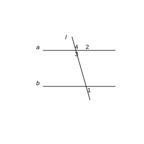
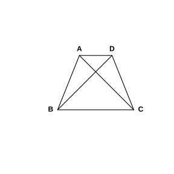

# Assignment 4

> **Definition 1.2.1** (Subset)  Generally, for two sets $A,B$, if every element in the set $A$ is an element of the set $B$, we call the set $A$ a subset of the set $B$, denoted $A\subseteq B$ (or $B\supseteq A$), read as "$A$ is contained in $B$" (or "$B$ contains $A$").

> **Definition 1.2.4** (Empty Set)  Generally, we call a set containing no elements the empty set, denoted $\varnothing$, and stipulate: the empty set is a subset of any set.

> **Definition 1.3.1** (Union)  Generally, the set formed by all elements belonging to the set $A$ or belonging to the set $B$ is called the union of the set $A$ and $B$, denoted $A\cup B$, i.e. $A\cup B=\left\{x\mid x\in A$, or $x\in B\right\}$.

> **Definition 1.3.2** (Intersection)  Generally, the set formed by all elements belonging to the set $A$ and belonging to the set $B$ is called the intersection of the set $A$ and $B$, denoted $A\cap B$, i.e. $A\cap B=\left\{x\mid x\in A$, and $x\in B\right\}$.

> **Definition 1.4.1** (Proposition)  Generally, we call a declarative sentence expressed in language, symbols, or formulas that can be judged true or false a proposition. A sentence judged true is a true proposition, and a sentence judged false is a false proposition. Many propositions in high school mathematics can be written in the forms "if $p$, then $q$" or "if $p$, then $q$", where $p$ is called the condition of the proposition and $q$ is called the conclusion of the proposition.

> **Definition 1.4.2** (Sufficient Condition and Necessary Condition)  Generally, "if $p$, then $q$" is a true proposition, meaning that from $p$ one can deduce $q$ through reasoning. At this point, we say that $q$ can be deduced from $p$, denoted $p\Rightarrow q$, and say that $p$ is a sufficient condition for $q$, and $q$ is a necessary condition for $p$. If "if $p$, then $q$" is a false proposition, then the conclusion $q$ cannot be deduced from the condition $p$, denoted $p\nRightarrow q$; at this point, we say that $p$ is not a sufficient condition for $q$, and $q$ is not a necessary condition for $p$.

> **Definition 1.4.3** (Converse Proposition)  Interchanging the condition $p$ and the conclusion $q$ in the proposition "if $p$, then $q$" gives a new proposition "if $q$, then $p$", which is called the converse proposition of the original proposition.

> **Definition 1.4.4** (Necessary and Sufficient Condition)  If both "if $p$, then $q$" and its converse "if $q$, then $p$" are true propositions, i.e. both $p\Rightarrow q$ and $q\Rightarrow p$ hold, then we write $p\Leftrightarrow q$. At this point, $p$ is both a sufficient condition for $q$ and a necessary condition for $q$; we say $p$ is a necessary and sufficient condition for $q$, or condition of equivalence for short. Obviously, if $p$ is a necessary and sufficient condition for $q$, then $q$ is also a necessary and sufficient condition for $p$. In summary, if $p\Leftrightarrow q$, then $p$ and $q$ are mutually necessary and sufficient conditions.

### Exercise 1

(Exercise 1.4, Problem 1) Among the following propositions in the form "if $p$, then $q$", in which propositions is $p$ a sufficient condition for $q$?

(1) If a point $P$ in the plane lies on the perpendicular bisector of the segment $AB$, then $PA=PB$;

(2) If two triangles have two sides and the angle opposite one side respectively equal, then the two triangles are congruent;

(3) If two triangles are similar, then the ratio of their areas equals the square of the ratio of their perimeters.

### Solution to Exercise 1

By **Definition 1.4.2** (Sufficient Condition and Necessary Condition), $p$ is a sufficient condition for $q$ if and only if "if $p$, then $q$" is a true proposition, i.e. $p\Rightarrow q$.

(1) By the property of the perpendicular bisector of a segment, any point on the perpendicular bisector is equidistant from the two endpoints of the segment, so if $P$ lies on the perpendicular bisector of $AB$, then necessarily $PA=PB$, i.e. $p\Rightarrow q$. Therefore, in proposition (1), $p$ is a sufficient condition for $q$.

(2) Two sides and the angle opposite one side respectively equal (i.e. "side-side-angle") cannot guarantee that two triangles are congruent. For example, taking two sides as $2,3$ and the angle opposite the side $2$ as $30^\circ$, one can construct two non-congruent triangles, i.e. $p\nRightarrow q$. Therefore, in proposition (2), $p$ is not a sufficient condition for $q$.

(3) Let the similarity ratio of the two triangles be $k$; by the property of similar triangles, the perimeter ratio equals the similarity ratio $k$, and the area ratio equals the square of the similarity ratio $k^2$, so the area ratio equals the square of the perimeter ratio, i.e. $p\Rightarrow q$. Therefore, in proposition (3), $p$ is a sufficient condition for $q$.

In summary, in propositions (1) and (3), $p$ is a sufficient condition for $q$. $\blacksquare$

### Exercise 2

(Exercise 1.4, Problem 2) Among the following propositions in the form "if $p$, then $q$", in which propositions is $q$ a necessary condition for $p$?

(1) If the line $l$ has exactly one intersection point with $\odot O$, then $l$ is a tangent line of $\odot O$;

(2) If $x$ is an irrational number, then $x^2$ is also an irrational number.

### Solution to Exercise 2

By **Definition 1.4.2** (Sufficient Condition and Necessary Condition), $q$ is a necessary condition for $p$ if and only if "if $p$, then $q$" is a true proposition, i.e. $p\Rightarrow q$.

(1) By the definition of a tangent line, when a line has exactly one common point with a circle, this line is called a tangent line of the circle; therefore, if $l$ has exactly one intersection point with $\odot O$, then necessarily $l$ is a tangent line of $\odot O$, i.e. $p\Rightarrow q$. Therefore, in proposition (1), $q$ is a necessary condition for $p$.

(2) Taking $x=\sqrt 2$, $x$ is an irrational number, but $x^2=2$ is a rational number, so $p\nRightarrow q$. Therefore, in proposition (2), $q$ is not a necessary condition for $p$.

In summary, in proposition (1), $q$ is a necessary condition for $p$. $\blacksquare$

### Exercise 3

(Exercise 1.4, Problem 3) As shown in the figure, the lines $a$ and $b$ are cut by the line $l$, obtaining $\angle 1$, $\angle 2$, $\angle 3$ and $\angle 4$. Based on this information, write several sufficient conditions and necessary conditions for "$a\parallel b$".

{width=50%}

### Solution to Exercise 3

By **Definition 1.4.2** (Sufficient Condition and Necessary Condition) and **Definition 1.4.4** (Necessary and Sufficient Condition), answer using the determination and property theorems of parallel lines.

In the figure, $\angle 3$ and $\angle 1$ are corresponding angles. By "if corresponding angles are equal, the two lines are parallel", $\angle 1=\angle 3\Rightarrow a\parallel b$; by "if two lines are parallel, corresponding angles are equal", $a\parallel b\Rightarrow \angle 1=\angle 3$. Therefore, $\angle 1=\angle 3$ is both a sufficient condition for $a\parallel b$ and a necessary condition for $a\parallel b$, i.e. a necessary and sufficient condition.

Also, at the intersection above line $a$, $\angle 2$ and $\angle 3$ are adjacent supplementary angles, so always $\angle 2+\angle 3=180^\circ$; therefore $\angle 1=\angle 3$ is equivalent to $\angle 1+\angle 2=180^\circ$. Similarly, $\angle 4$ and $\angle 2$ are vertical angles, so always $\angle 4=\angle 2$; therefore $\angle 1+\angle 2=180^\circ$ is equivalent to $\angle 1+\angle 4=180^\circ$.

Therefore, several sufficient conditions for "$a\parallel b$" (which are also necessary conditions) are: $\angle 1=\angle 3$; $\angle 1+\angle 2=180^\circ$; $\angle 1+\angle 4=180^\circ$. $\blacksquare$

### Exercise 4

(Exercise 1.4, Problem 1) In the following problems, in which is $p$ a necessary and sufficient condition for $q$?

(1) $p$: a triangle is isosceles, $q$: a triangle has two equal angles;

(2) $p$: two chords inside $\odot O$ are equal, $q$: the inscribed angles subtended by the two chords inside $\odot O$ are equal;

(3) $p$: $A\cap B$ is empty, $q$: one of $A$ and $B$ is empty.

### Solution to Exercise 4

By **Definition 1.4.4** (Necessary and Sufficient Condition), $p$ is a necessary and sufficient condition for $q$ if and only if both $p\Rightarrow q$ and $q\Rightarrow p$ hold, i.e. $p\Leftrightarrow q$.

(1) By the definition of an isosceles triangle, an isosceles triangle is a triangle with two equal angles (i.e. two equal sides). Therefore, a triangle is isosceles if and only if it has two equal angles, i.e. $p\Leftrightarrow q$. Therefore, $p$ is a necessary and sufficient condition for $q$.

(2) In the same circle, equal chords subtend equal central angles, and consequently equal inscribed angles; conversely, if the inscribed angles subtended by two chords are equal, then the central angles they subtend are equal, and thus the chord lengths are equal. Therefore $p\Leftrightarrow q$, i.e. $p$ is a necessary and sufficient condition for $q$.

(3) Taking $A=\left\{1\right\}$, $B=\left\{2\right\}$, by **Definition 1.3.2** (Intersection), $A\cap B=\varnothing$, but $A,B$ are both not the empty set, so $p\nRightarrow q$. Conversely, if one of $A$ and $B$ is the empty set, by **Definition 1.2.4** (Empty Set) and the meaning of intersection, $A\cap B=\varnothing$, i.e. $q\Rightarrow p$. Since $p\nRightarrow q$, $p$ is not a necessary and sufficient condition for $q$.

In summary, in propositions (1) and (2), $p$ is a necessary and sufficient condition for $q$. $\blacksquare$

### Exercise 5

(Exercise 1.4, Problem 2) Write several necessary and sufficient conditions for "two triangles are congruent" and for "two triangles are similar".

### Solution to Exercise 5

By **Definition 1.4.4** (Necessary and Sufficient Condition), a necessary and sufficient condition should be the converse of the original proposition and both should be true propositions.

Several necessary and sufficient conditions for two triangles to be congruent are:

(a) three sides respectively equal (side-side-side);

(b) two sides and the included angle respectively equal (side-angle-side);

(c) two angles and the included side respectively equal (angle-side-angle);

(d) two angles and the side opposite one of the angles respectively equal (angle-angle-side).

Several necessary and sufficient conditions for two triangles to be similar are:

(a) three angles respectively equal and three sides proportional (definition);

(b) three sides proportional;

(c) two sides proportional and the included angle equal;

(d) two angles respectively equal. $\blacksquare$

### Exercise 6

(Exercise 1.4, Problem 3) Prove: as shown in the figure, $AC=BD$ is a necessary and sufficient condition for the trapezoid $ABCD$ to be an isosceles trapezoid.

{width=50%}

### Solution to Exercise 6

By **Definition 1.4.4** (Necessary and Sufficient Condition), we need to prove sufficiency ($AC=BD\Rightarrow$ trapezoid $ABCD$ is an isosceles trapezoid) and necessity (trapezoid $ABCD$ is an isosceles trapezoid $\Rightarrow AC=BD$).

Without loss of generality, let $AB\parallel CD$ in the trapezoid $ABCD$, with $AD,BC$ as the two legs.

First prove necessity. If the trapezoid $ABCD$ is an isosceles trapezoid, by the property of an isosceles trapezoid, the two diagonals of an isosceles trapezoid are equal, so $AC=BD$.

Then prove sufficiency. If $AC=BD$, draw perpendiculars from $D,C$ to $AB$, with feet $E,F$. Since $AB\parallel CD$, we have $DE=CF$ (i.e. the heights of the trapezoid are equal). In $\mathrm{Rt}\triangle ACF$ and $\mathrm{Rt}\triangle BDE$, the hypotenuses $AC=BD$ and the legs $CF=DE$, so the two right triangles are congruent, and thus $AF=BE$. Also $AE=AF-EF$, $BF=BE-EF$, so $AE=BF$. Then from $DE=CF$, $AE=BF$, $\angle DEA=\angle CFB=90^\circ$, we get $\triangle ADE\cong\triangle BCF$, and thus $AD=BC$, i.e. the two legs are equal, so the trapezoid $ABCD$ is an isosceles trapezoid.

From the above two steps, $AC=BD$ is a necessary and sufficient condition for the trapezoid $ABCD$ to be an isosceles trapezoid. $\blacksquare$

### Problem 1

(Problem 1.4, Review and Consolidation, Problem 1) Give examples to illustrate:

(1) $p$ is a sufficient but not necessary condition for $q$;

(2) $p$ is a necessary but not sufficient condition for $q$;

(3) $p$ is a necessary and sufficient condition for $q$.

### Solution to Problem 1

By **Definition 1.4.2** (Sufficient Condition and Necessary Condition) and **Definition 1.4.4** (Necessary and Sufficient Condition), examples are as follows.

(1) Take $p$: $x>1$, $q$: $x>0$. From $x>1$ necessarily $x>0$, so $p\Rightarrow q$; but $x>0$ does not imply $x>1$ (e.g. $x=\frac12$), so $q\nRightarrow p$. Thus $p$ is a sufficient but not necessary condition for $q$.

(2) Take $p$: $x>0$, $q$: $x>1$. From $x>1$ necessarily $x>0$, i.e. $q\Rightarrow p$, but $x>0$ does not imply $x>1$, i.e. $p\nRightarrow q$. Thus $p$ is a necessary but not sufficient condition for $q$.

(3) Take $p$: corresponding angles are equal, $q$: two lines are parallel. By the determination theorem of parallel lines, $p\Rightarrow q$; by the property theorem of parallel lines, $q\Rightarrow p$. Thus $p\Leftrightarrow q$, i.e. $p$ is a necessary and sufficient condition for $q$. $\blacksquare$

### Problem 2

(Problem 1.4, Review and Consolidation, Problem 2) In the following problems, determine what kind of condition $p$ is for $q$ (please answer using "sufficient but not necessary condition", "necessary but not sufficient condition", "necessary and sufficient condition", "neither sufficient nor necessary condition"):

(1) $p$: a triangle is isosceles, $q$: a triangle is equilateral;

(2) $p$: the quadratic equation $ax^2+bx+c=0$ has real roots, $q$: $b^2-4ac\ge 0$ ($a\neq 0$);

(3) $p$: $a\in P\cap Q$, $q$: $a\in P$;

(4) $p$: $a\in P\cup Q$, $q$: $a\in P$;

(5) $p$: $x>y$, $q$: $x^2>y^2$.

### Solution to Problem 2

By **Definition 1.4.2** (Sufficient Condition and Necessary Condition) and **Definition 1.4.4** (Necessary and Sufficient Condition), determine whether $p\Rightarrow q$ and $q\Rightarrow p$ hold respectively.

(1) An equilateral triangle is necessarily an isosceles triangle, so $q\Rightarrow p$; but an isosceles triangle is not necessarily an equilateral triangle, so $p\nRightarrow q$. Therefore, $p$ is a necessary but not sufficient condition for $q$.

(2) By the discriminant of a quadratic equation, the equation $ax^2+bx+c=0$ ($a\neq 0$) has real roots if and only if $b^2-4ac\ge 0$, so $p\Leftrightarrow q$. Therefore, $p$ is a necessary and sufficient condition for $q$.

(3) By **Definition 1.3.2** (Intersection), if $a\in P\cap Q$, then $a$ must belong to $P$, so $p\Rightarrow q$; but $a\in P$ does not necessarily belong to $Q$, so $q\nRightarrow p$. Therefore, $p$ is a sufficient but not necessary condition for $q$.

(4) By **Definition 1.3.1** (Union), if $a\in P$, then $a$ must belong to $P\cup Q$, so $q\Rightarrow p$; but $a\in P\cup Q$ may belong only to $Q$ and not to $P$, so $p\nRightarrow q$. Therefore, $p$ is a necessary but not sufficient condition for $q$.

(5) Taking $x=1$, $y=-2$, then $x>y$, but $x^2=1<4=y^2$, so $p\nRightarrow q$; taking $x=-2$, $y=1$, then $x^2=4>1=y^2$, but $x<y$, so $q\nRightarrow p$. Therefore, $p$ is a neither sufficient nor necessary condition for $q$. $\blacksquare$

### Problem 3

(Problem 1.4, Review and Consolidation, Problem 3) Determine whether the following propositions are true or false:

(1) The distance from a point $P$ to the center $O$ of a circle being greater than the radius is a necessary and sufficient condition for the point $P$ to be outside $\odot O$;

(2) Two triangles having equal areas is a sufficient but not necessary condition for the two triangles to be congruent;

(3) $A\cup B=A$ is a necessary but not sufficient condition for $B\subseteq A$;

(4) $x$ or $y$ being rational is a neither sufficient nor necessary condition for $xy$ to be rational.

### Solution to Problem 3

By **Definition 1.4.2** (Sufficient Condition and Necessary Condition) and **Definition 1.4.4** (Necessary and Sufficient Condition), determine one by one.

(1) A point $P$ is outside the circle if and only if its distance to the center is greater than the radius; the two are mutually necessary and sufficient conditions, so this proposition is true.

(2) Two congruent triangles necessarily have equal areas, so equal areas is a necessary condition for congruence; but two triangles with equal areas are not necessarily congruent, so equal areas is not a sufficient condition for congruence. The proposition calls it a "sufficient but not necessary condition", which contradicts the facts, so this proposition is false.

(3) By **Definition 1.3.1** (Union) and **Definition 1.2.1** (Subset), $A\cup B=A$ if and only if $B\subseteq A$; the two are mutually necessary and sufficient conditions. The proposition calls it a "necessary but not sufficient condition", so this proposition is false.

(4) Taking $x=1$ as rational and $y=\sqrt 2$ as irrational, then $xy=\sqrt 2$ is irrational, so "$x$ or $y$ being rational" does not imply "$xy$ is rational"; also taking $x=y=\sqrt 2$, then $xy=2$ is rational, but $x,y$ are both not rational, so "$xy$ being rational" does not imply "$x$ or $y$ being rational". Therefore, the two are neither sufficient nor necessary, and this proposition is true. $\blacksquare$

### Problem 4

(Problem 1.4, Comprehensive Application, Problem 4) Given $A=\left\{x\mid x\text{ 满足条件 }p\right\}$, $B=\left\{x\mid x\text{ 满足条件 }q\right\}$,

(1) If $A\subseteq B$, then what kind of condition is $p$ for $q$?

(2) If $B\subseteq A$, then what kind of condition is $p$ for $q$?

(3) If $A=B$, then what kind of condition is $p$ for $q$?

### Solution to Problem 4

By **Definition 1.2.1** (Subset), $A\subseteq B$ means that every $x$ satisfying $p$ also satisfies $q$; by **Definition 1.4.2** (Sufficient Condition and Necessary Condition), this corresponds precisely to whether $p\Rightarrow q$ holds.

(1) If $A\subseteq B$, then every $x$ satisfying condition $p$ also satisfies condition $q$, i.e. $p\Rightarrow q$, so $p$ is a sufficient condition for $q$.

(2) If $B\subseteq A$, then every $x$ satisfying condition $q$ also satisfies condition $p$, i.e. $q\Rightarrow p$, so $p$ is a necessary condition for $q$.

(3) If $A=B$, then $A\subseteq B$ and $B\subseteq A$, i.e. $p\Rightarrow q$ and $q\Rightarrow p$, so $p\Leftrightarrow q$, and thus $p$ is a necessary and sufficient condition for $q$. $\blacksquare$

### Problem 5

(Problem 1.4, Comprehensive Application, Problem 5) Let $a,b,c\in\mathbb R$. Prove: $a=b=c$ is a necessary and sufficient condition for $a^2+b^2+c^2=ab+ac+bc$.

### Solution to Problem 5

By **Definition 1.4.4** (Necessary and Sufficient Condition), we need to prove $a=b=c\Leftrightarrow a^2+b^2+c^2=ab+ac+bc$.

Transposing the equation $a^2+b^2+c^2=ab+ac+bc$, we get

$$
a^2+b^2+c^2-ab-ac-bc=0.
$$

Multiplying both sides by $2$ and completing the square, we get

$$
\left(a-b\right)^2+\left(b-c\right)^2+\left(c-a\right)^2=0.
$$

Since $a,b,c\in\mathbb R$, the squares of three real numbers are all non-negative, and their sum is $0$ if and only if each term is $0$, i.e. $a-b=0$, $b-c=0$, $c-a=0$, i.e. $a=b=c$.

The above steps are all reversible, so $a=b=c$ if and only if $a^2+b^2+c^2=ab+ac+bc$, i.e. $a=b=c$ is a necessary and sufficient condition for this equation. $\blacksquare$

### Problem 6

(Problem 1.4, Extension and Exploration, Problem 6) Let $a,b,c$ be the three sides of $\triangle ABC$ respectively, with $a\le b\le c$. We know that if $\triangle ABC$ is a right triangle, then $a^2+b^2=c^2$ (the Pythagorean theorem). Conversely, if $a^2+b^2=c^2$, then $\triangle ABC$ is a right triangle (the converse of the Pythagorean theorem). Thus, $a^2+b^2=c^2$ is a necessary and sufficient condition for $\triangle ABC$ to be a right triangle. Using the side lengths $a,b,c$, give a necessary and sufficient condition for $\triangle ABC$ to be an acute triangle and one for it to be an obtuse triangle, and prove them.

### Solution to Problem 6

By **Definition 1.4.4** (Necessary and Sufficient Condition), give conditions using the law of cosines.

Since $a\le b\le c$, $c$ is the longest side, and the angle $C$ opposite to it is the largest angle of the triangle. A triangle is an acute triangle if and only if the largest angle $C$ is acute; a triangle is an obtuse triangle if and only if the largest angle $C$ is obtuse.

By the law of cosines,

$$
\cos C=\frac{a^2+b^2-c^2}{2ab}.
$$

Since $a,b>0$, we have $2ab>0$, so the sign of $\cos C$ is completely determined by $a^2+b^2-c^2$.

(1) A triangle is an acute triangle if and only if the largest angle $C$ is acute, i.e. $\cos C>0$, i.e. $a^2+b^2-c^2>0$, i.e. $a^2+b^2>c^2$. Therefore, a necessary and sufficient condition for $\triangle ABC$ to be an acute triangle is $a^2+b^2>c^2$.

(2) A triangle is an obtuse triangle if and only if the largest angle $C$ is obtuse, i.e. $\cos C<0$, i.e. $a^2+b^2-c^2<0$, i.e. $a^2+b^2<c^2$. Therefore, a necessary and sufficient condition for $\triangle ABC$ to be an obtuse triangle is $a^2+b^2<c^2$.

The above derivations are all reversible, so the two conditions are respectively the necessary and sufficient conditions for an acute triangle and an obtuse triangle. $\blacksquare$

### Reading and Thinking 1

(Thinking 1) In the article "Geometric Propositions and Sufficient and Necessary Conditions", let $q$: two triangles are similar. Think about it: (1) Can you give other sufficient conditions for similar triangles? (2) Can determination theorems be used to determine that two triangles are not similar? Why?

### Solution to Reading and Thinking 1

By **Definition 1.4.2** (Sufficient Condition and Necessary Condition) and **Definition 1.4.4** (Necessary and Sufficient Condition), answer as follows.

(1) The determination theorems for similar triangles themselves give sufficient conditions for $q$. Besides proportional three sides, two proportional sides with equal included angle, and two pairs of equal angles, one can also cite: two triangles similar to the same triangle are mutually similar (i.e. the transitivity of "similar"), which is also a sufficient condition for two triangles to be similar.

(2) Determination theorems cannot be used to determine that two triangles are not similar. Determination theorems give sufficient conditions in the form $p\Rightarrow q$, i.e. when the condition is satisfied, they are certainly similar. But two triangles not satisfying a particular determination theorem does not mean they are not similar, because the sufficient conditions for $q$ to hold are not unique, and it is entirely possible that they are similar through another path. To determine that two triangles are not similar, one needs to use the property theorems of similar triangles (i.e. necessary conditions): as long as one points out that a necessary property does not hold, one can conclude that they are not similar. $\blacksquare$

### Reading and Thinking 2

(Thinking 2) In the article "Geometric Propositions and Sufficient and Necessary Conditions", think about it: can property theorems be used to determine that two triangles are similar? Why? Can you give other necessary conditions for similar triangles?

### Solution to Reading and Thinking 2

By **Definition 1.4.2** (Sufficient Condition and Necessary Condition), property theorems give necessary conditions in the form $q\Rightarrow r$.

Property theorems cannot be used to determine that two triangles are similar. Property theorems show that if two triangles are similar, then their corresponding angles are necessarily equal, their perimeter ratios equal the similarity ratio, their area ratios equal the square of the similarity ratio, and so on. These are "properties that necessarily follow" after similarity, i.e. $q\Rightarrow r$. Conversely, even if these properties hold, one cannot infer that they are similar, because $q\Rightarrow r$ does not imply $r\Rightarrow q$. To determine similarity, one still needs to use determination theorems (sufficient conditions).

Other necessary conditions for similar triangles can also be cited: the ratio of corresponding altitudes, the ratio of corresponding medians, and the ratio of corresponding angle bisectors of similar triangles all equal the similarity ratio; the ratio of circumradii and the ratio of inradii of similar triangles both equal the similarity ratio; and so on. When these properties do not hold, the two triangles are certainly not similar, so they are all necessary conditions for $q$. $\blacksquare$

### Reading and Thinking 3

(Thinking 3) In the article "Geometric Propositions and Sufficient and Necessary Conditions", starting from any equivalent definition of similar triangles, one can also derive other properties of similar triangles; can you try? Following the above approach, organize the knowledge about isosceles triangles, right triangles, parallelograms (rectangles, rhombi, squares), and other figures.

### Solution to Reading and Thinking 3

By **Definition 1.4.4** (Necessary and Sufficient Condition), equivalent definitions can be derived from each other; based on this, organize the determination theorems and property theorems of figures.

Take parallelograms as an example. Its definition "a quadrilateral with two pairs of opposite sides respectively parallel" and "a quadrilateral with two pairs of opposite sides respectively equal", "a quadrilateral with one pair of opposite sides parallel and equal", "a quadrilateral whose diagonals bisect each other" are mutually necessary and sufficient conditions; taking any one as the definition, the others can serve both as determination theorems and as derived property theorems. For example, taking "two pairs of opposite sides respectively parallel" as the definition, one can derive that two pairs of opposite sides are respectively equal, two pairs of opposite angles are respectively equal, and the diagonals bisect each other, and other properties.

Similarly, the organization is as follows.

(a) Isosceles triangle: the necessary and sufficient conditions are "two equal sides" or "two equal angles"; from the definition one can derive the "three lines in one" (the angle bisector of the vertex angle, the median on the base, and the altitude on the base coincide) and other property theorems, and these properties are all necessary conditions for an isosceles triangle.

(b) Right triangle: the necessary and sufficient conditions are "one interior angle is a right angle" or "the sum of the squares of two sides equals the square of the third side (the Pythagorean theorem and its converse)"; from this one can derive that the median on the hypotenuse equals half the hypotenuse, and the two acute angles are complementary, and other properties.

(c) Rectangles, rhombi, squares: the necessary and sufficient conditions for a rectangle are "a parallelogram with one right angle" or "a parallelogram with equal diagonals"; the necessary and sufficient conditions for a rhombus are "a parallelogram with one pair of adjacent sides equal" or "a parallelogram with perpendicular diagonals"; the necessary and sufficient conditions for a square are "a rectangle with one pair of adjacent sides equal" or "a rhombus with one right angle". Their respective determination theorems correspond to sufficient conditions, and property theorems correspond to necessary conditions. $\blacksquare$
