# Assignment 42

> **Basic Fact 8.5.1** (Basic Fact 4)  Two lines parallel to the same line are parallel to each other.

> **Theorem 8.5.2** (Equal-Angle Theorem)  If the two sides of two angles in space are respectively parallel, then the two angles are equal or supplementary.

> **Theorem 8.5.3** (Criterion for a Line Being Parallel to a Plane)  If a line outside a plane is parallel to a line lying in that plane, then the line is parallel to the plane.

> **Theorem 8.5.4** (Property of a Line Parallel to a Plane)  If a line is parallel to a plane, and a plane passing through the line intersects this plane, then the line is parallel to the line of intersection.

> **Theorem 8.5.5** (Criterion for Two Parallel Planes)  If two intersecting lines in one plane are parallel to another plane, then the two planes are parallel.

> **Theorem 8.5.6** (Property of Two Parallel Planes)  If two planes are parallel and another plane intersects both of them, then the two lines of intersection are parallel.

### Exercise 1

(Exercise 8.5, Problem 1) As shown in the figure, fold a rectangular sheet of paper several times and then unfold it. Are the resulting creases parallel to one another? Why?

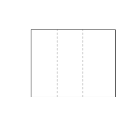{width=50%}

### Solution to Exercise 1

By **Basic Fact 8.5.1** (Basic Fact 4), two lines parallel to the same line are parallel to each other.

Each crease is parallel to the same side of the original rectangle, so all the creases are parallel to the same line. By **Basic Fact 8.5.1** (Basic Fact 4), these creases are parallel to one another. $\blacksquare$

### Exercise 2

(Exercise 8.5, Problem 2) As shown in the figure, in the cuboid $ABCD\text{-}A'B'C'D'$, how many edges are parallel to the edge $AA'$? Which edges are they?

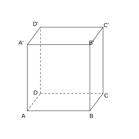{width=50%}

### Solution to Exercise 2

By **Basic Fact 8.5.1** (Basic Fact 4) and the properties of the edges of a cuboid.

The cuboid has $12$ edges, among which the $4$ mutually parallel lateral edges are $AA'$, $BB'$, $CC'$, $DD'$. Besides $AA'$ itself, there are $3$ edges parallel to $AA'$, namely $BB'$, $CC'$, $DD'$. $\blacksquare$

### Exercise 3

(Exercise 8.5, Problem 3) As shown in the figure, $AA'$, $BB'$, $CC'$ are not coplanar, and $AA'=\ BB'$, $BB'=\ CC'$. Prove that $\triangle ABC\cong\triangle A'B'C'$.

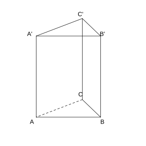{width=50%}

### Solution to Exercise 3

By **Basic Fact 8.5.1** (Basic Fact 4) and **Theorem 8.5.2** (Equal-Angle Theorem).

Since $AA'=\ BB'$, the quadrilateral $ABB'A'$ is a parallelogram, so $AB\parallel A'B'$ and $AB=A'B'$. Similarly, since $BB'=\ CC'$, $BC\parallel B'C'$ and $BC=B'C'$.

By **Theorem 8.5.2** (Equal-Angle Theorem), the two sides of $\angle ABC$ and those of $\angle A'B'C'$ are respectively parallel and in the same direction, so $\angle ABC=\angle A'B'C'$.

In $\triangle ABC$ and $\triangle A'B'C'$, $AB=A'B'$, $BC=B'C'$, $\angle ABC=\angle A'B'C'$, hence $\triangle ABC\cong\triangle A'B'C'$. $\blacksquare$

### Exercise 4

(Exercise 8.5, Problem 4) As shown in the figure, in the tetrahedron $A\text{-}BCD$, $E$, $F$, $G$ are points on $AB$, $AC$, $AD$ respectively. If $EF\parallel BC$ and $FG\parallel CD$, what is the relationship between $\triangle EFG$ and $\triangle BCD$? Why?

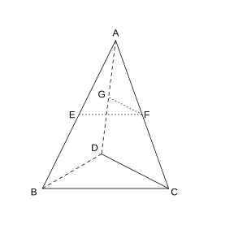{width=50%}

### Solution to Exercise 4

By **Theorem 8.5.2** (Equal-Angle Theorem) and the proportional division of a segment by parallel lines.

Since $EF\parallel BC$ and $FG\parallel CD$, the corresponding sides are parallel and in the same direction, so $\angle EFG=\angle BCD$.

Also, from $EF\parallel BC$, $\frac{EF}{BC}=\frac{AF}{AC}$; from $FG\parallel CD$, $\frac{FG}{CD}=\frac{AF}{AC}$. Hence $\frac{EF}{BC}=\frac{FG}{CD}$.

Since the corresponding sides are proportional and the included angle is equal, $\triangle EFG\sim\triangle BCD$. $\blacksquare$

### Exercise 5

(Exercise 8.5, Problem 1) As shown in the figure, in the cuboid $ABCD\text{-}A'B'C'D'$,

(1) the plane parallel to $AB$ is $\;\_\_\;$;

(2) the plane parallel to $AA'$ is $\;\_\_\;$;

(3) the plane parallel to $AD$ is $\;\_\_\;$.

{width=50%}

### Solution to Exercise 5

By **Theorem 8.5.3** (Criterion for a Line Being Parallel to a Plane).

(1) $AB\parallel A'B'\subset$ plane $A'B'C'D'$, and $AB\parallel DC\subset$ plane $D'DC'C$, so the planes parallel to $AB$ are plane $A'B'C'D'$ and plane $D'DC'C$.

(2) $AA'\parallel BB'\subset$ plane $B'BCC'$, $AA'\parallel DD'\subset$ plane $D'DC'C$, so the planes parallel to $AA'$ are plane $B'BCC'$ and plane $D'DC'C$.

(3) $AD\parallel A'D'\subset$ plane $A'B'C'D'$, $AD\parallel BC\subset$ plane $B'BCC'$, so the planes parallel to $AD$ are plane $A'B'C'D'$ and plane $B'BCC'$. $\blacksquare$

### Exercise 6

(Exercise 8.5, Problem 2) As shown in the figure, in the cuboid $ABCD\text{-}A'B'C'D'$, $E'$ is a point on $A'A$. Prove that $AB\parallel$ plane $DCC'D'$.

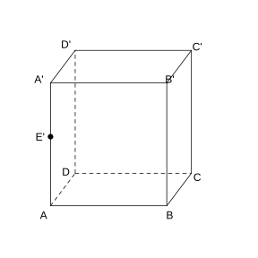{width=50%}

### Solution to Exercise 6

By **Theorem 8.5.3** (Criterion for a Line Being Parallel to a Plane).

In the cuboid, $AB\parallel DC$. Moreover, $DC\subset$ plane $DCC'D'$, and $AB\not\subset$ plane $DCC'D'$.

By **Theorem 8.5.3** (Criterion for a Line Being Parallel to a Plane), the line $AB$ outside the plane is parallel to the line $DC$ lying in the plane, so $AB\parallel$ plane $DCC'D'$. $\blacksquare$

### Exercise 7

(Exercise 8.5, Problem 1) Determine whether the following statements are correct. If correct, explain why; if wrong, give a counterexample.

(1) Given planes $\alpha$, $\beta$ and lines $m$, $n$, if $m\subset\alpha$, $n\subset\alpha$, $m\parallel\beta$, $n\parallel\beta$, then $\alpha\parallel\beta$.

(2) If two non-parallel lines in a plane $\alpha$ are both parallel to another plane $\beta$, then $\alpha\parallel\beta$.

(3) Two planes parallel to the same line are parallel.

(4) Two planes parallel to the same plane are parallel.

(5) If a line intersects one of two parallel planes, then it must intersect the other.

### Solution to Exercise 7

Judge by **Theorem 8.5.5** (Criterion for Two Parallel Planes).

(1) Wrong. $m$ and $n$ must intersect; if $m\parallel n$, the two planes may intersect.

(2) Correct. Two non-parallel lines in $\alpha$ are intersecting lines, and they are both parallel to $\beta$; by **Theorem 8.5.5** (Criterion for Two Parallel Planes), $\alpha\parallel\beta$.

(3) Wrong. Counterexample: two intersecting planes both parallel to a line parallel to their line of intersection.

(4) Correct. By the transitivity of parallelism, two planes parallel to the same plane are parallel to each other.

(5) Correct. If the line were parallel to the other plane or lay in it, then by the property of parallel planes it would also have no intersection point with the first plane, a contradiction. $\blacksquare$

### Exercise 8

(Exercise 8.5, Problem 2) A sufficient condition for plane $\alpha$ to be parallel to plane $\beta$ can be ( ).

(A) there are infinitely many lines in $\alpha$ all parallel to $\beta$;

(B) the line $a\parallel\alpha$, $a\parallel\beta$, and the line $a$ lies neither in $\alpha$ nor in $\beta$;

(C) the line $a\subset\alpha$, the line $b\subset\beta$, and $a\parallel\beta$, $b\parallel\alpha$;

(D) every line in $\alpha$ is parallel to $\beta$.

### Solution to Exercise 8

Judge by **Theorem 8.5.5** (Criterion for Two Parallel Planes).

(A) Wrong. Infinitely many lines in $\alpha$ are parallel to $\beta$, but they may all be parallel to the line of intersection of the two planes.

(B) Wrong. A single line cannot determine that two planes are parallel.

(C) Wrong. $a$ and $b$ each lying in one plane cannot determine it.

(D) Correct. Every line in $\alpha$ is parallel to $\beta$; in particular, one can take two intersecting lines both parallel to $\beta$, and by **Theorem 8.5.5** (Criterion for Two Parallel Planes), $\alpha\parallel\beta$.

Hence choose (D). $\blacksquare$

### Exercise 9

(Exercise 8.5, Problem 3) As shown in the figure, in the cube $ABCD\text{-}A_{1}B_{1}C_{1}D_{1}$, $M$, $N$, $E$, $F$ are the midpoints of the edges $A_{1}B_{1}$, $A_{1}D_{1}$, $B_{1}C_{1}$, $C_{1}D_{1}$ respectively. Prove that plane $AMN\parallel$ plane $DBEF$.

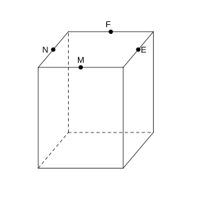{width=50%}

### Solution to Exercise 9

By **Theorem 8.5.3** (Criterion for a Line Being Parallel to a Plane) and **Theorem 8.5.5** (Criterion for Two Parallel Planes).

Since $M$, $N$ are the midpoints of $A_{1}B_{1}$, $A_{1}D_{1}$ respectively, $MN\parallel B_{1}D_{1}$. Also $B_{1}D_{1}\parallel BD$, so $MN\parallel BD$. Since $BD\subset$ plane $DBEF$ and $MN\not\subset$ plane $DBEF$, we have $MN\parallel$ plane $DBEF$.

Similarly, $AM\parallel DF$ (by the mid-segment and the symmetry of the cube), $DF\subset$ plane $DBEF$, $AM\not\subset$ plane $DBEF$, so $AM\parallel$ plane $DBEF$.

Moreover, $MN\cap AM=M$; the two intersecting lines $MN$, $AM$ both lie in plane $AMN$ and are both parallel to plane $DBEF$. By **Theorem 8.5.5** (Criterion for Two Parallel Planes), plane $AMN\parallel$ plane $DBEF$. $\blacksquare$

### Exercise 10

(Exercise 8.5, Problem 4) As shown in the figure, planes $\alpha\parallel\beta$, $\gamma\cap\alpha=a$, $\gamma\cap\beta=b$, $c\subset\beta$, $c\parallel b$. Determine the positional relationship of $c$ with $a$ and of $c$ with $\alpha$, and explain why.

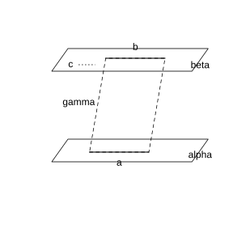{width=50%}

### Solution to Exercise 10

By **Theorem 8.5.6** (Property of Two Parallel Planes) and **Theorem 8.5.3** (Criterion for a Line Being Parallel to a Plane).

Since $\alpha\parallel\beta$ and $\gamma$ intersects them at $a$, $b$ respectively, by **Theorem 8.5.6** (Property of Two Parallel Planes), $a\parallel b$.

Also $c\parallel b$, and by the transitivity of parallelism, $c\parallel a$.

Since $c\parallel a$, $a\subset\alpha$, $c\not\subset\alpha$, by **Theorem 8.5.3** (Criterion for a Line Being Parallel to a Plane), $c\parallel\alpha$.

Hence $c\parallel a$, and $c\parallel\alpha$. $\blacksquare$

### Problem 1

(Exercise 8.5, Review and Consolidation, Problem 1) Multiple choice.

(1) If a line $a$ is not parallel to a plane $\alpha$, which of the following conclusions holds ( ).

(A) all lines in $\alpha$ are skew to $a$; (B) there is no line in $\alpha$ parallel to $a$; (C) every line in $\alpha$ intersects $a$; (D) the line $a$ has a common point with the plane $\alpha$.

(2) If the line $a\parallel$ plane $\alpha$ and $P\in\alpha$, then the line passing through point $P$ and parallel to line $a$ ( ).

(A) there is exactly one, not lying in plane $\alpha$; (B) there are infinitely many, not necessarily lying in $\alpha$; (C) there is exactly one, and it lies in plane $\alpha$; (D) there are infinitely many, necessarily lying in $\alpha$.

### Solution to Problem 1

Judge by **Definition 8.4.9** (Positional Relationship Between a Line and a Plane).

(1) If line $a$ is not parallel to plane $\alpha$, then $a$ lies in $\alpha$ or intersects $\alpha$; in both cases there is a common point. Hence choose (D).

(2) $a\parallel\alpha$, $P\in\alpha$. Pass a plane through $a$ and $P$; this plane intersects $\alpha$ in exactly one line $b$, and by the property of line-plane parallelism, $b\parallel a$. This line is unique and lies in $\alpha$. Hence choose (C). $\blacksquare$

### Problem 2

(Exercise 8.5, Review and Consolidation, Problem 2) Given planes $\alpha$, $\beta$ and lines $a$, $b$, $c$, with $a\parallel b\parallel c$, $a\subset\alpha$, $b\subset\beta$, $c\subset\beta$, the positional relationship between $\alpha$ and $\beta$ is $\;\_\_\;$.

### Solution to Problem 2

Judge by **Theorem 8.5.5** (Criterion for Two Parallel Planes).

$b$, $c$ are two parallel lines in $\beta$, and $a$ lies in $\alpha$ and is parallel to $b$, $c$. But $b$, $c$ are parallel and do not intersect, so this cannot determine $\alpha\parallel\beta$. The two planes may be parallel or may intersect (the line of intersection is parallel to these three lines).

Hence the positional relationship between $\alpha$ and $\beta$ is parallel or intersecting. $\blacksquare$

### Problem 3

(Exercise 8.5, Review and Consolidation, Problem 3) As shown in the figure, in a cuboid block $ABCD\text{-}A_{1}B_{1}C_{1}D_{1}$, there is a point $P$ on the face $A_{1}C_{1}$. How can one draw a line through point $P$ parallel to the edge $CD$?

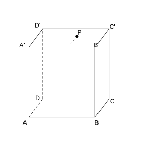{width=50%}

### Solution to Problem 3

By **Theorem 8.5.3** (Criterion for a Line Being Parallel to a Plane) and the construction of parallel lines.

In the plane $A_{1}B_{1}C_{1}D_{1}$, draw a line $EF$ through point $P$ such that $EF\parallel C_{1}D_{1}$, intersecting $A_{1}D_{1}$ and $B_{1}C_{1}$ at $E$ and $F$ respectively.

Since $CD\parallel C_{1}D_{1}$ and the constructed $EF\parallel C_{1}D_{1}$, we have $EF\parallel CD$. The line $EF$ is the required one. $\blacksquare$

### Problem 4

(Exercise 8.5, Review and Consolidation, Problem 4) As shown in the figure, in the cuboid $ABCD\text{-}A'B'C'D'$, $E$, $F$ are the midpoints of $AB$, $BC$ respectively. Prove that $EF\parallel A'C'$.

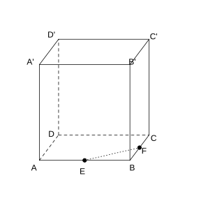{width=50%}

### Solution to Problem 4

By **Basic Fact 8.5.1** (Basic Fact 4).

In $\triangle ABC$, $E$, $F$ are the midpoints of $AB$, $BC$ respectively, so $EF$ is a mid-segment and $EF\parallel AC$.

In the cuboid, $AC\parallel A'C'$. By **Basic Fact 8.5.1** (Basic Fact 4), $EF\parallel A'C'$. $\blacksquare$

### Problem 5

(Exercise 8.5, Review and Consolidation, Problem 5) As shown in the figure on the next page, in the tetrahedron $D\text{-}ABC$, $E$, $F$, $G$ are the midpoints of $AB$, $BC$, $CD$ respectively. Prove that:

(1) $BD\parallel$ plane $EFG$;

(2) $AC\parallel$ plane $EFG$.

### Solution to Problem 5

By **Theorem 8.5.3** (Criterion for a Line Being Parallel to a Plane).

(1) $F$, $G$ are the midpoints of $BC$, $CD$ respectively; in $\triangle BCD$, $FG\parallel BD$. Also $FG\subset$ plane $EFG$ and $BD\not\subset$ plane $EFG$. By **Theorem 8.5.3** (Criterion for a Line Being Parallel to a Plane), $BD\parallel$ plane $EFG$.

(2) $E$, $F$ are the midpoints of $AB$, $BC$ respectively; in $\triangle ABC$, $EF\parallel AC$. Also $EF\subset$ plane $EFG$ and $AC\not\subset$ plane $EFG$. By **Theorem 8.5.3** (Criterion for a Line Being Parallel to a Plane), $AC\parallel$ plane $EFG$. $\blacksquare$

### Problem 6

(Exercise 8.5, Review and Consolidation, Problem 6) As shown in the figure, $a$, $b$ are skew lines. Draw a plane $\alpha$ such that $a\subset\alpha$ and $b\parallel\alpha$, and explain why.

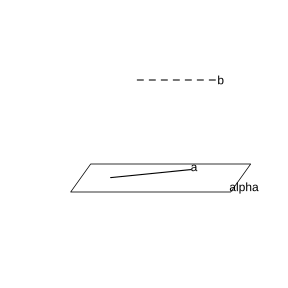{width=50%}

### Solution to Problem 6

By **Theorem 8.5.3** (Criterion for a Line Being Parallel to a Plane).

Take any point $A$ on the line $a$, and through $A$ draw a line $b'\parallel b$. By **Corollary 8.4.6** (Corollary 2), the two intersecting lines $a$ and $b'$ determine a plane, denoted $\alpha$, so that $a\subset\alpha$.

Since $b\parallel b'$, $b'\subset\alpha$, $b\not\subset\alpha$, by **Theorem 8.5.3** (Criterion for a Line Being Parallel to a Plane), $b\parallel\alpha$. Thus the plane $\alpha$ is the required one. $\blacksquare$

### Problem 7

(Exercise 8.5, Review and Consolidation, Problem 7) As shown in the figure, $\alpha\cap\beta=CD$, $\alpha\cap\gamma=EF$, $\beta\cap\gamma=AB$, $AB\parallel\alpha$. Prove that $CD\parallel EF$.

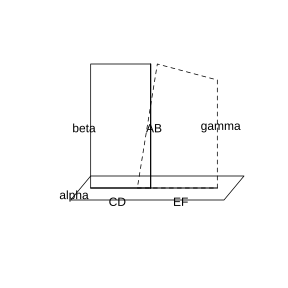{width=50%}

### Solution to Problem 7

By **Theorem 8.5.4** (Property of a Line Parallel to a Plane) and **Basic Fact 8.5.1** (Basic Fact 4).

Since $AB\parallel\alpha$, $AB\subset\beta$, $\beta\cap\alpha=CD$, by **Theorem 8.5.4** (Property of a Line Parallel to a Plane), $AB\parallel CD$.

Also $AB\subset\gamma$, $\gamma\cap\alpha=EF$, and by the same reasoning, $AB\parallel EF$.

By **Basic Fact 8.5.1** (Basic Fact 4), $CD\parallel EF$. $\blacksquare$

### Problem 8

(Exercise 8.5, Review and Consolidation, Problem 8) As shown in the figure, the lines $AA'$, $BB'$, $CC'$ intersect at point $O$, $AO=A'O$, $BO=B'O$, $CO=C'O$. Prove that plane $ABC\parallel$ plane $A'B'C'$.

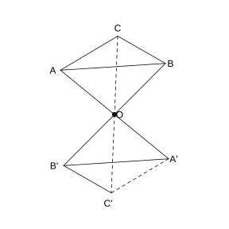{width=50%}

### Solution to Problem 8

By **Theorem 8.5.5** (Criterion for Two Parallel Planes).

In $\triangle AOB$ and $\triangle A'OB'$, $AO=A'O$, $BO=B'O$, $\angle AOB=\angle A'OB'$ (vertical angles), so $\triangle AOB\cong\triangle A'OB'$. Hence $\angle OAB=\angle OA'B'$, and so $AB\parallel A'B'$.

Similarly, $AO=A'O$, $CO=C'O$, $\angle AOC=\angle A'OC'$, which gives $AC\parallel A'C'$.

Since $AB\parallel A'B'$, $A'B'\subset$ plane $A'B'C'$, $AB\not\subset$ plane $A'B'C'$, we have $AB\parallel$ plane $A'B'C'$. Similarly, $AC\parallel$ plane $A'B'C'$.

Moreover, $AB\cap AC=A$; by **Theorem 8.5.5** (Criterion for Two Parallel Planes), plane $ABC\parallel$ plane $A'B'C'$. $\blacksquare$

### Problem 9

(Exercise 8.5, Comprehensive Application, Problem 9) As shown in the figure, $E$, $E'$ are the midpoints of the edges $AD$, $A'D'$ of the cuboid $ABCD\text{-}A'B'C'D'$ respectively. Prove that $\angle BEC=\angle B'E'C'$.

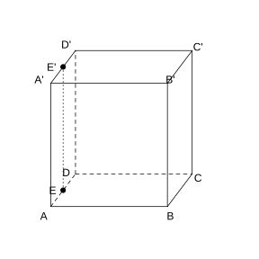{width=50%}

### Solution to Problem 9

By **Theorem 8.5.2** (Equal-Angle Theorem).

In the cuboid, $EE'\parallel AA'\parallel BB'\parallel CC'$, and the directions of $BE$ and $B'E'$ are correspondingly parallel, as are those of $CE$ and $C'E'$.

The two sides $EB$, $EC$ of $\angle BEC$ and the two sides $E'B'$, $E'C'$ of $\angle B'E'C'$ are respectively parallel and in the same direction.

By **Theorem 8.5.2** (Equal-Angle Theorem), $\angle BEC=\angle B'E'C'$. $\blacksquare$

### Problem 10

(Exercise 8.5, Comprehensive Application, Problem 10) As shown in the figure, $AB\parallel\alpha$, $AC\parallel BD$, $C\in\alpha$, $D\in\alpha$. Prove that $AC=BD$.

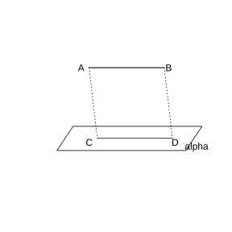{width=50%}

### Solution to Problem 10

By **Theorem 8.5.4** (Property of a Line Parallel to a Plane).

Since $C$, $D\in\alpha$, the line $CD\subset\alpha$. Also $AB\parallel\alpha$; the plane passing through $AB$ and $CD$ intersects $\alpha$ in $CD$, and by **Theorem 8.5.4** (Property of a Line Parallel to a Plane), $AB\parallel CD$.

Moreover, it is given that $AC\parallel BD$, so the two pairs of opposite sides of the quadrilateral $ABDC$ are respectively parallel, and it is a parallelogram.

Therefore $AC=BD$. $\blacksquare$

### Problem 11

(Exercise 8.5, Comprehensive Application, Problem 11) Given two parallel lines outside a plane, if one of them is parallel to this plane, prove that the other is also parallel to this plane.

### Solution to Problem 11

By **Theorem 8.5.4** (Property of a Line Parallel to a Plane) and **Theorem 8.5.3** (Criterion for a Line Being Parallel to a Plane).

Let the lines be $a\parallel b$, $a\parallel$ plane $\alpha$, and both $a$, $b$ lie outside $\alpha$.

Pass a plane $\beta$ through $a$ such that $\beta\cap\alpha=c$. Since $a\parallel\alpha$, by **Theorem 8.5.4** (Property of a Line Parallel to a Plane), $a\parallel c$.

Also $a\parallel b$, so by the transitivity of parallelism, $b\parallel c$. Since $c\subset\alpha$ and $b\not\subset\alpha$, by **Theorem 8.5.3** (Criterion for a Line Being Parallel to a Plane), $b\parallel\alpha$.

Hence the other line $b$ is also parallel to the plane $\alpha$. $\blacksquare$

### Problem 12

(Exercise 8.5, Comprehensive Application, Problem 12) A wooden block is shown in the figure on the next page. Point $P$ lies in the plane $VAC$. Saw the block through point $P$ so that the cross-section is parallel to the lines $VB$ and $AC$. How should one draw the lines on the surface of the block?

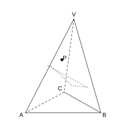{width=50%}

### Solution to Problem 12

By **Theorem 8.5.3** (Criterion for a Line Being Parallel to a Plane) and **Theorem 8.5.4** (Property of a Line Parallel to a Plane).

In the plane $VAC$, through $P$ draw a line $EF\parallel AC$, intersecting $VA$ and $VC$ at $E$ and $F$ respectively.

In the plane $VAB$, through $E$ draw a line $EG\parallel VB$, intersecting $AB$ at $G$. In the plane $VBC$, through $F$ draw a line $FH\parallel VB$, intersecting $BC$ at $H$. Connect $GH$.

Then the cross-section $EFGH$ is the required one: $EF\parallel AC$, $EG\parallel FH\parallel VB$. Simply draw the lines along $EF$, $EG$, $GH$, $FH$ and saw along them. $\blacksquare$

### Problem 13

(Exercise 8.5, Extension and Exploration, Problem 13) As shown in the figure, $\alpha\parallel\beta\parallel\gamma$. The lines $a$ and $b$ intersect $\alpha$, $\beta$, $\gamma$ at points $A$, $B$, $C$ and points $D$, $E$, $F$ respectively. Prove that $\frac{AB}{BC}=\frac{DE}{EF}$.

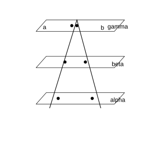{width=50%}

### Solution to Problem 13

By **Theorem 8.5.6** (Property of Two Parallel Planes) and the proportional division of a segment by parallel lines.

Connect $AF$, intersecting the plane $\beta$ at point $G$. The plane $ACF$ intersects $\beta$ in $BG$ and $\gamma$ in $CF$.

Since $\beta\parallel\gamma$, by **Theorem 8.5.6** (Property of Two Parallel Planes), $BG\parallel CF$. In $\triangle ACF$, $\frac{AB}{BC}=\frac{AG}{GF}$.

Similarly, the plane $ADF$ intersects $\beta$ in $GE$ and $\alpha$ in $AD$. Since $\alpha\parallel\beta$, $AD\parallel GE$. In $\triangle ADF$, $\frac{DE}{EF}=\frac{AG}{GF}$.

Hence $\frac{AB}{BC}=\frac{DE}{EF}$. $\blacksquare$

### Problem 14

(Exercise 8.5, Extension and Exploration, Problem 14) As shown in the figure, $a$, $b$ are skew lines, $a\subset\alpha$, $a\parallel\beta$, $b\subset\beta$, $b\parallel\alpha$. Prove that $\alpha\parallel\beta$.

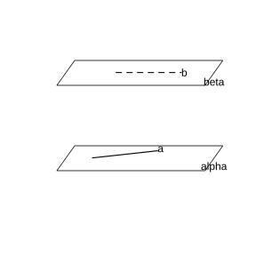{width=50%}

### Solution to Problem 14

By **Theorem 8.5.4** (Property of a Line Parallel to a Plane) and **Theorem 8.5.5** (Criterion for Two Parallel Planes).

Pass a plane through $a$ intersecting $\beta$ in a line $a'$. Since $a\parallel\beta$, by **Theorem 8.5.4** (Property of a Line Parallel to a Plane), $a\parallel a'$.

Since $a$, $b$ are skew and $a\parallel a'$, the line $a'$ must intersect $b$; let the intersection point be $P$.

Within $\beta$, $a'$ and $b$ are two intersecting lines. From $a\parallel a'$, $a\subset\alpha$, $a'\not\subset\alpha$, we get $a'\parallel\alpha$. It is also given that $b\parallel\alpha$.

By **Theorem 8.5.5** (Criterion for Two Parallel Planes), the two intersecting lines $a'$, $b$ in $\beta$ are both parallel to $\alpha$, so $\alpha\parallel\beta$. $\blacksquare$

### Problem 15

(Exercise 8.5, Extension and Exploration, Problem 15) As shown in the figure, a transparent plastic cuboid container $ABCD\text{-}A_{1}B_{1}C_{1}D_{1}$ is filled with some water. One edge $BC$ of the bottom of the container is fixed on the ground, and then the container is tilted. As the angle of tilt changes, consider the following five statements:

(1) the part containing water always has the shape of a prism;

(2) the part without water always has the shape of a prism;

(3) the area of the quadrilateral formed by the water surface $EFGH$ is constant;

(4) the edge $A_{1}D_{1}$ is always parallel to the plane of the water surface;

(5) when the container is tilted as shown in figure (3), $BE\cdot BF$ is constant.

Among them, the numbers of all the correct statements are $\;\_\_\;$. Why?

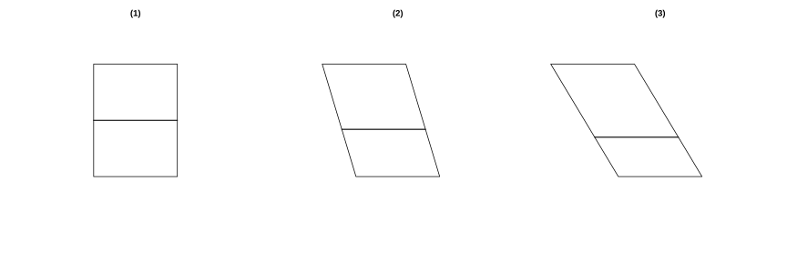{width=100%}

### Solution to Problem 15

By **Definition 8.1.4** (Prism) and **Theorem 8.5.3** (Criterion for a Line Being Parallel to a Plane).

With the edge $BC$ fixed, the water surface is always a plane parallel to the ground, and its line of intersection with the side faces of the cuboid is always parallel to $BC$.

(1) The water-filled part has a cross-section perpendicular to $BC$ as its base and extends along the direction of $BC$, so it always has the shape of a prism. Correct.

(2) Similarly, the part without water also always has the shape of a prism. Correct.

(3) In the water-surface quadrilateral $EFGH$, one side length is always equal to $BC$, but the other side length varies with the tilt angle, so the area is not constant. Wrong.

(4) $A_{1}D_{1}\parallel BC$, while the line of intersection of the water surface is parallel to $BC$, so $A_{1}D_{1}$ is parallel to a line lying in the water surface, and $A_{1}D_{1}$ is always parallel to the plane of the water surface. Correct.

(5) The volume of water is unchanged, and the water-filled part is a prism; the cross-section perpendicular to $BC$ is a right triangle, whose area $\frac{1}{2}BE\cdot BF$ times $BC$ equals the volume of water. Since both the volume of water and $BC$ are constant, $BE\cdot BF$ is constant. Correct.

Hence the numbers of the correct statements are (1) (2) (4) (5). $\blacksquare$
