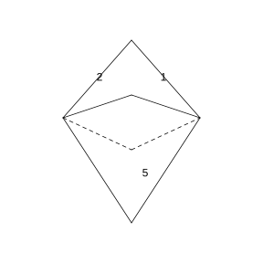

# Assignment 48

> **Definition 10.1.14** (Classical Probability Model)  We call an experiment with the following two features a classical-model experiment, and its mathematical model the classical probability model, shortened to classical probability model: (1) finiteness: there are only finitely many sample points in the sample space; (2) equal likelihood: each sample point is equally likely to occur.

> **Definition 10.1.15** (Classical Definition of Probability)  In general, let experiment $E$ be a classical probability model, the sample space $\Omega$ contain $n$ sample points, and event $A$ contain $k$ of them; then the probability of event $A$ is defined as $P\left(A\right)=\frac{k}{n}=\frac{n\left(A\right)}{n\left(\Omega\right)}$.

> **Definition 10.1.12** (Mutually Exclusive)  In general, if events $A$ and $B$ cannot occur simultaneously, i.e. $A\cap B$ is an impossible event, namely $A\cap B=\varnothing$, then events $A$ and $B$ are said to be mutually exclusive (or incompatible).

> **Property 10.1.18** (Additive Formula for Mutually Exclusive Events)  If events $A$ and $B$ are mutually exclusive, then $P\left(A\cup B\right)=P\left(A\right)+P\left(B\right)$.

> **Property 10.1.19** (Probability of Complementary Events)  If events $A$ and $B$ are complementary, then $P\left(B\right)=1-P\left(A\right)$, $P\left(A\right)=1-P\left(B\right)$.

> **Property 10.1.21** (General Additive Formula)  Let $A, B$ be two events in a random experiment; we have $P\left(A\cup B\right)=P\left(A\right)+P\left(B\right)-P\left(A\cap B\right)$.

> **Definition 10.2.1** (Mutual Independence of Events)  For any two events $A$ and $B$, if $P\left(A\cap B\right)=P\left(A\right)P\left(B\right)$ holds, then events $A$ and $B$ are said to be mutually independent, shortened to independent.

> **Property 10.2.2** (Independence of Complementary Events)  From the definition of mutual independence of two events, it is easy to verify that the certain event $\Omega$ and the impossible event $\varnothing$ are both independent of any event. If events $A$ and $B$ are mutually independent, then $A$ and $\bar B$, $\bar A$ and $B$, and $\bar A$ and $\bar B$ are also mutually independent.

### Exercise 1

(Exercise 10.2, Problem 1) Toss two fair coins separately. Let event $A=$ "the $1$st coin lands heads", event $B=$ "the $2$nd coin lands heads", event $C=$ "the two coins land the same side up". Which two of $A, B, C$ are mutually independent?

### Solution to Exercise 1

By **Definition 10.1.15** (Classical Definition of Probability), tossing two coins, the sample space is $\Omega=\left\{\left(1,1\right), \left(1,0\right), \left(0,1\right), \left(0,0\right)\right\}$, with $4$ equally likely sample points. The events are $A=\left\{\left(1,1\right), \left(1,0\right)\right\}$, $B=\left\{\left(1,1\right), \left(0,1\right)\right\}$, $C=\left\{\left(1,1\right), \left(0,0\right)\right\}$, so $P\left(A\right)=P\left(B\right)=P\left(C\right)=\frac{2}{4}=\frac{1}{2}$.

By **Definition 10.2.1** (Mutual Independence of Events), verify whether $P\left(A\cap B\right)=P\left(A\right)P\left(B\right)$ holds.

$A\cap B=\left\{\left(1,1\right)\right\}$, $P\left(A\cap B\right)=\frac{1}{4}$, while $P\left(A\right)P\left(B\right)=\frac{1}{2}\times\frac{1}{2}=\frac{1}{4}$, so $A$ and $B$ are mutually independent.

$A\cap C=\left\{\left(1,1\right)\right\}$, $P\left(A\cap C\right)=\frac{1}{4}$, while $P\left(A\right)P\left(C\right)=\frac{1}{2}\times\frac{1}{2}=\frac{1}{4}$, so $A$ and $C$ are mutually independent.

$B\cap C=\left\{\left(1,1\right)\right\}$, $P\left(B\cap C\right)=\frac{1}{4}$, while $P\left(B\right)P\left(C\right)=\frac{1}{2}\times\frac{1}{2}=\frac{1}{4}$, so $B$ and $C$ are mutually independent.

Hence any two of $A, B, C$ are mutually independent. $\blacksquare$

### Exercise 2

(Exercise 10.2, Problem 2) Let the sample space $\Omega=\left\{a, b, c, d\right\}$ contain equally likely sample points, and

$$
A=\left\{a, b\right\},\quad B=\left\{a, c\right\},\quad C=\left\{a, d\right\}.
$$

Verify that the three events $A, B, C$ are pairwise independent, but $P\left(A\cap B\cap C\right)\neq P\left(A\right)P\left(B\right)P\left(C\right)$.

### Solution to Exercise 2

By **Definition 10.1.15** (Classical Definition of Probability), each sample point has probability $\frac{1}{4}$, so $P\left(A\right)=P\left(B\right)=P\left(C\right)=\frac{2}{4}=\frac{1}{2}$.

By **Definition 10.2.1** (Mutual Independence of Events), verify pairwise independence.

$A\cap B=\left\{a\right\}$, $P\left(A\cap B\right)=\frac{1}{4}$, while $P\left(A\right)P\left(B\right)=\frac{1}{2}\times\frac{1}{2}=\frac{1}{4}$, so $A$ and $B$ are independent.

$A\cap C=\left\{a\right\}$, $P\left(A\cap C\right)=\frac{1}{4}$, while $P\left(A\right)P\left(C\right)=\frac{1}{2}\times\frac{1}{2}=\frac{1}{4}$, so $A$ and $C$ are independent.

$B\cap C=\left\{a\right\}$, $P\left(B\cap C\right)=\frac{1}{4}$, while $P\left(B\right)P\left(C\right)=\frac{1}{2}\times\frac{1}{2}=\frac{1}{4}$, so $B$ and $C$ are independent.

Hence $A, B, C$ are pairwise independent.

Also $A\cap B\cap C=\left\{a\right\}$, $P\left(A\cap B\cap C\right)=\frac{1}{4}$, while $P\left(A\right)P\left(B\right)P\left(C\right)=\frac{1}{2}\times\frac{1}{2}\times\frac{1}{2}=\frac{1}{8}$, so

$$
P\left(A\cap B\cap C\right)=\frac{1}{4}\neq\frac{1}{8}=P\left(A\right)P\left(B\right)P\left(C\right).
$$

$\blacksquare$

### Exercise 3

(Exercise 10.2, Problem 3) The weather forecast reports: during the New Year holiday, the probability of rain in place A is $0.2$ and in place B is $0.3$. Assuming that whether it rains in the two places during this period has no mutual influence, compute, during this period:

(1) the probability that it rains in both places A and B;

(2) the probability that it rains in neither place A nor B;

(3) the probability that it rains in at least one place.

### Solution to Exercise 3

Let event $A=$ "it rains in place A", $B=$ "it rains in place B"; then $P\left(A\right)=0.2$, $P\left(B\right)=0.3$. By the problem, $A$ and $B$ are mutually independent. By **Property 10.2.2** (Independence of Complementary Events), $\bar A, \bar B$ are also mutually independent.

(1) By **Definition 10.2.1** (Mutual Independence of Events), rain in both places means $A\cap B$ occurs, so

$$
P\left(A\cap B\right)=P\left(A\right)P\left(B\right)=0.2\times 0.3=0.06.
$$

(2) Rain in neither place means $\bar A\cap\bar B$ occurs. By **Property 10.1.19** (Probability of Complementary Events), $P\left(\bar A\right)=1-0.2=0.8$, $P\left(\bar B\right)=1-0.3=0.7$. Then by **Definition 10.2.1** (Mutual Independence of Events),

$$
P\left(\bar A\cap\bar B\right)=P\left(\bar A\right)P\left(\bar B\right)=0.8\times 0.7=0.56.
$$

(3) "It rains in at least one place" is the complementary event of "it rains in neither place". By **Property 10.1.19** (Probability of Complementary Events),

$$
P\left(\text{至少一个降雨}\right)=1-P\left(\bar A\cap\bar B\right)=1-0.56=0.44.
$$

$\blacksquare$

### Exercise 4

(Exercise 10.2, Problem 4) Prove that the certain event $\Omega$ and the impossible event $\varnothing$ are independent of any event.

### Solution to Exercise 4

By **Definition 10.2.1** (Mutual Independence of Events), we need to verify that for any event $A$, $P\left(\Omega\cap A\right)=P\left(\Omega\right)P\left(A\right)$ and $P\left(\varnothing\cap A\right)=P\left(\varnothing\right)P\left(A\right)$.

By set operations, $\Omega\cap A=A$, $\varnothing\cap A=\varnothing$. By **Property 10.1.17** (Probability of the Certain and Impossible Events), $P\left(\Omega\right)=1$, $P\left(\varnothing\right)=0$.

Therefore

$$
P\left(\Omega\cap A\right)=P\left(A\right)=1\cdot P\left(A\right)=P\left(\Omega\right)P\left(A\right),
$$

$$
P\left(\varnothing\cap A\right)=P\left(\varnothing\right)=0=0\cdot P\left(A\right)=P\left(\varnothing\right)P\left(A\right).
$$

By **Definition 10.2.1** (Mutual Independence of Events), the certain event $\Omega$ and the impossible event $\varnothing$ are independent of any event. $\blacksquare$

### Problem 1

(Exercise 10.2, Review and Consolidation, Problem 1) Toss two fair dice. Let $A=$ "the first die shows an odd number" and $B=$ "the second die shows an even number". Then the relationship between $A$ and $B$ is ( ).

(A) mutually exclusive

(B) complementary

(C) mutually independent

(D) equal

### Solution to Problem 1

By **Definition 10.1.15** (Classical Definition of Probability), tossing two dice gives $36$ equally likely sample points. The first die showing an odd number has $3$ possibilities ($1, 3, 5$) and the second has $6$, so $n\left(A\right)=3\times 6=18$, $P\left(A\right)=\frac{18}{36}=\frac{1}{2}$. The second die showing an even number has $3$ possibilities ($2, 4, 6$) and the first has $6$, so $n\left(B\right)=6\times 3=18$, $P\left(B\right)=\frac{18}{36}=\frac{1}{2}$.

$A\cap B$ means the first is odd and the second is even, giving $3\times 3=9$ sample points, so $P\left(A\cap B\right)=\frac{9}{36}=\frac{1}{4}$. While $P\left(A\right)P\left(B\right)=\frac{1}{2}\times\frac{1}{2}=\frac{1}{4}$, so $P\left(A\cap B\right)=P\left(A\right)P\left(B\right)$. By **Definition 10.2.1** (Mutual Independence of Events), $A$ and $B$ are mutually independent; choose (C). $\blacksquare$

### Problem 2

(Exercise 10.2, Review and Consolidation, Problem 2) Suppose $P\left(A\right)=0.7$, $P\left(B\right)=0.8$, and $A$ and $B$ are mutually independent. Then $P\left(A\cap B\right)=\;\_\_\;$, $P\left(A\cup B\right)=\;\_\_\;$.

### Solution to Problem 2

By **Definition 10.2.1** (Mutual Independence of Events), since $A$ and $B$ are independent,

$$
P\left(A\cap B\right)=P\left(A\right)P\left(B\right)=0.7\times 0.8=0.56.
$$

By **Property 10.1.21** (General Additive Formula),

$$
P\left(A\cup B\right)=P\left(A\right)+P\left(B\right)-P\left(A\cap B\right)=0.7+0.8-0.56=0.94.
$$

$\blacksquare$

### Problem 3

(Exercise 10.2, Review and Consolidation, Problem 3) If $P\left(A\right)>0$, $P\left(B\right)>0$, prove that events $A, B$ being mutually independent and $A, B$ being mutually exclusive cannot hold simultaneously.

### Solution to Problem 3

By **Definition 10.1.12** (Mutually Exclusive), if $A, B$ are mutually exclusive, then $A\cap B=\varnothing$, so $P\left(A\cap B\right)=0$.

By **Definition 10.2.1** (Mutual Independence of Events), if $A, B$ are mutually independent, then $P\left(A\cap B\right)=P\left(A\right)P\left(B\right)$.

If $A, B$ were both independent and mutually exclusive, then necessarily $P\left(A\right)P\left(B\right)=P\left(A\cap B\right)=0$. But given $P\left(A\right)>0$ and $P\left(B\right)>0$, we have $P\left(A\right)P\left(B\right)>0$, a contradiction.

Therefore, when $P\left(A\right)>0$ and $P\left(B\right)>0$, events $A, B$ being mutually independent and $A, B$ being mutually exclusive cannot hold simultaneously. $\blacksquare$

### Problem 4

(Exercise 10.2, Comprehensive Application, Problem 4) Two people, A and B, independently decode a cipher; their individual probabilities of decoding it are $\frac{1}{3}$ and $\frac{1}{4}$ respectively. Find:

(1) the probability that both successfully decode it;

(2) the probability that the cipher is successfully decoded.

### Solution to Problem 4

Let event $A=$ "A decodes successfully", $B=$ "B decodes successfully"; then $P\left(A\right)=\frac{1}{3}$, $P\left(B\right)=\frac{1}{4}$. By the problem, $A$ and $B$ are mutually independent.

(1) By **Definition 10.2.1** (Mutual Independence of Events), both decoding successfully means $A\cap B$ occurs, so

$$
P\left(A\cap B\right)=P\left(A\right)P\left(B\right)=\frac{1}{3}\times\frac{1}{4}=\frac{1}{12}.
$$

(2) The cipher being successfully decoded means at least one decodes it, i.e. $A\cup B$. By **Property 10.1.21** (General Additive Formula),

$$
P\left(A\cup B\right)=P\left(A\right)+P\left(B\right)-P\left(A\cap B\right)=\frac{1}{3}+\frac{1}{4}-\frac{1}{12}=\frac{4+3-1}{12}=\frac{6}{12}=\frac{1}{2}.
$$

It can also be computed via the complementary event: by **Property 10.2.2** (Independence of Complementary Events), $\bar A$ and $\bar B$ are independent, $P\left(\bar A\right)=\frac{2}{3}$, $P\left(\bar B\right)=\frac{3}{4}$, so

$$
P\left(\text{密码被破译}\right)=1-P\left(\bar A\cap\bar B\right)=1-\frac{2}{3}\times\frac{3}{4}=1-\frac{1}{2}=\frac{1}{2}.
$$

$\blacksquare$

### Problem 5

(Exercise 10.2, Comprehensive Application, Problem 5) As shown in the figure, a regular octahedron has its eight faces labeled with the numbers $1$ to $8$; toss it once at random and observe the number on the face touching the ground, obtaining the sample space $\Omega=\left\{1, 2, 3, 4, 5, 6, 7, 8\right\}$. Construct appropriate events $A, B, C$ such that $P\left(A\cap B\cap C\right)=P\left(A\right)P\left(B\right)P\left(C\right)$ holds, but $A, B, C$ are not pairwise independent.

{width=50%}

### Solution to Problem 5

By **Definition 10.1.15** (Classical Definition of Probability), each sample point has probability $\frac{1}{8}$.

Construct the following events:

$$
A=\left\{1, 2, 3, 4\right\},\quad B=\left\{1, 2, 5, 6\right\},\quad C=\left\{1, 3, 5, 7\right\}.
$$

Then $P\left(A\right)=P\left(B\right)=P\left(C\right)=\frac{4}{8}=\frac{1}{2}$.

$A\cap B=\left\{1, 2\right\}$, $P\left(A\cap B\right)=\frac{2}{8}=\frac{1}{4}$, while $P\left(A\right)P\left(B\right)=\frac{1}{2}\times\frac{1}{2}=\frac{1}{4}$, so $A$ and $B$ are independent.

$A\cap C=\left\{1, 3\right\}$, $P\left(A\cap C\right)=\frac{2}{8}=\frac{1}{4}$, while $P\left(A\right)P\left(C\right)=\frac{1}{4}$, so $A$ and $C$ are independent.

$B\cap C=\left\{1, 5\right\}$, $P\left(B\cap C\right)=\frac{2}{8}=\frac{1}{4}$, while $P\left(B\right)P\left(C\right)=\frac{1}{4}$, so $B$ and $C$ are independent.

The three are pairwise independent. Also $A\cap B\cap C=\left\{1\right\}$, $P\left(A\cap B\cap C\right)=\frac{1}{8}$, and

$$
P\left(A\right)P\left(B\right)P\left(C\right)=\frac{1}{2}\times\frac{1}{2}\times\frac{1}{2}=\frac{1}{8},
$$

so $P\left(A\cap B\cap C\right)=P\left(A\right)P\left(B\right)P\left(C\right)$ holds.

In this construction the three are not only jointly independent but also pairwise independent. To construct an example satisfying $P\left(A\cap B\cap C\right)=P\left(A\right)P\left(B\right)P\left(C\right)$ but not pairwise independent, take

$$
A=\left\{1, 2, 3, 4\right\},\quad B=\left\{1, 2, 5, 6\right\},\quad C=\left\{1, 2, 7, 8\right\}.
$$

Then $P\left(A\right)=P\left(B\right)=P\left(C\right)=\frac{1}{2}$, $A\cap B=\left\{1, 2\right\}$, $A\cap C=\left\{1, 2\right\}$, $B\cap C=\left\{1, 2\right\}$, so $P\left(A\cap B\right)=P\left(A\cap C\right)=P\left(B\cap C\right)=\frac{1}{4}=P\left(A\right)P\left(B\right)$; the three are still pairwise independent.

Take another construction: $A=\left\{1, 2, 3, 4\right\}$, $B=\left\{1, 2, 3, 5\right\}$, $C=\left\{1, 6, 7, 8\right\}$. Then $P\left(A\right)=P\left(B\right)=P\left(C\right)=\frac{1}{2}$. $A\cap B=\left\{1, 2, 3\right\}$, $P\left(A\cap B\right)=\frac{3}{8}\neq\frac{1}{4}=P\left(A\right)P\left(B\right)$, so $A, B$ are not independent. $A\cap C=\left\{1\right\}$, $B\cap C=\left\{1\right\}$, $A\cap B\cap C=\left\{1\right\}$, so $P\left(A\cap B\cap C\right)=\frac{1}{8}=P\left(A\right)P\left(B\right)P\left(C\right)=\frac{1}{8}$. In this example $P\left(A\cap B\cap C\right)=P\left(A\right)P\left(B\right)P\left(C\right)$ holds, but $A, B$ are not independent. $\blacksquare$

### Problem 6

(Exercise 10.2, Extension and Exploration, Problem 6) Analyze the following three random experiments and their designated random events, and answer the questions below.

$E_1$: toss two fair coins; event $A=$ "both land heads".

$E_2$: shoot at a target twice, each time with hit probability $0.6$; event $B=$ "hit the target twice".

$E_3$: draw two balls in succession without replacement from a bag containing $2$ red balls and $3$ yellow balls; event $C=$ "both draws are red".

(1) Use appropriate symbols to denote the possible outcomes and write out the sample space of each experiment;

(2) Point out the common features and differences of these three experiments;

(3) Find the probabilities of $A, B, C$ respectively.

### Solution to Problem 6

By **Definition 10.1.2** (Sample Points and Sample Space) and **Definition 10.2.1** (Mutual Independence of Events).

(1) $E_1$: use $1$ for heads and $0$ for tails; the sample space is

$$
\Omega_1=\left\{\left(1,1\right), \left(1,0\right), \left(0,1\right), \left(0,0\right)\right\}.
$$

$E_2$: use $1$ for a hit and $0$ for a miss; the sample space is

$$
\Omega_2=\left\{\left(1,1\right), \left(1,0\right), \left(0,1\right), \left(0,0\right)\right\}.
$$

$E_3$: number the $2$ red balls $1, 2$ and the $3$ yellow balls $3, 4, 5$; use the pair $\left(x_1, x_2\right)$ to denote the result of the two draws; the sample space is

$$
\Omega_3=\left\{\left(1,2\right), \left(1,3\right), \left(1,4\right), \left(1,5\right), \left(2,1\right), \left(2,3\right), \left(2,4\right), \left(2,5\right), \left(3,1\right), \left(3,2\right), \left(3,4\right), \left(3,5\right), \left(4,1\right), \left(4,2\right), \left(4,3\right), \left(4,5\right), \left(5,1\right), \left(5,2\right), \left(5,3\right), \left(5,4\right)\right\}.
$$

(2) Common feature: all three experiments consist of two independent trials, and the event of interest is "both times occur". Difference: $E_1$ is a classical model, with each sample point equally likely; in $E_2$ the sample points are not equally likely (the hit probability is $0.6$, not $0.5$), so it is not a classical model, but the two shots are independent; $E_3$ is sampling without replacement, so the two draws are not independent.

(3) $E_1$ is a classical model; by **Definition 10.1.15** (Classical Definition of Probability), $A=\left\{\left(1,1\right)\right\}$, $P\left(A\right)=\frac{1}{4}$.

In $E_2$ the two shots are independent; by **Definition 10.2.1** (Mutual Independence of Events),

$$
P\left(B\right)=0.6\times 0.6=0.36.
$$

$E_3$ is a classical model, $n\left(\Omega_3\right)=20$, $C=\left\{\left(1,2\right), \left(2,1\right)\right\}$, $n\left(C\right)=2$, so $P\left(C\right)=\frac{2}{20}=\frac{1}{10}$. $\blacksquare$
