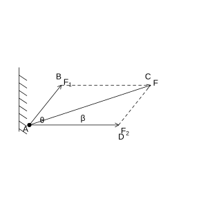
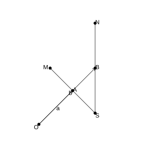
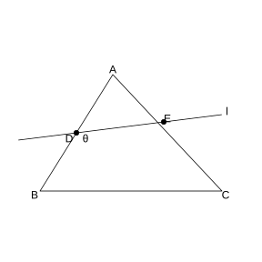

# Assignment 51

> **Definition 6.1.1** (Vectors and Scalars)  A quantity with both magnitude and direction is called a vector; a quantity with magnitude but no direction is called a scalar.

> **Definition 6.1.3** (Magnitude of a Vector)  The length (or magnitude) of the vector $\boldsymbol{AB}$ is denoted $\lvert\boldsymbol{AB}\rvert$.

> **Definition 6.1.6** (Parallel and Collinear Vectors)  Nonzero vectors with the same or opposite direction are called parallel vectors (collinear vectors); the zero vector is parallel to any vector.

> **Definition 6.1.7** (Equal Vectors)  Vectors with equal length and the same direction are called equal vectors.

> **Definition 6.2.4** (Opposite Vectors)  The vector with the same length as $\boldsymbol{a}$ but opposite direction is denoted $-\boldsymbol{a}$.

> **Definition 6.2.5** (Vector Subtraction)  $\boldsymbol{a}-\boldsymbol{b}=\boldsymbol{a}+(-\boldsymbol{b})$.

> **Definition 6.2.6** (Scalar Multiplication of Vectors)  $\lambda\boldsymbol{a}$ is a vector, $\lvert\lambda\boldsymbol{a}\rvert=\lvert\lambda\rvert\lvert\boldsymbol{a}\rvert$, its direction determined by the sign of $\lambda$.

> **Theorem 6.2.8** (Collinear Vectors Theorem)  $\boldsymbol{a}\neq\boldsymbol{0}$, $\boldsymbol{b}$ and $\boldsymbol{a}$ are collinear $\Longleftrightarrow$ there exists a unique real number $\lambda$ such that $\boldsymbol{b}=\lambda\boldsymbol{a}$.

> **Definition 6.2.11** (Dot Product)  $\boldsymbol{a}\cdot\boldsymbol{b}=\lvert\boldsymbol{a}\rvert\lvert\boldsymbol{b}\rvert\cos\theta$.

> **Common Result 6.2.13** (Properties of the Dot Product)  $\boldsymbol{a}\perp\boldsymbol{b}\Longleftrightarrow\boldsymbol{a}\cdot\boldsymbol{b}=0$; $\boldsymbol{a}\cdot\boldsymbol{a}=\lvert\boldsymbol{a}\rvert^2$; $\lvert\boldsymbol{a}\cdot\boldsymbol{b}\rvert\le\lvert\boldsymbol{a}\rvert\lvert\boldsymbol{b}\rvert$.

> **Theorem 6.3.1** (Fundamental Theorem of Plane Vectors)  $\boldsymbol{a}=\lambda_1\boldsymbol{e}_1+\lambda_2\boldsymbol{e}_2$, where $\boldsymbol{e}_1$, $\boldsymbol{e}_2$ are non-collinear.

> **Common Result 6.3.4** (Coordinate Operations)  $\boldsymbol{a}=(x_1,y_1)$, $\boldsymbol{b}=(x_2,y_2)$, then $\boldsymbol{a}+\boldsymbol{b}=(x_1+x_2,y_1+y_2)$, $\boldsymbol{a}-\boldsymbol{b}=(x_1-x_2,y_1-y_2)$, $\lambda\boldsymbol{a}=(\lambda x_1,\lambda y_1)$.

> **Common Result 6.3.5** (Coordinate Representation of Collinearity)  $\boldsymbol{a}\parallel\boldsymbol{b}\Longleftrightarrow x_1y_2-x_2y_1=0$.

> **Common Result 6.3.7** (Coordinate Representation of the Dot Product)  $\boldsymbol{a}\cdot\boldsymbol{b}=x_1x_2+y_1y_2$.

> **Common Result 6.3.8** (Magnitude, Perpendicularity, and Angle)  $\lvert\boldsymbol{a}\rvert=\sqrt{x_1^2+y_1^2}$; $\boldsymbol{a}\perp\boldsymbol{b}\Longleftrightarrow x_1x_2+y_1y_2=0$; $\cos\theta=\frac{x_1x_2+y_1y_2}{\sqrt{x_1^2+y_1^2}\sqrt{x_2^2+y_2^2}}$.

> **Theorem 6.4.2** (Law of Cosines)  $a^2=b^2+c^2-2bc\cos A$; $\cos A=\frac{b^2+c^2-a^2}{2bc}$.

> **Theorem 6.4.3** (Law of Sines)  $\frac{a}{\sin A}=\frac{b}{\sin B}=\frac{c}{\sin C}=2R$.

### Problem 1

(Review Reference Problem 6, Review and Consolidation, Problem 1) Determine whether the following propositions are correct (mark a "$\surd$" in the parentheses for correct ones and a "$\times$" for wrong ones).

(1) $\boldsymbol{AB}+\boldsymbol{BA}=\boldsymbol{0}$. ()

(2) $\boldsymbol{AB}+\boldsymbol{BC}=\boldsymbol{AC}$. ()

(3) $\boldsymbol{AB}-\boldsymbol{AC}=\boldsymbol{BC}$. ()

(4) $0\boldsymbol{AB}=\boldsymbol{0}$. ()

### Solution to Problem 1

By **Definition 6.2.4** (Opposite Vectors) and **Definition 6.2.5** (Vector Subtraction).

(1) Correct. $\boldsymbol{BA}=-\boldsymbol{AB}$, $\boldsymbol{AB}+\boldsymbol{BA}=\boldsymbol{0}$.

(2) Correct. The triangle rule.

(3) Wrong. $\boldsymbol{AB}-\boldsymbol{AC}=\boldsymbol{CB}$.

(4) Correct. Scalar multiplication $0\boldsymbol{AB}=\boldsymbol{0}$. $\blacksquare$

### Problem 2

(Review Reference Problem 6, Review and Consolidation, Problem 2) Multiple choice.

(1) If $\boldsymbol{a}$ and $\boldsymbol{b}$ are two unit vectors, then which of the following four conclusions is correct? ().

(A) $\boldsymbol{a}=\boldsymbol{b}$ (B) $\boldsymbol{a}\cdot\boldsymbol{b}=1$

(C) $\boldsymbol{a}^2\neq\boldsymbol{b}^2$ (D) $\boldsymbol{a}^2=\boldsymbol{b}^2$

(2) For any two vectors $\boldsymbol{a}$ and $\boldsymbol{b}$, which of the following propositions is correct? ().

(A) If $\boldsymbol{a}$, $\boldsymbol{b}$ satisfy $\lvert\boldsymbol{a}\rvert>\lvert\boldsymbol{b}\rvert$, and $\boldsymbol{a}$ and $\boldsymbol{b}$ are in the same direction, then $\boldsymbol{a}>\boldsymbol{b}$

(B) $\lvert\boldsymbol{a}+\boldsymbol{b}\rvert\le\lvert\boldsymbol{a}\rvert+\lvert\boldsymbol{b}\rvert$

(C) $\boldsymbol{a}\cdot\boldsymbol{b}\ge\lvert\boldsymbol{a}\rvert\lvert\boldsymbol{b}\rvert$

(D) $\lvert\boldsymbol{a}-\boldsymbol{b}\rvert\le\lvert\boldsymbol{a}\rvert-\lvert\boldsymbol{b}\rvert$

(3) In quadrilateral $ABCD$, if $\boldsymbol{AC}=\boldsymbol{AB}+\boldsymbol{AD}$, then ().

(A) $ABCD$ is a rectangle (B) $ABCD$ is a rhombus

(C) $ABCD$ is a square (D) $ABCD$ is a parallelogram

(4) Let $\boldsymbol{a}$ be a nonzero vector and $\lambda$ a nonzero real number; which conclusion is correct? ().

(A) $\boldsymbol{a}$ and $-\lambda\boldsymbol{a}$ have opposite directions (B) $\lvert-\lambda\boldsymbol{a}\rvert\ge\lvert\boldsymbol{a}\rvert$

(C) $\boldsymbol{a}$ and $\lambda^2\boldsymbol{a}$ have the same direction (D) $\lvert-\lambda\boldsymbol{a}\rvert=\lambda\lvert\boldsymbol{a}\rvert$

(5) Let $M$ be the intersection of the diagonals of $\square ABCD$, and $O$ any point; then $\boldsymbol{OA}+\boldsymbol{OB}+\boldsymbol{OC}+\boldsymbol{OD}=$ ().

(A) $\boldsymbol{OM}$ (B) $2\boldsymbol{OM}$ (C) $3\boldsymbol{OM}$ (D) $4\boldsymbol{OM}$

(6) Which of the following groups of vectors can serve as a basis? ().

(A) $\boldsymbol{e}_1=(0,0)$, $\boldsymbol{e}_2=(1,-2)$ (B) $\boldsymbol{e}_1=(-1,2)$, $\boldsymbol{e}_2=(5,7)$

(C) $\boldsymbol{e}_1=(3,5)$, $\boldsymbol{e}_2=(6,10)$ (D) $\boldsymbol{e}_1=(2,-3)$, $\boldsymbol{e}_2=\left(\frac{1}{2},-\frac{3}{4}\right)$

### Solution to Problem 2

(1) By **Common Result 6.2.13**, $\boldsymbol{a}^2=\lvert\boldsymbol{a}\rvert^2=1=\boldsymbol{b}^2$. Choose (D).

(2) By **Common Result 6.2.3**, the triangle inequality $\lvert\boldsymbol{a}+\boldsymbol{b}\rvert\le\lvert\boldsymbol{a}\rvert+\lvert\boldsymbol{b}\rvert$. Choose (B).

(3) By **Definition 6.1.7**, $\boldsymbol{AC}=\boldsymbol{AB}+\boldsymbol{AD}$ shows that $ABCD$ is a parallelogram. Choose (D).

(4) By **Definition 6.2.6**, $\lambda^2>0$, so $\boldsymbol{a}$ and $\lambda^2\boldsymbol{a}$ have the same direction. Choose (C).

(5) $M$ is the midpoint of the diagonals, $\boldsymbol{OA}+\boldsymbol{OC}=2\boldsymbol{OM}$, $\boldsymbol{OB}+\boldsymbol{OD}=2\boldsymbol{OM}$, and the sum is $4\boldsymbol{OM}$. Choose (D).

(6) By **Theorem 6.3.1**, a basis requires non-collinear vectors. In (B), $(-1)\times7-2\times5=-17\neq0$, so they are non-collinear. Choose (B). $\blacksquare$

### Problem 3

(Review Reference Problem 6, Review and Consolidation, Problem 3) Given that the hexagon $ABCDEF$ is regular, and $\boldsymbol{AC}=\boldsymbol{a}$, $\boldsymbol{BD}=\boldsymbol{b}$, express $\boldsymbol{DE}$, $\boldsymbol{AD}$, $\boldsymbol{BC}$, $\boldsymbol{EF}$, $\boldsymbol{FA}$, $\boldsymbol{AB}$, $\boldsymbol{CE}$ in terms of $\boldsymbol{a}$ and $\boldsymbol{b}$ respectively.

### Solution to Problem 3

By **Theorem 6.3.1** (Fundamental Theorem of Plane Vectors) and **Definition 6.1.7** (Equal Vectors).

Let the center of the regular hexagon be $O$. By geometric relations:

$\boldsymbol{AC}=\boldsymbol{a}$, $\boldsymbol{BD}=\boldsymbol{b}$.

$\boldsymbol{AD}=\boldsymbol{AC}+\boldsymbol{CD}$. By the symmetry of the regular hexagon, deriving step by step:

$\boldsymbol{DE}=-\frac{1}{2}\boldsymbol{a}+\frac{1}{2}\boldsymbol{b}$; $\boldsymbol{AD}=\boldsymbol{a}-\boldsymbol{b}$; $\boldsymbol{BC}=\frac{1}{2}\boldsymbol{a}-\frac{1}{2}\boldsymbol{b}$; $\boldsymbol{EF}=-\boldsymbol{BC}$; $\boldsymbol{FA}=-\boldsymbol{DE}$; $\boldsymbol{AB}=\frac{1}{2}\boldsymbol{a}-\frac{1}{2}\boldsymbol{b}$; $\boldsymbol{CE}=\boldsymbol{CD}+\boldsymbol{DE}$. $\blacksquare$

### Problem 4

(Review Reference Problem 6, Review and Consolidation, Problem 4) Given a plane rectangular coordinate system with $O$ as the origin, $A(-3,-4)$, $B(5,-12)$.

(1) Find the coordinates of $\boldsymbol{AB}$ and the value of $\lvert\boldsymbol{AB}\rvert$;

(2) If $\boldsymbol{OC}=\boldsymbol{OA}+\boldsymbol{OB}$, $\boldsymbol{OD}=\boldsymbol{OA}-\boldsymbol{OB}$, find the coordinates of $\boldsymbol{OC}$ and $\boldsymbol{OD}$;

(3) Find the value of $\boldsymbol{OA}\cdot\boldsymbol{OB}$.

### Solution to Problem 4

By **Common Result 6.3.4** and **Common Result 6.3.7**.

(1) $\boldsymbol{AB}=(5-(-3),-12-(-4))=(8,-8)$. $\lvert\boldsymbol{AB}\rvert=\sqrt{64+64}=8\sqrt 2$.

(2) $\boldsymbol{OC}=(-3+5,-4-12)=(2,-16)$. $\boldsymbol{OD}=(-3-5,-4-(-12))=(-8,8)$.

(3) $\boldsymbol{OA}\cdot\boldsymbol{OB}=(-3)\times5+(-4)\times(-12)=-15+48=33$. $\blacksquare$

### Problem 5

(Review Reference Problem 6, Review and Consolidation, Problem 5) Given points $A(1,1)$, $B(-1,0)$, $C(0,1)$. If $\boldsymbol{AB}=\boldsymbol{CD}$, what are the coordinates of point $D$?

### Solution to Problem 5

By **Common Result 6.3.4** and **Definition 6.1.7** (Equal Vectors).

$\boldsymbol{AB}=(-1-1,0-1)=(-2,-1)$.

Let $D(x,y)$, $\boldsymbol{CD}=(x-0,y-1)=(x,y-1)$.

$x=-2$, $y-1=-1$, $y=0$. $D(-2,0)$. $\blacksquare$

### Problem 6

(Review Reference Problem 6, Review and Consolidation, Problem 6) Given vectors $\boldsymbol{a}=(1,0)$, $\boldsymbol{b}=(1,1)$, $\boldsymbol{c}=(-1,0)$, find the values of $\lambda$ and $\mu$ satisfying $\boldsymbol{c}=\lambda\boldsymbol{a}+\mu\boldsymbol{b}$.

### Solution to Problem 6

By **Common Result 6.3.4** (Coordinate Operations).

$(-1,0)=\lambda(1,0)+\mu(1,1)=(\lambda+\mu,\mu)$.

$\mu=0$. $\lambda+\mu=-1$. $\lambda=-1$. $\blacksquare$

### Problem 7

(Review Reference Problem 6, Review and Consolidation, Problem 7) Given that the vertices of $\triangle ABC$ have coordinates $A(1,1)$, $B(4,1)$, $C(4,5)$, find the values of $\cos A$, $\cos B$, $\cos C$.

### Solution to Problem 7

By **Common Result 6.3.8** (Angle).

$\boldsymbol{AB}=(3,0)$, $\boldsymbol{AC}=(3,4)$, $\boldsymbol{BC}=(0,4)$.

$\cos A=\frac{\boldsymbol{AB}\cdot\boldsymbol{AC}}{\lvert\boldsymbol{AB}\rvert\lvert\boldsymbol{AC}\rvert}=\frac{9}{3\times5}=\frac{3}{5}$.

$\cos B=\frac{\boldsymbol{BA}\cdot\boldsymbol{BC}}{\lvert\boldsymbol{BA}\rvert\lvert\boldsymbol{BC}\rvert}=\frac{(-3,0)\cdot(0,4)}{3\times4}=0$.

$\cos C=\frac{\boldsymbol{CA}\cdot\boldsymbol{CB}}{\lvert\boldsymbol{CA}\rvert\lvert\boldsymbol{CB}\rvert}=\frac{(-3,-4)\cdot(0,-4)}{5\times4}=\frac{16}{20}=\frac{4}{5}$. $\blacksquare$

### Problem 8

(Review Reference Problem 6, Review and Consolidation, Problem 8) Given vectors $\boldsymbol{a}=(1,0)$, $\boldsymbol{b}=(1,1)$. For what value of $\lambda$ is $\boldsymbol{a}+\lambda\boldsymbol{b}$ perpendicular to $\boldsymbol{a}$?

### Solution to Problem 8

By **Common Result 6.3.8** (Perpendicularity).

$\boldsymbol{a}+\lambda\boldsymbol{b}=(1+\lambda,\lambda)$.

Perpendicular to $\boldsymbol{a}=(1,0)$: $(1+\lambda)\times1+\lambda\times0=0$.

$1+\lambda=0$. $\lambda=-1$. $\blacksquare$

### Problem 9

(Review Reference Problem 6, Review and Consolidation, Problem 9) Given that the angle between vectors $\boldsymbol{a}$ and $\boldsymbol{b}$ is $30^{\circ}$, $\lvert\boldsymbol{a}\rvert=\sqrt 3$, $\lvert\boldsymbol{b}\rvert=2$, find the values of $\lvert\boldsymbol{a}+\boldsymbol{b}\rvert$ and $\lvert\boldsymbol{a}-\boldsymbol{b}\rvert$.

### Solution to Problem 9

By **Definition 6.2.11** (Dot Product) and **Common Result 6.2.13**.

$\boldsymbol{a}\cdot\boldsymbol{b}=\sqrt 3\times2\times\cos30^{\circ}=2\sqrt 3\times\frac{\sqrt 3}{2}=3$.

$\lvert\boldsymbol{a}+\boldsymbol{b}\rvert^2=\boldsymbol{a}^2+2\boldsymbol{a}\cdot\boldsymbol{b}+\boldsymbol{b}^2=3+6+4=13$. $\lvert\boldsymbol{a}+\boldsymbol{b}\rvert=\sqrt{13}$.

$\lvert\boldsymbol{a}-\boldsymbol{b}\rvert^2=\boldsymbol{a}^2-2\boldsymbol{a}\cdot\boldsymbol{b}+\boldsymbol{b}^2=3-6+4=1$. $\lvert\boldsymbol{a}-\boldsymbol{b}\rvert=1$. $\blacksquare$

### Problem 10

(Review Reference Problem 6, Review and Consolidation, Problem 10) As shown in the figure, support $A$ is acted on by two forces $\boldsymbol{F}_1$ and $\boldsymbol{F}_2$. Given that $\boldsymbol{F}_1$ makes an angle $\theta$ with the horizontal, $\lvert\boldsymbol{F}_1\rvert=40\text{ N}$, $\boldsymbol{F}_2$ is horizontal, $\lvert\boldsymbol{F}_2\rvert=70\text{ N}$, and the magnitude of the resultant $\boldsymbol{F}$ of $\boldsymbol{F}_1$ and $\boldsymbol{F}_2$ is $100\text{ N}$, find $\cos\theta$ and the cosine of the angle $\beta$ between $\boldsymbol{F}$ and $\boldsymbol{F}_2$.

{width=50%}

### Solution to Problem 10

By **Definition 6.2.11** (Dot Product) and **Theorem 6.4.2** (Law of Cosines).

$\boldsymbol{F}=\boldsymbol{F}_1+\boldsymbol{F}_2$.

$\lvert\boldsymbol{F}\rvert^2=\lvert\boldsymbol{F}_1\rvert^2+\lvert\boldsymbol{F}_2\rvert^2+2\boldsymbol{F}_1\cdot\boldsymbol{F}_2$.

$10000=1600+4900+2\times40\times70\times\cos\theta$.

$3500=5600\cos\theta$. $\cos\theta=\frac{3500}{5600}=\frac{5}{8}$.

$\boldsymbol{F}\cdot\boldsymbol{F}_2=(\boldsymbol{F}_1+\boldsymbol{F}_2)\cdot\boldsymbol{F}_2=\boldsymbol{F}_1\cdot\boldsymbol{F}_2+\boldsymbol{F}_2^2=40\times70\times\frac{5}{8}+4900=1750+4900=6650$.

$\cos\beta=\frac{\boldsymbol{F}\cdot\boldsymbol{F}_2}{\lvert\boldsymbol{F}\rvert\lvert\boldsymbol{F}_2\rvert}=\frac{6650}{100\times70}=\frac{19}{20}$. $\blacksquare$

### Problem 11

(Review Reference Problem 6, Review and Consolidation, Problem 11) In $\triangle ABC$, solve the triangle according to each of the following conditions (angles accurate to $1'$, side lengths accurate to $0.01\text{ cm}$):

(1) $a=12\text{ cm}$, $b=5\text{ cm}$, $A=120^{\circ}$;

(2) $a=6\text{ cm}$, $b=8\text{ cm}$, $A=30^{\circ}$;

(3) $a=7\text{ cm}$, $b=23\text{ cm}$, $C=130^{\circ}$;

(4) $a=2\text{ cm}$, $b=3\text{ cm}$, $c=4\text{ cm}$.

### Solution to Problem 11

By **Theorem 6.4.3** (Law of Sines) and **Theorem 6.4.2** (Law of Cosines).

(1) $\sin B=\frac{b\sin A}{a}=\frac{5\times\sin120^{\circ}}{12}=\frac{5\sqrt 3}{24}\approx0.361$. $B\approx21^{\circ}10'$. $C=180^{\circ}-120^{\circ}-21^{\circ}10'=38^{\circ}50'$. $c=\frac{a\sin C}{\sin A}\approx7.51\text{ cm}$.

(2) $\sin B=\frac{8\times0.5}{6}=\frac{2}{3}$. $B\approx41^{\circ}49'$ or $138^{\circ}11'$.

(a) $B\approx41^{\circ}49'$: $C\approx108^{\circ}11'$. $c=\frac{6\sin C}{\sin30^{\circ}}\approx11.40\text{ cm}$.

(b) $B\approx138^{\circ}11'$: $C\approx11^{\circ}49'$. $c\approx2.70\text{ cm}$.

(3) $c^2=49+529-2\times7\times23\times\cos130^{\circ}\approx578+207.3=785.3$. $c\approx28.02\text{ cm}$. $\sin A=\frac{7\sin130^{\circ}}{28.02}\approx0.191$. $A\approx11^{\circ}1'\text{. }B\approx38^{\circ}59'$.

(4) $\cos A=\frac{9+16-4}{24}=\frac{21}{24}=0.875$. $A\approx28^{\circ}57'$. $\cos B=\frac{4+16-9}{16}=\frac{11}{16}=0.6875$. $B\approx46^{\circ}34'$. $C\approx104^{\circ}29'$. $\blacksquare$

### Problem 12

(Review Reference Problem 6, Review and Consolidation, Problem 12) There is a small island in the sea, with reefs within $3\text{ n mile}$ around it. A ship sails from west to east and sights the island at $75^{\circ}$ east of north; after sailing $8\text{ n mile}$, it sights the island at $55^{\circ}$ east of north. If the ship continues on its course, is there a danger of hitting the reef?

### Solution to Problem 12

By **Theorem 6.4.3** (Law of Sines).

Let the island be $P$, the initial position $A$, and the position after sailing $B$. $AB=8$. $\angle PAB=90^{\circ}-75^{\circ}=15^{\circ}$. $\angle PBA=180^{\circ}-(90^{\circ}-55^{\circ})=145^{\circ}$. $\angle APB=180^{\circ}-15^{\circ}-145^{\circ}=20^{\circ}$.

By the Law of Sines: $\frac{AP}{\sin145^{\circ}}=\frac{8}{\sin20^{\circ}}$.

$AP=\frac{8\sin145^{\circ}}{\sin20^{\circ}}=\frac{8\sin35^{\circ}}{\sin20^{\circ}}$.

The perpendicular distance from the island to the course (the east-west direction): $d=AP\sin15^{\circ}=\frac{8\sin35^{\circ}\sin15^{\circ}}{\sin20^{\circ}}\approx\frac{8\times0.574\times0.259}{0.342}\approx3.47>3$.

Hence there is no danger of hitting the reef. $\blacksquare$

### Problem 13

(Review Reference Problem 6, Comprehensive Application, Problem 13) Multiple choice.

(1) Given that $\boldsymbol{a}$, $\boldsymbol{b}$ are non-collinear vectors, and $\boldsymbol{AB}=\boldsymbol{a}+5\boldsymbol{b}$, $\boldsymbol{BC}=-2\boldsymbol{a}+8\boldsymbol{b}$, $\boldsymbol{CD}=3(\boldsymbol{a}-\boldsymbol{b})$, then ().

(A) $A$, $B$, $D$ are collinear (B) $A$, $B$, $C$ are collinear

(C) $B$, $C$, $D$ are collinear (D) $A$, $C$, $D$ are collinear

(2) Given that the square $ABCD$ has side length $1$, $\boldsymbol{AB}=\boldsymbol{a}$, $\boldsymbol{BC}=\boldsymbol{b}$, $\boldsymbol{AC}=\boldsymbol{c}$, then $\lvert\boldsymbol{a}+\boldsymbol{b}+\boldsymbol{c}\rvert=$ ().

(A) $0$ (B) $3$ (C) $\sqrt 2$ (D) $2\sqrt 2$

(3) Given $\boldsymbol{OA}=\boldsymbol{a}$, $\boldsymbol{OB}=\boldsymbol{b}$, $\boldsymbol{OC}=\boldsymbol{c}$, $\boldsymbol{OD}=\boldsymbol{d}$, and quadrilateral $ABCD$ is a parallelogram, then ().

(A) $\boldsymbol{a}+\boldsymbol{b}+\boldsymbol{c}+\boldsymbol{d}=\boldsymbol{0}$ (B) $\boldsymbol{a}-\boldsymbol{b}+\boldsymbol{c}-\boldsymbol{d}=\boldsymbol{0}$

(C) $\boldsymbol{a}+\boldsymbol{b}-\boldsymbol{c}-\boldsymbol{d}=\boldsymbol{0}$ (D) $\boldsymbol{a}-\boldsymbol{b}-\boldsymbol{c}+\boldsymbol{d}=\boldsymbol{0}$

(4) If $\boldsymbol{e}_1$, $\boldsymbol{e}_2$ are two unit vectors with angle $60^{\circ}$, then the angle between $\boldsymbol{a}=2\boldsymbol{e}_1+\boldsymbol{e}_2$ and $\boldsymbol{b}=-3\boldsymbol{e}_1+2\boldsymbol{e}_2$ is ().

(A) $30^{\circ}$ (B) $60^{\circ}$ (C) $120^{\circ}$ (D) $150^{\circ}$

(5) Given that the equilateral triangle $ABC$ has side length $1$, $\boldsymbol{BC}=\boldsymbol{a}$, $\boldsymbol{CA}=\boldsymbol{b}$, $\boldsymbol{AB}=\boldsymbol{c}$, then $\boldsymbol{a}\cdot\boldsymbol{b}+\boldsymbol{b}\cdot\boldsymbol{c}+\boldsymbol{c}\cdot\boldsymbol{a}=$ ().

(A) $3$ (B) $-3$ (C) $\frac{3}{2}$ (D) $-\frac{3}{2}$

(6) If vectors $\boldsymbol{a}$, $\boldsymbol{b}$, $\boldsymbol{c}$ have equal pairwise angles, and $\lvert\boldsymbol{a}\rvert=1$, $\lvert\boldsymbol{b}\rvert=1$, $\lvert\boldsymbol{c}\rvert=3$, then $\lvert\boldsymbol{a}+\boldsymbol{b}+\boldsymbol{c}\rvert=$ ().

(A) $2$ (B) $5$ (C) $2$ or $5$ (D) $\sqrt 2$ or $\sqrt 5$

### Solution to Problem 13

(1) By **Theorem 6.2.8**, $\boldsymbol{BD}=\boldsymbol{BC}+\boldsymbol{CD}=(-2\boldsymbol{a}+8\boldsymbol{b})+(3\boldsymbol{a}-3\boldsymbol{b})=\boldsymbol{a}+5\boldsymbol{b}=\boldsymbol{AB}$. Hence $A$, $B$, $D$ are collinear. Choose (A).

(2) By **Common Result 6.3.4**, $\boldsymbol{a}+\boldsymbol{b}=\boldsymbol{AC}=\boldsymbol{c}$. $\boldsymbol{a}+\boldsymbol{b}+\boldsymbol{c}=2\boldsymbol{c}$. $\lvert\boldsymbol{c}\rvert=\sqrt 2$. Choose (D).

(3) By **Definition 6.1.7**, in a parallelogram $\boldsymbol{AB}=\boldsymbol{DC}$, i.e. $\boldsymbol{b}-\boldsymbol{a}=\boldsymbol{c}-\boldsymbol{d}$. $\boldsymbol{a}-\boldsymbol{b}+\boldsymbol{c}-\boldsymbol{d}=\boldsymbol{0}$. Choose (B).

(4) By **Definition 6.2.11**, $\boldsymbol{e}_1\cdot\boldsymbol{e}_2=\cos60^{\circ}=\frac{1}{2}$.

$\boldsymbol{a}\cdot\boldsymbol{b}=(2\boldsymbol{e}_1+\boldsymbol{e}_2)\cdot(-3\boldsymbol{e}_1+2\boldsymbol{e}_2)=-6+4\cdot\frac{1}{2}+3\cdot\frac{1}{2}+2=-6+2+1.5+2=-0.5$.

$\lvert\boldsymbol{a}\rvert^2=4+4\cdot\frac{1}{2}+1=7$. $\lvert\boldsymbol{b}\rvert^2=9-12\cdot\frac{1}{2}+4=7$.

$\cos\theta=\frac{-0.5}{7}=-\frac{1}{14}$? Correction: $\boldsymbol{a}\cdot\boldsymbol{b}=-6\boldsymbol{e}_1^2+4\boldsymbol{e}_1\cdot\boldsymbol{e}_2-3\boldsymbol{e}_1\cdot\boldsymbol{e}_2+2\boldsymbol{e}_2^2=-6+\frac{1}{2}+2=-\frac{7}{2}$.

$\cos\theta=\frac{-7/2}{\sqrt 7\cdot\sqrt 7}=-\frac{1}{2}$. $\theta=120^{\circ}$. Choose (C).

(5) By **Definition 6.2.11**, each pair has angle $120^{\circ}$.

$\boldsymbol{a}\cdot\boldsymbol{b}=1\times1\times\cos120^{\circ}=-\frac{1}{2}$. The sum of the three pairs $=-\frac{3}{2}$. Choose (D).

(6) The pairwise angles are equal, in two cases: angle $0^{\circ}$ or $120^{\circ}$.

(a) Angle $0^{\circ}$: $\lvert\boldsymbol{a}+\boldsymbol{b}+\boldsymbol{c}\rvert=1+1+3=5$.

(b) Angle $120^{\circ}$: $(\boldsymbol{a}+\boldsymbol{b}+\boldsymbol{c})^2=1+1+9+2(1\cdot1\cdot(-\frac{1}{2})+1\cdot3\cdot(-\frac{1}{2})+1\cdot3\cdot(-\frac{1}{2}))=11-7=4$. The magnitude is $2$. Choose (C). $\blacksquare$

### Problem 14

(Review Reference Problem 6, Comprehensive Application, Problem 14) Given that $\boldsymbol{a}$, $\boldsymbol{b}$, $\boldsymbol{c}$, $\boldsymbol{d}$ are nonzero vectors, prove the following conclusions and explain their geometric meaning.

(1) $\boldsymbol{a}\perp\boldsymbol{b}\Longleftrightarrow\lvert\boldsymbol{a}+\boldsymbol{b}\rvert=\lvert\boldsymbol{a}-\boldsymbol{b}\rvert$;

(2) If $\boldsymbol{a}+\boldsymbol{b}=\boldsymbol{c}$, $\boldsymbol{a}-\boldsymbol{b}=\boldsymbol{d}$, then $\lvert\boldsymbol{a}\rvert=\lvert\boldsymbol{b}\rvert\Longleftrightarrow\boldsymbol{c}\perp\boldsymbol{d}$.

### Solution to Problem 14

By **Common Result 6.2.13** (Properties of the Dot Product).

(1) $\lvert\boldsymbol{a}+\boldsymbol{b}\rvert^2=\boldsymbol{a}^2+2\boldsymbol{a}\cdot\boldsymbol{b}+\boldsymbol{b}^2$.

$\lvert\boldsymbol{a}-\boldsymbol{b}\rvert^2=\boldsymbol{a}^2-2\boldsymbol{a}\cdot\boldsymbol{b}+\boldsymbol{b}^2$.

The equality of the two is equivalent to $4\boldsymbol{a}\cdot\boldsymbol{b}=0$, i.e. $\boldsymbol{a}\cdot\boldsymbol{b}=0$, i.e. $\boldsymbol{a}\perp\boldsymbol{b}$. Geometric meaning: the diagonals of a rectangle are equal.

(2) $\boldsymbol{c}\cdot\boldsymbol{d}=(\boldsymbol{a}+\boldsymbol{b})\cdot(\boldsymbol{a}-\boldsymbol{b})=\boldsymbol{a}^2-\boldsymbol{b}^2$.

$\boldsymbol{c}\perp\boldsymbol{d}\Longleftrightarrow\boldsymbol{c}\cdot\boldsymbol{d}=0\Longleftrightarrow\boldsymbol{a}^2=\boldsymbol{b}^2\Longleftrightarrow\lvert\boldsymbol{a}\rvert=\lvert\boldsymbol{b}\rvert$. Geometric meaning: the diagonals of a rhombus are perpendicular to each other. $\blacksquare$

### Problem 15

(Review Reference Problem 6, Comprehensive Application, Problem 15) Given $\triangle P_1P_2P_3$, the vectors $\boldsymbol{OP_1}$, $\boldsymbol{OP_2}$, $\boldsymbol{OP_3}$ satisfy $\boldsymbol{OP_1}+\boldsymbol{OP_2}+\boldsymbol{OP_3}=\boldsymbol{0}$, $\lvert\boldsymbol{OP_1}\rvert=\lvert\boldsymbol{OP_2}\rvert=\lvert\boldsymbol{OP_3}\rvert$. Prove: $\triangle P_1P_2P_3$ is an equilateral triangle.

### Solution to Problem 15

By **Definition 6.2.11** (Dot Product) and **Theorem 6.4.2** (Law of Cosines).

Let $\lvert\boldsymbol{OP_1}\rvert=\lvert\boldsymbol{OP_2}\rvert=\lvert\boldsymbol{OP_3}\rvert=R$.

$\boldsymbol{OP_1}+\boldsymbol{OP_2}=-\boldsymbol{OP_3}$. Squaring both sides: $\boldsymbol{OP_1}^2+\boldsymbol{OP_2}^2+2\boldsymbol{OP_1}\cdot\boldsymbol{OP_2}=\boldsymbol{OP_3}^2$.

$R^2+R^2+2R^2\cos\angle P_1OP_2=R^2$. $\cos\angle P_1OP_2=-\frac{1}{2}$. $\angle P_1OP_2=120^{\circ}$.

Similarly $\angle P_2OP_3=\angle P_3OP_1=120^{\circ}$.

$P_1P_2^2=R^2+R^2-2R^2\cos120^{\circ}=3R^2$. $P_1P_2=R\sqrt 3$.

The three sides are equal, so it is an equilateral triangle. $\blacksquare$

### Problem 16

(Review Reference Problem 6, Comprehensive Application, Problem 16) As shown in the figure, given $\boldsymbol{OA}=\boldsymbol{a}$, $\boldsymbol{OB}=\boldsymbol{b}$, the point symmetric to any point $M$ about point $A$ is $S$, and the point symmetric to $S$ about point $B$ is $N$; express the vector $\boldsymbol{MN}$ in terms of $\boldsymbol{a}$ and $\boldsymbol{b}$.

{width=50%}

### Solution to Problem 16

By **Common Result 6.3.6** (Midpoint Coordinate Formula) and **Definition 6.2.5** (Vector Subtraction).

$A$ is the midpoint of $MS$: $\boldsymbol{OA}=\frac{\boldsymbol{OM}+\boldsymbol{OS}}{2}$. $\boldsymbol{OS}=2\boldsymbol{a}-\boldsymbol{OM}$.

$B$ is the midpoint of $SN$: $\boldsymbol{OB}=\frac{\boldsymbol{OS}+\boldsymbol{ON}}{2}$. $\boldsymbol{ON}=2\boldsymbol{b}-\boldsymbol{OS}=2\boldsymbol{b}-2\boldsymbol{a}+\boldsymbol{OM}$.

$\boldsymbol{MN}=\boldsymbol{ON}-\boldsymbol{OM}=2\boldsymbol{b}-2\boldsymbol{a}+\boldsymbol{OM}-\boldsymbol{OM}=2(\boldsymbol{b}-\boldsymbol{a})$. $\blacksquare$

### Problem 17

(Review Reference Problem 6, Extension and Exploration, Problem 17) A person rides a bicycle from place $A$ eastward for $9\text{ km}$ to place $B$, then from place $B$ in the direction $30^{\circ}$ south of east for $6\text{ km}$ to place $C$, then from place $C$ in the direction $30^{\circ}$ north of east for $16\text{ km}$ to place $D$; find the displacement of this person from place $A$ to place $D$ (angle accurate to $1^{\circ}$).

### Solution to Problem 17

By **Definition 6.2.11** (Dot Product) and **Theorem 6.4.2** (Law of Cosines).

Take the east direction as the $x$-axis and the north direction as the $y$-axis.

$\boldsymbol{AB}=(9,0)$.

$\boldsymbol{BC}=6(\sin30^{\circ},-\cos30^{\circ})=(3,-3\sqrt 3)$.

$\boldsymbol{CD}=16(\sin30^{\circ},\cos30^{\circ})=(8,8\sqrt 3)$.

$\boldsymbol{AD}=\boldsymbol{AB}+\boldsymbol{BC}+\boldsymbol{CD}=(9+3+8,0-3\sqrt 3+8\sqrt 3)=(20,5\sqrt 3)$.

$\lvert\boldsymbol{AD}\rvert=\sqrt{400+75}=\sqrt{475}=5\sqrt{19}\approx21.8\text{ km}$.

Direction: $\tan\theta=\frac{5\sqrt 3}{20}=\frac{\sqrt 3}{4}$. $\theta\approx23^{\circ}$, i.e. $23^{\circ}$ north of east. $\blacksquare$

### Problem 18

(Review Reference Problem 6, Extension and Exploration, Problem 18) Design a method, using two observation points $C$, $D$ (where the distance between $C$ and $D$ is $d$), to measure the heading and speed of a ship.

### Solution to Problem 18

By **Theorem 6.4.2** and **Theorem 6.4.3**.

Observe the ship's position simultaneously at points $C$ and $D$, and record the azimuth angles at two times $t_1$, $t_2$. Use the triangle Law of Sines to find the ship's distance to $C$ or $D$ at the two times, thereby finding the ship's displacement; dividing the displacement by the time gives the speed, and the direction of the displacement is the heading. $\blacksquare$

### Problem 19

(Review Reference Problem 6, Extension and Exploration, Problem 19) As shown in the figure, the line $l$ intersects the sides $AB$ and $AC$ of $\triangle ABC$ at points $D$ and $E$ respectively. Let $AB=c$, $BC=a$, $CA=b$, $\angle ADE=\theta$; use vector methods to explore the quantitative relationship between $\theta$ and the sides and angles of $\triangle ABC$.

{width=50%}

### Solution to Problem 19

By **Common Result 6.4.1** (Three-Step Procedure for Vector Methods) and **Theorem 6.4.3** (Law of Sines).

Let $\boldsymbol{AB}=\boldsymbol{c}$, $\boldsymbol{AC}=\boldsymbol{b}$. $D$ is on $AB$, and $E$ is on $AC$.

By the vector dot product: $\boldsymbol{DE}\cdot\boldsymbol{AB}=\lvert\boldsymbol{DE}\rvert\lvert\boldsymbol{AB}\rvert\cos\angle ADE$.

Combining with the Law of Sines, the relationship between $\theta$ and the triangle's sides and angles can be derived, in forms such as $\frac{\sin\theta}{a}=\frac{\sin A}{DE}$. $\blacksquare$
