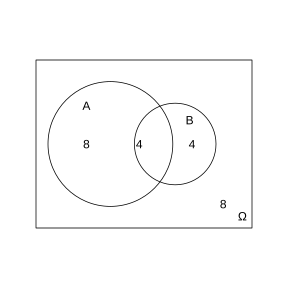
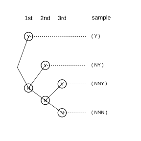

# Assignment 55

> **Definition 10.1.2** (Sample Points and Sample Space)  We call each possible elementary outcome of a random experiment $E$ a sample point, and the set of all sample points the sample space of the experiment $E$. In general, we use $\Omega$ to denote the sample space and $\omega$ to denote a sample point.

> **Definition 10.1.4** (Random Event)  We call a subset of the sample space $\Omega$ a random event, abbreviated as an event; random events are generally denoted by capital letters $A, B, C, \cdots$. In each trial, event $A$ is said to occur if and only if some sample point in $A$ appears.

> **Definition 10.1.10** (Union Event)  In general, if at least one of event $A$ and event $B$ occurs, the sample points in such an event lie either in event $A$ or in event $B$; we call this event the union event (or sum event) of events $A$ and $B$, denoted by $A\cup B$ (or $A+B$).

> **Definition 10.1.11** (Intersection Event)  In general, if event $A$ and event $B$ occur simultaneously, the sample points in such an event lie both in event $A$ and in event $B$; we call such an event the intersection event (or product event) of events $A$ and $B$, denoted by $A\cap B$ (or $AB$).

> **Definition 10.1.12** (Mutually Exclusive)  In general, if event $A$ and event $B$ cannot occur simultaneously, i.e. $A\cap B$ is an impossible event, namely $A\cap B=\varnothing$, then events $A$ and $B$ are said to be mutually exclusive (or disjoint).

> **Definition 10.1.13** (Complementary Events)  In general, if in any trial exactly one of event $A$ and event $B$ occurs, i.e. $A\cup B=\Omega$ and $A\cap B=\varnothing$, then events $A$ and $B$ are said to be complementary. The complementary event of event $A$ is denoted by $\bar A$.

> **Definition 10.1.14** (Classical Probability Model)  We call an experiment having the following two features a classical-probability-model experiment, and its mathematical model is called the classical probability model, abbreviated as the classical probability model: (1) finiteness: there are only finitely many sample points in the sample space; (2) equal likelihood: each sample point occurs with equal probability.

> **Definition 10.1.15** (Classical Definition of Probability)  In general, suppose experiment $E$ is a classical probability model, the sample space $\Omega$ contains $n$ sample points, and event $A$ contains $k$ of them; then the probability of event $A$ is defined as $P(A)=\frac{k}{n}=\frac{n(A)}{n(\Omega)}$.

> **Property 10.1.17** (Probability of the Certain Event and the Impossible Event)  The probability of the certain event is $1$, and the probability of the impossible event is $0$, i.e. $P(\Omega)=1$, $P(\varnothing)=0$.

> **Property 10.1.18** (Addition Formula for Mutually Exclusive Events)  If events $A$ and $B$ are mutually exclusive, then $P(A\cup B)=P(A)+P(B)$.

> **Property 10.1.19** (Probability of Complementary Events)  If events $A$ and $B$ are complementary events, then $P(B)=1-P(A)$, $P(A)=1-P(B)$.

> **Property 10.1.20** (Monotonicity of Probability)  If $A\subseteq B$, then $P(A)\le P(B)$. From Property 10.1.20 it follows that for any event $A$, since $\varnothing\subseteq A\subseteq\Omega$, we have $0\le P(A)\le 1$.

> **Property 10.1.21** (General Addition Formula for Probability)  Let $A, B$ be two events in a random experiment; then we have $P(A\cup B)=P(A)+P(B)-P(A\cap B)$.

> **Definition 10.2.1** (Mutual Independence of Events)  For any two events $A$ and $B$, if $P(A\cap B)=P(A)P(B)$ holds, then events $A$ and $B$ are said to be mutually independent, abbreviated as independent.

> **Property 10.2.2** (Independence of Complementary Events)  From the definition of mutual independence of two events, it is easy to verify that the certain event $\Omega$ and the impossible event $\varnothing$ are both mutually independent of any event. If events $A$ and $B$ are mutually independent, then $A$ and $\bar B$, $\bar A$ and $B$, and $\bar A$ and $\bar B$ are also mutually independent.

> **Definition 10.3.1** (Stability of Frequency)  In general, as the number of trials $n$ increases, the extent to which the frequency deviates from the probability becomes smaller; that is, the frequency $f_n(A)$ of the occurrence of event $A$ gradually stabilizes at the probability $P(A)$ of the occurrence of event $A$. We call this property of frequency the stability of frequency. Hence we can use the frequency $f_n(A)$ to estimate the probability $P(A)$.

### Problem 1

(Review Exercises 10, Review and Consolidation, Problem 1) A box contains $3$ balls: a blue ball, a red ball and a green ball, $1$ of each. Draw $1$ ball at random, note its color and put it back, and then draw $1$ ball again at random.

(1) Use appropriate notation to represent the possible outcomes of the experiment, and write out the sample space;

(2) Use a set to represent the event "the first ball drawn is red";

(3) Use a set to represent the event "the two balls drawn have the same color".

### Solution to Problem 1

By **Definition 10.1.2** (Sample Points and Sample Space), let $b$ denote the blue ball, $r$ the red ball, and $g$ the green ball, and use the pair $(x_1, x_2)$ to denote the result of the two draws.

(1) Since the drawing is with replacement, there are $3$ possibilities each time; the sample space is

$$
\Omega=\{(b,b), (b,r), (b,g), (r,b), (r,r), (r,g), (g,b), (g,r), (g,g)\}.
$$

(2) By **Definition 10.1.4** (Random Event), "the first ball drawn is red" means $x_1=r$, which contains the sample points $(r,b), (r,r), (r,g)$; hence

$$
A=\{(r,b), (r,r), (r,g)\}.
$$

(3) "the two balls drawn have the same color" means $x_1=x_2$, which contains the sample points $(b,b), (r,r), (g,g)$; hence

$$
B=\{(b,b), (r,r), (g,g)\}.
$$

$\blacksquare$

### Problem 2

(Review Exercises 10, Review and Consolidation, Problem 2) The figure shows the sample space $\Omega$ and the events $A$ and $B$ of a classical probability model, where $n(\Omega)=24$, $n(A)=12$, $n(B)=8$, $n(A\cup B)=16$. Then

(1) $n(A\cap B)=\;\_\_\;$, $P(A\cap B)=\;\_\_\;$, $P(A\cup B)=\;\_\_\;$, $P(\bar A\cap\bar B)=\;\_\_\;$.

(2) Are events $A$ and $B$ mutually exclusive? Are events $A$ and $B$ mutually independent?

{width=50%}

### Solution to Problem 2

By **Definition 10.1.15** (Classical Definition of Probability) and **Property 10.1.21** (General Addition Formula for Probability).

(1) In the sample-point form of **Property 10.1.21** (General Addition Formula for Probability), $n(A\cup B)=n(A)+n(B)-n(A\cap B)$; hence

$$
n(A\cap B)=n(A)+n(B)-n(A\cup B)=12+8-16=4.
$$

Therefore

$$
P(A\cap B)=\frac{n(A\cap B)}{n(\Omega)}=\frac{4}{24}=\frac{1}{6}.
$$

$$
P(A\cup B)=\frac{n(A\cup B)}{n(\Omega)}=\frac{16}{24}=\frac{2}{3}.
$$

By **Definition 10.1.13** (Complementary Events), $\bar A\cap\bar B=\overline{A\cup B}$. By **Property 10.1.19** (Probability of Complementary Events),

$$
P(\bar A\cap\bar B)=1-P(A\cup B)=1-\frac{2}{3}=\frac{1}{3}.
$$

(2) By **Definition 10.1.12** (Mutually Exclusive), $n(A\cap B)=4\neq 0$, so $A\cap B\neq\varnothing$, and $A$ and $B$ are not mutually exclusive.

By **Definition 10.2.1** (Mutual Independence of Events), $P(A)=\frac{12}{24}=\frac{1}{2}$, $P(B)=\frac{8}{24}=\frac{1}{3}$, and $P(A)P(B)=\frac{1}{2}\times\frac{1}{3}=\frac{1}{6}=P(A\cap B)$, so $A$ and $B$ are mutually independent. $\blacksquare$

### Problem 3

(Review Exercises 10, Review and Consolidation, Problem 3) A pharmaceutical factory is testing the efficacy of a weight-loss drug; $500$ volunteers took the drug, with the following results:

| Change in weight | Weight decreased | Weight unchanged | Weight increased |
|---|---|---|---|
| Number of people | $276$ | $144$ | $80$ |

If another person takes this drug, estimate the probability of the following events:

(1) this person's weight decreased;

(2) this person's weight remained unchanged;

(3) this person's weight increased.

### Solution to Problem 3

By **Definition 10.3.1** (Stability of Frequency), estimate the probability by the frequency. The total number of people is $500$.

(1) The frequency of weight decreased is $\frac{276}{500}=0.552$, so the estimate is $P(A_1)=0.552$.

(2) The frequency of weight unchanged is $\frac{144}{500}=0.288$, so the estimate is $P(A_2)=0.288$.

(3) The frequency of weight increased is $\frac{80}{500}=0.160$, so the estimate is $P(A_3)=0.160$. $\blacksquare$

### Problem 4

(Review Exercises 10, Review and Consolidation, Problem 4) A middle school has $130$ staff members. A survey of their age and education level gave the following results:

| Age group | Bachelor's | Graduate | Total |
|---|---|---|---|
| Under $35$ | $50$ | $35$ | $85$ |
| $35$ to $50$ | $20$ | $13$ | $33$ |
| Over $50$ | $10$ | $2$ | $12$ |

One person is drawn at random from these $130$ staff members. Find the probability of the following events:

(1) the person has a Bachelor's degree;

(2) the person is $35$ or older;

(3) the person is under $35$ and has a graduate degree.

### Solution to Problem 4

By **Definition 10.1.15** (Classical Definition of Probability), drawing one person at random from $130$ people gives $n(\Omega)=130$.

(1) The number with a Bachelor's degree is $50+20+10=80$, so $P(A_1)=\frac{80}{130}=\frac{8}{13}$.

(2) The number aged $35$ or older is $33+12=45$, so $P(A_2)=\frac{45}{130}=\frac{9}{26}$.

(3) The number under $35$ with a graduate degree is $35$, so $P(A_3)=\frac{35}{130}=\frac{7}{26}$. $\blacksquare$

### Problem 5

(Review Exercises 10, Comprehensive Application, Problem 5) A bag contains $4$ red balls and $6$ green balls. Draw $2$ balls successively at random without replacement.

(1) Find the probability that the second ball drawn is red;

(2) Find the probability that the two balls drawn have the same color;

(3) If there are $4$ red balls and $n$ green balls, and the probability that the $2$ balls drawn are both red is $\frac{1}{6}$, what is $n$?

### Solution to Problem 5

By **Definition 10.1.15** (Classical Definition of Probability).

(1) Drawing $2$ balls successively without replacement from $10$ balls gives $10\times 9=90$ equally likely outcomes. Cases in which the second ball is red: the first draw is green ($6$ ways) and the second is red ($4$ ways), giving $6\times 4=24$ ways; the first draw is red ($4$ ways) and the second is red ($3$ ways), giving $4\times 3=12$ ways. In total $24+12=36$ ways, hence

$$
P(A_1)=\frac{36}{90}=\frac{2}{5}.
$$

(2) The two colors are the same: both red gives $4\times 3=12$ ways, both green gives $6\times 5=30$ ways, totaling $42$ ways, hence

$$
P(A_2)=\frac{42}{90}=\frac{7}{15}.
$$

(3) The bag has $4$ red balls and $n$ green balls, for $4+n$ balls in total. The number of outcomes where the $2$ drawn balls are both red is $4\times 3=12$, and the total number of outcomes is $(4+n)(3+n)$. By the problem,

$$
\frac{12}{(4+n)(3+n)}=\frac{1}{6}.
$$

Solving gives $(4+n)(3+n)=72$, i.e. $n^2+7n+12=72$, $n^2+7n-60=0$, which gives $n=5$ (discarding the negative root $n=-12$). Hence $n=5$. $\blacksquare$

### Problem 6

(Review Exercises 10, Comprehensive Application, Problem 6) $2$ people enter an elevator on the ground floor of a $7$-story building. Suppose each person, starting from the second floor, is equally likely to leave the elevator at any floor.

(1) Find the probability that the two people leave the elevator on different floors;

(2) Find the probability that the two people leave the elevator on the same floor.

### Solution to Problem 6

By **Definition 10.1.15** (Classical Definition of Probability). Each person chooses one floor out of the $6$ floors from the $2$nd to the $7$th to leave; the two choose independently, giving $6\times 6=36$ equally likely outcomes.

(1) The two leave on different floors: the first person has $6$ choices and the second has $5$ choices (a floor different from the first), giving $6\times 5=30$ ways, hence

$$
P(A_1)=\frac{30}{36}=\frac{5}{6}.
$$

(2) By **Property 10.1.19** (Probability of Complementary Events), "leaving on the same floor" is the complementary event of "leaving on different floors", hence

$$
P(A_2)=1-P(A_1)=1-\frac{5}{6}=\frac{1}{6}.
$$

It can also be computed directly: the two leave on the same floor, giving $6$ ways (any one of the $6$ floors), so $P(A_2)=\frac{6}{36}=\frac{1}{6}$. $\blacksquare$

### Problem 7

(Review Exercises 10, Comprehensive Application, Problem 7) A closet contains $3$ pairs of different shoes; denote the $6$ shoes by $a_1, a_2, b_1, b_2, c_1, c_2$, and draw $2$ of them at random.

(1) Write out the sample space of the experiment.

(2) Find the probability of the following events and describe their relationships:

(1) $A=$ "the two drawn shoes are not a pair";

(2) $B=$ "the two drawn shoes are both left-foot";

(3) $C=$ "the two drawn shoes are for the same foot";

(4) $D=$ "the two drawn shoes are one left and one right, but not a pair".

### Solution to Problem 7

By **Definition 10.1.15** (Classical Definition of Probability). Drawing $2$ shoes from $6$ gives $\binom{6}{2}=15$ equally likely outcomes.

(1) The sample space is

$$
\Omega=\{a_1a_2, a_1b_1, a_1b_2, a_1c_1, a_1c_2, a_2b_1, a_2b_2, a_2c_1, a_2c_2, b_1b_2, b_1c_1, b_1c_2, b_2c_1, b_2c_2, c_1c_2\}.
$$

(2) Let $a_1, b_1, c_1$ be left shoes and $a_2, b_2, c_2$ be right shoes.

Event $B=$ "both left-foot": drawing $2$ from the $3$ left shoes gives $\binom{3}{2}=3$ ways, so $P(B)=\frac{3}{15}=\frac{1}{5}$.

The event "both right-foot" likewise has $3$ ways and probability $\frac{1}{5}$. Event $C=$ "for the same foot", i.e. both left or both right; the two are mutually exclusive, so by **Property 10.1.18** (Addition Formula for Mutually Exclusive Events), $P(C)=\frac{1}{5}+\frac{1}{5}=\frac{2}{5}$.

Event $A=$ "not a pair", i.e. not matching. There are $3$ pairs ($a_1a_2, b_1b_2, c_1c_2$), so the probability of a matching pair is $\frac{3}{15}=\frac{1}{5}$. By **Property 10.1.19** (Probability of Complementary Events), "not a pair" is the complementary event of "a pair", so $P(A)=1-\frac{1}{5}=\frac{4}{5}$.

Event $D=$ "one left and one right but not a pair", i.e. one left and one right from different pairs. Choosing one left shoe gives $3$ ways and one right shoe gives $3$ ways, totaling $9$ ways; of these, $3$ are pairs ($a_1a_2, b_1b_2, c_1c_2$), so $9-3=6$ are not pairs, and $P(D)=\frac{6}{15}=\frac{2}{5}$.

Relationships: $C\subseteq A$, because "for the same foot" necessarily implies "not a pair". $D\subseteq A$, because "one left and one right but not a pair" also belongs to "not a pair". $C$ and $D$ are mutually exclusive, because "for the same foot" and "one left and one right" cannot occur simultaneously. $\blacksquare$

### Problem 8

(Review Exercises 10, Extension and Exploration, Problem 8) In the entrance interview of a certain university there are $3$ questions of comparable difficulty, and the probability that Li Ming answers each question correctly is $0.6$. Each interviewee has three chances in total: once a question drawn is answered correctly, the interview is passed; otherwise one keeps drawing questions until the $3$rd attempt. Let $Y$ denote answering a question correctly and $N$ answering it incorrectly; assume that correctness on the different questions drawn is independent.

(1) Fill in the sample points in the tree diagram on the right, and write out the sample space;

(2) Find the probability that Li Ming passes the interview on his second attempt;

(3) Find the probability that Li Ming eventually passes the interview.

{width=50%}

### Solution to Problem 8

By **Definition 10.2.1** (Mutual Independence of Events) and **Property 10.2.2** (Independence of Complementary Events), correctness on each attempt is mutually independent, with $P(Y)=0.6$ and $P(N)=0.4$.

(1) The branches of the tree diagram are: first attempt $Y$ (passed, stop) or $N$; if the first is $N$, the second attempt is $Y$ (passed, stop) or $N$; if the first two are both $N$, the third attempt is $Y$ or $N$. The sample space is

$$
\Omega=\{Y, NY, NNY, NNN\}.
$$

(2) Passing on the second attempt means the first answer is wrong and the second is correct, i.e. the event $NY$. By **Definition 10.2.1** (Mutual Independence of Events),

$$
P(NY)=P(N)P(Y)=0.4\times 0.6=0.24.
$$

(3) Eventually passing the interview means the first answer is correct, or the first is wrong and the second correct, or the first two are wrong and the third correct. The three are pairwise mutually exclusive, so by **Property 10.1.18** (Addition Formula for Mutually Exclusive Events),

$$
P(\text{通过})=P(Y)+P(NY)+P(NNY).
$$

By **Definition 10.2.1** (Mutual Independence of Events),

$$
P(Y)=0.6,\quad P(NY)=0.4\times 0.6=0.24,\quad P(NNY)=0.4\times 0.4\times 0.6=0.096.
$$

Hence

$$
P(\text{通过})=0.6+0.24+0.096=0.936.
$$

It can also be computed via the complementary event: not passing means all three answers are wrong, $P(NNN)=0.4^3=0.064$, and by **Property 10.1.19** (Probability of Complementary Events), $P(\text{通过})=1-0.064=0.936$. $\blacksquare$

### Problem 9

(Review Exercises 10, Extension and Exploration, Problem 9) There are two boxes: box No. $1$ contains $95$ red balls and $5$ white balls; box No. $2$ contains $95$ white balls and $5$ red balls. Now choose one of the two boxes at random, and then draw a ball from it at random. If the ball drawn is red, which box do you think was chosen? Make your inference and explain your reasoning. Do you think a completely correct judgment can be made?

### Solution to Problem 9

By **Definition 10.3.1** (Stability of Frequency) and the basic idea of probability.

The probability of choosing box No. $1$ is $\frac{1}{2}$, and the probability of choosing box No. $2$ is also $\frac{1}{2}$. The probability of drawing a red ball from box No. $1$ is $\frac{95}{100}=0.95$, and from box No. $2$ is $\frac{5}{100}=0.05$.

Given that a red ball was drawn, the likelihood of drawing a red ball from box No. $1$ is far greater than from box No. $2$. Therefore, infer that box No. $1$ was chosen.

But this inference is not completely correct: it is also possible to draw a red ball from box No. $2$ (with probability $0.05$), so there remains a possibility of a wrong judgment. Under the condition that only one ball is drawn, a completely correct judgment cannot be made. If the drawing is repeated many times and the frequency of red balls is recorded, then by **Definition 10.3.1** (Stability of Frequency), the chosen box can be judged with greater confidence, though absolute correctness still cannot be guaranteed. $\blacksquare$
