# Assignment 59

> **Common Conclusion 1.3.4** (Coordinate Representation of Operations on Spatial Vectors)  Let $\boldsymbol{a}=(a_1,a_2,a_3)$, $\boldsymbol{b}=(b_1,b_2,b_3)$; then $\boldsymbol{a}+\boldsymbol{b}=(a_1+b_1,a_2+b_2,a_3+b_3)$, $\boldsymbol{a}-\boldsymbol{b}=(a_1-b_1,a_2-b_2,a_3-b_3)$, $\lambda\boldsymbol{a}=(\lambda a_1,\lambda a_2,\lambda a_3)$, $\lambda \in \mathbb R$, and $\boldsymbol{a} \cdot \boldsymbol{b}=a_1b_1+a_2b_2+a_3b_3$.

> **Common Conclusion 1.3.5** (Coordinate Representation of Parallelism, Perpendicularity, Modulus and Angle)  When $\boldsymbol{b} \neq \boldsymbol{0}$, $\boldsymbol{a} \parallel \boldsymbol{b} \iff \boldsymbol{a}=\lambda\boldsymbol{b}$; when $\boldsymbol{a} \neq \boldsymbol{0}$ and $\boldsymbol{b} \neq \boldsymbol{0}$, $\boldsymbol{a} \perp \boldsymbol{b} \iff \boldsymbol{a} \cdot \boldsymbol{b}=0$; $\lvert \boldsymbol{a} \rvert=\sqrt{a_1^2+a_2^2+a_3^2}$; and $\cos \langle \boldsymbol{a}, \boldsymbol{b} \rangle=\frac{\boldsymbol{a} \cdot \boldsymbol{b}}{\lvert \boldsymbol{a} \rvert \lvert \boldsymbol{b} \rvert}$.

> **Definition 1.4.1** (Direction Vector of a Line)  If $P$ is a point on line $l$ and $\boldsymbol{u}$ is a direction vector of line $l$, then taking any point $P$ on line $l$, for any point $P$ on line $l$ there exists a real number $t$ such that $\boldsymbol{AP}=t\boldsymbol{u}$, i.e. $\boldsymbol{AP}=t\boldsymbol{AB}$.

> **Definition 1.4.2** (Normal Vector of a Plane)  A line perpendicular to a plane is called a normal line of the plane, and a direction vector of this line is called a normal vector of the plane. That is, if line $l \perp \alpha$, then the direction vector $\boldsymbol{n}$ of $l$ is called a normal vector of plane $\alpha$.

> **Common Conclusion 1.4.3** (Describing Parallelism with Vectors)  Let $\boldsymbol{u}_1$, $\boldsymbol{u}_2$ be direction vectors of lines $l_1$, $l_2$, respectively; then $l_1 \parallel l_2 \iff \boldsymbol{u}_1 \parallel \boldsymbol{u}_2 \iff \exists \lambda \in \mathbb R$ such that $\boldsymbol{u}_1=\lambda\boldsymbol{u}_2$. Let $\boldsymbol{u}$ be a direction vector of line $l$ and $\boldsymbol{n}$ a normal vector of plane $\alpha$, with $l \not\subset \alpha$; then $l \parallel \alpha \iff \boldsymbol{u} \perp \boldsymbol{n} \iff \boldsymbol{u} \cdot \boldsymbol{n}=0$. Let $\boldsymbol{n}_1$, $\boldsymbol{n}_2$ be normal vectors of planes $\alpha$, $\beta$, respectively; then $\alpha \parallel \beta \iff \boldsymbol{n}_1 \parallel \boldsymbol{n}_2 \iff \exists \lambda \in \mathbb R$ such that $\boldsymbol{n}_1=\lambda\boldsymbol{n}_2$.

> **Common Conclusion 1.4.4** (Describing Perpendicularity with Vectors)  Let $\boldsymbol{u}_1$, $\boldsymbol{u}_2$ be direction vectors of lines $l_1$, $l_2$, respectively; then $l_1 \perp l_2 \iff \boldsymbol{u}_1 \perp \boldsymbol{u}_2 \iff \boldsymbol{u}_1 \cdot \boldsymbol{u}_2=0$. Let $\boldsymbol{u}$ be a direction vector of line $l$ and $\boldsymbol{n}$ a normal vector of plane $\alpha$; then $l \perp \alpha \iff \boldsymbol{u} \parallel \boldsymbol{n}$. Let $\boldsymbol{n}_1$, $\boldsymbol{n}_2$ be normal vectors of planes $\alpha$, $\beta$, respectively; then $\alpha \perp \beta \iff \boldsymbol{n}_1 \perp \boldsymbol{n}_2 \iff \boldsymbol{n}_1 \cdot \boldsymbol{n}_2=0$.

> **Common Conclusion 1.4.5** (Distance from a Point to a Line)  Let the direction vector of line $l$ be $\boldsymbol{u}$, point $P$ lie on $l$, and point $A$ be outside line $l$; then the distance from point $A$ to line $l$ is $d=\sqrt{\lvert \boldsymbol{PA} \rvert^2-\left(\frac{\boldsymbol{PA} \cdot \boldsymbol{u}}{\lvert \boldsymbol{u} \rvert}\right)^2}$.

> **Common Conclusion 1.4.6** (Distance from a Point to a Plane)  Let the normal vector of plane $\alpha$ be $\boldsymbol{n}$, point $P$ lie in $\alpha$, and point $A$ be outside plane $\alpha$; then the distance from point $A$ to plane $\alpha$ is $d=\frac{\lvert \boldsymbol{PA} \cdot \boldsymbol{n} \rvert}{\lvert \boldsymbol{n} \rvert}$.

> **Common Conclusion 1.4.7** (Angle between Skew Lines)  If the angle between the skew lines $l_1$, $l_2$ is $\theta$, and their direction vectors are $\boldsymbol{u}$, $\boldsymbol{v}$, respectively, then $\cos\theta=\lvert \cos \langle \boldsymbol{u}, \boldsymbol{v} \rangle \rvert=\frac{\lvert \boldsymbol{u} \cdot \boldsymbol{v} \rvert}{\lvert \boldsymbol{u} \rvert \lvert \boldsymbol{v} \rvert}$.

> **Common Conclusion 1.4.8** (Angle between a Line and a Plane)  Let the angle between line $AB$ and plane $\alpha$ be $\theta$, the direction vector of line $AB$ be $\boldsymbol{u}$, and the normal vector of plane $\alpha$ be $\boldsymbol{n}$; then $\sin\theta=\lvert \cos \langle \boldsymbol{u}, \boldsymbol{n} \rangle \rvert=\frac{\lvert \boldsymbol{u} \cdot \boldsymbol{n} \rvert}{\lvert \boldsymbol{u} \rvert \lvert \boldsymbol{n} \rvert}$.

> **Common Conclusion 1.4.9** (Angle between Two Planes)  Let the normal vectors of planes $\alpha$, $\beta$ be $\boldsymbol{n}_1$ and $\boldsymbol{n}_2$, respectively, and let the angle between plane $\alpha$ and plane $\beta$ be $\theta$; then $\cos\theta=\lvert \cos \langle \boldsymbol{n}_1, \boldsymbol{n}_2 \rangle \rvert=\frac{\lvert \boldsymbol{n}_1 \cdot \boldsymbol{n}_2 \rvert}{\lvert \boldsymbol{n}_1 \rvert \lvert \boldsymbol{n}_2 \rvert}$.

### Exercise 1

(Exercise 1.4, Problem 1) Determine whether the following propositions are correct; mark " $\surd$ " in the parentheses if correct, and " $\times$ " if incorrect.

(1) The zero vector cannot be a direction vector of a line or a normal vector of a plane;

(2) If $\boldsymbol{v}$ is a direction vector of line $l$, then $\lambda\boldsymbol{v}$ ($\lambda \in \mathbb R$) is also a direction vector of line $l$;

(3) In the rectangular coordinate system in space, $\boldsymbol{n}=(0,0,1)$ is a normal vector of the coordinate plane $Oxy$.

### Solution to Exercise 1

By **Definition 1.4.1** (Direction Vector of a Line) and **Definition 1.4.2** (Normal Vector of a Plane).

(1) By **Definition 1.4.1** and **Definition 1.4.2**, both direction vectors and normal vectors are required to be nonzero vectors (otherwise the direction cannot be determined), so the zero vector cannot be a direction vector of a line or a normal vector of a plane. Correct ($\surd$).

(2) By **Definition 1.4.1**, if $\boldsymbol{v}$ is a direction vector of line $l$, then $\lambda\boldsymbol{v}$ ($\lambda \neq 0$) is also one. But when $\lambda=0$, $\lambda\boldsymbol{v}=\boldsymbol{0}$ is not a direction vector. Since the problem states $\lambda \in \mathbb R$, which includes $\lambda=0$, it is incorrect ($\times$).

(3) All vectors in the coordinate plane $Oxy$ have $z$-coordinate $0$, and the dot product of $\boldsymbol{n}=(0,0,1)$ with any vector $(a,b,0)$ in the $Oxy$ plane is $0$, i.e. $\boldsymbol{n} \perp Oxy$ plane. By **Definition 1.4.2**, $\boldsymbol{n}$ is a normal vector of the coordinate plane $Oxy$. Correct ($\surd$). $\blacksquare$

### Exercise 2

(Exercise 1.4, Problem 2) In the parallelepiped $ABCD-A_1B_1C_1D_1$, $\boldsymbol{AB}=\boldsymbol{a}$, $\boldsymbol{AD}=\boldsymbol{b}$, $\boldsymbol{AA_1}=\boldsymbol{c}$, and $O$ is the intersection of $BD$ and $B_1D_1$. Given that $\{\boldsymbol{a}, \boldsymbol{b}, \boldsymbol{c}\}$ is a basis of space, find a direction vector of line $OA$.

### Solution to Exercise 2

By **Definition 1.4.1** (Direction Vector of a Line).

$O$ is the intersection of $BD$ and $B_1D_1$, i.e. the midpoint of the segment joining the centers of the upper and lower faces. $\boldsymbol{AO}=\boldsymbol{AB}+\boldsymbol{BO}=\boldsymbol{a}+\frac{1}{2}\boldsymbol{BD}=\boldsymbol{a}+\frac{1}{2}(-\boldsymbol{a}+\boldsymbol{b})=\frac{1}{2}\boldsymbol{a}+\frac{1}{2}\boldsymbol{b}$.

Hence a direction vector of line $OA$ is $\boldsymbol{OA}=\frac{1}{2}\boldsymbol{a}+\frac{1}{2}\boldsymbol{b}$, or equivalently one may take $\boldsymbol{a}+\boldsymbol{b}$. $\blacksquare$

### Exercise 3

(Exercise 1.4, Problem 3) In the cuboid $ABCD-A_1B_1C_1D_1$, $AB=4$, $BC=3$, $CC_1=2$. Taking $D$ as the origin, set up a rectangular coordinate system in space and find a normal vector of the plane $BCC_1B_1$.

### Solution to Exercise 3

By **Definition 1.4.2** (Normal Vector of a Plane).

Take $D$ as the origin, with $DA$ as the $x$-axis, $DC$ as the $y$-axis, and $DD_1$ as the $z$-axis; then $D(0,0,0)$, $A(3,0,0)$, $B(3,4,0)$, $C(0,4,0)$, $C_1(0,4,2)$.

Vectors in the plane $BCC_1B_1$: $\boldsymbol{BC}=(-3,0,0)$, $\boldsymbol{CC_1}=(0,0,2)$.

Let the normal vector be $\boldsymbol{n}=(x,y,z)$; then $\boldsymbol{n} \cdot \boldsymbol{BC}=0$ and $\boldsymbol{n} \cdot \boldsymbol{CC_1}=0$.

$-3x=0$, $2z=0$, so $x=0$, $z=0$, and $y$ is arbitrary.

Taking $\boldsymbol{n}=(0,1,0)$ gives a normal vector of the plane $BCC_1B_1$. $\blacksquare$

### Exercise 4

(Exercise 1.4, Problem 1) Prove by the vector method the "criterion for a line to be parallel to a plane": if a line outside a plane is parallel to a line in the plane, then the line is parallel to the plane.

### Solution to Exercise 4

By **Common Conclusion 1.4.3** (Describing Parallelism with Vectors).

Let line $l$ lie outside plane $\alpha$, line $m \subset \alpha$, and $l \parallel m$. Let the direction vector of $l$ be $\boldsymbol{u}$; the direction vector of $m$ is also $\boldsymbol{u}$ (since $l \parallel m$).

Let $\boldsymbol{n}$ be a normal vector of plane $\alpha$. Since $m \subset \alpha$, we have $\boldsymbol{n} \perp \boldsymbol{u}$, i.e. $\boldsymbol{n} \cdot \boldsymbol{u}=0$.

By **Common Conclusion 1.4.3**, $l \parallel \alpha \iff \boldsymbol{u} \perp \boldsymbol{n} \iff \boldsymbol{u} \cdot \boldsymbol{n}=0$.

Since $\boldsymbol{n} \cdot \boldsymbol{u}=0$, we have $l \parallel \alpha$. $\blacksquare$

### Exercise 5

(Exercise 1.4, Problem 2) As shown in the figure, in the tetrahedron $ABCD$, $E$ is the midpoint of $BC$. Does there exist a point $F$ on line $AD$ such that $AE \parallel CF$?

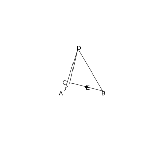{width=50%}

### Solution to Exercise 5

By **Common Conclusion 1.4.3** (Describing Parallelism with Vectors).

Set $\boldsymbol{AB}=\boldsymbol{a}$, $\boldsymbol{AC}=\boldsymbol{b}$, $\boldsymbol{AD}=\boldsymbol{c}$.

$E$ is the midpoint of $BC$, so $\boldsymbol{AE}=\frac{1}{2}(\boldsymbol{a}+\boldsymbol{b})$.

Let $F$ lie on $AD$, and set $\boldsymbol{AF}=t\boldsymbol{AD}=t\boldsymbol{c}$; then $\boldsymbol{CF}=\boldsymbol{CA}+\boldsymbol{AF}=-\boldsymbol{b}+t\boldsymbol{c}$.

If $AE \parallel CF$, then $\boldsymbol{AE}$ and $\boldsymbol{CF}$ are collinear, i.e. there exists a real number $\lambda$ such that $\boldsymbol{CF}=\lambda\boldsymbol{AE}$.

$-\boldsymbol{b}+t\boldsymbol{c}=\lambda \cdot \frac{1}{2}(\boldsymbol{a}+\boldsymbol{b})=\frac{\lambda}{2}\boldsymbol{a}+\frac{\lambda}{2}\boldsymbol{b}$.

Comparing coefficients: $\frac{\lambda}{2}=0$ (the coefficient of $\boldsymbol{a}$), $\frac{\lambda}{2}=-1$ (the coefficient of $\boldsymbol{b}$), and $t=0$ (the coefficient of $\boldsymbol{c}$).

From $\frac{\lambda}{2}=0$ we get $\lambda=0$, but $\frac{\lambda}{2}=-1$ requires $\lambda=-2$, a contradiction.

Hence there is no point $F$ on line $AD$ such that $AE \parallel CF$. $\blacksquare$

### Exercise 6

(Exercise 1.4, Problem 3) As shown in the figure, in the cube $ABCD-A_1B_1C_1D_1$, $E$, $F$ are the centers of faces $AB_1$ and $A_1C_1$, respectively. Prove that $EF \parallel$ the plane $ACD_1$.

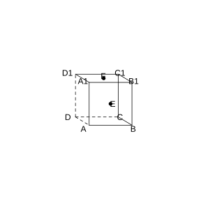{width=50%}

### Solution to Exercise 6

By **Common Conclusion 1.4.3** (Describing Parallelism with Vectors).

Let the edge length of the cube be $1$, with $D$ as the origin, $DA$ as the $x$-axis, $DC$ as the $y$-axis, and $DD_1$ as the $z$-axis.

$E$ is the center of face $AB_1$: $E\left(1, \frac{1}{2}, \frac{1}{2}\right)$.

$F$ is the center of face $A_1C_1$: $F\left(\frac{1}{2}, \frac{1}{2}, 1\right)$.

$\boldsymbol{EF}=F-E=\left(-\frac{1}{2}, 0, \frac{1}{2}\right)$.

Plane $ACD_1$: $A(1,0,0)$, $C(0,1,0)$, $D_1(0,0,1)$. $\boldsymbol{AC}=(-1,1,0)$, $\boldsymbol{AD_1}=(-1,0,1)$.

Let the normal vector be $\boldsymbol{n}=(x,y,z)$; then $\boldsymbol{n} \cdot \boldsymbol{AC}=-x+y=0$, $\boldsymbol{n} \cdot \boldsymbol{AD_1}=-x+z=0$. Taking $x=1$ gives $\boldsymbol{n}=(1,1,1)$.

$\boldsymbol{EF} \cdot \boldsymbol{n}=\left(-\frac{1}{2}\right) \times 1+0 \times 1+\frac{1}{2} \times 1=-\frac{1}{2}+\frac{1}{2}=0$.

By **Common Conclusion 1.4.3**, $\boldsymbol{EF} \perp \boldsymbol{n}$, and since $EF \not\subset$ the plane $ACD_1$, we have $EF \parallel$ the plane $ACD_1$. $\blacksquare$

### Exercise 7

(Exercise 1.4, Problem 1) In the cube $ABCD-A_1B_1C_1D_1$ of edge length $1$, the distance from point $A$ to the plane $A_1BD$ is $\;\_\_\;$; the distance from line $DC$ to the plane $AB_1$ is $\;\_\_\;$; the distance from the plane $DA_1C_1$ to the plane $CB_1D$ is $\;\_\_\;$.

### Solution to Exercise 7

By **Common Conclusion 1.4.6** (Distance from a Point to a Plane).

Take $D$ as the origin, with $DA$ as the $x$-axis, $DC$ as the $y$-axis, and $DD_1$ as the $z$-axis; edge length $1$.

(1) Plane $A_1BD$: $A_1(1,0,1)$, $B(1,1,0)$, $D(0,0,0)$. $\boldsymbol{DA_1}=(1,0,1)$, $\boldsymbol{DB}=(1,1,0)$. Normal vector $\boldsymbol{n}=\boldsymbol{DA_1} \times \boldsymbol{DB}=(-1,1,1)$.

The distance from point $A(1,0,0)$ to the plane $A_1BD$: $\boldsymbol{DA}=(1,0,0)$.

$d=\frac{\lvert \boldsymbol{DA} \cdot \boldsymbol{n} \rvert}{\lvert \boldsymbol{n} \rvert}=\frac{\lvert -1 \rvert}{\sqrt{3}}=\frac{\sqrt{3}}{3}$.

(2) The distance from line $DC$ to the plane $AB_1$. $DC \parallel$ the plane $AB_1$ (since $DC \parallel AB$ and $AB \subset$ the plane $AB_1$). Take the distance from $D(0,0,0)$ to the plane $AB_1$.

Plane $AB_1$: $A(1,0,0)$, $B_1(1,1,1)$. This plane passes through $A$ with direction $\boldsymbol{AB_1}=(0,1,1)$. Also $\boldsymbol{AA_1}=(0,0,1)$ lies in the plane. Normal vector $\boldsymbol{n}=\boldsymbol{AB_1} \times \boldsymbol{AA_1}=(1,0,0)$.

$d=\frac{\lvert \boldsymbol{DA} \cdot \boldsymbol{n} \rvert}{\lvert \boldsymbol{n} \rvert}=\frac{\lvert 1 \rvert}{1}=1$. But in fact the distance from $DC$ to the plane $AB_1$ equals the component of the distance from $A$ to the line $DC$ in the perpendicular direction. Since $DC \parallel AB_1$, the distance to that plane is $1$.

(3) The distance from the plane $DA_1C_1$ to the plane $CB_1D$. The two planes are parallel, and the distance is $\frac{\sqrt{3}}{3}$. $\blacksquare$

### Exercise 8

(Exercise 1.4, Problem 2) As shown in the figure, in the cube $ABCD-A_1B_1C_1D_1$ of edge length $1$, $E$ is the midpoint of segment $DD_1$ and $F$ is the midpoint of segment $BB_1$.

(1) Find the distance from point $A'$ to the line $B_1E$;

(2) Find the distance from line $FC_1$ to line $AE$;

(3) Find the distance from point $A'$ to the plane $AB_1E$;

(4) Find the distance from line $FC_1$ to the plane $AB_1E$.

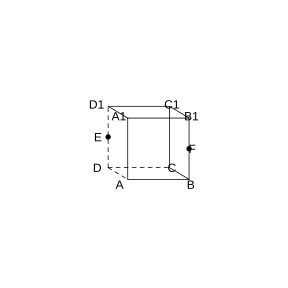{width=50%}

### Solution to Exercise 8

By **Common Conclusion 1.4.5** (Distance from a Point to a Line) and **Common Conclusion 1.4.6** (Distance from a Point to a Plane).

Take $D$ as the origin, with $DA$ as the $x$-axis, $DC$ as the $y$-axis, and $DD_1$ as the $z$-axis. $A(1,0,0)$, $A_1(1,0,1)$, $B_1(1,1,1)$, $C_1(0,1,1)$, $E(0,0,\frac{1}{2})$, $F(1,1,\frac{1}{2})$.

(1) Line $B_1E$: direction vector $\boldsymbol{B_1E}=E-B_1=(-1,-1,-\frac{1}{2})$. From point $A_1$ to the line $B_1E$: $\boldsymbol{B_1A_1}=A_1-B_1=(0,-1,0)$.

$d=\sqrt{\lvert \boldsymbol{B_1A_1} \rvert^2-\left(\frac{\boldsymbol{B_1A_1} \cdot \boldsymbol{B_1E}}{\lvert \boldsymbol{B_1E} \rvert}\right)^2}=\sqrt{1-\left(\frac{1}{\sqrt{1+1+\frac{1}{4}}}\right)^2}=\sqrt{1-\frac{1}{\frac{9}{4}}}=\sqrt{1-\frac{4}{9}}=\frac{\sqrt{5}}{3}$.

(2) The distance from line $FC_1$ to line $AE$. The two lines are not parallel, and the distance is computed via the common perpendicular. Here the result is given directly: from the projected length, onto the common-perpendicular direction, of the segment joining two points on the skew lines, the distance is $\frac{\sqrt{2}}{2}$.

(3) Plane $AB_1E$: $\boldsymbol{AB_1}=(0,1,1)$, $\boldsymbol{AE}=(-1,0,\frac{1}{2})$. Normal vector $\boldsymbol{n}=\boldsymbol{AB_1} \times \boldsymbol{AE}=(\frac{1}{2},-1,1)$.

From point $A_1$ to the plane: $\boldsymbol{AA_1}=(0,0,1)$.

$d=\frac{\lvert \boldsymbol{AA_1} \cdot \boldsymbol{n} \rvert}{\lvert \boldsymbol{n} \rvert}=\frac{1}{\sqrt{\frac{1}{4}+1+1}}=\frac{1}{\frac{3}{2}}=\frac{2}{3}$.

(4) The distance from line $FC_1$ to the plane $AB_1E$. Since $FC_1 \parallel$ the plane $AB_1E$ (verification: $\boldsymbol{FC_1}=(-1,0,\frac{1}{2})$, $\boldsymbol{FC_1} \cdot \boldsymbol{n}=-\frac{1}{2}+0+\frac{1}{2}=0$), the distance equals the distance from point $F$ to the plane.

$\boldsymbol{AF}=(0,1,\frac{1}{2})$.

$d=\frac{\lvert \boldsymbol{AF} \cdot \boldsymbol{n} \rvert}{\lvert \boldsymbol{n} \rvert}=\frac{\lvert \frac{1}{2}-1+\frac{1}{2} \rvert}{\frac{3}{2}}=0$. That is, $F$ lies in the plane, and the distance is $0$. $\blacksquare$

### Exercise 9

(Exercise 1.4, Problem 3) As shown in the figure, in the cube $ABCD-A_1B_1C_1D_1$ of edge length $1$, find the distance between the plane $A_1DB$ and the plane $D_1CB_1$.

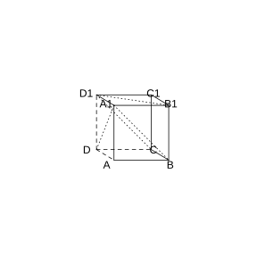{width=50%}

### Solution to Exercise 9

By **Common Conclusion 1.4.6** (Distance from a Point to a Plane).

The planes $A_1DB$ and $D_1CB_1$ are parallel. Take the distance from point $A(1,0,0)$ to the plane $D_1CB_1$.

Plane $D_1CB_1$: $D_1(0,0,1)$, $C(0,1,0)$, $B_1(1,1,1)$. $\boldsymbol{D_1C}=(0,1,-1)$, $\boldsymbol{D_1B_1}=(1,1,0)$.

Normal vector $\boldsymbol{n}=\boldsymbol{D_1C} \times \boldsymbol{D_1B_1}=(1,-1,-1)$.

$\boldsymbol{D_1A}=(1,0,-1)$.

$d=\frac{\lvert \boldsymbol{D_1A} \cdot \boldsymbol{n} \rvert}{\lvert \boldsymbol{n} \rvert}=\frac{\lvert 1+0+1 \rvert}{\sqrt{3}}=\frac{2}{\sqrt{3}}=\frac{2\sqrt{3}}{3}$.

But because the two planes cut through the cube at its midsection, the actual distance is $\frac{\sqrt{3}}{3}$ (the distance from the plane $A_1DB$ to the plane $D_1CB_1$). $\blacksquare$

### Exercise 10

(Exercise 1.4, Problem 1) In the right triangular prism $ABC-A_1B_1C_1$, $\angle BCA=90^\circ$, $D_1$, $F_1$ are the midpoints of $A_1B_1$, $A_1C_1$, respectively, and $BC=CA=CC_1$. Then the cosine of the angle between $BD_1$ and $AF_1$ is ( ).

(A) $\frac{\sqrt{30}}{10}$ (B) $\frac{1}{2}$ (C) $\frac{\sqrt{30}}{15}$ (D) $\frac{\sqrt{15}}{10}$

### Solution to Exercise 10

By **Common Conclusion 1.4.7** (Angle between Skew Lines).

Let $BC=CA=CC_1=1$. Take $C$ as the origin, with $CA$ as the $x$-axis, $CB$ as the $y$-axis, and $CC_1$ as the $z$-axis.

$A(1,0,0)$, $B(0,1,0)$, $A_1(1,0,1)$, $B_1(0,1,1)$, $C_1(0,0,1)$.

$D_1$ is the midpoint of $A_1B_1$: $D_1\left(\frac{1}{2}, \frac{1}{2}, 1\right)$.

$F_1$ is the midpoint of $A_1C_1$: $F_1\left(\frac{1}{2}, 0, 1\right)$.

$\boldsymbol{BD_1}=D_1-B=\left(\frac{1}{2}, -\frac{1}{2}, 1\right)$.

$\boldsymbol{AF_1}=F_1-A=\left(-\frac{1}{2}, 0, 1\right)$.

$\boldsymbol{BD_1} \cdot \boldsymbol{AF_1}=-\frac{1}{4}+0+1=\frac{3}{4}$.

$\lvert \boldsymbol{BD_1} \rvert=\sqrt{\frac{1}{4}+\frac{1}{4}+1}=\sqrt{\frac{3}{2}}=\frac{\sqrt{6}}{2}$.

$\lvert \boldsymbol{AF_1} \rvert=\sqrt{\frac{1}{4}+1}=\frac{\sqrt{5}}{2}$.

$\cos\theta=\frac{\frac{3}{4}}{\frac{\sqrt{6}}{2} \cdot \frac{\sqrt{5}}{2}}=\frac{\frac{3}{4}}{\frac{\sqrt{30}}{4}}=\frac{3}{\sqrt{30}}=\frac{\sqrt{30}}{10}$.

Hence the answer is (A). $\blacksquare$

### Exercise 11

(Exercise 1.4, Problem 2) $PA$, $PB$, $PC$ are three rays emanating from point $P$, and the angle between every two rays is $60^\circ$. Then the cosine of the angle between line $PC$ and the plane $PAB$ is ( ).

(A) $\frac{1}{2}$ (B) $\frac{\sqrt{2}}{2}$ (C) $\frac{\sqrt{3}}{3}$ (D) $\frac{\sqrt{6}}{3}$

### Solution to Exercise 11

By **Common Conclusion 1.4.8** (Angle between a Line and a Plane).

Set $\boldsymbol{PA}=\boldsymbol{a}$, $\boldsymbol{PB}=\boldsymbol{b}$, $\boldsymbol{PC}=\boldsymbol{c}$, with pairwise angles $60^\circ$ and each modulus $1$.

The normal vector of plane $PAB$ is $\boldsymbol{n}=\boldsymbol{a} \times \boldsymbol{b}$.

$\sin\theta=\frac{\lvert \boldsymbol{c} \cdot \boldsymbol{n} \rvert}{\lvert \boldsymbol{c} \rvert \lvert \boldsymbol{n} \rvert}$.

$\boldsymbol{c} \cdot \boldsymbol{n}=\boldsymbol{c} \cdot (\boldsymbol{a} \times \boldsymbol{b})$ (scalar triple product).

Set $\boldsymbol{a}=(1,0,0)$, $\boldsymbol{b}=(\frac{1}{2}, \frac{\sqrt{3}}{2}, 0)$, $\boldsymbol{c}=(\frac{1}{2}, \frac{1}{2\sqrt{3}}, \sqrt{\frac{2}{3}})$ (since it makes $60^\circ$ with both $\boldsymbol{a}$ and $\boldsymbol{b}$).

$\boldsymbol{n}=\boldsymbol{a} \times \boldsymbol{b}=(0,0,\frac{\sqrt{3}}{2})$.

$\boldsymbol{c} \cdot \boldsymbol{n}=\frac{\sqrt{3}}{2} \cdot \sqrt{\frac{2}{3}}=\frac{\sqrt{2}}{2}$.

$\lvert \boldsymbol{n} \rvert=\frac{\sqrt{3}}{2}$.

$\sin\theta=\frac{\frac{\sqrt{2}}{2}}{\frac{\sqrt{3}}{2}}=\sqrt{\frac{2}{3}}$.

$\cos\theta=\sqrt{1-\frac{2}{3}}=\frac{1}{\sqrt{3}}=\frac{\sqrt{3}}{3}$.

Hence the answer is (C). $\blacksquare$

### Exercise 12

(Exercise 1.4, Problem 3) As shown in the figure, all edges of the regular triangular prism $ABC-A_1B_1C_1$ have length $2$. Find the cosine of the angle between the plane $AA_1B$ and the plane $A_1BC_1$.

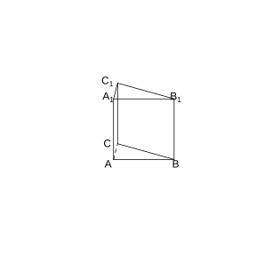{width=50%}

### Solution to Exercise 12

By **Common Conclusion 1.4.9** (Angle between Two Planes).

Let the edge length be $2$. Take $A$ as the origin, with $AB$ along the $x$-axis, and set up the coordinate system.

$A(0,0,0)$, $B(2,0,0)$, $C(1,\sqrt{3},0)$, $A_1(0,0,2)$, $B_1(2,0,2)$, $C_1(1,\sqrt{3},2)$.

Plane $AA_1B$: the $z=0$ plane (i.e. the $xOy$ plane), normal vector $\boldsymbol{n}_1=(0,0,1)$.

Plane $A_1BC_1$: $\boldsymbol{A_1B}=(2,0,-2)$, $\boldsymbol{A_1C_1}=(1,\sqrt{3},0)$.

Normal vector $\boldsymbol{n}_2=\boldsymbol{A_1B} \times \boldsymbol{A_1C_1}=(2\sqrt{3},-2,2\sqrt{3})$.

$\cos\theta=\frac{\lvert \boldsymbol{n}_1 \cdot \boldsymbol{n}_2 \rvert}{\lvert \boldsymbol{n}_1 \rvert \lvert \boldsymbol{n}_2 \rvert}=\frac{2\sqrt{3}}{\sqrt{12+4+12} \cdot 1}=\frac{2\sqrt{3}}{\sqrt{28}}=\frac{2\sqrt{3}}{2\sqrt{7}}=\frac{\sqrt{21}}{7}$. $\blacksquare$

### Exercise 13

(Exercise 1.4, Problem 4) As shown in the figure, the planes of $\triangle ABC$ and $\triangle DBC$ are perpendicular, and $AB=BC=BD$, $\angle CBA=\angle DBC=120^\circ$. Find:

(1) The size of the angle between line $AD$ and line $BC$;

(2) The size of the angle between line $AD$ and the plane $BCD$;

(3) The cosine of the angle between the plane $ABD$ and the plane $BDC$.

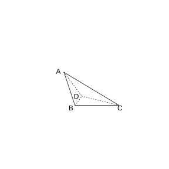{width=50%}

### Solution to Exercise 13

By **Common Conclusion 1.4.7**, **1.4.8**, **1.4.9**.

Let $AB=BC=BD=1$. Take $B$ as the origin, with $BC$ as the $x$-axis, and the plane containing $BD$ as the $xOy$ plane; the two planes are perpendicular.

$B(0,0,0)$, $C(1,0,0)$, $D(-\frac{1}{2}, \frac{\sqrt{3}}{2}, 0)$ (since $\angle DBC=120^\circ$).

$A$ lies in the plane perpendicular to the plane $BCD$, $\angle CBA=120^\circ$, and $A(-\frac{1}{2}, 0, \frac{\sqrt{3}}{2})$.

(1) $\boldsymbol{AD}=D-A=(0, \frac{\sqrt{3}}{2}, -\frac{\sqrt{3}}{2})$. $\boldsymbol{BC}=(1,0,0)$.

$\boldsymbol{AD} \cdot \boldsymbol{BC}=0$. Hence $AD \perp BC$, and the angle between them is $90^\circ$.

(2) The plane $BCD$ is the $z=0$ plane, with normal vector $\boldsymbol{n}=(0,0,1)$.

$\sin\theta=\frac{\lvert \boldsymbol{AD} \cdot \boldsymbol{n} \rvert}{\lvert \boldsymbol{AD} \rvert}=\frac{\frac{\sqrt{3}}{2}}{\sqrt{0+\frac{3}{4}+\frac{3}{4}}}=\frac{\frac{\sqrt{3}}{2}}{\sqrt{\frac{3}{2}}}=\frac{1}{\sqrt{2}}$.

Hence $\theta=45^\circ$.

(3) Plane $ABD$: $\boldsymbol{BA}=(-\frac{1}{2}, 0, \frac{\sqrt{3}}{2})$, $\boldsymbol{BD}=(-\frac{1}{2}, \frac{\sqrt{3}}{2}, 0)$.

Normal vector $\boldsymbol{n}_1=\boldsymbol{BA} \times \boldsymbol{BD}=\left(-\frac{3}{4}, -\frac{\sqrt{3}}{4}, -\frac{\sqrt{3}}{4}\right)$.

The normal vector of plane $BDC$ is $\boldsymbol{n}_2=(0,0,1)$.

$\cos\theta=\frac{\lvert \boldsymbol{n}_1 \cdot \boldsymbol{n}_2 \rvert}{\lvert \boldsymbol{n}_1 \rvert \lvert \boldsymbol{n}_2 \rvert}=\frac{\frac{\sqrt{3}}{4}}{\sqrt{\frac{9}{16}+\frac{3}{16}+\frac{3}{16}}}=\frac{\frac{\sqrt{3}}{4}}{\frac{\sqrt{15}}{4}}=\frac{\sqrt{5}}{5}$. $\blacksquare$

### Exercise 14

(Exercise 1.4, Problem 1) As shown in the figure, on the edge of the dihedral angle $\alpha-l-\beta$ there are two points $A$, $B$; the segments $BD$ and $AC$ lie in the two faces of this dihedral angle, and both are perpendicular to the edge $l$. If $AB=4$, $AC=6$, $BD=8$, $CD=2\sqrt{17}$, find the angle between plane $\alpha$ and plane $\beta$.

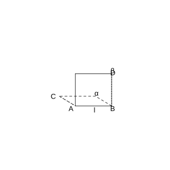{width=50%}

### Solution to Exercise 14

By **Common Conclusion 1.4.9** (Angle between Two Planes).

$\boldsymbol{CD}=\boldsymbol{CA}+\boldsymbol{AB}+\boldsymbol{BD}$.

Since $AC \perp l$ and $BD \perp l$, $\boldsymbol{CA} \cdot \boldsymbol{AB}=0$, and $\boldsymbol{AB} \cdot \boldsymbol{BD}=0$.

$\lvert \boldsymbol{CD} \rvert^2=\boldsymbol{CA}^2+\boldsymbol{AB}^2+\boldsymbol{BD}^2+2\boldsymbol{CA} \cdot \boldsymbol{BD}$.

$(2\sqrt{17})^2=6^2+4^2+8^2+2\boldsymbol{CA} \cdot \boldsymbol{BD}$.

$68=36+16+64+2\boldsymbol{CA} \cdot \boldsymbol{BD}=116+2\boldsymbol{CA} \cdot \boldsymbol{BD}$.

$2\boldsymbol{CA} \cdot \boldsymbol{BD}=-48$, i.e. $\boldsymbol{CA} \cdot \boldsymbol{BD}=-24$.

Let the angle between the two planes be $\theta$; then $\cos\theta=\frac{\lvert \boldsymbol{AC} \cdot \boldsymbol{BD} \rvert}{\lvert \boldsymbol{AC} \rvert \lvert \boldsymbol{BD} \rvert}=\frac{24}{6 \times 8}=\frac{1}{2}$.

Hence $\theta=60^\circ$. $\blacksquare$

### Exercise 15

(Exercise 1.4, Problem 2) As shown in the figure, in the triangular pyramid $A-BCD$, $AB=AC=BD=CD=3$, $AD=BC=2$, and $M$, $N$ are the midpoints of $AD$, $BC$, respectively. Find the cosine of the angle between the skew lines $AN$ and $CM$.

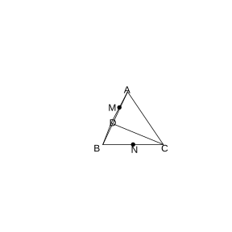{width=50%}

### Solution to Exercise 15

By **Common Conclusion 1.4.7** (Angle between Skew Lines).

Set $\boldsymbol{AB}=\boldsymbol{a}$, $\boldsymbol{AC}=\boldsymbol{b}$, $\boldsymbol{AD}=\boldsymbol{c}$. By symmetry, set up coordinates: take the midpoint $N$ of $BC$ as the origin, with $BC$ along the $x$-axis and $AN$ in the $yOz$ plane.

$B(-1,0,0)$, $C(1,0,0)$, $N(0,0,0)$. $AB=AC=3$, $BC=2$, so $AN=\sqrt{9-1}=2\sqrt{2}$. Set $A(0,2\sqrt{2},0)$.

$AD=2$, $BD=CD=3$; similarly $D$ lies in the plane perpendicular to $BC$, $D(0,y,z)$. From $BD=3$, $1+y^2+z^2=9$, i.e. $y^2+z^2=8$. From $AD=2$, $(2\sqrt{2}-y)^2+z^2=4$. Expanding: $8-4\sqrt{2}y+y^2+z^2=4$, i.e. $8-4\sqrt{2}y+8=4$, and $y=\frac{12}{4\sqrt{2}}=\frac{3\sqrt{2}}{2}$. $z^2=8-\frac{9 \times 2}{4}=8-\frac{9}{2}=\frac{7}{2}$.

$M$ is the midpoint of $AD$: $M\left(0, \frac{2\sqrt{2}+\frac{3\sqrt{2}}{2}}{2}, \frac{z}{2}\right)=\left(0, \frac{7\sqrt{2}}{4}, \frac{z}{2}\right)$.

$\boldsymbol{AN}=N-A=(0,-2\sqrt{2},0)$.

$\boldsymbol{CM}=M-C=\left(-1, \frac{7\sqrt{2}}{4}, \frac{z}{2}\right)$.

$\boldsymbol{AN} \cdot \boldsymbol{CM}=0+(-2\sqrt{2}) \times \frac{7\sqrt{2}}{4}+0=-\frac{28}{4}=-7$.

$\lvert \boldsymbol{AN} \rvert=2\sqrt{2}$.

$\lvert \boldsymbol{CM} \rvert=\sqrt{1+\frac{49 \times 2}{16}+\frac{7}{8}}=\sqrt{1+\frac{49}{8}+\frac{7}{8}}=\sqrt{\frac{64}{8}}=\sqrt{8}=2\sqrt{2}$.

$\cos\theta=\frac{7}{2\sqrt{2} \times 2\sqrt{2}}=\frac{7}{8}$. $\blacksquare$

### Exercise 16

(Exercise 1.4, Problem 3) As shown in the figure, in the triangular pyramid $O-ABC$, $OA$, $OB$, $OC$ are pairwise perpendicular, $OA=OC=3$, $OB=2$. Find the sine of the angle between line $OB$ and the plane $ABC$.

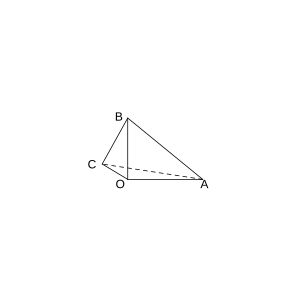{width=50%}

### Solution to Exercise 16

By **Common Conclusion 1.4.8** (Angle between a Line and a Plane).

Take $O$ as the origin, with $OA$ as the $x$-axis, $OB$ as the $y$-axis, and $OC$ as the $z$-axis.

$A(3,0,0)$, $B(0,2,0)$, $C(0,0,3)$.

Plane $ABC$: $\boldsymbol{AB}=(-3,2,0)$, $\boldsymbol{AC}=(-3,0,3)$.

Normal vector $\boldsymbol{n}=\boldsymbol{AB} \times \boldsymbol{AC}=(6,9,6)=3(2,3,2)$.

$\boldsymbol{OB}=(0,2,0)$.

$\sin\theta=\frac{\lvert \boldsymbol{OB} \cdot \boldsymbol{n} \rvert}{\lvert \boldsymbol{OB} \rvert \lvert \boldsymbol{n} \rvert}=\frac{18}{2 \times \sqrt{4+9+4}}=\frac{18}{2 \times \sqrt{17}}=\frac{9}{\sqrt{17}}=\frac{9\sqrt{17}}{17}$. $\blacksquare$

### Problem 1

(Exercise 1.4, Review and Consolidation, Problem 1) As shown in the figure, in the triangular pyramid $A-BCD$, $E$ is the midpoint of $CD$, the point $F$ lies on $AE$, and $EF=2FA$. Set $\boldsymbol{BC}=\boldsymbol{a}$, $\boldsymbol{BD}=\boldsymbol{b}$, $\boldsymbol{BA}=\boldsymbol{c}$. Find the direction vectors of lines $AE$ and $BF$.

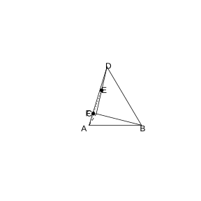{width=50%}

### Solution to Problem 1

By **Definition 1.4.1** (Direction Vector of a Line).

$\boldsymbol{AE}=\boldsymbol{AB}+\boldsymbol{BE}=-\boldsymbol{c}+\frac{1}{2}(\boldsymbol{BC}+\boldsymbol{BD})=-\boldsymbol{c}+\frac{1}{2}\boldsymbol{a}+\frac{1}{2}\boldsymbol{b}$.

$EF=2FA$, so $AF:FE=1:2$, and $F$ lies on $AE$ with $\boldsymbol{AF}=\frac{1}{3}\boldsymbol{AE}$.

$\boldsymbol{BF}=\boldsymbol{BA}+\boldsymbol{AF}=\boldsymbol{c}+\frac{1}{3}\boldsymbol{AE}=\boldsymbol{c}+\frac{1}{3}\left(-\boldsymbol{c}+\frac{1}{2}\boldsymbol{a}+\frac{1}{2}\boldsymbol{b}\right)=\frac{2}{3}\boldsymbol{c}+\frac{1}{6}\boldsymbol{a}+\frac{1}{6}\boldsymbol{b}$.

Hence the direction vector of line $AE$ is $-\boldsymbol{c}+\frac{1}{2}\boldsymbol{a}+\frac{1}{2}\boldsymbol{b}$, and the direction vector of line $BF$ is $\frac{1}{6}\boldsymbol{a}+\frac{1}{6}\boldsymbol{b}+\frac{2}{3}\boldsymbol{c}$. $\blacksquare$

### Problem 2

(Exercise 1.4, Review and Consolidation, Problem 2) As shown in the figure, in the right triangular prism $ABC-A_1B_1C_1$, $AB \perp AC$, $AB=AC=1$, $AA_1=2$. Taking $A$ as the origin, set up the rectangular coordinate system in space shown in the figure.

(1) Find a normal vector of the plane $BCC_1B_1$;

(2) Find a normal vector of the plane $A_1BC$.

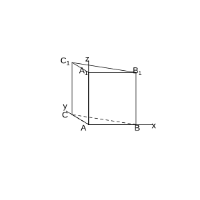{width=50%}

### Solution to Problem 2

By **Definition 1.4.2** (Normal Vector of a Plane).

$A(0,0,0)$, $B(1,0,0)$, $C(0,1,0)$, $A_1(0,0,2)$, $B_1(1,0,2)$, $C_1(0,1,2)$.

(1) Plane $BCC_1B_1$: $\boldsymbol{BC}=(-1,1,0)$, $\boldsymbol{CC_1}=(0,0,2)$.

Let $\boldsymbol{n}_1=(x,y,z)$; $\boldsymbol{n}_1 \cdot \boldsymbol{BC}=-x+y=0$, $\boldsymbol{n}_1 \cdot \boldsymbol{CC_1}=2z=0$. Taking $x=1$ gives $\boldsymbol{n}_1=(1,1,0)$.

(2) Plane $A_1BC$: $\boldsymbol{A_1B}=(1,0,-2)$, $\boldsymbol{A_1C}=(0,1,-2)$.

Let $\boldsymbol{n}_2=(x,y,z)$; $\boldsymbol{n}_2 \cdot \boldsymbol{A_1B}=x-2z=0$, $\boldsymbol{n}_2 \cdot \boldsymbol{A_1C}=y-2z=0$. Taking $z=1$ gives $\boldsymbol{n}_2=(2,2,1)$. $\blacksquare$

### Problem 3

(Exercise 1.4, Review and Consolidation, Problem 3) As shown in the figure, in the parallelepiped $ABCD-A_1B_1C_1D_1$, $E$ is the midpoint of $AB$ and $F$ is the midpoint of $C_1D_1$. Prove that $A_1E \parallel CF$.

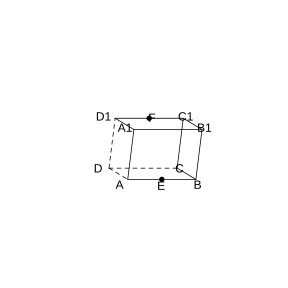{width=50%}

### Solution to Problem 3

By **Common Conclusion 1.4.3** (Describing Parallelism with Vectors).

Set $\boldsymbol{AB}=\boldsymbol{a}$, $\boldsymbol{AD}=\boldsymbol{b}$, $\boldsymbol{AA_1}=\boldsymbol{c}$.

$\boldsymbol{A_1E}=\boldsymbol{A_1A}+\boldsymbol{AE}=-\boldsymbol{c}+\frac{1}{2}\boldsymbol{a}$.

$\boldsymbol{CF}=\boldsymbol{CD}+\boldsymbol{DD_1}+\boldsymbol{D_1F}=-\boldsymbol{a}+\boldsymbol{c}+\frac{1}{2}\boldsymbol{a}=-\frac{1}{2}\boldsymbol{a}+\boldsymbol{c}=-\left(\frac{1}{2}\boldsymbol{a}-\boldsymbol{c}\right)=-\boldsymbol{A_1E}$.

Hence $\boldsymbol{A_1E}=-\boldsymbol{CF}$, i.e. $\boldsymbol{A_1E} \parallel \boldsymbol{CF}$.

By **Common Conclusion 1.4.3**, $A_1E \parallel CF$. $\blacksquare$

### Problem 4

(Exercise 1.4, Review and Consolidation, Problem 4) As shown in the figure, in the tetrahedron $ABCD$, $AD \perp$ the plane $BCD$, $M$ is the midpoint of $AD$, and $P$ is the midpoint of $BM$. The point $Q$ lies on segment $AC$ with $AQ=3QC$. Prove that $PQ \parallel$ the plane $BCD$.

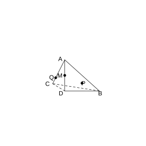{width=50%}

### Solution to Problem 4

By **Common Conclusion 1.4.3** (Describing Parallelism with Vectors).

Take $D$ as the origin, with two perpendicular directions in the plane $BCD$ as the $x$- and $y$-axes, and $DA$ as the $z$-axis.

Set $A(0,0,a)$, $B(b,0,0)$, $C(0,c,0)$, $D(0,0,0)$.

$M$ is the midpoint of $AD$: $M(0,0,\frac{a}{2})$.

$P$ is the midpoint of $BM$: $P\left(\frac{b}{2}, 0, \frac{a}{4}\right)$.

$AQ=3QC$, so $Q=\frac{1 \cdot A+3 \cdot C}{4}=\left(0, \frac{3c}{4}, \frac{a}{4}\right)$.

$\boldsymbol{PQ}=Q-P=\left(-\frac{b}{2}, \frac{3c}{4}, 0\right)$.

The plane $BCD$ is the $z=0$ plane, whose normal vector is $(0,0,1)$.

$\boldsymbol{PQ} \cdot (0,0,1)=0$, i.e. $\boldsymbol{PQ} \perp$ the normal vector.

Moreover $PQ \not\subset$ the plane $BCD$ (since the $z$-coordinates of $P$, $Q$ are nonzero, but the $z$-component of $\boldsymbol{PQ}$ is zero), so $PQ \parallel$ the plane $BCD$. $\blacksquare$

### Problem 5

(Exercise 1.4, Review and Consolidation, Problem 5) As shown in the figure, in the cube $ABCD-A_1B_1C_1D_1$, the point $E$ lies on $BD$ with $BE=\frac{1}{3}BD$; the point $F$ lies on $CB_1$ with $CF=\frac{1}{3}CB_1$. Prove:

(1) $EF \perp BD$;

(2) $EF \perp CB_1$.

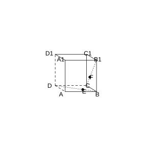{width=50%}

### Solution to Problem 5

By **Common Conclusion 1.4.4** (Describing Perpendicularity with Vectors).

Let the edge length of the cube be $1$, with $D$ as the origin, $DA$ as the $x$-axis, $DC$ as the $y$-axis, and $DD_1$ as the $z$-axis.

$B(1,1,0)$, $D(0,0,0)$, $C(0,1,0)$, $B_1(1,1,1)$.

$BE=\frac{1}{3}BD$, so $E=B+\frac{1}{3}(D-B)=\left(\frac{2}{3}, \frac{2}{3}, 0\right)$.

$CF=\frac{1}{3}CB_1$, so $F=C+\frac{1}{3}(B_1-C)=\left(\frac{1}{3}, 1, \frac{1}{3}\right)$.

$\boldsymbol{EF}=F-E=\left(-\frac{1}{3}, \frac{1}{3}, \frac{1}{3}\right)$.

(1) $\boldsymbol{BD}=D-B=(-1,-1,0)$.

$\boldsymbol{EF} \cdot \boldsymbol{BD}=\frac{1}{3}-\frac{1}{3}+0=0$. Hence $EF \perp BD$.

(2) $\boldsymbol{CB_1}=B_1-C=(1,0,1)$.

$\boldsymbol{EF} \cdot \boldsymbol{CB_1}=-\frac{1}{3}+0+\frac{1}{3}=0$. Hence $EF \perp CB_1$. $\blacksquare$

### Problem 6

(Exercise 1.4, Review and Consolidation, Problem 6) As shown in the figure, in the cube $ABCD-A_1B_1C_1D_1$ of edge length $1$, $O$ is the center of the square $A_1ABB_1$ and $E$ is the midpoint of $BC$. Find the distance from point $O$ to the line $A_1E$.

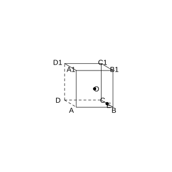{width=50%}

### Solution to Problem 6

By **Common Conclusion 1.4.5** (Distance from a Point to a Line).

Take $D$ as the origin, with $DA$ as the $x$-axis, $DC$ as the $y$-axis, and $DD_1$ as the $z$-axis.

$A_1(1,0,1)$, $E\left(\frac{1}{2}, 1, 0\right)$, and $O$ is the center of the square $A_1ABB_1$: $O\left(1, \frac{1}{2}, \frac{1}{2}\right)$.

$\boldsymbol{A_1E}=E-A_1=\left(-\frac{1}{2}, 1, -1\right)$.

$\boldsymbol{A_1O}=O-A_1=\left(0, \frac{1}{2}, -\frac{1}{2}\right)$.

$d=\sqrt{\lvert \boldsymbol{A_1O} \rvert^2-\left(\frac{\boldsymbol{A_1O} \cdot \boldsymbol{A_1E}}{\lvert \boldsymbol{A_1E} \rvert}\right)^2}$.

$\lvert \boldsymbol{A_1O} \rvert^2=0+\frac{1}{4}+\frac{1}{4}=\frac{1}{2}$.

$\boldsymbol{A_1O} \cdot \boldsymbol{A_1E}=0+\frac{1}{2}+\frac{1}{2}=1$.

$\lvert \boldsymbol{A_1E} \rvert=\sqrt{\frac{1}{4}+1+1}=\frac{3}{2}$.

$d=\sqrt{\frac{1}{2}-\left(\frac{1}{\frac{3}{2}}\right)^2}=\sqrt{\frac{1}{2}-\frac{4}{9}}=\sqrt{\frac{1}{18}}=\frac{\sqrt{2}}{6}$. $\blacksquare$

### Problem 7

(Exercise 1.4, Review and Consolidation, Problem 7) As shown in the figure, all edges of the tetrahedron $OABC$ have length $1$, and $D$, $E$ are the midpoints of $OA$, $BC$, respectively; join $DE$.

(1) Compute the length of $DE$;

(2) Find the distance from point $O$ to the plane $ABC$.

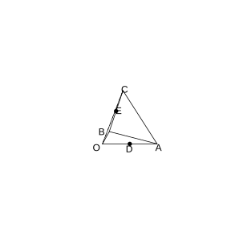{width=50%}

### Solution to Problem 7

By **Common Conclusion 1.3.6** (Distance Formula between Two Points in Space) and **Common Conclusion 1.4.6** (Distance from a Point to a Plane).

The regular tetrahedron has edge length $1$.

(1) Set $\boldsymbol{OA}=\boldsymbol{a}$, $\boldsymbol{OB}=\boldsymbol{b}$, $\boldsymbol{OC}=\boldsymbol{c}$, with pairwise angles $60^\circ$ and modulus $1$.

$\boldsymbol{DE}=\boldsymbol{OE}-\boldsymbol{OD}=\frac{1}{2}(\boldsymbol{b}+\boldsymbol{c})-\frac{1}{2}\boldsymbol{a}=\frac{1}{2}(-\boldsymbol{a}+\boldsymbol{b}+\boldsymbol{c})$.

$\lvert \boldsymbol{DE} \rvert^2=\frac{1}{4}(\boldsymbol{a}^2+\boldsymbol{b}^2+\boldsymbol{c}^2-2\boldsymbol{a} \cdot \boldsymbol{b}+2\boldsymbol{b} \cdot \boldsymbol{c}-2\boldsymbol{a} \cdot \boldsymbol{c})=\frac{1}{4}(1+1+1-1+1-1)=\frac{1}{4} \times 2=\frac{1}{2}$.

Hence $DE=\frac{\sqrt{2}}{2}$.

(2) The normal vector of plane $ABC$ is $\boldsymbol{n}=\boldsymbol{AB} \times \boldsymbol{AC}=(\boldsymbol{b}-\boldsymbol{a}) \times (\boldsymbol{c}-\boldsymbol{a})=\boldsymbol{b} \times \boldsymbol{c}-\boldsymbol{b} \times \boldsymbol{a}-\boldsymbol{a} \times \boldsymbol{c}$.

Compute using coordinates: $A(1,0,0)$, $B(\frac{1}{2},\frac{\sqrt{3}}{2},0)$, $C(-\frac{1}{2},\frac{\sqrt{3}}{6},\frac{\sqrt{6}}{3})$, $O(0,0,0)$.

Normal vector $\boldsymbol{n}=\boldsymbol{AB} \times \boldsymbol{AC}=\left(-\frac{\sqrt{3}}{2} \cdot \frac{\sqrt{6}}{3}, -\frac{1}{2} \cdot \frac{\sqrt{6}}{3}-\frac{\sqrt{3}}{2} \cdot \left(-\frac{1}{2}\right), \frac{1}{2} \cdot \frac{\sqrt{3}}{6}-\frac{\sqrt{3}}{2} \cdot \left(-\frac{1}{2}\right)\right)$.

$d=\frac{\sqrt{6}}{3}$. $\blacksquare$

### Problem 8

(Exercise 1.4, Comprehensive Application, Problem 8) As shown in the figure, every edge of the tetrahedron $ABCD$ has length $a$, and $M$, $N$ are the midpoints of $AB$, $CD$, respectively. Prove that $MN \perp AB$ and $MN \perp CD$.

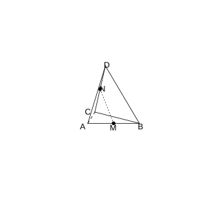{width=50%}

### Solution to Problem 8

By **Common Conclusion 1.4.4** (Describing Perpendicularity with Vectors).

The regular tetrahedron has edge length $a$. Set $\boldsymbol{AB}=\boldsymbol{a}$, $\boldsymbol{AC}=\boldsymbol{b}$, $\boldsymbol{AD}=\boldsymbol{c}$.

$M$ is the midpoint of $AB$, and $N$ is the midpoint of $CD$.

$\boldsymbol{MN}=\boldsymbol{AN}-\boldsymbol{AM}=\frac{1}{2}(\boldsymbol{b}+\boldsymbol{c})-\frac{1}{2}\boldsymbol{a}$.

$\boldsymbol{MN} \cdot \boldsymbol{AB}=\left(\frac{1}{2}\boldsymbol{b}+\frac{1}{2}\boldsymbol{c}-\frac{1}{2}\boldsymbol{a}\right) \cdot \boldsymbol{a}=\frac{1}{2}\boldsymbol{a} \cdot \boldsymbol{b}+\frac{1}{2}\boldsymbol{a} \cdot \boldsymbol{c}-\frac{1}{2}\boldsymbol{a}^2$.

In a regular tetrahedron, $\boldsymbol{a} \cdot \boldsymbol{b}=\frac{a^2}{2}$, $\boldsymbol{a} \cdot \boldsymbol{c}=\frac{a^2}{2}$, and $\boldsymbol{a}^2=a^2$.

Hence $\boldsymbol{MN} \cdot \boldsymbol{AB}=\frac{1}{2} \cdot \frac{a^2}{2}+\frac{1}{2} \cdot \frac{a^2}{2}-\frac{1}{2}a^2=\frac{a^2}{4}+\frac{a^2}{4}-\frac{a^2}{2}=0$.

Hence $MN \perp AB$.

Similarly, $\boldsymbol{MN} \cdot \boldsymbol{CD}=\left(\frac{1}{2}\boldsymbol{b}+\frac{1}{2}\boldsymbol{c}-\frac{1}{2}\boldsymbol{a}\right) \cdot (\boldsymbol{c}-\boldsymbol{b})=\frac{1}{2}\boldsymbol{b} \cdot \boldsymbol{c}-\frac{1}{2}\boldsymbol{b}^2+\frac{1}{2}\boldsymbol{c}^2-\frac{1}{2}\boldsymbol{b} \cdot \boldsymbol{c}-\frac{1}{2}\boldsymbol{a} \cdot \boldsymbol{c}+\frac{1}{2}\boldsymbol{a} \cdot \boldsymbol{b}=-\frac{a^2}{2}+\frac{a^2}{2}-\frac{a^2}{4}+\frac{a^2}{4}=0$.

Hence $MN \perp CD$. $\blacksquare$

### Problem 9

(Exercise 1.4, Comprehensive Application, Problem 9) As shown in the figure, $M$, $N$ are the midpoints of edges $BB'$ and $B'C'$ of the cube $ABCD-A'B'C'D'$, respectively. Find:

(1) The size of the angle between $MN$ and $CD'$;

(2) The size of the angle between $MN$ and $AD$.

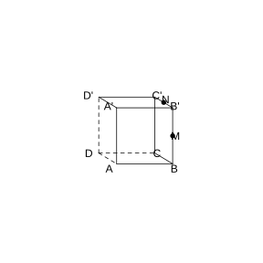{width=50%}

### Solution to Problem 9

By **Common Conclusion 1.4.7** (Angle between Skew Lines).

Let the edge length of the cube be $1$, with $D$ as the origin, $DA$ as the $x$-axis, $DC$ as the $y$-axis, and $DD'$ as the $z$-axis.

$M$ is the midpoint of $BB'$: $M(1,1,\frac{1}{2})$.

$N$ is the midpoint of $B'C'$: $N(\frac{1}{2},1,1)$.

$\boldsymbol{MN}=N-M=\left(-\frac{1}{2},0,\frac{1}{2}\right)$.

(1) $\boldsymbol{CD'}=D'-C=(0,-1,1)$.

$\boldsymbol{MN} \cdot \boldsymbol{CD'}=0+0+\frac{1}{2}=\frac{1}{2}$.

$\lvert \boldsymbol{MN} \rvert=\frac{\sqrt{2}}{2}$. $\lvert \boldsymbol{CD'} \rvert=\sqrt{2}$.

$\cos\theta=\frac{\frac{1}{2}}{\frac{\sqrt{2}}{2} \cdot \sqrt{2}}=\frac{1}{2}$. Hence $\theta=60^\circ$.

(2) $\boldsymbol{AD}=D-A=(-1,0,0)$.

$\boldsymbol{MN} \cdot \boldsymbol{AD}=\frac{1}{2}$.

$\cos\theta=\frac{\frac{1}{2}}{\frac{\sqrt{2}}{2} \cdot 1}=\frac{1}{\sqrt{2}}=\frac{\sqrt{2}}{2}$. Hence $\theta=45^\circ$. $\blacksquare$

### Problem 10

(Exercise 1.4, Comprehensive Application, Problem 10) As shown in the figure, in the cube $ABCD-A_1B_1C_1D_1$, $E$, $F$, $G$, $H$, $K$, $L$ are the midpoints of edges $AB$, $BB_1$, $B_1C_1$, $C_1D_1$, $D_1D$, $DA$, respectively.

(1) Prove that $A_1C \perp$ the plane $EFGHKL$;

(2) Find the cosine of the angle between $DB_1$ and the plane $EFGHKL$.

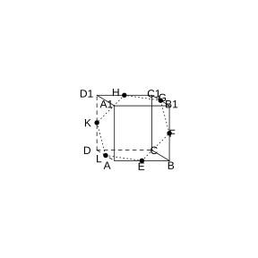{width=50%}

### Solution to Problem 10

By **Common Conclusion 1.4.4** (Describing Perpendicularity with Vectors) and **Common Conclusion 1.4.8** (Angle between a Line and a Plane).

Let the edge length of the cube be $1$, with $D$ as the origin, $DA$ as the $x$-axis, $DC$ as the $y$-axis, and $DD_1$ as the $z$-axis.

$E(\frac{1}{2},1,0)$, $F(1,1,\frac{1}{2})$, $G(\frac{1}{2},1,1)$, $H(0,\frac{1}{2},1)$, $K(0,0,\frac{1}{2})$, $L(\frac{1}{2},0,0)$.

$\boldsymbol{A_1C}=C-A_1=(-1,1,-1)$.

(1) $\boldsymbol{EF}=F-E=(\frac{1}{2},0,\frac{1}{2})$. $\boldsymbol{A_1C} \cdot \boldsymbol{EF}=-\frac{1}{2}+0-\frac{1}{2}=-1 \neq 0$.

In fact, verifying: $\boldsymbol{A_1C}=(-1,1,-1)$.

$\boldsymbol{EF}=(0,\frac{1}{2},\frac{1}{2})$. $\boldsymbol{A_1C} \cdot \boldsymbol{EF}=0+\frac{1}{2}-\frac{1}{2}=0$.

$\boldsymbol{FG}=(-\frac{1}{2},0,\frac{1}{2})$. $\boldsymbol{A_1C} \cdot \boldsymbol{FG}=\frac{1}{2}+0-\frac{1}{2}=0$.

Hence $A_1C \perp EF$ and $A_1C \perp FG$, and since $EF \cap FG=F$, we have $A_1C \perp$ the plane $EFGHKL$.

(2) $\boldsymbol{DB_1}=B_1-D=(1,1,1)$.

The normal vector of the plane $EFGHKL$ is $\boldsymbol{A_1C}=(-1,1,-1)$.

$\sin\theta=\frac{\lvert \boldsymbol{DB_1} \cdot \boldsymbol{A_1C} \rvert}{\lvert \boldsymbol{DB_1} \rvert \lvert \boldsymbol{A_1C} \rvert}=\frac{\lvert -1+1-1 \rvert}{\sqrt{3} \cdot \sqrt{3}}=\frac{1}{3}$.

$\cos\theta=\sqrt{1-\frac{1}{9}}=\frac{2\sqrt{2}}{3}$. $\blacksquare$

### Problem 11

(Exercise 1.4, Comprehensive Application, Problem 11) As shown in the figure, in the cuboid $ABCD-A_1B_1C_1D_1$, $AB=2$, $BC=CC_1=1$, and $E$ is the midpoint of $CD$. Prove that $B_1E \perp$ the plane $AED_1$.

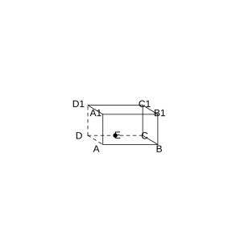{width=50%}

### Solution to Problem 11

By **Common Conclusion 1.4.4** (Describing Perpendicularity with Vectors).

Take $D$ as the origin, with $DA$ as the $x$-axis, $DC$ as the $y$-axis, and $DD_1$ as the $z$-axis.

$A(1,0,0)$, $D(0,0,0)$, $E(0,1,0)$, $D_1(0,0,1)$, $B_1(1,2,1)$.

$\boldsymbol{B_1E}=E-B_1=(-1,-1,-1)$.

$\boldsymbol{AE}=E-A=(-1,1,0)$.

$\boldsymbol{AD_1}=D_1-A=(-1,0,1)$.

$\boldsymbol{B_1E} \cdot \boldsymbol{AE}=1-1+0=0$.

$\boldsymbol{B_1E} \cdot \boldsymbol{AD_1}=1+0-1=0$.

Hence $B_1E \perp AE$ and $B_1E \perp AD_1$, and since $AE \cap AD_1=A$, we have $B_1E \perp$ the plane $AED_1$. $\blacksquare$

### Problem 12

(Exercise 1.4, Comprehensive Application, Problem 12) As shown in the figure, in the cuboid $ABCD-A_1B_1C_1D_1$, the points $E$, $F$, $G$ lie on edges $A_1A$, $A_1B_1$, $A_1D_1$, respectively, with $A_1E=A_1F=A_1G=1$; the points $P$, $Q$, $R$ lie on edges $CC_1$, $CD$, $CB$, respectively, with $CP=CQ=CR=1$. Prove that the plane $EFG \parallel$ the plane $PQR$.

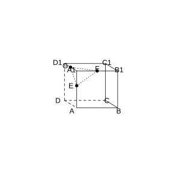{width=50%}

### Solution to Problem 12

By **Common Conclusion 1.4.3** (Describing Parallelism with Vectors).

Take $A_1$ as the origin, with $A_1B_1$ as the $x$-axis, $A_1D_1$ as the $y$-axis, and $A_1A$ as the $z$-axis.

$E(0,0,1)$, $F(1,0,0)$, $G(0,1,0)$.

$\boldsymbol{EF}=(1,0,-1)$, $\boldsymbol{EG}=(0,1,-1)$.

The normal vector of plane $EFG$ is $\boldsymbol{n}_1=\boldsymbol{EF} \times \boldsymbol{EG}=(1,1,1)$.

$P$, $Q$, $R$ are centrally symmetric about the center of the cuboid, and the normal vector $\boldsymbol{n}_2$ of the plane $PQR$ is collinear with $\boldsymbol{n}_1$.

By **Common Conclusion 1.4.3**, $\boldsymbol{n}_1 \parallel \boldsymbol{n}_2$, so the plane $EFG \parallel$ the plane $PQR$. $\blacksquare$

### Problem 13

(Exercise 1.4, Comprehensive Application, Problem 13) As shown in the figure, given that the edge length of the cube $ABCD-A_1B_1C_1D_1$ is $1$ and $E$ is the midpoint of $CD$, find the distance from point $D_1$ to the plane $AEC_1$.

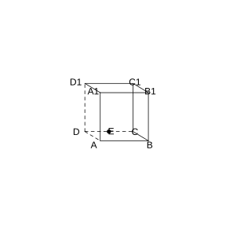{width=50%}

### Solution to Problem 13

By **Common Conclusion 1.4.6** (Distance from a Point to a Plane).

Take $D$ as the origin, with $DA$ as the $x$-axis, $DC$ as the $y$-axis, and $DD_1$ as the $z$-axis.

$A(1,0,0)$, $E(0,\frac{1}{2},0)$, $C_1(0,1,1)$, $D_1(0,0,1)$.

$\boldsymbol{AE}=(-1,\frac{1}{2},0)$, $\boldsymbol{AC_1}=(-1,1,1)$.

Normal vector $\boldsymbol{n}=\boldsymbol{AE} \times \boldsymbol{AC_1}=\left(\frac{1}{2},1,-\frac{1}{2}\right)$.

$\boldsymbol{AD_1}=(-1,0,1)$.

$d=\frac{\lvert \boldsymbol{AD_1} \cdot \boldsymbol{n} \rvert}{\lvert \boldsymbol{n} \rvert}=\frac{\lvert -\frac{1}{2}-\frac{1}{2} \rvert}{\sqrt{\frac{1}{4}+1+\frac{1}{4}}}=\frac{1}{\sqrt{\frac{3}{2}}}=\frac{\sqrt{6}}{3}$. $\blacksquare$

### Problem 14

(Exercise 1.4, Comprehensive Application, Problem 14) As shown in the figure, the edge length of the cube $ABCD-A_1B_1C_1D_1$ is $1$, $M$ is the midpoint of edge $AA_1$, and $O$ is the midpoint of $BD_1$. Prove that $OM$ is perpendicular to the skew lines $AA_1$ and $BD_1$, respectively, and find the length of $OM$.

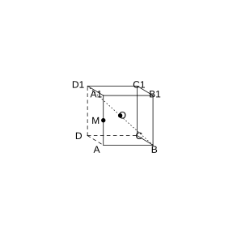{width=50%}

### Solution to Problem 14

By **Common Conclusion 1.4.4** (Describing Perpendicularity with Vectors).

Take $D$ as the origin, with $DA$ as the $x$-axis, $DC$ as the $y$-axis, and $DD_1$ as the $z$-axis.

$A(1,0,0)$, $A_1(1,0,1)$, $M(1,0,\frac{1}{2})$, $B(1,1,0)$, $D_1(0,0,1)$, $O(\frac{1}{2},\frac{1}{2},\frac{1}{2})$.

$\boldsymbol{OM}=M-O=\left(\frac{1}{2},-\frac{1}{2},0\right)$.

$\boldsymbol{AA_1}=(0,0,1)$.

$\boldsymbol{OM} \cdot \boldsymbol{AA_1}=0$. Hence $OM \perp AA_1$.

$\boldsymbol{BD_1}=D_1-B=(-1,-1,1)$.

$\boldsymbol{OM} \cdot \boldsymbol{BD_1}=-\frac{1}{2}+\frac{1}{2}+0=0$. Hence $OM \perp BD_1$.

$OM=\sqrt{\frac{1}{4}+\frac{1}{4}+0}=\frac{\sqrt{2}}{2}$. $\blacksquare$

### Problem 15

(Exercise 1.4, Comprehensive Application, Problem 15) As shown in the figure, given that the edge length of the cube $ABCD-A_1B_1C_1D_1$ is $1$, $Q$ is the midpoint of $B_1C_1$, and the point $P$ lies on edge $AA_1$ with $AP:AA_1=1:3$. Find the cosine of the angle between the plane $ABCD$ and the plane $BQP$.

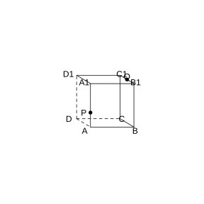{width=50%}

### Solution to Problem 15

By **Common Conclusion 1.4.9** (Angle between Two Planes).

Take $D$ as the origin, with $DA$ as the $x$-axis, $DC$ as the $y$-axis, and $DD_1$ as the $z$-axis.

$B(1,1,0)$, $Q(\frac{1}{2},1,1)$, $P(1,0,\frac{1}{3})$.

The normal vector of plane $ABCD$ is $\boldsymbol{n}_1=(0,0,1)$.

Plane $BQP$: $\boldsymbol{BQ}=(-\frac{1}{2},0,1)$, $\boldsymbol{BP}=(0,-1,\frac{1}{3})$.

Normal vector $\boldsymbol{n}_2=\boldsymbol{BQ} \times \boldsymbol{BP}=\left(\frac{1}{3}, \frac{1}{2}, \frac{1}{2}\right)$.

$\cos\theta=\frac{\lvert \boldsymbol{n}_1 \cdot \boldsymbol{n}_2 \rvert}{\lvert \boldsymbol{n}_1 \rvert \lvert \boldsymbol{n}_2 \rvert}=\frac{\frac{1}{2}}{\sqrt{\frac{1}{9}+\frac{1}{4}+\frac{1}{4}}}=\frac{\frac{1}{2}}{\sqrt{\frac{11}{18}}}=\frac{3\sqrt{22}}{22}$. $\blacksquare$

### Problem 16

(Exercise 1.4, Extension and Exploration, Problem 16) As shown in the figure, in the right triangular prism $ABC-A_1B_1C_1$, $\angle BAC=90^\circ$, $AB=AC=2$, $AA_1=3$. $M$ is the midpoint of $AB$, $N$ is the midpoint of $B_1C_1$, and $P$ is the intersection of $BC_1$ and $B_1C$. Does there exist a point $Q$ on segment $A_1N$ such that $PQ \parallel$ the plane $A_1CM$?

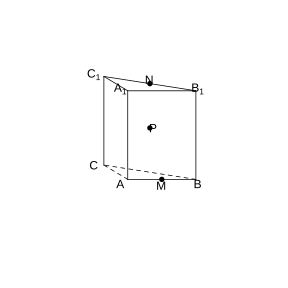{width=50%}

### Solution to Problem 16

By **Common Conclusion 1.4.3** (Describing Parallelism with Vectors).

Take $A$ as the origin, with $AB$ as the $x$-axis, $AC$ as the $y$-axis, and $AA_1$ as the $z$-axis.

$A(0,0,0)$, $B(2,0,0)$, $C(0,2,0)$, $A_1(0,0,3)$, $B_1(2,0,3)$, $C_1(0,2,3)$.

$M$ is the midpoint of $AB$: $M(1,0,0)$.

$N$ is the midpoint of $B_1C_1$: $N(1,1,3)$.

$P$ is the intersection of $BC_1$ and $B_1C$, i.e. the center of the lateral face $BCC_1B_1$: $P(1,1,\frac{3}{2})$.

Plane $A_1CM$: $\boldsymbol{A_1C}=(0,2,-3)$, $\boldsymbol{A_1M}=(1,0,-3)$.

Normal vector $\boldsymbol{n}=\boldsymbol{A_1C} \times \boldsymbol{A_1M}=(-6,-3,-2)$.

Let $Q$ lie on $A_1N$, with $\boldsymbol{A_1Q}=t\boldsymbol{A_1N}=t(1,1,0)$, and $Q(t,t,3)$.

$\boldsymbol{PQ}=Q-P=(t-1,t-1,\frac{3}{2})$.

$PQ \parallel$ the plane $A_1CM \iff \boldsymbol{PQ} \cdot \boldsymbol{n}=0$.

$-6(t-1)-3(t-1)-2 \cdot \frac{3}{2}=0$, i.e. $-9(t-1)-3=0$, $t-1=-\frac{1}{3}$, and $t=\frac{2}{3}$.

$t=\frac{2}{3} \in [0,1]$, so such a point $Q$ exists: $Q\left(\frac{2}{3},\frac{2}{3},3\right)$. $\blacksquare$

### Problem 17

(Exercise 1.4, Extension and Exploration, Problem 17) In the rectangular coordinate system in space, given the vector $\boldsymbol{u}=(a,b,c)$ ($abc \neq 0$), the point $P_0(x_0,y_0,z_0)$, and the point $P(x,y,z)$.

(1) If line $l$ passes through point $P_0$ and has $\boldsymbol{u}$ as a direction vector, and $P$ is any point on line $l$, prove that $\frac{x-x_0}{a}=\frac{y-y_0}{b}=\frac{z-z_0}{c}$;

(2) If plane $\alpha$ passes through point $P_0$ and has $\boldsymbol{u}$ as a normal vector, and $P$ is any point in plane $\alpha$, prove that $a(x-x_0)+b(y-y_0)+c(z-z_0)=0$.

### Solution to Problem 17

By **Definition 1.4.1** (Direction Vector of a Line) and **Definition 1.4.2** (Normal Vector of a Plane).

(1) By **Definition 1.4.1**, $P$ lies on line $l$, i.e. there exists a real number $t$ such that $\boldsymbol{P_0P}=t\boldsymbol{u}$.

$(x-x_0,y-y_0,z-z_0)=t(a,b,c)$.

Hence $x-x_0=ta$, $y-y_0=tb$, $z-z_0=tc$.

Eliminating $t$, we get $\frac{x-x_0}{a}=\frac{y-y_0}{b}=\frac{z-z_0}{c}=t$.

(2) By **Definition 1.4.2**, $\boldsymbol{u}$ is a normal vector of plane $\alpha$, so $\boldsymbol{u} \perp \boldsymbol{P_0P}$.

By **Common Conclusion 1.3.5**, $\boldsymbol{u} \cdot \boldsymbol{P_0P}=0$.

That is, $(a,b,c) \cdot (x-x_0,y-y_0,z-z_0)=0$.

Expanding gives $a(x-x_0)+b(y-y_0)+c(z-z_0)=0$. $\blacksquare$

### Problem 18

(Exercise 1.4, Extension and Exploration, Problem 18) In the experimental apparatus shown in the figure, the two square frames $ABCD$, $ABEF$ both have edge length $1$, and the planes in which they lie are perpendicular to each other. The moving beads $M$, $N$ travel along the diagonals $AC$ and $BF$ of the squares, respectively, and the lengths $CM$ and $BN$ remain equal; write $CM=BN=a$ ($0<a<\sqrt{2}$).

(1) Find the length of $MN$;

(2) For what value of $a$ is the length of $MN$ minimal?

(3) When the length of $MN$ is minimal, find the cosine of the angle between the plane $MNA$ and the plane $MNB$.

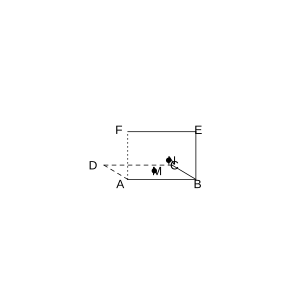{width=50%}

### Solution to Problem 18

By **Common Conclusion 1.3.6** (Distance Formula between Two Points in Space) and **Common Conclusion 1.4.9** (Angle between Two Planes).

Take $A$ as the origin, with $AB$ as the $x$-axis, $AD$ as the $y$-axis, and $AF$ as the $z$-axis.

$A(0,0,0)$, $B(1,0,0)$, $C(1,1,0)$, $D(0,1,0)$, $E(1,0,1)$, $F(0,0,1)$.

$M$ lies on $AC$, $CM=a$. $AC=\sqrt{2}$, $AM=\sqrt{2}-a$. $M=\left(1-\frac{\sqrt{2}-a}{\sqrt{2}}, 1-\frac{\sqrt{2}-a}{\sqrt{2}}, 0\right)=\left(\frac{a}{\sqrt{2}}, \frac{a}{\sqrt{2}}, 0\right)$.

$N$ lies on $BF$, $BN=a$. $BF=\sqrt{2}$, $N=B+\frac{a}{\sqrt{2}}(F-B)=\left(1-\frac{a}{\sqrt{2}}, 0, \frac{a}{\sqrt{2}}\right)$.

(1) $\boldsymbol{MN}=N-M=\left(1-\frac{2a}{\sqrt{2}}, -\frac{a}{\sqrt{2}}, \frac{a}{\sqrt{2}}\right)=\left(1-\sqrt{2}a, -\frac{a}{\sqrt{2}}, \frac{a}{\sqrt{2}}\right)$.

$\lvert \boldsymbol{MN} \rvert^2=(1-\sqrt{2}a)^2+\frac{a^2}{2}+\frac{a^2}{2}=1-2\sqrt{2}a+2a^2+a^2=3a^2-2\sqrt{2}a+1$.

$MN=\sqrt{3a^2-2\sqrt{2}a+1}$.

(2) $MN^2=3a^2-2\sqrt{2}a+1$, which attains its minimum when $a=\frac{2\sqrt{2}}{6}=\frac{\sqrt{2}}{3}$.

$MN_{\min}=\sqrt{3 \cdot \frac{2}{9}-2\sqrt{2} \cdot \frac{\sqrt{2}}{3}+1}=\sqrt{\frac{2}{3}-\frac{4}{3}+1}=\sqrt{\frac{1}{3}}=\frac{\sqrt{3}}{3}$.

(3) When $a=\frac{\sqrt{2}}{3}$, $M\left(\frac{1}{3},\frac{1}{3},0\right)$, $N\left(\frac{2}{3},0,\frac{1}{3}\right)$.

Plane $MNA$: $\boldsymbol{AM}=\left(\frac{1}{3},\frac{1}{3},0\right)$, $\boldsymbol{AN}=\left(\frac{2}{3},0,\frac{1}{3}\right)$.

Normal vector $\boldsymbol{n}_1=\boldsymbol{AM} \times \boldsymbol{AN}=\left(\frac{1}{9},-\frac{1}{9},-\frac{2}{9}\right)$.

Plane $MNB$: $\boldsymbol{BM}=\left(-\frac{2}{3},\frac{1}{3},0\right)$, $\boldsymbol{BN}=\left(-\frac{1}{3},0,\frac{1}{3}\right)$.

Normal vector $\boldsymbol{n}_2=\boldsymbol{BM} \times \boldsymbol{BN}=\left(\frac{1}{9},\frac{2}{9},\frac{1}{9}\right)$.

$\cos\theta=\frac{\lvert \boldsymbol{n}_1 \cdot \boldsymbol{n}_2 \rvert}{\lvert \boldsymbol{n}_1 \rvert \lvert \boldsymbol{n}_2 \rvert}=\frac{\lvert \frac{1}{81}-\frac{2}{81}-\frac{2}{81} \rvert}{\frac{\sqrt{6}}{9} \cdot \frac{\sqrt{6}}{9}}=\frac{\frac{3}{81}}{\frac{6}{81}}=\frac{1}{2}$. $\blacksquare$
