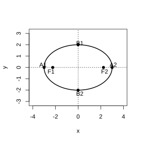
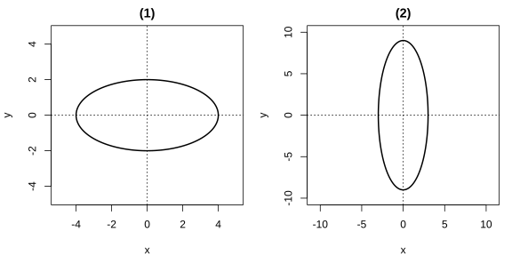
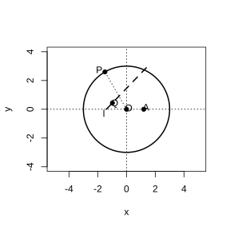
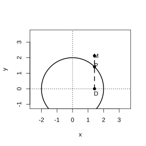
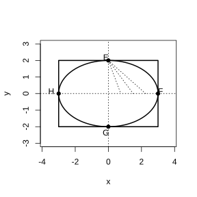

# Assignment 65

> **Definition 3.1.1** (Ellipse)  The locus of points in a plane whose sum of distances to two fixed points $F_1,F_2$ equals a constant (greater than $\lvert F_1F_2 \rvert$) is called an ellipse. These two fixed points are called the foci of the ellipse, the distance between the two foci is called the focal distance, and half of it is called the semi-focal distance.

> **Common Conclusion 3.1.2** (Sum of Distances from a Point on an Ellipse to the Two Foci)  The sum of the distances from any point $M$ on an ellipse to the two foci $F_1,F_2$ equals the fixed length $2a$, i.e. $\lvert MF_1 \rvert+\lvert MF_2 \rvert=2a$, where $2a>\lvert F_1F_2 \rvert$.

> **Definition 3.1.3** (Standard Equation of an Ellipse)  When the foci lie on the $x$-axis at $F_1\left(-c,0\right)$ and $F_2\left(c,0\right)$, the standard equation of the ellipse is $\frac{x^2}{a^2}+\frac{y^2}{b^2}=1$ ($a>b>0$), where $c^2=a^2-b^2$; when the foci lie on the $y$-axis at $F_1\left(0,-c\right)$ and $F_2\left(0,c\right)$, the standard equation is $\frac{y^2}{a^2}+\frac{x^2}{b^2}=1$ ($a>b>0$).

> **Common Conclusion 3.1.4** (Range of an Ellipse)  From $\frac{x^2}{a^2}+\frac{y^2}{b^2}=1$ we obtain $-a\le x\le a$ and $-b\le y\le b$; the ellipse lies inside the rectangle bounded by the lines $x=\pm a$ and $y=\pm b$.

> **Common Conclusion 3.1.5** (Symmetry of an Ellipse)  An ellipse is symmetric about the $x$-axis, the $y$-axis, and the origin; the coordinate axes are the axes of symmetry, and the origin is the center of symmetry. The center of symmetry of an ellipse is called the center of the ellipse.

> **Definition 3.1.6** (Vertices, Major Axis, and Minor Axis of an Ellipse)  The four intersection points $A_1\left(-a,0\right)$, $A_2\left(a,0\right)$, $B_1\left(0,-b\right)$, $B_2\left(0,b\right)$ of an ellipse with its axes of symmetry are called the vertices of the ellipse. The segment $A_1A_2$ is called the major axis, with length $2a$; the segment $B_1B_2$ is called the minor axis, with length $2b$. $a$ and $b$ are called the semi-major axis length and semi-minor axis length, respectively.

> **Definition 3.1.7** (Eccentricity of an Ellipse)  The ratio of the focal distance to the major axis length, $\frac{c}{a}$, is called the eccentricity of the ellipse, denoted $e$, i.e. $e=\frac{c}{a}$. Since $a>c>0$, we have $0<e<1$. The closer $e$ is to $1$, the flatter the ellipse; the closer $e$ is to $0$, the closer the ellipse is to a circle.

> **Common Conclusion 3.1.8** (Position of a Line Relative to an Ellipse)  Eliminating a variable by combining the line equation with the ellipse gives a quadratic equation in one variable. When its discriminant is $\Delta>0$, the line and ellipse have two common points; when $\Delta=0$, they have exactly one common point; when $\Delta<0$, they have no common points.

### Exercise 1

(Exercise 3.1, Problem 1) If a point $P$ on the ellipse $\frac{x^2}{100}+\frac{y^2}{36}=1$ is at distance $6$ from the focus $F_1$, then the distance from $P$ to the other focus $F_2$ is $\;\_\_\;$.

### Solution to Exercise 1

By **Common Conclusion 3.1.2** (Sum of Distances from a Point on an Ellipse to the Two Foci), the sum of the distances from any point on the ellipse to the two foci is $2a$.

In the ellipse $\frac{x^2}{100}+\frac{y^2}{36}=1$, we have $a^2=100$, hence $a=10$ and $2a=20$. From $\lvert PF_1 \rvert+\lvert PF_2 \rvert=20$ and $\lvert PF_1 \rvert=6$, we get $\lvert PF_2 \rvert=20-6=14$. $\blacksquare$

### Exercise 2

(Exercise 3.1, Problem 2) Find the standard equation of the ellipse satisfying the following conditions.

(1) $a=4$, $b=1$, foci on the $x$-axis;

(2) $a=4$, $c=\sqrt{15}$, foci on the $y$-axis;

(3) $a+b=10$, $c=2\sqrt{5}$.

### Solution to Exercise 2

By **Definition 3.1.3** (Standard Equation of an Ellipse), when the foci are on the $x$-axis the equation is $\frac{x^2}{a^2}+\frac{y^2}{b^2}=1$, and when they are on the $y$-axis it is $\frac{y^2}{a^2}+\frac{x^2}{b^2}=1$, with $c^2=a^2-b^2$.

(1) The foci are on the $x$-axis, $a=4$, $b=1$, so the standard equation is

$$
\frac{x^2}{16}+y^2=1.
$$

(2) The foci are on the $y$-axis, $a=4$, $c=\sqrt{15}$; from $b^2=a^2-c^2=16-15=1$ we get $b=1$, so the standard equation is

$$
\frac{y^2}{16}+x^2=1.
$$

(3) From $c^2=a^2-b^2=\left(a+b\right)\left(a-b\right)$, substituting $a+b=10$ and $c=2\sqrt{5}$ gives $20=10\left(a-b\right)$, hence $a-b=2$. Combining with $a+b=10$ gives $a=6$, $b=4$. Since the axis of the foci is not specified, the standard equation is

$$
\frac{x^2}{36}+\frac{y^2}{16}=1
$$

or

$$
\frac{y^2}{36}+\frac{x^2}{16}=1.
$$

$\blacksquare$

### Exercise 3

(Exercise 3.1, Problem 3) Through the right focus $F_2$ of the ellipse $\frac{x^2}{25}+\frac{y^2}{16}=1$, draw the line $AB$ perpendicular to the $x$-axis, intersecting the ellipse at $A$ and $B$. $F_1$ is the left focus of the ellipse.

(1) Find the perimeter of $\triangle AF_1B$;

(2) If $AB$ is not perpendicular to the $x$-axis, does the perimeter of $\triangle AF_1B$ change? Why?

### Solution to Exercise 3

By **Definition 3.1.3** (Standard Equation of an Ellipse), in the ellipse $\frac{x^2}{25}+\frac{y^2}{16}=1$ we have $a^2=25$, $b^2=16$, hence $a=5$, $c=\sqrt{a^2-b^2}=3$, and the foci are $F_1\left(-3,0\right)$, $F_2\left(3,0\right)$. By **Common Conclusion 3.1.2**, any point $M$ on the ellipse satisfies $\lvert MF_1 \rvert+\lvert MF_2 \rvert=2a=10$.

(1) The line $AB$ passes through $F_2\left(3,0\right)$ and is perpendicular to the $x$-axis, so the x-coordinates of $A$ and $B$ are both $3$; since $A$ and $B$ lie on the ellipse, we have $\lvert AF_2 \rvert+\lvert BF_2 \rvert=\lvert AB \rvert$. By **Common Conclusion 3.1.2**, $\lvert AF_1 \rvert+\lvert AF_2 \rvert=10$ and $\lvert BF_1 \rvert+\lvert BF_2 \rvert=10$. Adding the two gives

$$
\lvert AF_1 \rvert+\lvert BF_1 \rvert+\lvert AF_2 \rvert+\lvert BF_2 \rvert=20.
$$

Since also $\lvert AF_2 \rvert+\lvert BF_2 \rvert=\lvert AB \rvert$, the perimeter of $\triangle AF_1B$ is

$$
\lvert AF_1 \rvert+\lvert BF_1 \rvert+\lvert AB \rvert=20.
$$

(2) The perimeter does not change. By **Common Conclusion 3.1.2**, for any chord $AB$ of the ellipse through $F_2$, we have $\lvert AF_1 \rvert+\lvert AF_2 \rvert=2a$ and $\lvert BF_1 \rvert+\lvert BF_2 \rvert=2a$. Adding gives $\lvert AF_1 \rvert+\lvert BF_1 \rvert+\lvert AF_2 \rvert+\lvert BF_2 \rvert=4a$. Since $A$, $F_2$, and $B$ are collinear, $\lvert AF_2 \rvert+\lvert BF_2 \rvert=\lvert AB \rvert$, and hence the perimeter is $\lvert AF_1 \rvert+\lvert BF_1 \rvert+\lvert AB \rvert=4a=20$, independent of the direction of chord $AB$. $\blacksquare$

### Exercise 4

(Exercise 3.1, Problem 4) Given that the coordinates of $A$ and $B$ are $\left(-1,0\right)$ and $\left(1,0\right)$ respectively, the lines $AM$ and $BM$ intersect at $M$, and the quotient of the slope of $AM$ to the slope of $BM$ is $2$. What is the locus of $M$? Why?

### Solution to Exercise 4

Let the coordinates of $M$ be $\left(x,y\right)$. By the slope formula for a line through two points, the slope of $AM$ is $k_{AM}=\frac{y}{x+1}$ ($x\neq-1$), and the slope of $BM$ is $k_{BM}=\frac{y}{x-1}$ ($x\neq1$).

By the problem, the quotient of $k_{AM}$ and $k_{BM}$ is $2$, i.e.

$$
\frac{y}{x+1}\Big/\frac{y}{x-1}=2.
$$

When $y\neq0$, simplifying gives $\frac{x-1}{x+1}=2$, i.e. $x-1=2x+2$, so $x=-3$. When $y=0$, both slopes are $0$ and the quotient is undefined. Hence the locus of $M$ is the line $x=-3$ (with the point $\left(-3,0\right)$ removed). $\blacksquare$

### Exercise 5

(Exercise 3.1, Problem 1) Can you use a compass to locate the foci of the ellipse in the figure? What is your justification?

{width=50%}

### Solution to Exercise 5

By **Definition 3.1.1** (Ellipse), the sum of the distances from any point on the ellipse to the two foci equals the fixed length $2a$; the sum of the distances from a vertex on the major axis to the two foci is also $2a$, the distance from a major-axis vertex to the center is $a$, and the distance from the center to a focus is $c$.

In the figure, the two intersections of the ellipse with the $x$-axis are $A_1$ and $A_2$, which are the major-axis vertices, with $\lvert OA_1 \rvert=\lvert OA_2 \rvert=a$. With $A_1$ as center and $a$ as radius, draw an arc intersecting the major axis (the segment $A_1A_2$) at two points; these two points are the foci $F_1$ and $F_2$. Justification: by **Common Conclusion 3.1.2**, $\lvert A_1F_1 \rvert+\lvert A_1F_2 \rvert=2a$; also $\lvert A_1F_1 \rvert+\lvert F_1F_2 \rvert+\lvert F_2A_2 \rvert=2a$, with $\lvert A_1F_1 \rvert=\lvert A_2F_2 \rvert$ and $\lvert F_1F_2 \rvert=2c$, so drawing the arc centered at $A_1$ with radius $a$ intersects the major axis at $F_1$. $\blacksquare$

### Exercise 6

(Exercise 3.1, Problem 2) Find the coordinates of the foci of each of the following ellipses.

(1) $\frac{x^2}{100}+\frac{y^2}{36}=1$;

(2) $2x^2+y^2=8$.

### Solution to Exercise 6

By **Definition 3.1.3** (Standard Equation of an Ellipse), the foci are at $\left(\pm c,0\right)$ or $\left(0,\pm c\right)$, where $c^2=a^2-b^2$ and $a$ is the square root of the larger denominator.

(1) In $\frac{x^2}{100}+\frac{y^2}{36}=1$, we have $a^2=100$, $b^2=36$, the foci are on the $x$-axis, and $c=\sqrt{100-36}=8$; hence the foci are at $\left(-8,0\right)$ and $\left(8,0\right)$.

(2) Rewrite $2x^2+y^2=8$ in standard form as $\frac{y^2}{8}+\frac{x^2}{4}=1$, so $a^2=8$, $b^2=4$, the foci are on the $y$-axis, and $c=\sqrt{8-4}=2$; hence the foci are at $\left(0,-2\right)$ and $\left(0,2\right)$. $\blacksquare$

### Exercise 7

(Exercise 3.1, Problem 3) Find the standard equation of the ellipse satisfying the following conditions.

(1) foci on the $x$-axis, $a=6$, $e=\frac{1}{3}$;

(2) foci on the $y$-axis, $c=3$, $e=\frac{3}{5}$.

### Solution to Exercise 7

By **Definition 3.1.7** (Eccentricity), $e=\frac{c}{a}$; by **Definition 3.1.3**, $b^2=a^2-c^2$.

(1) Foci on the $x$-axis, $a=6$, $e=\frac{1}{3}$, so $c=ae=2$, $b^2=a^2-c^2=36-4=32$. The standard equation is

$$
\frac{x^2}{36}+\frac{y^2}{32}=1.
$$

(2) Foci on the $y$-axis, $c=3$, $e=\frac{3}{5}$, so $a=\frac{c}{e}=5$, $b^2=a^2-c^2=25-9=16$. The standard equation is

$$
\frac{y^2}{25}+\frac{x^2}{16}=1.
$$

$\blacksquare$

### Exercise 8

(Exercise 3.1, Problem 4) Find the standard equation of the ellipse satisfying the following conditions.

(1) passing through $P\left(-3,0\right)$ and $Q\left(0,-2\right)$;

(2) major axis length equals $20$, eccentricity equals $\frac{3}{5}$.

### Solution to Exercise 8

By **Definition 3.1.6** (Vertices), the intersections of the ellipse with the coordinate axes are the vertices; by **Definition 3.1.7** (Eccentricity), $e=\frac{c}{a}$.

(1) The point $P\left(-3,0\right)$ is on the $x$-axis and $Q\left(0,-2\right)$ is on the $y$-axis; these are the intersections of the ellipse with the two coordinate axes. By **Definition 3.1.6**, the vertices are at $\left(\pm a,0\right)$ and $\left(0,\pm b\right)$, so $a=3$, $b=2$. Since $a>b$, the foci are on the $x$-axis, and the standard equation is

$$
\frac{x^2}{9}+\frac{y^2}{4}=1.
$$

(2) The major axis length is $2a=20$, so $a=10$. $e=\frac{3}{5}$, so $c=ae=6$, $b^2=a^2-c^2=100-36=64$. Since the axis of the foci is not specified, the standard equation is

$$
\frac{x^2}{100}+\frac{y^2}{64}=1
$$

or

$$
\frac{y^2}{100}+\frac{x^2}{64}=1.
$$

$\blacksquare$

### Exercise 9

(Exercise 3.1, Problem 5) Compare the shapes of the ellipses in each pair below: which is closer to a circle? Why?

(1) $9x^2+y^2=36$ and $\frac{x^2}{16}+\frac{y^2}{12}=1$;

(2) $x^2+9y^2=36$ and $\frac{x^2}{6}+\frac{y^2}{10}=1$.

### Solution to Exercise 9

By **Definition 3.1.7** (Eccentricity), $e=\frac{c}{a}=\sqrt{1-\frac{b^2}{a^2}}$; the closer $e$ is to $0$, the closer $a$ and $b$ are, and the closer the ellipse is to a circle.

(1) Rewrite $9x^2+y^2=36$ as $\frac{y^2}{36}+\frac{x^2}{4}=1$, with $a=6$, $b=2$, $e_1=\sqrt{1-\frac{4}{36}}=\frac{2\sqrt{2}}{3}\approx0.94$. For $\frac{x^2}{16}+\frac{y^2}{12}=1$, we have $a=4$, $b=2\sqrt{3}$, $e_2=\sqrt{1-\frac{12}{16}}=\frac{1}{2}=0.5$. Since $e_2<e_1$, the ellipse $\frac{x^2}{16}+\frac{y^2}{12}=1$ is closer to a circle.

(2) Rewrite $x^2+9y^2=36$ as $\frac{x^2}{36}+\frac{y^2}{4}=1$, with $a=6$, $b=2$, $e_1=\sqrt{1-\frac{4}{36}}=\frac{2\sqrt{2}}{3}\approx0.94$. For $\frac{x^2}{6}+\frac{y^2}{10}=1$, we have $a=\sqrt{10}$, $b=\sqrt{6}$, $e_2=\sqrt{1-\frac{6}{10}}=\frac{\sqrt{10}}{5}\approx0.63$. Since $e_2<e_1$, the ellipse $\frac{x^2}{6}+\frac{y^2}{10}=1$ is closer to a circle. $\blacksquare$

### Exercise 10

(Exercise 3.1, Problem 1) Find the intersection coordinates of each line and ellipse below.

(1) $3x+10y-25=0$, $\frac{x^2}{25}+\frac{y^2}{4}=1$;

(2) $3x-y+2=0$, $\frac{x^2}{16}+\frac{y^2}{4}=1$.

### Solution to Exercise 10

By **Common Conclusion 3.1.8** (Position of a Line Relative to an Ellipse), combine the line and ellipse equations and solve.

(1) From $3x+10y-25=0$ we have $y=\frac{25-3x}{10}$; substituting into $\frac{x^2}{25}+\frac{y^2}{4}=1$ gives

$$
\frac{x^2}{25}+\frac{\left(25-3x\right)^2}{400}=1.
$$

Multiplying both sides by $400$ gives $16x^2+\left(25-3x\right)^2=400$, i.e. $25x^2-150x+225=0$, i.e. $\left(x-3\right)^2=0$, hence $x=3$, and substituting back gives $y=\frac{8}{5}$. The intersection is $\left(3,\frac{8}{5}\right)$.

(2) From $3x-y+2=0$ we have $y=3x+2$; substituting into $\frac{x^2}{16}+\frac{y^2}{4}=1$ gives

$$
\frac{x^2}{16}+\frac{\left(3x+2\right)^2}{4}=1.
$$

Multiplying both sides by $16$ gives $x^2+4\left(3x+2\right)^2=16$, i.e. $37x^2+48x=0$, so $x=0$ or $x=-\frac{48}{37}$. Substituting back into $y=3x+2$ gives $y=2$ or $y=-\frac{70}{37}$. The intersections are $\left(0,2\right)$ and $\left(-\frac{48}{37},-\frac{70}{37}\right)$. $\blacksquare$

### Exercise 11

(Exercise 3.1, Problem 2) Through the left focus $F_1$ of the ellipse $\frac{x^2}{2}+y^2=1$, draw the line $l$ with inclination angle $60^{\circ}$. The line $l$ intersects the ellipse at $A$ and $B$. Find the length of the segment $AB$.

### Solution to Exercise 11

By **Definition 3.1.3** (Standard Equation of an Ellipse), in the ellipse $\frac{x^2}{2}+y^2=1$ we have $a^2=2$, $b^2=1$, $c=\sqrt{2-1}=1$, and the left focus is $F_1\left(-1,0\right)$.

The line $l$ has inclination angle $60^{\circ}$, so its slope is $k=\tan60^{\circ}=\sqrt{3}$; passing through $F_1\left(-1,0\right)$, its equation is $y=\sqrt{3}\left(x+1\right)$. Substituting into the ellipse gives

$$
\frac{x^2}{2}+3\left(x+1\right)^2=1.
$$

Simplifying gives $7x^2+12x+4=0$. Let $A\left(x_1,y_1\right)$ and $B\left(x_2,y_2\right)$; then $x_1+x_2=-\frac{12}{7}$ and $x_1x_2=\frac{4}{7}$. By the chord-length formula,

$$
\lvert AB \rvert=\sqrt{1+k^2}\cdot\sqrt{\left(x_1+x_2\right)^2-4x_1x_2}.
$$

Substituting gives

$$
\lvert AB \rvert=\sqrt{1+3}\cdot\sqrt{\frac{144}{49}-\frac{16}{7}}=2\cdot\sqrt{\frac{32}{49}}=\frac{8\sqrt{2}}{7}.
$$

$\blacksquare$

### Problem 1

(Exercise 3.1, Review and Consolidation, Problem 1) If the point $M\left(x,y\right)$ always satisfies the relation

$$
\sqrt{x^2+\left(y-3\right)^2}+\sqrt{x^2+\left(y+3\right)^2}=10,
$$

as it moves, what curve is the locus of $M$? Why? Write its equation.

### Solution to Problem 1

By **Definition 3.1.1** (Ellipse), the locus of points in a plane whose sum of distances to two fixed points equals a constant (greater than the distance between the two fixed points) is an ellipse.

$\sqrt{x^2+\left(y-3\right)^2}$ is the distance from $M\left(x,y\right)$ to $\left(0,3\right)$, and $\sqrt{x^2+\left(y+3\right)^2}$ is the distance from $M\left(x,y\right)$ to $\left(0,-3\right)$. The two fixed points are $F_1\left(0,3\right)$ and $F_2\left(0,-3\right)$, with $\lvert F_1F_2 \rvert=6$. The sum of the distances from $M$ to the two fixed points is the constant $10$, and $10>6$, so by **Definition 3.1.1** the locus of $M$ is an ellipse with foci at $\left(0,\pm3\right)$.

From $2a=10$ we get $a=5$, and from $2c=6$ we get $c=3$, with $b^2=a^2-c^2=25-9=16$. The foci are on the $y$-axis, so the equation is

$$
\frac{y^2}{25}+\frac{x^2}{16}=1.
$$

$\blacksquare$

### Problem 2

(Exercise 3.1, Review and Consolidation, Problem 2) Write the standard equation of the ellipse satisfying the following conditions.

(1) foci at $\left(0,-4\right)$ and $\left(0,4\right)$, $a=5$;

(2) $a+c=10$, $a-c=4$.

### Solution to Problem 2

By **Definition 3.1.3** (Standard Equation of an Ellipse), $b^2=a^2-c^2$.

(1) The foci $\left(0,\pm4\right)$ are on the $y$-axis, so $c=4$, $a=5$, $b^2=25-16=9$. The standard equation is

$$
\frac{y^2}{25}+\frac{x^2}{9}=1.
$$

(2) From $a+c=10$ and $a-c=4$ we get $a=7$, $c=3$, $b^2=49-9=40$. Since the focus axis is not specified, the standard equation is

$$
\frac{x^2}{49}+\frac{y^2}{40}=1
$$

or

$$
\frac{y^2}{49}+\frac{x^2}{40}=1.
$$

$\blacksquare$

### Problem 3

(Exercise 3.1, Review and Consolidation, Problem 3) Find the major and minor axis lengths, the eccentricity, the foci, and the vertices of each of the following ellipses, and draw the figures.

(1) $x^2+4y^2=16$;

(2) $9x^2+y^2=81$.

{width=100%}

### Solution to Problem 3

By **Definition 3.1.3** (Standard Equation of an Ellipse), rewrite the equations in standard form; then use **Definition 3.1.6** (Vertices, Major and Minor Axes) and **Definition 3.1.7** (Eccentricity).

(1) $x^2+4y^2=16$ becomes $\frac{x^2}{16}+\frac{y^2}{4}=1$, with $a=4$, $b=2$, $c=\sqrt{16-4}=2\sqrt{3}$. The major axis length is $2a=8$, the minor axis length is $2b=4$, the eccentricity is $e=\frac{c}{a}=\frac{\sqrt{3}}{2}$, the foci are at $\left(-2\sqrt{3},0\right)$ and $\left(2\sqrt{3},0\right)$, and the vertices are at $\left(\pm4,0\right)$ and $\left(0,\pm2\right)$. The figure is an ellipse with foci on the $x$-axis.

(2) $9x^2+y^2=81$ becomes $\frac{y^2}{81}+\frac{x^2}{9}=1$, with $a=9$, $b=3$, $c=\sqrt{81-9}=6\sqrt{2}$. The major axis length is $2a=18$, the minor axis length is $2b=6$, the eccentricity is $e=\frac{c}{a}=\frac{2\sqrt{2}}{3}$, the foci are at $\left(0,\pm6\sqrt{2}\right)$, and the vertices are at $\left(\pm3,0\right)$ and $\left(0,\pm9\right)$. The figure is an ellipse with foci on the $y$-axis. $\blacksquare$

### Problem 4

(Exercise 3.1, Review and Consolidation, Problem 4) Find the standard equation of the ellipse satisfying the following conditions.

(1) passing through $P\left(-2\sqrt{2},0\right)$ and $Q\left(0,\sqrt{5}\right)$;

(2) major axis length is $3$ times the minor axis length, and passing through $P\left(3,0\right)$;

(3) focal distance is $8$, eccentricity equals $0.8$.

### Solution to Problem 4

Use **Definition 3.1.6** (Vertices) and **Definition 3.1.7** (Eccentricity).

(1) $P\left(-2\sqrt{2},0\right)$ is on the $x$-axis and $Q\left(0,\sqrt{5}\right)$ is on the $y$-axis, so $a=2\sqrt{2}$, $b=\sqrt{5}$, with $a>b$ and the foci on the $x$-axis. The standard equation is

$$
\frac{x^2}{8}+\frac{y^2}{5}=1.
$$

(2) The major axis length is $3$ times the minor axis length, i.e. $2a=3\cdot2b$, so $a=3b$. The ellipse passes through $P\left(3,0\right)$. If the foci are on the $x$-axis, then $\left(3,0\right)$ is a major-axis vertex, $a=3$, $b=1$, and the equation is $\frac{x^2}{9}+y^2=1$; if the foci are on the $y$-axis, then $\left(3,0\right)$ is a minor-axis vertex, $b=3$, $a=9$, and the equation is $\frac{y^2}{81}+\frac{x^2}{9}=1$.

(3) The focal distance is $2c=8$, so $c=4$. $e=0.8=\frac{c}{a}$, so $a=\frac{4}{0.8}=5$, $b^2=a^2-c^2=25-16=9$. Since the focus axis is not specified, the equation is

$$
\frac{x^2}{25}+\frac{y^2}{9}=1
$$

or

$$
\frac{y^2}{25}+\frac{x^2}{9}=1.
$$

$\blacksquare$

### Problem 5

(Exercise 3.1, Review and Consolidation, Problem 5) Given that $P$ is a point on the ellipse $\frac{x^2}{5}+\frac{y^2}{4}=1$, and the triangle with $P$ and the foci $F_1$, $F_2$ as vertices has area $1$, find the coordinates of $P$.

### Solution to Problem 5

By **Definition 3.1.3**, in the ellipse $\frac{x^2}{5}+\frac{y^2}{4}=1$ we have $a^2=5$, $b^2=4$, $c=\sqrt{5-4}=1$, foci $F_1\left(-1,0\right)$, $F_2\left(1,0\right)$, and $\lvert F_1F_2 \rvert=2$.

Let $P\left(x,y\right)$. The base of $\triangle PF_1F_2$ is $\lvert F_1F_2 \rvert=2$ and the height is $\lvert y \rvert$, so the area is $S=\frac{1}{2}\cdot2\cdot\lvert y \rvert=\lvert y \rvert=1$, giving $y=\pm1$. Substituting into the ellipse gives $\frac{x^2}{5}+\frac{1}{4}=1$, i.e. $x^2=\frac{15}{4}$, $x=\pm\frac{\sqrt{15}}{2}$. Hence the coordinates of $P$ are

$$
\left(\pm\frac{\sqrt{15}}{2},\pm1\right)
$$

at four points. $\blacksquare$

### Problem 6

(Exercise 3.1, Review and Consolidation, Problem 6) As shown in the figure, the circle $O$ has fixed radius $r$, $A$ is a fixed point inside the circle $O$, and $P$ is any point on the circle $O$. The perpendicular bisector $l$ of segment $AP$ intersects the radius $OP$ at $Q$. As $P$ moves on the circle, what is the locus of $Q$? Why?

{width=50%}

### Solution to Problem 6

By the property of the perpendicular bisector of a segment, since $Q$ lies on the perpendicular bisector of $AP$, we have $\lvert QA \rvert=\lvert QP \rvert$.

Also, $Q$ lies on the radius $OP$, and $\lvert OP \rvert=r$, so $\lvert QO \rvert+\lvert QP \rvert=\lvert OP \rvert=r$. Substituting $\lvert QP \rvert=\lvert QA \rvert$ gives

$$
\lvert QO \rvert+\lvert QA \rvert=r.
$$

By **Definition 3.1.1** (Ellipse), the sum of the distances from $Q$ to the two fixed points $O$ and $A$ is the constant $r$. Since $A$ is inside the circle $O$, we have $\lvert OA \rvert<r$, satisfying the condition that the constant is greater than the distance between the two fixed points. Hence the locus of $Q$ is an ellipse with foci at $O$ and $A$. $\blacksquare$

### Problem 7

(Exercise 3.1, Review and Consolidation, Problem 7) The orbit of the comet "Purple Mountain No. 1" is an ellipse with the sun as one focus. Measurements show that its perihelion distance from the sun's center is $1.486$ astronomical units, its aphelion distance is $5.563$ astronomical units, and the perihelion, aphelion, and sun's center are collinear. Find the equation of the orbit.

### Solution to Problem 7

By **Definition 3.1.3** (Standard Equation of an Ellipse), the sun lies at one focus of the ellipse. Let the center of the ellipse be the origin, with the sun (focus) on the $x$-axis.

The perihelion distance from the focus is $a-c$, and the aphelion distance is $a+c$. Hence $a-c=1.486$, $a+c=5.563$. Solving gives $a=\frac{1.486+5.563}{2}=3.5245$, $c=\frac{5.563-1.486}{2}=2.0385$. $b^2=a^2-c^2=\left(a-c\right)\left(a+c\right)=1.486\times5.563\approx8.267$. The orbit equation is

$$
\frac{x^2}{3.5245^2}+\frac{y^2}{8.267}=1.
$$

$\blacksquare$

### Problem 8

(Exercise 3.1, Review and Consolidation, Problem 8) The ratio of the distance from a point $M$ to the fixed point $F\left(2,0\right)$ to its distance to the fixed line $x=8$ is $1:2$. Find the locus equation of $M$ and describe the figure.

### Solution to Problem 8

Let $M\left(x,y\right)$. The distance from $M$ to $F\left(2,0\right)$ is $\sqrt{\left(x-2\right)^2+y^2}$, and the distance from $M$ to the line $x=8$ is $\lvert 8-x \rvert$. By the problem,

$$
\frac{\sqrt{\left(x-2\right)^2+y^2}}{\lvert 8-x \rvert}=\frac{1}{2}.
$$

Squaring both sides gives $4\left[\left(x-2\right)^2+y^2\right]=\left(8-x\right)^2$; expanding and simplifying gives

$$
3x^2+4y^2-16x-48=0.
$$

Completing the square gives $3\left(x-\frac{8}{3}\right)^2+4y^2=\frac{208}{3}$, i.e.

$$
\frac{\left(x-\frac{8}{3}\right)^2}{\frac{208}{9}}+\frac{y^2}{\frac{52}{3}}=1.
$$

By **Definition 3.1.1** (Ellipse), the locus is an ellipse centered at $\left(\frac{8}{3},0\right)$. $\blacksquare$

### Problem 9

(Exercise 3.1, Comprehensive Application, Problem 9) As shown in the figure, $DP\perp x$ axis, with foot $D$, and $M$ lies on the extension of $DP$, with $\frac{DM}{DP}=\frac{3}{2}$. As $P$ moves on the circle $x^2+y^2=4$, find the locus equation of $M$ and describe its shape.

{width=50%}

### Solution to Problem 9

Let $M\left(x,y\right)$ and $P\left(x_0,y_0\right)$. Since $DP\perp x$ axis, the foot is $D\left(x_0,0\right)$, and since $M$ lies on the extension of $DP$, we have $x=x_0$. Also $\frac{DM}{DP}=\frac{3}{2}$, with $DM=\lvert y \rvert$ and $DP=\lvert y_0 \rvert$, so $y=\frac{3}{2}y_0$, i.e. $y_0=\frac{2}{3}y$.

Since $P\left(x_0,y_0\right)$ lies on the circle $x^2+y^2=4$, we have $x_0^2+y_0^2=4$. Substituting $x_0=x$ and $y_0=\frac{2}{3}y$ gives

$$
x^2+\frac{4}{9}y^2=4,
$$

i.e.

$$
\frac{x^2}{4}+\frac{y^2}{9}=1.
$$

By **Definition 3.1.1** (Ellipse), the locus of $M$ is an ellipse with foci on the $y$-axis. $\blacksquare$

### Problem 10

(Exercise 3.1, Comprehensive Application, Problem 10) A moving circle is externally tangent to the circle $x^2+y^2+6x+5=0$ and internally tangent to the circle $x^2+y^2-6x-91=0$. Find the locus equation of the center of the moving circle, and describe the curve.

### Solution to Problem 10

Complete the square for the two fixed circles. The circle $x^2+y^2+6x+5=0$ becomes $\left(x+3\right)^2+y^2=4$, with center $C_1\left(-3,0\right)$ and radius $r_1=2$. The circle $x^2+y^2-6x-91=0$ becomes $\left(x-3\right)^2+y^2=100$, with center $C_2\left(3,0\right)$ and radius $r_2=10$.

Let the center of the moving circle be $M\left(x,y\right)$ and its radius be $R$. External tangency gives $\lvert MC_1 \rvert=R+r_1=R+2$, and internal tangency gives $\lvert MC_2 \rvert=r_2-R=10-R$. Adding the two gives

$$
\lvert MC_1 \rvert+\lvert MC_2 \rvert=12.
$$

By **Definition 3.1.1** (Ellipse), the sum of the distances from $M$ to the two fixed points $C_1\left(-3,0\right)$ and $C_2\left(3,0\right)$ is the constant $12$, and $12>\lvert C_1C_2 \rvert=6$, so the locus is an ellipse with foci at $C_1,C_2$. $2a=12$, $a=6$, $2c=6$, $c=3$, $b^2=36-9=27$. The locus equation is

$$
\frac{x^2}{36}+\frac{y^2}{27}=1.
$$

$\blacksquare$

### Problem 11

(Exercise 3.1, Extension and Exploration, Problem 11) As shown in the figure, in rectangle $ABCD$, $AB=2a$, $BC=2b$ ($a>b>0$). $E$, $F$, $G$, $H$ are the midpoints of the four sides; $R$, $S$, $T$ are the points that divide segment $OF$ into four equal parts, and $R'$, $S'$, $T'$ are the points that divide segment $CF$ into four equal parts. Prove that the intersections $L$, $M$, $N$ of $ER$ and $GR'$, $ES$ and $GS'$, and $ET$ and $GT'$ all lie on the ellipse $\frac{x^2}{a^2}+\frac{y^2}{b^2}=1$ ($a>b>0$).

{width=50%}

### Solution to Problem 11

Take $O$ as the origin and $OF$ as the $x$-axis. From $AB=2a$ and $BC=2b$, the midpoints are $E\left(0,-b\right)$, $F\left(a,0\right)$, $G\left(0,b\right)$, $C\left(a,b\right)$.

$R$, $S$, $T$ are the points dividing $OF$ into four equal parts, and $OF$ runs from $O\left(0,0\right)$ to $F\left(a,0\right)$; hence $R\left(\frac{a}{4},0\right)$, $S\left(\frac{a}{2},0\right)$, $T\left(\frac{3a}{4},0\right)$. $R'$, $S'$, $T'$ are the points dividing $CF$ into four equal parts, and $CF$ runs from $C\left(a,b\right)$ to $F\left(a,0\right)$; hence $R'\left(a,\frac{3b}{4}\right)$, $S'\left(a,\frac{b}{2}\right)$, $T'\left(a,\frac{b}{4}\right)$.

Line $ER$ passes through $E\left(0,-b\right)$ and $R\left(\frac{a}{4},0\right)$, with slope $k_1=\frac{b}{a/4}=\frac{4b}{a}$ and equation $y=\frac{4b}{a}x-b$. Line $GR'$ passes through $G\left(0,b\right)$ and $R'\left(a,\frac{3b}{4}\right)$, with slope $k_2=\frac{\frac{3b}{4}-b}{a}=-\frac{b}{4a}$ and equation $y=-\frac{b}{4a}x+b$. Solving for the intersection $L$:

$$
\frac{4b}{a}x-b=-\frac{b}{4a}x+b.
$$

Solving gives $x=\frac{8a}{17}$, $y=\frac{15b}{17}$. Substituting into the ellipse equation:

$$
\frac{x^2}{a^2}+\frac{y^2}{b^2}=\frac{64}{289}+\frac{225}{289}=1.
$$

Hence $L$ lies on the ellipse. Similarly, combining $ES$ and $GS'$ gives $x=\frac{4a}{5}$, $y=\frac{3b}{5}$, and substitution gives $\frac{16}{25}+\frac{9}{25}=1$, so $M$ lies on the ellipse. Combining $ET$ and $GT'$ gives $x=\frac{24a}{25}$, $y=\frac{7b}{25}$, and substitution gives $\frac{576}{625}+\frac{49}{625}=1$, so $N$ lies on the ellipse. $\blacksquare$

### Problem 12

(Exercise 3.1, Extension and Exploration, Problem 12) The Earth's orbit is an ellipse with semi-major axis $a=1.50\times10^8\,\mathrm{km}$ and eccentricity $e=0.0192$, with the sun at one focus. Find the maximum and minimum distances from the Earth to the sun.

### Solution to Problem 12

By **Definition 3.1.7** (Eccentricity), $e=\frac{c}{a}$, so $c=ae=1.50\times10^8\times0.0192=2.88\times10^6\,\mathrm{km}$.

The maximum distance from the Earth to the sun (focus) is $a+c$, and the minimum distance is $a-c$. Hence the maximum distance is

$$
a+c=1.50\times10^8+2.88\times10^6=1.5288\times10^8\,\mathrm{km},
$$

and the minimum distance is

$$
a-c=1.50\times10^8-2.88\times10^6=1.4712\times10^8\,\mathrm{km}.
$$

$\blacksquare$

### Problem 13

(Exercise 3.1, Extension and Exploration, Problem 13) Given the ellipse $\frac{x^2}{25}+\frac{y^2}{9}=1$ and the line $l:4x-5y+40=0$. Is there a point on the ellipse such that:

(1) its distance to $l$ is minimized? What is the minimum distance?

(2) its distance to $l$ is maximized? What is the maximum distance?

### Solution to Problem 13

Let a line parallel to $l:4x-5y+40=0$ be $4x-5y+m=0$; substitute into the ellipse $\frac{x^2}{25}+\frac{y^2}{9}=1$. From $y=\frac{4x+m}{5}$, substituting gives

$$
\frac{x^2}{25}+\frac{\left(4x+m\right)^2}{25\cdot9}=1.
$$

Simplifying gives $25x^2+8mx+m^2-225=0$. By **Common Conclusion 3.1.8**, tangency means $\Delta=0$, i.e. $64m^2-100\left(m^2-225\right)=0$, so $m^2=625$, $m=\pm25$.

The two tangents are $4x-5y+25=0$ and $4x-5y-25=0$. Their distances to $l:4x-5y+40=0$ are respectively

$$
d_1=\frac{\lvert 25-40 \rvert}{\sqrt{4^2+5^2}}=\frac{15}{\sqrt{41}}=\frac{15\sqrt{41}}{41},
$$

$$
d_2=\frac{\lvert -25-40 \rvert}{\sqrt{41}}=\frac{65}{\sqrt{41}}=\frac{65\sqrt{41}}{41}.
$$

(1) There is a point at minimum distance to $l$, and the minimum distance is $\frac{15\sqrt{41}}{41}$.

(2) There is a point at maximum distance to $l$, and the maximum distance is $\frac{65\sqrt{41}}{41}$. $\blacksquare$

### Problem 14

(Exercise 3.1, Extension and Exploration, Problem 14) Given the ellipse $\frac{x^2}{4}+\frac{y^2}{9}=1$, a family of parallel lines has slope $\frac{3}{2}$.

(1) When does this family of lines have two common points with the ellipse?

(2) When they have two common points with the ellipse, prove that the midpoints of the segments cut off by the ellipse lie on a single line.

### Solution to Problem 14

Let the parallel lines be $y=\frac{3}{2}x+m$; substituting into the ellipse $\frac{x^2}{4}+\frac{y^2}{9}=1$ gives

$$
\frac{x^2}{4}+\frac{\left(\frac{3}{2}x+m\right)^2}{9}=1.
$$

Simplifying gives $18x^2+12mx+4m^2-36=0$, i.e. $9x^2+6mx+2m^2-18=0$.

(1) By **Common Conclusion 3.1.8**, having two common points requires $\Delta>0$, i.e. $36m^2-36\left(2m^2-18\right)>0$, which simplifies to $m^2<18$, i.e. $-3\sqrt{2}<m<3\sqrt{2}$.

(2) Let the abscissas of the intersections be $x_1,x_2$; then the abscissa of the midpoint is $x_0=\frac{x_1+x_2}{2}=-\frac{m}{3}$. The ordinate of the midpoint is $y_0=\frac{3}{2}x_0+m=-\frac{m}{2}+m=\frac{m}{2}$. Eliminating $m$ gives $y_0=-\frac{3}{2}x_0$, i.e. the midpoints lie on the line $y=-\frac{3}{2}x$. $\blacksquare$

### Information Technology Application 1

(Think About It 1) In deriving the standard equation of the ellipse, what transformation leads to the ratio being the constant $\frac{c}{a}$ between the distance from a point $M\left(x,y\right)$ to the fixed point $F\left(-c,0\right)$ and the distance from the moving point $M$ to the fixed line $l':x=-\frac{a^2}{c}$? What insight do you gain from this process?

### Solution to Information Technology Application 1

In deriving the standard equation of the ellipse, we obtain

$$
a^2-cx=a\sqrt{\left(x-c\right)^2+y^2}.
$$

If we replace $x$ by $-x$ (keeping $y$ unchanged, i.e. reflecting across the $y$-axis), this becomes

$$
a^2+cx=a\sqrt{\left(x+c\right)^2+y^2}.
$$

Rearranging gives

$$
\frac{\sqrt{\left(x+c\right)^2+y^2}}{\frac{a^2}{c}+x}=\frac{c}{a}.
$$

Here $\sqrt{\left(x+c\right)^2+y^2}$ is the distance from $M\left(x,y\right)$ to $F\left(-c,0\right)$, and $\frac{a^2}{c}+x=\frac{a^2}{c}-\left(-x\right)$ is the distance from $M$ to the line $l':x=-\frac{a^2}{c}$. This shows that the ratio of the distance from a point on the ellipse to a focus to the distance to the corresponding directrix is always the eccentricity $\frac{c}{a}$. This process reflects the unity of the two definitions of the ellipse and reveals the meaning of the directrix as a geometric element of the ellipse. $\blacksquare$
