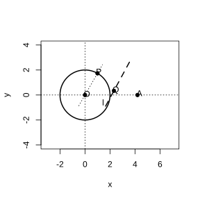

# Assignment 66

> **Definition 3.1.3** (Standard Equation of an Ellipse)  The standard equation of an ellipse with foci on the $x$-axis is $\frac{x^2}{a^2}+\frac{y^2}{b^2}=1$ ($a>b>0$), where $c^2=a^2-b^2$; when the foci are on the $y$-axis it is $\frac{y^2}{a^2}+\frac{x^2}{b^2}=1$.

> **Definition 3.2.1** (Hyperbola)  The locus of points in a plane whose absolute difference of distances to two fixed points $F_1$ and $F_2$ equals a nonzero constant (less than $\lvert F_1F_2 \rvert$) is called a hyperbola. These two fixed points are called the foci of the hyperbola, and the distance between the two foci is called the focal distance.

> **Common Conclusion 3.2.2** (Difference of Distances from a Point on a Hyperbola to the Two Foci)  The absolute value of the difference of the distances from any point $M$ on a hyperbola to the two foci equals $2a$, i.e. $\lvert \lvert MF_1 \rvert-\lvert MF_2 \rvert \rvert=2a$, where $0<2a<\lvert F_1F_2 \rvert$.

> **Definition 3.2.3** (Standard Equation of a Hyperbola)  When the foci are on the $x$-axis at $F_1(-c,0)$ and $F_2(c,0)$, the standard equation is $\frac{x^2}{a^2}-\frac{y^2}{b^2}=1$ ($a>0$, $b>0$), where $c^2=a^2+b^2$; when the foci are on the $y$-axis it is $\frac{y^2}{a^2}-\frac{x^2}{b^2}=1$.

> **Common Conclusion 3.2.4** (Range and Symmetry of a Hyperbola)  From $\frac{x^2}{a^2}-\frac{y^2}{b^2}=1$ we get $x\le-a$ or $x\ge a$, with $y\in\mathbb R$. The hyperbola is symmetric about the $x$-axis, the $y$-axis, and the origin; the origin is the center of the hyperbola.

> **Definition 3.2.5** (Vertices, Transverse Axis, and Conjugate Axis of a Hyperbola)  Setting $y=0$ gives $x=\pm a$; the intersections $A_1(-a,0)$ and $A_2(a,0)$ of the hyperbola with the $x$-axis are called the vertices. The segment $A_1A_2$ is called the transverse axis, with length $2a$, where $a$ is the semi-transverse axis length; the points $B_1(0,-b)$ and $B_2(0,b)$ lie on the $y$-axis, and the segment $B_1B_2$ is called the conjugate axis, with length $2b$, where $b$ is the semi-conjugate axis length.

> **Definition 3.2.6** (Asymptotes of a Hyperbola)  As the two branches of the hyperbola $\frac{x^2}{a^2}-\frac{y^2}{b^2}=1$ extend outward, they approach the two lines $\frac{x}{a}\pm\frac{y}{b}=0$ but never meet them; these two lines are called the asymptotes of the hyperbola, i.e. $y=\pm\frac{b}{a}x$.

> **Definition 3.2.7** (Equilateral Hyperbola)  A hyperbola whose transverse and conjugate axes have equal length is called an equilateral hyperbola, with equation $x^2-y^2=a^2$ and asymptotes $y=\pm x$.

> **Definition 3.2.8** (Eccentricity of a Hyperbola)  The ratio of the focal distance to the transverse axis length, $\frac{c}{a}$, is called the eccentricity of the hyperbola, denoted $e=\frac{c}{a}$. Since $c>a>0$, we have $e>1$. The eccentricity describes how wide the opening of the hyperbola is.

### Exercise 1

(Exercise 3.2, Problem 1) Find the standard equation of the hyperbola satisfying the following conditions.

(1) foci on the $x$-axis, $a=4$, $b=3$;

(2) foci on the $x$-axis, passing through $\left(-\sqrt{2},-\sqrt{3}\right)$ and $\left(\frac{\sqrt{15}}{3},\sqrt{2}\right)$;

(3) foci at $(0,-6)$ and $(0,6)$, passing through $(2,-5)$.

### Solution to Exercise 1

By **Definition 3.2.3** (Standard Equation of a Hyperbola), $c^2=a^2+b^2$.

(1) Foci on the $x$-axis, $a=4$, $b=3$; the standard equation is

$$
\frac{x^2}{16}-\frac{y^2}{9}=1.
$$

(2) Foci on the $x$-axis; let the equation be $\frac{x^2}{a^2}-\frac{y^2}{b^2}=1$. Substituting the two points:

$$
\frac{2}{a^2}-\frac{3}{b^2}=1,\quad \frac{15/9}{a^2}-\frac{2}{b^2}=1.
$$

Solving gives $a^2=1$, $b^2=3$. The standard equation is

$$
x^2-\frac{y^2}{3}=1.
$$

(3) The foci $(0,\pm6)$ are on the $y$-axis, so $c=6$; let the equation be $\frac{y^2}{a^2}-\frac{x^2}{b^2}=1$. Substituting $(2,-5)$ gives $\frac{25}{a^2}-\frac{4}{b^2}=1$, and $a^2+b^2=36$. Solving gives $a^2=20$, $b^2=16$. The standard equation is

$$
\frac{y^2}{20}-\frac{x^2}{16}=1.
$$

$\blacksquare$

### Exercise 2

(Exercise 3.2, Problem 2) Prove that the hyperbola $x^2-15y^2=15$ and the ellipse $\frac{x^2}{25}+\frac{y^2}{9}=1$ have the same foci.

### Solution to Exercise 2

By **Definition 3.2.3** (Standard Equation of a Hyperbola), rewrite the hyperbola $x^2-15y^2=15$ as $\frac{x^2}{15}-\frac{y^2}{1}=1$, so $a^2=15$, $b^2=1$, $c^2=a^2+b^2=16$, $c=4$, and the foci are at $(-4,0)$ and $(4,0)$.

By **Definition 3.1.3** (Standard Equation of an Ellipse), in the ellipse $\frac{x^2}{25}+\frac{y^2}{9}=1$ we have $a^2=25$, $b^2=9$, $c^2=a^2-b^2=16$, $c=4$, and the foci are at $(-4,0)$ and $(4,0)$.

The foci are exactly the same, and the claim follows. $\blacksquare$

### Exercise 3

(Exercise 3.2, Problem 3) Given that the equation $\frac{x^2}{2+m}-\frac{y^2}{m+1}=1$ represents a hyperbola, find the range of $m$.

### Solution to Exercise 3

By **Definition 3.2.3** (Standard Equation of a Hyperbola), in the standard hyperbola equation the signs of the $x^2$ and $y^2$ terms are opposite, i.e. the two denominators must have the same sign (one positive and one negative is impossible; in the standard form the two terms have opposite signs, so the two denominators must have the same sign).

For $\frac{x^2}{2+m}-\frac{y^2}{m+1}=1$ to represent a hyperbola, the two denominators must have the same sign. Either $2+m>0$ and $m+1>0$, giving $m>-1$; or $2+m<0$ and $m+1<0$, giving $m<-2$. Hence the range of $m$ is $m<-2$ or $m>-1$. $\blacksquare$

### Exercise 4

(Exercise 3.2, Problem 4) The two foci of the hyperbola $\frac{x^2}{a^2}-\frac{y^2}{12}=1$ ($a>0$) are $F_1$ and $F_2$, with focal distance $8$; $M$ is a point on the hyperbola with $\lvert MF_1 \rvert=5$. Find $\lvert MF_2 \rvert$.

### Solution to Exercise 4

By **Definition 3.2.3** (Standard Equation of a Hyperbola), $c^2=a^2+b^2$. The focal distance is $2c=8$, so $c=4$, $c^2=16$. Also $b^2=12$, so $a^2=c^2-b^2=4$, $a=2$.

By **Common Conclusion 3.2.2** (Difference of Distances from a Point on a Hyperbola to the Two Foci), $\lvert \lvert MF_1 \rvert-\lvert MF_2 \rvert \rvert=2a=4$. Substituting $\lvert MF_1 \rvert=5$ gives $\lvert 5-\lvert MF_2 \rvert \rvert=4$, so $\lvert MF_2 \rvert=9$ or $\lvert MF_2 \rvert=1$. Since the distance from a point on the hyperbola to the nearer focus is greater than $c-a=2$, the solution $\lvert MF_2 \rvert=1$ is rejected, leaving $\lvert MF_2 \rvert=9$. $\blacksquare$

### Exercise 5

(Exercise 3.2, Problem 1) Find the lengths of the transverse and conjugate axes, the coordinates of the vertices and foci, and the eccentricity of each hyperbola below.

(1) $x^2-8y^2=32$;

(2) $9x^2-y^2=81$;

(3) $x^2-y^2=-4$;

(4) $\frac{x^2}{49}-\frac{y^2}{25}=-1$.

### Solution to Exercise 5

Use **Definition 3.2.3**, **Definition 3.2.5** (Vertices, Transverse and Conjugate Axes), and **Definition 3.2.8** (Eccentricity).

(1) $x^2-8y^2=32$ becomes $\frac{x^2}{32}-\frac{y^2}{4}=1$, with $a=4\sqrt{2}$, $b=2$, $c=\sqrt{32+4}=6$. The transverse axis length is $8\sqrt{2}$, the conjugate axis length is $4$, the vertices are at $(\pm4\sqrt{2},0)$, the foci are at $(\pm6,0)$, and $e=\frac{6}{4\sqrt{2}}=\frac{3\sqrt{2}}{4}$.

(2) $9x^2-y^2=81$ becomes $\frac{x^2}{9}-\frac{y^2}{81}=1$, with $a=3$, $b=9$, $c=\sqrt{9+81}=3\sqrt{10}$. The transverse axis length is $6$, the conjugate axis length is $18$, the vertices are at $(\pm3,0)$, the foci are at $(\pm3\sqrt{10},0)$, and $e=\sqrt{10}$.

(3) $x^2-y^2=-4$ becomes $\frac{y^2}{4}-\frac{x^2}{4}=1$, with $a=2$, $b=2$, $c=2\sqrt{2}$. The transverse axis length is $4$, the conjugate axis length is $4$, the vertices are at $(0,\pm2)$, the foci are at $(0,\pm2\sqrt{2})$, and $e=\sqrt{2}$.

(4) $\frac{x^2}{49}-\frac{y^2}{25}=-1$ becomes $\frac{y^2}{25}-\frac{x^2}{49}=1$, with $a=5$, $b=7$, $c=\sqrt{25+49}=\sqrt{74}$. The transverse axis length is $10$, the conjugate axis length is $14$, the vertices are at $(0,\pm5)$, the foci are at $(0,\pm\sqrt{74})$, and $e=\frac{\sqrt{74}}{5}$. $\blacksquare$

### Exercise 6

(Exercise 3.2, Problem 2) Find the standard equation of the hyperbola satisfying the following conditions.

(1) vertices on the $x$-axis, distance between the two vertices is $8$, $e=\frac{5}{4}$;

(2) foci on the $y$-axis, focal distance is $16$, $e=\frac{4}{3}$.

### Solution to Exercise 6

Use **Definition 3.2.5** (Vertices, Transverse Axis) and **Definition 3.2.8** (Eccentricity).

(1) Vertices on the $x$-axis, distance between vertices is $2a=8$, so $a=4$. $e=\frac{c}{a}=\frac{5}{4}$, so $c=5$, $b^2=c^2-a^2=25-16=9$. The standard equation is

$$
\frac{x^2}{16}-\frac{y^2}{9}=1.
$$

(2) Foci on the $y$-axis, focal distance is $2c=16$, so $c=8$. $e=\frac{c}{a}=\frac{4}{3}$, so $a=6$, $b^2=c^2-a^2=64-36=28$. The standard equation is

$$
\frac{y^2}{36}-\frac{x^2}{28}=1.
$$

$\blacksquare$

### Exercise 7

(Exercise 3.2, Problem 3) One focus of an equilateral hyperbola whose axes of symmetry lie on the coordinate axes is $F_1(-6,0)$. Find the standard equation and the asymptotes of the hyperbola.

### Solution to Exercise 7

By **Definition 3.2.7** (Equilateral Hyperbola), $a=b$ in an equilateral hyperbola. The focus $F_1(-6,0)$ is on the $x$-axis, so $c=6$. From $c^2=a^2+b^2=2a^2$, we get $a^2=18$. The standard equation is

$$
\frac{x^2}{18}-\frac{y^2}{18}=1.
$$

By **Definition 3.2.6** (Asymptotes), the asymptotes are $y=\pm\frac{b}{a}x=\pm x$. $\blacksquare$

### Exercise 8

(Exercise 3.2, Problem 4) The asymptotes of a hyperbola are $y=\pm2x$, and its conjugate axis length is $4$. Find the standard equation.

### Solution to Exercise 8

By **Definition 3.2.6** (Asymptotes), the asymptotes are $y=\pm\frac{b}{a}x=\pm2x$, so $\frac{b}{a}=2$. The conjugate axis length is $2b=4$, so $b=2$, $a=1$. Since the focus axis is not specified, the standard equation is

$$
x^2-\frac{y^2}{4}=1
$$

or

$$
\frac{y^2}{4}-x^2=1.
$$

$\blacksquare$

### Exercise 9

(Exercise 3.2, Problem 1) Given that the coordinates of $A$ and $B$ are $(-6,0)$ and $(6,0)$ respectively, the lines $AM$ and $BM$ intersect at $M$, and the product of their slopes is $\frac{2}{9}$. Find the locus equation of $M$ and describe its shape.

### Solution to Exercise 9

Let $M(x,y)$. Then $k_{AM}=\frac{y}{x+6}$ and $k_{BM}=\frac{y}{x-6}$. By the problem, $\frac{y}{x+6}\cdot\frac{y}{x-6}=\frac{2}{9}$, i.e.

$$
\frac{y^2}{x^2-36}=\frac{2}{9}.
$$

Simplifying gives $9y^2=2x^2-72$, i.e.

$$
\frac{x^2}{36}-\frac{y^2}{8}=1.
$$

By **Definition 3.2.1** (Hyperbola), the locus of $M$ is a hyperbola with foci on the $x$-axis. $\blacksquare$

### Exercise 10

(Exercise 3.2, Problem 2) Find the intersection coordinates of each line and hyperbola below.

(1) $2x-y-10=0$, $\frac{x^2}{20}-\frac{y^2}{5}=1$;

(2) $4x-3y-16=0$, $\frac{x^2}{25}-\frac{y^2}{16}=1$.

### Solution to Exercise 10

Combine the line and hyperbola equations and solve.

(1) From $2x-y-10=0$ we have $y=2x-10$; substituting into $\frac{x^2}{20}-\frac{y^2}{5}=1$ gives

$$
\frac{x^2}{20}-\frac{(2x-10)^2}{5}=1.
$$

Simplifying gives $x^2-4(2x-10)^2=20$, i.e. $15x^2-160x+420=0$, i.e. $3x^2-32x+84=0$, so $x=6$ or $x=\frac{14}{3}$. Substituting back gives $y=2$ or $y=-\frac{2}{3}$. The intersections are $(6,2)$ and $\left(\frac{14}{3},-\frac{2}{3}\right)$.

(2) From $4x-3y-16=0$ we have $y=\frac{4x-16}{3}$; substituting into $\frac{x^2}{25}-\frac{y^2}{16}=1$ gives

$$
\frac{x^2}{25}-\frac{(4x-16)^2}{9\times16}=1.
$$

Simplifying gives $16x^2-(4x-16)^2=400$, i.e. $128x=656$, $x=\frac{41}{8}$, $y=\frac{5}{3}$. The intersection is $\left(\frac{41}{8},\frac{5}{3}\right)$ (tangent, one common point). $\blacksquare$

### Exercise 11

(Exercise 3.2, Problem 3) The line $y=\frac{2}{3}x$ intersects the hyperbola $\frac{x^2}{a^2}-\frac{y^2}{8}=1$ ($a>0$) at $A$ and $B$, and the product of the abscissas of $A$ and $B$ is $-9$. Find the eccentricity $e$.

### Solution to Exercise 11

Substituting $y=\frac{2}{3}x$ into the hyperbola gives

$$
\frac{x^2}{a^2}-\frac{4x^2/9}{8}=1,
$$

i.e. $x^2\left(\frac{1}{a^2}-\frac{1}{18}\right)=1$. Let the abscissas of the two intersections be $x_1,x_2$; then $x_1x_2=\frac{1}{\frac{1}{a^2}-\frac{1}{18}}=-9$. Solving gives $\frac{1}{a^2}-\frac{1}{18}=-\frac{1}{9}$, i.e. $\frac{1}{a^2}=\frac{1}{18}-\frac{2}{18}=-\frac{1}{18}$, a contradiction. Rearranging: $x^2=\frac{1}{\frac{1}{a^2}-\frac{1}{18}}$, and the two intersections are symmetric with $x_1=-x_2$, so $x_1x_2=-x_1^2=-9$, i.e. $x_1^2=9$. Substituting gives $9\left(\frac{1}{a^2}-\frac{1}{18}\right)=1$, so $\frac{1}{a^2}=\frac{1}{9}+\frac{1}{18}=\frac{1}{6}$, $a^2=6$. $c^2=a^2+b^2=6+8=14$, and $e=\frac{\sqrt{14}}{\sqrt{6}}=\frac{\sqrt{21}}{3}$. $\blacksquare$

### Problem 1

(Exercise 3.2, Review and Consolidation, Problem 1) A point $P$ on the hyperbola $4x^2-y^2+64=0$ is at distance $1$ from one of its foci. Then the distance from $P$ to the other focus is $\;\_\_\;$.

### Solution to Problem 1

Rewrite the hyperbola $4x^2-y^2+64=0$ as $\frac{y^2}{64}-\frac{x^2}{16}=1$, with $a=8$, $b=4$, $c=\sqrt{64+16}=4\sqrt{5}$.

By **Common Conclusion 3.2.2** (Difference of Distances from a Point on a Hyperbola to the Two Foci), $\lvert \lvert PF_1 \rvert-\lvert PF_2 \rvert \rvert=2a=16$. Given that the distance to one focus is $1$, the distance to the other is $1+16=17$ (rejecting $\lvert 1-16 \rvert=15$, because the distance from a point on the hyperbola to the nearer focus is at least $c-a=4\sqrt{5}-8\approx0.94>0$; the distance $1$ corresponds to the nearer focus, so the distance to the farther focus is $17$). $\blacksquare$

### Problem 2

(Exercise 3.2, Review and Consolidation, Problem 2) Find the standard equation of the hyperbola satisfying the following conditions.

(1) foci on the $x$-axis, $a=2\sqrt{5}$, passing through $A(-5,2)$;

(2) passing through $A(-7,-6\sqrt{2})$ and $B(2\sqrt{7},3)$.

### Solution to Problem 2

By **Definition 3.2.3** (Standard Equation of a Hyperbola).

(1) Foci on the $x$-axis, $a=2\sqrt{5}$; let the equation be $\frac{x^2}{20}-\frac{y^2}{b^2}=1$. Substituting $A(-5,2)$ gives $\frac{25}{20}-\frac{4}{b^2}=1$, so $b^2=16$. The standard equation is

$$
\frac{x^2}{20}-\frac{y^2}{16}=1.
$$

(2) Let the equation be $mx^2+ny^2=1$ ($mn<0$). Substituting $A(-7,-6\sqrt{2})$ and $B(2\sqrt{7},3)$:

$$
49m+72n=1,\quad 28m+9n=1.
$$

Solving gives $m=\frac{1}{25}$, $n=-\frac{1}{75}$. The standard equation is

$$
\frac{x^2}{25}-\frac{y^2}{75}=1.
$$

$\blacksquare$

### Problem 3

(Exercise 3.2, Review and Consolidation, Problem 3) Given the equations of the following hyperbolas, find their foci, eccentricities, and asymptotes.

(1) $16x^2-9y^2=144$;

(2) $16x^2-9y^2=-144$.

### Solution to Problem 3

Use **Definition 3.2.3**, **Definition 3.2.6** (Asymptotes), and **Definition 3.2.8** (Eccentricity).

(1) $16x^2-9y^2=144$ becomes $\frac{x^2}{9}-\frac{y^2}{16}=1$, with $a=3$, $b=4$, $c=5$. The foci are at $(\pm5,0)$, $e=\frac{5}{3}$, and the asymptotes are $y=\pm\frac{4}{3}x$.

(2) $16x^2-9y^2=-144$ becomes $\frac{y^2}{16}-\frac{x^2}{9}=1$, with $a=4$, $b=3$, $c=5$. The foci are at $(0,\pm5)$, $e=\frac{5}{4}$, and the asymptotes are $y=\pm\frac{4}{3}x$. $\blacksquare$

### Problem 4

(Exercise 3.2, Review and Consolidation, Problem 4) Find the standard equation of the hyperbola satisfying the following conditions.

(1) foci on the $x$-axis, transverse axis length $10$, conjugate axis length $8$;

(2) foci on the $y$-axis, focal distance $10$, conjugate axis length $8$;

(3) eccentricity $e=\sqrt{2}$, passing through $M(-5,3)$.

### Solution to Problem 4

Use **Definition 3.2.5** (Transverse and Conjugate Axes) and **Definition 3.2.8** (Eccentricity).

(1) $2a=10$, $a=5$; $2b=8$, $b=4$. Foci on the $x$-axis; the equation is

$$
\frac{x^2}{25}-\frac{y^2}{16}=1.
$$

(2) $2c=10$, $c=5$; $2b=8$, $b=4$. $a^2=c^2-b^2=25-16=9$. Foci on the $y$-axis; the equation is

$$
\frac{y^2}{9}-\frac{x^2}{16}=1.
$$

(3) $e=\sqrt{2}$, so $\frac{c}{a}=\sqrt{2}$, $c^2=2a^2$, $b^2=c^2-a^2=a^2$. Let the equation be $\frac{x^2}{a^2}-\frac{y^2}{a^2}=1$. Substituting $M(-5,3)$ gives $\frac{25-9}{a^2}=1$, $a^2=16$. The equation is

$$
\frac{x^2}{16}-\frac{y^2}{16}=1.
$$

$\blacksquare$

### Problem 5

(Exercise 3.2, Review and Consolidation, Problem 5) As shown in the figure, the circle $O$ has fixed radius $r$, $A$ is a fixed point outside the circle $O$, and $P$ is any point on the circle $O$. The perpendicular bisector $l$ of segment $AP$ intersects the line $OP$ at $Q$. As $P$ moves on the circle $O$, what is the locus of $Q$? Why?

{width=50%}

### Solution to Problem 5

By the property of the perpendicular bisector, $\lvert QA \rvert=\lvert QP \rvert$. Also, $Q$ lies on the line $OP$, and $\lvert OP \rvert=r$.

Since $A$ is outside the circle $O$, $\lvert OA \rvert>r$, and $Q$ lies on the extension of $OP$ (on the side beyond $P$), so $\lvert QO \rvert=\lvert QP \rvert+\lvert PO \rvert=\lvert QA \rvert+r$, i.e.

$$
\lvert QO \rvert-\lvert QA \rvert=r.
$$

By **Definition 3.2.1** (Hyperbola), the difference of the distances from $Q$ to the two fixed points $O$ and $A$ is the constant $r$, and $r<\lvert OA \rvert$, so the locus of $Q$ is one branch of a hyperbola with foci at $O$ and $A$. $\blacksquare$

### Problem 6

(Exercise 3.2, Review and Consolidation, Problem 6) Find the standard equation of the equilateral hyperbola passing through $A(3,-1)$ with its axes of symmetry on the coordinate axes.

### Solution to Problem 6

By **Definition 3.2.7** (Equilateral Hyperbola), let the equation be $x^2-y^2=\lambda$ ($\lambda\neq0$). Substituting $A(3,-1)$ gives $9-1=\lambda$, $\lambda=8$. The standard equation is

$$
\frac{x^2}{8}-\frac{y^2}{8}=1.
$$

$\blacksquare$

### Problem 7

(Exercise 3.2, Comprehensive Application, Problem 7) For what values of $m$ and $n$ does the equation $\frac{x^2}{m}+\frac{y^2}{n}=1$ represent the following curves:

(1) a circle;

(2) an ellipse;

(3) a hyperbola?

### Solution to Problem 7

(1) By **Definition 3.1.3** (Standard Equation of an Ellipse), a circle is the special case of an ellipse when $a=b$, so we need $m=n>0$.

(2) By **Definition 3.1.3**, an ellipse requires both denominators positive and unequal, i.e. $m>0$, $n>0$, and $m\neq n$.

(3) By **Definition 3.2.3** (Standard Equation of a Hyperbola), a hyperbola requires the two denominators to have opposite signs, i.e. $m>0$, $n<0$ or $m<0$, $n>0$. $\blacksquare$

### Problem 8

(Exercise 3.2, Comprehensive Application, Problem 8) Find the equation of the hyperbola that shares foci with the ellipse $\frac{x^2}{49}+\frac{y^2}{24}=1$ and has eccentricity $e=\frac{5}{4}$.

### Solution to Problem 8

By **Definition 3.1.3**, in the ellipse $\frac{x^2}{49}+\frac{y^2}{24}=1$ we have $c^2=49-24=25$, $c=5$, and foci at $(\pm5,0)$.

The hyperbola shares the foci with the ellipse, so $c=5$. By **Definition 3.2.8** (Eccentricity), $e=\frac{c}{a}=\frac{5}{4}$, so $a=4$, $b^2=c^2-a^2=25-16=9$. The hyperbola equation is

$$
\frac{x^2}{16}-\frac{y^2}{9}=1.
$$

$\blacksquare$

### Problem 9

(Exercise 3.2, Comprehensive Application, Problem 9) Two outposts $A$ and $B$ are $1400\,\mathrm{m}$ apart. The time difference between hearing an explosion is $3\,\mathrm{s}$, and the speed of sound is $340\,\mathrm{m/s}$. On what curve does the explosion point lie, and find its equation.

### Solution to Problem 9

The difference of the distances from the explosion point to $A$ and $B$ is $340\times3=1020\,\mathrm{m}$. Take the midpoint of $AB$ as the origin and the line $AB$ as the $x$-axis; then $A(-700,0)$, $B(700,0)$, $2c=1400$, $c=700$.

By **Common Conclusion 3.2.2**, $\lvert \lvert PA \rvert-\lvert PB \rvert \rvert=1020=2a$, $a=510$. $b^2=c^2-a^2=700^2-510^2=229900$. The explosion point lies on a hyperbola with foci at $A$ and $B$, with equation

$$
\frac{x^2}{260100}-\frac{y^2}{229900}=1.
$$

$\blacksquare$

### Problem 10

(Exercise 3.2, Comprehensive Application, Problem 10) Let the ratio of the distance from a moving point $M$ to the fixed point $F(c,0)$ ($c>0$) to the distance from $M$ to the fixed line $l:x=\frac{a^2}{c}$ be $\frac{c}{a}$ ($a<c$). Find the locus equation of $M$ and describe its shape.

### Solution to Problem 10

Let $M(x,y)$. The distance to $F(c,0)$ is $\sqrt{(x-c)^2+y^2}$, and the distance to $l:x=\frac{a^2}{c}$ is $\left|x-\frac{a^2}{c}\right|$. By the problem,

$$
\frac{\sqrt{(x-c)^2+y^2}}{\left|x-\frac{a^2}{c}\right|}=\frac{c}{a}.
$$

Squaring both sides and simplifying gives

$$
(a^2-c^2)x^2+a^2y^2=a^2(a^2-c^2).
$$

Since $a<c$, we have $a^2-c^2<0$; dividing both sides by $a^2(a^2-c^2)$ gives

$$
\frac{x^2}{a^2}-\frac{y^2}{c^2-a^2}=1.
$$

By **Definition 3.2.1** (Hyperbola), the locus is a hyperbola with foci on the $x$-axis. $\blacksquare$

### Problem 11

(Exercise 3.2, Extension and Exploration, Problem 11) $M$ is a moving point; $MA$ is perpendicular to the line $y=x$, with foot $A$ in the first quadrant, and $MB$ is perpendicular to the line $y=-x$, with foot $B$ in the fourth quadrant. If the area of quadrilateral $OAMB$ ($O$ is the origin) is $3$, find the locus equation of $M$.

### Solution to Problem 11

Let $M(x,y)$. $MA\perp y=x$, with foot $A$ on $y=x$; $MB\perp y=-x$, with foot $B$ on $y=-x$.

By the projection formula, the coordinates of $A$ are $\left(\frac{x+y}{2},\frac{x+y}{2}\right)$, and the coordinates of $B$ are $\left(\frac{x-y}{2},\frac{-(x-y)}{2}\right)$. Since $A$ is in the first quadrant, $x+y>0$; since $B$ is in the fourth quadrant, $x-y>0$, so $x>\lvert y \rvert$.

The quadrilateral $OAMB$ is split into $\triangle OMA$ and $\triangle OMB$. $\lvert OA \rvert=\frac{\lvert x+y \rvert}{\sqrt{2}}$, $\lvert MA \rvert=\frac{\lvert x-y \rvert}{\sqrt{2}}$; $\lvert OB \rvert=\frac{\lvert x-y \rvert}{\sqrt{2}}$, $\lvert MB \rvert=\frac{\lvert x+y \rvert}{\sqrt{2}}$. The area is

$$
S=\frac{1}{2}\lvert OA \rvert\lvert MA \rvert+\frac{1}{2}\lvert OB \rvert\lvert MB \rvert=\frac{1}{2}\cdot\frac{\lvert x^2-y^2 \rvert}{2}\cdot2=\frac{\lvert x^2-y^2 \rvert}{2}=3.
$$

Since $x>\lvert y \rvert$, we have $x^2-y^2>0$, so $x^2-y^2=6$. The locus equation is

$$
\frac{x^2}{6}-\frac{y^2}{6}=1\quad(x>\sqrt{6}).
$$

$\blacksquare$

### Problem 12

(Exercise 3.2, Extension and Exploration, Problem 12) Let the eccentricities of the ellipse $\frac{x^2}{a^2}+\frac{y^2}{b^2}=1$ ($a>b>0$) and the hyperbola $\frac{x^2}{a^2}-\frac{y^2}{b^2}=1$ be $e_1$ and $e_2$, respectively, and suppose the slopes of the asymptotes of the hyperbola are less than $\frac{2\sqrt{5}}{5}$. Find the ranges of $e_1$ and $e_2$.

### Solution to Problem 12

By **Definition 3.1.7** (Eccentricity of an Ellipse), $e_1=\frac{c_1}{a}=\frac{\sqrt{a^2-b^2}}{a}$; by **Definition 3.2.8** (Eccentricity of a Hyperbola), $e_2=\frac{c_2}{a}=\frac{\sqrt{a^2+b^2}}{a}$.

The slopes of the hyperbola's asymptotes are $\frac{b}{a}<\frac{2\sqrt{5}}{5}$, so $\frac{b^2}{a^2}<\frac{4}{5}$.

Let $t=\frac{b^2}{a^2}$; then $0<t<\frac{4}{5}$. $e_1^2=1-t>\frac{1}{5}$, and since $e_1<1$, we have $\frac{\sqrt{5}}{5}<e_1<1$. $e_2^2=1+t<\frac{9}{5}$, and since $e_2>1$, we have $1<e_2<\frac{3\sqrt{5}}{5}$. $\blacksquare$

### Problem 13

(Exercise 3.2, Extension and Exploration, Problem 13) Given the hyperbola $x^2-\frac{y^2}{2}=1$, a line $l$ through $P(1,1)$ intersects the hyperbola at $A$ and $B$. Can $P$ be the midpoint of segment $AB$? Why?

### Solution to Problem 13

Let the slope of $l$ be $k$, with equation $y-1=k(x-1)$. Substituting into the hyperbola $x^2-\frac{y^2}{2}=1$ gives

$$
x^2-\frac{[k(x-1)+1]^2}{2}=1.
$$

Simplifying gives $(2-k^2)x^2-2k(1-k)x-(1-k)^2-2=0$. Let $A(x_1,y_1)$ and $B(x_2,y_2)$. If $P(1,1)$ is the midpoint, then $x_1+x_2=2$. By Vieta's formulas, $x_1+x_2=\frac{2k(1-k)}{2-k^2}=2$, so $k=2$.

When $k=2$, the equation becomes $-2x^2+4x-3=0$, with discriminant $\Delta=16-24=-8<0$, so there are no real roots. Hence no such line exists, and $P$ cannot be the midpoint of $AB$. $\blacksquare$

### Problem 14

(Exercise 3.2, Extension and Exploration, Problem 14) Given the hyperbola $\frac{x^2}{4}-\frac{y^2}{16}=1$ and the line $l:y=kx+m$ ($k\neq\pm2$) with exactly one common point $M$, the line through $M$ perpendicular to $l$ intersects the $x$-axis and $y$-axis at $A(x,0)$ and $B(0,y)$, respectively. As $M$ moves, find the locus equation of $P(x,y)$ and describe the curve. Generalizing to a general hyperbola, what corresponding conclusion follows?

### Solution to Problem 14

Substituting $y=kx+m$ into $\frac{x^2}{4}-\frac{y^2}{16}=1$ gives $(4-k^2)x^2-2kmx-(m^2+16)=0$. Tangency means $\Delta=0$, i.e. $4k^2m^2+4(4-k^2)(m^2+16)=0$, which simplifies to $m^2=16(4-k^2)$.

The abscissa of the tangent point $M$ is $x_M=\frac{km}{4-k^2}$, and $y_M=kx_M+m=\frac{4m}{4-k^2}$. The line through $M$ perpendicular to $l$ has slope $-\frac{1}{k}$, with equation $y-y_M=-\frac{1}{k}(x-x_M)$. Setting $y=0$ gives $x=x_M+ky_M=\frac{km+4km}{4-k^2}=\frac{5km}{4-k^2}$; setting $x=0$ gives $y=y_M+\frac{x_M}{k}=\frac{4m+km/k}{4-k^2}=\frac{4m+m}{4-k^2}=\frac{5m}{4-k^2}$.

Eliminating the parameters $k,m$ gives $x=ky$, i.e. $y=\frac{x}{k}$. Since $m^2=16(4-k^2)$, substituting $y=\frac{5m}{4-k^2}$ gives $y^2=\frac{25\cdot16(4-k^2)}{(4-k^2)^2}=\frac{400}{4-k^2}$. From $x=ky$, $k=\frac{x}{y}$; substituting gives $4-\frac{x^2}{y^2}=\frac{400}{y^2}$, i.e. $4y^2-x^2=400$, i.e.

$$
\frac{y^2}{100}-\frac{x^2}{400}=1.
$$

The locus is a hyperbola. Generalizing to a general hyperbola, the locus of the points where the lines perpendicular to the tangent at the tangent point cut the coordinate axes is again a hyperbola. $\blacksquare$

### Inquiry and Discovery 1

(Think About It 1) Alternatively, we can directly compute $\lvert MQ \rvert$ and prove that as $x$ grows without bound, $\lvert MQ \rvert$ approaches $0$.

### Solution to Inquiry and Discovery 1

In the first quadrant, the hyperbola equation is $y=\frac{b}{a}\sqrt{x^2-a^2}$ ($x>a$). The distance from $M(x,y)$ to the asymptote $bx-ay=0$ is

$$
\lvert MQ \rvert=\frac{\lvert bx-ay \rvert}{\sqrt{a^2+b^2}}=\frac{\left|bx-b\sqrt{x^2-a^2}\right|}{\sqrt{a^2+b^2}}.
$$

Rationalizing the numerator:

$$
bx-b\sqrt{x^2-a^2}=\frac{b(x^2-(x^2-a^2))}{x+\sqrt{x^2-a^2}}=\frac{ba^2}{x+\sqrt{x^2-a^2}}.
$$

Hence

$$
\lvert MQ \rvert=\frac{ba^2}{\sqrt{a^2+b^2}\left(x+\sqrt{x^2-a^2}\right)}.
$$

As $x\to+\infty$, the denominator tends to infinity, so $\lvert MQ \rvert\to0$, i.e. the hyperbola approaches its asymptote without bound. $\blacksquare$
