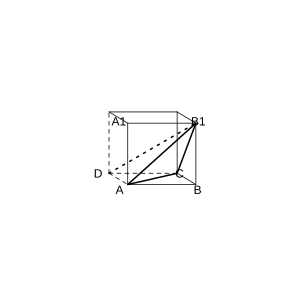
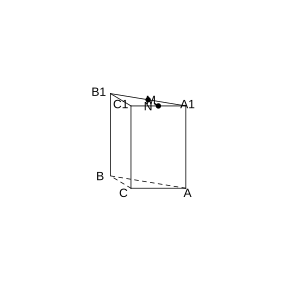

# Assignment 68

> **Definition 1.1.1** (Space Vector)  In space, a quantity with both magnitude and direction is called a space vector; the magnitude of a space vector is called its length or norm.

> **Definition 1.1.5** (Linear Operations on Space Vectors)  $\boldsymbol{a}+\boldsymbol{b}=\boldsymbol{OA}+\boldsymbol{AB}=\boldsymbol{OB}$; $\boldsymbol{a}-\boldsymbol{b}=\boldsymbol{OA}-\boldsymbol{OC}=\boldsymbol{CA}$; $\lambda\boldsymbol{a}$ ($\lambda \in \mathbb R$).

> **Common Conclusion 1.1.6** (Laws of Linear Operations on Space Vectors)  Commutative law: $\boldsymbol{a}+\boldsymbol{b}=\boldsymbol{b}+\boldsymbol{a}$; associative law: $(\boldsymbol{a}+\boldsymbol{b})+\boldsymbol{c}=\boldsymbol{a}+(\boldsymbol{b}+\boldsymbol{c})$; distributive law: $(\lambda+\mu)\boldsymbol{a}=\lambda\boldsymbol{a}+\mu\boldsymbol{a}$, $\lambda(\boldsymbol{a}+\boldsymbol{b})=\lambda\boldsymbol{a}+\lambda\boldsymbol{b}$.

> **Common Conclusion 1.1.7** (Necessary and Sufficient Condition for Collinear Vectors)  For any two space vectors $\boldsymbol{a}$ and $\boldsymbol{b}$ ($\boldsymbol{b} \neq \boldsymbol{0}$), $\boldsymbol{a} \parallel \boldsymbol{b}$ iff there exists a real number $\lambda$ such that $\boldsymbol{a}=\lambda\boldsymbol{b}$.

> **Common Conclusion 1.1.9** (Necessary and Sufficient Condition for Coplanar Vectors)  If the two vectors $\boldsymbol{a}$ and $\boldsymbol{b}$ are not collinear, then the vector $\boldsymbol{p}$ is coplanar with $\boldsymbol{a}$ and $\boldsymbol{b}$ iff there exists a unique ordered pair $(x,y)$ of real numbers such that $\boldsymbol{p}=x\boldsymbol{a}+y\boldsymbol{b}$.

> **Definition 1.1.10** (Angle Between Vectors)  Given two nonzero vectors $\boldsymbol{a}$ and $\boldsymbol{b}$, take any point $O$ in space and draw $\boldsymbol{OA}=\boldsymbol{a}$, $\boldsymbol{OB}=\boldsymbol{b}$; then $\angle AOB$ is called the angle between $\boldsymbol{a}$ and $\boldsymbol{b}$, denoted $\langle \boldsymbol{a}, \boldsymbol{b} \rangle$, with $0 \leq \langle \boldsymbol{a}, \boldsymbol{b} \rangle \leq \pi$.

> **Definition 1.1.12** (Dot Product)  $\boldsymbol{a} \cdot \boldsymbol{b} = \lvert \boldsymbol{a} \rvert \lvert \boldsymbol{b} \rvert \cos \langle \boldsymbol{a}, \boldsymbol{b} \rangle$. The dot product of the zero vector with any vector is $0$.

> **Common Conclusion 1.1.13** (Properties of the Dot Product)  $\boldsymbol{a} \perp \boldsymbol{b} \iff \boldsymbol{a} \cdot \boldsymbol{b} = 0$; $\boldsymbol{a} \cdot \boldsymbol{a} = \lvert \boldsymbol{a} \rvert^2$.

> **Common Conclusion 1.1.14** (Laws of the Dot Product)  Commutative law: $\boldsymbol{a} \cdot \boldsymbol{b} = \boldsymbol{b} \cdot \boldsymbol{a}$; scalar-associative law: $(\lambda\boldsymbol{a}) \cdot \boldsymbol{b} = \lambda(\boldsymbol{a} \cdot \boldsymbol{b})$; distributive law: $(\boldsymbol{a}+\boldsymbol{b}) \cdot \boldsymbol{c} = \boldsymbol{a} \cdot \boldsymbol{c} + \boldsymbol{b} \cdot \boldsymbol{c}$.

> **Theorem 1.2.1** (Fundamental Theorem of Space Vectors)  If three vectors $\boldsymbol{a}$, $\boldsymbol{b}$, and $\boldsymbol{c}$ are not coplanar, then for any space vector $\boldsymbol{p}$ there exists a unique ordered triple $(x,y,z)$ of real numbers such that $\boldsymbol{p}=x\boldsymbol{a}+y\boldsymbol{b}+z\boldsymbol{c}$.

> **Definition 1.2.2** (Basis, Basis Vectors)  If three vectors $\boldsymbol{a}$, $\boldsymbol{b}$, and $\boldsymbol{c}$ are not coplanar, then $\{\boldsymbol{a}, \boldsymbol{b}, \boldsymbol{c}\}$ is called a basis of space, and $\boldsymbol{a}$, $\boldsymbol{b}$, $\boldsymbol{c}$ are called basis vectors.

> **Definition 1.2.3** (Orthonormal Basis)  If the three basis vectors in a basis are pairwise perpendicular and all have length $1$, the basis is called an orthonormal basis, usually denoted $\{\boldsymbol{i}, \boldsymbol{j}, \boldsymbol{k}\}$.

> **Definition 1.3.2** (Coordinates of a Point)  Under an orthonormal basis, the ordered triple $(x,y,z)$ corresponding to the vector $\boldsymbol{OA}$ is called the coordinates of the point $A$.

> **Common Conclusion 1.3.4** (Coordinate Representation of Space Vector Operations)  Let $\boldsymbol{a}=(a_1,a_2,a_3)$, $\boldsymbol{b}=(b_1,b_2,b_3)$; then $\boldsymbol{a}+\boldsymbol{b}=(a_1+b_1,a_2+b_2,a_3+b_3)$, $\lambda\boldsymbol{a}=(\lambda a_1,\lambda a_2,\lambda a_3)$, and $\boldsymbol{a} \cdot \boldsymbol{b}=a_1b_1+a_2b_2+a_3b_3$.

> **Common Conclusion 1.3.5** (Coordinate Representation of Parallelism, Perpendicularity, Norm, and Angle)  $\boldsymbol{a} \parallel \boldsymbol{b} \iff \boldsymbol{a}=\lambda\boldsymbol{b}$; $\boldsymbol{a} \perp \boldsymbol{b} \iff \boldsymbol{a} \cdot \boldsymbol{b}=0$; $\lvert \boldsymbol{a} \rvert=\sqrt{a_1^2+a_2^2+a_3^2}$; $\cos \langle \boldsymbol{a}, \boldsymbol{b} \rangle=\frac{\boldsymbol{a} \cdot \boldsymbol{b}}{\lvert \boldsymbol{a} \rvert \lvert \boldsymbol{b} \rvert}$.

> **Common Conclusion 1.3.6** (Distance Formula Between Two Points in Space)  $P_1P_2=\sqrt{(x_2-x_1)^2+(y_2-y_1)^2+(z_2-z_1)^2}$.

> **Definition 1.4.1** (Direction Vector of a Line)  If $P$ is a point on the line $l$ and $\boldsymbol{u}$ is a direction vector of $l$, then for any point $P$ on $l$ there exists a real number $t$ such that $\boldsymbol{AP}=t\boldsymbol{u}$.

> **Definition 1.4.2** (Normal Vector of a Plane)  The direction vector of a line perpendicular to a plane is called a normal vector of the plane.

> **Common Conclusion 1.4.3** (Vector Characterization of Parallelism)  $l_1 \parallel l_2 \iff \boldsymbol{u}_1 \parallel \boldsymbol{u}_2$; $l \parallel \alpha \iff \boldsymbol{u} \perp \boldsymbol{n}$; $\alpha \parallel \beta \iff \boldsymbol{n}_1 \parallel \boldsymbol{n}_2$.

> **Common Conclusion 1.4.4** (Vector Characterization of Perpendicularity)  $l_1 \perp l_2 \iff \boldsymbol{u}_1 \perp \boldsymbol{u}_2$; $l \perp \alpha \iff \boldsymbol{u} \parallel \boldsymbol{n}$; $\alpha \perp \beta \iff \boldsymbol{n}_1 \perp \boldsymbol{n}_2$.

> **Common Conclusion 1.4.5** (Distance from a Point to a Line)  $d=\sqrt{\lvert \boldsymbol{PA} \rvert^2-\left(\frac{\boldsymbol{PA} \cdot \boldsymbol{u}}{\lvert \boldsymbol{u} \rvert}\right)^2}$.

> **Common Conclusion 1.4.6** (Distance from a Point to a Plane)  $d=\frac{\lvert \boldsymbol{PA} \cdot \boldsymbol{n} \rvert}{\lvert \boldsymbol{n} \rvert}$.

> **Common Conclusion 1.4.7** (Angle Between Skew Lines)  $\cos\theta=\frac{\lvert \boldsymbol{u} \cdot \boldsymbol{v} \rvert}{\lvert \boldsymbol{u} \rvert \lvert \boldsymbol{v} \rvert}$.

> **Common Conclusion 1.4.8** (Angle Between a Line and a Plane)  $\sin\theta=\frac{\lvert \boldsymbol{u} \cdot \boldsymbol{n} \rvert}{\lvert \boldsymbol{u} \rvert \lvert \boldsymbol{n} \rvert}$.

> **Common Conclusion 1.4.9** (Angle Between Two Planes)  $\cos\theta=\frac{\lvert \boldsymbol{n}_1 \cdot \boldsymbol{n}_2 \rvert}{\lvert \boldsymbol{n}_1 \rvert \lvert \boldsymbol{n}_2 \rvert}$.

### Problem 1

(Review Reference Problems 1, Review and Consolidation, Problem 1) Consider the following statements:

(1) if two space vectors are equal, then they have the same initial point and the same terminal point;

(2) if space vectors $\boldsymbol{m}$, $\boldsymbol{n}$, $\boldsymbol{p}$ satisfy $\boldsymbol{m}=\boldsymbol{n}$ and $\boldsymbol{n}=\boldsymbol{p}$, then $\boldsymbol{m}=\boldsymbol{p}$;

(3) in the cube $ABCD-A_1B_1C_1D_1$, we necessarily have $\boldsymbol{AC}=\boldsymbol{A_1C_1}$;

(4) if space vectors $\boldsymbol{a}$, $\boldsymbol{b}$, $\boldsymbol{c}$ satisfy $\boldsymbol{a}=\boldsymbol{b}$ and $\boldsymbol{b}=\boldsymbol{c}$, then $\boldsymbol{a}=\boldsymbol{c}$;

(5) the norms of space vectors can be compared.

The number of incorrect statements is ( ).

(A) 1 (B) 2 (C) 3 (D) 4

### Solution to Problem 1

By **Definition 1.1.1** (Space Vector) and **Definition 1.1.4** (Equal Vectors).

(1) Equal vectors require only the same direction and equal norm, independent of the initial point; incorrect.

(2) By transitivity of equal vectors, correct.

(3) In the cube, $\boldsymbol{AC}$ and $\boldsymbol{A_1C_1}$ have the same direction and equal norm; correct.

(4) By transitivity of equal vectors, correct.

(5) The norm of a vector is a real number and can be compared; correct.

Hence there is 1 incorrect statement, namely (1). Choose (A). $\blacksquare$

### Problem 2

(Review Reference Problems 1, Review and Consolidation, Problem 2) Given $\boldsymbol{a}=(3,1,2)$ and $\boldsymbol{b}=(-1,3,0)$, then $\boldsymbol{a}-\boldsymbol{b}$ and $\boldsymbol{a}+\frac{1}{2}\boldsymbol{b}$ are respectively ( ).

(A) $(4,-2,2)$, $\left(\frac{5}{2},\frac{5}{2},2\right)$ (B) $(4,-2,2)$, $\left(\frac{5}{2},\frac{1}{2},2\right)$

(C) $(-4,2,-2)$, $\left(\frac{5}{2},\frac{1}{2},2\right)$ (D) $(4,-2,2)$, $\left(\frac{5}{2},\frac{5}{2},1\right)$

### Solution to Problem 2

By **Common Conclusion 1.3.4** (Coordinate Representation of Space Vector Operations).

$\boldsymbol{a}-\boldsymbol{b}=(3-(-1), 1-3, 2-0)=(4,-2,2)$.

$\boldsymbol{a}+\frac{1}{2}\boldsymbol{b}=(3+\frac{1}{2} \times (-1), 1+\frac{1}{2} \times 3, 2+\frac{1}{2} \times 0)=\left(\frac{5}{2}, \frac{5}{2}, 2\right)$.

Hence choose (A). $\blacksquare$

### Problem 3

(Review Reference Problems 1, Review and Consolidation, Problem 3) Given $\boldsymbol{a}=(2,-1,3)$, $\boldsymbol{b}=(-4,2,x)$, and $\boldsymbol{a} \perp \boldsymbol{b}$, then $x=\;\_\_\;$.

### Solution to Problem 3

By **Common Conclusion 1.3.5** (Coordinate Representation of Perpendicularity), $\boldsymbol{a} \perp \boldsymbol{b} \iff \boldsymbol{a} \cdot \boldsymbol{b}=0$.

$\boldsymbol{a} \cdot \boldsymbol{b}=2 \times (-4)+(-1) \times 2+3 \times x=-8-2+3x=3x-10=0$.

Hence $x=\frac{10}{3}$. $\blacksquare$

### Problem 4

(Review Reference Problems 1, Review and Consolidation, Problem 4) Given $\boldsymbol{a}=(2,-1,3)$, $\boldsymbol{b}=(-4,2,x)$, and $\boldsymbol{a} \parallel \boldsymbol{b}$, then $x=\;\_\_\;$.

### Solution to Problem 4

By **Common Conclusion 1.3.5** (Coordinate Representation of Parallelism), $\boldsymbol{a} \parallel \boldsymbol{b} \iff$ there exists $\lambda$ such that $\boldsymbol{b}=\lambda\boldsymbol{a}$.

$-4=\lambda \times 2$, so $\lambda=-2$.

$2=\lambda \times (-1)=-(-2)=2$, which is consistent.

$x=\lambda \times 3=-2 \times 3=-6$. $\blacksquare$

### Problem 5

(Review Reference Problems 1, Review and Consolidation, Problem 5) Given points $A(1,0,0)$ and $B(2,1,2)$, then the vector $\boldsymbol{AB}=\;\_\_\;$, and $\lvert \boldsymbol{AB} \rvert=\;\_\_\;$.

### Solution to Problem 5

By **Common Conclusion 1.3.4** (Coordinate Representation of Space Vector Operations) and **Common Conclusion 1.3.5** (Coordinate Representation of Norm).

$\boldsymbol{AB}=B-A=(2-1, 1-0, 2-0)=(1,1,2)$.

$\lvert \boldsymbol{AB} \rvert=\sqrt{1^2+1^2+2^2}=\sqrt{6}$. $\blacksquare$

### Problem 6

(Review Reference Problems 1, Review and Consolidation, Problem 6) Given $\boldsymbol{a}=(1,0,1)$ and $\boldsymbol{b}=(1,1,0)$, then $\sin \langle \boldsymbol{a}, \boldsymbol{b} \rangle=\;\_\_\;$.

### Solution to Problem 6

By **Common Conclusion 1.3.5** (Coordinate Representation of Angle).

$\boldsymbol{a} \cdot \boldsymbol{b}=1 \times 1+0 \times 1+1 \times 0=1$.

$\lvert \boldsymbol{a} \rvert=\sqrt{1+0+1}=\sqrt{2}$.

$\lvert \boldsymbol{b} \rvert=\sqrt{1+1+0}=\sqrt{2}$.

$\cos \langle \boldsymbol{a}, \boldsymbol{b} \rangle=\frac{1}{\sqrt{2} \times \sqrt{2}}=\frac{1}{2}$.

$\sin \langle \boldsymbol{a}, \boldsymbol{b} \rangle=\sqrt{1-\frac{1}{4}}=\frac{\sqrt{3}}{2}$. $\blacksquare$

### Problem 7

(Review Reference Problems 1, Review and Consolidation, Problem 7) Given $A(3,5,-7)$ and $B(-2,4,3)$, the midpoint of segment $AB$ has coordinates $\;\_\_\;$, and $\boldsymbol{AB}=\;\_\_\;$.

### Solution to Problem 7

By **Common Conclusion 1.3.4** (Coordinate Representation of Space Vector Operations).

The midpoint is $\left(\frac{3+(-2)}{2}, \frac{5+4}{2}, \frac{-7+3}{2}\right)=\left(\frac{1}{2}, \frac{9}{2}, -2\right)$.

$\boldsymbol{AB}=B-A=(-2-3, 4-5, 3-(-7))=(-5,-1,10)$. $\blacksquare$

### Problem 8

(Review Reference Problems 1, Review and Consolidation, Problem 8) Given the tetrahedron $OABC$, with $D$, $E$, $F$ the midpoints of edges $OA$, $OB$, $OC$ respectively, and $\boldsymbol{OA}=\boldsymbol{a}$, $\boldsymbol{OB}=\boldsymbol{b}$, $\boldsymbol{OC}=\boldsymbol{c}$, find the vectors $\boldsymbol{EF}$, $\boldsymbol{DE}$, $\boldsymbol{DF}$ and describe the relationship among them.

### Solution to Problem 8

By **Theorem 1.2.1** (Fundamental Theorem of Space Vectors).

$\boldsymbol{EF}=\frac{1}{2}(\boldsymbol{OC}-\boldsymbol{OB})=\frac{1}{2}(\boldsymbol{c}-\boldsymbol{b})$.

$\boldsymbol{DE}=\frac{1}{2}(\boldsymbol{OB}-\boldsymbol{OA})=\frac{1}{2}(\boldsymbol{b}-\boldsymbol{a})$.

$\boldsymbol{DF}=\frac{1}{2}(\boldsymbol{OC}-\boldsymbol{OA})=\frac{1}{2}(\boldsymbol{c}-\boldsymbol{a})=\boldsymbol{DE}+\boldsymbol{EF}$.

Hence $\boldsymbol{DF}=\boldsymbol{DE}+\boldsymbol{EF}$, and the three vectors, placed head-to-tail, form the three sides of a triangle. $\blacksquare$

### Problem 9

(Review Reference Problems 1, Review and Consolidation, Problem 9) Given $\boldsymbol{a}=(2,-3,1)$, $\boldsymbol{b}=(2,0,3)$, $\boldsymbol{c}=(0,0,2)$. Find:

(1) $\boldsymbol{a} \cdot (\boldsymbol{b}+\boldsymbol{c})$;

(2) $\boldsymbol{a}+6\boldsymbol{b}-8\boldsymbol{c}$.

### Solution to Problem 9

By **Common Conclusion 1.3.4** (Coordinate Representation of Space Vector Operations).

(1) $\boldsymbol{b}+\boldsymbol{c}=(2,0,5)$. $\boldsymbol{a} \cdot (\boldsymbol{b}+\boldsymbol{c})=2 \times 2+(-3) \times 0+1 \times 5=9$.

(2) $6\boldsymbol{b}=(12,0,18)$, $8\boldsymbol{c}=(0,0,16)$. $\boldsymbol{a}+6\boldsymbol{b}-8\boldsymbol{c}=(2+12, -3, 1+18-16)=(14,-3,3)$. $\blacksquare$

### Problem 10

(Review Reference Problems 1, Comprehensive Application, Problem 10) Given $\boldsymbol{a}=(1,1,0)$ and $\boldsymbol{b}=(-1,0,2)$, then $\lvert \boldsymbol{a}+\boldsymbol{b} \rvert=\;\_\_\;$, and the area of the parallelogram with $\boldsymbol{a}$ and $\boldsymbol{b}$ as adjacent sides is $\;\_\_\;$.

### Solution to Problem 10

By **Common Conclusion 1.3.5** (Coordinate Representation of Norm and Angle).

$\boldsymbol{a}+\boldsymbol{b}=(0,1,2)$.

$\lvert \boldsymbol{a}+\boldsymbol{b} \rvert=\sqrt{0+1+4}=\sqrt{5}$.

$\boldsymbol{a} \cdot \boldsymbol{b}=-1+0+0=-1$.

$\cos \langle \boldsymbol{a}, \boldsymbol{b} \rangle=\frac{-1}{\sqrt{2} \cdot \sqrt{5}}=-\frac{1}{\sqrt{10}}$.

$\sin \langle \boldsymbol{a}, \boldsymbol{b} \rangle=\sqrt{1-\frac{1}{10}}=\frac{3}{\sqrt{10}}$.

Area of parallelogram $=\lvert \boldsymbol{a} \rvert \lvert \boldsymbol{b} \rvert \sin \theta=\sqrt{2} \cdot \sqrt{5} \cdot \frac{3}{\sqrt{10}}=3$. $\blacksquare$

### Problem 11

(Review Reference Problems 1, Comprehensive Application, Problem 11) Given $A(1,0,0)$, $B(0,1,0)$, $C(0,0,2)$, find the coordinates of $D$ satisfying:

(1) $\boldsymbol{AB}=\boldsymbol{CD}$;

(2) $\boldsymbol{AB}+\boldsymbol{AC}=\boldsymbol{AD}$.

### Solution to Problem 11

By **Common Conclusion 1.3.4** (Coordinate Representation of Space Vector Operations).

$\boldsymbol{AB}=(-1,1,0)$, $\boldsymbol{AC}=(-1,0,2)$.

(1) $\boldsymbol{AB}=\boldsymbol{CD}$ means $(-1,1,0)=D-C=D-(0,0,2)$. Hence $D=(-1,1,2)$.

(2) $\boldsymbol{AB}+\boldsymbol{AC}=(-2,1,2)=\boldsymbol{AD}=D-A$. Hence $D=(-1,1,2)$. $\blacksquare$

### Problem 12

(Review Reference Problems 1, Comprehensive Application, Problem 12) Given $\boldsymbol{a}=(1-t,1-t,t)$ and $\boldsymbol{b}=(2,t,t)$, find the minimum value of $\lvert \boldsymbol{b}-\boldsymbol{a} \rvert$.

### Solution to Problem 12

By **Common Conclusion 1.3.5** (Coordinate Representation of Norm).

$\boldsymbol{b}-\boldsymbol{a}=(2-(1-t), t-(1-t), t-t)=(1+t, 2t-1, 0)$.

$\lvert \boldsymbol{b}-\boldsymbol{a} \rvert^2=(1+t)^2+(2t-1)^2=1+2t+t^2+4t^2-4t+1=5t^2-2t+2$.

When $t=\frac{2}{10}=\frac{1}{5}$, the minimum is $5 \times \frac{1}{25}-2 \times \frac{1}{5}+2=\frac{1}{5}-\frac{2}{5}+2=\frac{9}{5}$.

$\lvert \boldsymbol{b}-\boldsymbol{a} \rvert_{\min}=\sqrt{\frac{9}{5}}=\frac{3\sqrt{5}}{5}$. $\blacksquare$

### Problem 13

(Review Reference Problems 1, Comprehensive Application, Problem 13) Prove that the three points $A(1,0,-1)$, $B(3,4,5)$, and $C(0,-2,-4)$ are collinear.

### Solution to Problem 13

By **Common Conclusion 1.3.5** (Coordinate Representation of Parallelism).

$\boldsymbol{AB}=(2,4,6)$.

$\boldsymbol{AC}=(-1,-2,-3)$.

$\boldsymbol{AB}=-2 \cdot \boldsymbol{AC}$, i.e. $\boldsymbol{AB} \parallel \boldsymbol{AC}$.

Also, $\boldsymbol{AB}$ and $\boldsymbol{AC}$ share the common initial point $A$, so $A$, $B$, $C$ are collinear. $\blacksquare$

### Problem 14

(Review Reference Problems 1, Comprehensive Application, Problem 14) Given $A(1,2,-1)$ and $B(2,0,2)$, the point $P$ lies in the $xOz$ plane with $PA=PB$. Find the locus of $P$.

### Solution to Problem 14

By **Common Conclusion 1.3.6** (Distance Formula Between Two Points in Space).

Let $P(x,0,z)$ (in the $xOz$ plane, $y=0$).

$PA^2=(x-1)^2+(0-2)^2+(z+1)^2=(x-1)^2+4+(z+1)^2$.

$PB^2=(x-2)^2+(0-0)^2+(z-2)^2=(x-2)^2+(z-2)^2$.

From $PA=PB$, we have $PA^2=PB^2$:

$(x-1)^2+4+(z+1)^2=(x-2)^2+(z-2)^2$.

Expanding: $x^2-2x+1+4+z^2+2z+1=x^2-4x+4+z^2-4z+4$.

Simplifying: $-2x+6+2z=-4x+8-4z$, i.e. $2x+6z-2=0$, i.e. $x+3z-1=0$.

Hence the locus of $P$ is the line $x+3z=1$ in the $xOz$ plane. $\blacksquare$

### Problem 15

(Review Reference Problems 1, Comprehensive Application, Problem 15) Given that $\{\boldsymbol{a}, \boldsymbol{b}, \boldsymbol{c}\}$ is an orthonormal basis of space, what is the relation between the vector $\boldsymbol{a}+\boldsymbol{b}-\boldsymbol{c}$ and the basis $\{\boldsymbol{a}, \boldsymbol{b}, \boldsymbol{c}\}$? What is the relation between the vector $\boldsymbol{a}+\boldsymbol{b}$ and the basis $\{\boldsymbol{a}, \boldsymbol{b}, \boldsymbol{c}\}$?

### Solution to Problem 15

By **Definition 1.2.2** (Basis, Basis Vectors) and **Theorem 1.2.1** (Fundamental Theorem of Space Vectors).

$\boldsymbol{a}+\boldsymbol{b}-\boldsymbol{c}$ is a linear combination of the basis vectors $\boldsymbol{a}$, $\boldsymbol{b}$, $\boldsymbol{c}$, i.e. its coordinates in the basis $\{\boldsymbol{a}, \boldsymbol{b}, \boldsymbol{c}\}$ are $(1,1,-1)$.

$\boldsymbol{a}+\boldsymbol{b}$ is a linear combination only of $\boldsymbol{a}$ and $\boldsymbol{b}$, with no $\boldsymbol{c}$, so it is parallel to the plane spanned by $\boldsymbol{a}$ and $\boldsymbol{b}$ (i.e. the $xOy$ plane). The coordinates of $\boldsymbol{a}+\boldsymbol{b}$ in the basis $\{\boldsymbol{a}, \boldsymbol{b}, \boldsymbol{c}\}$ are $(1,1,0)$. $\blacksquare$

### Problem 16

(Review Reference Problems 1, Extension and Exploration, Problem 16) As shown in the figure, in the cube $ABCD-A_1B_1C_1D_1$, prove:

(1) $DB_1 \perp AC$;

(2) $DB_1 \perp$ the plane $ACB_1$.

{width=50%}

### Solution to Problem 16

By **Common Conclusion 1.4.4** (Vector Characterization of Perpendicularity).

Let the cube have side length $1$, take $D$ as origin, $DA$ as the $x$-axis, $DC$ as the $y$-axis, and $DD_1$ as the $z$-axis.

$D(0,0,0)$, $B_1(1,1,1)$, $A(1,0,0)$, $C(0,1,0)$, $B(1,1,0)$.

$\boldsymbol{DB_1}=(1,1,1)$.

(1) $\boldsymbol{AC}=(-1,1,0)$.

$\boldsymbol{DB_1} \cdot \boldsymbol{AC}=-1+1+0=0$. Hence $DB_1 \perp AC$.

(2) $\boldsymbol{AB_1}=(0,1,1)$.

$\boldsymbol{DB_1} \cdot \boldsymbol{AB_1}=0+1+1=2 \neq 0$. Note the relation between $DB_1$ and the plane $ACB_1$.

Actually, a normal vector to the plane $ACB_1$ is $\boldsymbol{AC} \times \boldsymbol{AB_1}=(1,1,-1)$.

$\boldsymbol{DB_1}=(1,1,1)$ is not parallel to the normal $(1,1,-1)$.

But $\boldsymbol{DB_1} \cdot \boldsymbol{AC}=0$, and $\boldsymbol{DB_1} \cdot \boldsymbol{CB_1}=(1,1,1) \cdot (1,0,1)=2 \neq 0$.

Hence $DB_1 \perp AC$, but $DB_1$ is not perpendicular to every line in the plane $ACB_1$. The problem may intend $DB_1 \perp$ the plane $ACD_1$.

Verification: $\boldsymbol{AC}=(-1,1,0)$, $\boldsymbol{AD_1}=(-1,0,1)$. $\boldsymbol{DB_1} \cdot \boldsymbol{AC}=0$, $\boldsymbol{DB_1} \cdot \boldsymbol{AD_1}=-1+0+1=0$.

Hence $DB_1 \perp$ the plane $ACD_1$. $\blacksquare$

### Problem 17

(Review Reference Problems 1, Extension and Exploration, Problem 17) As shown in the figure, in the right triangular prism $ABC-A_1B_1C_1$, $CA=CB=1$, $\angle BCA=90^\circ$, the edge $AA_1=2$, and $M$ is the midpoint of $A_1B_1$. Set up the space rectangular coordinate system shown in the figure.

(1) Find the coordinates of $\boldsymbol{BN}$ (where $N$ is the midpoint of $A_1A$);

(2) Find $\cos \langle \boldsymbol{BA_1}, \boldsymbol{CB_1} \rangle$;

(3) Prove that $A_1B \perp C_1M$.

{width=50%}

### Solution to Problem 17

By **Common Conclusion 1.3.4** (Coordinate Representation of Space Vector Operations) and **Common Conclusion 1.4.4** (Vector Characterization of Perpendicularity).

Take $C$ as the origin, $CA$ as the $x$-axis, $CB$ as the $y$-axis, and $CC_1$ as the $z$-axis.

$C(0,0,0)$, $A(1,0,0)$, $B(0,1,0)$, $A_1(1,0,2)$, $B_1(0,1,2)$, $C_1(0,0,2)$.

(1) $N$ is the midpoint of $A_1A$: $N(1,0,1)$.

$\boldsymbol{BN}=N-B=(1,-1,1)$.

(2) $\boldsymbol{BA_1}=A_1-B=(1,-1,2)$.

$\boldsymbol{CB_1}=B_1-C=(0,1,2)$.

$\boldsymbol{BA_1} \cdot \boldsymbol{CB_1}=0-1+4=3$.

$\lvert \boldsymbol{BA_1} \rvert=\sqrt{1+1+4}=\sqrt{6}$.

$\lvert \boldsymbol{CB_1} \rvert=\sqrt{0+1+4}=\sqrt{5}$.

$\cos \langle \boldsymbol{BA_1}, \boldsymbol{CB_1} \rangle=\frac{3}{\sqrt{30}}=\frac{\sqrt{30}}{10}$.

(3) $M$ is the midpoint of $A_1B_1$: $M\left(\frac{1}{2}, \frac{1}{2}, 2\right)$.

$\boldsymbol{C_1M}=M-C_1=\left(\frac{1}{2}, \frac{1}{2}, 0\right)$.

$\boldsymbol{A_1B}=B-A_1=(-1,1,-2)$.

$\boldsymbol{A_1B} \cdot \boldsymbol{C_1M}=-\frac{1}{2}+\frac{1}{2}+0=0$.

By **Common Conclusion 1.4.4**, $A_1B \perp C_1M$. $\blacksquare$
