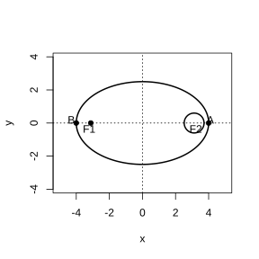
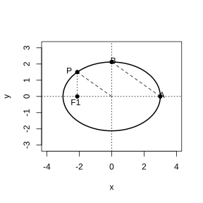
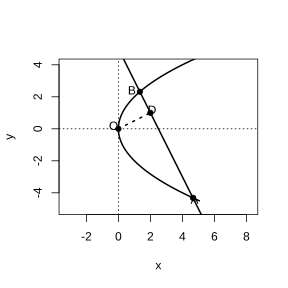
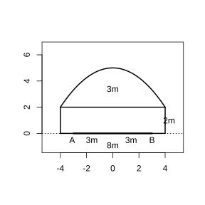
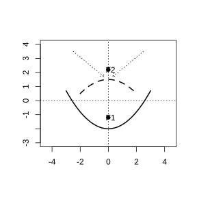

# Assignment 70

> **Definition 3.1.1** (Ellipse)  The locus of points in the plane the sum of whose distances to two fixed points $F_1$, $F_2$ equals a constant (greater than $\lvert F_1F_2 \rvert$) is called an ellipse. These two fixed points are called the foci of the ellipse, and the distance between the two foci is called the focal distance.

> **Common Conclusion 3.1.2** (Sum of Distances from a Point on the Ellipse to the Two Foci)  For any point $M$ on the ellipse, the sum of its distances to the two foci equals $2a$, i.e. $\lvert MF_1 \rvert+\lvert MF_2 \rvert=2a$.

> **Definition 3.1.3** (Standard Equation of an Ellipse)  When the foci lie on the $x$-axis the equation is $\frac{x^2}{a^2}+\frac{y^2}{b^2}=1$ ($a>b>0$), $c^2=a^2-b^2$; when the foci lie on the $y$-axis it is $\frac{y^2}{a^2}+\frac{x^2}{b^2}=1$.

> **Definition 3.1.7** (Eccentricity of an Ellipse)  $e=\frac{c}{a}$, $0<e<1$; the closer $e$ is to $1$, the flatter the ellipse.

> **Definition 3.2.1** (Hyperbola)  The locus of points in the plane the absolute value of the difference of whose distances to two fixed points $F_1$, $F_2$ equals a nonzero constant (less than $\lvert F_1F_2 \rvert$) is called a hyperbola.

> **Common Conclusion 3.2.2** (Difference of Distances from a Point on the Hyperbola to the Two Foci)  $\lvert \lvert MF_1 \rvert-\lvert MF_2 \rvert \rvert=2a$.

> **Definition 3.2.3** (Standard Equation of a Hyperbola)  When the foci lie on the $x$-axis the equation is $\frac{x^2}{a^2}-\frac{y^2}{b^2}=1$, $c^2=a^2+b^2$; when the foci lie on the $y$-axis it is $\frac{y^2}{a^2}-\frac{x^2}{b^2}=1$.

> **Definition 3.2.8** (Eccentricity of a Hyperbola)  $e=\frac{c}{a}>1$.

> **Definition 3.3.1** (Parabola)  The locus of points in the plane equidistant from a fixed point $F$ and a fixed line $l$ (where $l$ does not pass through $F$) is called a parabola.

> **Definition 3.3.2** (Standard Equation of a Parabola)  $y^2=2px$ ($p>0$), focus $\left(\frac{p}{2},0\right)$, directrix $x=-\frac{p}{2}$.

> **Common Conclusion 3.3.3** (Distances from a Point on the Parabola to the Focus and Directrix)  $\lvert MF \rvert=d$ (where $d$ is the distance from $M$ to the directrix).

### Problem 1

(Review Reference Problems 3, Review and Consolidation, Problem 1) As shown in the figure, the orbit of China's first artificial Earth satellite is an ellipse with the Earth's center $F_2$ as one focus. Its perigee $A$ is $439\,\mathrm{km}$ above the ground, its apogee $B$ is $2384\,\mathrm{km}$ above the ground, and $F_2$, $A$, $B$ are collinear; the Earth's radius is approximately $6371\,\mathrm{km}$. Find: (1) the equation of the satellite's orbit (accurate to $1\,\mathrm{km}$); (2) the eccentricity of the orbit.

{width=50%}

### Solution to Problem 1

The distance from perigee $A$ to the Earth's center is $6371+439=6810\,\mathrm{km}$, and from apogee $B$ to the Earth's center is $6371+2384=8755\,\mathrm{km}$. By **Definition 3.1.3**, $a-c=6810$, $a+c=8755$. Solving gives $a=7782.5\approx7783\,\mathrm{km}$, $c=972.5\approx973\,\mathrm{km}$.

(1) $b^2=a^2-c^2=(a-c)(a+c)=6810\times8755=59621550$. The orbit equation is

$$
\frac{x^2}{7783^2}+\frac{y^2}{59621550}=1.
$$

(2) By **Definition 3.1.7** (Eccentricity), $e=\frac{c}{a}=\frac{973}{7783}\approx0.125$. $\blacksquare$

### Problem 2

(Review Reference Problems 3, Review and Consolidation, Problem 2) Multiple choice.

(1) The ellipse $\frac{x^2}{25}+\frac{y^2}{9}=1$ and the ellipse $\frac{x^2}{25-k}+\frac{y^2}{9-k}=1$ ($k<9$) have the same $(\quad)$.

(A) major axis length    (B) minor axis length

(C) eccentricity    (D) focal distance

(2) The center of a circle externally tangent to both the circle $x^2+y^2=1$ and the circle $x^2+y^2-8x+12=0$ lies on $(\quad)$.

(A) an ellipse    (B) one branch of a hyperbola

(C) a parabola    (D) a circle

### Solution to Problem 2

(1) For $\frac{x^2}{25}+\frac{y^2}{9}=1$, $c^2=25-9=16$, $c=4$. For $\frac{x^2}{25-k}+\frac{y^2}{9-k}=1$, $c^2=(25-k)-(9-k)=16$, $c=4$. Both ellipses have focal distance $2c=8$, so the focal distances are equal. Choose (D).

(2) The circle $x^2+y^2=1$ has center $O_1(0,0)$ and radius $r_1=1$. The circle $x^2+y^2-8x+12=0$ rewrites as $(x-4)^2+y^2=4$, with center $O_2(4,0)$ and radius $r_2=2$. Let the moving circle have radius $R$; since it is externally tangent to both, $\lvert MO_1 \rvert=R+1$, $\lvert MO_2 \rvert=R+2$, so $\lvert MO_2 \rvert-\lvert MO_1 \rvert=1$. By **Definition 3.2.1** (Hyperbola), the center lies on one branch of a hyperbola. Choose (B). $\blacksquare$

### Problem 3

(Review Reference Problems 3, Review and Consolidation, Problem 3) As $\alpha$ varies from $0^{\circ}$ to $180^{\circ}$, how does the shape of the curve given by $x^2+y^2\cos\alpha=1$ change?

### Solution to Problem 3

Classify by the value of $\cos\alpha$.

(1) When $\alpha=0^{\circ}$, $\cos\alpha=1$, the equation is $x^2+y^2=1$, a unit circle.

(2) When $0^{\circ}<\alpha<90^{\circ}$, $0<\cos\alpha<1$, the equation is $\frac{x^2}{1}+\frac{y^2}{1/\cos\alpha}=1$, an ellipse with foci on the $y$-axis.

(3) When $\alpha=90^{\circ}$, $\cos\alpha=0$, the equation is $x^2=1$, i.e. $x=\pm1$, two parallel lines.

(4) When $90^{\circ}<\alpha\le180^{\circ}$, $-1\le\cos\alpha<0$, the equation is $x^2-\frac{y^2}{-1/\cos\alpha}=1$, a hyperbola with foci on the $x$-axis (when $\alpha=180^{\circ}$ it is the equilateral hyperbola $x^2-y^2=1$). $\blacksquare$

### Problem 4

(Review Reference Problems 3, Review and Consolidation, Problem 4) Given that the line $y=kx-1$ has no common point with the hyperbola $x^2-y^2=4$, find the range of $k$.

### Solution to Problem 4

Substituting $y=kx-1$ into $x^2-y^2=4$ gives $x^2-(kx-1)^2=4$, i.e. $(1-k^2)x^2+2kx-5=0$.

No common point requires no real root. When $1-k^2=0$, i.e. $k=\pm1$, the equation is linear and has one solution, which does not satisfy the condition. When $1-k^2\neq0$, the discriminant is $\Delta=4k^2+20(1-k^2)<0$, i.e. $20-16k^2<0$, $k^2>\frac{5}{4}$. Hence the range of $k$ is $k<-\frac{\sqrt{5}}{2}$ or $k>\frac{\sqrt{5}}{2}$. $\blacksquare$

### Problem 5

(Review Reference Problems 3, Review and Consolidation, Problem 5) Let the vertex of a parabola be $O$. The line through the focus perpendicular to the axis of symmetry meets the parabola at $B$, $C$. A line through a point $P$ on the parabola perpendicular to the axis of symmetry meets the axis at $Q$. Prove: $\lvert PQ \rvert^2=\lvert BC \rvert\cdot\lvert OQ \rvert$.

### Solution to Problem 5

Let the parabola be $y^2=2px$, focus $F\left(\frac{p}{2},0\right)$. The line through $F$ perpendicular to the axis (the $x$-axis) is $x=\frac{p}{2}$, which meets the parabola at $B\left(\frac{p}{2},p\right)$ and $C\left(\frac{p}{2},-p\right)$, so $\lvert BC \rvert=2p$.

Let $P(x_0,y_0)$ lie on the parabola, so $y_0^2=2px_0$. $PQ$ is perpendicular to the $x$-axis and meets the $x$-axis at $Q(x_0,0)$, so $\lvert PQ \rvert=\lvert y_0 \rvert$, $\lvert OQ \rvert=x_0$.

$\lvert PQ \rvert^2=y_0^2=2px_0$, and $\lvert BC \rvert\cdot\lvert OQ \rvert=2p\cdot x_0=2px_0$. Hence $\lvert PQ \rvert^2=\lvert BC \rvert\cdot\lvert OQ \rvert$. $\blacksquare$

### Problem 6

(Review Reference Problems 3, Review and Consolidation, Problem 6) One vertex of an equilateral triangle lies at the focus of the parabola $y^2=2px$ ($p>0$), and the other two vertices lie on the parabola. Find the side length of this equilateral triangle.

### Solution to Problem 6

The focus is $F\left(\frac{p}{2},0\right)$. Let two points $A$, $B$ on the parabola be symmetric about the $x$-axis, with $A(x_0,y_0)$, $B(x_0,-y_0)$. Then $\lvert FA \rvert=\lvert FB \rvert=\lvert AB \rvert$.

$\lvert AB \rvert=2\lvert y_0 \rvert$, and $\lvert FA \rvert=\sqrt{\left(x_0-\frac{p}{2}\right)^2+y_0^2}$. From $\lvert FA \rvert=\lvert AB \rvert$ and $y_0^2=2px_0$, we get $\left(x_0-\frac{p}{2}\right)^2+2px_0=4y_0^2=8px_0$, i.e. $x_0^2-px_0+\frac{p^2}{4}=8px_0$, i.e. $x_0^2-9px_0+\frac{p^2}{4}=0$. Solving gives $x_0=\frac{9p\pm\sqrt{80p^2}}{2}=\frac{9\pm4\sqrt{5}}{2}p$. Taking the solution with $x_0>0$, the side length is $\lvert AB \rvert=2\lvert y_0 \rvert=2\sqrt{2px_0}$. Substituting gives the side length $2p\sqrt{9+4\sqrt{5}}=2p(2\sqrt{5}+1)$. $\blacksquare$

### Problem 7

(Review Reference Problems 3, Comprehensive Application, Problem 7) Given that $P$ is a point on the ellipse $16x^2+25y^2=1600$ above the $x$-axis, with $F_1$, $F_2$ the left and right foci respectively, and the slope of the line $PF_2$ is $-\frac{4\sqrt{3}}{3}$, find the area of $\triangle PF_1F_2$.

### Solution to Problem 7

The ellipse $16x^2+25y^2=1600$ rewrites as $\frac{x^2}{100}+\frac{y^2}{64}=1$, with $a=10$, $b=8$, $c=6$. Hence $F_1(-6,0)$, $F_2(6,0)$, $\lvert F_1F_2 \rvert=12$.

The line $PF_2$ passes through $F_2(6,0)$ with slope $-\frac{4\sqrt{3}}{3}$, so its equation is $y=-\frac{4\sqrt{3}}{3}(x-6)$. Substituting into the ellipse equation to find the ordinate of $P$ gives the ordinate of $P$ as $y_P=3\sqrt{3}$ (taking the upper side). The area is $S=\frac{1}{2}\cdot\lvert F_1F_2 \rvert\cdot\lvert y_P \rvert=\frac{1}{2}\cdot12\cdot3\sqrt{3}=18\sqrt{3}$. $\blacksquare$

### Problem 8

(Review Reference Problems 3, Comprehensive Application, Problem 8) As shown in the figure, from a point $P$ on the ellipse $\frac{x^2}{a^2}+\frac{y^2}{b^2}=1$ ($a>b>0$) a perpendicular is dropped to the $x$-axis, whose foot is exactly the left focus $F_1$. Point $A$ is the intersection of the ellipse with the positive $x$-axis, and point $B$ is the intersection with the positive $y$-axis. Given $AB\parallel OP$ and $\lvert F_1A \rvert=\sqrt{10}+\sqrt{5}$, find the equation of the ellipse.

{width=50%}

### Solution to Problem 8

The foot of the perpendicular from $P$ to the $x$-axis is $F_1(-c,0)$, so $P(-c,y_P)$. Substituting into the ellipse: $\frac{c^2}{a^2}+\frac{y_P^2}{b^2}=1$, so $y_P^2=b^2\left(1-\frac{c^2}{a^2}\right)=\frac{b^4}{a^2}$, and $y_P=\frac{b^2}{a}$ ($P$ is above).

$A(a,0)$, $B(0,b)$, so $k_{AB}=-\frac{b}{a}$. Also $k_{OP}=\frac{y_P}{-c}=-\frac{b^2}{ac}$. From $AB\parallel OP$, $-\frac{b}{a}=-\frac{b^2}{ac}$, giving $b=c$. Moreover $a^2=b^2+c^2=2c^2$, so $a=\sqrt{2}c$.

$\lvert F_1A \rvert=a+c=\sqrt{10}+\sqrt{5}$, i.e. $c(\sqrt{2}+1)=\sqrt{5}(\sqrt{2}+1)$, so $c=\sqrt{5}$. Hence $b=\sqrt{5}$, $a=\sqrt{10}$. The ellipse equation is

$$
\frac{x^2}{10}+\frac{y^2}{5}=1.
$$

$\blacksquare$

### Problem 9

(Review Reference Problems 3, Comprehensive Application, Problem 9) Given that the coordinates of points $A$, $B$ are $(-1,0)$ and $(1,0)$ respectively, the lines $AM$ and $BM$ meet at point $M$, and the sum of their slopes is $2$. Find the equation of the locus of point $M$.

### Solution to Problem 9

Let $M(x,y)$. Then $k_{AM}=\frac{y}{x+1}$, $k_{BM}=\frac{y}{x-1}$. By the condition, $\frac{y}{x+1}+\frac{y}{x-1}=2$, i.e.

$$
y\cdot\frac{2x}{x^2-1}=2.
$$

Simplifying gives $xy=x^2-1$, i.e. $x^2-xy-1=0$. The locus equation is $x^2-xy=1$ ($x\neq\pm1$). $\blacksquare$

### Problem 10

(Review Reference Problems 3, Extension and Exploration, Problem 10) As shown in the figure, a line intersects the parabola $y^2=2px$ ($p>0$) at $A$, $B$, with $OA\perp OB$ and $OD\perp AB$ meeting $AB$ at $D$, and the coordinates of $D$ are $(2,1)$. Find the value of $p$.

{width=50%}

### Solution to Problem 10

$D(2,1)$ lies on $AB$. The slope of $OD$ is $\frac{1}{2}$, and $OD\perp AB$, so the slope of $AB$ is $-2$. The equation of $AB$ is $y-1=-2(x-2)$, i.e. $y=-2x+5$.

Let $A(x_1,y_1)$, $B(x_2,y_2)$. Since $OA\perp OB$, $x_1x_2+y_1y_2=0$. Substituting $y=-2x+5$ into $y^2=2px$ gives $(-2x+5)^2=2px$, i.e. $4x^2-(20+2p)x+25=0$. Hence $x_1x_2=\frac{25}{4}$, $x_1+x_2=\frac{20+2p}{4}$.

$y_1y_2=(-2x_1+5)(-2x_2+5)=4x_1x_2-10(x_1+x_2)+25=25-\frac{10(20+2p)}{4}+25=50-5(10+p)=-5p$.

From $x_1x_2+y_1y_2=0$, we get $\frac{25}{4}-5p=0$, so $p=\frac{5}{4}$. $\blacksquare$

### Problem 11

(Review Reference Problems 3, Extension and Exploration, Problem 11) Given that two vertices $A$, $B$ of $\triangle ABC$ have coordinates $(-5,0)$ and $(5,0)$ respectively, and the product of the slopes of lines $AC$ and $BC$ equals $m$ ($m\neq0$), find the locus of vertex $C$.

### Solution to Problem 11

Let $C(x,y)$. Then $k_{AC}=\frac{y}{x+5}$, $k_{BC}=\frac{y}{x-5}$. By the condition, $\frac{y^2}{x^2-25}=m$, i.e.

$$
\frac{x^2}{25}-\frac{y^2}{25m}=1.
$$

When $m>0$, the locus is a hyperbola with foci on the $x$-axis (excluding the two points $A$, $B$); when $m<0$, the locus is an ellipse (excluding the two points $A$, $B$). $\blacksquare$

### Problem 12

(Review Reference Problems 3, Extension and Exploration, Problem 12) Find a point $P$ on the parabola $y^2=4x$ such that the distance from $P$ to the line $y=x+3$ is minimized.

### Solution to Problem 12

Let $P(x_0,y_0)$ lie on $y^2=4x$, so $x_0=\frac{y_0^2}{4}$. The distance from $P$ to the line $x-y+3=0$ is

$$
d=\frac{\left|x_0-y_0+3\right|}{\sqrt{2}}=\frac{\left|\frac{y_0^2}{4}-y_0+3\right|}{\sqrt{2}}.
$$

Since $\frac{y_0^2}{4}-y_0+3=\frac{1}{4}(y_0-2)^2+2>0$, we have $d=\frac{\frac{1}{4}(y_0-2)^2+2}{\sqrt{2}}$. $d$ is minimized when $y_0=2$, giving $x_0=1$. The point $P$ is $(1,2)$. $\blacksquare$

### Problem 13

(Review Reference Problems 3, Extension and Exploration, Problem 13) As $m$ varies, describe the shape of the curve given by the equation $(m-1)x^2+(3-m)y^2=(m-1)(3-m)$.

### Solution to Problem 13

Dividing both sides by $(m-1)(3-m)$ (assuming $m\neq1$, $m\neq3$) gives

$$
\frac{x^2}{3-m}+\frac{y^2}{m-1}=1.
$$

(1) When $m=1$, the equation is $2y^2=0$, i.e. $y=0$, a single line.

(2) When $m=3$, the equation is $2x^2=0$, i.e. $x=0$, a single line.

(3) When $1<m<3$, both denominators are positive, so the curve is an ellipse (when $3-m=m-1$, i.e. $m=2$, it is a circle).

(4) When $m<1$, $3-m>0$ and $m-1<0$, so the curve is a hyperbola with foci on the $x$-axis.

(5) When $m>3$, $3-m<0$ and $m-1>0$, so the curve is a hyperbola with foci on the $y$-axis. $\blacksquare$

### Problem 14

(Review Reference Problems 3, Extension and Exploration, Problem 14) As shown in the figure, a tunnel carries a two-lane road, and its cross-section consists of a rectangle and a parabola. For safety, the vertical clearance between the top of a vehicle (assumed flat-roofed) and the tunnel ceiling must be at least $0.5\,\mathrm{m}$. Given that the total roadway width is $AB=6\,\mathrm{m}$, what is the height limit for vehicles passing through the tunnel? (Accurate to $0.1\,\mathrm{m}$)

{width=50%}

### Solution to Problem 14

From the dimensions in the figure, the parabolic part is $8\,\mathrm{m}$ wide and $3\,\mathrm{m}$ high (the rectangular part is $2\,\mathrm{m}$ high, and the parabola rises $3\,\mathrm{m}$ above the rectangle). Taking the parabola's vertex as the origin and opening downward, set $x^2=-2py$. The parabola passes through $(4,-3)$, so $16=6p$, giving $p=\frac{8}{3}$, and the equation is $x^2=-\frac{16}{3}y$.

The roadway is $6\,\mathrm{m}$ wide, i.e. $x=\pm3$. Substituting: $9=-\frac{16}{3}y$, so $y=-\frac{27}{16}\approx-1.69$. At $x=3$, the parabola is $1.69\,\mathrm{m}$ below the vertex. The rectangle is $2\,\mathrm{m}$ high, so the total tunnel height at the roadway edge is $2+1.69=3.69\,\mathrm{m}$. Requiring a clearance of at least $0.5\,\mathrm{m}$, the height limit is $3.69-0.5\approx3.2\,\mathrm{m}$. $\blacksquare$

### Problem 15

(Review Reference Problems 3, Extension and Exploration, Problem 15) By combining the optical properties of the parabola and the hyperbola, one can design a reflecting astronomical telescope. Given that $F_1$, $F_2$ are the two foci of a hyperbola, and $F_2$ is also the focus of a parabola, find the equations of the parabola and the hyperbola based on the dimensions in the figure (unit: $\mathrm{mm}$).

{width=50%}

### Solution to Problem 15

From the dimensions in the figure, take the intersection of the two axes of symmetry as the origin. The parabola has its vertex at the origin and opens to the left, with $F_2$ as its focus. The focal parameter $p$ is obtained from the $529\,\mathrm{mm}$ in the figure: $\frac{p}{2}=529$, so $p=1058$. The parabola equation is $y^2=-2116x$.

The hyperbola has foci $F_1$, $F_2$, so $2c=2080$, $c=1040$. From the $1763\,\mathrm{mm}$ in the figure giving the position of the real-axis vertex, $a=1040-529=511$. Then $b^2=c^2-a^2=1040^2-511^2=828479$. The hyperbola equation is

$$
\frac{x^2}{261121}-\frac{y^2}{828479}=1.
$$

$\blacksquare$

### Problem 16

(Review Reference Problems 3, Extension and Exploration, Problem 16) Through the focus $F$ of the parabola $y^2=2px$ ($p>0$) draw a line meeting the parabola at $A$, $B$. Draw a circle with $AB$ as diameter, and observe its relation to the directrix $l$ of the parabola. What conclusion can you draw? What about the corresponding cases for the ellipse and the hyperbola? Can you prove your conclusions?

### Solution to Problem 16

Let $AB$ be the chord through the focus $F$, with midpoint $M$. By **Common Conclusion 3.3.3**, $\lvert AF \rvert=d_A$ (the distance from $A$ to the directrix), and $\lvert BF \rvert=d_B$. The circle has radius $r=\frac{\lvert AB \rvert}{2}=\frac{\lvert AF \rvert+\lvert BF \rvert}{2}=\frac{d_A+d_B}{2}$.

The distance from the center $M$ to the directrix is $d_M=\frac{d_A+d_B}{2}=r$. Hence the circle with $AB$ as diameter is tangent to the directrix.

Correspondingly, for an ellipse, the circle with a focal chord as diameter is disjoint from the corresponding directrix; for a hyperbola, the circle with a focal chord as diameter intersects the corresponding directrix. $\blacksquare$
