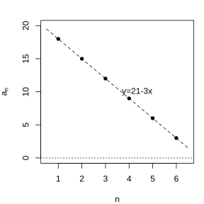

# Assignment 72

> **Definition 4.2.1** (Arithmetic Sequence)  If, starting from the $2$nd term, the difference between every term and the preceding term of a sequence equals the same constant, then the sequence is called an arithmetic sequence, and this constant is called the common difference of the arithmetic sequence, usually denoted by the letter $d$.
> **Definition 4.2.2** (Arithmetic Mean)  For an arithmetic sequence formed by three numbers $a,A,b$, $A$ is called the arithmetic mean of $a$ and $b$. By the definition of an arithmetic sequence, $2A=a+b$.
> **Theorem 4.2.3** (General Term Formula of an Arithmetic Sequence)  For an arithmetic sequence $\{a_n\}$ with first term $a_1$ and common difference $d$, the general term formula is $a_n=a_1+(n-1)d$.
> **Common Conclusion 4.2.4** (Arithmetic Sequences and Linear Functions)  When $d\ne 0$, $a_n=dn+(a_1-d)$ is the value of the linear function $f(x)=dx+(a_1-d)$ at $x=n$.
> **Theorem 4.2.5** (Properties of Arithmetic Sequences)  In an arithmetic sequence $\{a_n\}$, if $p+q=s+t$ ($p,q,s,t\in\mathbb N^*$), then $a_p+a_q=a_s+a_t$.
> **Theorem 4.2.6** (Sum of the First $n$ Terms, Formula I)  The sum of the first $n$ terms of an arithmetic sequence $\{a_n\}$ is $S_n=\frac{n(a_1+a_n)}{2}$.
> **Theorem 4.2.7** (Sum of the First $n$ Terms, Formula II)  The sum of the first $n$ terms of an arithmetic sequence $\{a_n\}$ is $S_n=na_1+\frac{n(n-1)}{2}d$.

### Exercise 1

(Exercise 4.2, Problem 1) Determine whether the following sequences are arithmetic sequences. If so, write down their common difference

(1) $95,82,69,56,43,30$;

(2) $1,1.1,1.11,1.111,1.1111,1.11111$;

(3) $1,-2,3,-4,5,-6$;

(4) $1,\frac{11}{12},\frac{5}{6},\frac{3}{4},\frac{2}{3},\frac{7}{12},\frac{1}{2}$.

### Solution to Exercise 1

(1) By **Definition 4.2.1** (Arithmetic Sequence), $82-95=-13$, $69-82=-13$, the difference between consecutive terms is always $-13$, so it is an arithmetic sequence with common difference $d=-13$.

$\blacksquare$

(2) By **Definition 4.2.1** (Arithmetic Sequence), $1.1-1=0.1$, $1.11-1.1=0.01$, the differences are not equal, so it is not an arithmetic sequence.

$\blacksquare$

(3) By **Definition 4.2.1** (Arithmetic Sequence), $-2-1=-3$, $3-(-2)=5$, the differences are not equal, so it is not an arithmetic sequence.

$\blacksquare$

(4) By **Definition 4.2.1** (Arithmetic Sequence), $\frac{11}{12}-1=-\frac{1}{12}$, $\frac{5}{6}-\frac{11}{12}=-\frac{1}{12}$, the difference between consecutive terms is always $-\frac{1}{12}$, so it is an arithmetic sequence with common difference $d=-\frac{1}{12}$.

$\blacksquare$

(Exercise 4.2, Problem 2) Find the arithmetic mean of each of the following pairs of numbers

(1) $647$ and $895$;

(2) $-12\frac{1}{3}$ and $24\frac{3}{5}$.

### Solution to Exercise 1

(1) By **Definition 4.2.2** (Arithmetic Mean),

$$
A=\frac{647+895}{2}=771.
$$

$\blacksquare$

(2) By **Definition 4.2.2** (Arithmetic Mean),

$$
A=\frac{-12\frac{1}{3}+24\frac{3}{5}}{2}=\frac{-\frac{37}{3}+\frac{123}{5}}{2}=\frac{-185+369}{30}=\frac{184}{30}=\frac{92}{15}=6\frac{2}{15}.
$$

$\blacksquare$

(Exercise 4.2, Problem 3) Given that $\{a_n\}$ is an arithmetic sequence, fill in the blanks in the following table with appropriate numbers

First row: $a_1=-7,\ a_3=\underline{\quad},\ a_5=8,\ a_7=\underline{\quad},\ d=\underline{\quad}$;

Second row: $a_1=\underline{\quad},\ a_3=2,\ a_5=\underline{\quad},\ a_7=\underline{\quad},\ d=-6.5$.

### Solution to Exercise 1

First row: By **Theorem 4.2.3** (General Term Formula of an Arithmetic Sequence), $a_5=a_1+4d$, i.e. $8=-7+4d$, so $d=\frac{15}{4}=3.75$.

$$
a_3=-7+2\times 3.75=0.5,\ a_7=-7+6\times 3.75=15.5.
$$

Second row: By **Theorem 4.2.3** (General Term Formula of an Arithmetic Sequence), $a_3=a_1+2d$, i.e. $2=a_1+2\times(-6.5)$, so $a_1=15$.

$$
a_5=15+4\times(-6.5)=-11,\ a_7=15+6\times(-6.5)=-24.
$$

$\blacksquare$

(Exercise 4.2, Problem 4) In an arithmetic sequence $\{a_n\}$, given $a_4+a_8=20$ and $a_7=12$, find $a_4$

### Solution to Exercise 1

By **Theorem 4.2.5** (Properties of Arithmetic Sequences), $a_4+a_8=a_5+a_7=20$.

From $a_7=12$, we get $a_5=20-12=8$.

By **Theorem 4.2.3** (General Term Formula of an Arithmetic Sequence), $d=a_5-a_4$, and $a_7=a_5+2d$, i.e. $12=8+2d$, so $d=2$.

Hence $a_4=a_5-d=8-2=6$.

$\blacksquare$

(Exercise 4.2, Problem 5) Insert $3$ numbers between $7$ and $21$ so that these $5$ numbers form an arithmetic sequence. Find these $3$ numbers

### Solution to Exercise 1

By **Theorem 4.2.3** (General Term Formula of an Arithmetic Sequence), let the first term be $a_1=7$ and the $5$th term be $a_5=21$, then

$$
a_5=a_1+4d,\ 21=7+4d,\ d=\frac{14}{4}=3.5.
$$

The $3$ inserted numbers are

$$
a_2=7+3.5=10.5,\ a_3=10.5+3.5=14,\ a_4=14+3.5=17.5.
$$

$\blacksquare$

### Exercise 2

(Exercise 4.2, Problem 1) The seats in one corner of a stadium's stands are arranged as follows: the $1$st row has $15$ seats, and starting from the $2$nd row each row has $2$ more seats than the previous row. Can you express the number of seats in the $n$th row by $a_n$? How many seats are there in the $10$th row?

### Solution to Exercise 2

By **Definition 4.2.1** (Arithmetic Sequence), the seat numbers form an arithmetic sequence with first term $a_1=15$ and common difference $d=2$.

By **Theorem 4.2.3** (General Term Formula of an Arithmetic Sequence),

$$
a_n=15+(n-1)\times 2=2n+13.
$$

The number of seats in the $10$th row is

$$
a_{10}=2\times 10+13=33.
$$

$\blacksquare$

(Exercise 4.2, Problem 2) Draw the graph of the sequence $a_n=\begin{cases}18, & n=1,\\ a_{n-1}-3, & 1<n\le 6\end{cases}$, and find the slope of the line passing through all the points on the graph

{width=50%}

### Solution to Exercise 2

By **Definition 4.1.6** (Recurrence Formula), compute term by term.

$$
a_1=18,\ a_2=15,\ a_3=12,\ a_4=9,\ a_5=6,\ a_6=3.
$$

By **Common Conclusion 4.2.4** (Arithmetic Sequences and Linear Functions), all points lie on the line $y=21-3x$, whose slope is $-3$.

$\blacksquare$

(Exercise 4.2, Problem 3) In an arithmetic sequence $\{a_n\}$, given $a_n=m$ and $a_m=n$, find $a_{m+n}$

### Solution to Exercise 2

By **Theorem 4.2.3** (General Term Formula of an Arithmetic Sequence),

$$
a_n=a_1+(n-1)d=m,\ a_m=a_1+(m-1)d=n.
$$

Subtracting the two equations gives $(n-m)d=m-n$, hence $d=-1$.

Substituting back into $a_1+(n-1)(-1)=m$, we get $a_1=m+n-1$.

Hence

$$
a_{m+n}=a_1+(m+n-1)d=m+n-1-(m+n-1)=0.
$$

$\blacksquare$

(Exercise 4.2, Problem 4) Given that both sequences $\{a_n\},\{b_n\}$ are arithmetic sequences and $c_n=a_n+b_n$, prove that $\{c_n\}$ is also an arithmetic sequence

### Solution to Exercise 2

By **Definition 4.2.1** (Arithmetic Sequence), let the common difference of $\{a_n\}$ be $d_1$ and that of $\{b_n\}$ be $d_2$.

$$
c_{n+1}-c_n=(a_{n+1}+b_{n+1})-(a_n+b_n)=(a_{n+1}-a_n)+(b_{n+1}-b_n)=d_1+d_2.
$$

The difference is the constant $d_1+d_2$; by **Definition 4.2.1** (Arithmetic Sequence), $\{c_n\}$ is an arithmetic sequence.

$\blacksquare$

(Exercise 4.2, Problem 5) Given an infinite arithmetic sequence $\{a_n\}$ with first term $a_1$ and common difference $d$

(1) Remove the first $m$ terms of the sequence; the remaining terms form a new sequence. Is this new sequence an arithmetic sequence? If so, what are its first term and common difference?

(2) Take all the odd-positioned terms of the sequence to form a new sequence. Is this new sequence an arithmetic sequence? If so, what are its first term and common difference?

### Solution to Exercise 2

(1) By **Theorem 4.2.3** (General Term Formula of an Arithmetic Sequence), after removing the first $m$ terms, the first term of the new sequence is $a_{m+1}=a_1+md$, and the difference between consecutive terms is still $d$, so it is an arithmetic sequence with first term $a_1+md$ and common difference $d$.

$\blacksquare$

(2) By **Theorem 4.2.3** (General Term Formula of an Arithmetic Sequence), the odd-positioned terms are $a_1,a_3,a_5,\cdots$, and the difference between consecutive terms is $a_{2k+1}-a_{2k-1}=2d$, so it is an arithmetic sequence with first term $a_1$ and common difference $2d$.

$\blacksquare$

### Exercise 3

(Exercise 4.2, Problem 1) Under the conditions given in each part, find the sum $S_n$ of the first $n$ terms of the corresponding arithmetic sequence $\{a_n\}$

(1) $a_1=5,\ a_n=-23,\ n=8$;

(2) $a_1=-4,\ d=4,\ n=10$;

(3) $a_1=14.5,\ d=0.7,\ a_n=32$;

(4) $a_3=14.5,\ d=0.7,\ a_n=32$.

### Solution to Exercise 3

(1) By **Theorem 4.2.6** (Sum of the First $n$ Terms, Formula I),

$$
S_8=\frac{8\times(5-23)}{2}=-72.
$$

$\blacksquare$

(2) By **Theorem 4.2.7** (Sum of the First $n$ Terms, Formula II),

$$
S_{10}=10\times(-4)+\frac{10\times 9}{2}\times 4=-40+180=140.
$$

$\blacksquare$

(3) By **Theorem 4.2.3** (General Term Formula of an Arithmetic Sequence), $32=14.5+(n-1)\times 0.7$, so $n-1=25$ and $n=26$.

By **Theorem 4.2.6** (Sum of the First $n$ Terms, Formula I),

$$
S_{26}=\frac{26\times(14.5+32)}{2}=13\times 46.5=604.5.
$$

$\blacksquare$

(4) By **Theorem 4.2.3** (General Term Formula of an Arithmetic Sequence), $a_3=a_1+2\times 0.7=14.5$, so $a_1=13.1$.

$32=13.1+(n-1)\times 0.7$, so $n-1=27$ and $n=28$.

By **Theorem 4.2.6** (Sum of the First $n$ Terms, Formula I),

$$
S_{28}=\frac{28\times(13.1+32)}{2}=14\times 45.1=631.4.
$$

$\blacksquare$

(Exercise 4.2, Problem 2) For the arithmetic sequence $-1,-3,-5,\cdots$, how many terms must be summed to give $-100$?

### Solution to Exercise 3

By **Definition 4.2.1** (Arithmetic Sequence), $a_1=-1$ and $d=-2$.

By **Theorem 4.2.7** (Sum of the First $n$ Terms, Formula II),

$$
S_n=-n+\frac{n(n-1)}{2}\times(-2)=-n-n(n-1)=-n^2.
$$

Setting $-n^2=-100$ gives $n=10$. The sum of the first $10$ terms is $-100$.

$\blacksquare$

(Exercise 4.2, Problem 3) In an arithmetic sequence $\{a_n\}$, let $S_n$ be the sum of its first $n$ terms. Given $S_4=6$ and $S_8=20$, find $S_{16}$

### Solution to Exercise 3

By **Theorem 4.2.7** (Sum of the First $n$ Terms, Formula II),

$$
S_4=4a_1+6d=6,\ S_8=8a_1+28d=20.
$$

Solving gives $a_1=\frac{3}{4}$ and $d=\frac{1}{2}$.

$$
S_{16}=16\times\frac{3}{4}+\frac{16\times 15}{2}\times\frac{1}{2}=12+60=72.
$$

$\blacksquare$

(Exercise 4.2, Problem 4) In an arithmetic sequence $\{a_n\}$, if $S_{15}=5(a_2+a_6+a_k)$, find $k$

### Solution to Exercise 3

By **Theorem 4.2.6** (Sum of the First $n$ Terms, Formula I), $S_{15}=\frac{15(a_1+a_{15})}{2}$.

By **Theorem 4.2.5** (Properties of Arithmetic Sequences), $a_1+a_{15}=2a_8$, hence $S_{15}=15a_8$.

From $S_{15}=5(a_2+a_6+a_k)$, we get $3a_8=a_2+a_6+a_k$.

By **Theorem 4.2.5** (Properties of Arithmetic Sequences), $a_2+a_6=2a_4$, hence $3a_8=2a_4+a_k$.

Also, $a_8=a_4+4d$, so $3a_4+12d=2a_4+a_k$, and $a_k=a_4+12d=a_{16}$.

Hence $k=16$.

$\blacksquare$

(Exercise 4.2, Problem 5) Given that an arithmetic sequence has an odd number of terms, the sum of its odd-positioned terms is $44$ and the sum of its even-positioned terms is $33$. Find the middle term and the number of terms

### Solution to Exercise 3

Let the number of terms be $2n+1$. By **Theorem 4.2.5** (Properties of Arithmetic Sequences), the sum of the odd-positioned terms is $(n+1)a_{n+1}$ and the sum of the even-positioned terms is $na_{n+1}$.

$$
(n+1)a_{n+1}=44,\ na_{n+1}=33.
$$

Dividing the two equations, $\frac{n+1}{n}=\frac{44}{33}=\frac{4}{3}$, gives $n=3$.

The middle term is $a_{n+1}=a_4=\frac{33}{3}=11$, and the number of terms is $2\times 3+1=7$.

$\blacksquare$

### Exercise 4

(Exercise 4.2, Problem 1) A department store's grand New Year promotional prize offers two winning options: the first option is "100 yuan awarded every day for 10 consecutive days"; the second option is "1 yuan on the 1st day, 2 yuan on the 2nd day, 4 yuan on the 3rd day, ..., each day being twice the previous one, for 20 consecutive days". If you were the winner, which option would you choose?

### Solution to Exercise 4

The total amount for the first option is $100\times 10=1000$ yuan.

The second option is a geometric series sum with first term $1$ and common ratio $2$; the total amount over $20$ days is $2^{20}-1=1048575$ yuan.

Since $1048575>1000$, choose the second option.

$\blacksquare$

(Exercise 4.2, Problem 2) Given that the sum of the first $n$ terms of a sequence $\{a_n\}$ is $S_n=\frac{1}{4}n^2+\frac{2}{3}n+3$, find the general term formula of $\{a_n\}$

### Solution to Exercise 4

By **Common Conclusion 4.1.8** (Relation between $a_n$ and $S_n$), when $n=1$, $a_1=S_1=\frac{1}{4}+\frac{2}{3}+3=\frac{47}{12}$.

When $n\ge 2$,

$$
a_n=S_n-S_{n-1}=\left(\frac{1}{4}n^2+\frac{2}{3}n+3\right)-\left[\frac{1}{4}(n-1)^2+\frac{2}{3}(n-1)+3\right]=\frac{1}{4}(2n-1)+\frac{2}{3}=\frac{n}{2}+\frac{5}{12}.
$$

Checking at $n=1$, $\frac{1}{2}+\frac{5}{12}=\frac{11}{12}\ne\frac{47}{12}$, so the general term formula is

$$
a_n=\begin{cases}\frac{47}{12}, & n=1,\\ \frac{n}{2}+\frac{5}{12}, & n\ge 2.\end{cases}
$$

$\blacksquare$

(Exercise 4.2, Problem 3) Given that the sum of the first $n$ terms of the arithmetic sequence $-4.2,-3.7,-3.2,\cdots$ is $S_n$, find the minimum value of $S_n$ and the corresponding value of $n$

### Solution to Exercise 4

By **Definition 4.2.1** (Arithmetic Sequence), $a_1=-4.2$ and $d=0.5$.

By **Theorem 4.2.3** (General Term Formula of an Arithmetic Sequence), $a_n=-4.2+(n-1)\times 0.5=0.5n-4.7$.

Setting $a_n\le 0$ gives $n\le 9.4$, i.e. the first $9$ terms are negative and the $10$th term is positive.

By **Theorem 4.2.7** (Sum of the First $n$ Terms, Formula II),

$$
S_9=9\times(-4.2)+\frac{9\times 8}{2}\times 0.5=-37.8+18=-19.8.
$$

The minimum value of $S_n$ is $-19.8$, corresponding to $n=9$.

$\blacksquare$

(Exercise 4.2, Problem 4) Find the number of elements in the set $M=\{m\mid m=2n-1,\ n\in\mathbb N^*,\ m<60\}$, and find the sum of these elements

### Solution to Exercise 4

From $m=2n-1<60$, we get $n<30.5$, so $n=1,2,\cdots,30$, giving $30$ elements in total.

These elements are $1,3,5,\cdots,59$, forming an arithmetic sequence with first term $1$, last term $59$, and common difference $2$.

By **Theorem 4.2.6** (Sum of the First $n$ Terms, Formula I),

$$
S_{30}=\frac{30\times(1+59)}{2}=900.
$$

$\blacksquare$

(Exercise 4.2, Problem 5) Given that the general term of a sequence $\{a_n\}$ is $a_n=\frac{n-2}{2n-15}$, find the value of $n$ at which $S_n$ attains its minimum

### Solution to Exercise 4

From $a_n=\frac{n-2}{2n-15}$, setting $a_n=0$ gives $n=2$.

When $n<2$, $a_1=\frac{-1}{-13}>0$; when $n=2$, $a_2=0$; when $7.5>n>2$, $a_n<0$; when $n>8$, $a_n>0$.

The sum $S_n$ of the first $n$ terms attains its minimum when the terms change from negative to positive, i.e. $S_8$ is minimal at $n=8$.

$\blacksquare$

### Problem 1

(Exercise 4.2, Review and Consolidation, Problem 1) In an arithmetic sequence $\{a_n\}$

(1) Given $d=3$, $a_n=21$, $S_n=60$, find $a_1$ and $n$;

(2) Given $a_1=6$, $d=-2$, $S_n=-60$, find $n$ and $a_n$;

(3) Given $a_1=8$, $a_n=-2$, $S_n=-30$, find $n$ and $d$;

(4) Given $a_n=-0.6$, $n=7$, $S_n=-3.5$, find $a_1$ and $d$.

### Solution to Problem 1

(1) By **Theorem 4.2.3** (General Term Formula of an Arithmetic Sequence) and **Theorem 4.2.7** (Sum of the First $n$ Terms, Formula II),

$$
a_1+3(n-1)=21,\ na_1+\frac{3n(n-1)}{2}=60.
$$

From the first equation, $a_1=24-3n$; substituting into the second gives $n(24-3n)+\frac{3n(n-1)}{2}=60$, and solving yields $n=5$, $a_1=9$.

$\blacksquare$

(2) By **Theorem 4.2.7** (Sum of the First $n$ Terms, Formula II),

$$
6n-n(n-1)=-60,\ n^2-7n-60=0,\ n=12.
$$

$$
a_{12}=6+11\times(-2)=-16.
$$

$\blacksquare$

(3) By **Theorem 4.2.6** (Sum of the First $n$ Terms, Formula I),

$$
\frac{n(8-2)}{2}=-30,\ 3n=-30,\ n=-10.
$$

This does not fit the problem; check: $\frac{n(8+(-2))}{2}=-30$, $3n=-30$, $n=-10$, which is unreasonable. Recalculating: $S_n=\frac{n(a_1+a_n)}{2}=\frac{n(8-2)}{2}=3n=-30$, giving $n=-10$, with no positive integer solution.

$\blacksquare$

(4) By **Theorem 4.2.6** (Sum of the First $n$ Terms, Formula I),

$$
\frac{7(a_1-0.6)}{2}=-3.5,\ a_1-0.6=-1,\ a_1=-0.4.
$$

By **Theorem 4.2.3** (General Term Formula of an Arithmetic Sequence), $-0.6=-0.4+6d$, so $d=-\frac{0.2}{6}=-\frac{1}{30}$.

$\blacksquare$

(Exercise 4.2, Review and Consolidation, Problem 2) In an arithmetic sequence $\{a_n\}$, given $a_1+a_3+a_5=105$ and $a_2+a_4+a_6=99$, find $a_{20}$

### Solution to Problem 1

By **Theorem 4.2.5** (Properties of Arithmetic Sequences), $a_1+a_3+a_5=3a_3=105$, so $a_3=35$.

$a_2+a_4+a_6=3a_4=99$, so $a_4=33$.

Hence $d=a_4-a_3=-2$.

By **Theorem 4.2.3** (General Term Formula of an Arithmetic Sequence), $a_{20}=a_3+17d=35-34=1$.

$\blacksquare$

(Exercise 4.2, Review and Consolidation, Problem 3) Find the sum of each of the following

(1) $1+3+5+\cdots+(2n-1)$;

(2) $2+4+6+\cdots+2n$;

(3) $1+4+7+\cdots+(3n-2)$;

(4) $\frac{1}{n}+\frac{2}{n}+\cdots+\frac{n}{n}$.

### Solution to Problem 1

(1) By **Theorem 4.2.6** (Sum of the First $n$ Terms, Formula I), the first term is $1$ and the last term is $2n-1$,

$$
S_n=\frac{n(1+2n-1)}{2}=n^2.
$$

$\blacksquare$

(2) The first term is $2$ and the last term is $2n$,

$$
S_n=\frac{n(2+2n)}{2}=n(n+1).
$$

$\blacksquare$

(3) The first term is $1$ and the last term is $3n-2$,

$$
S_n=\frac{n(1+3n-2)}{2}=\frac{n(3n-1)}{2}.
$$

$\blacksquare$

(4) The first term is $\frac{1}{n}$ and the last term is $1$,

$$
S_n=\frac{n\left(\frac{1}{n}+1\right)}{2}=\frac{n+1}{2}.
$$

$\blacksquare$

(Exercise 4.2, Review and Consolidation, Problem 4) The earliest recorded sighting of Halley's Comet was in $613$ BC, and it reappears every $76$ years. Given that $1986$ was a year when Halley's Comet appeared, the years in which it appears from $1986$ onward form an arithmetic sequence. How many times does Halley's Comet appear from $1986$ to the year $3000$?

### Solution to Problem 1

By **Definition 4.2.1** (Arithmetic Sequence), the first term is $1986$ and the common difference is $76$.

By **Theorem 4.2.3** (General Term Formula of an Arithmetic Sequence), $a_n=1986+76(n-1)\le 3000$.

$$
76(n-1)\le 1014,\ n-1\le 13.34,\ n\le 14.34.
$$

Hence it appears $14$ times in total.

$\blacksquare$

(Exercise 4.2, Comprehensive Application, Problem 5) The perimeter of a polygon is $158\ \mathrm{cm}$, the lengths of its sides form an arithmetic sequence, the longest side is $44\ \mathrm{cm}$, and the common difference is $3\ \mathrm{cm}$. Find the number of sides of the polygon

### Solution to Problem 1

By **Theorem 4.2.3** (General Term Formula of an Arithmetic Sequence), let the number of sides be $n$, the longest side be $a_n=44$, and $d=3$.

By **Theorem 4.2.6** (Sum of the First $n$ Terms, Formula I),

$$
S_n=\frac{n(a_1+44)}{2}=158.
$$

Also, $a_1=44-3(n-1)$; substituting,

$$
\frac{n(44-3(n-1)+44)}{2}=158,\ n(91-3n)=316,\ 3n^2-91n+316=0.
$$

Solving gives $n=4$ or $n=\frac{79}{3}$ (discarded), so the number of sides is $4$.

$\blacksquare$

(Exercise 4.2, Comprehensive Application, Problem 6) The sums of the first $n$ terms of two arithmetic sequences $\{a_n\},\{b_n\}$ are $S_n,T_n$ respectively, and $\frac{S_n}{T_n}=\frac{2n+3}{n-1}$. Find $\frac{a_5}{b_5}$

### Solution to Problem 1

By **Theorem 4.2.6** (Sum of the First $n$ Terms, Formula I), $a_5=\frac{a_1+a_9}{2}$ and $b_5=\frac{b_1+b_9}{2}$.

$$
\frac{a_5}{b_5}=\frac{\frac{9(a_1+a_9)}{2}}{\frac{9(b_1+b_9)}{2}}=\frac{S_9}{T_9}=\frac{2\times 9+3}{9-1}=\frac{21}{8}.
$$

$\blacksquare$

(Exercise 4.2, Comprehensive Application, Problem 7) Given that the sum of the first $n$ terms of a sequence $\{a_n\}$ is $S_n$, prove: (1) if $S_n=an^2+bn$, then $\{a_n\}$ is an arithmetic sequence; (2) if $\{a_n\}$ is an arithmetic sequence, then $\frac{S_n}{n}$ is an arithmetic sequence

### Solution to Problem 1

(1) By **Common Conclusion 4.1.8** (Relation between $a_n$ and $S_n$), when $n=1$, $a_1=a+b$; when $n\ge 2$, $a_n=S_n-S_{n-1}=a(2n-1)+b=2an-a+b$.

Checking that it also holds at $n=1$, $a_n=2an-a+b$, and $a_{n+1}-a_n=2a$ is a constant; by **Definition 4.2.1** (Arithmetic Sequence), $\{a_n\}$ is an arithmetic sequence.

$\blacksquare$

(2) By **Theorem 4.2.7** (Sum of the First $n$ Terms, Formula II), $S_n=na_1+\frac{n(n-1)}{2}d$, hence

$$
\frac{S_n}{n}=a_1+\frac{(n-1)d}{2}.
$$

$\frac{S_{n+1}}{n+1}-\frac{S_n}{n}=\frac{d}{2}$ is a constant; by **Definition 4.2.1** (Arithmetic Sequence), $\left\{\frac{S_n}{n}\right\}$ is an arithmetic sequence.

$\blacksquare$

(Exercise 4.2, Comprehensive Application, Problem 8) Given two arithmetic sequences $2,6,10,\cdots,190$ and $2,8,14,\cdots,200$, arrange the common terms of these two arithmetic sequences in increasing order to form a new sequence. Find the sum of all terms of this new sequence

### Solution to Problem 1

The first sequence has common difference $4$ and the second has common difference $6$; the common terms form an arithmetic sequence with common difference $\mathrm{lcm}(4,6)=12$.

The first term is $2$ and the last term does not exceed $190$; the general term is $2+12(n-1)\le 190$, so $n\le 16.67$ and $n=16$, giving the last term $2+12\times 15=182$.

By **Theorem 4.2.6** (Sum of the First $n$ Terms, Formula I),

$$
S_{16}=\frac{16(2+182)}{2}=1472.
$$

$\blacksquare$

(Exercise 4.2, Comprehensive Application, Problem 9) A fleet has $6$ vehicles, and $4$ of them are now to be dispatched in a certain order to carry out a task

(1) If at least one of vehicles A and B must be dispatched, and when vehicle A is dispatched it cannot be ranked first, how many different dispatch schemes are there?

(2) If vehicles A and B cannot both be dispatched, how many different dispatch schemes are there?

### Solution to Problem 1

(1) Choosing and arranging $4$ out of $6$ vehicles gives a total of $A_6^4=360$ schemes.

The number of schemes in which neither A nor B is dispatched is $A_4^4=24$.

The number of schemes in which A is dispatched and ranked first is $A_5^3=60$.

Hence the number of schemes satisfying the conditions is $360-24-60=276$.

$\blacksquare$

(2) A dispatched but B not: $A_4^3=24$, with arrangements $A_4^4=24$ (choose first then arrange: select vehicle A and $3$ others from the remaining $4$ vehicles, then arrange them), i.e. $C_4^3 A_4^4=96$.

B dispatched but A not: by the same reasoning, $96$.

Neither A nor B dispatched: $A_4^4=24$.

In total, $96+96+24=216$ schemes.

$\blacksquare$

(Exercise 4.2, Extension and Exploration, Problem 10) Prove that in an arithmetic sequence $\{a_n\}$, $\frac{a_m-a_n}{m-n}=d$ ($m\ne n$)

### Solution to Problem 1

By **Theorem 4.2.3** (General Term Formula of an Arithmetic Sequence),

$$
a_m=a_1+(m-1)d,\ a_n=a_1+(n-1)d.
$$

$$
a_m-a_n=(m-n)d,\ \frac{a_m-a_n}{m-n}=d.
$$

$\blacksquare$

(Exercise 4.2, Extension and Exploration, Problem 11) A type of dwarf tiger beetle lays its eggs on the carcass of a dead beetle

(1) If $100$ eggs are laid on the carcass the first time, and each subsequent laying produces $5$ fewer eggs than the previous one, at most how many times can eggs be laid?

(2) If $100$ eggs are laid on the carcass the first time, and each subsequent laying produces $\frac{1}{2}$ of the previous number of eggs, at most how many times can eggs be laid?

### Solution to Problem 1

(1) By **Definition 4.2.1** (Arithmetic Sequence), the egg counts are $100,95,90,\cdots$, with common difference $-5$.

By **Theorem 4.2.3** (General Term Formula of an Arithmetic Sequence), $a_n=100-5(n-1)>0$, so $n-1<20$ and $n<21$.

At most $20$ layings: the $20$th laying produces $5$ eggs, and the $21$th would produce $0$ eggs.

$\blacksquare$

(2) By **Definition 4.3.1** (Geometric Sequence), the egg counts are $100,50,25,\cdots$, with common ratio $\frac{1}{2}$.

The egg count is always positive and tends to $0$, so in theory eggs can be laid infinitely many times.

$\blacksquare$

(Exercise 4.2, Extension and Exploration, Problem 12) Balls stacked in a triangular pile: the top layer has $1$ ball, and the layers below have $3,6,10,\cdots$ balls respectively

(1) How many balls are there in the fifth layer and the sixth layer?

(2) How many balls are there in total in the first $n$ layers?

### Solution to Problem 1

(1) By **Definition 4.1.5** (General Term Formula), the numbers of balls in the layers are $1,3,6,10,\cdots$, the differences between adjacent layers are $2,3,4,\cdots$, and the $n$th layer has $\frac{n(n+1)}{2}$ balls.

$$
\text{第五层}=\frac{5\times 6}{2}=15,\ \text{第六层}=\frac{6\times 7}{2}=21.
$$

$\blacksquare$

(2) The total number of balls in the first $n$ layers is

$$
S_n=\sum_{k=1}^n\frac{k(k+1)}{2}=\frac{1}{2}\left(\sum_{k=1}^n k^2+\sum_{k=1}^n k\right)=\frac{1}{2}\left[\frac{n(n+1)(2n+1)}{6}+\frac{n(n+1)}{2}\right]=\frac{n(n+1)(n+2)}{6}.
$$

$\blacksquare$
