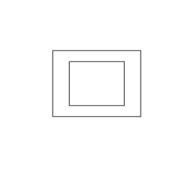
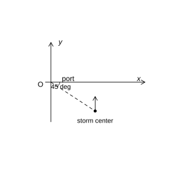

# Assignment 8

> **Definition 2.3.1** (Quadratic Inequality in One Variable)  In general, an inequality containing only one unknown and in which the highest degree of the unknown is $2$ is called a quadratic inequality in one variable. Its general form is $ax^2+bx+c>0$ or $ax^2+bx+c<0$, where $a,b,c$ are all constants and $a\neq0$.

> **Definition 2.3.2** (Zeros of a Quadratic Function)  For the quadratic function $y=ax^2+bx+c$, the real number $x$ satisfying $ax^2+bx+c=0$ is called a zero of the quadratic function $y=ax^2+bx+c$.

> **Standard Conclusion 2.3.3** (Solution Set of a Quadratic Inequality)  For $ax^2+bx+c>0$ or $ax^2+bx+c<0$ ($a>0$), let $\Delta=b^2-4ac$, and let $x_1,x_2$ be the two real roots of the equation $ax^2+bx+c=0$ ($x_1<x_2$). When $\Delta>0$, the solution set of $ax^2+bx+c>0$ is $\left\{x\mid x<x_1$ or $x>x_2\right\}$, and the solution set of $ax^2+bx+c<0$ is $\left\{x\mid x_1<x<x_2\right\}$; when $\Delta=0$, the solution set of $ax^2+bx+c>0$ is $\left\{x\mid x\neq-\frac{b}{2a}\right\}$, and the solution set of $ax^2+bx+c<0$ is $\varnothing$; when $\Delta<0$, the solution set of $ax^2+bx+c>0$ is $\mathbb R$, and the solution set of $ax^2+bx+c<0$ is $\varnothing$. For an inequality whose quadratic coefficient is negative, first change the quadratic coefficient to a positive one and then solve it.

### Exercise 1

(Exercise 2.3, Problem 1) Find the solution sets of the following inequalities.

(1) $\left(x+2\right)\left(x-3\right)>0$;

(2) $3x^2-7x\le10$;

(3) $-x^2+4x-4<0$;

(4) $x^2-x+\frac{1}{4}<0$;

(5) $-2x^2+x\le-3$;

(6) $x^2-3x+4>0$.

### Solution to Exercise 1

By **Standard Conclusion 2.3.3** (Solution Set of a Quadratic Inequality), first find the roots of the corresponding equation, and then write the solution set according to the position of the graph.

(1) The roots of the equation $\left(x+2\right)\left(x-3\right)=0$ are $x=-2,3$, and the quadratic coefficient is positive, so the solution set is $\left\{x\mid x<-2$ or $x>3\right\}$.

(2) Rearranging gives $3x^2-7x-10\le0$. The roots of the equation $3x^2-7x-10=0$ are $x=-1,\frac{10}{3}$, so the solution set is $\left\{x\mid-1\le x\le\frac{10}{3}\right\}$.

(3) Multiplying both sides by $-1$ gives $x^2-4x+4>0$, i.e. $\left(x-2\right)^2>0$, so the solution set is $\left\{x\mid x\neq2\right\}$.

(4) $x^2-x+\frac{1}{4}=\left(x-\frac{1}{2}\right)^2\ge0$ always holds, and $\left(x-\frac{1}{2}\right)^2<0$ has no solution, so the solution set is $\varnothing$.

(5) Rearranging gives $2x^2-x-3\ge0$. The roots of the equation $2x^2-x-3=0$ are $x=-1,\frac{3}{2}$, so the solution set is $\left\{x\mid x\le-1$ or $x\ge\frac{3}{2}\right\}$.

(6) $\Delta=9-16=-7<0$, and the quadratic coefficient is positive; by **Standard Conclusion 2.3.3** (Solution Set of a Quadratic Inequality), the solution set is $\mathbb R$. $\blacksquare$

### Exercise 2

(Exercise 2.3, Problem 2) For what range of the independent variable $x$ does the value of each of the following functions equal $0$? exceed $0$? be less than $0$?

(1) $y=3x^2-6x+2$;

(2) $y=25-x^2$;

(3) $y=x^2+6x+10$;

(4) $y=-3x^2+12x-12$.

### Solution to Exercise 2

By **Standard Conclusion 2.3.3** (Solution Set of a Quadratic Inequality), first find the zeros, and then determine the positive and negative intervals according to the opening direction.

(1) $\Delta=36-24=12>0$, the zeros are $x=1\pm\frac{\sqrt3}{3}$, and the parabola opens upward. Thus $y=0$ when $x=1\pm\frac{\sqrt3}{3}$; $y>0$ when $x<1-\frac{\sqrt3}{3}$ or $x>1+\frac{\sqrt3}{3}$; $y<0$ when $1-\frac{\sqrt3}{3}<x<1+\frac{\sqrt3}{3}$.

(2) The zeros are $x=\pm5$, and the parabola opens downward. Thus $y=0$ when $x=\pm5$; $y>0$ when $-5<x<5$; $y<0$ when $x<-5$ or $x>5$.

(3) $\Delta=36-40=-4<0$, the parabola opens upward, and the graph always lies above the $x$-axis. Thus $y$ is always greater than $0$, and both $y=0$ and $y<0$ have no solution.

(4) $y=-3\left(x-2\right)^2$. Thus $y=0$ when $x=2$; $y<0$ when $x\neq2$; $y>0$ has no solution. $\blacksquare$

### Exercise 3

(Exercise 2.3, Problem 3) For what real numbers $x$ is $\sqrt{x^2+x-12}$ meaningful?

### Solution to Exercise 3

By the condition for a quadratic radical to be meaningful, the radicand must be nonnegative, i.e. $x^2+x-12\ge0$.

By **Standard Conclusion 2.3.3** (Solution Set of a Quadratic Inequality), the equation $x^2+x-12=0$, i.e. $\left(x+4\right)\left(x-3\right)=0$, has roots $x=-4,3$, and the parabola opens upward, so the solution set of $x^2+x-12\ge0$ is $\left\{x\mid x\le-4$ or $x\ge3\right\}$. That is, when $x\le-4$ or $x\ge3$, $\sqrt{x^2+x-12}$ is meaningful. $\blacksquare$

### Exercise 4

(Exercise 2.3, Problem 4) As shown in the figure, flowers are planted around the perimeter of a rectangular ground of length $8\ \mathrm m$ and width $6\ \mathrm m$, and lawn is planted in the middle. If the flower border is required to have uniform width and the area of the lawn is not more than half of the total area, what should be the width of the flower border in meters?

{width=50%}

### Solution to Exercise 4

Let the width of the flower border be $x\ \mathrm m$, then the middle lawn has length $8-2x$ and width $6-2x$, and we must have $0<x<3$.

The total area of the ground is $8\times6=48$, and the lawn area is not more than half, i.e.

$$
\left(8-2x\right)\left(6-2x\right)\le24.
$$

Expanding and rearranging gives $4x^2-28x+24\le0$, i.e. $\left(x-1\right)\left(x-6\right)\le0$. By **Standard Conclusion 2.3.3** (Solution Set of a Quadratic Inequality), the solution set is $1\le x\le6$. Combined with $0<x<3$, we get $1\le x<3$. Thus the width of the flower border should be not less than $1\ \mathrm m$ and less than $3\ \mathrm m$. $\blacksquare$

### Exercise 5

(Exercise 2.3, Problem 5) An online shop sells a batch of new pencil sharpeners, and the lowest selling price of each sharpener is $15$ yuan. If sold at the lowest price, $30$ sharpeners can be sold per day; for every $1$ yuan increase in the selling price of one sharpener, the daily sales volume decreases by $2$ sharpeners. To make the daily sales revenue of this batch of sharpeners greater than $400$ yuan, how should the selling price be set?

### Solution to Exercise 5

Let the selling price be raised by $x$ yuan above the lowest price, then the selling price is $15+x$ and the daily sales volume is $30-2x$, where $x\ge0$. The daily sales revenue is $\left(15+x\right)\left(30-2x\right)$.

Requiring the sales revenue to be greater than $400$ yuan, i.e.

$$
\left(15+x\right)\left(30-2x\right)>400.
$$

Expanding gives $450-2x^2>400$, i.e. $x^2<25$, equivalently $-5<x<5$. Combined with $x\ge0$, we get $0\le x<5$. Thus the selling price $15+x$ should satisfy $15\le$ price $<20$ yuan. That is, when the selling price is set not less than $15$ yuan and less than $20$ yuan, the daily sales revenue is above $400$ yuan. $\blacksquare$

### Problem 1

(Exercise 2.3, Review and Consolidation, Problem 1) Find the solution sets of the following inequalities.

(1) $13-4x^2>0$;

(2) $\left(x-3\right)\left(x-7\right)<0$;

(3) $x^2-3x-10>0$;

(4) $-3x^2+5x-4>0$.

### Solution to Problem 1

By **Standard Conclusion 2.3.3** (Solution Set of a Quadratic Inequality), solve each item.

(1) $4x^2<13$, i.e. $x^2<\frac{13}{4}$, and the solution set is $\left\{x\mid-\frac{\sqrt{13}}{2}<x<\frac{\sqrt{13}}{2}\right\}$.

(2) The roots are $x=3,7$, the parabola opens upward and we take $<0$, so the solution set is $\left\{x\mid3<x<7\right\}$.

(3) $\left(x-5\right)\left(x+2\right)>0$, the roots are $x=-2,5$, and the solution set is $\left\{x\mid x<-2$ or $x>5\right\}$.

(4) Multiplying both sides by $-1$ gives $3x^2-5x+4<0$. $\Delta=25-48=-23<0$, the parabola opens upward, and $3x^2-5x+4$ is always positive, so it cannot be less than $0$; thus the solution set is $\varnothing$. $\blacksquare$

### Problem 2

(Exercise 2.3, Review and Consolidation, Problem 2) For what real numbers $x$ are the following expressions meaningful?

(1) $\sqrt{x^2-4x+9}$;

(2) $\sqrt{-2x^2+12x-18}$.

### Solution to Problem 2

By the condition for a quadratic radical to be meaningful, the radicand must be nonnegative; then solve by **Standard Conclusion 2.3.3** (Solution Set of a Quadratic Inequality).

(1) We require $x^2-4x+9\ge0$. $\Delta=16-36=-20<0$, the parabola opens upward, so $x^2-4x+9>0$ always holds for all real numbers. Thus the expression is meaningful for any real number $x$.

(2) We require $-2x^2+12x-18\ge0$, i.e. $\left(x-3\right)^2\le0$. It holds only when $x=3$, so the expression is meaningful when $x=3$. $\blacksquare$

### Problem 3

(Exercise 2.3, Comprehensive Application, Problem 3) Given $M=\left\{x\mid4x^2-4x-15>0\right\}$ and $N=\left\{x\mid x^2-5x-6>0\right\}$, find $M\cap N$ and $M\cup N$.

### Solution to Problem 3

By **Standard Conclusion 2.3.3** (Solution Set of a Quadratic Inequality), first simplify $M,N$ separately.

The roots of $4x^2-4x-15=0$ are $x=-\frac{3}{2},\frac{5}{2}$, so $M=\left\{x\mid x<-\frac{3}{2}$ or $x>\frac{5}{2}\right\}$.

The roots of $x^2-5x-6=\left(x-6\right)\left(x+1\right)=0$ are $x=-1,6$, so $N=\left\{x\mid x<-1$ or $x>6\right\}$.

Taking the common part, we get

$$
M\cap N=\left\{x\mid x<-\frac{3}{2}\text{ 或 }x>6\right\}.
$$

Taking the union, we get

$$
M\cup N=\left\{x\mid x<-1\text{ 或 }x>\frac{5}{2}\right\}.
$$

$\blacksquare$

### Problem 4

(Exercise 2.3, Comprehensive Application, Problem 4) A student throws a volleyball vertically upward with initial velocity $v_0=12\ \mathrm{m/s}$. For how long at most can the volleyball stay at a position more than $2\ \mathrm m$ above the launch point (accurate to $0.01\ \mathrm s$)?

### Solution to Problem 4

According to the problem, the height is $h=v_0t-\frac{1}{2}gt^2=12t-5t^2$. The volleyball is more than $2\ \mathrm m$ above the launch point, i.e. $h\ge2$.

By **Standard Conclusion 2.3.3** (Solution Set of a Quadratic Inequality), $12t-5t^2\ge2$, which rearranges to $5t^2-12t+2\le0$. The roots of the equation $5t^2-12t+2=0$ are

$$
t=\frac{6\pm\sqrt{26}}{5}.
$$

The time the volleyball stays above $2\ \mathrm m$ is the difference between the two roots, i.e.

$$
\frac{6+\sqrt{26}}{5}-\frac{6-\sqrt{26}}{5}=\frac{2\sqrt{26}}{5}\approx2.04\ \mathrm s.
$$

$\blacksquare$

### Problem 5

(Exercise 2.3, Comprehensive Application, Problem 5) Given the sets $A=\left\{x\mid x^2-16<0\right\}$ and $B=\left\{x\mid x^2-4x+3>0\right\}$, find $A\cup B$.

### Solution to Problem 5

By **Standard Conclusion 2.3.3** (Solution Set of a Quadratic Inequality), first simplify $A,B$.

$x^2-16<0$, i.e. $-4<x<4$, so $A=\left\{x\mid-4<x<4\right\}$.

The solution of $x^2-4x+3=\left(x-1\right)\left(x-3\right)>0$ is $x<1$ or $x>3$, so $B=\left\{x\mid x<1$ or $x>3\right\}$.

Combining $A$ and $B$: $B$ already contains $x<1$ and $x>3$, and $A$ supplements the part $1\le x\le3$ within $-4<x<4$; together they cover all real numbers, so $A\cup B=\mathbb R$. $\blacksquare$

### Problem 6

(Exercise 2.3, Extension and Exploration, Problem 6) As shown in the figure, according to the forecast of the meteorological department, the center of a tropical storm is at a position $600\ \mathrm{km}$ from a certain harbor in the direction $45^\circ$ south of east, moving due north at a speed of $20\ \mathrm{km/h}$; regions within $450\ \mathrm{km}$ of the storm center will be affected. Based on the above forecast, estimate how long from now the harbor will be affected by the tropical storm, and approximately how long the impact will last (accurate to $0.1\ \mathrm h$)?

{width=50%}

### Solution to Problem 6

Take the harbor as the origin, due east as the $x$-axis, and due north as the $y$-axis. The storm center is initially at $45^\circ$ south of east from the harbor, at a distance of $600\ \mathrm{km}$, and its coordinates are $\left(300\sqrt2,-300\sqrt2\right)$. The storm moves due north, and after $t$ hours the center has coordinates $\left(300\sqrt2,-300\sqrt2+20t\right)$.

The harbor is affected when its distance to the storm center is not more than $450\ \mathrm{km}$, i.e.

$$
\left(300\sqrt2\right)^2+\left(-300\sqrt2+20t\right)^2\le450^2.
$$

Rearranging gives $\left(20t-300\sqrt2\right)^2\le22500$, i.e. $\left|20t-300\sqrt2\right|\le150$. By **Standard Conclusion 2.3.3** (Solution Set of a Quadratic Inequality), solving gives

$$
\frac{300\sqrt2-150}{20}\le t\le\frac{300\sqrt2+150}{20}.
$$

That is, $13.7\le t\le28.7$. Thus about $13.7\ \mathrm h$ later the harbor begins to be affected, and the duration of the impact is the difference between the two bounds, $15.0\ \mathrm h$. $\blacksquare$
