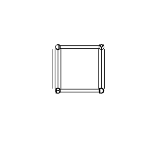
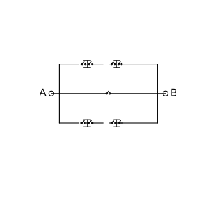

# Assignment 80

> **Definition 6.1.1** (Addition Counting Principle for Classification)  There are two different categories of ways to complete a task: the first category has $m$ different methods and the second category has $n$ different methods. Then there are $N=m+n$ different methods in total to complete the task. The methods in the two categories are mutually distinct. Generalizing to $k$ categories, if the $i$-th category has $n_i$ different methods, then $N=n_1+n_2+\cdots+n_k$.

> **Definition 6.1.2** (Multiplication Counting Principle for Step-by-Step Processes)  Completing a task requires two steps: the first step has $m$ different methods and the second step has $n$ different methods. Then there are $N=m\times n$ different methods in total to complete the task. No matter which method is used in the first step, the second step always has the same number of methods. Generalizing to $k$ steps, if the $i$-th step has $n_i$ different methods, then $N=n_1\times n_2\times\cdots\times n_k$.

> **Common Conclusion 6.1.3** (Key Points for Applying the Two Counting Principles)  When using the two counting principles to solve counting problems, first carefully analyze two points: (1) what exactly is the task to be completed; (2) whether it requires classification or step-by-step decomposition. Classification must be neither repetitive nor omissive; after classifying, count each category separately, and finally sum them using the addition counting principle to obtain the total. Step-by-step decomposition must be complete, i.e., all steps must be finished to complete the task; after decomposing, compute the number of methods for each step, and finally multiply them according to the multiplication counting principle to obtain the total.

> **Common Conclusion** (Number of Subsets)  An $n$-element set $A=\left\{a_1,a_2,\cdots,a_n\right\}$ has $2^n$ distinct subsets.

### Exercise 1

(Exercise 6.1, Problem 1) Fill in the blanks.

(1) A job can be completed by $2$ methods. There are $5$ people who can only use the $1$st method and another $4$ people who can only use the $2$nd method. If $1$ person is chosen from them to do the job, the number of different choices is $\;\_\_\;$;

(2) There are $3$ roads from Village $A$ to Village $B$ and $2$ roads from Village $B$ to Village $C$. Then going from Village $A$ through Village $B$ to Village $C$, the number of different routes is $\;\_\_\;$.

### Solution to Exercise 1

By **Definition 6.1.1** (Addition Counting Principle for Classification) and **Definition 6.1.2** (Multiplication Counting Principle for Step-by-Step Processes).

(1) The task is to choose $1$ person for the job. The $5$ people who can use the $1$st method and the $4$ people who can use the $2$nd method form two mutually disjoint categories, and choosing any one of them completes the job. By **Definition 6.1.1**, the number of different choices is $5+4=9$.

(2) Going from Village $A$ through Village $B$ to Village $C$ requires first reaching Village $B$ and then Village $C$, which are two steps. By **Definition 6.1.2**, the number of different routes is $3\times 2=6$. $\blacksquare$

### Exercise 2

(Exercise 6.1, Problem 2) In Example 1, if mathematics is also a strong major of University $A$, then University $A$ has $6$ majors to choose from and University $B$ has $4$ majors to choose from. Applying the addition counting principle, the number of possible major choices for this student is $6+4=10$. What is wrong with this calculation?

### Solution to Exercise 2

By **Definition 6.1.1** (Addition Counting Principle for Classification), the methods in two different categories must be mutually distinct, i.e., the classification must be neither repetitive nor omissive.

Originally, University $A$ and University $B$ had no common strong majors, so $5+4=9$ had no duplication. Now mathematics is also a strong major of University $A$, while in Example 1 mathematics was already a strong major of University $B$; thus the major mathematics appears once in each category. If one directly computes $6+4=10$, the choice of the same major direction is counted twice, which violates the requirement in **Definition 6.1.1** that the methods in the two categories be mutually distinct.

The correct approach is to subtract the duplicated $1$, so the number of distinct major choices is $6+4-1=9$. $\blacksquare$

### Exercise 3

(Exercise 6.1, Problem 3) The top shelf of a bookcase holds $6$ different mathematics books, and the bottom shelf holds $5$ different Chinese language books.

(1) If $1$ book is taken at random from the bookcase, how many different choices are there?

(2) If a mathematics book and a Chinese language book, $1$ of each, are taken at random from the bookcase, how many different choices are there?

### Solution to Exercise 3

By **Definition 6.1.1** (Addition Counting Principle for Classification) and **Definition 6.1.2** (Multiplication Counting Principle for Step-by-Step Processes).

(1) Taking $1$ book at random, one may take a mathematics book from the top shelf or a Chinese language book from the bottom shelf; these are two mutually disjoint categories. By **Definition 6.1.1**, the number of different choices is $6+5=11$.

(2) Taking a mathematics book and a Chinese language book, $1$ of each, requires first taking $1$ mathematics book and then $1$ Chinese language book, which are two steps. By **Definition 6.1.2**, the number of different choices is $6\times 5=30$. $\blacksquare$

### Exercise 4

(Exercise 6.1, Problem 4) There are $3$ students from Grade 10, $5$ students from Grade 11, and $4$ students from Grade 12.

(1) If $1$ student is chosen at random from the students of the three grades to take part in an activity receiving foreign guests, how many different choices are there?

(2) If $1$ student is chosen from each of the three grades to take part in the activity receiving foreign guests, how many different choices are there?

### Solution to Exercise 4

By **Definition 6.1.1** (Addition Counting Principle for Classification) and **Definition 6.1.2** (Multiplication Counting Principle for Step-by-Step Processes).

(1) Choosing $1$ person at random, one may pick any one of the three grades, Grade 10, Grade 11, or Grade 12, to choose from; these are three mutually disjoint categories. By **Definition 6.1.1**, the number of different choices is $3+5+4=12$.

(2) Choosing $1$ person from each grade requires choosing $1$ student from Grade 10, $1$ from Grade 11, and $1$ from Grade 12, which are three steps. By **Definition 6.1.2**, the number of different choices is $3\times 5\times 4=60$. $\blacksquare$

### Exercise 5

(Exercise 6.1, Problem 1) The telephone numbers within the jurisdiction of a telephone exchange consist of $8$ digits, of which the first $4$ digits are fixed and the last $4$ digits are each a digit from $0\sim 9$. At most how many different telephone numbers can this exchange have?

### Solution to Exercise 5

By **Definition 6.1.2** (Multiplication Counting Principle for Step-by-Step Processes).

The first $4$ digits are already fixed and do not affect the number of numbers. Each of the last $4$ digits can be taken at random from the $10$ digits $0\sim 9$, and digits may repeat. Determining a telephone number requires successively fixing the last $4$ digits, four steps in total, each with $10$ choices. By **Definition 6.1.2**, the number of different numbers is

$$
10\times 10\times 10\times 10=10^4=10000.
$$

Therefore this exchange can have at most $10000$ different telephone numbers. $\blacksquare$

### Exercise 6

(Exercise 6.1, Problem 2) From $5$ students, a head group leader and a deputy group leader are to be chosen, $1$ of each. How many different choices are there?

### Solution to Exercise 6

By **Definition 6.1.2** (Multiplication Counting Principle for Step-by-Step Processes).

Choosing a head group leader and a deputy group leader, $1$ of each, requires first choosing the head group leader and then the deputy. Step $1$: choose $1$ of the $5$ students as head group leader, with $5$ choices. Step $2$: once the head group leader is chosen, choose $1$ of the remaining $4$ students as deputy, with $4$ choices. By **Definition 6.1.2**, the number of different choices is

$$
5\times 4=20.
$$

Therefore there are $20$ different choices. $\blacksquare$

### Exercise 7

(Exercise 6.1, Problem 3) Choose a number at random from $1,2,\cdots,19,20$ as the minuend, then choose a number at random from $1,2,\cdots,10$ as the subtrahend, and write them as a subtraction expression. How many different expressions can be obtained in total?

### Solution to Exercise 7

By **Definition 6.1.2** (Multiplication Counting Principle for Step-by-Step Processes).

Writing a subtraction expression requires first choosing the minuend and then the subtrahend, which are two steps. Step $1$: the minuend is taken at random from $1$ to $20$, with $20$ choices. Step $2$: the subtrahend is taken at random from $1$ to $10$, with $10$ choices. Each pairing of minuend and subtrahend corresponds to a different expression. By **Definition 6.1.2**, the number of different expressions is

$$
20\times 10=200.
$$

Therefore $200$ different expressions can be obtained. $\blacksquare$

### Exercise 8

(Exercise 6.1, Problem 4) Among $1,2,\cdots,500$, how many numbers leave a remainder of $2$ when divided by $5$?

### Solution to Exercise 8

By **Definition 6.1.1** (Addition Counting Principle for Classification), count by classifying according to the remainder upon division by $5$.

Numbers leaving a remainder of $2$ when divided by $5$ have the form $5k+2$, where $k$ is a nonnegative integer. We require $1\le 5k+2\le 500$, i.e., $-1\le 5k\le 498$, equivalently $0\le k\le 99.6$. Thus $k$ can take $0,1,2,\cdots,99$, $100$ values in total.

Therefore, among $1,2,\cdots,500$, there are $100$ numbers leaving a remainder of $2$ when divided by $5$. $\blacksquare$

### Exercise 9

(Exercise 6.1, Problem 5) How many three-digit numbers can be formed using the digits $1,2,3,4,5$ (digits on different positions may repeat)?

### Solution to Exercise 9

By **Definition 6.1.2** (Multiplication Counting Principle for Step-by-Step Processes).

Forming a three-digit number requires successively fixing the hundreds, tens, and units digits, three steps in total. Each digit can be taken at random from the $5$ digits $1,2,3,4,5$, and digits may repeat, so each position has $5$ choices. By **Definition 6.1.2**, the number of three-digit numbers that can be formed is

$$
5\times 5\times 5=125.
$$

Therefore $125$ three-digit numbers can be formed. $\blacksquare$

### Exercise 10

(Exercise 6.1, Problem 1) After expanding the product $\left(a_1+a_2+a_3\right)\left(b_1+b_2+b_3\right)\left(c_1+c_2+c_3+c_4+c_5\right)$, how many terms are there in total?

### Solution to Exercise 10

By **Definition 6.1.2** (Multiplication Counting Principle for Step-by-Step Processes).

Each term of the expanded product is obtained by taking one $a_i$ at random from the first parentheses, one $b_j$ at random from the second parentheses, and one $c_k$ at random from the third parentheses, and multiplying them. Fixing a term of the expansion requires three steps: Step $1$ chooses $1$ of the $3$ $a_i$'s, with $3$ choices; Step $2$ chooses $1$ of the $3$ $b_j$'s, with $3$ choices; Step $3$ chooses $1$ of the $5$ $c_k$'s, with $5$ choices. By **Definition 6.1.2**, after expansion there are in total

$$
3\times 3\times 5=45
$$

terms. $\blacksquare$

### Exercise 11

(Exercise 6.1, Problem 2) Among all two-digit numbers, how many have a units digit smaller than their tens digit?

### Solution to Exercise 11

By **Definition 6.1.1** (Addition Counting Principle for Classification), classify by the tens digit.

The tens digit can take $1,2,\cdots,9$. For each tens digit $t$, the units digit must be smaller than $t$ and be a digit from $0\sim 9$.

(1) When the tens digit is $1$, the units digit can only be $0$, giving $1$ number;

(2) When the tens digit is $2$, the units digit can be $0,1$, giving $2$ numbers;

(3) When the tens digit is $3$, the units digit can be $0,1,2$, giving $3$ numbers;

And so on; when the tens digit is $t$, there are $t$ numbers. By **Definition 6.1.1**, the number of two-digit numbers whose units digit is smaller than their tens digit is

$$
1+2+3+\cdots+9=\frac{9\times 10}{2}=45
$$

. $\blacksquare$

### Exercise 12

(Exercise 6.1, Problem 3) A shopping mall has $6$ doors. If a person enters the mall through any one of the doors and must exit through a different door, how many different ways of entering and leaving the mall are there?

### Solution to Exercise 12

By **Definition 6.1.2** (Multiplication Counting Principle for Step-by-Step Processes).

Entering and leaving the mall requires first choosing the entrance and then the exit, which are two steps. Step $1$: choose any $1$ of the $6$ doors to enter, with $6$ choices. Step $2$: once the entrance is chosen, choose $1$ of the remaining $5$ doors as the exit, with $5$ choices. By **Definition 6.1.2**, the number of different ways of entering and leaving is

$$
6\times 5=30.
$$

Therefore there are $30$ different ways of entering and leaving the mall. $\blacksquare$

### Exercise 13

(Exercise 6.1, Problem 4) Draw an arbitrary line and take $n$ division points on it at random.

(1) Taking $2$ of these $n$ points at random to form a line segment, how many line segments can be obtained?

(2) Taking $2$ of these $n$ points at random to form directed line segments, how many directed line segments can be obtained?

### Solution to Exercise 13

By **Definition 6.1.2** (Multiplication Counting Principle for Step-by-Step Processes).

(1) To form a line segment, one only needs to choose $2$ of the $n$ points as endpoints, without regard to order. Choosing the first endpoint has $n$ choices, and choosing the second endpoint from the remaining $n-1$ points has $n-1$ choices. Since the two endpoints of a segment have no order, each segment is counted twice; hence the number of segments is

$$
\frac{n\left(n-1\right)}{2}.
$$

(2) To form a directed segment, one first chooses the starting point and then the ending point. Step $1$: choosing the starting point has $n$ choices. Step $2$: choosing the ending point from the remaining $n-1$ points has $n-1$ choices. By **Definition 6.1.2**, the number of directed segments is

$$
n\left(n-1\right).
$$

$\blacksquare$

### Problem 1

(Exercise 6.1, Review and Consolidation, Problem 1) A store sells a certain model of television, of which there are $4$ locally made varieties and $7$ non-local varieties. If $1$ television of this model is to be bought, how many different choices are there?

### Solution to Problem 1

By **Definition 6.1.1** (Addition Counting Principle for Classification).

Buying $1$ television, one may choose a local product or a non-local product; these are two mutually disjoint categories. There are $4$ local varieties and $7$ non-local varieties. By **Definition 6.1.1**, the number of different choices is

$$
4+7=11.
$$

Therefore there are $11$ different choices. $\blacksquare$

### Problem 2

(Exercise 6.1, Review and Consolidation, Problem 2) As shown in the figure, there are $2$ roads from Place A to Place B and $3$ roads from Place B to Place D; there are $4$ roads from Place A to Place C and $2$ roads from Place C to Place D. How many different routes are there from Place A to Place D in total?

{width=50%}

### Solution to Problem 2

By **Definition 6.1.1** (Addition Counting Principle for Classification) and **Definition 6.1.2** (Multiplication Counting Principle for Step-by-Step Processes).

There are two categories of routes from Place A to Place D: one via Place B and one via Place C.

(1) Via Place B: first from A to B there are $2$ roads, then from B to D there are $3$ roads. By **Definition 6.1.2**, this category has $2\times 3=6$ routes.

(2) Via Place C: first from A to C there are $4$ roads, then from C to D there are $2$ roads. By **Definition 6.1.2**, this category has $4\times 2=8$ routes.

The two categories are mutually disjoint. By **Definition 6.1.1**, from Place A to Place D there are in total

$$
6+8=14
$$

different routes. $\blacksquare$

### Problem 3

(Exercise 6.1, Review and Consolidation, Problem 3) As shown in the figure, to make the circuit conduct from point $A$ to point $B$ with exactly one branch connected, how many different paths are possible?

{width=50%}

### Solution to Problem 3

By **Definition 6.1.1** (Addition Counting Principle for Classification).

In the figure, the circuit from $A$ to $B$ consists of three parallel branches, upper, middle, and lower, each with several switches in series. The requirement is that exactly one branch be connected, i.e., exactly one of the three branches is chosen to conduct. The upper, middle, and lower branches are three mutually disjoint categories, and choosing any one branch accomplishes the task of conducting from $A$ to $B$. By **Definition 6.1.1**, the number of different paths is

$$
3
$$

. $\blacksquare$

### Problem 4

(Exercise 6.1, Review and Consolidation, Problem 4) Using any one of $1,5,9,13$ as the numerator and any one of $4,8,12,16$ as the denominator, how many different fractions can be formed? How many different proper fractions can be formed?

### Solution to Problem 4

By **Definition 6.1.2** (Multiplication Counting Principle for Step-by-Step Processes).

(1) Forming a fraction requires first choosing the numerator and then the denominator, which are two steps. The numerator has $4$ choices and the denominator has $4$ choices. By **Definition 6.1.2**, the total number of fractions that can be formed is

$$
4\times 4=16
$$

fractions.

(2) A proper fraction requires the numerator to be smaller than the denominator. When the numerator is $1$, the denominators $4,8,12,16$ are all greater than $1$, giving $4$; when the numerator is $5$, the denominator can be $8,12,16$, giving $3$; when the numerator is $9$, the denominator can be $12,16$, giving $2$; when the numerator is $13$, the denominator can be $16$, giving $1$. By **Definition 6.1.1**, the number of different proper fractions is

$$
4+3+2+1=10
$$

. $\blacksquare$

### Problem 5

(Exercise 6.1, Review and Consolidation, Problem 5) One bag contains $5$ balls and another bag contains $6$ balls, and all these balls have distinct colors. Taking $1$ ball from each of the two bags, how many different choices are there in total?

### Solution to Problem 5

By **Definition 6.1.2** (Multiplication Counting Principle for Step-by-Step Processes).

Taking $1$ ball from each bag requires first taking $1$ ball from the first bag and then $1$ from the second bag, which are two steps. The first bag has $5$ balls and the second bag has $6$ balls, and all balls have distinct colors. By **Definition 6.1.2**, the number of different choices is

$$
5\times 6=30.
$$

Therefore there are $30$ different choices. $\blacksquare$

### Problem 6

(Exercise 6.1, Review and Consolidation, Problem 6)

(1) In a rectangular coordinate system, how many distinct points are there whose x-coordinate and y-coordinate both take values in $A=\left\{0,1,2,3,4,5\right\}$?

(2) In a rectangular coordinate system, how many distinct lines are there whose slope takes values in the set $B=\left\{1,3,5,7\right\}$ and whose $y$-intercept takes values in the set $C=\left\{2,4,6,8\right\}$?

### Solution to Problem 6

By **Definition 6.1.2** (Multiplication Counting Principle for Step-by-Step Processes).

(1) Fixing the coordinates of a point requires first taking the x-coordinate and then the y-coordinate, which are two steps. The x-coordinate has $6$ choices in $A$, and the y-coordinate also has $6$ choices in $A$. By **Definition 6.1.2**, the number of distinct points is

$$
6\times 6=36
$$

.

(2) Fixing a line requires first taking the slope and then the y-intercept, which are two steps. The slope has $4$ choices in $B$, and the y-intercept has $4$ choices in $C$. Each pairing of slope and intercept determines a distinct line. By **Definition 6.1.2**, the number of distinct lines is

$$
4\times 4=16
$$

. $\blacksquare$

### Problem 7

(Exercise 6.1, Comprehensive Application, Problem 7) A combination lock has $4$ dials, each with the $10$ digits $0\sim 9$. Now the last dial has malfunctioned and can only be set among the $6$ digits $0\sim 5$. How many four-digit numbers can these $4$ dials form?

### Solution to Problem 7

By **Definition 6.1.2** (Multiplication Counting Principle for Step-by-Step Processes).

Setting a four-digit number requires successively turning the $4$ dials, four steps in total. Each of the first $3$ dials has the $10$ digits $0\sim 9$, giving $10$ ways each; the last dial has malfunctioned and can only be set among the $6$ digits $0\sim 5$, giving $6$ ways. By **Definition 6.1.2**, the number of four-digit numbers that can be formed is

$$
10\times 10\times 10\times 6=6000.
$$

Therefore $6000$ four-digit numbers can be formed. $\blacksquare$

### Problem 8

(Exercise 6.1, Comprehensive Application, Problem 8)

(1) $4$ students each sign up for the school's football team, basketball team, or table tennis team, each joining exactly one of the teams. Is the number of different sign-up ways $3^4$ or $4^3$?

(2) $3$ classes each choose one of $5$ scenic spots to visit. Is the number of different choices $3^5$ or $5^3$?

### Solution to Problem 8

By **Definition 6.1.2** (Multiplication Counting Principle for Step-by-Step Processes), determine whether the task requires step-by-step decomposition or classification.

(1) The task is for each of the $4$ students to join one team. For each student, $1$ team must be chosen among the $3$ teams: football, basketball, and table tennis. Decomposing by student, there are $4$ steps in total, each with $3$ choices. By **Definition 6.1.2**, the number of different sign-up ways is

$$
3\times 3\times 3\times 3=3^4.
$$

Therefore it is $3^4$.

(2) The task is for each of the $3$ classes to choose one scenic spot. For each class, $1$ spot must be chosen among the $5$ spots. Decomposing by class, there are $3$ steps in total, each with $5$ choices. By **Definition 6.1.2**, the number of different choices is

$$
5\times 5\times 5=5^3.
$$

Therefore it is $5^3$. $\blacksquare$

### Problem 9

(Exercise 6.1, Comprehensive Application, Problem 9)

(1) From $5$ different gifts, $4$ are chosen to be given to $4$ students, one gift per student. How many different ways of giving are there?

(2) There are $5$ numbered drawers, and $3$ different books are to be put into them. How many different ways of placing them are there? (A drawer may hold more than one book.)

### Solution to Problem 9

By **Definition 6.1.2** (Multiplication Counting Principle for Step-by-Step Processes).

(1) The task of giving gifts can be decomposed by student: the $1$st student chooses $1$ of the $5$ gifts, with $5$ ways; the $2$nd student chooses $1$ of the remaining $4$ gifts, with $4$ ways; the $3$rd student chooses $1$ of the remaining $3$ gifts, with $3$ ways; the $4$th student chooses $1$ of the remaining $2$ gifts, with $2$ ways. By **Definition 6.1.2**, the number of different ways of giving is

$$
5\times 4\times 3\times 2=120.
$$

(2) Placing the $3$ different books can be decomposed by book: each book may be put into any one of the $5$ drawers, and a drawer may hold more than one book, so each book has $5$ ways of placement. By **Definition 6.1.2**, the number of different ways of placement is

$$
5\times 5\times 5=125.
$$

$\blacksquare$

### Problem 10

(Exercise 6.1, Comprehensive Application, Problem 10) A bag contains $8$ white balls and $10$ red balls, each ball numbered distinctly. Now $2$ balls are drawn from it.

(1) How many ways of drawing exactly one white ball and one red ball are there?

(2) How many ways of drawing exactly two white balls are there?

(3) How many ways of drawing at least one white ball are there?

(4) How many ways of drawing two balls of the same color are there?

### Solution to Problem 10

By **Definition 6.1.1** (Addition Counting Principle for Classification) and **Definition 6.1.2** (Multiplication Counting Principle for Step-by-Step Processes).

(1) Drawing exactly one white ball and one red ball requires first taking $1$ of the $8$ white balls and then $1$ of the $10$ red balls. By **Definition 6.1.2**, the number of ways is

$$
8\times 10=80.
$$

(2) Drawing exactly two white balls requires taking $2$ of the $8$ white balls. Taking the first white ball has $8$ ways, and taking the second white ball from the remaining $7$ has $7$ ways; since drawing balls does not consider order, each way is counted twice, so the number of ways is

$$
\frac{8\times 7}{2}=28.
$$

(3) Drawing at least one white ball includes two categories: one white and one red, and two white. From (1), one white and one red gives $80$ ways; from (2), two white gives $28$ ways. By **Definition 6.1.1**, the number of ways is

$$
80+28=108.
$$

(4) Drawing two balls of the same color includes two categories: two white and two red. Two white gives $28$ ways; similarly, two red gives $\frac{10\times 9}{2}=45$ ways. By **Definition 6.1.1**, the number of ways is

$$
28+45=73.
$$

$\blacksquare$

### Problem 11

(Exercise 6.1, Extension and Exploration, Problem 11) During the National Day holiday, several people are to be chosen from $7$ people to be on duty during the $7$ holiday days (only $1$ person is on duty each day), with no person on duty for $2$ consecutive days. How many possible arrangements are there?

### Solution to Problem 11

By **Definition 6.1.2** (Multiplication Counting Principle for Step-by-Step Processes).

The task of scheduling duty is decomposed by day, $7$ steps in total. On day $1$, choose $1$ of the $7$ people to be on duty, with $7$ choices. From day $2$ onward, to avoid the same person being on duty for $2$ consecutive days, each day cannot assign the person who was on duty the previous day; thus each day chooses $1$ of the remaining $6$ people, with $6$ choices each.

Thus day $1$ has $7$ choices, and days $2$ through $7$ each have $6$ choices. By **Definition 6.1.2**, the number of possible arrangements is

$$
7\times 6^6.
$$

That is, there are $7\times 6^6$ possible arrangements. $\blacksquare$

### Problem 12

(Exercise 6.1, Extension and Exploration, Problem 12) How many distinct positive divisors does $2160$ have?

### Solution to Problem 12

By **Definition 6.1.2** (Multiplication Counting Principle for Step-by-Step Processes).

First factor into primes. Since

$$
2160=2^4\times 3^3\times 5.
$$

Taking any positive divisor, the exponent of $2$ in its prime factorization can be $0,1,2,3,4$, $5$ choices; the exponent of $3$ can be $0,1,2,3$, $4$ choices; the exponent of $5$ can be $0,1$, $2$ choices. Fixing a positive divisor requires choosing the exponents of $2,3,5$ separately, which are three steps. By **Definition 6.1.2**, the number of distinct positive divisors is

$$
5\times 4\times 2=40.
$$

Therefore $2160$ has $40$ distinct positive divisors. $\blacksquare$

### Inquiry and Discovery 1

(Think About 1) How many subsets are there? Although enumeration is a rather brute-force method, it is the basic method of counting. Please enumerate the subsets of the $4$-element set $\left\{a_1,a_2,a_3,a_4\right\}$ and the $5$-element set $\left\{a_1,a_2,a_3,a_4,a_5\right\}$.

### Solution to Inquiry and Discovery 1

By **Definition 6.1.2** (Multiplication Counting Principle for Step-by-Step Processes).

(1) The subsets of the $4$-element set $\left\{a_1,a_2,a_3,a_4\right\}$ enumerated by the number of elements they contain: the empty set $\varnothing$; the one-element subsets $\left\{a_1\right\},\left\{a_2\right\},\left\{a_3\right\},\left\{a_4\right\}$; the two-element subsets $\left\{a_1,a_2\right\},\left\{a_1,a_3\right\},\left\{a_1,a_4\right\},\left\{a_2,a_3\right\},\left\{a_2,a_4\right\},\left\{a_3,a_4\right\}$; the three-element subsets $\left\{a_1,a_2,a_3\right\},\left\{a_1,a_2,a_4\right\},\left\{a_1,a_3,a_4\right\},\left\{a_2,a_3,a_4\right\}$; the four-element subset $\left\{a_1,a_2,a_3,a_4\right\}$. In total $1+4+6+4+1=16=2^4$.

(2) By **Common Conclusion** (Number of Subsets), the number of subsets of the $5$-element set $\left\{a_1,a_2,a_3,a_4,a_5\right\}$ should be $2^5=32$. By the number of elements they contain, they are $1,5,10,10,5,1$ respectively, totaling $32$.

The enumeration shows that a $3$-element set has $2^3=8$ subsets, a $4$-element set has $2^4=16$ subsets, and a $5$-element set has $2^5=32$ subsets. $\blacksquare$

### Inquiry and Discovery 2

(Think About 2) Inquiry and Discovery: How many subsets are there? From this, do you gain a further understanding of the convention that both the empty set and the set itself are regarded as subsets?

### Solution to Inquiry and Discovery 2

By **Common Conclusion** (Number of Subsets), an $n$-element set has $2^n$ distinct subsets.

When examining a subset with the multiplication counting principle, each element of the set has two choices: belong to the subset or not belong to it. The $n$ elements thus correspond to $2^n$ outcomes, each outcome determining exactly one subset. Among them, when all $n$ elements are chosen as not belonging, the corresponding subset is the empty set; when all $n$ elements are chosen as belonging, the corresponding subset is the set itself.

Thus, regarding both the empty set and the set itself as subsets is not an extra special convention but the two extreme cases that naturally arise under the counting scheme of $2^n$, "two choices for each element." It is precisely because of this convention that the total number of subsets can be neatly written as $2^n$. $\blacksquare$

### Inquiry and Discovery 3

(Think About 3) Inquiry and Discovery: How many subsets are there? Can you also prove, by another method, that the $n$-element set $A=\left\{a_1,a_2,\cdots,a_n\right\}$ has $2^n$ distinct subsets?

### Solution to Inquiry and Discovery 3

By **Definition 6.1.1** (Addition Counting Principle for Classification) and the meaning of binomial coefficients.

Classify by the number of elements a subset contains: the number of subsets formed by choosing $k$ out of $n$ elements is $\binom{n}{k}$, where $k=0,1,2,\cdots,n$. By **Definition 6.1.1**, the number of all subsets is the sum over the categories

$$
\binom{n}{0}+\binom{n}{1}+\binom{n}{2}+\cdots+\binom{n}{n}.
$$

By the binomial theorem, taking $a=b=1$ gives

$$
\left(1+1\right)^n=\binom{n}{0}+\binom{n}{1}+\binom{n}{2}+\cdots+\binom{n}{n}=2^n.
$$

Therefore the $n$-element set $A$ has $2^n$ distinct subsets in total. $\blacksquare$
