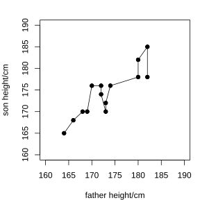
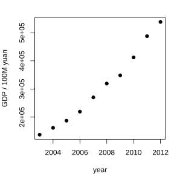
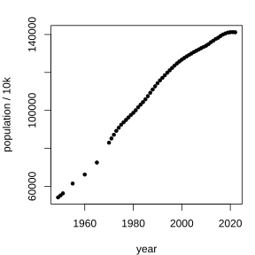

# 作业 89

> **定义 8.2.1** (一元线性回归模型)  关于 $x$ 和随机变量 $Y$ 的一元线性回归模型为

$$
\begin{cases}Y=bx+a+e,\\ E\left(e\right)=0,\ D\left(e\right)=\sigma^2\end{cases}
$$

其中 $x$ 是解释变量 (自变量), $Y$ 是响应变量 (因变量), $a$ 和 $b$ 为模型的未知参数, $e$ 是随机误差.

> **定义 8.2.2** (最小二乘法)  对 $n$ 对成对样本数据 $\left(x_i,y_i\right)\left(i=1,2,\cdots,n\right)$, 称

$$
Q\left(a,b\right)=\sum_{i=1}^{n}\left(y_i-bx_i-a\right)^2
$$

为残差平方和, 使 $Q\left(a,b\right)$ 达到最小的 $a$ 和 $b$ 的估计方法称为最小二乘法.

> **常用结论 8.2.3** (最小二乘估计公式)  由最小二乘法可得

$$
\hat b=\frac{\sum_{i=1}^{n}\left(x_i-\bar x\right)\left(y_i-\bar y\right)}{\sum_{i=1}^{n}\left(x_i-\bar x\right)^2},\qquad \hat a=\bar y-\hat b\bar x.
$$

> **定义 8.2.4** (经验回归方程)  由最小二乘估计得到的方程

$$
\hat y=\hat b x+\hat a
$$

称为 $y$ 关于 $x$ 的经验回归方程.

> **定义 8.2.5** (残差)  观测值 $y_i$ 减去预测值 $\hat y_i$ 所得的差 $e_i=y_i-\hat y_i$ 称为相应于点 $\left(x_i,y_i\right)$ 的残差.

> **常用结论 8.2.6** (决定系数)  用决定系数

$$
R^2=1-\frac{\sum_{i=1}^{n}\left(y_i-\hat y_i\right)^2}{\sum_{i=1}^{n}\left(y_i-\bar y\right)^2}
$$

度量回归直线的拟合效果, $R^2$ 越大, 残差平方和越小, 模型的拟合效果越好.

> **常用结论 8.2.7** (回归预测的注意事项)  (1) 回归方程只适用于所研究的样本的总体; (2) 样本的取值范围会影响回归方程的适用范围; (3) 时间会影响回归方程的适用性; (4) 利用回归方程得到的预测值只是一个估计值.

### 练习一

(练习 8.2 第 1 题) 说明函数模型与回归模型的区别, 并分别举出一个函数模型和回归模型的例子.

### 解答 练习一

由**定义 8.2.1** (一元线性回归模型).

函数模型描述的是两个变量之间的确定性关系, 当自变量的值确定时, 因变量的值由函数式唯一确定, 不包含随机误差.

回归模型描述的是两个变量之间的相关关系, 由**定义 8.2.1** (一元线性回归模型), $Y=bx+a+e$, 其中除了 $x$ 的线性影响 $bx+a$ 之外, 还含有随机误差 $e$, 自变量 $x$ 确定后, 因变量 $Y$ 的值并不能唯一确定, 而是在一个估计值附近随机波动.

例如, 正方形的面积 $S$ 与边长 $l$ 之间满足 $S=l^2$, 这是函数模型; 而人的身高与体重之间的关系, 由**定义 8.2.1** (一元线性回归模型) 用回归模型刻画, 是回归模型. $\blacksquare$

### 练习二

(练习 8.2 第 2 题) 在一元线性回归模型 $\left(1\right)$ 中, 参数 $b$ 的含义是什么?

### 解答 练习二

由**定义 8.2.1** (一元线性回归模型).

在一元线性回归模型 $Y=bx+a+e$ 中, 参数 $b$ 是直线的斜率, 它表示解释变量 $x$ 每增加 $1$ 个单位时, 响应变量 $Y$ 的均值平均增加的单位数, 即刻画 $x$ 对 $Y$ 的线性影响的方向和大小. $\blacksquare$

### 练习三

(练习 8.2 第 3 题) 将图 $8.2-1$ 中的点按父亲身高的大小次序用折线连起来. 你能发现折线图呈现出什么规律? 它与散点图相比, 哪一个更直观地呈现出两个变量之间的关系?

{width=50%}

### 解答 练习三

由**定义 8.2.1** (一元线性回归模型).

按父亲身高从小到大的次序用折线把各点连起来后, 折线整体呈现出从左下到右上的上升趋势, 即父亲身高增加时, 女儿身高的取值总体上也随之增加.

折线图能够看出女儿身高随父亲身高变化的大体走向, 但点与点之间的连线带有一定的人为性; 散点图则把每一对数据作为一个点直接呈现, 能更直观地看出数据的分布规律和两个变量之间相关关系的类型, 因此散点图更直观地呈现出两个变量之间的关系. $\blacksquare$

### 练习四

(练习 8.2 第 1 题) 对一元线性回归模型参数 $a$ 和 $b$ 的估计中, 有人认为, 因为 $\bar y=\hat b\bar x+\hat a$, 所以点 $\left(\bar x,\bar y\right)$ 一定在回归直线上. 你认为这种说法正确吗?

### 解答 练习四

由**常用结论 8.2.3** (最小二乘估计公式).

这种说法正确.

由**常用结论 8.2.3** (最小二乘估计公式), $\hat a=\bar y-\hat b\bar x$, 即 $\bar y=\hat b\bar x+\hat a$.

把 $x=\bar x$ 代入经验回归方程 $\hat y=\hat b x+\hat a$ (**定义 8.2.4**), 得

$$
\hat y=\hat b\bar x+\hat a=\bar y.
$$

故点 $\left(\bar x,\bar y\right)$ 的坐标满足经验回归方程, 一定在回归直线上. $\blacksquare$

### 练习五

(练习 8.2 第 2 题) 假如女儿身高 $y$ 关于父亲身高 $x$ 的经验回归方程为 $\hat y=0.81x+25.82$, 父亲的身高为 $175\,\mathrm{cm}$, 请预测他女儿的身高.

### 解答 练习五

由**定义 8.2.4** (经验回归方程).

把 $x=175$ 代入经验回归方程 $\hat y=0.81x+25.82$, 得

$$
\hat y=0.81\times 175+25.82=167.57.
$$

故预测他女儿的身高为 $167.57\,\mathrm{cm}$. $\blacksquare$

### 练习六

(练习 8.2 第 3 题) 根据 $8.1.1$ 节表 $8.1-1$ 中的数据, 建立人体的脂肪含量关于年龄的经验回归方程, 并描述所求得的回归直线与散点图的配合情况.

### 解答 练习六

由**常用结论 8.2.3** (最小二乘估计公式) 及**定义 8.2.4** (经验回归方程).

由表 $8.1-1$ 中的 $14$ 对数据, 计算得

$$
\bar x\approx 48.07,\qquad \bar y\approx 27.26.
$$

由**常用结论 8.2.3** (最小二乘估计公式),

$$
\hat b=\frac{\sum_{i=1}^{14}\left(x_i-\bar x\right)\left(y_i-\bar y\right)}{\sum_{i=1}^{14}\left(x_i-\bar x\right)^2}\approx 0.576,
$$

$$
\hat a=\bar y-\hat b\bar x\approx -0.448.
$$

故由**定义 8.2.4** (经验回归方程), 人体的脂肪含量关于年龄的经验回归方程为

$$
\hat y=0.576x-0.448.
$$

回归直线的斜率为正, 与散点图从左下到右上的上升趋势一致, 散点大致分布在这条直线附近, 直线与散点图配合较好. $\blacksquare$

### 练习七

(练习 8.2 第 4 题) 计算表 $8.2-2$ 中的所有残差之和. 你能发现什么规律?

### 解答 练习七

由**定义 8.2.5** (残差) 及**常用结论 8.2.3** (最小二乘估计公式).

表 $8.2-2$ 中各残差分别为 $1.057$, $4.413$, $-4.104$, $-0.748$, $3.345$, $2.735$, $-1.977$, $0.735$, $0.091$, $-0.231$, $-3.655$, $-2.104$, $-1.553$, $2.023$.

由**定义 8.2.5** (残差), 它们的和为

$$
\sum_{i=1}^{14}e_i\approx 0.
$$

规律: 由**常用结论 8.2.3** (最小二乘估计公式), $\hat a=\bar y-\hat b\bar x$, 故

$$
\sum_{i=1}^{n}\left(y_i-\hat y_i\right)=\sum_{i=1}^{n}\left[y_i-\left(\hat b x_i+\hat a\right)\right]=\sum_{i=1}^{n}y_i-n\hat b\bar x-n\hat a=n\bar y-n\hat b\bar x-n\hat a=0.
$$

即由最小二乘法得到的经验回归方程, 其所有残差之和恰好为 $0$. $\blacksquare$

### 练习八

(练习 8.2 第 5 题) 假设变量 $x$ 与变量 $Y$ 的 $n$ 对观测数据 $\left(x_i,y_i\right)$ 满足一元线性回归模型 $Y=bx+e$, 即回归直线的截距为 $0$, 且 $E\left(e\right)=0$, $D\left(e\right)=\sigma^2$. 请写出参数 $b$ 的最小二乘估计.

### 解答 练习八

由**定义 8.2.2** (最小二乘法).

此时残差平方和为

$$
Q\left(b\right)=\sum_{i=1}^{n}\left(y_i-bx_i\right)^2.
$$

由**定义 8.2.2** (最小二乘法), 取使 $Q\left(b\right)$ 最小的 $b$. 将 $Q\left(b\right)$ 展开并对 $b$ 求导, 令其等于 $0$, 得

$$
-2\sum_{i=1}^{n}\left(y_i-bx_i\right)x_i=0,
$$

即

$$
\sum_{i=1}^{n}x_i y_i-b\sum_{i=1}^{n}x_i^2=0.
$$

故参数 $b$ 的最小二乘估计为

$$
\hat b=\frac{\sum_{i=1}^{n}x_i y_i}{\sum_{i=1}^{n}x_i^2}.
$$

$\blacksquare$

### 练习九

(练习 8.2 第 1 题) 在回归分析中, 分析残差能够帮助我们解决哪些问题?

### 解答 练习九

由**定义 8.2.5** (残差).

由**定义 8.2.5** (残差), 残差是观测值减去预测值所得的差. 分析残差可以帮助我们:

(1) 判断所选用的模型是否合适: 若残差图中残差点比较均匀地分布在一条以 $0$ 为中心的水平带状区域内, 说明选用的线性模型比较合适; 若残差点呈现出某种明显的曲线趋势, 则说明选用线性模型不合适.

(2) 发现数据中的异常值: 残差明显偏大的点可能是异常数据.

(3) 判断误差的方差是否恒定: 若残差图中残差的带状区域宽度随 $x$ 变化, 说明随机误差的方差不恒定, 模型的方差假设可能不成立.

(4) 比较不同模型的拟合效果: 残差平方和越小, 拟合效果越好. $\blacksquare$

### 练习十

(练习 8.2 第 2 题) $2003$ 至 $2012$ 年我国的国内生产总值 ($\mathrm{GDP}$) 的数据如下表所示.

| 年份 | $2003$ | $2004$ | $2005$ | $2006$ | $2007$ | $2008$ | $2009$ | $2010$ | $2011$ | $2012$ |
|---|---|---|---|---|---|---|---|---|---|---|
| $\mathrm{GDP}$/亿元 | $137422.0$ | $161840.2$ | $187318.9$ | $219438.5$ | $270092.3$ | $319244.6$ | $348517.7$ | $412119.3$ | $487940.2$ | $538580.0$ |

(1) 作 $\mathrm{GDP}$ 关于年份的散点图;

(2) 建立 $\mathrm{GDP}$ 关于年份的经验回归方程;

(3) 描述回归直线与散点图中数据配合的情况;

(4) 预测 $2023$ 年我国的 $\mathrm{GDP}$;

(5) 你所预测的 $2023$ 年的 $\mathrm{GDP}$ 与实际值吻合吗? 请说明原因.

{width=50%}

### 解答 练习十

由**常用结论 8.2.3** (最小二乘估计公式), **定义 8.2.4** (经验回归方程) 及**常用结论 8.2.7** (回归预测的注意事项).

(1) 以年份为横轴, $\mathrm{GDP}$ 为纵轴作散点图, 散点从左下到右上近似呈一条直线上升.

(2) 由数据计算得年份均值 $\bar x=2007.5$, $\mathrm{GDP}$ 均值 $\bar y=308251.4$, 由**常用结论 8.2.3** (最小二乘估计公式) 得

$$
\hat b\approx 45172.8,\qquad \hat a\approx -90376168.
$$

故 $\mathrm{GDP}$ 关于年份的经验回归方程为

$$
\hat y=45172.8x-90376168.
$$

(3) 回归直线斜率为正, 与散点图的上升趋势一致, 散点大致分布在直线附近, 配合情况较好.

(4) 把 $x=2023$ 代入经验回归方程, 得

$$
\hat y=45172.8\times 2023-90376168\approx 1008430.
$$

即预测 $2023$ 年我国的 $\mathrm{GDP}$ 约为 $1008430$ 亿元.

(5) 由**常用结论 8.2.7** (回归预测的注意事项), 回归方程只适用于所研究的样本的总体, 且样本的取值范围会影响回归方程的适用范围. 所建回归方程是根据 $2003$ 至 $2012$ 年的数据得到的, 而 $2023$ 年距离样本区间已较远, 经济发展受政策, 外部环境等多种因素影响, 因此预测值与实际值一般不会吻合. $\blacksquare$

### 习题一

(习题 8.2 复习巩固第 1 题) 如果散点图中所有的散点都落在一条斜率为非 $0$ 的直线上, 请回答下列问题:

(1) 两个变量的相关关系是函数关系还是相关关系?

(2) 解释变量和响应变量的线性相关系数是多少?

### 解答 习题一

由**常用结论 8.1.6** (样本相关系数的性质) 及**定义 8.2.1** (一元线性回归模型).

(1) 由**常用结论 8.1.6** (样本相关系数的性质), 当 $\left|r\right|=1$ 时, 成对样本数据恰好落在一条直线上. 此时由散点的分布规律, 一个变量的值确定后, 另一个变量的值也随之唯一确定, 故两个变量之间是函数关系.

(2) 由**常用结论 8.1.6** (样本相关系数的性质), 散点落在一条斜率为非 $0$ 的直线上时, 样本相关系数的绝对值为 $1$; 当直线斜率为正时 $r=1$, 当直线斜率为负时 $r=-1$. 故解释变量和响应变量的样本相关系数为 $1$ 或 $-1$. $\blacksquare$

### 习题二

(习题 8.2 复习巩固第 2 题) 一个车间为了规定工时定额, 需要确定加工零件所花费的时间, 为此进行了 $10$ 次试验. 测得的数据如下:

| 零件数 $x$/个 | $10$ | $20$ | $30$ | $40$ | $50$ | $60$ | $70$ | $80$ | $90$ | $100$ |
|---|---|---|---|---|---|---|---|---|---|---|
| 加工时间 $y$/$\min$ | $62$ | $68$ | $75$ | $81$ | $89$ | $95$ | $102$ | $108$ | $115$ | $122$ |

(1) $y$ 与 $x$ 是否具有线性相关关系?

(2) 如果 $y$ 与 $x$ 具有线性相关关系, 求经验回归方程.

(3) 根据求出的经验回归方程, 预测加工 $200$ 个零件需要花费多少时间.

### 解答 习题二

由**常用结论 8.1.6** (样本相关系数的性质), **常用结论 8.2.3** (最小二乘估计公式) 及**定义 8.2.4** (经验回归方程).

(1) 以零件数为横轴, 加工时间为纵轴作散点图, 散点从左下到右上近似呈一条直线. 由数据计算得样本相关系数 $r\approx 0.9998$, 由**常用结论 8.1.6** (样本相关系数的性质), $r$ 非常接近 $1$, 故 $y$ 与 $x$ 具有很强的正线性相关关系.

(2) 由数据计算得 $\bar x=55$, $\bar y=91.7$, 由**常用结论 8.2.3** (最小二乘估计公式) 得

$$
\hat b\approx 0.668,\qquad \hat a\approx 54.93.
$$

故由**定义 8.2.4** (经验回归方程), 经验回归方程为

$$
\hat y=0.668x+54.93.
$$

(3) 把 $x=200$ 代入经验回归方程, 得

$$
\hat y=0.668\times 200+54.93\approx 188.5.
$$

故预测加工 $200$ 个零件需要花费约 $188.5\,\min$. $\blacksquare$

### 习题三

(习题 8.2 复习巩固第 3 题) 根据 $8.1.2$ 节例 $2$ 中某城市居民年收入与 $A$ 商品销售额的数据, 回答下列问题:

(1) 建立 $A$ 商品销售额关于居民年收入的经验回归方程;

(2) 如果某居民年收入 $40$ 万元, 预测该家庭 $A$ 商品的销售额.

### 解答 习题三

由**常用结论 8.2.3** (最小二乘估计公式) 及**定义 8.2.4** (经验回归方程).

(1) 由例 $2$ 中 $10$ 对数据计算得, 居民年收入均值 $\bar x=38.96$, $A$ 商品销售额均值 $\bar y=39.1$, 由**常用结论 8.2.3** (最小二乘估计公式) 得

$$
\hat b\approx 1.447,\qquad \hat a\approx -15.84.
$$

故由**定义 8.2.4** (经验回归方程), $A$ 商品销售额关于居民年收入的经验回归方程为

$$
\hat y=1.447x-15.84.
$$

(2) 把 $x=40$ 代入经验回归方程, 得

$$
\hat y=1.447\times 40-15.84\approx 42.04.
$$

故预测该家庭 $A$ 商品的销售额约为 $42.04$ 万元. $\blacksquare$

### 习题四

(习题 8.2 综合运用第 4 题) 人口问题是制约我国发展的关键因素之一. 下表是我国 $1949$ 至 $2022$ 年人口总数变化情况.

(表中列出了 $1949$ 年至 $2022$ 年逐年的人口总数/万人.)

(1) 作人口总数关于年份的散点图;

(2) 建立人口总数 (万人) 关于年份的经验回归方程 $\hat y=\hat b x+\hat a$;

(3) 预测 $2023$ 年我国的人口总数, 并与网上公布的 $2023$ 年我国人口总数相比较.

{width=50%}

### 解答 习题四

由**常用结论 8.2.3** (最小二乘估计公式), **定义 8.2.4** (经验回归方程) 及**常用结论 8.2.7** (回归预测的注意事项).

(1) 以年份为横轴, 人口总数为纵轴作散点图, 散点整体从左下到右上近似呈一条直线.

(2) 由表中数据计算得年份均值 $\bar x\approx 1985.6$, 人口总数均值 $\bar y\approx 103511$, 由**常用结论 8.2.3** (最小二乘估计公式) 得

$$
\hat b\approx 1249.2,\qquad \hat a\approx -2375604.
$$

故由**定义 8.2.4** (经验回归方程), 人口总数关于年份的经验回归方程为

$$
\hat y=1249.2x-2375604.
$$

(3) 把 $x=2023$ 代入经验回归方程, 得

$$
\hat y=1249.2\times 2023-2375604\approx 151453.
$$

即预测 $2023$ 年我国人口总数约为 $151453$ 万人. 由**常用结论 8.2.7** (回归预测的注意事项), 人口总数受国家生育政策, 人口发展规律等因素影响, 近年来人口增长趋势已发生变化, 由较早年份数据建立的线性回归方程预测较远年份, 预测值会明显大于网上公布的 $2023$ 年我国人口总数. $\blacksquare$

### 习题五

(习题 8.2 综合运用第 5 题) 在某地区的一段时间内观测到的不小于某震级 $x$ 的地震数 $N$ 的数据如下表所示:

| $x$ | $3.0$ | $3.2$ | $3.4$ | $3.6$ | $3.8$ | $4.0$ | $4.2$ | $4.4$ | $4.6$ | $4.8$ | $5.0$ |
|---|---|---|---|---|---|---|---|---|---|---|---|
| $N$ | $28381$ | $20380$ | $14795$ | $10695$ | $7641$ | $5502$ | $3842$ | $2698$ | $1919$ | $1356$ | $973$ |
| $x$ | $5.2$ | $5.4$ | $5.6$ | $5.8$ | $6.0$ | $6.2$ | $6.4$ | $6.6$ | $6.8$ | $7.0$ | |
| $N$ | $746$ | $604$ | $435$ | $274$ | $206$ | $148$ | $98$ | $57$ | $41$ | $25$ | |

科学家根据实验得到地震震级与地震次数的关系为 $\lg N=a+bx$. 试根据上表数据, 利用一元线性回归模型求出 $a$ 和 $b$ 的值.

### 解答 习题五

由**常用结论 8.2.3** (最小二乘估计公式) 及**定义 8.2.4** (经验回归方程).

令 $Y=\lg N$, 则关系式 $\lg N=a+bx$ 即为一元线性回归模型 $Y=bx+a$.

对表中各数据取常用对数, 得 $Y_i=\lg N_i$. 由数据计算得 $\bar x=5.0$, $\bar Y\approx 2.95$, 由**常用结论 8.2.3** (最小二乘估计公式) 得

$$
\hat b\approx -0.74,\qquad \hat a\approx 6.70.
$$

故由**定义 8.2.4** (经验回归方程),

$$
\lg N=6.70-0.74x.
$$

即 $a\approx 6.70$, $b\approx -0.74$. $\blacksquare$

### 习题六

(习题 8.2 拓广探索第 6 题) 生活中有许多变量之间的关系是值得我们去研究的. 例如, 关于我们自己的身高与体重之间是否存在某种相关关系呢? 请收集自己, 同学, 朋友, 家人等至少 $20$ 个人的身高与体重数据, 利用本节课学习的相关关系和回归分析的知识, 画出所收集数据的散点图, 建立体重关于身高的经验回归方程, 并分析回归模型的拟合情况.

### 解答 习题六

由**定义 8.1.5** (样本相关系数), **常用结论 8.2.3** (最小二乘估计公式) 及**定义 8.2.4** (经验回归方程).

本题为开放性实践问题, 解答的一般步骤为:

(1) 收集至少 $20$ 个人的身高 $x$ (单位 $\mathrm{cm}$) 与体重 $y$ (单位 $\mathrm{kg}$) 的成对数据;

(2) 以身高为横轴, 体重为纵轴画出散点图, 观察散点是否呈现从左下到右上的趋势;

(3) 由**定义 8.1.5** (样本相关系数) 计算样本相关系数 $r$, 判断体重与身高之间是否存在线性相关关系及其强弱;

(4) 由**常用结论 8.2.3** (最小二乘估计公式) 计算 $\hat b$ 和 $\hat a$, 由**定义 8.2.4** (经验回归方程) 写出体重关于身高的经验回归方程 $\hat y=\hat b x+\hat a$;

(5) 画出残差图, 由**定义 8.2.5** (残差) 观察残差点是否均匀地分布在以 $0$ 为中心的水平带状区域内, 分析回归模型的拟合情况. $\blacksquare$

### 阅读与思考一

(思考 1) 请你进一步查阅资料, 了解回归与相关的发展和应用.

### 解答 阅读与思考一

由**定义 8.2.1** (一元线性回归模型) 及**定义 8.1.5** (样本相关系数).

回归与相关的思想最早由英国生物学家高尔顿在研究父子身高遗传问题时提出, 他发现父亲身高很高时儿子身高有向平均身高回归的趋势, 由此提出了 "回归" 的概念. 后来皮尔逊等人发展了相关系数的理论, 使相关与回归分析成为统计学的重要方法.

由**定义 8.1.5** (样本相关系数) 与**定义 8.2.1** (一元线性回归模型), 相关分析用于度量两个变量之间线性相关的方向和强弱, 回归分析则用于建立一个变量关于另一个变量的数学表达式, 进而进行预测和控制. 如今回归与相关的方法已广泛应用于经济, 医学, 农业, 工业等各个领域. $\blacksquare$
